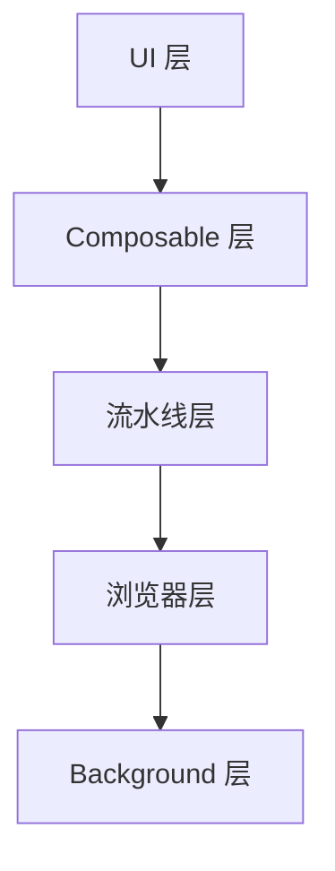
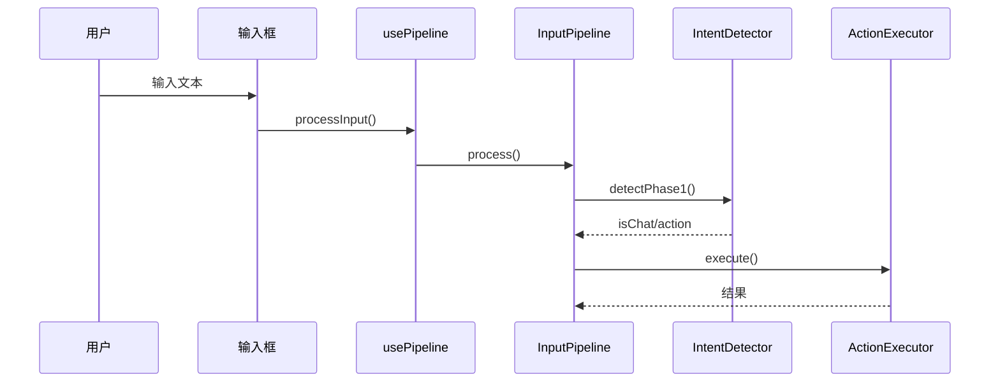
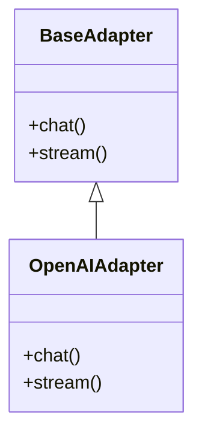

# 更新架构文档

自动生成整个项目的全面架构文档。

---

## 使用场景

* 每天工作完成后，记录最新的架构
* 新成员入职时
* 审查项目结构时
* 重大重构后

---

## 功能说明

1. **扫描** 整个项目代码库（`src/`、`entrypoints/`）
2. **识别** 所有功能模块
3. **生成** 每个模块的详细架构文档
4. **创建** 总体架构概览
5. **输出** 到 `docs/architecture/` 目录

---

## 输出结构

```
docs/architecture/
├── README.md                    # 总体架构概览
├── browser-command.md           # 浏览器命令执行架构
├── input-pipeline.md            # 输入处理流水线架构
├── ai-adapters.md               # AI 适配器架构
├── state-management.md          # 状态管理架构（Pinia stores）
├── background-service.md        # Background Service Worker 架构
├── content-script.md            # Content Script + Vue 组件架构
├── translation.md               # 翻译功能架构
├── voice.md                     # 语音功能架构
└── storage.md                   # 存储架构
```

---

## 文档格式

每个文档包含以下结构：

1. **目标** — 这个模块做什么
2. **架构概览** — 分层架构图（Mermaid）
3. **核心设计决策** — 关键选择和原因
4. **详细实现** — 每个部分如何工作
5. **数据流** — 序列图/流程图（Mermaid）
6. **关键方法签名** — 重要 API
7. **错误处理** — 如何处理错误
8. **目录结构** — 文件组织

---

## 使用方法

调用 skill：

```
/update-architecture-docs
```

---

## 实现步骤

当 skill 被调用时，按以下步骤执行：

### 第一步：创建输出目录

```bash
mkdir -p docs/architecture
```

### 第二步：扫描项目结构

识别所有模块，扫描：
- `src/` — 所有子目录（adapters、automation、browser、composables、input、storage、stores、utils、voice）
- `entrypoints/` — background.ts 和 content/ 目录

### 第三步：生成总体架构（README.md）

对于 `docs/architecture/README.md`：

1. **读取** `package.json` 了解项目依赖
2. **读取** `entrypoints/background.ts` 了解 Background Service Worker
3. **读取** `entrypoints/content/index.ts` 了解 Content Script 入口
4. **读取** `entrypoints/content/App.vue` 了解 Vue 应用结构
5. **生成** 总体架构文档，包含：
   - 项目概述
   - 分层架构图（Mermaid）
   - 模块列表和描述
   - 数据流概览
   - 关键设计决策

### 第四步：生成模块文档

为每个模块创建文档：

#### 4.1 browser-command.md（浏览器命令执行）

**读取文件：**
- `src/browser/types.ts`
- `src/browser/skeleton.ts`
- `src/browser/action-executor.ts`
- `src/browser/local-html.ts`
- `src/browser/index.ts`

**生成内容：**
- 目标：浏览器命令执行系统
- 架构：语义骨架 → 命令解析 → 动作执行
- 设计决策：无缓存、流式单命令执行、三重元素定位
- 数据流图
- 关键方法签名

#### 4.2 input-pipeline.md（输入处理流水线）

**读取文件：**
- `src/input/types.ts`
- `src/input/router.ts`
- `src/input/intent-detector.ts`
- `src/input/pipeline.ts`
- `src/input/tag-parser.ts`
- `src/input/prompts.ts`
- `src/input/index.ts`

**生成内容：**
- 目标：输入处理流水线
- 架构：路由器 → 阶段1（意图检测）→ 阶段2（流式执行）
- 设计决策：两阶段处理、流式单命令、重试机制
- 数据流图
- 关键方法签名

#### 4.3 ai-adapters.md（AI 适配器）

**读取文件：**
- `src/adapters/base.ts`
- `src/adapters/openai.ts`
- `src/adapters/qwen.ts`
- `src/adapters/wenxin.ts`
- `src/adapters/gemini.ts`
- `src/adapters/doubao.ts`
- `src/adapters/proxy.ts`
- `src/adapters/index.ts`

**生成内容：**
- 目标：AI 提供者抽象层
- 架构：BaseAdapter → 具体适配器 → CORS 代理
- 设计决策：工厂模式、Background 代理流式传输
- 数据流图
- 关键方法签名

#### 4.4 state-management.md（状态管理）

**读取文件：**
- `src/stores/settings.ts`
- `src/stores/conversations.ts`
- `src/stores/voice.ts`

**生成内容：**
- 目标：全局状态管理
- 架构：Pinia stores + 跨标签页同步
- 设计决策：Chrome storage sync、响应式状态
- 数据流图
- 关键方法签名

#### 4.5 background-service.md（Background Service Worker）

**读取文件：**
- `entrypoints/background.ts`

**生成内容：**
- 目标：Background Service Worker
- 架构：消息处理、CORS 代理、标签页管理
- 设计决策：Manifest V3 限制、流式代理
- 数据流图
- 关键方法签名

#### 4.6 content-script.md（Content Script）

**读取文件：**
- `entrypoints/content/index.ts`
- `entrypoints/content/App.vue`
- `entrypoints/content/components/` 下的所有文件

**生成内容：**
- 目标：Content Script + Vue UI
- 架构：Shadow DOM → Vue 应用 → 组件
- 设计决策：Shadow DOM 隔离、Vue 3 Composition API
- 数据流图
- 组件层次结构

#### 4.7 translation.md（翻译功能）

**读取文件：**
- `src/browser/translate-service.ts`
- `src/browser/translate-popup.ts`
- `src/browser/translate-click.ts`
- `src/browser/translate-parser.ts`

**生成内容：**
- 目标：翻译功能
- 架构：选区检测 → API 调用 → 弹窗显示
- 设计决策：多翻译提供者、内联显示
- 数据流图
- 关键方法签名

#### 4.8 voice.md（语音功能）

**读取文件：**
- `src/voice/` 目录

**生成内容：**
- 目标：语音输入/输出
- 架构：Web Speech API 集成
- 设计决策：浏览器原生 API、状态管理
- 数据流图
- 关键方法签名

#### 4.9 storage.md（存储层）

**读取文件：**
- `src/storage/index.ts`

**生成内容：**
- 目标：数据持久化
- 架构：Chrome storage API 封装
- 设计决策：类型安全存储、迁移支持
- 数据流图
- 关键方法签名

### 第五步：生成 Mermaid 图表

每个文档包含：

1. **架构图** — 分层视图


2. **数据流图** — 操作序列


3. **类/模块图** — 关键接口


### 第六步：写入文档

使用 Write 工具在 `docs/architecture/` 中创建每个文档。

---

## 注意事项

* 每次运行直接覆盖（不保留历史）
* 使用 Mermaid 生成所有图表
* 专注于设计和实现，不是 API 参考
* 基于实际代码，不是设计文档
* 每个文档应该独立完整、可读
* 在有帮助的地方包含代码片段
* 保持图表简单、聚焦