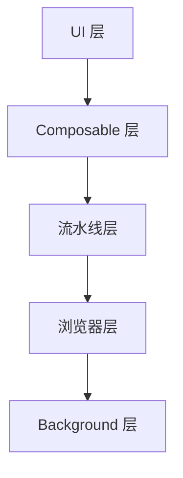
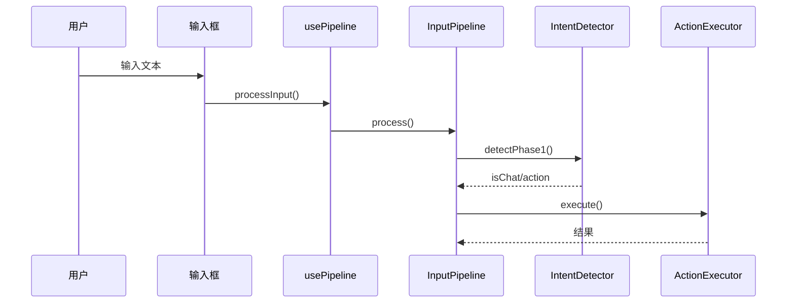
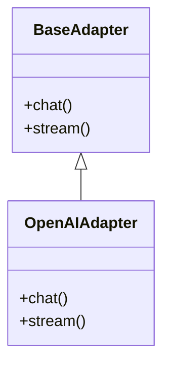

# 更新架构文档

智能生成和增量更新项目架构文档。

---

## 使用场景

* 新功能开发完成后，更新对应模块文档
* 重大重构后，刷新受影响的文档
* 新成员入职时，首次生成全套文档
* 审查项目结构时

---

## 两种模式

### 模式 A：首次全量生成

当 `docs/architecture/` 目录不存在或为空时，执行全量扫描和生成。

### 模式 B：增量更新（默认）

当 `docs/architecture/` 已存在文档时，执行增量更新：
1. 检测哪些模块的代码发生了变化
2. 只重写有变化的模块文档
3. 更新 README.md 中的模块列表（如有新增/删除模块）
4. 未变化的模块文档保持原样

---

## 模块与源文件映射

每个文档对应一组源文件。通过检查这些文件的修改时间或内容变化来决定是否需要更新。

| 文档 | 源文件 |
|------|--------|
| `README.md` | `package.json`, `entrypoints/background.ts`, `entrypoints/content/index.ts`, `entrypoints/content/App.vue`, 所有模块的关键导出文件 |
| `browser-command.md` | `src/browser/types.ts`, `src/browser/skeleton.ts`, `src/browser/action-executor.ts`, `src/browser/local-html.ts`, `src/browser/index.ts` |
| `input-pipeline.md` | `src/input/types.ts`, `src/input/router.ts`, `src/input/intent-detector.ts`, `src/input/pipeline.ts`, `src/input/tag-parser.ts`, `src/input/prompts.ts`, `src/input/index.ts` |
| `ai-adapters.md` | `src/adapters/base.ts`, `src/adapters/openai.ts`, `src/adapters/qwen.ts`, `src/adapters/wenxin.ts`, `src/adapters/gemini.ts`, `src/adapters/doubao.ts`, `src/adapters/proxy.ts`, `src/adapters/index.ts` |
| `state-management.md` | `src/stores/settings.ts`, `src/stores/conversations.ts`, `src/stores/voice.ts` |
| `background-service.md` | `entrypoints/background.ts` |
| `content-script.md` | `entrypoints/content/index.ts`, `entrypoints/content/App.vue`, `entrypoints/content/components/**/*.vue` |
| `translation.md` | `src/browser/translate-service.ts`, `src/browser/translate-popup.ts`, `src/browser/translate-click.ts`, `src/browser/translate-parser.ts` |
| `voice.md` | `src/voice/**/*` |
| `storage.md` | `src/storage/index.ts` |

---

## 实现步骤

当 skill 被调用时，按以下步骤执行：

### 第一步：判断模式

检查 `docs/architecture/` 目录：
- **不存在或为空** → 进入模式 A（全量生成）
- **已有文档** → 进入模式 B（增量更新）

### 第二步：检测变化（仅模式 B）

对每个模块，执行以下操作：

1. 使用 `git diff --name-only HEAD~1` 或检查文件内容，识别自上次文档更新以来哪些源文件发生了变化
2. 构建变化映射：`{ 文档名: [变化的源文件列表] }`
3. 如果没有检测到 git 历史，退化为全量读取源文件，与现有文档内容对比关键签名/结构是否匹配

**变化检测策略（按优先级）：**

```
策略 1: git diff（最可靠）
  - 检查 docs/architecture/ 中文档的最后 git 提交时间
  - 对比源文件在该时间之后是否有新提交
  - git log --since="<doc_last_commit_time>" -- <source_file>

策略 2: 文件修改时间对比（fallback）
  - 对比源文件的 mtime 与对应文档的 mtime
  - 源文件更新 → 需要重新生成该文档

策略 3: 内容结构对比（最终 fallback）
  - 读取现有文档中的关键方法签名
  - 读取源文件中的实际方法签名
  - 不匹配 → 需要更新
```

**向用户报告变化摘要：**
```
检测到以下模块需要更新：
  - input-pipeline.md（src/input/router.ts 新增了 redirect 方法）
  - translation.md（src/browser/translate-click.ts 重构）

以下模块无需更新：
  - browser-command.md, ai-adapters.md, state-management.md, ...
```

### 第三步：读取源文件

**模式 A：** 读取所有源文件（见模块映射表）

**模式 B：** 只读取有变化的模块对应的源文件。对于 `README.md`，始终检查是否需要更新（因为任何模块变化都可能影响总体架构概览）。

### 第四步：生成/更新文档

#### 4.1 README.md（总体架构概览）

**首次生成时包含：**
- 项目概述
- 技术栈
- 分层架构图（Mermaid）
- 模块列表和描述
- 数据流概览
- 关键设计决策

**增量更新时：**
- 更新模块列表（新增/删除/描述变化的模块）
- 更新分层架构图（如有结构变化）
- 保留未变化部分的原文

#### 4.2 模块文档（browser-command.md 等）

每个文档的标准结构：

1. **目标** — 这个模块做什么
2. **架构概览** — 分层架构图（Mermaid）
3. **核心设计决策** — 关键选择和原因
4. **详细实现** — 每个部分如何工作
5. **数据流** — 序列图/流程图（Mermaid）
6. **关键方法签名** — 重要 API
7. **错误处理** — 如何处理错误
8. **目录结构** — 文件组织

**增量更新策略：**

对于需要更新的模块文档，采用 **「读取现有 → 对比变化 → 局部更新」** 而非全量重写：

1. **读取现有文档** — 了解当前结构和内容
2. **读取最新源文件** — 获取当前代码
3. **识别差异点** — 哪些部分需要更新：
   - 新增的文件/类/方法 → 添加到对应章节
   - 删除的文件/类/方法 → 从文档中移除
   - 修改的方法签名 → 更新签名和说明
   - 新增的设计决策 → 追加到设计决策章节
   - 数据流变化 → 更新 Mermaid 图
4. **执行局部更新** — 只修改有变化的章节，保留其余原文

**示例：增量更新 input-pipeline.md**

```
现有文档内容：
  - 有 IntentDetector.detectPhase1() 方法签名
  - 有两阶段处理的数据流图

源码变化：
  - router.ts 新增了 redirect() 方法
  - pipeline.ts 的 process() 方法新增了 retryCount 参数

更新操作：
  - 在「关键方法签名」章节追加 redirect() 方法
  - 更新 process() 方法签名（新增参数）
  - 其余章节保持不变
```

### 第五步：生成 Mermaid 图表

每个文档包含：

1. **架构图** — 分层视图


2. **数据流图** — 操作序列


3. **类/模块图** — 关键接口


**增量更新时：** 只重新生成有变化模块的 Mermaid 图，未变化的保持原样。

### 第六步：写入文档

- **模式 A：** 使用 Write 工具创建所有文档
- **模式 B：** 使用 Edit 工具对有变化的部分进行局部修改；如果变化超过 60%，退化为 Write 全量重写该文档

### 第七步：同步根目录 README.md

每次更新架构文档后，将 `docs/architecture/README.md` 的最新内容同步到项目根目录 `README.md`。根目录 README 是项目的门面，必须与架构文档保持一致。模块链接路径使用 `./docs/architecture/` 前缀。

### 第八步：报告更新摘要

输出本次更新的总结：

```
✅ 架构文档更新完成

更新模式：增量更新
更新文档：input-pipeline.md, translation.md
跳过文档：browser-command.md, ai-adapters.md, ...（共 6 个）
README.md：已更新模块列表

变更详情：
  input-pipeline.md:
    + 新增 redirect() 方法文档
    ~ 更新 process() 方法签名
    ~ 更新数据流图

  translation.md:
    + 新增 click-translate 模块说明
    ~ 重构架构图
```

---

## 文档质量要求

* 使用 Mermaid 生成所有图表
* 专注于设计和实现，不是 API 参考
* 基于实际代码，不是设计文档
* 每个文档应该独立完整、可读
* 在有帮助的地方包含代码片段
* 保持图表简单、聚焦
* 增量更新时保留原文的措辞风格，只改有变化的部分

---

## 特殊情况处理

### 新增模块

当发现源码中有新的模块目录（如 `src/new-module/`）但 `docs/architecture/` 中没有对应文档时：
1. 自动为新模块生成完整文档
2. 在 README.md 中添加模块条目

### 删除模块

当 `docs/architecture/` 中有文档但对应源码目录已不存在时：
1. 自动删除该孤立文档
2. 从 README.md 中移除对应条目

### 无法判断变化

如果 git diff 和文件修改时间都无法判断（如新 clone 的仓库），退化为全量对比模式：读取每个模块的源文件，与现有文档的关键方法签名对比，有差异则更新。
