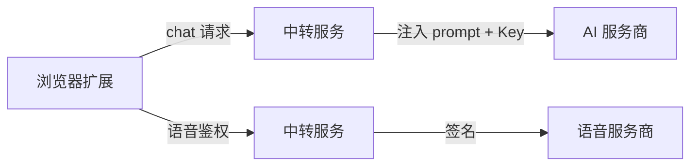

# PRD：中转保护 + JS 混淆 + 国内外双分发

## 1. 背景与目标

### 1.1 背景

当前项目（AI 浏览器助手）需要对外分发，面临以下问题：

- **源码泄露风险**：crx 解压就是 JS，prompt 模板和业务逻辑明文暴露
- **API Key 暴露风险**：用户自带 Key 或内置 Key 直接出现在请求中
- **分发渠道差异**：海外走 Chrome Web Store，国内需要 zip 手动安装

### 1.2 目标

1. **核心逻辑零泄露**：prompt 与关键业务逻辑通过中转服务保护
2. **源码高强度混淆 + 版本轮转**：每次发布重新混淆，旧版破解工具失效
3. **零业务服务器**：使用 Cloudflare Worker / 腾讯云函数中转，不维护业务后端
4. **Chrome Web Store 兼容**：所有方案符合商店审核政策
5. **国内外双分发**：海外版上架 Chrome Web Store，国内版提供 zip

### 1.3 已接受的硬短板

- 没有服务端校验 = 前端限制都能被改 JS 绕过（混淆可提高逆向门槛）
- crx 解压就是 JS，只能提高逆向成本，做不到 100% 防泄露
- 无法实现真正自动更新（Chrome Web Store 自带更新机制解决此问题）

---

## 2. 架构设计

### 2.1 整体架构



- 扩展只发送用户文本和必要参数，不包含 prompt 与 API Key
- 中转服务负责注入 prompt、签名和上游调用
- 海外版连接 Cloudflare Worker，国内版连接腾讯云函数

### 2.2 中转协议

请求体：

```json
{
  "action": "chat",
  "data": { "userText": "用户输入" }
}
```

响应体：

```json
{
  "ok": true,
  "data": { "content": "AI 回复" }
}
```

流式响应使用 SSE，格式与现有 AI 适配器兼容。

### 2.3 环境切换

| 环境 | 中转地址 | 用途 |
|------|----------|------|
| 海外 | Cloudflare Worker | Chrome Web Store 版本 |
| 国内 | 腾讯云函数 | zip 分发版本 |

通过 `.env.overseas` / `.env.domestic` 切换，构建时注入 `VITE_PROXY_URL`。

---

## 3. 实现范围

### 3.1 中转服务

- `workers/ai-proxy.js`：Cloudflare Worker 实现
- `tencent-scf/index.js`：腾讯云函数实现（复用 Worker 逻辑）
- 服务端保存 prompt 模板与内置 API Key
- 校验请求来源与参数格式

### 3.2 扩展端改造

- `src/input/intent-detector.ts`：AI 调用改走中转
- `src/input/pipeline.ts`：流式调用改走中转
- `src/voice/voice-manager.ts`：讯飞鉴权改走中转
- `src/stores/voice.ts`：移除不再需要的密钥配置
- `src/utils/proxy-client.ts`：统一中转客户端

### 3.3 JS 混淆

- 使用 esbuild 压缩 + mangle
- 禁止 `javascript-obfuscator` 的 `selfDefending` / `debugProtection`
- 每次发布重新构建，避免旧版工具直接复用

### 3.4 双版本分发

- 海外版：Chrome Web Store
- 国内版：Cloudflare R2 / 蓝奏云 zip
- 两个版本功能一致，仅中转地址不同

---

## 4. 验收标准

### 中转保护

- [ ] DevTools Network 中请求体不包含 prompt
- [ ] 请求体不包含 API Key
- [ ] 海外版自动连接 Cloudflare Worker
- [ ] 国内版自动连接腾讯云函数

### JS 混淆

- [ ] 生产构建后 JS 代码可读性低
- [ ] 字符串被压缩/混淆
- [ ] 控制流被扁平化

### 语音识别

- [ ] 海外版 Web Speech API 正常工作
- [ ] 国内版讯飞 API 正常工作
- [ ] 讯飞鉴权走中转，Key 不暴露

### 用户自定义 Key

- [ ] 填写自定义 Key 后仍走中转
- [ ] prompt 仍然不暴露
- [ ] 使用用户自己的 API 额度

### 分发

- [ ] Chrome 商店审核通过（海外版）
- [ ] zip 国内版可正常安装使用
- [ ] 两个版本功能一致

---

## 5. 风险与应对

| 风险 | 影响 | 应对 |
|------|------|------|
| 中转服务被滥用 | 成本上升 | 请求限流 + 来源校验 |
| 上游服务变更 | 功能失效 | 中转层统一适配，扩展端不感知 |
| JS 混淆影响调试 | 排查困难 | 保留 debug 构建，不混淆 |
| Chrome Web Store 审核不通过 | 延迟上架 | 禁用不兼容选项，提前自测 |
| 国内外网络差异 | 连接失败 | 双中转地址 + 失败提示 |
