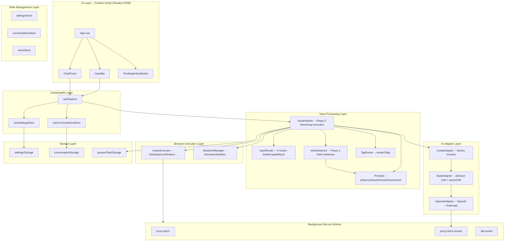
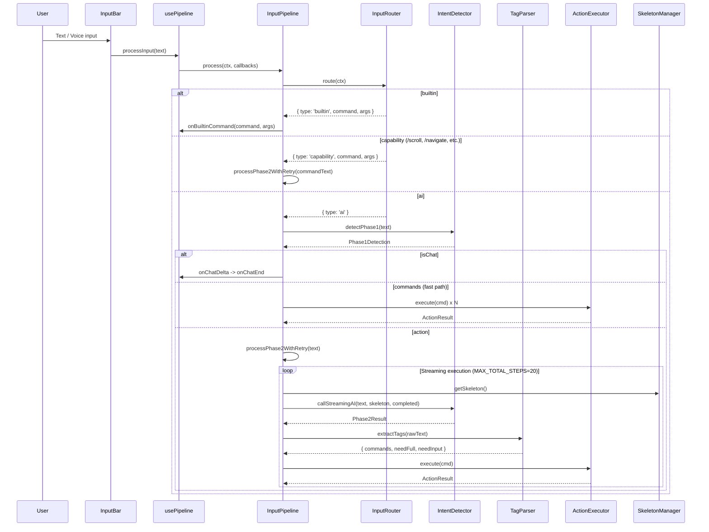
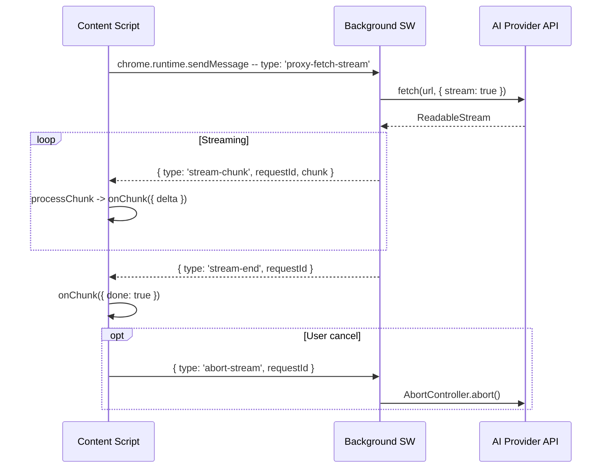

# LingBot — AI Voice Browser Assistant

> 🌐 **[中文](./README.md)**

> Chrome extension: AI Voice Browser Assistant. WXT + Vue 3 + TypeScript + Pinia, running in Shadow DOM.

**Version 1.8.3** | [User Guide](./docs/site/guide-en.md) | [Architecture](./docs/architecture/README-en.md)

## Tech Stack

| Layer | Technology | Description |
|---|---|---|
| Build | WXT (Manifest V3) | Chrome extension framework with HMR support |
| UI | Vue 3 + `<script setup>` | Composition API, Shadow DOM isolation |
| State | Pinia (setup store) | Composition API style, reactive responses |
| Types | TypeScript + `vue-tsc` | Strict type checking |
| Styles | Pure CSS (`aib-` prefix) | `src/styles/global.css`, avoids style conflicts |
| Logging | Logger -> `chrome.storage.local` | No console, unified storage logging |
| AI Adapters | Factory + Strategy pattern | 11 providers, unified `chat()` interface |
| Proxy | Background Service Worker | `proxyFetchStream` for CORS bypass |

## Architecture Layers



## Module Documentation

| Module | Document | Core Responsibility |
|---|---|---|
| Input Pipeline | [input-pipeline-en.md](./docs/architecture/input-pipeline-en.md) | Routing, Phase 1/2, tag extraction, command execution loop |
| Browser Command | [browser-command-en.md](./docs/architecture/browser-command-en.md) | Semantic skeleton, element targeting, action execution engine |
| AI Adapters | [ai-adapters-en.md](./docs/architecture/ai-adapters-en.md) | Multi-provider protocol adaptation, streaming proxy |
| Content Script | [content-script-en.md](./docs/architecture/content-script-en.md) | Shadow DOM mounting, translation init, cross-tab tasks |
| State Management | [state-management-en.md](./docs/architecture/state-management-en.md) | Pinia store, session management, cross-tab sync |
| Storage Layer | [storage-en.md](./docs/architecture/storage-en.md) | Chrome storage abstraction, persistence |
| Background Service | [background-service-en.md](./docs/architecture/background-service-en.md) | Request proxy, tab operations, streaming |
| Voice | [voice-en.md](./docs/architecture/voice-en.md) | Dual-engine recognition, state machine, TTS, command parsing |
| Translation | [translation-en.md](./docs/architecture/translation-en.md) | Selection, auto, click translation modes |
| File Parsing | [file-parsing-en.md](./docs/architecture/file-parsing-en.md) | Attachment parsing (OCR, PDF, Office), file generation |
| Voice Automation | [automation-en.md](./docs/architecture/automation-en.md) | Action execution, selector adaptation |
| Internationalization | [i18n-en.md](./docs/architecture/i18n-en.md) | Chinese/English support, responsive switching |

📖 [Architecture Overview](./docs/architecture/README-en.md)

## Core Data Flow

### User Input -> AI Chat



### Streaming Proxy Request



## Key Design Decisions

### 1. Two-Phase Intent Detection + Fast Path

Phase 1 does lightweight classification (chat / [action] / [command] / [FILE]), Phase 2 handles complex operation decisions. Operations that don't need page skeleton (navigate, scroll, keyboard) are directly output as [command] by Phase 1, skipping Phase 2 to reduce one AI call.

### 2. Semantic Skeleton Without Caching

`SkeletonManager.getSkeleton()` re-extracts interactive elements in the viewport every time. No caching, no DOM mutation monitoring — simple, reliable, never stale. MAX_SKELETON_ELEMENTS=200 limits token consumption.

### 3. Streaming Single-Command Execution + Termination Verification

Phase 2 generates only 1 command per round, feeds back the result before generating the next. The `done:1` field marks whether the final goal is achieved, and `MAX_TOTAL_STEPS=20` prevents infinite loops.

### 4. Cross-Tab Task Resumption

After navigate/click(_blank), the current step is saved to `queuedTaskStorage` (30s expiry). When the new tab finishes loading, it detects the queued task, skips Phase 1, and resumes execution directly in Phase 2.

### 5. Background Streaming Proxy

All AI API requests go through `proxyFetchStream` via Background Service Worker to bypass Content Script CORS restrictions. Uses requestId to identify streams, supports AbortSignal cancellation.

### 6. Shadow DOM Style Isolation

UI components run inside Shadow DOM, CSS class names use `aib-` prefix to avoid conflicts with host page styles.

### 7. Dual-Engine Voice Recognition

Prioritizes Sherpa-ONNX local offline recognition (WASM), falls back to Web Speech API. Local engine needs no network, supports Chinese and English.

## Directory Structure

```
entrypoints/
  background.ts              # Background Service Worker (request proxy, tab ops)
  content/
    index.ts                 # Content Script entry (Shadow DOM mounting)
    App.vue                  # Root component
    components/              # All Vue components
src/
  adapters/                  # AI adapters (factory + strategy pattern)
  automation/                # Voice automation (action execution, selectors)
  browser/                   # Browser command execution engine
  composables/               # Vue composables
  i18n/                      # Internationalization (Chinese/English)
  input/                     # Unified input processing pipeline
  storage/                   # Chrome storage abstraction layer
  stores/                    # Pinia state management
  styles/                    # Global CSS
  utils/                     # Utilities (file parsing, OCR, charts, etc.)
  voice/                     # Voice recognition and session management
  types.ts                   # Shared type definitions
```

## 📄 License

MIT
