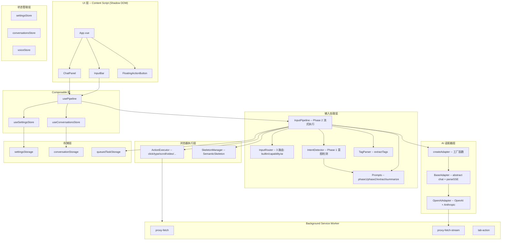
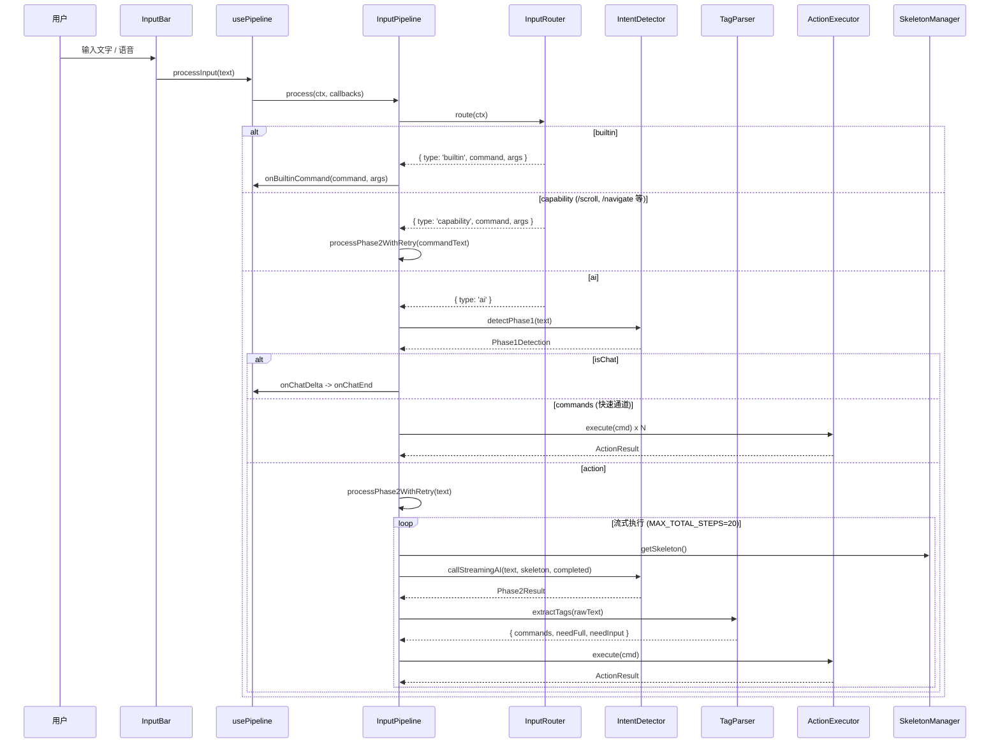
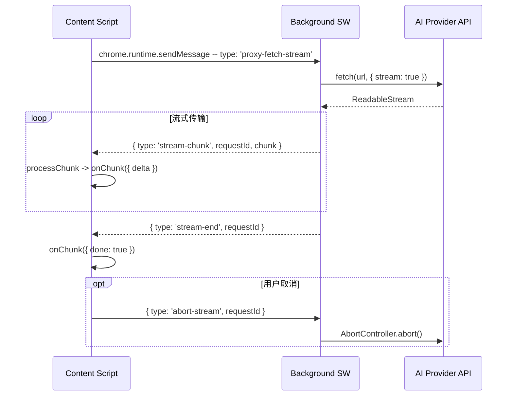

# 小灵 LingBot — AI 语音浏览器助手

> Chrome 扩展：AI 语音浏览器助手。WXT + Vue 3 + TypeScript + Pinia，运行在 Shadow DOM 中。

**Version 1.8.3** | [GitHub](https://github.com/zw123zw/ai-browser) | [使用指南](./docs/site/guide-zh.md) | [架构文档](./docs/architecture/)

## 技术栈

| 层 | 技术 | 说明 |
|---|---|---|
| 构建 | WXT (Manifest V3) | Chrome 扩展框架，支持 HMR 开发 |
| UI | Vue 3 + `<script setup>` | Composition API，Shadow DOM 隔离 |
| 状态 | Pinia (setup store) | Composition API 写法，reactive 响应 |
| 类型 | TypeScript + `vue-tsc` | 严格类型检查 |
| 样式 | 纯 CSS (`aib-` 前缀) | `src/styles/global.css`，避免样式冲突 |
| 日志 | Logger -> `chrome.storage.local` | 禁止 console，统一写入 storage |
| AI 适配器 | 工厂+策略模式 | 11 家供应商，统一 `chat()` 接口 |
| 代理 | Background Service Worker | `proxyFetchStream` 规避 CORS |

## 架构分层



## 模块文档

| 模块 | 文档 | 核心职责 |
|---|---|---|
| 输入管线 | [input-pipeline.md](./docs/architecture/input-pipeline.md) | 路由、Phase 1/2、标签提取、命令执行循环 |
| 浏览器指令 | [browser-command.md](./docs/architecture/browser-command.md) | 语义骨架、元素定位、操作执行引擎 |
| AI 适配器 | [ai-adapters.md](./docs/architecture/ai-adapters.md) | 多供应商协议适配、流式代理 |
| Content Script | [content-script.md](./docs/architecture/content-script.md) | Shadow DOM 挂载、翻译初始化、跨标签页任务 |
| 状态管理 | [state-management.md](./docs/architecture/state-management.md) | Pinia store、会话管理、跨标签页同步 |
| 存储层 | [storage.md](./docs/architecture/storage.md) | Chrome storage 抽象、持久化 |
| Background | [background-service.md](./docs/architecture/background-service.md) | 代理请求、标签页操作、流式传输 |
| 语音 | [voice.md](./docs/architecture/voice.md) | 双引擎识别、状态机、TTS、命令解析 |
| 翻译 | [translation.md](./docs/architecture/translation.md) | 划词、自动、点击三种翻译模式 |
| 文件解析 | [file-parsing.md](./docs/architecture/file-parsing.md) | 附件解析（图片 OCR、PDF、Office）、文件生成 |
| 语音自动化 | [automation.md](./docs/architecture/automation.md) | 操作执行、选择器适配 |
| 国际化 | [i18n.md](./docs/architecture/i18n.md) | 中英文支持、响应式切换 |

📖 [总体架构文档](./docs/architecture/README.md)

## 核心数据流

### 用户输入 -> AI 对话



### 流式代理请求



## 关键设计决策

### 1. 两阶段意图检测 + 快速通道

Phase 1 做轻量分类（聊天 / [action] / [command] / [FILE]），Phase 2 做复杂操作决策。不需要页面骨架的操作（navigate、scroll、keyboard）由 Phase 1 直出 [command]，跳过 Phase 2，减少一次 AI 调用。

### 2. 语义骨架无缓存

`SkeletonManager.getSkeleton()` 每次重新提取视口内可交互元素。不缓存、不监听 DOM 变化——简单可靠，永不过期。MAX_SKELETON_ELEMENTS=200 限制 token 消耗。

### 3. 流式单指令执行 + 终止验证

Phase 2 每次只生成 1 条指令，执行后反馈结果再生成下一条。通过 `done:1` 字段标记最终目标是否达成，`MAX_TOTAL_STEPS=20` 防止无限循环。

### 4. 跨标签页任务续接

navigate/click(_blank) 后，当前步骤保存到 `queuedTaskStorage`（30s 过期）。新标签页加载完成后检测到 queued task，跳过 Phase 1 直接进入 Phase 2 恢复执行。

### 5. Background 代理流式请求

所有 AI API 请求通过 `proxyFetchStream` 经 Background Service Worker 中转，规避 Content Script 的 CORS 限制。使用 requestId 标识流，支持 AbortSignal 取消。

### 6. Shadow DOM 样式隔离

UI 组件运行在 Shadow DOM 中，CSS 类名统一 `aib-` 前缀，避免与宿主页面样式冲突。

### 7. 双引擎语音识别

优先使用 Sherpa-ONNX 本地离线识别（WASM），失败时降级到 Web Speech API。本地引擎无需网络，支持中英双语。

## 目录结构

```
entrypoints/
  background.ts              # 后台 Service Worker（代理请求、标签页操作）
  content/
    index.ts                 # Content Script 入口（Shadow DOM 挂载）
    App.vue                  # 根组件
    components/              # 所有 Vue 组件
src/
  adapters/                  # AI 适配器（工厂+策略模式）
  automation/                # 语音自动化（操作执行、选择器）
  browser/                   # 浏览器命令执行引擎
  composables/               # Vue 组合式函数
  i18n/                      # 国际化（中英文）
  input/                     # 统一输入处理管线
  storage/                   # Chrome storage 抽象层
  stores/                    # Pinia 状态管理
  styles/                    # 全局 CSS
  utils/                     # 工具函数（文件解析、OCR、图表等）
  voice/                     # 语音识别与会话管理
  types.ts                   # 共享类型定义
```

## 📄 License

MIT
