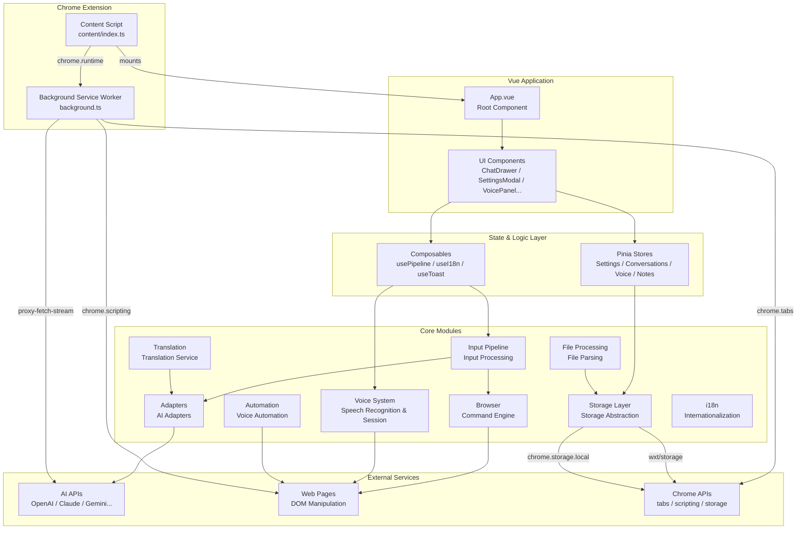

# AI Browser Architecture Documentation

> **🌐 中文版本：[README.md](./README.md)**

## Project Overview

AI Browser (LingBot) is a Chrome browser extension that provides an AI-powered voice assistant. Built on the WXT framework, it uses a Vue 3 Composition API + TypeScript + Pinia tech stack running under the Manifest V3 Service Worker architecture. The extension injects into web pages via Shadow DOM isolation, enabling chat conversations, voice interaction, intelligent translation, note-taking/bookmarking, web automation, and more.

## Tech Stack

| Layer | Technology | Description |
|-------|-----------|-------------|
| Build Tool | WXT | Chrome extension build framework with HMR and auto-generated types |
| UI Framework | Vue 3 + Composition API | All components use `<script setup lang="ts">` |
| State Management | Pinia | Setup Store pattern only |
| Type Checking | TypeScript | Compile-time checking via `vue-tsc --noEmit` |
| Styling | Plain CSS | Global styles in `src/styles/global.css`, class names prefixed with `aib-` |
| Storage Layer | wxt/storage + chrome.storage.local | Bidirectional sync, debounced writes, echo-window loop prevention |
| Speech Recognition | 4-engine adapters | WebSpeech / Baidu / iFlytek / Tencent |
| Architecture Pattern | MV3 Service Worker | Background proxy relay + Content Script injection |

## Layered Architecture Diagram



## Module List

| Module | Path | Description | Documentation |
|--------|------|-------------|---------------|
| Browser Command Engine | `src/browser/` | Browser command execution engine for tab operations, DOM manipulation, and page interaction | [browser-command.md](./browser-command.md) |
| Input Pipeline | `src/input/` | Unified input processing pipeline for command routing and AI intent detection | [input-pipeline.md](./input-pipeline.md) |
| AI Adapters | `src/adapters/` | AI adapter factory supporting OpenAI/Claude/Gemini and other multi-model providers | [ai-adapters.md](./ai-adapters.md) |
| State Management | `src/stores/` | Pinia state management using Setup Store pattern | [state-management.md](./state-management.md) |
| Background Service | `entrypoints/background.ts` | Background Service Worker for request proxying, tab operations, and streaming | [background-service.md](./background-service.md) |
| Content Script | `entrypoints/content/` | Content script for Shadow DOM injection, Vue app mounting, and translation initialization | [content-script.md](./content-script.md) |
| Translation | `src/browser/translate-*.ts` | Translation service supporting selection translation, auto-translation, and click-to-translate | [translation.md](./translation.md) |
| Voice System | `src/voice/` | Speech recognition and session management with 4-engine adapters, TTS playback, and wake words | [voice.md](./voice.md) |
| Storage Layer | `src/storage/` | Chrome storage abstraction with bidirectional sync and debounced writes | [storage.md](./storage.md) |
| File Processing | `src/file-parsers.ts` | File parsing for PDF/DOCX/XLSX and image OCR | [file-parsing.md](./file-parsing.md) |
| Voice Automation | `src/automation/` | Voice-triggered web automation for click, input, scroll, and other operations | [automation.md](./automation.md) |
| Internationalization | `src/i18n/` | Internationalization module supporting Chinese and English | [i18n.md](./i18n.md) |
| Utilities | `src/utils/` | Utility functions including Logger, shortcut matching, and storage sync | [utils.md](./utils.md) |

## Data Flow Overview

### User Input to AI Response

```
User Input (Text / Voice)
        │
        ▼
┌─────────────────┐
│  Input Pipeline  │  Routing: / prefix → Built-in commands, otherwise → AI
│  src/input/      │
└────────┬────────┘
         │
    ┌────┴────┐
    ▼         ▼
┌────────┐ ┌─────────────┐
│Command │ │  AI Intent   │
│Execute │ │  Detection   │
│        │ │  (Two-Phase) │
└────┬───┘ └──────┬──────┘
     │            │
     ▼            ▼
┌────────┐ ┌─────────────┐
│Browser │ │ AI Adapter  │
│Engine  │ │ (Streaming) │
└────┬───┘ └──────┬──────┘
     │            │
     ▼            ▼
┌──────────────────────┐
│  ChatDrawer Messages │
│  (Real-time Stream)  │
└──────────────────────┘
```

### Voice Interaction Flow

```
┌─────────────────────────────────────────────────────────┐
│                    VoiceManager                          │
│  ┌───────────┐    ┌───────────┐    ┌───────────┐       │
│  │  Wake     │───▶│  Speech   │───▶│   Text    │       │
│  │  Word     │    │Recognition│    │Processing │       │
│  │ Detection │    │  (ASR)    │    │ (Pipeline)│       │
│  └───────────┘    └───────────┘    └───────────┘       │
│       │                                    │            │
│       ▼                                    ▼            │
│  ┌───────────┐                      ┌───────────┐      │
│  │  State    │                      │    TTS    │      │
│  │Management │                      │ Playback  │      │
│  │idle/wake/ │                      │ (Optional)│      │
│  │ command   │                      └───────────┘      │
│  └───────────┘                                          │
└─────────────────────────────────────────────────────────┘

Engine Adapters:
  WebSpeech ─┐
  Baidu     ─┤──▶ VoiceManager ──▶ Unified Interface
  iFlytek   ─┤
  Tencent   ─┘
```

### Cross-Tab Storage Sync

```
Tab A                                 Tab B
    │                                     │
    ▼                                     ▼
┌──────────────┐                   ┌──────────────┐
│ defineStorage │                   │ defineStorage │
│ Sync()       │                   │ Sync()       │
└──────┬───────┘                   └──────┬───────┘
       │                                  │
       │  200ms Debounce                  │
       ▼                                  │
┌──────────────────────────────────────────┐
│         chrome.storage.local             │
│  ┌─────────────────────────────────┐    │
│  │ 500ms Echo Window Loop Guard    │    │
│  └─────────────────────────────────┘    │
└──────────────────────────────────────────┘
       │                                  │
       │  onChanged Event                 │
       ▼                                  ▼
┌──────────────┐                   ┌──────────────┐
│  Reactive    │                   │  Reactive    │
│  Update      │                   │  Update      │
│  (Vue Ref)   │                   │  (Vue Ref)   │
└──────────────┘                   └──────────────┘
```

## Key Design Decisions

### 1. Shadow DOM Isolation

The extension UI is injected into the page via Shadow DOM, achieving complete style and DOM isolation:
- Prevents CSS conflicts with the host page
- Blocks page scripts from interfering with extension functionality
- Creates an independent rendering context via `createShadowRootUi`
- All CSS class names use the `aib-` prefix as a secondary safeguard

### 2. Adapter Pattern

AI models are abstracted through a unified `BaseAdapter` interface:
- `createAdapter(provider)` factory function creates concrete instances
- Adding a new model only requires extending `BaseAdapter` and registering with the factory
- All API requests are relayed through the Background to bypass CORS
- Supports real-time forwarding of streaming responses (SSE)

### 3. Two-Phase Input Pipeline

Input processing is divided into two phases:
- **Phase 1**: AI streaming conversation or action detection
- **Phase 2**: Iterative command execution (up to 5 retries)
- Supports multi-step automation for complex tasks
- Separates commands from conversation to maintain responsive flow

### 4. Composition API First

Vue 3 Composition API is used exclusively:
- `<script setup lang="ts">` simplifies component authoring
- Pinia Setup Store pattern provides full type safety
- Composables encapsulate reusable logic (usePipeline, useI18n, useToast)

### 5. Unified Logging System

All logging is managed through a unified Logger class:
- Direct `console.log` usage is prohibited
- Logs are written to `chrome.storage.local`, not the browser console
- Supports DEBUG/INFO/WARN/ERROR levels
- Objects are automatically serialized; Error objects extract stack traces
- Output can be controlled at runtime via `VITE_LOG_ENABLED`

### 6. Storage Bidirectional Sync

`defineStorageSync()` implements bidirectional binding between reactive refs and chrome.storage:
- 200ms debounced writes reduce I/O overhead
- 500ms echo window prevents cross-tab sync loops
- `plain()` strips Vue proxies before serialization
- Supports `watch` for monitoring external changes

### 7. Cross-Tab Microphone Lock

Only one tab is allowed to hold the microphone at a time:
- Lock state is stored in `chrome.storage.local` (`aib-mic-lock`)
- Lock is automatically released/acquired on tab visibility changes
- Other tabs forcibly stop the current engine when acquiring the lock
- `beforeunload` event ensures lock release

### 8. Streaming Proxy Architecture

The Background Service Worker acts as a proxy layer:
- `proxy-fetch`: Standard request proxying
- `proxy-fetch-stream`: SSE streaming request proxying
- Supports request abortion via AbortController
- Data chunks are forwarded to the Content Script in real time
- Request IDs enable multiple concurrent streams
