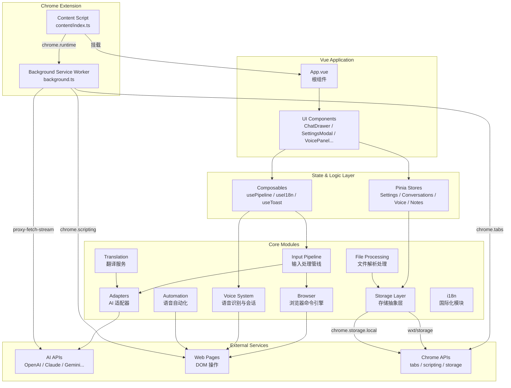

# AI Browser 架构文档

## 项目概述

AI Browser（小灵 LingBot）是一款 Chrome 浏览器扩展，提供 AI 语音助手功能。项目基于 WXT 框架构建，采用 Vue 3 Composition API + TypeScript + Pinia 技术栈，运行在 Manifest V3 Service Worker 架构下。扩展通过 Shadow DOM 隔离注入页面，实现聊天对话、语音交互、智能翻译、笔记收藏、网页自动化等功能。

## 技术栈

| 层级 | 技术方案 | 说明 |
|------|----------|------|
| 构建工具 | WXT | Chrome 扩展专用构建框架，支持 HMR、自动类型生成 |
| UI 框架 | Vue 3 + Composition API | 所有组件使用 `<script setup lang="ts">` |
| 状态管理 | Pinia | 仅使用 Setup Store 模式 |
| 类型检查 | TypeScript | `vue-tsc --noEmit` 编译时检查 |
| 样式方案 | 纯 CSS | 全局样式 `src/styles/global.css`，类名 `aib-` 前缀 |
| 存储层 | wxt/storage + chrome.storage.local | 双向同步、防抖写入、回声窗口防循环 |
| 语音识别 | 4 引擎适配 | WebSpeech / Baidu / iFlytek / Tencent |
| 架构模式 | MV3 Service Worker | Background 中转代理 + Content Script 注入 |

## 分层架构图



## 模块列表

| 模块 | 路径 | 说明 | 文档 |
|------|------|------|------|
| Browser Command Engine | `src/browser/` | 浏览器命令执行引擎，处理标签页操作、DOM 操作、页面交互 | [browser-command.md](./browser-command.md) |
| Input Pipeline | `src/input/` | 统一输入处理管线，路由命令与 AI 意图检测 | [input-pipeline.md](./input-pipeline.md) |
| AI Adapters | `src/adapters/` | AI 适配器工厂，支持 OpenAI/Claude/Gemini 等多模型 | [ai-adapters.md](./ai-adapters.md) |
| State Management | `src/stores/` | Pinia 状态管理，Setup Store 模式 | [state-management.md](./state-management.md) |
| Background Service | `entrypoints/background.ts` | 后台 Service Worker，代理请求、标签页操作、流式传输 | [background-service.md](./background-service.md) |
| Content Script | `entrypoints/content/` | 内容脚本，Shadow DOM 注入、Vue 应用挂载、翻译初始化 | [content-script.md](./content-script.md) |
| Translation | `src/browser/translate-*.ts` | 翻译服务，支持划词翻译、自动翻译、点击翻译 | [translation.md](./translation.md) |
| Voice System | `src/voice/` | 语音识别与会话管理，4 引擎适配、TTS 播报、唤醒词 | [voice.md](./voice.md) |
| Storage Layer | `src/storage/` | Chrome storage 抽象层，双向同步、防抖写入 | [storage.md](./storage.md) |
| File Processing | `src/file-parsers.ts` | 文件解析处理，PDF/DOCX/XLSX/图片 OCR | [file-parsing.md](./file-parsing.md) |
| Voice Automation | `src/automation/` | 语音触发的网页自动化，点击/输入/滚动等操作 | [automation.md](./automation.md) |
| Internationalization | `src/i18n/` | 国际化模块，支持中文/英文 | [i18n.md](./i18n.md) |
| License System | `wasm-license/` + `src/license/` | 授权系统，Wasm 加固 + 激活码验证 + 功能门控 + 隐性防破解 | [license-system.md](./license-system.md) |
| Utilities | `src/utils/` | 工具函数，Logger、快捷键匹配、存储同步 | [utils.md](./utils.md) |

## 数据流概览

### 用户输入 → AI 响应

```
用户输入 (文本/语音)
        │
        ▼
┌─────────────────┐
│  Input Pipeline  │  路由：/ 前缀 → 内置命令，其他 → AI
│  src/input/      │
└────────┬────────┘
         │
    ┌────┴────┐
    ▼         ▼
┌────────┐ ┌─────────────┐
│ 命令   │ │ AI 意图检测  │
│ 执行   │ │ (两阶段)     │
└────┬───┘ └──────┬──────┘
     │            │
     ▼            ▼
┌────────┐ ┌─────────────┐
│ Browser│ │ AI Adapter  │
│ Engine │ │ (流式响应)  │
└────┬───┘ └──────┬──────┘
     │            │
     ▼            ▼
┌──────────────────────┐
│  ChatDrawer 消息列表  │
│  (实时流式更新)       │
└──────────────────────┘
```

### 语音交互流程

```
┌─────────────────────────────────────────────────────────┐
│                    VoiceManager                          │
│  ┌───────────┐    ┌───────────┐    ┌───────────┐       │
│  │ 唤醒词    │───▶│ 语音识别  │───▶│ 文本处理  │       │
│  │ 检测      │    │ (ASR)     │    │ (Pipeline)│       │
│  └───────────┘    └───────────┘    └───────────┘       │
│       │                                    │            │
│       ▼                                    ▼            │
│  ┌───────────┐                      ┌───────────┐      │
│  │ 状态管理  │                      │ TTS 播报  │      │
│  │ idle/wake │                      │ (可选)    │      │
│  │ /command  │                      └───────────┘      │
│  └───────────┘                                          │
└─────────────────────────────────────────────────────────┘

引擎适配：
  WebSpeech ─┐
  Baidu     ─┤──▶ VoiceManager ──▶ 统一接口
  iFlytek   ─┤
  Tencent   ─┘
```

### 跨标签页存储同步

```
标签页 A                              标签页 B
    │                                     │
    ▼                                     ▼
┌──────────────┐                   ┌──────────────┐
│ defineStorage │                   │ defineStorage │
│ Sync()       │                   │ Sync()       │
└──────┬───────┘                   └──────┬───────┘
       │                                  │
       │  200ms 防抖写入                   │
       ▼                                  │
┌──────────────────────────────────────────┐
│         chrome.storage.local             │
│  ┌─────────────────────────────────┐    │
│  │ 500ms 回声窗口防循环            │    │
│  └─────────────────────────────────┘    │
└──────────────────────────────────────────┘
       │                                  │
       │  onChanged 事件                  │
       ▼                                  ▼
┌──────────────┐                   ┌──────────────┐
│ 响应式更新   │                   │ 响应式更新   │
│ (Vue Ref)    │                   │ (Vue Ref)    │
└──────────────┘                   └──────────────┘
```

## 关键设计决策

### 1. Shadow DOM 隔离

扩展 UI 注入到页面 Shadow DOM 中，实现样式和 DOM 完全隔离：
- 避免与宿主页面 CSS 冲突
- 防止页面脚本干扰扩展功能
- 通过 `createShadowRootUi` 创建独立的渲染上下文
- 所有 CSS 类名使用 `aib-` 前缀作为二次防护

### 2. 适配器模式 (Adapter Pattern)

AI 模型通过统一的 `BaseAdapter` 接口抽象：
- `createAdapter(provider)` 工厂函数创建具体实例
- 新增模型只需继承 `BaseAdapter` 并注册工厂
- 所有 API 请求通过 Background 中转，规避 CORS
- 支持流式响应（SSE）实时转发

### 3. 两阶段输入管线 (Two-Phase Input)

输入处理分为两个阶段：
- **阶段一**：AI 流式对话或动作检测
- **阶段二**：迭代命令执行（最多 5 次重试）
- 支持复杂任务的多步骤自动化
- 命令与对话分离，保持响应流畅

### 4. Composition API 优先

全部采用 Vue 3 Composition API：
- `<script setup lang="ts">` 简化组件编写
- Pinia Setup Store 模式，完全类型安全
- Composables 封装可复用逻辑（usePipeline、useI18n、useToast）

### 5. 统一日志系统 (Unified Logging)

所有日志通过 Logger 类统一管理：
- 禁止直接使用 `console.log`
- 日志写入 `chrome.storage.local`，不输出到控制台
- 支持 DEBUG/INFO/WARN/ERROR 级别
- 对象自动序列化，Error 自动提取堆栈
- 运行时可通过 `VITE_LOG_ENABLED` 控制输出

### 6. 存储双向同步 (Storage Sync)

`defineStorageSync()` 实现 reactive ref 与 chrome.storage 双向绑定：
- 200ms 防抖写入，减少 IO 开销
- 500ms 回声窗口，防止跨标签页循环同步
- 序列化前用 `plain()` 剥离 Vue 代理
- 支持 `watch` 监听外部变化

### 7. 跨标签页麦克风锁

同一时刻仅允许一个标签页持有麦克风：
- `chrome.storage.local` 存储锁状态（`aib-mic-lock`）
- 标签页可见性变化时自动释放/获取
- 其他标签页抢锁时自动停止当前引擎
- `beforeunload` 事件确保锁释放

### 8. 流式代理架构

Background Service Worker 作为代理层：
- `proxy-fetch`：普通请求代理
- `proxy-fetch-stream`：SSE 流式请求代理
- 支持请求中止（AbortController）
- 数据块实时转发到 Content Script
- 请求 ID 标识，支持多流并行
