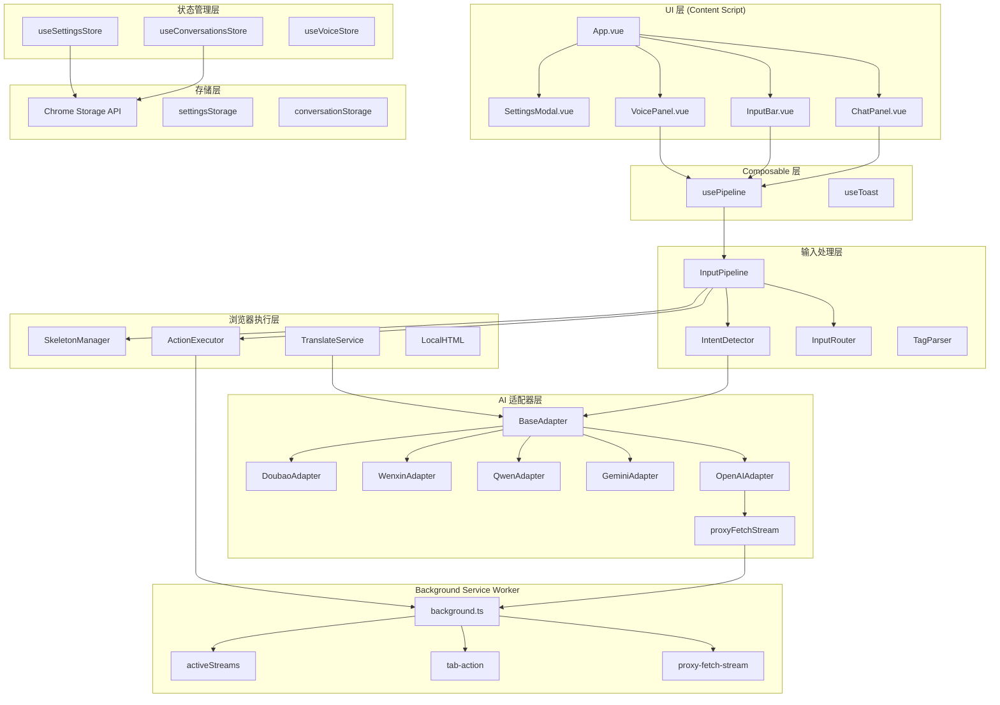
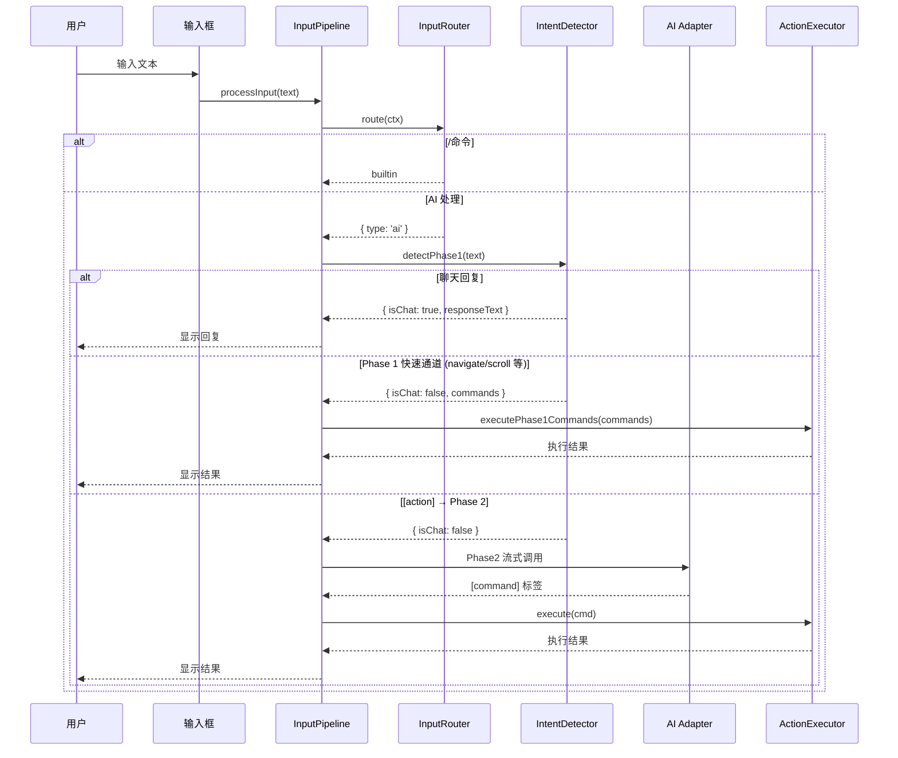
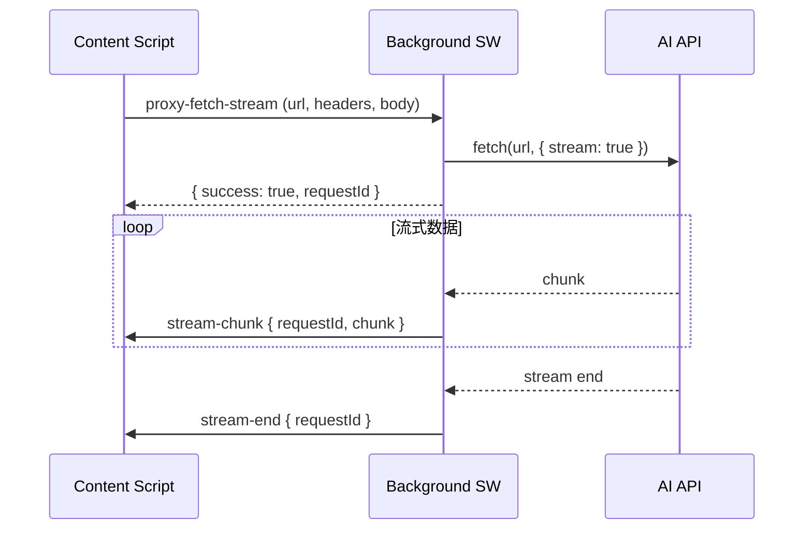

# AI 浏览器助手 — 总体架构

## 项目概述

AI 浏览器助手是一个 Chrome 浏览器扩展（Manifest V3），支持语音控制、网页自动化、多模型切换和翻译功能。基于 WXT + Vue 3 + TypeScript 构建。

**核心能力：**
- 🤖 多 AI 模型对话（OpenAI / Anthropic / Gemini / 通义千问 / 文心一言 / 豆包等）
- 🌐 网页自动化（语义骨架 → AI 理解 → 指令执行）
- 🎤 语音输入/输出（Web Speech API + Sherpa-ONNX）
- 🌍 翻译功能（划词翻译 / 自动翻译 / 点击翻译）
- 📎 文件附件（图片 OCR / PDF / Word / Excel）

## 技术栈

| 层级 | 技术 |
|------|------|
| 构建工具 | WXT (Web Extension Toolkit) |
| 前端框架 | Vue 3 + Composition API |
| 状态管理 | Pinia |
| 类型系统 | TypeScript |
| 语音识别 | Web Speech API / Sherpa-ONNX |
| OCR | Tesseract.js |
| 文件解析 | pdfjs-dist / mammoth / xlsx |

## 分层架构



## 模块列表

| 模块 | 路径 | 职责 |
|------|------|------|
| [输入处理流水线](./input-pipeline.md) | `src/input/` | 用户输入路由、意图检测、指令解析 |
| [浏览器命令执行](./browser-command.md) | `src/browser/` | 语义骨架提取、指令执行引擎 |
| [AI 适配器](./ai-adapters.md) | `src/adapters/` | 多 AI 提供者协议适配 |
| [状态管理](./state-management.md) | `src/stores/` | Pinia stores + 跨标签页同步 |
| [Background Service](./background-service.md) | `entrypoints/background.ts` | CORS 代理、标签页管理、流式传输 |
| [Content Script](./content-script.md) | `entrypoints/content/` | Shadow DOM + Vue 应用 + 组件 |
| [翻译功能](./translation.md) | `src/browser/translate-*.ts` | 划词/自动/点击翻译 |
| [语音功能](./voice.md) | `src/voice/` | 语音识别、指令解析、语音播报 |
| [存储层](./storage.md) | `src/storage/` | Chrome Storage API 封装 |

## 核心数据流

### 用户输入 → AI 对话



### 流式代理架构



## 关键设计决策

### 1. 两阶段意图检测 + 快速通道
- **Phase 1**：轻量分类 — 聊天 / 简单指令直出 / 文件生成 / 需要页面操作
- **Phase 1 快速通道**：navigate/scroll/keyboard 等无需骨架的指令，Phase 1 直出 `[command]` 跳过 Phase 2
- **Phase 2**：从 AI 自然回复中提取结构化指令（需要页面骨架的操作）
- 优势：简单操作零延迟，复杂操作仍走 Phase 2 精确定位

### 2. 语义骨架（无缓存）
- 每次调用 `getSkeleton()` 重新提取可视窗口内的可交互元素
- 不缓存、不监听 DOM 变化 — 简单可靠，永不过期
- 三重元素定位：elementId → CSS 选择器 → 文本匹配
- `alerts` 字段提取页面错误/状态提示，辅助 AI 决策

### 3. 流式单命令执行 + end 验证
- Phase 2 每次只取 AI 返回的第一条指令执行
- 执行成功后刷新骨架，再请求下一条
- `end` 指令需 AI 确认页面状态后才能输出，未执行过指令时拒绝 end
- 最多 20 次总执行步骤（含成功/失败/重试）

### 3.5 跨标签页任务续接
- `navigate` 或 `_blank` 点击导致页面跳转时，任务保存到 `queuedTaskStorage`
- 新标签页加载完成后自动恢复执行，跳过 Phase 1
- 30 秒过期保护 + click 前置保存 + openedNewTab 检测

### 4. Background 代理流式传输
- Content Script 无法直接跨域请求
- Background Service Worker 代理 fetch + SSE 解析
- 通过 `chrome.runtime.sendMessage` 转发 chunk

### 5. Shadow DOM 隔离
- Vue 应用挂载在 Shadow DOM 内
- 样式完全隔离，不影响宿主页面
- 通过 `createShadowRootUi` (WXT) 创建

## 目录结构

```
ai-browser/
├── entrypoints/
│   ├── background.ts           # Background Service Worker
│   └── content/
│       ├── index.ts            # Content Script 入口
│       ├── App.vue             # Vue 根组件
│       └── components/         # UI 组件
│           ├── ChatDrawer.vue
│           ├── ChatPanel.vue
│           ├── InputBar.vue
│           ├── VoicePanel.vue
│           ├── SettingsModal.vue
│           └── ...
├── src/
│   ├── adapters/               # AI 适配器
│   │   ├── base.ts
│   │   ├── openai.ts
│   │   ├── gemini.ts
│   │   ├── qwen.ts
│   │   ├── wenxin.ts
│   │   ├── doubao.ts
│   │   ├── proxy.ts
│   │   └── index.ts
│   ├── browser/                # 浏览器命令执行
│   │   ├── types.ts
│   │   ├── skeleton.ts
│   │   ├── skeleton-id.ts
│   │   ├── action-executor.ts
│   │   ├── local-html.ts
│   │   ├── code-filter.ts
│   │   ├── translate-service.ts
│   │   ├── translate-popup.ts
│   │   ├── translate-click.ts
│   │   ├── translate-parser.ts
│   │   └── index.ts
│   ├── composables/            # Vue Composables
│   │   ├── usePipeline.ts
│   │   └── useToast.ts
│   ├── input/                  # 输入处理
│   │   ├── types.ts
│   │   ├── router.ts
│   │   ├── intent-detector.ts
│   │   ├── pipeline.ts
│   │   ├── tag-parser.ts
│   │   ├── prompts.ts
│   │   └── index.ts
│   ├── storage/                # 存储层
│   │   ├── index.ts
│   │   └── input-history.ts
│   ├── stores/                 # Pinia Stores
│   │   ├── settings.ts
│   │   ├── conversations.ts
│   │   └── voice.ts
│   ├── voice/                  # 语音功能
│   │   ├── recognition.ts
│   │   ├── sherpa-recognition.ts
│   │   ├── commandParser.ts
│   │   ├── broadcast.ts
│   │   ├── session.ts
│   │   └── index.ts
│   ├── utils/                  # 工具函数
│   │   ├── logger.ts
│   │   ├── log-storage.ts
│   │   ├── storage-sync.ts
│   │   ├── shortcut.ts
│   │   ├── markdown.ts
│   │   ├── file-parsers.ts
│   │   ├── file-type.ts
│   │   ├── file.ts
│   │   └── ocr.ts
│   ├── types.ts                # 全局类型定义
│   └── themes.ts               # 主题配置
└── package.json
```
