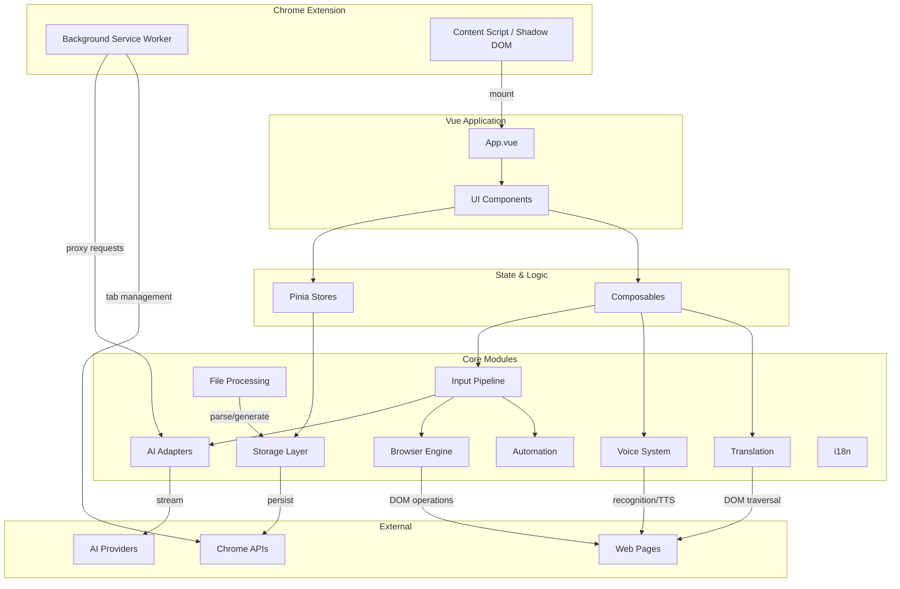

# LingBot Browser Architecture Overview

**小灵 LingBot** — AI 语音浏览器助手 | AI Voice Browser Assistant

Version 1.3.1 | [GitHub Repository](https://github.com/zw123zw/ai-browser)

## Project Overview

LingBot Browser is a Chrome extension that combines AI-powered chat, voice interaction, and browser automation into a unified assistant experience. Built on WXT (Manifest V3) with Vue 3, TypeScript, and Pinia, it runs entirely within a Shadow DOM content script to avoid style conflicts with host pages. The extension supports multiple AI providers through an adapter pattern, processes user input through a multi-stage pipeline that distinguishes between conversational queries and browser commands, and provides features including real-time translation, voice-driven page automation, file parsing, and cross-tab state synchronization.

## Tech Stack

| Layer | Technology | Purpose |
|-------|------------|---------|
| Build System | WXT | Manifest V3 bundling, HMR, cross-browser support |
| UI Framework | Vue 3 + Composition API | Reactive component system with `<script setup>` |
| State Management | Pinia (setup stores) | Centralized state with composition API style |
| Type System | TypeScript + vue-tsc | Static analysis and compile-time checks |
| Styling | Pure CSS (`aib-` prefixed) | Scoped styles in Shadow DOM |
| Storage | `wxt/storage` + `chrome.storage.local` | Persistent and session storage with cross-tab sync |
| Voice | Web Speech API + MediaRecorder | Dual-engine speech recognition and TTS |
| Architecture | Manifest V3 Service Worker | Background processing and CORS proxy |

## Layered Architecture



## Module Reference

| Module | Description | Doc |
|--------|-------------|-----|
| Browser Command Engine | Page skeleton extraction, element locating, command execution | [browser-command.md](./browser-command.md) |
| Input Pipeline | Routing, intent detection, two-phase AI, command execution loop | [input-pipeline.md](./input-pipeline.md) |
| AI Adapters | Multi-protocol support, streaming, CORS proxy | [ai-adapters.md](./ai-adapters.md) |
| State Management | Pinia stores, cross-tab synchronization | [state-management.md](./state-management.md) |
| Background Service | Service Worker, proxy requests, tab management | [background-service.md](./background-service.md) |
| Content Script | Shadow DOM isolation, Vue mount, translation init | [content-script.md](./content-script.md) |
| Translation | Selection, auto, and click translation modes | [translation.md](./translation.md) |
| Voice System | Dual-engine recognition, state machine, TTS | [voice.md](./voice.md) |
| Storage Layer | wxt/storage, persistence, cross-tab sync | [storage.md](./storage.md) |
| File Processing | Parsing, generation, OCR, charts | [file-parsing.md](./file-parsing.md) |
| Voice Automation | Action execution, selector adaptation | [automation.md](./automation.md) |
| Internationalization | Chinese/English, reactive language switching | [i18n.md](./i18n.md) |

## Data Flow

### User Input to AI Response

```
User Input (text/voice)
    |
    v
Input Pipeline (src/input/)
    |-- "/" prefix? --> Command Router --> Built-in command execution
    |-- Otherwise --> Intent Detection (AI)
         |
         v
    Phase 1: AI Streaming
         |-- Conversational --> Stream response to ChatDrawer
         |-- Action detected --> Extract action intent
              |
              v
         Phase 2: Command Execution Loop
              |-- Browser Command --> Browser Engine --> DOM operations
              |-- Voice Automation --> Automation Module --> Page actions
              |-- Max 5 retry iterations
```

### Voice Interaction Flow

```
Voice Input (Web Speech API / MediaRecorder)
    |
    v
Voice Manager (state machine)
    |-- Wake word detection
    |-- Continuous / push-to-talk mode
    |
    v
Transcription --> Input Pipeline --> (standard flow above)
    |
    v
TTS Output (speechSynthesis) <-- AI response text
```

### Cross-Tab Storage Sync

```
Tab A: Vue reactive ref
    |-- 200ms debounce --> chrome.storage.local
                              |
                              v
Tab B: storage.onChanged listener
    |-- 500ms echo window (prevent loop)
    |-- Update reactive ref --> UI re-render
```

## Key Design Decisions

### Shadow DOM Isolation

The entire Vue application mounts inside a Shadow DOM node attached to the host page. This prevents CSS leakage in both directions — the extension styles do not affect the host page, and host page styles do not break the extension UI. All CSS class names use the `aib-` prefix as a secondary safety measure.

### Adapter Pattern for AI Providers

AI provider integration uses a `BaseAdapter` abstract class with a factory function (`createAdapter`). Each provider (OpenAI, Claude, Gemini, etc.) implements the same `chat()` interface. New providers are added by extending the base class and registering in the factory — no changes to the pipeline or UI layer are required. All API requests route through the background Service Worker via `proxyFetchStream()` to avoid CORS restrictions.

### Two-Phase Input Processing

The input pipeline uses a two-phase approach: Phase 1 streams the AI response for conversational input or detects action intent; Phase 2 executes browser commands in an iterative loop (up to 5 retries) when the AI determines a page operation is needed. This separation keeps conversation responsive while allowing complex multi-step automations.

### Composition API Throughout

All Vue components use `<script setup lang="ts">` with the Composition API. Pinia stores use the setup store pattern (not option stores). This provides consistent TypeScript inference, better code colocation, and aligns with Vue 3's recommended patterns.

### Unified Logging

All logging goes through a centralized `Logger` utility that writes to `chrome.storage.local` rather than the browser console. This enables persistent log inspection within the extension UI and avoids cluttering host page developer tools. Log level is controlled by a runtime flag (`VITE_LOG_ENABLED`).

### Storage Synchronization

State synchronization across tabs uses `defineStorageSync()` — a reactive ref backed by `chrome.storage.local` with 200ms debounced writes and a 500ms echo window to prevent cross-tab update loops. Serialization strips Vue proxies via `plain()` before writing.
