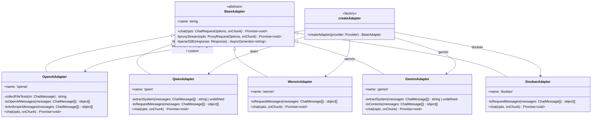
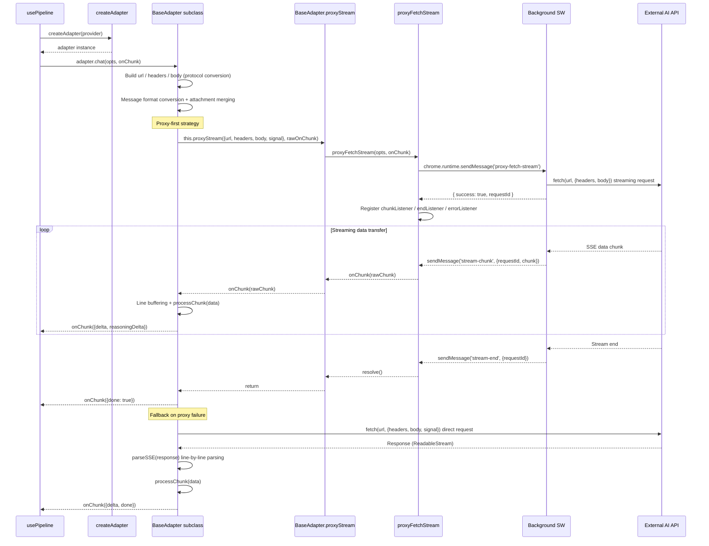
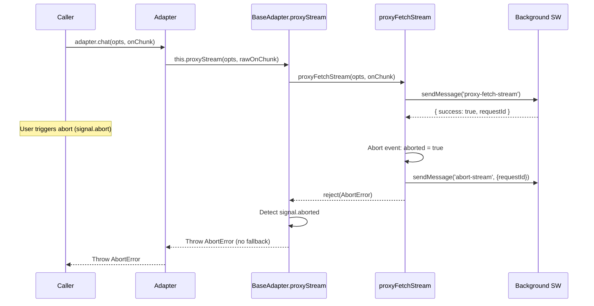

> **🌐 Chinese Version: [ai-adapters.md](./ai-adapters.md)**

# AI Adapter Architecture

## 1. Module Overview

The AI adapter module (`src/adapters/`) is responsible for converting the internal unified chat message format into each AI provider's API protocol, and handling the parsing and delivery of streaming responses. The module employs a **Strategy + Factory** pattern: `BaseAdapter` abstract class defines a unified `chat()` interface, each provider adapter implements the protocol-specific differences, and the `createAdapter` factory function creates the corresponding instance based on the `Provider` type.

**Position in Architecture**: The adapter module sits between the input pipeline (`src/input/`) and external AI APIs, serving as the sole exit point for AI requests. Callers obtain an adapter instance via `createAdapter()`, pass in `ChatRequestOptions`, and receive streaming incremental data through the `onChunk` callback.

**Dependencies**:

| Dependency | Description |
|------|------|
| `src/types.ts` | Shared types: `Provider`, `ChatMessage`, `ChatRequestOptions`, `StreamChunk`, etc. |
| `src/utils/logger.ts` | Unified logging module; all adapters log requests/responses/errors via `new Logger('Adapter:Name')` |
| `src/adapters/proxy.ts` | Proxy request utility that relays requests through `chrome.runtime.sendMessage` to bypass CORS |
| `chrome.runtime` | Background Service Worker communication interface |

Currently supported providers:

| Provider | Adapter Class | Protocol |
|--------|----------|------|
| OpenAI | `OpenAIAdapter` | OpenAI / Anthropic dual-protocol auto-detection |
| Qwen (Alibaba) | `QwenAdapter` | Alibaba DashScope native API |
| Wenxin (Baidu) | `WenxinAdapter` | Baidu Qianfan platform native API |
| Google Gemini | `GeminiAdapter` | Google Generative Language API |
| Doubao (ByteDance) | `DoubaoAdapter` | OpenAI-compatible (Volcano Engine) |
| Zhipu / DeepSeek / Moonshot / Anthropic / Grok / Custom | `OpenAIAdapter` | OpenAI-compatible (mapped by the `default` branch) |

Core design principles:

- **CORS Bypass**: All requests go through `BaseAdapter.proxyStream()` -> `proxyFetchStream()`, relayed via the background script to avoid content script cross-origin restrictions.
- **Proxy-first, Direct-fallback**: When the proxy request fails, it automatically falls back to direct `fetch()` + `parseSSE()`.
- **Unified Attachment Handling**: Image OCR text and file content are merged into plain text at the adapter layer, without relying on provider multimodal interfaces.
- **doneFired Re-entrancy Guard**: A boolean flag ensures `onChunk({ done: true })` fires only once.
- **Unified Abort Semantics**: `BaseAdapter.proxyStream()` handles abort scenarios uniformly; on abort, it throws `AbortError` directly without entering the fallback path.

## 2. Architecture Design



**Design Patterns**:

- **Strategy Pattern**: `BaseAdapter` defines the abstract `chat()` interface, and each subclass implements a different protocol conversion strategy. Callers interact uniformly through `chat(opts, onChunk)` without needing to know protocol details.
- **Factory Pattern**: `createAdapter(provider)` encapsulates adapter creation logic; callers only need to pass the `Provider` type to obtain the correct instance.
- **Template Method Pattern**: `BaseAdapter` provides `proxyStream()` and `parseSSE()` as reusable infrastructure, which subclasses compose and invoke within `chat()`.

## 3. Core Type Definitions

### 3.1 Provider

The provider union type defined in `src/types.ts`, determining which adapter to use:

```typescript
export type Provider =
  | 'openai'        // OpenAI-compatible
  | 'anthropic'     // Anthropic Claude
  | 'gemini'        // Google Gemini
  | 'custom'        // Custom
  | 'qwen'          // Qwen (Alibaba)
  | 'wenxin'        // Wenxin (Baidu)
  | 'zhipu'         // Zhipu ChatGLM
  | 'deepseek'      // DeepSeek
  | 'moonshot'      // Moonshot (Kimi)
  | 'doubao'        // Doubao (ByteDance Volcano Engine)
  | 'grok'          // Grok (xAI)
```

### 3.2 ChatRequestOptions

```typescript
export interface ChatRequestOptions {
  baseUrl: string;       // API base URL
  apiKey: string;        // Authentication key
  modelName: string;     // Model identifier (used in request body)
  provider?: string;     // Provider identifier (for protocol detection, e.g. Anthropic)
  messages: ChatMessage[];  // Standardized message list
  signal?: AbortSignal;  // Request abort signal
}
```

### 3.3 StreamChunk

The incremental data unit that adapters pass to callers via the `onChunk` callback:

```typescript
export interface StreamChunk {
  delta?: string;           // Incremental text
  reasoningDelta?: string;  // Incremental reasoning text (for deep-thinking models, e.g. Claude 3.7+ thinking, Gemini 2.0+ thought)
  done?: boolean;           // Stream-end flag
}
```

### 3.4 ChatMessage

```typescript
export interface ChatMessage {
  id: string;
  role: 'user' | 'assistant' | 'system';
  content: string;                // Plain text content
  reasoning?: string;             // Deep-thinking content (optional, for storage)
  attachments?: Attachment[];     // Unified attachments (image OCR text + files)
  timestamp: number;              // Creation time
  status?: 'sending' | 'streaming' | 'done' | 'error' | 'aborted';
  errorMessage?: string;
  reasoningEnabled?: boolean;     // Whether deep thinking was enabled when sending this message
}
```

### 3.5 ProxyRequestOptions

Proxy request parameters defined in `src/adapters/proxy.ts`:

```typescript
export interface ProxyRequestOptions {
  url: string;
  method?: string;                     // HTTP method, defaults to 'POST'
  headers?: Record<string, string>;    // Request headers
  body?: string;                       // Request body as JSON string
  signal?: AbortSignal;                // Abort signal
}
```

### 3.6 ProxyResponse

Response structure for non-streaming proxy requests:

```typescript
export interface ProxyResponse {
  success: boolean;
  data?: any;
  status?: number;
  error?: string;
}
```

## 4. Implementation Details

### 4.1 Factory Function: createAdapter

**File**: `src/adapters/index.ts`

```typescript
export function createAdapter(provider: Provider): BaseAdapter
```

Selects an adapter instance based on the `Provider` union type:

| Provider Value | Returned Adapter |
|---|---|
| `'qwen'` | `new QwenAdapter()` |
| `'wenxin'` | `new WenxinAdapter()` |
| `'gemini'` | `new GeminiAdapter()` |
| `'doubao'` | `new DoubaoAdapter()` |
| `'openai'` / `'zhipu'` / `'deepseek'` / `'moonshot'` / `'anthropic'` / `'grok'` / `'custom'` / default | `new OpenAIAdapter()` |

Most providers are compatible with the OpenAI protocol, so `OpenAIAdapter` serves as the default implementation. Only providers with significantly different protocols (Qwen, Wenxin, Gemini, Doubao) require independent adapters. If a newly added provider is OpenAI-compatible, no new adapter is needed -- simply add the type value to `Provider`, and the `default` branch will automatically use `OpenAIAdapter`.

### 4.2 BaseAdapter -- Abstract Base Class

**File**: `src/adapters/base.ts`

```typescript
export abstract class BaseAdapter {
  abstract readonly name: string;

  abstract chat(
    opts: ChatRequestOptions,
    onChunk: (chunk: StreamChunk) => void
  ): Promise<void>;

  protected async proxyStream(
    opts: ProxyRequestOptions,
    onChunk: (chunk: string) => void
  ): Promise<void>;

  protected async *parseSSE(
    response: Response
  ): AsyncGenerator<string, void, unknown>;
}
```

#### proxyStream()

```typescript
protected async proxyStream(
  opts: ProxyRequestOptions,
  onChunk: (chunk: string) => void
): Promise<void>
```

The unified entry point for all adapters to make proxy requests. Internally calls `proxyFetchStream()` and handles abort semantics uniformly:

- **Proxy succeeds**: Returns normally
- **Request aborted** (`opts.signal?.aborted`): Throws `DOMException('The operation was aborted.', 'AbortError')` directly, bypassing fallback logic to avoid establishing a new SSE connection
- **Other errors**: Thrown as-is; the caller (each adapter's `chat()` method) decides whether to fall back to a direct request

#### parseSSE()

```typescript
protected async *parseSSE(response: Response): AsyncGenerator<string, void, unknown>
```

A generic SSE (Server-Sent Events) parser used in the direct-fallback path. Processing flow:

1. Obtain a `ReadableStream` `reader` from `response.body`
2. Decode binary chunks using `TextDecoder('utf-8')`
3. Maintain a `buffer` string, split by `\n` into lines
4. Skip empty lines and lines without the `data:` prefix
5. Terminate the generator (`return`) upon encountering `data: [DONE]`
6. Yield the JSON string after `data:` line by line via `AsyncGenerator`
7. The caller consumes via `for await (const data of this.parseSSE(res))`

### 4.3 OpenAIAdapter -- Dual Protocol Support

**File**: `src/adapters/openai.ts`

```typescript
export class OpenAIAdapter extends BaseAdapter {
  readonly name = 'openai';
}
```

The most complex adapter, supporting both OpenAI and Anthropic protocols simultaneously.

#### Protocol Auto-detection

```typescript
const isAnthropic = opts.provider === 'anthropic' || base.includes('/anthropic');
```

Determined by `opts.provider` and the URL path. When `provider === 'anthropic'` or the URL contains `/anthropic`, it uses the Anthropic protocol; otherwise, it uses the OpenAI-compatible protocol.

#### Smart URL Construction

```typescript
const hasCompletePath = base.endsWith('/chat/completions') || base.endsWith('/messages');
```

- If `baseUrl` already ends with `/chat/completions` or `/messages`, it is used directly
- Anthropic protocol: if baseUrl already contains `/v1`, append `/messages`; otherwise append `/v1/messages`
- OpenAI protocol: append `/chat/completions` (no automatic `/v1` addition, as baseUrl may already contain a version path like `/v4`)

#### Request Headers and Body

| Protocol | Headers | Body |
|---|---|---|
| OpenAI | `Content-Type: application/json` + `Authorization: Bearer {apiKey}` | `{ model, messages, stream: true }` |
| Anthropic | `Content-Type: application/json` + `x-api-key: {apiKey}` + `anthropic-version: '2023-06-01'` | `{ model, messages, max_tokens: 8192, stream: true }` |

#### collectFileTexts()

```typescript
private collectFileTexts(m: ChatMessage): string
```

Extracts text content from message attachments:
- Image attachments: `[Image OCR: ${a.name}]\n${a.content}`
- File attachments: `[File: ${a.name}]\n\`\`\`${a.lang || ''}\n${a.content}\n\`\`\``
- Multiple attachments are joined with double newlines `\n\n`

#### toOpenAIMessages() / toAnthropicMessages()

```typescript
private toOpenAIMessages(messages: ChatMessage[]): { role: string; content: string }[]
private toAnthropicMessages(messages: ChatMessage[]): { role: string; content: string }[]
```

Converts internal `ChatMessage[]` to API message format. Both methods have identical logic: call `collectFileTexts()` to extract attachment text and append it to the message `content`.

#### SSE Parsing -- processChunk

SSE data is parsed through a `processChunk(data: string)` closure function, with different branches based on the protocol:

**Anthropic protocol** distinguishes event types by `event:` lines:
- `content_block_delta` + `delta.type === 'text_delta'`: Extracts `delta.text` as `delta`
- `content_block_delta` + `delta.type === 'thinking_delta'`: Extracts `delta.thinking` as `reasoningDelta` (supported by Claude 3.7+)
- `message_delta` (`delta.stop_reason` present) or `message_stop`: Triggers `fireDone()`
- `ping` / `message_start` / `content_block_start` / `content_block_stop`: Ignored

**OpenAI protocol** extracts content from `choices[0].delta`:
- `delta.content` or `delta.text`: Main text increment
- `delta.reasoning_content` / `delta.reasoning` / `delta.thinking`: Reasoning content increment (three field names for compatibility with different providers)
- `choice.finish_reason`: Triggers `fireDone()`

#### doneFired Re-entrancy Guard

```typescript
let doneFired = false;
const fireDone = () => {
  if (doneFired) return;
  doneFired = true;
  onChunk({ done: true });
};
```

A boolean flag in the closure ensures `onChunk({ done: true })` fires only once, preventing duplicate triggers from both the proxy and direct paths, as well as from the Anthropic protocol's `message_delta` and `message_stop`.

#### Proxy-first + Direct-fallback

```
try {
  await this.proxyStream({ url, method, headers, body, signal }, (chunk) => { ... });
  fireDone();
  return;
} catch (proxyError) {
  if (opts.signal?.aborted) throw new DOMException('...', 'AbortError');
  // Fall back to direct request
}
const res = await fetch(url, { method, headers, body, signal });
// ...
for await (const data of this.parseSSE(res)) { processChunk(data); }
fireDone();
```

No fallback on abort; other errors (such as unavailable extension environment or background communication failure) fall back to direct `fetch()`.

#### Logging

Each request logs: request start (URL, model, message count), request completion (chunk count, elapsed time), full AI response content and reasoning content.

### 4.4 QwenAdapter -- Qwen

**File**: `src/adapters/qwen.ts`

```typescript
export class QwenAdapter extends BaseAdapter {
  readonly name = 'qwen';
}
```

Uses the Alibaba DashScope native API, which differs from the OpenAI protocol in the following ways:

- **URL**: `${baseUrl}/services/aigc/text-generation/generation` (not `/chat/completions`)
- **Body structure**: Messages are placed in `input.messages`, streaming parameter is `parameters.incremental_output: true`, and `parameters.result_format: 'message'` is required
- **System message**: Extracted independently via `extractSystem()` into the `input.system` field, not mixed into the messages array
- **Authentication**: `Authorization: Bearer {apiKey}`
- **SSE format**: Response is in `output.choices[0].message.content`, `output.choices[0].finish_reason` triggers completion
- **Attachment handling**: `toRequestMessages()` merges attachment text (same logic as OpenAIAdapter)

### 4.5 WenxinAdapter -- Wenxin

**File**: `src/adapters/wenxin.ts`

```typescript
export class WenxinAdapter extends BaseAdapter {
  readonly name = 'wenxin';
}
```

Uses the Baidu Qianfan platform API:

- **URL**: `${baseUrl}/chat/completions`
- **Body structure**: Only requires `messages` and `stream: true`, no `model` field needed (model is determined by the endpoint URL)
- **Role mapping**: `assistant` remains unchanged; all other roles (including `system`) are mapped to `'user'`
- **Authentication**: No Authorization header (authentication info is typically encoded in the URL endpoint parameter)
- **SSE format**: Response is in the `result` field (not `choices`); end marker is `is_end: true`; errors are returned via `error_code` + `error_msg`
- **Error handling**: `processChunk` detects the `error_code` field and throws an `Error` with `error_msg`; HTTP errors parse `error_msg` or `error.message`

### 4.6 GeminiAdapter -- Google Gemini

**File**: `src/adapters/gemini.ts`

```typescript
export class GeminiAdapter extends BaseAdapter {
  readonly name = 'gemini';
}
```

Uses the Google Generative Language API:

- **URL**: `${baseUrl}/v1beta/models/${modelName}:streamGenerateContent?alt=sse` (`alt=sse` enables SSE format); if baseUrl already contains `:streamGenerateContent`, it is used directly
- **Authentication header**: `x-goog-api-key: {apiKey}` (not Bearer token)
- **Body structure**:
  - Messages are placed in the `contents` array; role mapping: `assistant` -> `'model'`, others -> `'user'`
  - `system` messages are extracted via `extractSystem()` into an independent `systemInstruction.parts[].text` field
  - `generationConfig.maxOutputTokens` is set to 8192
- **SSE format**: Response is in the `candidates[0].content.parts[]` array; each `part` contains a `text` field
- **Deep thinking**: The `part.thought` boolean field distinguishes reasoning content (`reasoningDelta`) from the main response (`delta`); supported by Gemini 2.0+ thinking model
- **End marker**: `candidate.finishReason` existing and not being `'FINISH_REASON_UNSPECIFIED'` triggers done

### 4.7 DoubaoAdapter -- Doubao

**File**: `src/adapters/doubao.ts`

```typescript
export class DoubaoAdapter extends BaseAdapter {
  readonly name = 'doubao';
}
```

Uses the Volcano Engine OpenAI-compatible API:

- **URL**: `${baseUrl}/chat/completions` (smart detection of whether baseUrl already contains the full path)
- **Body structure**: Standard OpenAI format `{ model, messages, stream: true }`
- **Authentication**: `Authorization: Bearer {apiKey}`
- **SSE format**: Standard OpenAI format `choices[0].delta.content`, `choice.finish_reason` triggers completion
- **Attachment handling**: `toRequestMessages()` merges attachment text (same logic as OpenAIAdapter)

### 4.8 Proxy Layer -- proxy.ts

**File**: `src/adapters/proxy.ts`

Provides two core functions that communicate with the background script via `chrome.runtime.sendMessage` to bypass CORS.

#### proxyFetch() -- Non-streaming Request

```typescript
export async function proxyFetch(options: ProxyRequestOptions): Promise<ProxyResponse>
```

- Sends a `{ type: 'proxy-fetch', url, method, headers, body }` message to the background
- Background returns a `ProxyResponse` after completing the request
- Checks whether `chrome.runtime?.sendMessage` is available; throws `'Not in extension environment'` if unavailable
- Hides the apiKey in logs via `bodySummary()`

#### proxyFetchStream() -- Streaming Request

```typescript
export async function proxyFetchStream(
  options: ProxyRequestOptions,
  onChunk: (chunk: string) => void
): Promise<void>
```

Complete flow:

1. **Environment check**: Verify that `chrome.runtime?.sendMessage` is available
2. **Initiate request**: Send a `{ type: 'proxy-fetch-stream', url, method, headers, body }` message
3. **Obtain requestId**: Get the `requestId` from the background response for subsequent message matching
4. **Register listeners**: After `sendMessage` but before stream data arrives, register three `chrome.runtime.onMessage` listeners:
   - `chunkListener`: Receives `stream-chunk` type messages, matches by `requestId`, then calls `onChunk(msg.chunk)`
   - `endListener`: Receives `stream-end` type messages, resolves the Promise
   - `errorListener`: Receives `stream-error` type messages, rejects the Promise
5. **Wait for completion**: Returns a Promise, waiting for `stream-end` or `stream-error`
6. **Cleanup**: The `cleanup()` function removes all listeners upon completion

**Race Condition Handling**:

- Uses an `aborted` flag to handle cases where an abort signal is received before `requestId` is assigned
- If already aborted before `requestId` assignment, immediately sends `{ type: 'abort-stream', requestId }` and rejects with `AbortError`
- When the abort signal fires: sets `aborted = true`, sends `abort-stream` message to notify the background to terminate the underlying fetch
- The Promise listens for the abort signal again internally to ensure immediate rejection without waiting for `stream-end`

**Communication Protocol**:

| Message Type | Direction | Fields | Description |
|---|---|---|---|
| `proxy-fetch-stream` | Content -> BG | url, method, headers, body | Initiate streaming request |
| `stream-chunk` | BG -> Content | requestId, chunk (string) | Streaming data chunk |
| `stream-end` | BG -> Content | requestId | Stream end |
| `stream-error` | BG -> Content | requestId, error | Stream error |
| `abort-stream` | Content -> BG | requestId | Abort request |

**Security Feature**: The `bodySummary()` function replaces the `apiKey` field with `'***'` in logs to prevent key leakage into log storage:

```typescript
function bodySummary(body?: string): string {
  if (!body) return ''
  try {
    const parsed = JSON.parse(body)
    if (parsed.apiKey) parsed.apiKey = '***'
    return JSON.stringify(parsed, null, 2)
  } catch {
    return body
  }
}
```

## 5. Data Flow

### 5.1 Complete Request Flow



### 5.2 Abort Flow



## 6. Configuration and Extension

### 6.1 Adding a New Provider Adapter

**Scenario A: New provider is OpenAI-compatible**

1. Add a new value to the `Provider` union type in `src/types.ts` (e.g. `'newprovider'`)
2. Add `case 'newprovider':` in the `createAdapter()` switch in `src/adapters/index.ts` and `return new OpenAIAdapter()` (or simply let it fall through to the `default` branch)
3. Done -- no new adapter file needed

**Scenario B: New provider uses a proprietary protocol**

1. Add a new value to the `Provider` union type in `src/types.ts`
2. Create `src/adapters/<provider>.ts`, extending `BaseAdapter`
3. Implement the `readonly name` property
4. Implement the `chat()` method, following this template:
   - Build URL, headers, body
   - Define `processChunk(data)` to parse the provider's SSE format
   - Proxy-first: `try { await this.proxyStream(...) } catch { ... }`
   - Direct-fallback: `fetch()` + `this.parseSSE()` + `processChunk()`
   - `fireDone()` re-entrancy guard
5. Register in `createAdapter()` in `src/adapters/index.ts`

### 6.2 Adapter chat() Method Template

```typescript
async chat(opts: ChatRequestOptions, onChunk: (chunk: StreamChunk) => void): Promise<void> {
  // 1. Build URL
  const url = buildUrl(opts.baseUrl, opts.modelName);

  // 2. Build headers (authentication method varies by provider)
  const headers = { 'Content-Type': 'application/json', ... };

  // 3. Build body (message format conversion + attachment merging)
  const body = JSON.stringify({ ... });

  // 4. doneFired re-entrancy guard
  let doneFired = false;
  const fireDone = () => {
    if (doneFired) return;
    doneFired = true;
    onChunk({ done: true });
  };

  // 5. Define processChunk (parse provider-specific SSE format)
  const processChunk = (data: string) => {
    const json = JSON.parse(data);
    // Extract delta / reasoningDelta / done
  };

  // 6. Proxy-first
  try {
    let buffer = '';
    await this.proxyStream({ url, method: 'POST', headers, body, signal: opts.signal }, (chunk) => {
      buffer += chunk;
      const lines = buffer.split('\n');
      buffer = lines.pop() || '';
      for (const line of lines) {
        if (line.startsWith('data: ')) processChunk(line.slice(6));
      }
    });
    fireDone();
    return;
  } catch (proxyError) {
    if (opts.signal?.aborted) throw new DOMException('...', 'AbortError');
  }

  // 7. Direct-fallback
  const res = await fetch(url, { method: 'POST', headers, body, signal: opts.signal });
  if (!res.ok) { /* Error handling */ }
  for await (const data of this.parseSSE(res)) { processChunk(data); }
  fireDone();
}
```

### 6.3 Attachment Handling Strategy

All adapters handle attachments uniformly during the message conversion phase (without relying on provider multimodal interfaces):

- **Image attachments**: Prefixed with `[Image OCR: <filename>]` followed by the OCR text
- **File attachments**: Prefixed with `[File: <filename>]` and wrapped in a code block (with language identifier) around the content
- Attachment content is appended to the end of the message body, separated by double newlines `\n\n`
- Empty attachments are skipped without affecting the original message content

### 6.4 Adapter Comparison Quick Reference

| Adapter | API Endpoint | Auth Header | System Message Handling | End Marker | Reasoning Content Field |
|---|---|---|---|---|---|
| OpenAI | `/chat/completions` | `Authorization: Bearer` | Within messages array | `choices[0].finish_reason` | `reasoning_content` / `reasoning` / `thinking` |
| Anthropic | `/v1/messages` | `x-api-key` | Within messages array | `message_stop` / `message_delta.stop_reason` | `thinking_delta` |
| Gemini | `...:streamGenerateContent?alt=sse` | `x-goog-api-key` | Independent `systemInstruction` field | `finishReason !== UNSPECIFIED` | `part.thought` |
| Qwen | `.../generation` | `Authorization: Bearer` | Independent `input.system` field | `finish_reason` | Not supported |
| Wenxin | `/chat/completions` | None (URL-encoded) | Role mapped to `user` | `is_end` | Not supported |
| Doubao | `/chat/completions` | `Authorization: Bearer` | Within messages array | `finish_reason` | Not supported |

## 7. Known Limitations

1. **OpenAIAdapter attachment format duplication**: `toOpenAIMessages()` and `toAnthropicMessages()` have identical attachment handling logic (both call `collectFileTexts()`), resulting in code duplication. This could be extracted into a common method or implemented directly in the base class.

2. **WenxinAdapter role mapping is approximate**: Mapping the `system` role to `user` is an approximation; Wenxin's understanding of system prompts may not be as precise as with a native system field.

3. **GeminiAdapter attachments not handled**: The `toContents()` method directly uses `m.content` without merging attachment text content, which is inconsistent with other adapters' behavior.

4. **Inconsistent error parsing**: Each adapter implements HTTP error parsing independently, with different error format detection (JSON field names) across adapters (`error.message` / `error.type` / `message` / `error_msg`), lacking a unified error extraction abstraction.

5. **No request retry**: All adapters throw exceptions directly on request failure without a built-in retry mechanism. Callers must handle retry logic for network jitter scenarios.

6. **No timeout control for streaming requests**: `proxyFetchStream` has no request-level timeout mechanism; if the AI API responds slowly or hangs, it can only be aborted via an external `AbortSignal`.

7. **proxyFetchStream listener registration timing**: The code first calls `sendMessage` to obtain `requestId`, then registers `chunkListener`. If the background emits `stream-chunk` messages before listeners are registered, early chunks may be lost. This currently relies on the background-side buffering mechanism to mitigate, but the risk remains in high-latency scenarios.

8. **Hardcoded max_tokens**: The Anthropic protocol's `max_tokens: 8192` and Gemini's `maxOutputTokens: 8192` are both hardcoded values that cannot be configured through `ChatRequestOptions`.
