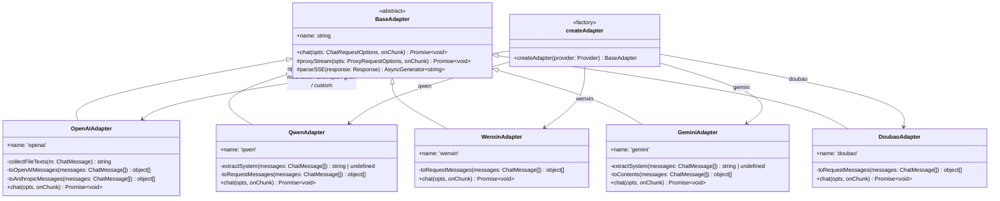
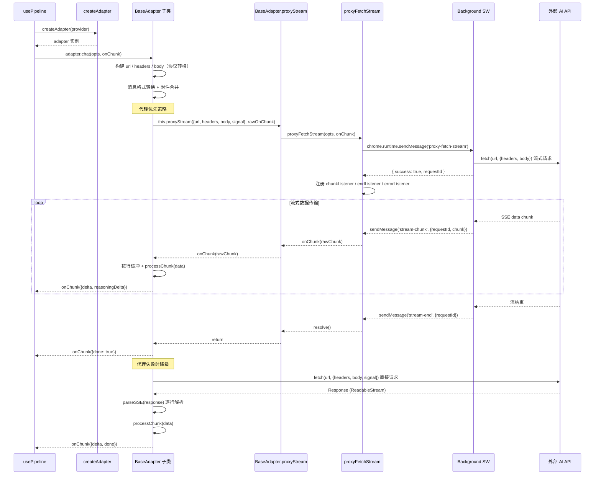
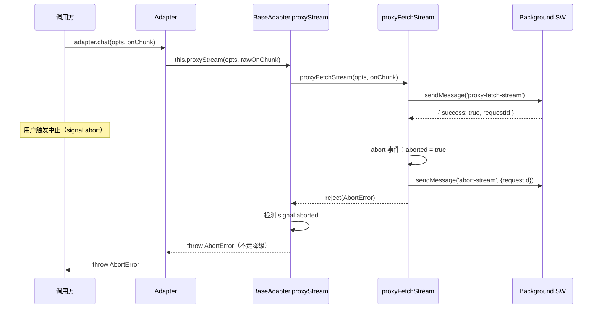

# AI 适配器架构

## 1. 模块概述

AI 适配器模块（`src/adapters/`）负责将内部统一的聊天消息格式转换为各 AI 供应商的 API 协议，并处理流式响应的解析与回传。该模块采用 **策略 + 工厂** 模式：`BaseAdapter` 抽象类定义统一的 `chat()` 接口，各供应商适配器实现协议差异部分，`createAdapter` 工厂函数根据 `Provider` 类型创建对应实例。

**在架构中的位置**：适配器模块位于输入管线（`src/input/`）与外部 AI API 之间，是唯一的 AI 请求出口。调用方通过 `createAdapter()` 获取适配器实例，传入 `ChatRequestOptions` 后通过 `onChunk` 回调接收流式增量数据。

**依赖关系**：

| 依赖 | 说明 |
|------|------|
| `src/types.ts` | `Provider`、`ChatMessage`、`ChatRequestOptions`、`StreamChunk` 等共享类型 |
| `src/utils/logger.ts` | 统一日志模块，所有适配器通过 `new Logger('Adapter:名称')` 记录请求/响应/错误 |
| `src/adapters/proxy.ts` | 代理请求工具，通过 `chrome.runtime.sendMessage` 中转请求以规避 CORS |
| `chrome.runtime` | Background Service Worker 通信接口 |

当前支持的供应商：

| 供应商 | 适配器类 | 协议 |
|--------|----------|------|
| OpenAI | `OpenAIAdapter` | OpenAI / Anthropic 双协议自动检测 |
| 通义千问（阿里） | `QwenAdapter` | 阿里 DashScope 原生接口 |
| 文心一言（百度） | `WenxinAdapter` | 百度千帆平台原生接口 |
| Google Gemini | `GeminiAdapter` | Google Generative Language API |
| 豆包（字节） | `DoubaoAdapter` | OpenAI 兼容（火山引擎） |
| 智谱 / DeepSeek / Moonshot / Anthropic / Grok / 自定义 | `OpenAIAdapter` | OpenAI 兼容（由 `default` 分支映射） |

核心设计原则：

- **CORS 规避**：所有请求通过 `BaseAdapter.proxyStream()` -> `proxyFetchStream()` 经 background script 中转，避免内容脚本的跨域限制。
- **代理优先、直连降级**：代理请求失败时自动回退到直接 `fetch()` + `parseSSE()`。
- **统一附件处理**：图片 OCR 文字与文件内容在适配层合并为纯文本，不依赖供应商的多模态接口。
- **doneFired 防重入**：通过布尔标志确保 `onChunk({ done: true })` 只触发一次。
- **abort 语义统一**：`BaseAdapter.proxyStream()` 统一处理中止场景，中止时直接抛出 `AbortError`，不走降级逻辑。

## 2. 架构设计



**设计模式**：

- **策略模式（Strategy）**：`BaseAdapter` 定义 `chat()` 抽象接口，各子类实现不同的协议转换策略。调用方无需关心具体协议细节，统一通过 `chat(opts, onChunk)` 交互。
- **工厂模式（Factory）**：`createAdapter(provider)` 封装适配器创建逻辑，调用方只需传入 `Provider` 类型即可获取正确实例。
- **模板方法模式（Template Method）**：`BaseAdapter` 提供 `proxyStream()` 和 `parseSSE()` 作为可复用的基础设施，子类在 `chat()` 中组合调用。

## 3. 核心类型定义

### 3.1 Provider

`src/types.ts` 中定义的供应商联合类型，决定使用哪个适配器：

```typescript
export type Provider =
  | 'openai'        // OpenAI 兼容
  | 'anthropic'     // Anthropic Claude
  | 'gemini'        // Google Gemini
  | 'custom'        // 自定义
  | 'qwen'          // 通义千问（阿里）
  | 'wenxin'        // 文心一言（百度）
  | 'zhipu'         // 智谱清言
  | 'deepseek'      // DeepSeek
  | 'moonshot'      // Moonshot (Kimi)
  | 'doubao'        // 豆包（字节火山引擎）
  | 'grok'          // Grok (xAI)
```

### 3.2 ChatRequestOptions

```typescript
export interface ChatRequestOptions {
  baseUrl: string;       // API 基础地址
  apiKey: string;        // 认证密钥
  modelName: string;     // 模型标识（请求 body 用）
  provider?: string;     // 供应商标识（用于协议判断，如 Anthropic 检测）
  messages: ChatMessage[];  // 标准化消息列表
  signal?: AbortSignal;  // 请求中止信号
}
```

### 3.3 StreamChunk

适配器通过 `onChunk` 回调向调用方传递流式数据的增量单元：

```typescript
export interface StreamChunk {
  delta?: string;           // 增量文本
  reasoningDelta?: string;  // 增量思考文本（深度思考模型，如 Claude 3.7+ thinking、Gemini 2.0+ thought）
  done?: boolean;           // 流结束标记
}
```

### 3.4 ChatMessage

```typescript
export interface ChatMessage {
  id: string;
  role: 'user' | 'assistant' | 'system';
  content: string;                // 普通文本内容
  reasoning?: string;             // 深度思考内容（可选，存储用）
  attachments?: Attachment[];     // 统一附件（图片 OCR 文字 + 文件）
  timestamp: number;              // 创建时间
  status?: 'sending' | 'streaming' | 'done' | 'error' | 'aborted';
  errorMessage?: string;
  reasoningEnabled?: boolean;     // 该消息发送时是否启用了深度思考
}
```

### 3.5 ProxyRequestOptions

`src/adapters/proxy.ts` 中定义的代理请求参数：

```typescript
export interface ProxyRequestOptions {
  url: string;
  method?: string;                     // HTTP 方法，默认 'POST'
  headers?: Record<string, string>;    // 请求头
  body?: string;                       // JSON 字符串格式的请求体
  signal?: AbortSignal;                // 中止信号
}
```

### 3.6 ProxyResponse

非流式代理请求的响应结构：

```typescript
export interface ProxyResponse {
  success: boolean;
  data?: any;
  status?: number;
  error?: string;
}
```

## 4. 实现细节

### 4.1 工厂函数 createAdapter

**文件**：`src/adapters/index.ts`

```typescript
export function createAdapter(provider: Provider): BaseAdapter
```

根据 `Provider` 联合类型选择适配器实例：

| Provider 值 | 返回的适配器 |
|---|---|
| `'qwen'` | `new QwenAdapter()` |
| `'wenxin'` | `new WenxinAdapter()` |
| `'gemini'` | `new GeminiAdapter()` |
| `'doubao'` | `new DoubaoAdapter()` |
| `'openai'` / `'zhipu'` / `'deepseek'` / `'moonshot'` / `'anthropic'` / `'grok'` / `'custom'` / default | `new OpenAIAdapter()` |

大部分供应商兼容 OpenAI 协议，因此 `OpenAIAdapter` 是默认实现。仅协议差异较大的供应商（千问、文心、Gemini、豆包）需要独立适配器。若新增的供应商兼容 OpenAI 协议，无需创建新适配器——只需在 `Provider` 中添加类型值，`default` 分支会自动使用 `OpenAIAdapter`。

### 4.2 BaseAdapter -- 抽象基类

**文件**：`src/adapters/base.ts`

```typescript
export abstract class BaseAdapter {
  abstract readonly name: string;

  abstract chat(
    opts: ChatRequestOptions,
    onChunk: (chunk: StreamChunk) => void
  ): Promise<void>;

  protected async proxyStream(
    opts: ProxyRequestOptions,
    onChunk: (chunk: string) => void
  ): Promise<void>;

  protected async *parseSSE(
    response: Response
  ): AsyncGenerator<string, void, unknown>;
}
```

#### proxyStream()

```typescript
protected async proxyStream(
  opts: ProxyRequestOptions,
  onChunk: (chunk: string) => void
): Promise<void>
```

所有适配器调用代理请求的统一入口。内部调用 `proxyFetchStream()`，并统一处理 abort 语义：

- **代理成功**：正常返回
- **请求中止**（`opts.signal?.aborted`）：直接抛出 `DOMException('The operation was aborted.', 'AbortError')`，不走降级逻辑，避免建立新的 SSE 连接
- **其他错误**：原样抛出，由调用方（各适配器的 `chat()` 方法）决定是否降级到直接请求

#### parseSSE()

```typescript
protected async *parseSSE(response: Response): AsyncGenerator<string, void, unknown>
```

通用 SSE（Server-Sent Events）解析工具，用于直连降级路径。处理流程：

1. 从 `response.body` 获取 `ReadableStream` 的 `reader`
2. 使用 `TextDecoder('utf-8')` 解码二进制数据块
3. 维护 `buffer` 字符串，按 `\n` 分割为行
4. 跳过空行和非 `data:` 前缀的行
5. 遇到 `data: [DONE]` 时终止生成器（`return`）
6. 通过 `AsyncGenerator` 逐行 yield `data:` 后面的 JSON 字符串
7. 调用方通过 `for await (const data of this.parseSSE(res))` 消费

### 4.3 OpenAIAdapter -- 双协议支持

**文件**：`src/adapters/openai.ts`

```typescript
export class OpenAIAdapter extends BaseAdapter {
  readonly name = 'openai';
}
```

最复杂的适配器，同时支持 OpenAI 和 Anthropic 两种协议。

#### 协议自动检测

```typescript
const isAnthropic = opts.provider === 'anthropic' || base.includes('/anthropic');
```

通过 `opts.provider` 和 URL 路径判断。`provider === 'anthropic'` 或 URL 包含 `/anthropic` 时走 Anthropic 协议，否则走 OpenAI 兼容协议。

#### 智能 URL 拼接

```typescript
const hasCompletePath = base.endsWith('/chat/completions') || base.endsWith('/messages');
```

- 若 `baseUrl` 已以 `/chat/completions` 或 `/messages` 结尾，直接使用
- Anthropic 协议：若 baseUrl 已含 `/v1` 则拼 `/messages`，否则拼 `/v1/messages`
- OpenAI 协议：拼接 `/chat/completions`（不自动加 `/v1`，因为 baseUrl 可能已含版本路径如 `/v4`）

#### 请求头与 Body

| 协议 | Headers | Body |
|---|---|---|
| OpenAI | `Content-Type: application/json` + `Authorization: Bearer {apiKey}` | `{ model, messages, stream: true }` |
| Anthropic | `Content-Type: application/json` + `x-api-key: {apiKey}` + `anthropic-version: '2023-06-01'` | `{ model, messages, max_tokens: 8192, stream: true }` |

#### collectFileTexts()

```typescript
private collectFileTexts(m: ChatMessage): string
```

提取消息附件中的文本内容：
- 图片附件：`[图片文字识别: ${a.name}]\n${a.content}`
- 文件附件：`[文件: ${a.name}]\n\`\`\`${a.lang || ''}\n${a.content}\n\`\`\``
- 多个附件以双换行 `\n\n` 连接

#### toOpenAIMessages() / toAnthropicMessages()

```typescript
private toOpenAIMessages(messages: ChatMessage[]): { role: string; content: string }[]
private toAnthropicMessages(messages: ChatMessage[]): { role: string; content: string }[]
```

将内部 `ChatMessage[]` 转换为 API 消息格式。两个方法逻辑相同：调用 `collectFileTexts()` 提取附件文本，追加到消息 `content` 末尾。

#### SSE 解析 -- processChunk

通过闭包中的 `processChunk(data: string)` 函数解析 SSE 数据，根据协议走不同分支：

**Anthropic 协议**按 `event:` 行区分事件类型：
- `content_block_delta` + `delta.type === 'text_delta'`：提取 `delta.text` 作为 `delta`
- `content_block_delta` + `delta.type === 'thinking_delta'`：提取 `delta.thinking` 作为 `reasoningDelta`（Claude 3.7+ 支持）
- `message_delta`（`delta.stop_reason` 存在）或 `message_stop`：触发 `fireDone()`
- `ping` / `message_start` / `content_block_start` / `content_block_stop`：忽略

**OpenAI 协议**从 `choices[0].delta` 提取内容：
- `delta.content` 或 `delta.text`：正文增量
- `delta.reasoning_content` / `delta.reasoning` / `delta.thinking`：推理内容增量（三种字段名兼容不同供应商）
- `choice.finish_reason`：触发 `fireDone()`

#### doneFired 防重入

```typescript
let doneFired = false;
const fireDone = () => {
  if (doneFired) return;
  doneFired = true;
  onChunk({ done: true });
};
```

通过闭包中的布尔标志确保 `onChunk({ done: true })` 只触发一次，避免代理路径和直连路径重复触发，也避免 Anthropic 协议中 `message_delta` 和 `message_stop` 双重触发。

#### 代理优先 + 直连降级

```
try {
  await this.proxyStream({ url, method, headers, body, signal }, (chunk) => { ... });
  fireDone();
  return;
} catch (proxyError) {
  if (opts.signal?.aborted) throw new DOMException('...', 'AbortError');
  // 降级到直接请求
}
const res = await fetch(url, { method, headers, body, signal });
// ...
for await (const data of this.parseSSE(res)) { processChunk(data); }
fireDone();
```

中止时不降级，其他错误（如扩展环境不可用、background 通信失败）回退到直接 `fetch()`。

#### 日志记录

每个请求记录：请求开始（URL、模型、消息数）、请求完成（chunk 数、耗时）、完整 AI 响应内容和推理内容。

### 4.4 QwenAdapter -- 通义千问

**文件**：`src/adapters/qwen.ts`

```typescript
export class QwenAdapter extends BaseAdapter {
  readonly name = 'qwen';
}
```

使用阿里 DashScope 原生接口，与 OpenAI 协议有以下差异：

- **URL**：`${baseUrl}/services/aigc/text-generation/generation`（非 `/chat/completions`）
- **Body 结构**：消息放在 `input.messages` 中，流式参数为 `parameters.incremental_output: true`，需要 `parameters.result_format: 'message'`
- **System 消息**：通过 `extractSystem()` 独立提取为 `input.system` 字段，不混入 messages 数组
- **认证**：`Authorization: Bearer {apiKey}`
- **SSE 格式**：响应在 `output.choices[0].message.content` 中，`output.choices[0].finish_reason` 触发结束
- **附件处理**：`toRequestMessages()` 中合并附件文本（逻辑与 OpenAIAdapter 相同）

### 4.5 WenxinAdapter -- 文心一言

**文件**：`src/adapters/wenxin.ts`

```typescript
export class WenxinAdapter extends BaseAdapter {
  readonly name = 'wenxin';
}
```

使用百度千帆平台接口：

- **URL**：`${baseUrl}/chat/completions`
- **Body 结构**：仅需 `messages` 和 `stream: true`，不需要 `model` 字段（模型由 endpoint URL 决定）
- **角色映射**：`assistant` 保持不变，其余角色（含 `system`）统一映射为 `'user'`
- **认证**：无 Authorization 头（认证信息通常编码在 URL 的 endpoint 参数中）
- **SSE 格式**：响应在 `result` 字段中（非 `choices`），结束标记为 `is_end: true`，错误通过 `error_code` + `error_msg` 返回
- **错误处理**：`processChunk` 中检测 `error_code` 字段，抛出带 `error_msg` 的 `Error`；HTTP 错误解析 `error_msg` 或 `error.message`

### 4.6 GeminiAdapter -- Google Gemini

**文件**：`src/adapters/gemini.ts`

```typescript
export class GeminiAdapter extends BaseAdapter {
  readonly name = 'gemini';
}
```

使用 Google Generative Language API：

- **URL**：`${baseUrl}/v1beta/models/${modelName}:streamGenerateContent?alt=sse`（`alt=sse` 启用 SSE 格式），若 baseUrl 已含 `:streamGenerateContent` 则直接使用
- **认证头**：`x-goog-api-key: {apiKey}`（非 Bearer token）
- **Body 结构**：
  - 消息放在 `contents` 数组中，角色映射：`assistant` -> `'model'`，其余 -> `'user'`
  - `system` 消息通过 `extractSystem()` 提取为独立的 `systemInstruction.parts[].text` 字段
  - `generationConfig.maxOutputTokens` 设为 8192
- **SSE 格式**：响应在 `candidates[0].content.parts[]` 数组中，每个 `part` 包含 `text` 字段
- **深度思考**：通过 `part.thought` 布尔字段区分思考内容（`reasoningDelta`）和正式回复（`delta`），Gemini 2.0+ thinking model 支持
- **结束标记**：`candidate.finishReason` 存在且不为 `'FINISH_REASON_UNSPECIFIED'` 时触发 done

### 4.7 DoubaoAdapter -- 豆包

**文件**：`src/adapters/doubao.ts`

```typescript
export class DoubaoAdapter extends BaseAdapter {
  readonly name = 'doubao';
}
```

使用火山引擎 OpenAI 兼容接口：

- **URL**：`${baseUrl}/chat/completions`（智能检测 baseUrl 是否已包含完整路径）
- **Body 结构**：标准 OpenAI 格式 `{ model, messages, stream: true }`
- **认证**：`Authorization: Bearer {apiKey}`
- **SSE 格式**：标准 OpenAI 格式 `choices[0].delta.content`，`choice.finish_reason` 触发结束
- **附件处理**：`toRequestMessages()` 中合并附件文本（逻辑与 OpenAIAdapter 相同）

### 4.8 代理层 proxy.ts

**文件**：`src/adapters/proxy.ts`

提供两个核心函数，通过 `chrome.runtime.sendMessage` 与 background script 通信以规避 CORS。

#### proxyFetch() -- 非流式请求

```typescript
export async function proxyFetch(options: ProxyRequestOptions): Promise<ProxyResponse>
```

- 发送 `{ type: 'proxy-fetch', url, method, headers, body }` 消息到 background
- background 完成请求后返回 `ProxyResponse`
- 检查 `chrome.runtime?.sendMessage` 是否可用，不可用则抛出 `'不在扩展环境中'`
- 日志中通过 `bodySummary()` 隐藏 apiKey

#### proxyFetchStream() -- 流式请求

```typescript
export async function proxyFetchStream(
  options: ProxyRequestOptions,
  onChunk: (chunk: string) => void
): Promise<void>
```

完整流程：

1. **环境检查**：验证 `chrome.runtime?.sendMessage` 可用
2. **发起请求**：发送 `{ type: 'proxy-fetch-stream', url, method, headers, body }` 消息
3. **获取 requestId**：从 background 响应中获取 `requestId`，用于后续消息匹配
4. **注册监听器**：在 `sendMessage` 之后、流数据到达之前注册三个 `chrome.runtime.onMessage` 监听器：
   - `chunkListener`：接收 `stream-chunk` 类型消息，按 `requestId` 匹配后调用 `onChunk(msg.chunk)`
   - `endListener`：接收 `stream-end` 类型消息，resolve Promise
   - `errorListener`：接收 `stream-error` 类型消息，reject Promise
5. **等待完成**：返回 Promise，等待 `stream-end` 或 `stream-error`
6. **清理**：`cleanup()` 函数在结束时移除所有监听器

**竞态条件处理**：

- 通过 `aborted` 标志处理在 `requestId` 赋值前就收到 abort 信号的情况
- 若 `requestId` 赋值前已 abort，立即发送 `{ type: 'abort-stream', requestId }` 消息并 reject `AbortError`
- abort 信号触发时：设置 `aborted = true`，发送 `abort-stream` 消息通知 background 终止底层 fetch
- Promise 内部再次监听 abort 信号，确保立即 reject 而不等待 `stream-end`

**通信协议**：

| 消息类型 | 方向 | 字段 | 说明 |
|---|---|---|---|
| `proxy-fetch-stream` | Content -> BG | url, method, headers, body | 发起流式请求 |
| `stream-chunk` | BG -> Content | requestId, chunk (string) | 流式数据块 |
| `stream-end` | BG -> Content | requestId | 流结束 |
| `stream-error` | BG -> Content | requestId, error | 流错误 |
| `abort-stream` | Content -> BG | requestId | 中止请求 |

**安全特性**：`bodySummary()` 函数在日志中将 `apiKey` 字段替换为 `'***'`，避免密钥泄露到日志存储：

```typescript
function bodySummary(body?: string): string {
  if (!body) return ''
  try {
    const parsed = JSON.parse(body)
    if (parsed.apiKey) parsed.apiKey = '***'
    return JSON.stringify(parsed, null, 2)
  } catch {
    return body
  }
}
```

## 5. 数据流

### 5.1 完整请求流程



### 5.2 中止流程



## 6. 配置与扩展

### 6.1 添加新供应商适配器

**场景 A：新供应商兼容 OpenAI 协议**

1. 在 `src/types.ts` 的 `Provider` 联合类型中添加新值（如 `'newprovider'`）
2. 在 `src/adapters/index.ts` 的 `createAdapter()` switch 中添加 `case 'newprovider':` 并 `return new OpenAIAdapter()`（或直接走 `default` 分支）
3. 完成——无需创建新适配器文件

**场景 B：新供应商使用独立协议**

1. 在 `src/types.ts` 的 `Provider` 联合类型中添加新值
2. 创建 `src/adapters/<provider>.ts`，继承 `BaseAdapter`
3. 实现 `readonly name` 属性
4. 实现 `chat()` 方法，遵循以下模板：
   - 构建 URL、headers、body
   - 定义 `processChunk(data)` 解析供应商 SSE 格式
   - 代理优先：`try { await this.proxyStream(...) } catch { ... }`
   - 直连降级：`fetch()` + `this.parseSSE()` + `processChunk()`
   - `fireDone()` 防重入
5. 在 `src/adapters/index.ts` 的 `createAdapter()` 中注册

### 6.2 适配器 chat() 方法模板

```typescript
async chat(opts: ChatRequestOptions, onChunk: (chunk: StreamChunk) => void): Promise<void> {
  // 1. 构建 URL
  const url = buildUrl(opts.baseUrl, opts.modelName);

  // 2. 构建 headers（认证方式因供应商而异）
  const headers = { 'Content-Type': 'application/json', ... };

  // 3. 构建 body（消息格式转换 + 附件合并）
  const body = JSON.stringify({ ... });

  // 4. doneFired 防重入
  let doneFired = false;
  const fireDone = () => {
    if (doneFired) return;
    doneFired = true;
    onChunk({ done: true });
  };

  // 5. 定义 processChunk（按供应商 SSE 格式解析）
  const processChunk = (data: string) => {
    const json = JSON.parse(data);
    // 提取 delta / reasoningDelta / done
  };

  // 6. 代理优先
  try {
    let buffer = '';
    await this.proxyStream({ url, method: 'POST', headers, body, signal: opts.signal }, (chunk) => {
      buffer += chunk;
      const lines = buffer.split('\n');
      buffer = lines.pop() || '';
      for (const line of lines) {
        if (line.startsWith('data: ')) processChunk(line.slice(6));
      }
    });
    fireDone();
    return;
  } catch (proxyError) {
    if (opts.signal?.aborted) throw new DOMException('...', 'AbortError');
  }

  // 7. 直连降级
  const res = await fetch(url, { method: 'POST', headers, body, signal: opts.signal });
  if (!res.ok) { /* 错误处理 */ }
  for await (const data of this.parseSSE(res)) { processChunk(data); }
  fireDone();
}
```

### 6.3 附件处理策略

所有适配器统一在消息转换阶段处理附件（不依赖供应商多模态接口）：

- **图片附件**：以 `[图片文字识别: <filename>]` 前缀拼接 OCR 文本
- **文件附件**：以 `[文件: <filename>]` 前缀 + 代码块（含语言标识）包裹拼接内容
- 附件内容追加到消息正文末尾，以双换行 `\n\n` 分隔
- 附件为空时跳过，不影响原始消息内容

### 6.4 适配器对比速查

| 适配器 | API 端点 | Auth 头 | System 消息处理 | 结束标记 | 推理内容字段 |
|---|---|---|---|---|---|
| OpenAI | `/chat/completions` | `Authorization: Bearer` | messages 数组内 | `choices[0].finish_reason` | `reasoning_content` / `reasoning` / `thinking` |
| Anthropic | `/v1/messages` | `x-api-key` | messages 数组内 | `message_stop` / `message_delta.stop_reason` | `thinking_delta` |
| Gemini | `...:streamGenerateContent?alt=sse` | `x-goog-api-key` | `systemInstruction` 独立字段 | `finishReason !== UNSPECIFIED` | `part.thought` |
| Qwen | `.../generation` | `Authorization: Bearer` | `input.system` 独立字段 | `finish_reason` | 不支持 |
| Wenxin | `/chat/completions` | 无（URL 编码） | role 映射为 `user` | `is_end` | 不支持 |
| Doubao | `/chat/completions` | `Authorization: Bearer` | messages 数组内 | `finish_reason` | 不支持 |

## 7. 已知限制

1. **OpenAIAdapter 附件格式重复**：`toOpenAIMessages()` 和 `toAnthropicMessages()` 的附件处理逻辑完全相同（均调用 `collectFileTexts()`），存在代码重复。可提取为公共方法或直接在基类中实现。

2. **WenxinAdapter 角色映射近似**：将 `system` 角色映射为 `user` 是近似处理，文心一言对 system prompt 的理解可能不如原生 system 字段精确。

3. **GeminiAdapter 附件未处理**：`toContents()` 方法直接使用 `m.content`，未合并附件文本内容，与其他适配器行为不一致。

4. **错误解析不统一**：各适配器的 HTTP 错误解析逻辑独立实现，错误格式检测（JSON 字段名）各不相同（`error.message` / `error.type` / `message` / `error_msg`），缺少统一的错误提取抽象。

5. **缺少请求重试**：所有适配器在请求失败后直接抛出异常，没有内置重试机制。网络抖动场景下需要调用方处理重试逻辑。

6. **流式请求无超时控制**：`proxyFetchStream` 没有请求级别的超时机制，若 AI API 响应缓慢或挂起，只能依赖外部 `AbortSignal` 中止。

7. **proxyFetchStream 监听器注册时序**：代码先 `sendMessage` 获取 `requestId`，再注册 `chunkListener`。若 background 在监听器注册前就发出了 `stream-chunk` 消息，早期 chunk 可能丢失。当前依赖 background 端的缓冲机制缓解，但在高延迟场景下仍存在风险。

8. **max_tokens 硬编码**：Anthropic 协议的 `max_tokens: 8192` 和 Gemini 的 `maxOutputTokens: 8192` 均为硬编码值，无法通过 `ChatRequestOptions` 配置。
