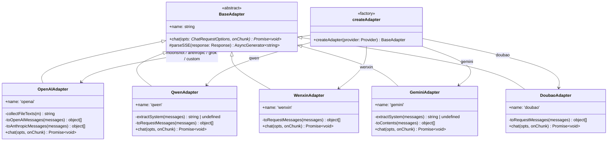
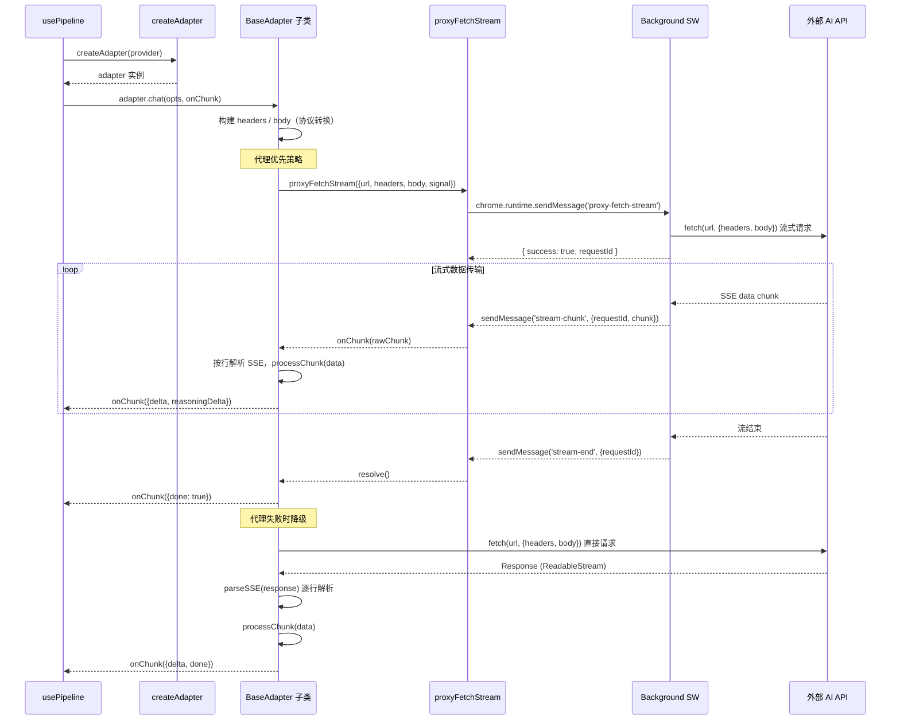

# AI 适配器架构

## 1. 模块概述

AI 适配器模块（`src/adapters/`）负责将内部统一的聊天消息格式转换为各 AI 供应商的 API 协议，并处理流式响应的解析与回传。该模块采用 **策略 + 工厂** 模式：`BaseAdapter` 抽象类定义统一的 `chat()` 接口，各供应商适配器实现协议差异部分，`createAdapter` 工厂函数根据 `Provider` 类型创建对应实例。

当前支持的供应商：

| 供应商 | 适配器 | 协议 |
|--------|--------|------|
| OpenAI | `OpenAIAdapter` | OpenAI / Anthropic 双协议 |
| 通义千问（阿里） | `QwenAdapter` | 阿里 DashScope 原生 |
| 文心一言（百度） | `WenxinAdapter` | 百度千帆原生 |
| Google Gemini | `GeminiAdapter` | Google Generative Language API |
| 豆包（字节） | `DoubaoAdapter` | OpenAI 兼容 |
| 智谱 / DeepSeek / Moonshot / Grok / 自定义 | `OpenAIAdapter` | OpenAI 兼容 |
| Anthropic Claude | `OpenAIAdapter` | Anthropic 协议（自动检测） |

核心设计原则：

- **CORS 规避**：所有请求通过 `proxyFetchStream()` 经 background script 中转，避免内容脚本的跨域限制。
- **代理优先、直连降级**：代理请求失败时自动回退到直接 `fetch()`。
- **统一附件处理**：图片 OCR 文字与文件内容在适配层合并为纯文本，不依赖供应商的多模态接口。
- **doneFired 防重入**：通过布尔标志确保 `onChunk({ done: true })` 只触发一次。

## 2. 架构设计



## 3. 核心类型定义

### 3.1 BaseAdapter

`src/adapters/base.ts` 定义的抽象基类，所有适配器必须继承并实现 `chat()` 方法。

```typescript
export abstract class BaseAdapter {
  /** 协议名 */
  abstract readonly name: string;

  /**
   * 发送对话请求（流式）
   * @param opts 请求参数
   * @param onChunk 每收到一段回调
   */
  abstract chat(
    opts: ChatRequestOptions,
    onChunk: (chunk: StreamChunk) => void
  ): Promise<void>;

  /** 通用 SSE 解析工具：把 ReadableStream 解析成一行行 data: ... */
  protected async *parseSSE(
    response: Response
  ): AsyncGenerator<string, void, unknown>;
}
```

`parseSSE()` 是基类提供的通用 SSE 解析工具：

- 从 `response.body` 获取 `ReadableStream` 的 reader
- 使用 `TextDecoder('utf-8')` 解码二进制数据
- 维护 buffer，按换行符 `\n` 分割，提取 `data:` 前缀的行
- 遇到 `data: [DONE]` 时终止生成器
- 通过 `AsyncGenerator` 逐行 yield 数据，调用方用 `for await...of` 消费

### 3.2 ChatRequestOptions

```typescript
export interface ChatRequestOptions {
  baseUrl: string;       // API 基础地址
  apiKey: string;        // 认证密钥
  modelName: string;     // 模型标识（请求 body 用）
  provider?: string;     // 供应商标识（用于协议判断）
  messages: ChatMessage[];  // 标准化消息列表
  signal?: AbortSignal;  // 请求中止信号
}
```

### 3.3 StreamChunk

适配器通过 `onChunk` 回调向调用方传递流式数据的增量单元：

```typescript
export interface StreamChunk {
  delta?: string;           // 增量文本
  reasoningDelta?: string;  // 增量思考文本（深度思考模型）
  done?: boolean;           // 流结束标记
}
```

### 3.4 ProxyRequestOptions

`src/adapters/proxy.ts` 中定义的代理请求参数：

```typescript
export interface ProxyRequestOptions {
  url: string;
  method?: string;
  headers?: Record<string, string>;
  body?: string;
  signal?: AbortSignal;
}
```

### 3.5 ProxyResponse

非流式代理请求的响应结构：

```typescript
export interface ProxyResponse {
  success: boolean;
  data?: any;
  status?: number;
  error?: string;
}
```

## 4. 实现细节

### 4.1 工厂函数 createAdapter

`src/adapters/index.ts` 中的工厂函数，根据 `Provider` 联合类型选择适配器：

| Provider 值 | 适配器 |
|---|---|
| `qwen` | `QwenAdapter` |
| `wenxin` | `WenxinAdapter` |
| `gemini` | `GeminiAdapter` |
| `doubao` | `DoubaoAdapter` |
| `openai` / `zhipu` / `deepseek` / `moonshot` / `anthropic` / `grok` / `custom` / default | `OpenAIAdapter` |

大部分供应商兼容 OpenAI 协议，因此 `OpenAIAdapter` 是默认实现。仅协议差异较大的供应商（千问、文心、Gemini、豆包）需要独立适配器。

### 4.2 OpenAIAdapter -- 双协议支持

`OpenAIAdapter` 是最复杂的适配器，同时支持 OpenAI 和 Anthropic 两种协议。

**协议自动检测**：通过 `opts.provider` 和 URL 路径判断。`provider === 'anthropic'` 或 URL 包含 `/anthropic` 时走 Anthropic 协议，否则走 OpenAI 兼容协议。

```typescript
const isAnthropic = opts.provider === 'anthropic' || base.includes('/anthropic');
```

**智能 URL 拼接**：

- 若 `baseUrl` 已以 `/chat/completions` 或 `/messages` 结尾，直接使用
- Anthropic 协议：拼接 `/v1/messages`（若 baseUrl 已含 `/v1` 则只拼 `/messages`）
- OpenAI 协议：拼接 `/chat/completions`（不自动加 `/v1`，因为 baseUrl 可能已含版本路径如 `/v4`）

**请求头差异**：

| 协议 | Headers |
|---|---|
| OpenAI | `Content-Type: application/json` + `Authorization: Bearer {apiKey}` |
| Anthropic | `Content-Type: application/json` + `x-api-key: {apiKey}` + `anthropic-version: 2023-06-01` |

**Body 差异**：

| 协议 | Body |
|---|---|
| OpenAI | `{ model, messages, stream: true }` |
| Anthropic | `{ model, messages, max_tokens: 8192, stream: true }` |

**SSE 解析 -- processChunk**：

Anthropic 协议按 `event:` 行区分事件类型：
- `content_block_delta`：`text_delta` 提取文本，`thinking_delta` 提取思考内容
- `message_delta` / `message_stop`：触发 done

OpenAI 协议从 `choices[0].delta` 提取内容：
- `delta.content` 或 `delta.text`：正文增量
- `delta.reasoning_content` / `delta.reasoning` / `delta.thinking`：推理内容增量（三种字段名兼容）
- `choice.finish_reason`：触发 done

**doneFired 防重入**：`fireDone()` 通过闭包中的布尔标志确保 `onChunk({ done: true })` 只触发一次，避免代理路径和直连路径重复触发。

**附件处理**：`collectFileTexts()` 提取消息附件中的文本内容，图片以 `[图片文字识别: <name>]` 前缀，文件以 `[文件: <name>]` + 代码块包裹。`toOpenAIMessages()` 和 `toAnthropicMessages()` 均调用此方法。

**代理优先 + 直连降级**：先尝试 `proxyFetchStream()`，catch 到异常后回退到直接 `fetch()` + `parseSSE()`。

### 4.3 QwenAdapter -- 通义千问

使用阿里 DashScope 原生接口，与 OpenAI 协议有以下差异：

- **URL**：`/services/aigc/text-generation/generation`（非 `/chat/completions`）
- **Body 结构**：消息放在 `input.messages` 中，流式参数为 `parameters.incremental_output: true`，需要 `parameters.result_format: 'message'`
- **System 消息**：独立提取为 `input.system` 字段，不混入 messages 数组
- **认证**：`Authorization: Bearer {apiKey}`
- **SSE 格式**：响应在 `output.choices[0].message.content` 中，`finish_reason` 触发结束

### 4.4 WenxinAdapter -- 文心一言

使用百度千帆平台接口：

- **URL**：`/chat/completions`
- **Body 结构**：仅需 `messages` 和 `stream: true`，不需要 `model` 字段（模型由 endpoint 决定）
- **角色映射**：`assistant` 保持不变，其余角色（含 `system`）统一映射为 `user`
- **认证**：无 Authorization 头（认证信息通常编码在 URL 中）
- **SSE 格式**：响应在 `result` 字段中（非 `choices`），结束标记为 `is_end: true`，错误通过 `error_code` + `error_msg` 返回

### 4.5 GeminiAdapter -- Google Gemini

使用 Google Generative Language API：

- **URL**：`/v1beta/models/{model}:streamGenerateContent?alt=sse`（`alt=sse` 启用 SSE 格式）
- **认证头**：`x-goog-api-key`（非 Bearer token）
- **Body 结构**：消息放在 `contents` 数组中，角色映射 `assistant` -> `model`；`system` 提取为独立的 `systemInstruction` 字段；`generationConfig.maxOutputTokens` 设为 8192
- **SSE 格式**：响应在 `candidates[0].content.parts[].text` 中
- **深度思考**：通过 `part.thought` 区分思考内容（`reasoningDelta`）和正式回复（`delta`），Gemini 2.0+ thinking model 支持

### 4.6 DoubaoAdapter -- 豆包

使用火山引擎 OpenAI 兼容接口：

- **URL**：`/chat/completions`（智能检测 baseUrl 是否已包含完整路径）
- **Body 结构**：标准 OpenAI 格式 `{ model, messages, stream: true }`
- **认证**：`Authorization: Bearer {apiKey}`
- **SSE 格式**：标准 OpenAI 格式 `choices[0].delta.content`，`choice.finish_reason` 触发结束

### 4.7 代理层 proxy.ts

提供两个核心函数，通过 `chrome.runtime.sendMessage` 与 background script 通信以规避 CORS。

**`proxyFetch()` -- 非流式请求**：

- 发送 `{ type: 'proxy-fetch', url, method, headers, body }` 消息
- background 完成请求后返回 `ProxyResponse`
- 用于不需要流式响应的场景

**`proxyFetchStream()` -- 流式请求**：

1. 发送 `{ type: 'proxy-fetch-stream', url, method, headers, body }` 消息
2. 从响应中获取 `requestId`，用于后续消息匹配
3. 注册三个 `chrome.runtime.onMessage` 监听器：
   - `chunkListener`：接收 `stream-chunk` 类型消息，按 `requestId` 匹配后调用 `onChunk`
   - `endListener`：接收 `stream-end` 类型消息，resolve Promise
   - `errorListener`：接收 `stream-error` 类型消息，reject Promise
4. `cleanup()` 函数在结束时移除所有监听器

**竞态条件处理**：

- 通过 `aborted` 标志处理在 `requestId` 赋值前就收到 abort 信号的情况
- 若 `requestId` 赋值前已 abort，立即发送 `abort-stream` 消息并 reject
- abort 时发送 `{ type: 'abort-stream', requestId }` 通知 background 终止底层请求

**通信协议**：

| 消息类型 | 方向 | 字段 | 说明 |
|---|---|---|---|
| `proxy-fetch-stream` | CS -> BG | url, method, headers, body | 发起流式请求 |
| `stream-chunk` | BG -> CS | requestId, chunk | 流式数据块 |
| `stream-end` | BG -> CS | requestId | 流结束 |
| `stream-error` | BG -> CS | requestId, error | 流错误 |
| `abort-stream` | CS -> BG | requestId | 中止请求 |

**安全特性**：`bodySummary()` 函数在日志中将 `apiKey` 字段替换为 `***`，避免密钥泄露到日志存储。

## 5. 数据流



## 6. 配置与扩展

### 6.1 添加新供应商适配器

1. 在 `src/types.ts` 的 `Provider` 联合类型中添加新值
2. 创建 `src/adapters/<provider>.ts`，继承 `BaseAdapter`，实现 `chat()` 方法
3. 在 `src/adapters/index.ts` 的 `createAdapter()` switch 中添加 `case` 分支
4. 在工厂 switch 中注册映射

若新供应商兼容 OpenAI 协议，无需创建新适配器 -- 只需在 `Provider` 中添加类型，`createAdapter` 的 `default` 分支会自动使用 `OpenAIAdapter`。

### 6.2 适配器实现模板

每个适配器的 `chat()` 方法遵循统一结构：

1. **构建 URL**：根据供应商文档拼接 endpoint
2. **构建 headers**：认证方式因供应商而异（Bearer / x-api-key / x-goog-api-key / 无认证）
3. **构建 body**：将 `ChatMessage[]` 转换为供应商要求的消息格式
4. **定义 processChunk**：按供应商的 SSE 格式解析 JSON，提取 delta/reasoningDelta/done
5. **代理请求**：调用 `proxyFetchStream()`，在回调中缓冲并按行解析 SSE
6. **降级直连**：代理失败时用 `fetch()` + `parseSSE()` 直接请求
7. **触发 done**：通过 `doneFired` 标志确保只触发一次 `onChunk({ done: true })`

### 6.3 附件处理策略

所有适配器统一在消息转换阶段处理附件（不依赖供应商多模态接口）：

- 图片附件：以 `[图片文字识别: <filename>]` 前缀拼接 OCR 文本
- 文件附件：以 `[文件: <filename>]` 前缀 + 代码块包裹拼接内容
- 附件内容追加到消息正文末尾，以双换行分隔

### 6.4 适配器对比速查

| 适配器 | API 端点 | Auth | System 消息 | 结束标记 | 推理内容 |
|---|---|---|---|---|---|
| OpenAI | `/chat/completions` | Bearer token | messages 数组 | `finish_reason` | `reasoning_content` |
| Anthropic | `/v1/messages` | x-api-key | messages 数组 | `message_stop` | `thinking_delta` |
| Gemini | `...:streamGenerateContent` | x-goog-api-key | `systemInstruction` 字段 | `FINISH_REASON_*` | `part.thought` |
| Qwen | `.../generation` | Bearer token | `input.system` 字段 | `finish_reason` | - |
| Wenxin | `/chat/completions` | 无 | role 映射为 user | `is_end` | - |
| Doubao | `/chat/completions` | Bearer token | messages 数组 | `finish_reason` | - |

## 7. 已知限制

1. **proxyFetchStream 监听器注册时序**：代码先 `sendMessage` 获取 `requestId`，再注册 `chunkListener`。若 background 在监听器注册前就发出了 `stream-chunk` 消息，早期 chunk 可能丢失。当前依赖 background 端的缓冲机制缓解，但在高延迟场景下仍存在风险。

2. **OpenAIAdapter 附件格式重复**：`toOpenAIMessages()` 和 `toAnthropicMessages()` 的附件处理逻辑完全相同，存在代码重复，可提取为公共方法。

3. **WenxinAdapter 角色映射**：将 `system` 角色映射为 `user` 是近似处理，文心一言对 system prompt 的理解可能不如原生 system 字段精确。

4. **GeminiAdapter 附件未处理**：`toContents()` 方法直接使用 `m.content`，未合并附件文本内容，与其他适配器行为不一致。

5. **错误解析不统一**：各适配器的 HTTP 错误解析逻辑独立实现，错误格式检测（JSON 字段名）各不相同，缺少统一的错误提取抽象。

6. **缺少请求重试**：所有适配器在请求失败后直接抛出异常，没有内置重试机制。网络抖动场景下需要调用方处理重试逻辑。

7. **流式请求无超时控制**：`proxyFetchStream` 没有请求级别的超时机制，若 AI API 响应缓慢或挂起，只能依赖外部 `AbortSignal` 中止。
