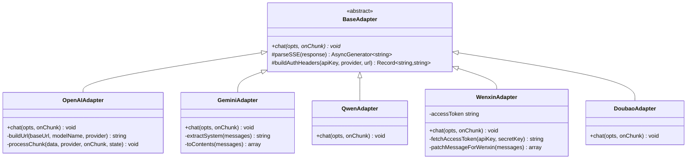
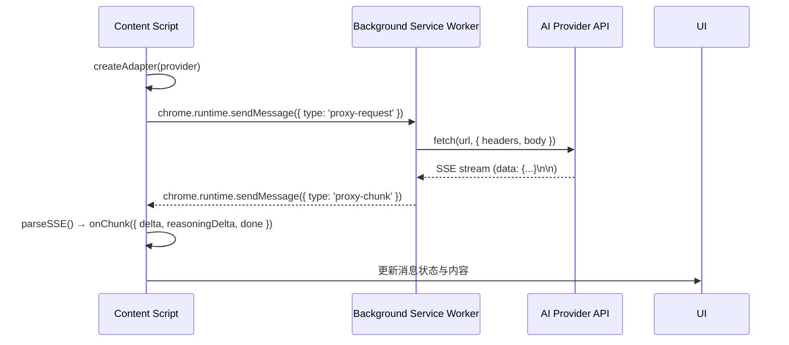

# AI 适配器架构

## 目标

统一多 AI 提供者的协议差异，提供一致的流式对话接口。适配器层将不同供应商的 API 格式（OpenAI、Anthropic、Gemini、通义千问、文心一言、豆包等）抽象为统一的 `chat()` 方法，使上层业务代码无需关心底层协议细节。

## 架构总览



## 核心设计决策

### 1. 工厂模式

`createAdapter(provider)` 工厂函数根据 provider 类型返回对应的适配器实例：

```typescript
// src/adapters/index.ts
export function createAdapter(provider: string): BaseAdapter {
  switch (provider) {
    case 'gemini':   return new GeminiAdapter();
    case 'wenxin':   return new WenxinAdapter();
    case 'doubao':   return new DoubaoAdapter();
    default:         return new OpenAIAdapter(); // 其余全部走 OpenAI 兼容
  }
}
```

**设计要点**：大多数供应商（OpenAI、Anthropic、DeepSeek、Moonshot、智谱、Grok、通义千问、自定义）均采用 OpenAI 兼容协议，只有 Gemini、文心一言、豆包等少数需要独立适配器。

### 2. 后台代理解决 CORS

Chrome 扩展的 Content Script 受同源策略限制，无法直接调用第三方 API。通过 `proxyFetchStream()` 将请求转发给 Background Service Worker：

```typescript
// src/adapters/proxy.ts
export async function proxyFetchStream(
  init: RequestInit & { url: string },
  onChunk: (chunk: string) => void,
): Promise<void>
```

**回退机制**：如果 `chrome.runtime` 不可用（如 Side Panel 中），自动降级为 `fetch()` 直连。

### 3. SSE 流式解析

`parseSSE()` 是 `BaseAdapter` 提供的 protected 工具方法，基于 Generator 模式逐行解析 Server-Sent Events：

```typescript
// src/adapters/base.ts
protected async *parseSSE(response: Response): AsyncGenerator<string> {
  // 按 UTF-8 解码流 → 逐行扫描 "data:" 前缀 → yield 数据行
}
```

### 4. OpenAIAdapter 双协议支持

`OpenAIAdapter` 不仅处理 OpenAI 格式，还自动适配 Anthropic Claude 协议：

- **协议检测**：通过 `options.provider === 'anthropic'` 或 URL 中包含 `anthropic` 判断
- **URL 构建**：OpenAI 用 `/v1/chat/completions`，Anthropic 用 `/v1/messages`
- **请求体转换**：Anthropic 将 system 消息提取到顶层 `system` 字段，而非 messages 数组
- **响应解析**：OpenAI 的 `choices[0].delta` vs Anthropic 的 `content_block_delta`
- **思考内容**：OpenAI 用 `reasoning_content` 字段，Anthropic 用 `thinking` content block

## 模块结构

```
src/adapters/
├── index.ts      # createAdapter() 工厂
├── base.ts       # BaseAdapter 抽象基类 + parseSSE()
├── openai.ts     # OpenAI + Anthropic + DeepSeek + Moonshot + 智谱 + Grok
├── gemini.ts     # Google Gemini (Generative Language API)
├── qwen.ts       # 通义千问（阿里，OpenAI 兼容封装）
├── wenxin.ts     # 文心一言（百度，独立协议 + access_token 认证）
├── doubao.ts     # 豆包（字节火山引擎，OpenAI 兼容 + endpoint_id）
└── proxy.ts      # proxyFetch() / proxyFetchStream() 后台代理
```

## 数据流



## 关键方法签名

```typescript
// 工厂函数
function createAdapter(provider: string): BaseAdapter

// 抽象基类
abstract class BaseAdapter {
  abstract chat(opts: ChatRequestOptions, onChunk: (chunk: StreamChunk) => void): Promise<void>
  protected async *parseSSE(response: Response): AsyncGenerator<string>
}

// 请求选项
interface ChatRequestOptions {
  baseUrl: string
  apiKey: string
  modelName: string
  provider?: string
  messages: ChatMessage[]
  signal?: AbortSignal
}

// 流式数据块
interface StreamChunk {
  delta?: string          // 增量文本
  reasoningDelta?: string // 增量思考文本
  done?: boolean          // 是否完成
}

// 后台代理
async function proxyFetchStream(
  init: RequestInit & { url: string },
  onChunk: (chunk: string) => void,
): Promise<void>
```

## 错误处理

1. **代理回退**：`proxyFetchStream()` 失败时自动降级为 `fetch()` 直连
2. **HTTP 错误解析**：尝试从响应体 JSON 中提取 `error.message`，提供有意义的错误提示
3. **中止支持**：所有适配器通过 `AbortSignal` 支持请求取消，避免内存泄漏和无效回调
4. **流异常捕获**：`parseSSE()` 中读取流失败时抛出 "读取流失败" 异常
5. **缓冲区保护**：SSE 解析器通过 `buffer.slice(0, 1024 * 1024)` 防止畸形数据导致内存溢出
6. **JSON 容错**：所有适配器的 chunk 解析均包裹在 try-catch 中，单条畸形数据不影响后续处理
7. **百度 access_token 错误**：`WenxinAdapter` 当 HTTP 200 但响应体包含错误码时，重置 token 并重试

## 支持的提供者

| Provider | 适配器 | 协议 | 认证方式 |
|----------|--------|------|----------|
| `openai` | OpenAIAdapter | OpenAI | Bearer token |
| `anthropic` | OpenAIAdapter | Anthropic | x-api-key |
| `gemini` | GeminiAdapter | Google Generative Language | x-goog-api-key |
| `qwen` | QwenAdapter | OpenAI 兼容 | Bearer token |
| `wenxin` | WenxinAdapter | 百度独立协议 | access_token (OAuth) |
| `zhipu` | OpenAIAdapter | OpenAI 兼容 | Bearer token |
| `deepseek` | OpenAIAdapter | OpenAI 兼容 | Bearer token |
| `moonshot` | OpenAIAdapter | OpenAI 兼容 | Bearer token |
| `doubao` | DoubaoAdapter | OpenAI 兼容 | Bearer token (endpoint_id) |
| `grok` | OpenAIAdapter | OpenAI 兼容 | Bearer token |
| `custom` | OpenAIAdapter | OpenAI 兼容 | Bearer token |

## 认证机制

适配器支持多种认证字段，通过 `buildAuthHeaders()` 统一处理：

| authField | Header | 适用场景 |
|-----------|--------|----------|
| `bearer` | `Authorization: Bearer <key>` | 默认，大多数供应商 |
| `api-key` | `Authorization: <key>` | Azure OpenAI |
| `x-api-key` | `x-api-key: <key>` | Anthropic / AWS Bedrock |
| `access-token` | `access-token: <key>` | 百度文心一言 |
| `authorization` | `Authorization: <key>` | 通用 |

若用户未指定 `authField`，系统根据 provider 自动选择默认值。
