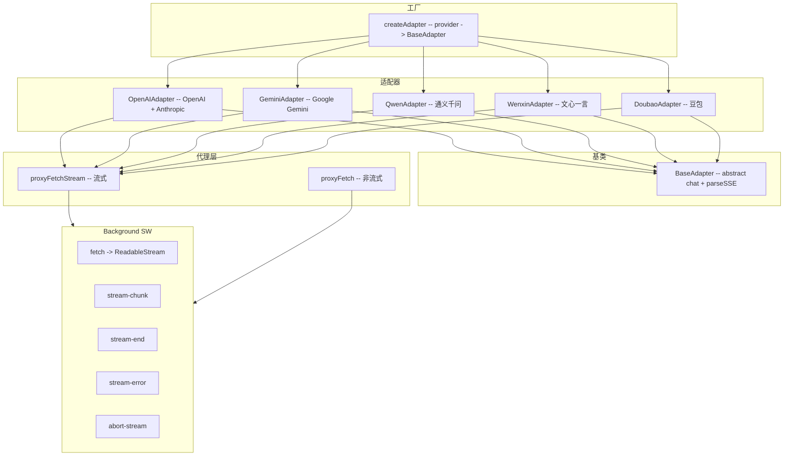
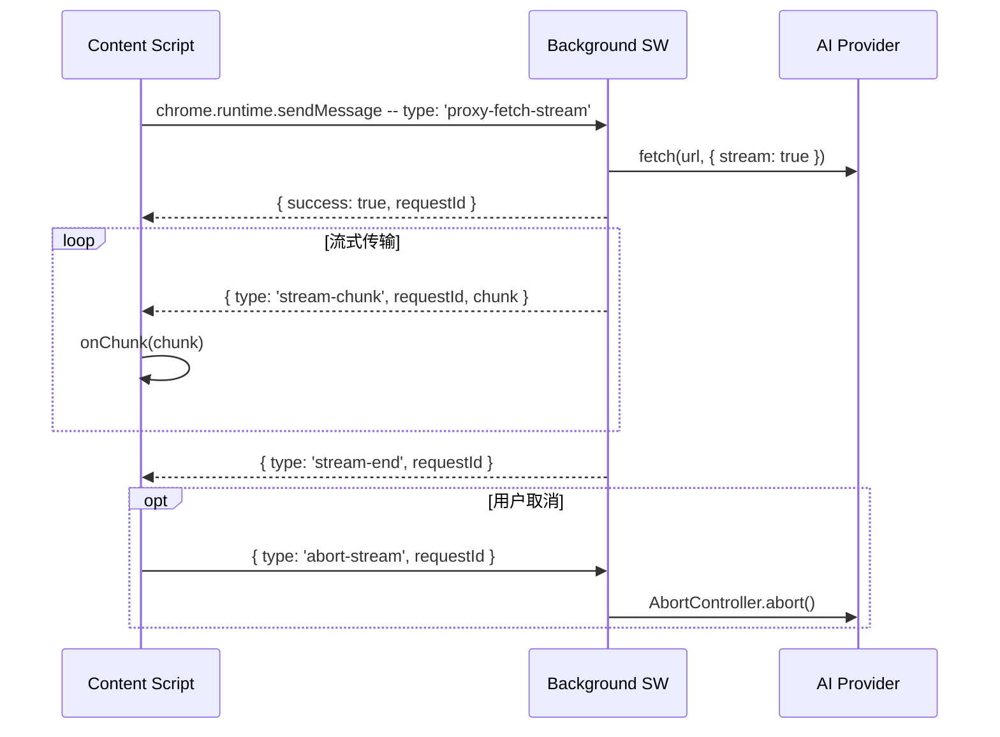

# AI 适配器 (AI Adapters)

> 工厂+策略模式：统一 `chat()` 接口，11 家供应商，Background 代理流式请求。

## 模块概览



## BaseAdapter -- 基类

**源码**: `src/adapters/base.ts`

```typescript
export abstract class BaseAdapter {
  abstract readonly name: string

  abstract chat(
    opts: ChatRequestOptions,
    onChunk: (chunk: StreamChunk) => void
  ): Promise<void>

  protected async *parseSSE(response: Response): AsyncGenerator<string, void, unknown>
}
```

`parseSSE` 是通用 SSE 解析工具：将 `ReadableStream` 解析为一行行 `data: ...`，遇到 `[DONE]` 终止。

## createAdapter -- 工厂函数

**源码**: `src/adapters/index.ts`

```typescript
export function createAdapter(provider: Provider): BaseAdapter {
  switch (provider) {
    case 'qwen':      return new QwenAdapter()
    case 'wenxin':    return new WenxinAdapter()
    case 'gemini':    return new GeminiAdapter()
    case 'doubao':    return new DoubaoAdapter()
    case 'openai':
    case 'zhipu':
    case 'deepseek':
    case 'moonshot':
    case 'anthropic':
    case 'grok':
    case 'custom':
    default:           return new OpenAIAdapter()
  }
}
```

大部分模型兼容 OpenAI 协议，直接使用 `OpenAIAdapter`。只有特殊协议的模型需要单独适配器。

## Provider 类型

**源码**: `src/types.ts`

```typescript
export type Provider =
  | 'openai'        // OpenAI 兼容
  | 'anthropic'     // Anthropic Claude
  | 'gemini'        // Google Gemini
  | 'custom'        // 自定义
  | 'qwen'          // 通义千问（阿里）
  | 'wenxin'        // 文心一言（百度）
  | 'zhipu'         // 智谱清言
  | 'deepseek'      // DeepSeek
  | 'moonshot'      // Moonshot (Kimi)
  | 'doubao'        // 豆包（字节火山引擎）
  | 'grok'          // Grok (xAI)
```

## OpenAIAdapter -- OpenAI + Anthropic

**源码**: `src/adapters/openai.ts`

```typescript
export class OpenAIAdapter extends BaseAdapter {
  readonly name = 'openai'
  async chat(opts: ChatRequestOptions, onChunk: (chunk: StreamChunk) => void): Promise<void>
}
```

### 协议检测

```typescript
const isAnthropic = opts.provider === 'anthropic' || base.includes('/anthropic')
```

### URL 拼接

| 条件 | URL |
|---|---|
| baseUrl 已包含完整路径（`/chat/completions` 或 `/messages`） | 直接使用 |
| Anthropic | `{base}/v1/messages` |
| OpenAI 兼容 | `{base}/chat/completions` |

### 请求差异

| 字段 | OpenAI | Anthropic |
|---|---|---|
| Headers | `Authorization: Bearer {apiKey}` | `x-api-key: {apiKey}`, `anthropic-version: 2023-06-01` |
| Body | `{ model, messages, stream }` | `{ model, messages, max_tokens: 8192, stream }` |

### Chunk 解析 -- processChunk

```typescript
const processChunk = (data: string) => {
  const json = JSON.parse(data)

  if (isAnthropic) {
    switch (json.type) {
      case 'content_block_delta':
        if (json.delta?.type === 'text_delta')     -> onChunk({ delta: json.delta.text })
        if (json.delta?.type === 'thinking_delta')  -> onChunk({ reasoningDelta: json.delta.thinking })
        break
      case 'message_delta':  -> fireDone()
      case 'message_stop':   -> fireDone()
    }
  } else {
    // OpenAI 格式
    const delta = choice.delta || choice.message || {}
    const reasoning = delta.reasoning_content ?? delta.reasoning ?? delta.thinking
    const content = delta.content ?? delta.text
    if (choice.finish_reason) fireDone()
  }
}
```

### 推理内容（Thinking）

| 供应商 | 字段 |
|---|---|
| OpenAI | `delta.reasoning_content` / `delta.reasoning` / `delta.thinking` |
| Anthropic | `delta.type === 'thinking_delta'` -> `delta.thinking` |

### 附件处理

```typescript
private collectFileTexts(m: ChatMessage): string {
  return m.attachments
    .filter(a => a.content)
    .map(a => {
      if (a.type === 'image') return `[图片文字识别: ${a.name}]\n${a.content}`
      return `[文件: ${a.name}]\n\`\`\`${a.lang || ''}\n${a.content}\n\`\`\``
    })
    .join('\n\n')
}
```

## GeminiAdapter -- Google Gemini

**源码**: `src/adapters/gemini.ts`

```typescript
export class GeminiAdapter extends BaseAdapter {
  readonly name = 'gemini'
  async chat(opts: ChatRequestOptions, onChunk: (chunk: StreamChunk) => void): Promise<void>
}
```

### API 端点

```
{baseUrl}/v1beta/models/{modelName}:streamGenerateContent?alt=sse
```

### 请求结构

```typescript
{
  contents: messages.map(m => ({
    role: m.role === 'assistant' ? 'model' : 'user',
    parts: [{ text: m.content }],
  })),
  generationConfig: { maxOutputTokens: 8192 },
  systemInstruction: { parts: [{ text: systemPrompt }] },  // system 消息独立字段
}
```

Headers: `x-goog-api-key: {apiKey}`

### Chunk 解析

```typescript
const processChunk = (data: string) => {
  const json = JSON.parse(data)
  const candidate = json.candidates?.[0]
  for (const part of candidate.content?.parts || []) {
    if (part.text) {
      if (part.thought) {
        onChunk({ reasoningDelta: part.text })  // Gemini 2.0+ thinking model
      } else {
        onChunk({ delta: part.text })
      }
    }
  }
  if (candidate.finishReason && candidate.finishReason !== 'FINISH_REASON_UNSPECIFIED') {
    fireDone()
  }
}
```

## QwenAdapter -- 通义千问

**源码**: `src/adapters/qwen.ts`

```typescript
export class QwenAdapter extends BaseAdapter {
  readonly name = 'qwen'
  async chat(opts: ChatRequestOptions, onChunk: (chunk: StreamChunk) => void): Promise<void>
}
```

### API 端点

```
{baseUrl}/services/aigc/text-generation/generation
```

### 请求结构

```typescript
{
  model: modelName,
  input: {
    messages: filteredMessages,      // 不含 system
    system: systemPrompt,            // system 独立字段
  },
  parameters: {
    result_format: 'message',
    incremental_output: true,
  },
}
```

Headers: `Authorization: Bearer {apiKey}`

### Chunk 解析

```typescript
const processChunk = (data: string) => {
  const json = JSON.parse(data)
  const choice = json.output?.choices?.[0]
  if (choice?.message?.content) {
    onChunk({ delta: choice.message.content })
  }
  if (choice?.finish_reason) fireDone()
}
```

## WenxinAdapter -- 文心一言

**源码**: `src/adapters/wenxin.ts`

```typescript
export class WenxinAdapter extends BaseAdapter {
  readonly name = 'wenxin'
  async chat(opts: ChatRequestOptions, onChunk: (chunk: StreamChunk) => void): Promise<void>
}
```

### API 端点

```
{baseUrl}/chat/completions
```

### 请求结构

```typescript
{
  messages: requestMessages,   // role 只有 user/assistant
  stream: true,
}
```

Headers: `{ 'Content-Type': 'application/json' }`（无 Authorization）

### Chunk 解析

```typescript
const processChunk = (data: string) => {
  const json = JSON.parse(data)
  if (json.error_code) throw new Error(`文心一言错误: ${json.error_msg}`)
  if (json.result) onChunk({ delta: json.result })   // result 字段（非 choices）
  if (json.is_end) fireDone()                          // is_end 标记结束
}
```

## DoubaoAdapter -- 豆包

**源码**: `src/adapters/doubao.ts`

```typescript
export class DoubaoAdapter extends BaseAdapter {
  readonly name = 'doubao'
  async chat(opts: ChatRequestOptions, onChunk: (chunk: StreamChunk) => void): Promise<void>
}
```

OpenAI 兼容协议。

### API 端点

```
{baseUrl}/chat/completions
```

### 请求结构

```typescript
{
  model: modelName,
  messages: requestMessages,
  stream: true,
}
```

Headers: `Authorization: Bearer {apiKey}`

### Chunk 解析

与 OpenAI 格式一致：`choices[0].delta.content`，`choice.finish_reason` 触发 done。

## proxyFetchStream -- 流式代理

**源码**: `src/adapters/proxy.ts`

```typescript
export async function proxyFetchStream(
  options: ProxyRequestOptions,
  onChunk: (chunk: string) => void
): Promise<void>
```

### 通信协议

```typescript
export interface ProxyRequestOptions {
  url: string
  method?: string
  headers?: Record<string, string>
  body?: string
  signal?: AbortSignal
}
```

### 流程



### 消息类型

| 类型 | 方向 | 字段 | 说明 |
|---|---|---|---|
| `proxy-fetch-stream` | CS -> BG | url, method, headers, body | 发起流式请求 |
| `stream-chunk` | BG -> CS | requestId, chunk | 流式数据块 |
| `stream-end` | BG -> CS | requestId | 流结束 |
| `stream-error` | BG -> CS | requestId, error | 流错误 |
| `abort-stream` | CS -> BG | requestId | 中止请求 |

### AbortSignal 支持

```typescript
// 注册监听器（先于 sendMessage，避免竞态）
chrome.runtime.onMessage.addListener(chunkListener)

// 监听 abort signal
if (options.signal) {
  options.signal.addEventListener('abort', () => {
    chrome.runtime.sendMessage({ type: 'abort-stream', requestId })
  }, { once: true })
}
```

### 错误处理

- 代理请求失败 -> 回退到直接请求（`fetch()`）
- 直接请求也失败 -> 抛出错误
- AbortSignal 触发 -> `DOMException('AbortError')`
- requestId 赋值前已 abort -> 立即中止并 reject

## proxyFetch -- 非流式代理

**源码**: `src/adapters/proxy.ts`

```typescript
export async function proxyFetch(options: ProxyRequestOptions): Promise<ProxyResponse>
```

```typescript
export interface ProxyResponse {
  success: boolean
  data?: any
  status?: number
  error?: string
}
```

通过 `chrome.runtime.sendMessage({ type: 'proxy-fetch' })` 发送，Background 返回完整响应。

## 适配器对比

| 适配器 | API 端点 | Auth | System 消息 | 结束标记 | 推理内容 |
|---|---|---|---|---|---|
| OpenAI | `/chat/completions` | Bearer token | messages 数组 | `finish_reason` | `reasoning_content` |
| Anthropic | `/v1/messages` | x-api-key | messages 数组 | `message_stop` | `thinking_delta` |
| Gemini | `/v1beta/models/{m}:streamGenerateContent` | x-goog-api-key | `systemInstruction` 字段 | `FINISH_REASON_*` | `part.thought` |
| Qwen | `/services/aigc/text-generation/generation` | Bearer token | `input.system` 字段 | `finish_reason` | - |
| Wenxin | `/chat/completions` | 无 | messages 数组 | `is_end` | - |
| Doubao | `/chat/completions` | Bearer token | messages 数组 | `finish_reason` | - |
| Zhipu | `/chat/completions` | Bearer token | messages 数组 | `finish_reason` | `reasoning_content` |
| DeepSeek | `/chat/completions` | Bearer token | messages 数组 | `finish_reason` | `reasoning_content` |
| Moonshot | `/chat/completions` | Bearer token | messages 数组 | `finish_reason` | - |
| Grok | `/chat/completions` | Bearer token | messages 数组 | `finish_reason` | - |
| Custom | `/chat/completions` | Bearer token | messages 数组 | `finish_reason` | - |

## ChatRequestOptions 接口

**源码**: `src/types.ts`

```typescript
export interface ChatRequestOptions {
  baseUrl: string
  apiKey: string
  modelName: string
  provider?: string
  messages: ChatMessage[]
  signal?: AbortSignal
}
```

## StreamChunk 接口

**源码**: `src/types.ts`

```typescript
export interface StreamChunk {
  delta?: string              // 增量文本
  reasoningDelta?: string     // 增量思考文本
  done?: boolean              // 完成标记
}
```
