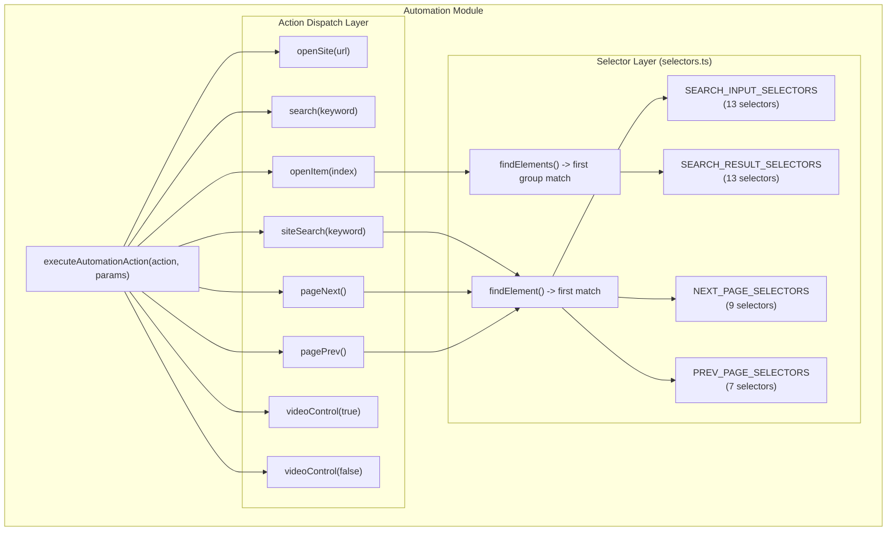
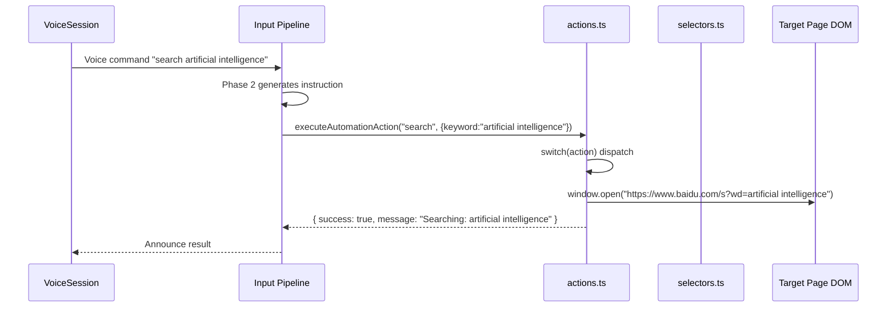
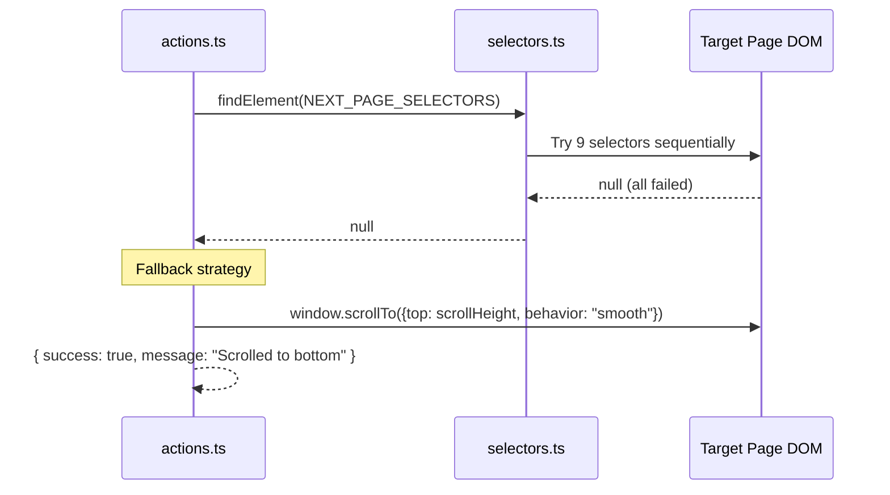

# Automation Module

> **🌐 中文版本：[automation.md](./automation.md)**

> Module path: `src/automation/`
> Voice-driven web automation: action execution, selector adaptation, DOM manipulation.

---

## 1. Module Overview

### 1.1 Purpose

The Automation module is the **web operation execution layer** of AI Browser, responsible for three core functions:

1. **Action Execution** — Provides a unified entry point `executeAutomationAction()` that dispatches to specific DOM operation functions based on action type.
2. **Selector Adaptation** — Adapts to major search engines (Baidu, Google, Bing) and general website structures through priority-ordered CSS selector lists.
3. **Graceful Degradation** — When selector matching fails, provides fallback strategies such as scrolling to the bottom or browser back navigation.

### 1.2 Position in the Architecture

```
User Voice -> VoiceSession -> Input Pipeline -> Phase 2 Instruction Generation
                                                    |
                                          Browser Command Engine
                                                    |
                                    executeAutomationAction() (this module)
                                                    |
                                              Page DOM Operations
```

- **Upstream**: Phase 2 of the Input Pipeline generates automation instructions and calls this module via content script.
- **Downstream**: Directly manipulates the target page DOM (`window.open`, `element.click`, `video.play`, etc.).
- **Parallel**: Coexists with the browser command engine in `src/browser/action-executor.ts`. This module focuses on search engine and media control scenarios.

### 1.3 Dependencies

| Dependency | Purpose |
|------|------|
| `src/utils/logger.ts` | Unified logging (`Logger('Automation')`, writes to chrome.storage.local) |
| `src/automation/selectors.ts` | DOM selector collections (internal dependency) |

### 1.4 File Structure

```
src/automation/
├── index.ts        # Public exports (barrel file)
├── actions.ts      # Action executor (8 action types)
└── selectors.ts    # DOM selector collections (4 selector groups + 2 lookup functions)
```

---

## 2. Architecture Design

### 2.1 Overall Architecture



### 2.2 Core Design Patterns

#### Strategy Dispatch (Strategy + Switch)

`executeAutomationAction()` serves as the unified entry point, dispatching to 8 concrete action functions via `switch(action)`. Each action function is independently encapsulated and returns a unified `ActionResult` interface.

#### Priority-ordered Selectors

All selector arrays are **sorted by priority**: site-specific selectors come first (e.g., Baidu `input[name="wd"]`), followed by generic selectors (e.g., `.search-input`). `findElement()` iterates through the list and returns the first match, implementing a "specific first, generic fallback" lookup strategy.

#### Graceful Degradation

Pagination operations provide fallback strategies when selector matching fails:
- `pageNext()` -> `window.scrollTo({ top: scrollHeight, behavior: 'smooth' })`
- `pagePrev()` -> `window.history.back()`

### 2.3 Design Rationale

| Design Decision | Reason |
|----------|------|
| Priority-ordered selectors | Major search engines have varying DOM structures; prioritizing site-specific selectors improves hit rate |
| Synchronous lookup instead of async wait | Pages are already loaded when content script is injected; synchronous lookup is sufficient and avoids added complexity |
| Delayed click (openItem 300ms) | Search results may not be fully rendered yet; the delay ensures DOM readiness |
| siteSearch dual submission | Some sites listen for Enter, others for form submit; dual mechanism improves compatibility |
| video.play() silent catch | Browser autoplay policy restrictions are unavoidable; silent failure is preferable to interrupting the user flow |

---

## 3. Core Type Definitions

### 3.1 AutomationAction

A union literal type for action types, with 8 predefined actions:

```typescript
type AutomationAction =
  | 'open_site'      // Open a website
  | 'search'         // Global web search
  | 'site_search'    // Site-specific search
  | 'open_item'      // Click the Nth search result
  | 'page_next'      // Next page
  | 'page_prev'      // Previous page
  | 'video_play'     // Play video
  | 'video_pause'    // Pause video
```

### 3.2 ActionResult

The unified return type for all action functions:

```typescript
interface ActionResult {
  success: boolean;   // Whether the action executed successfully
  message: string;    // Human-readable result description
}
```

### 3.3 ActionParams

Action parameters (second argument of `executeAutomationAction`):

```typescript
{
  url?: string;       // Used by open_site
  keyword?: string;   // Used by search, site_search
  index?: number;     // Used by open_item (1-based)
}
```

### 3.4 Selector Collection Types

All selector collections are of type `string[]`, sorted by priority:

| Constant | Count | Purpose |
|------|------|------|
| `SEARCH_INPUT_SELECTORS` | 13 | Search input field lookup |
| `SEARCH_RESULT_SELECTORS` | 13 | Search result link lookup |
| `NEXT_PAGE_SELECTORS` | 9 | Next page button lookup |
| `PREV_PAGE_SELECTORS` | 7 | Previous page button lookup |

---

## 4. Implementation Details

### 4.1 Action Executor (actions.ts)

#### Unified Entry Point

```typescript
export function executeAutomationAction(
  action: AutomationAction,
  params: { url?: string; keyword?: string; index?: number }
): ActionResult
```

Dispatches via switch to 8 concrete action functions. Unknown actions return `{ success: false, message: 'Unknown action: ...' }`.

#### openSite(url)

```typescript
function openSite(url: string): ActionResult
```

- Ensures URL has `https://` prefix: `url.startsWith('http') ? url : `https://${url}``
- `window.open(fullUrl, '_blank')` opens in a new tab
- Empty URL returns `{ success: false, message: 'No URL specified' }`

#### search(keyword)

```typescript
function search(keyword: string): ActionResult
```

- Constructs a Baidu search URL: `https://www.baidu.com/s?wd=${encodeURIComponent(keyword)}`
- `window.open()` opens in a new tab
- **Hardcoded** to use Baidu search engine; no support for switching

#### siteSearch(keyword)

```typescript
function siteSearch(keyword: string): ActionResult
```

**Three-step flow**:

1. `findElement(SEARCH_INPUT_SELECTORS)` locates the search input; returns error if not found
2. Sets `input.value = keyword`, dispatches `input` and `change` events (triggers reactive updates in frameworks like Vue/React)
3. After a 100ms delay:
   - Dispatches `KeyboardEvent('keydown', { key: 'Enter', keyCode: 13 })` to simulate Enter key
   - Finds the nearest `<form>` and dispatches `Event('submit')` for form submission

The dual submission mechanism (Enter + form submit) ensures compatibility with different site search implementations.

#### openItem(index)

```typescript
function openItem(index: number): ActionResult
```

- `findElements(SEARCH_RESULT_SELECTORS)` retrieves all search result links
- Takes the element at `index - 1` (parameter is 1-based index)
- After a 300ms delay, calls `(target as HTMLElement).click()`
- Boundary check: `index < 1` returns error; exceeding array bounds returns `No result at position N (total: X)`

#### pageNext()

```typescript
function pageNext(): ActionResult
```

- `findElement(NEXT_PAGE_SELECTORS)` looks for the next page button
- Found -> `(nextBtn as HTMLElement).click()`
- Not found -> **Fallback**: `window.scrollTo({ top: document.body.scrollHeight, behavior: 'smooth' })`

#### pagePrev()

```typescript
function pagePrev(): ActionResult
```

- `findElement(PREV_PAGE_SELECTORS)` looks for the previous page button
- Found -> `(prevBtn as HTMLElement).click()`
- Not found -> **Fallback**: `window.history.back()`

#### videoControl(isPlay)

```typescript
function videoControl(isPlay: boolean): ActionResult
```

- `document.querySelector('video')` finds the first video element on the page
- `isPlay=true` -> `video.play().catch(() => {})` (silently handles autoplay policy errors)
- `isPlay=false` -> `video.pause()`

### 4.2 Selector Collections (selectors.ts)

#### findElement — Single Element Lookup

```typescript
export function findElement(selectors: string[]): Element | null
```

Iterates through the selector list, executing `document.querySelector(selector)` for each, and returns the first matching element. Invalid selectors are skipped via `try/catch`.

**Strategy**: first-match-wins; priority ordering ensures site-specific selectors match first.

#### findElements — Multi-Element Lookup

```typescript
export function findElements(selectors: string[]): Element[]
```

Iterates through the selector list, executing `document.querySelectorAll(selector)` for each, and returns the first non-empty `NodeList` (converted to `Array`). Unlike `findElement`, this returns a **group of elements** rather than a single one.

#### SEARCH_INPUT_SELECTORS (13 selectors)

```typescript
export const SEARCH_INPUT_SELECTORS = [
  'input[type="search"]',           // HTML5 search input
  'input[name="wd"]',               // Baidu
  'input[name="q"]',                // Google / Bing
  'input[id="kw"]',                 // Baidu
  'input[id="search-input"]',       // Generic ID
  'input[placeholder*="搜索"]',      // Chinese placeholder
  'input[placeholder*="search"]',   // English placeholder
  'input[aria-label*="搜索"]',       // Chinese accessibility label
  'input[aria-label*="search"]',    // English accessibility label
  '.search-input',                  // Common class
  '.search-box input',              // Nested class
  '.search-bar input',              // Nested class
  '#search',                        // ID selector
]
```

#### SEARCH_RESULT_SELECTORS (13 selectors)

```typescript
export const SEARCH_RESULT_SELECTORS = [
  '.result h3 a',                   // Baidu
  '.c-container h3 a',              // Baidu (container variant)
  '.g a h3',                        // Google
  '.yuRUbf a',                      // Google (new layout)
  '.b_algo h2 a',                   // Bing
  'h3 a',                           // Generic title link
  '.item a',                        // Generic list item
  '.card a',                        // Card layout
  '.result a',                      // Result container
  '.title a',                       // Title container
  '.list-item a',                   // List item
  '.video-item a',                  // Video item
  '.feed-item a',                   // Feed item
]
```

#### NEXT_PAGE_SELECTORS (9 selectors)

```typescript
export const NEXT_PAGE_SELECTORS = [
  'a.n',                            // Baidu
  '#page a:last-child',             // Baidu (pagination container end)
  '#pnnext',                        // Google
  '.b_pag a.sb_pagN',               // Bing
  '.next',                          // Generic class
  '.page-next',                     // Generic class
  'a[rel="next"]',                  // Semantic rel attribute
  '.pagination-next',               // Generic pagination
  '.pagination .next',              // Inside pagination container
]
```

#### PREV_PAGE_SELECTORS (7 selectors)

```typescript
export const PREV_PAGE_SELECTORS = [
  'a.prec',                         // Baidu
  '#pnprev',                        // Google
  '.prev',                          // Generic class
  '.page-prev',                     // Generic class
  'a[rel="prev"]',                  // Semantic rel attribute
  '.pagination-prev',               // Generic pagination
  '.pagination .prev',              // Inside pagination container
]
```

---

## 5. Data Flow

### 5.1 Complete Execution Flow



### 5.2 Site Search Flow

```mermaid
sequenceDiagram
    participant Actions as actions.ts
    participant Sel as selectors.ts
    participant DOM as Target Page DOM

    Actions->>Sel: findElement(SEARCH_INPUT_SELECTORS)
    Sel->>DOM: querySelector("input[type="search"]")
    DOM-->>Sel: null (no match)
    Sel->>DOM: querySelector("input[name="wd"]")
    DOM-->>Sel: <input name="wd">
    Sel-->>Actions: searchInput

    Actions->>DOM: searchInput.value = keyword
    Actions->>DOM: dispatchEvent("input")
    Actions->>DOM: dispatchEvent("change")

    Note over Actions: 100ms delay

    Actions->>DOM: dispatchEvent("keydown", Enter)
    Actions->>DOM: closest("form") -> dispatchEvent("submit")
```



### 5.3 Pagination Fallback Flow



---

## 6. Configuration and Extension

### 6.1 Configurable Parameters

| Parameter | Current Value | Location | Description |
|------|--------|------|------|
| Search engine | Baidu (hardcoded) | `actions.ts` line 99 | `search()` always uses `baidu.com/s?wd=` |
| openItem click delay | 300ms | `actions.ts` line 157 | `setTimeout` to wait for DOM loading |
| siteSearch submit delay | 100ms | `actions.ts` line 121 | Wait before dispatching Enter |
| video play error handling | Silent catch | `actions.ts` line 202 | `.catch(() => {})` |

### 6.2 Extension Points

#### Adding New Action Types

1. Add a new literal to the `AutomationAction` union type:

```typescript
type AutomationAction =
  | ...existing...
  | 'scroll_to'     // Scroll to a specific position
```

2. Add a case in the `executeAutomationAction` switch:

```typescript
case 'scroll_to':
  result = scrollTo(params.keyword!);
  break;
```

3. Implement the concrete action function, returning `ActionResult`.

#### Adding New Selectors

Append new selectors to the corresponding array in `selectors.ts` (note priority: site-specific first, generic last):

```typescript
export const SEARCH_INPUT_SELECTORS = [
  // ... existing ...
  'input[data-testid="search-input"]',  // New site-specific selector
]
```

#### Adding New Selector Collections

1. Define a new `const XXX_SELECTORS: string[]` array in `selectors.ts`
2. Export it in `index.ts`
3. Use `findElement(XXX_SELECTORS)` or `findElements(XXX_SELECTORS)` in action functions

---

## 7. Known Limitations

### 7.1 Selector Fragility

CSS selectors depend on website DOM structures; site redesigns may break selectors. Priority ordering partially mitigates but cannot fully solve this. Current selectors cover Baidu, Google, Bing, and some generic structures, but have limited support for niche search engines and custom UI frameworks.

### 7.2 Hardcoded Search Engine

`search()` always uses Baidu (`https://www.baidu.com/s?wd=`) and does not support user-configurable search engines (e.g., Google, Bing). Switching search engines requires source code changes.

### 7.3 No Element Wait Mechanism

`findElement()` and `findElements()` perform synchronous immediate lookups without waiting for dynamically loaded elements to appear. The 300ms delay in `openItem` is an empirical value and is not guaranteed to be reliable under all network conditions. For asynchronously rendered search results in SPA applications, longer waits or a MutationObserver mechanism may be needed.

### 7.4 Incomplete Event Simulation

`siteSearch` simulates user input by dispatching `input`, `change`, `keydown`, and `submit` events, but some frameworks (such as React's synthetic event system) may not respond to native DOM events. Some sites may require `InputEvent` instead of `Event`, or need `event.isTrusted` to be set (which cannot be simulated).

### 7.5 video.play() Autoplay Policy

Modern browsers' autoplay policies may block `video.play()` (requiring user interaction or muted state). Currently, errors are silently caught without informing the user of the failure reason.

### 7.6 No iframe Support

All selectors only search within the main document (`document`) and do not penetrate `<iframe>` or Shadow DOM. Embedded search results (such as Google Custom Search embeds) cannot be targeted.

### 7.7 pageNext Fallback Is Imprecise

When the next page button cannot be found, `scrollTo` scrolling to the bottom may not be the behavior the user expects (e.g., in single-page applications with no "bottom" concept, or pages with infinite scroll loading).

### 7.8 No Retry Mechanism

Failed action executions return error results directly without automatic retries. Failures caused by network jitter or temporary DOM instability require the user to retry manually.

### 7.9 index Parameter Does Not Validate Upper Bound

`openItem()` only validates `index < 1` but does not validate `index > items.length`. Although there is a subsequent `!target` check, the error message wording ("No result at position N") may confuse users.
