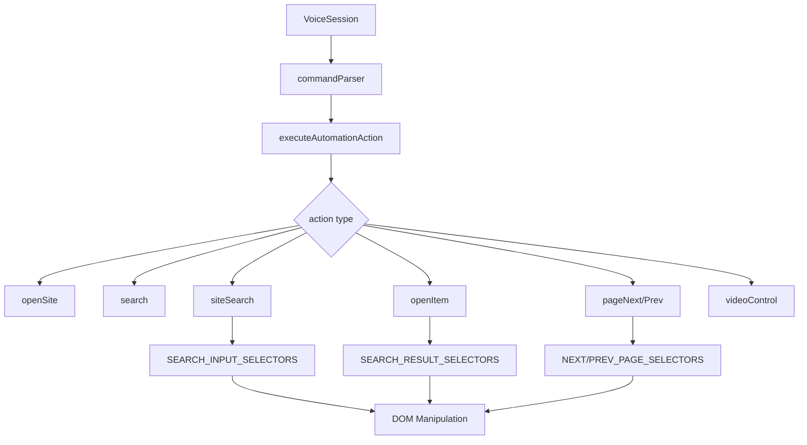
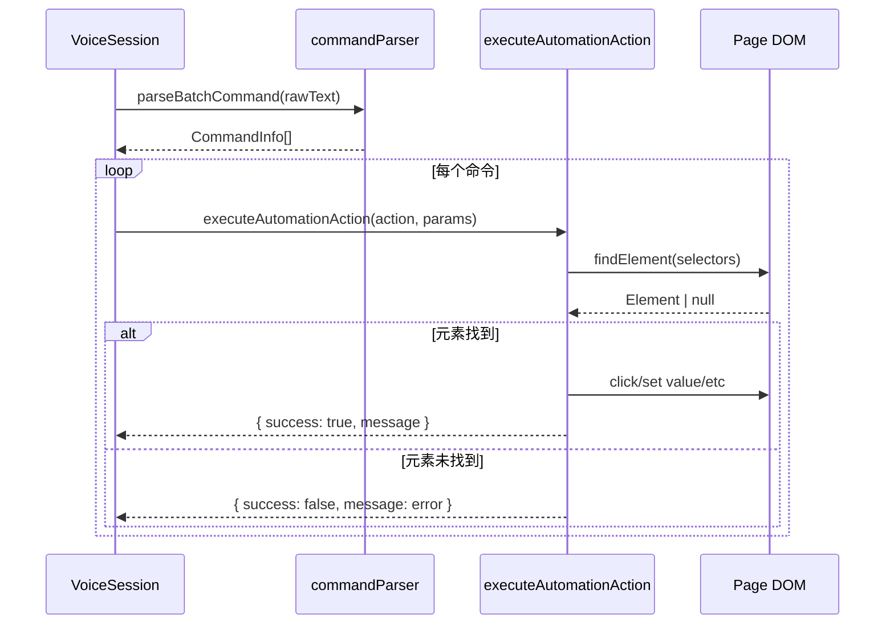

# 语音自动化模块

## 1. 模块概述

语音自动化模块为语音命令提供浏览器操作执行能力。与 `ActionExecutor` 不同，本模块使用更简单的直接 DOM 操作（不模拟完整事件序列），专门针对语音场景优化。

**职责：**
- 执行语音命令对应的浏览器操作
- 提供主流网站的 DOM 选择器适配
- 支持搜索、翻页、视频控制等常见操作

**源文件：**
- `src/automation/actions.ts` — 操作执行器
- `src/automation/selectors.ts` — DOM 选择器集合

**依赖：**
- `src/voice/commandParser.ts`（AutomationAction 类型）
- `@/src/utils/logger`

---

## 2. 架构设计



**设计模式：**
- **策略模式** — 不同 action 类型使用不同的执行策略
- **选择器降级列表** — 优先级排序的选择器数组，逐个尝试

**为什么这样设计：**
- 语音命令场景下，速度比精确性更重要（用户期望快速响应）
- 不需要完整的 PointerEvent 序列，直接 click() 即可
- 选择器列表覆盖主流搜索引擎，通用性好

---

## 3. 核心类型定义

```typescript
// 操作执行结果（本地定义，不与 browser/types.ts 共享）
interface ActionResult {
  success: boolean
  message: string
}

// AutomationAction 类型（来自 commandParser.ts）
type CommandType =
  | 'open_site' | 'search' | 'site_search' | 'open_item'
  | 'page_next' | 'page_prev' | 'video_play' | 'video_pause'
```

---

## 4. 实现细节

### 4.1 操作执行器

```typescript
function executeAutomationAction(
  action: AutomationAction,
  params: { url?: string; keyword?: string; index?: number }
): ActionResult
```

基于 switch 分发到各处理函数：

| Action | 处理函数 | 参数 |
|--------|---------|------|
| `open_site` | `openSite(url)` | url |
| `search` | `search(keyword)` | keyword |
| `site_search` | `siteSearch(keyword)` | keyword |
| `open_item` | `openItem(index)` | index (1-indexed) |
| `page_next` | `pageNext()` | 无 |
| `page_prev` | `pagePrev()` | 无 |
| `video_play` | `videoControl(true)` | 无 |
| `video_pause` | `videoControl(false)` | 无 |

### 4.2 openSite(url)

```
1. 如果 url 不以 http:// 或 https:// 开头，自动补全 https://
2. window.open(url, '_blank')
```

### 4.3 search(keyword)

```
1. 拼接百度搜索 URL: https://www.baidu.com/s?wd={keyword}
2. window.open(url, '_blank')
```

### 4.4 siteSearch(keyword)

```
1. 使用 SEARCH_INPUT_SELECTORS 查找搜索输入框
2. 设置 value 为 keyword
3. 分发 input + change 事件
4. 100ms 后模拟 Enter 键盘事件
5. 同时尝试表单提交
```

### 4.5 openItem(index)

```
1. index 为 1-indexed
2. 使用 SEARCH_RESULT_SELECTORS 查找搜索结果列表
3. 300ms 延迟后点击目标元素
```

### 4.6 pageNext() / pagePrev()

```
1. 使用 NEXT_PAGE_SELECTORS / PREV_PAGE_SELECTORS 查找翻页按钮
2. 如果找到，点击
3. 如果未找到：
   - pageNext: window.scrollTo({ behavior: 'smooth' }) 到底部
   - pagePrev: window.history.back()
```

### 4.7 videoControl(isPlay)

```
1. 查找第一个 <video> 元素
2. isPlay=true: video.play().catch(() => {})
3. isPlay=false: video.pause()
```

### 4.8 错误处理

- 缺少必要参数 → `{ success: false, message: '缺少参数' }`
- DOM 元素未找到 → 返回描述性错误消息
- `video.play()` Promise 拒绝 → 静默捕获（浏览器自动播放策略）

---

## 5. 选择器集合

### 5.1 SEARCH_INPUT_SELECTORS（12 个）

按优先级排序：
1. 通用：`input[type="search"]`
2. 百度：`input[name="wd"]`, `input[id="kw"]`
3. Google/Bing：`input[name="q"]`
4. 语义：`placeholder*="搜索"`
5. 类名：`.search-input`, `.search-box input`

### 5.2 SEARCH_RESULT_SELECTORS（13 个）

1. 百度：`.result h3 a`, `.c-container h3 a`
2. Google：`.g a h3`, `.yuRUbf a`
3. Bing：`.b_algo h2 a`
4. 通用：`.item a`, `.card a`, `.result a`, `.title a`

### 5.3 NEXT_PAGE_SELECTORS（8 个）

1. 百度：`a.n`, `#page a:last-child`
2. Google：`#pnnext`
3. Bing：`.b_pag a.sb_pagN`
4. 通用：`.next`, `a[rel="next"]`, `.pagination-next`

### 5.4 PREV_PAGE_SELECTORS（7 个）

1. 百度：`a.prec`
2. Google：`#pnprev`
3. 通用：`.prev`, `a[rel="prev"]`, `.pagination-prev`

### 5.5 辅助函数

```typescript
function findElement(selectors: string[]): Element | null
// 遍历选择器，返回第一个匹配的元素

function findElements(selectors: string[]): Element[]
// 遍历选择器，返回第一个匹配 >= 1 个元素的选择器结果
```

**策略：** First-match-wins（不合并所有选择器结果）

---

## 6. 数据流



---

## 7. 配置与扩展

### 添加新选择器

在 `selectors.ts` 中向对应的数组添加新条目。选择器按优先级排序，前面的优先匹配。

### 添加新操作

1. 在 `commandParser.ts` 的 `CommandType` 中添加新类型
2. 在 `actions.ts` 的 `executeAutomationAction` 中添加 case
3. 实现对应的处理函数
4. 如需选择器，在 `selectors.ts` 中添加

---

## 8. 已知限制

1. **直接 DOM 操作** — 不模拟完整事件序列，某些 SPA 框架可能不响应
2. **选择器覆盖有限** — 仅覆盖主流搜索引擎，小众网站可能不适用
3. **无骨架提取** — 不像 ActionExecutor 那样使用语义骨架定位元素
4. **硬编码搜索引擎** — `search()` 固定使用百度，不支持其他搜索引擎
5. **无重试机制** — 操作失败不会自动重试
6. **延迟依赖** — `siteSearch` 和 `openItem` 使用 setTimeout，页面响应慢时可能失败
