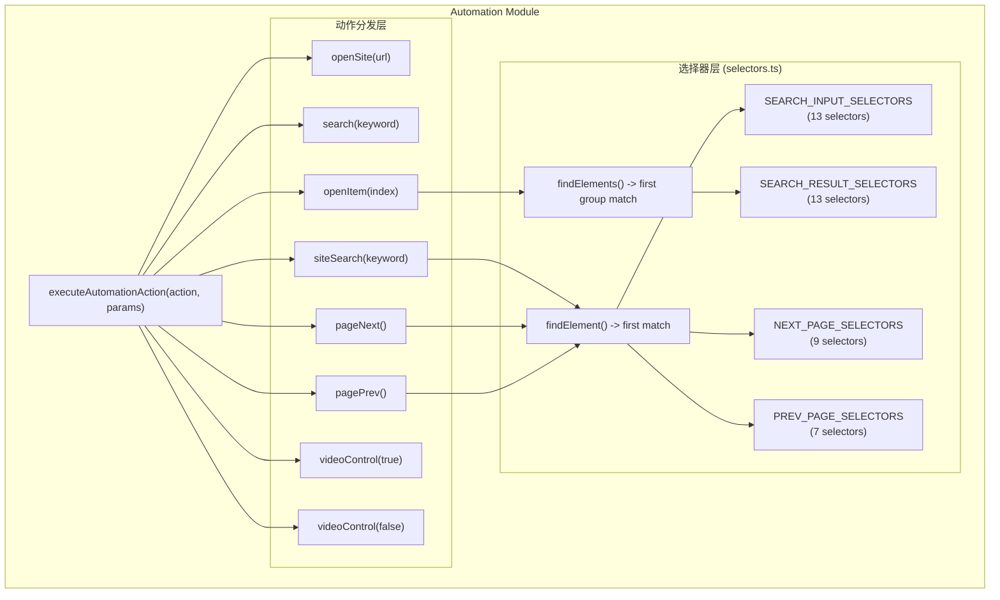
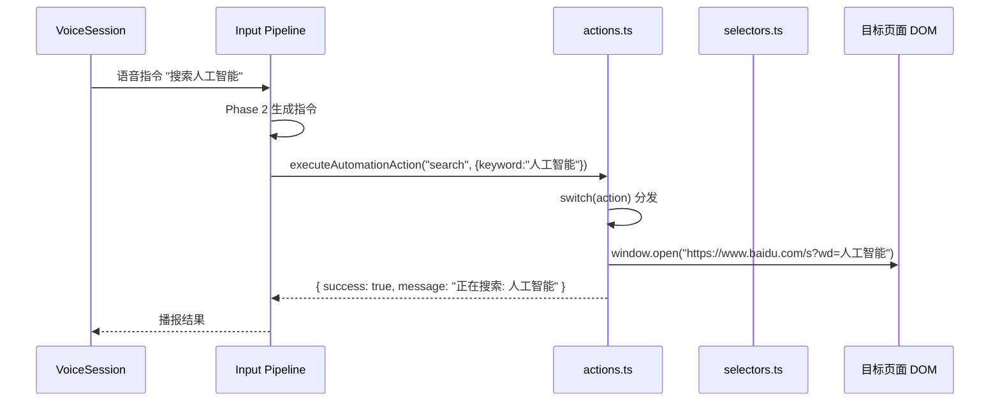
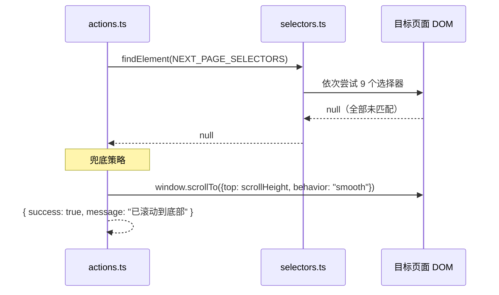

# 自动化模块 (Automation Module)

> 模块路径：`src/automation/`
> 语音驱动的网页自动化：动作执行、选择器适配、DOM 操作。

---

## 1. 模块概述

### 1.1 功能定位

Automation 模块是 AI Browser 的**网页操作执行层**，承担三项核心职责：

1. **动作执行** — 提供统一入口 `executeAutomationAction()`，根据动作类型分发到具体的 DOM 操作函数。
2. **选择器适配** — 通过优先级有序的 CSS 选择器列表，适配百度、Google、Bing 等主流搜索引擎及通用网站结构。
3. **兜底降级** — 当选择器匹配失败时，提供滚动到底部、浏览器后退等兜底策略。

### 1.2 在架构中的位置

```
用户语音 → VoiceSession → Input Pipeline → Phase 2 指令生成
                                                    ↓
                                          Browser Command Engine
                                                    ↓
                                    executeAutomationAction()（本模块）
                                                    ↓
                                              页面 DOM 操作
```

- **上游**：Input Pipeline 的 Phase 2 生成自动化指令，通过 content script 调用本模块。
- **下游**：直接操作目标页面 DOM（`window.open`、`element.click`、`video.play` 等）。
- **并行**：与 `src/browser/action-executor.ts` 的浏览器命令引擎并行存在，本模块专注于搜索引擎和媒体控制场景。

### 1.3 依赖关系

| 依赖 | 用途 |
|------|------|
| `src/utils/logger.ts` | 统一日志（`Logger('Automation')`，写入 chrome.storage.local） |
| `src/automation/selectors.ts` | DOM 选择器集合（模块内部依赖） |

### 1.4 文件结构

```
src/automation/
├── index.ts        # 公共导出（barrel 文件）
├── actions.ts      # 动作执行器（8 种动作类型）
└── selectors.ts    # DOM 选择器集合（4 组选择器 + 2 个查找函数）
```

---

## 2. 架构设计

### 2.1 整体架构



### 2.2 核心设计模式

#### 策略分发（Strategy + Switch）

`executeAutomationAction()` 作为统一入口，通过 `switch(action)` 分发到 8 个具体动作函数。每个动作函数独立封装，返回统一的 `ActionResult` 接口。

#### 优先级有序选择器（Priority-ordered Selectors）

所有选择器数组按**优先级排序**：针对特定网站的选择器在前（如百度 `input[name="wd"]`），通用选择器在后（如 `.search-input`）。`findElement()` 遍历列表返回第一个匹配项，实现"先精确后模糊"的查找策略。

#### 兜底降级（Graceful Degradation）

翻页操作在选择器匹配失败时提供降级策略：
- `pageNext()` → `window.scrollTo({ top: scrollHeight, behavior: 'smooth' })`
- `pagePrev()` → `window.history.back()`

### 2.3 为什么这样设计

| 设计决策 | 理由 |
|----------|------|
| 选择器优先级排序 | 主流搜索引擎 DOM 结构各异，优先匹配特定站点选择器提升命中率 |
| 同步查找而非异步等待 | content script 注入时页面已加载完成，同步查找足够；避免引入复杂度 |
| 延迟点击（openItem 300ms） | 搜索结果可能尚未完全渲染，延迟确保 DOM 就绪 |
| siteSearch 双重提交 | 部分网站监听 Enter，部分监听 form submit，双重机制提升兼容性 |
| video.play() 静默 catch | 浏览器 autoplay 策略限制不可避免，静默失败优于打断用户流程 |

---

## 3. 核心类型定义

### 3.1 AutomationAction

动作类型联合字面量类型，8 种预定义动作：

```typescript
type AutomationAction =
  | 'open_site'      // 打开网站
  | 'search'         // 全网搜索
  | 'site_search'    // 站内搜索
  | 'open_item'      // 点击第 N 个搜索结果
  | 'page_next'      // 下一页
  | 'page_prev'      // 上一页
  | 'video_play'     // 视频播放
  | 'video_pause'    // 视频暂停
```

### 3.2 ActionResult

所有动作函数的统一返回类型：

```typescript
interface ActionResult {
  success: boolean;   // 动作是否执行成功
  message: string;    // 人类可读的结果描述（中文）
}
```

### 3.3 ActionParams

动作参数（`executeAutomationAction` 的第二个参数）：

```typescript
{
  url?: string;       // open_site 使用
  keyword?: string;   // search、site_search 使用
  index?: number;     // open_item 使用（1-based）
}
```

### 3.4 选择器集合类型

所有选择器集合均为 `string[]` 类型，按优先级排序：

| 常量 | 数量 | 用途 |
|------|------|------|
| `SEARCH_INPUT_SELECTORS` | 13 | 搜索输入框查找 |
| `SEARCH_RESULT_SELECTORS` | 13 | 搜索结果链接查找 |
| `NEXT_PAGE_SELECTORS` | 9 | 下一页按钮查找 |
| `PREV_PAGE_SELECTORS` | 7 | 上一页按钮查找 |

---

## 4. 实现细节

### 4.1 动作执行器 (actions.ts)

#### 统一入口

```typescript
export function executeAutomationAction(
  action: AutomationAction,
  params: { url?: string; keyword?: string; index?: number }
): ActionResult
```

switch 分发到 8 个具体动作函数，未知动作返回 `{ success: false, message: '未知动作: ...' }`。

#### openSite(url)

```typescript
function openSite(url: string): ActionResult
```

- 确保 URL 有 `https://` 前缀：`url.startsWith('http') ? url : \`https://${url}\``
- `window.open(fullUrl, '_blank')` 在新标签页打开
- 空 URL 返回 `{ success: false, message: '未指定网址' }`

#### search(keyword)

```typescript
function search(keyword: string): ActionResult
```

- 构建百度搜索 URL：`https://www.baidu.com/s?wd=${encodeURIComponent(keyword)}`
- `window.open()` 新标签页打开
- **硬编码**使用百度搜索引擎，不支持切换

#### siteSearch(keyword)

```typescript
function siteSearch(keyword: string): ActionResult
```

**三步流程**：

1. `findElement(SEARCH_INPUT_SELECTORS)` 查找搜索框，未找到返回错误
2. 设置 `input.value = keyword`，派发 `input` 和 `change` 事件（触发 Vue/React 等框架的响应式更新）
3. 100ms 延迟后：
   - 派发 `KeyboardEvent('keydown', { key: 'Enter', keyCode: 13 })` 模拟回车
   - 查找最近的 `<form>` 并派发 `Event('submit')` 表单提交

双重提交机制（Enter + form submit）确保兼容不同网站的搜索实现。

#### openItem(index)

```typescript
function openItem(index: number): ActionResult
```

- `findElements(SEARCH_RESULT_SELECTORS)` 获取所有搜索结果链接
- 取第 `index - 1` 个元素（参数为 1-based 索引）
- 300ms 延迟后 `(target as HTMLElement).click()`
- 边界检查：`index < 1` 返回错误，超出数组范围返回 `没有第 N 个结果（共 X 个）`

#### pageNext()

```typescript
function pageNext(): ActionResult
```

- `findElement(NEXT_PAGE_SELECTORS)` 查找下一页按钮
- 找到 → `(nextBtn as HTMLElement).click()`
- 未找到 → **兜底**：`window.scrollTo({ top: document.body.scrollHeight, behavior: 'smooth' })`

#### pagePrev()

```typescript
function pagePrev(): ActionResult
```

- `findElement(PREV_PAGE_SELECTORS)` 查找上一页按钮
- 找到 → `(prevBtn as HTMLElement).click()`
- 未找到 → **兜底**：`window.history.back()`

#### videoControl(isPlay)

```typescript
function videoControl(isPlay: boolean): ActionResult
```

- `document.querySelector('video')` 查找页面第一个视频元素
- `isPlay=true` → `video.play().catch(() => {})`（静默处理 autoplay 策略错误）
- `isPlay=false` → `video.pause()`

### 4.2 选择器集合 (selectors.ts)

#### findElement — 单元素查找

```typescript
export function findElement(selectors: string[]): Element | null
```

遍历选择器列表，对每个选择器执行 `document.querySelector(selector)`，返回第一个匹配的元素。无效选择器通过 `try/catch` 跳过。

**策略**：first-match-wins，优先级排序确保特定站点选择器优先命中。

#### findElements — 多元素查找

```typescript
export function findElements(selectors: string[]): Element[]
```

遍历选择器列表，对每个选择器执行 `document.querySelectorAll(selector)`，返回第一个有结果的 `NodeList`（转为 `Array`）。与 `findElement` 的区别在于返回**一组元素**而非单个。

#### SEARCH_INPUT_SELECTORS (13 个)

```typescript
export const SEARCH_INPUT_SELECTORS = [
  'input[type="search"]',           // HTML5 搜索框
  'input[name="wd"]',               // 百度
  'input[name="q"]',                // Google / Bing
  'input[id="kw"]',                 // 百度
  'input[id="search-input"]',       // 通用 ID
  'input[placeholder*="搜索"]',      // 中文 placeholder
  'input[placeholder*="search"]',   // 英文 placeholder
  'input[aria-label*="搜索"]',       // 中文无障碍标签
  'input[aria-label*="search"]',    // 英文无障碍标签
  '.search-input',                  // 常见 class
  '.search-box input',              // 嵌套 class
  '.search-bar input',              // 嵌套 class
  '#search',                        // ID 选择器
]
```

#### SEARCH_RESULT_SELECTORS (13 个)

```typescript
export const SEARCH_RESULT_SELECTORS = [
  '.result h3 a',                   // 百度
  '.c-container h3 a',              // 百度（容器变体）
  '.g a h3',                        // Google
  '.yuRUbf a',                      // Google（新版布局）
  '.b_algo h2 a',                   // Bing
  'h3 a',                           // 通用标题链接
  '.item a',                        // 通用列表项
  '.card a',                        // 卡片布局
  '.result a',                      // 结果容器
  '.title a',                       // 标题容器
  '.list-item a',                   // 列表项
  '.video-item a',                  // 视频项
  '.feed-item a',                   // 信息流项
]
```

#### NEXT_PAGE_SELECTORS (9 个)

```typescript
export const NEXT_PAGE_SELECTORS = [
  'a.n',                            // 百度
  '#page a:last-child',             // 百度（分页容器末尾）
  '#pnnext',                        // Google
  '.b_pag a.sb_pagN',               // Bing
  '.next',                          // 通用 class
  '.page-next',                     // 通用 class
  'a[rel="next"]',                  // 语义化 rel 属性
  '.pagination-next',               // 通用分页
  '.pagination .next',              // 分页容器内
]
```

#### PREV_PAGE_SELECTORS (7 个)

```typescript
export const PREV_PAGE_SELECTORS = [
  'a.prec',                         // 百度
  '#pnprev',                        // Google
  '.prev',                          // 通用 class
  '.page-prev',                     // 通用 class
  'a[rel="prev"]',                  // 语义化 rel 属性
  '.pagination-prev',               // 通用分页
  '.pagination .prev',              // 分页容器内
]
```

---

## 5. 数据流

### 5.1 完整执行流程



### 5.2 站内搜索流程

```mermaid
sequenceDiagram
    participant Actions as actions.ts
    participant Sel as selectors.ts
    participant DOM as 目标页面 DOM

    Actions->>Sel: findElement(SEARCH_INPUT_SELECTORS)
    Sel->>DOM: querySelector("input[type="search"]")
    DOM-->>Sel: null（未匹配）
    Sel->>DOM: querySelector("input[name="wd"]")
    DOM-->>Sel: <input name="wd">
    Sel-->>Actions: searchInput

    Actions->>DOM: searchInput.value = keyword
    Actions->>DOM: dispatchEvent("input")
    Actions->>DOM: dispatchEvent("change")

    Note over Actions: 100ms 延迟

    Actions->>DOM: dispatchEvent("keydown", Enter)
    Actions->>DOM: closest("form") -> dispatchEvent("submit")
```



### 5.3 翻页降级流程



---

## 6. 配置与扩展

### 6.1 可配置参数

| 参数 | 当前值 | 位置 | 说明 |
|------|--------|------|------|
| 搜索引擎 | 百度（硬编码） | `actions.ts` line 99 | `search()` 固定使用 `baidu.com/s?wd=` |
| openItem 点击延迟 | 300ms | `actions.ts` line 157 | `setTimeout` 等待 DOM 加载 |
| siteSearch 提交延迟 | 100ms | `actions.ts` line 121 | Enter 派发前等待 |
| video play 错误处理 | 静默 catch | `actions.ts` line 202 | `.catch(() => {})` |

### 6.2 扩展点

#### 新增动作类型

1. 在 `AutomationAction` 联合类型中添加新字面量：

```typescript
type AutomationAction =
  | ...existing...
  | 'scroll_to'     // 滚动到指定位置
```

2. 在 `executeAutomationAction` 的 switch 中添加 case：

```typescript
case 'scroll_to':
  result = scrollTo(params.keyword!);
  break;
```

3. 实现具体动作函数，返回 `ActionResult`。

#### 新增选择器

在 `selectors.ts` 对应数组中追加新选择器（注意优先级，特定站点在前，通用在后）：

```typescript
export const SEARCH_INPUT_SELECTORS = [
  // ... existing ...
  'input[data-testid="search-input"]',  // 新站点特有
]
```

#### 新增选择器集合

1. 在 `selectors.ts` 中定义新的 `const XXX_SELECTORS: string[]` 数组
2. 在 `index.ts` 中导出
3. 在动作函数中使用 `findElement(XXX_SELECTORS)` 或 `findElements(XXX_SELECTORS)`

---

## 7. 已知限制

### 7.1 选择器脆弱性

CSS 选择器依赖网站 DOM 结构，网站改版可能导致选择器失效。优先级排序部分缓解但无法根治。当前选择器覆盖百度、Google、Bing 及部分通用结构，但对小众搜索引擎和自定义 UI 框架支持有限。

### 7.2 搜索引擎硬编码

`search()` 固定使用百度（`https://www.baidu.com/s?wd=`），不支持用户自定义搜索引擎（如 Google、Bing）。切换搜索引擎需要修改源码。

### 7.3 无元素等待机制

`findElement()` 和 `findElements()` 是同步立即查找，不等待动态加载的元素出现。`openItem` 的 300ms 延迟是经验值，不保证在所有网络条件下可靠。对于 SPA 应用中异步渲染的搜索结果，可能需要更长等待或 MutationObserver 机制。

### 7.4 事件模拟不完整

`siteSearch` 通过派发 `input`、`change`、`keydown`、`submit` 事件模拟用户输入，但某些框架（如 React 的合成事件系统）可能不响应原生 DOM 事件。部分网站可能需要 `InputEvent` 而非 `Event`，或需要设置 `event.isTrusted`（不可模拟）。

### 7.5 video.play() 自动播放策略

现代浏览器的 autoplay 策略可能阻止 `video.play()`（需要用户交互或静音状态）。当前静默 catch 错误，不向用户反馈失败原因。

### 7.6 无 iframe 支持

所有选择器只在主文档（`document`）中查找，不穿透 `<iframe>` 或 Shadow DOM。嵌入式搜索结果（如 Google 自定义搜索嵌入）无法被选中。

### 7.7 pageNext 兜底不精确

当找不到下一页按钮时，`scrollTo` 滚动到底部可能不是用户期望的行为（如单页应用中无"底部"概念，或页面有无限滚动加载）。

### 7.8 无重试机制

动作执行失败直接返回错误结果，不做自动重试。网络抖动或临时 DOM 不稳定导致的失败需要用户手动重试。

### 7.9 index 参数不校验上界

`openItem()` 仅校验 `index < 1`，不校验 `index > items.length`。虽然后续有 `!target` 检查，但错误消息的措辞（"没有第 N 个结果"）可能让用户困惑。
