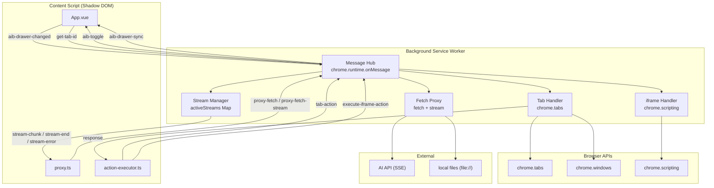
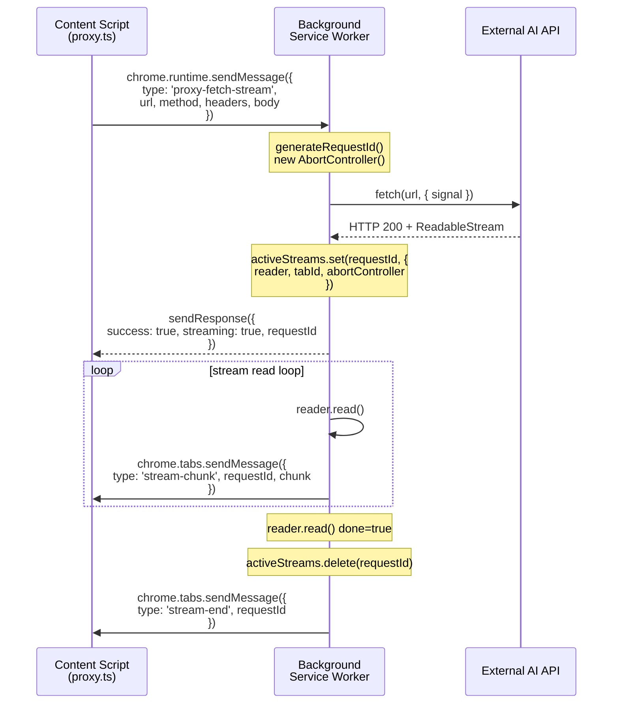
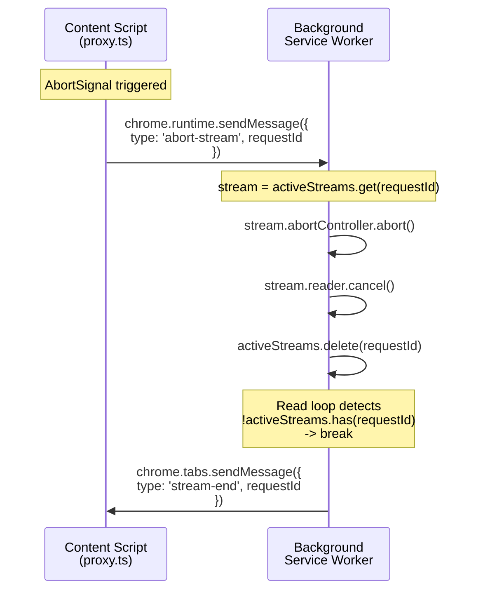
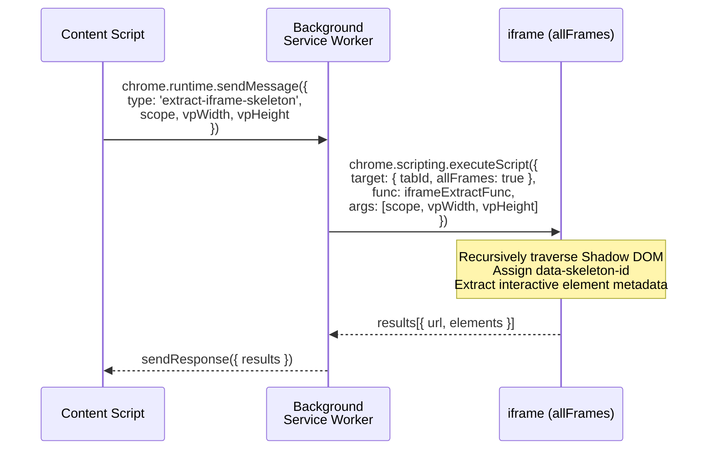
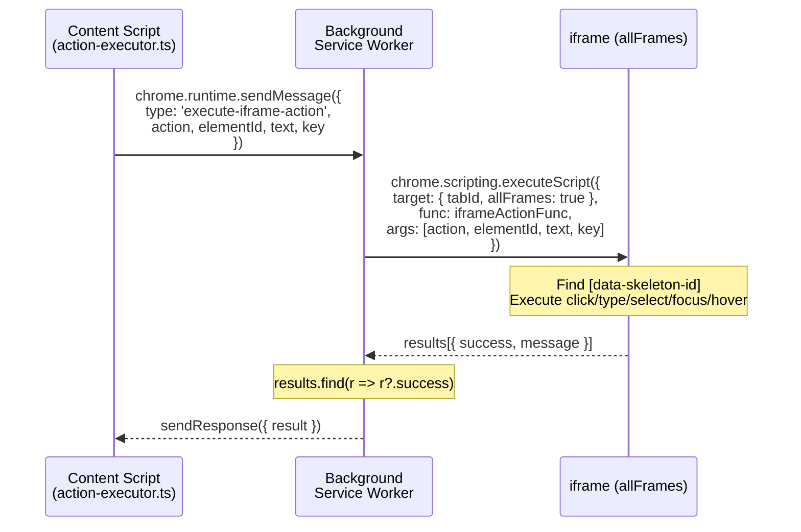
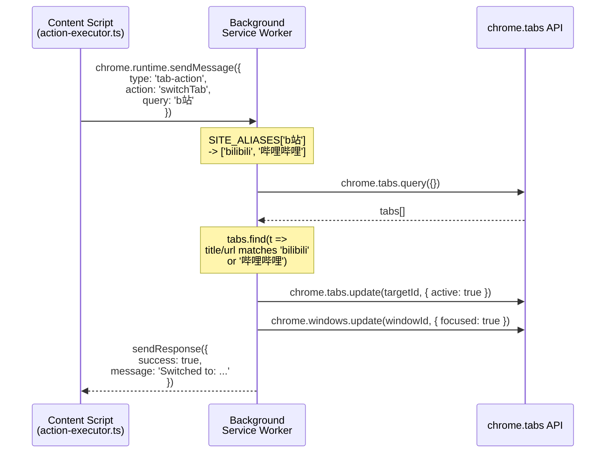
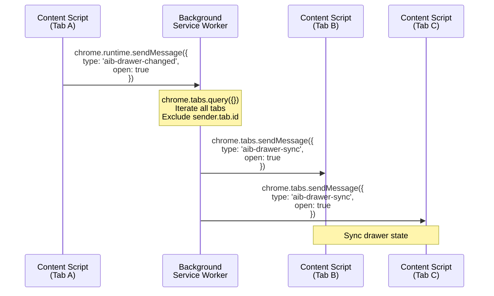

# Background Service Worker

> **🌐 中文版本：[background-service.md](./background-service.md)**

## Module Overview

The Background Service Worker is the backend hub of the extension, running in the Manifest V3 Service Worker context. It does not directly manipulate the DOM; instead, it acts as a message broker between content scripts, external networks, and browser APIs, with the following core responsibilities:

| Responsibility | Description |
|------|------|
| **Streaming Request Proxy** | Proxies SSE streaming requests, bypassing CORS restrictions in content scripts |
| **Standard Request Proxy** | Proxies non-streaming HTTP requests (`proxy-fetch`) |
| **Local File Reading** | Content scripts cannot `fetch('file://...')`; background acts as an intermediary |
| **Tab Management** | Create / close / switch tabs (content scripts lack `chrome.tabs` permissions) |
| **iframe Injection** | Executes skeleton extraction and DOM operations in iframes via `chrome.scripting.executeScript` |
| **Cross-Tab Sync** | Broadcasts drawer state changes for multi-tab UI consistency |
| **Toolbar / Shortcuts** | Responds to toolbar icon clicks and keyboard shortcuts to toggle the content script drawer |

**Source file**: `entrypoints/background.ts`

**Dependencies**:

- **Upstream**: Content Script (sends messages via `chrome.runtime.sendMessage`)
- **Downstream**: External AI APIs (initiates network requests via `fetch`), `chrome.tabs` / `chrome.windows` / `chrome.scripting` APIs
- **Utilities**: `Logger` (`src/utils/logger.ts`) for logging

---

## Architecture Design

### Overall Architecture



### Message Type Summary

| Message Type | Direction | Source Module | Purpose |
|---------|------|---------|------|
| `get-tab-id` | Content -> BG | App.vue | Get current tab ID (cross-tab session resumption) |
| `read-local-file` | Content -> BG | file-parsers.ts | Read `file://` local files |
| `extract-iframe-skeleton` | Content -> BG | skeleton-extractor | Execute skeleton extraction in all iframes |
| `execute-iframe-action` | Content -> BG | action-executor.ts | Execute DOM operations in all iframes |
| `proxy-fetch` | Content -> BG | proxy.ts | Proxy standard HTTP requests |
| `proxy-fetch-stream` | Content -> BG | proxy.ts | Proxy SSE streaming requests |
| `stream-chunk` | BG -> Content | (internal) | Forward streaming data chunks |
| `stream-end` | BG -> Content | (internal) | Stream end notification |
| `stream-error` | BG -> Content | (internal) | Stream error notification |
| `abort-stream` | Content -> BG | proxy.ts | Abort an in-progress streaming request |
| `aib-toggle` | BG -> Content | chrome.action / commands | Toolbar icon / shortcut triggers drawer toggle |
| `aib-drawer-changed` | Content -> BG | App.vue | Drawer state change (broadcast sync) |
| `aib-drawer-sync` | BG -> Content | (internal) | Receive drawer state from other tabs |
| `tab-action` | Content -> BG | action-executor.ts | Tab operations (newTab/closeTab/switchTab) |

---

## Core Type Definitions

### ActiveStream (Active Stream Tracking)

```typescript
// Actual structure (value in the Map)
interface ActiveStream {
  reader: ReadableStreamDefaultReader;  // Stream reader
  tabId: number;                         // Source tab ID (for message routing)
  abortController: AbortController;      // Used to abort the fetch request
}

// activeStreams: Map<string, ActiveStream>
// key = requestId, format: stream_{Date.now()}_{random7}
```

### Request ID Generation

```typescript
function generateRequestId(): string {
  return `stream_${Date.now()}_${Math.random().toString(36).slice(2, 9)}`;
}
```

Format: `stream_{timestamp}_{random7}` — timestamp + 7-character random base36 string, with extremely low collision probability.

### Site Alias Mapping

```typescript
const SITE_ALIASES: Record<string, string[]> = {
  'b站': ['bilibili', '哔哩哔哩'],
  'bilibili': ['bilibili', '哔哩哔哩'],
  '淘宝': ['taobao', '淘宝'],
  '京东': ['jd.com', '京东'],
  '百度': ['baidu', '百度'],
  '谷歌': ['google', '谷歌'],
  'github': ['github'],
  '掘金': ['juejin', '掘金'],
  '知乎': ['zhihu', '知乎'],
  '微博': ['weibo', '微博'],
  '抖音': ['douyin', '抖音', 'tiktok'],
  'youtube': ['youtube', 'youtube'],
  '油管': ['youtube', 'youtube'],
  'twitter': ['twitter', 'x.com'],
  '推特': ['twitter', 'x.com'],
  '网易': ['163.com', '网易'],
  '腾讯': ['qq.com', '腾讯'],
  '必应': ['bing', '必应'],
};
```

Keys are user inputs (lowercase); values are lists of matching keywords. During `switchTab`, the alias table is consulted first to expand match terms, then all tab titles / URLs are scanned.

### iframe Injection Function Signatures

```typescript
// Skeleton extraction (injected into iframe's allFrames: true context)
function iframeExtractFunc(
  scope: string,       // 'viewport' | 'all'
  vpWidth: number,     // Viewport width
  vpHeight: number,    // Viewport height
): { url: string; elements: unknown[] }

// Action execution (injected into iframe's allFrames: true context)
function iframeActionFunc(
  action: string,      // 'click' | 'type' | 'select' | 'focus' | 'hover' | 'clear'
  elementId: string,   // data-skeleton-id
  text: string,        // Text content for type/select
  key: string,         // Reserved (currently unused)
): { success: boolean; message: string } | null
```

---

## Implementation Details

### 1. Toolbar Icon and Keyboard Shortcuts

Two independent event listeners with identical functionality: send an `aib-toggle` message to the current active tab's content script.

```typescript
// Toolbar icon click
chrome.action.onClicked.addListener(async (tab) => {
  if (tab.id) {
    chrome.tabs.sendMessage(tab.id, { type: 'aib-toggle' }).catch(() => {});
  }
});

// Keyboard shortcut (toggle-chat command)
chrome.commands.onCommand.addListener(async (command) => {
  if (command !== 'toggle-chat') return;
  const [tab] = await chrome.tabs.query({ active: true, currentWindow: true });
  if (tab?.id) {
    chrome.tabs.sendMessage(tab.id, { type: 'aib-toggle' }).catch(() => {});
  }
});
```

**Note**: Both use `.catch(() => {})` to silently ignore errors (the content script may not yet be injected).

### 2. get-tab-id

The simplest message handler. Content scripts use this message to obtain their own tab ID, used in cross-tab session resumption scenarios.

```typescript
if (message.type === 'get-tab-id') {
  sendResponse({ tabId: sender.tab?.id });
  return false;  // Synchronous response
}
```

- **Return value**: `{ tabId: number | undefined }`
- **Synchronous**: `return false`

### 3. extract-iframe-skeleton (iframe Skeleton Extraction)

Content scripts cannot directly call the `chrome.scripting` API; the background acts as an intermediary to inject into all iframes of the target tab.

```typescript
if (message.type === 'extract-iframe-skeleton') {
  const { scope, vpWidth, vpHeight } = message;
  const tabId = sender.tab?.id;
  if (!tabId) { sendResponse({ error: 'no tabId' }); return false }

  chrome.scripting.executeScript({
    target: { tabId, allFrames: true },
    func: iframeExtractFunc,
    args: [scope, vpWidth, vpHeight],
  }).then(results => {
    sendResponse({ results: results.map(r => r.result).filter(Boolean) });
  }).catch(err => {
    sendResponse({ error: String(err) });
  });
  return true;  // Asynchronous response
}
```

**Parameters**:
- `scope`: `'viewport'` (viewport elements only) or `'all'` (all elements)
- `vpWidth` / `vpHeight`: Viewport dimensions, used for viewport-range filtering

**Injection logic**: `allFrames: true` ensures injection into all iframes. `iframeExtractFunc` internally traverses Shadow DOM recursively (max depth 10 levels), assigns `data-skeleton-id` to each interactive element, and extracts element metadata (tag, role, text, ariaLabel, placeholder, href, inputType, value, etc.).

**Return value**: `{ results: Array<{ url: string; elements: unknown[] }> }`, one record per iframe.

### 4. execute-iframe-action (iframe Action Execution)

Executes DOM operations in all iframes. Elements are located via `data-skeleton-id`; frames where the element is not found return `null` and are filtered out.

```typescript
if (message.type === 'execute-iframe-action') {
  const { action, elementId, text, key } = message;
  const tabId = sender.tab?.id;
  if (!tabId) { sendResponse({ error: 'no tabId' }); return false }

  chrome.scripting.executeScript({
    target: { tabId, allFrames: true },
    func: iframeActionFunc,
    args: [action, elementId, text || '', key || ''],
  }).then(results => {
    const result = results.map(r => r.result).find(r => r?.success);
    sendResponse({ result });
  }).catch(err => {
    sendResponse({ error: String(err) });
  });
  return true;
}
```

**Supported actions**:

| action | Behavior |
|--------|------|
| `click` | Full event sequence: pointerdown -> mousedown -> focus -> pointerup -> mouseup -> click |
| `type` | focus -> value setter -> input -> change |
| `clear` | Same as type, with empty text |
| `select` | Set select.value -> change |
| `focus` | focus -> focus event |
| `hover` | pointerover -> pointerenter -> mouseover -> mouseenter -> pointermove -> mousemove |

**Return value**: `{ result: { success: boolean; message: string } | undefined }`, returns the first successful result.

### 5. read-local-file (Local File Reading)

Content scripts are restricted by browser security policies and cannot directly `fetch('file://...')`. The background proxies the read and returns base64-encoded content.

```typescript
if (message.type === 'read-local-file') {
  const { url } = message;
  fetch(url)
    .then(async (res) => {
      if (!res.ok) {
        sendResponse({ success: false, error: `HTTP ${res.status}` });
        return;
      }
      const buffer = await res.arrayBuffer();
      const base64 = btoa(
        new Uint8Array(buffer).reduce(
          (data, byte) => data + String.fromCharCode(byte), ''
        )
      );
      const mimeType = res.headers.get('content-type') || 'application/octet-stream';
      sendResponse({ success: true, data: base64, mimeType });
    })
    .catch((err) => {
      sendResponse({ success: false, error: String(err) });
    });
  return true;
}
```

**Return value**:
- Success: `{ success: true, data: string (base64), mimeType: string }`
- Failure: `{ success: false, error: string }`

**Note**: MIME type relies on `res.headers.get('content-type')`; no suffix-based inference. Base64 encoding uses the `btoa` + `Uint8Array.reduce` approach.

### 6. proxy-fetch (Standard Request Proxy)

Proxies non-streaming HTTP requests, bypassing CORS restrictions. Returns the JSON response directly.

```typescript
if (message.type === 'proxy-fetch') {
  const { url, method, headers, body } = message;
  fetch(url, {
    method: method || 'POST',
    headers: headers || {},
    body: body,
  })
    .then(async (res) => {
      const data = await res.json();
      sendResponse({ success: true, data, status: res.status });
    })
    .catch((err) => {
      sendResponse({ success: false, error: String(err) });
    });
  return true;
}
```

**Return value**: `{ success: boolean, data?: any, status?: number, error?: string }`

**Note**: Response body is parsed via `res.json()`; non-JSON responses will throw an exception.

### 7. proxy-fetch-stream (Streaming Request Proxy)

The most critical background feature. Proxies SSE streaming requests and forwards stream data to content scripts through three channels: `stream-chunk` / `stream-end` / `stream-error`.

**Complete flow**:

1. Generate a unique `requestId`, create an `AbortController`
2. Initiate a `fetch()` request, obtain a `ReadableStream` reader
3. Store `{ reader, tabId, abortController }` in the `activeStreams` Map
4. Immediately return `{ success: true, streaming: true, requestId }` via `sendResponse`
5. Enter a `while(true)` read loop:
   - Each iteration checks `activeStreams.has(requestId)` (abort detection)
   - `reader.read()` reads a data chunk
   - Forward `stream-chunk` via `chrome.tabs.sendMessage`
6. After the loop ends, send `stream-end`
7. `finally` block cleans up `activeStreams`

```typescript
if (message.type === 'proxy-fetch-stream') {
  const { url, method, headers, body } = message;
  const requestId = generateRequestId();
  const abortController = new AbortController();

  fetch(url, {
    method: method || 'POST',
    headers: headers || {},
    body: body,
    signal: abortController.signal,
  })
    .then(async (res) => {
      if (!res.ok) {
        const text = await res.text();
        sendResponse({ success: false, error: `HTTP ${res.status}: ${text}` });
        return;
      }

      const reader = res.body?.getReader();
      if (!reader || !sender.tab?.id) {
        sendResponse({ success: false, error: 'Unable to obtain response stream' });
        return;
      }

      // Register active stream before notifying content script (avoid race condition)
      activeStreams.set(requestId, { reader, tabId: sender.tab.id, abortController });
      sendResponse({ success: true, streaming: true, requestId });

      const decoder = new TextDecoder();
      let buffer = '';

      try {
        while (true) {
          if (!activeStreams.has(requestId)) break;  // Abort detection

          const { done, value } = await reader.read();
          if (done) break;

          buffer += decoder.decode(value, { stream: true });
          chrome.tabs.sendMessage(sender.tab.id, {
            type: 'stream-chunk',
            requestId,
            chunk: buffer,
          }).catch(() => {});
          buffer = '';
        }
      } catch (streamErr) {
        if (!activeStreams.has(requestId)) return;  // Abort-caused error, silently exit
        chrome.tabs.sendMessage(sender.tab.id, {
          type: 'stream-error',
          requestId,
          error: String(streamErr),
        }).catch(() => {});
      } finally {
        activeStreams.delete(requestId);
      }

      chrome.tabs.sendMessage(sender.tab.id, {
        type: 'stream-end',
        requestId,
      }).catch(() => {});
    })
    .catch((err) => {
      if (sender.tab?.id) {
        chrome.tabs.sendMessage(sender.tab.id, {
          type: 'stream-error',
          requestId,
          error: String(err),
        }).catch(() => {});
      }
      sendResponse({ success: false, error: String(err) });
    });

  return true;
}
```

**Key design decisions**:
- `activeStreams.set` executes before `sendResponse` to avoid the race condition where `abort-stream` arrives before the stream is registered
- Each `reader.read()` checks `activeStreams.has(requestId)` first, implementing cooperative abort
- The `catch` block distinguishes between abort-caused errors (silent) and real errors (sends `stream-error`)
- The `finally` block ensures stream records are cleaned up

### 8. abort-stream (Abort Streaming Request)

```typescript
if (message.type === 'abort-stream') {
  const { requestId } = message;
  const stream = activeStreams.get(requestId);
  if (stream) {
    stream.abortController.abort();          // Abort fetch request
    stream.reader.cancel().catch(() => {});  // Cancel reader
    activeStreams.delete(requestId);          // Remove from Map
    chrome.tabs.sendMessage(stream.tabId, {
      type: 'stream-end',
      requestId,
    }).catch(() => {});                      // Notify content script that stream has ended
  }
  return false;  // Synchronous response
}
```

**Abort chain**: `abortController.abort()` terminates the underlying fetch -> `reader.cancel()` releases the stream -> `activeStreams.delete()` triggers the read loop break -> sends `stream-end` to notify the content script.

### 9. aib-drawer-changed (Cross-Tab Drawer Sync)

```typescript
if (message.type === 'aib-drawer-changed') {
  const { open } = message;
  chrome.tabs.query({}, (tabs) => {
    for (const tab of tabs) {
      if (tab.id && tab.id !== sender.tab?.id) {
        chrome.tabs.sendMessage(tab.id, {
          type: 'aib-drawer-sync',
          open,
        }).catch(() => {});
      }
    }
  });
  return false;  // Synchronous response (does not wait for broadcast to complete)
}
```

**Logic**: Iterates through all tabs, excludes the sender, and broadcasts `aib-drawer-sync`. Uses `.catch(() => {})` to ignore errors from tabs where the content script is not yet injected.

### 10. tab-action (Tab Management)

Supports three operations: `newTab`, `closeTab`, `switchTab`.

#### newTab

```typescript
if (action === 'newTab') {
  chrome.tabs.create({ url: message.url }).then((tab) => {
    if (tab.id) chrome.tabs.update(tab.id, { active: true });
    if (tab.windowId) chrome.windows.update(tab.windowId, { focused: true });
    sendResponse({ success: true, tabId: tab.id, message: `New tab: ${tab.id}` });
  }).catch((err) => {
    sendResponse({ success: false, error: String(err) });
  });
  return true;
}
```

After creating a new tab, it is automatically focused (`active: true` + `focused: true`). Cross-tab session resumption requires the new page to be immediately active.

#### closeTab

```typescript
if (action === 'closeTab') {
  const tabId = sender.tab?.id;
  if (tabId) {
    chrome.tabs.remove(tabId).then(() => {
      sendResponse({ success: true, message: 'Tab closed' });
    }).catch((err) => {
      sendResponse({ success: false, error: String(err) });
    });
  } else {
    sendResponse({ success: false, error: 'Unable to get current tab ID' });
  }
  return true;
}
```

Closes the sender's tab (`sender.tab.id`); does not support closing a specified tab.

#### switchTab

Supports two modes:

**Relative switching** (`query === 'next' | 'prev'`):

```typescript
if (query === 'next' || query === 'prev') {
  chrome.tabs.query({ currentWindow: true }).then((tabs) => {
    const activeIndex = tabs.findIndex((t) => t.active);
    if (activeIndex < 0) {
      sendResponse({ success: false, error: 'Current tab not found' });
      return;
    }
    let targetIndex: number;
    if (query === 'next') {
      targetIndex = (activeIndex + 1) % tabs.length;
    } else {
      targetIndex = (activeIndex - 1 + tabs.length) % tabs.length;
    }
    const target = tabs[targetIndex];
    if (target?.id) {
      chrome.tabs.update(target.id, { active: true }).then(() => {
        sendResponse({ success: true, message: `Switched to: ${target.title}` });
      }).catch(/* ... */);
    }
  }).catch(/* ... */);
  return true;
}
```

Index-based cycling through the current window's tab list, using modulo for wraparound.

**Keyword matching** (`query` is any string):

```typescript
const queryLower = query.toLowerCase();
const matchTerms = [queryLower, ...(SITE_ALIASES[queryLower] || [])];

chrome.tabs.query({}).then((tabs) => {
  const target = tabs.find((tab) => {
    const title = (tab.title || '').toLowerCase();
    const url = (tab.url || '').toLowerCase();
    return matchTerms.some(term => title.includes(term) || url.includes(term));
  });
  if (target?.id) {
    chrome.tabs.update(target.id, { active: true }).then(() => {
      if (target.windowId) {
        chrome.windows.update(target.windowId, { focused: true });
      }
      sendResponse({ success: true, message: `Switched to: ${target.title}` });
    }).catch(/* ... */);
  } else {
    sendResponse({ success: false, error: `No tab found containing "${query}"` });
  }
}).catch(/* ... */);
return true;
```

First expands match terms via `SITE_ALIASES`, then scans all tabs (cross-window) for substring matches in title / URL. After finding a match, both the tab and window are focused.

---

## Data Flow

### Streaming Request Proxy (SSE)



### Streaming Request Abort



### iframe Skeleton Extraction



### iframe Action Execution



### Tab Operations



### Cross-Tab Drawer Sync



---

## Configuration and Extension

### Adding a New Message Handler

Add a new `if` branch in the `chrome.runtime.onMessage.addListener` callback:

```typescript
chrome.runtime.onMessage.addListener((message, sender, sendResponse) => {
  // ... existing handlers ...

  if (message.type === 'your-new-type') {
    const { param1, param2 } = message;
    const tabId = sender.tab?.id;

    // Async operation -> return true
    someAsyncOperation(param1, param2)
      .then(result => sendResponse({ success: true, data: result }))
      .catch(err => sendResponse({ success: false, error: String(err) }));
    return true;

    // Sync operation -> return false
    // sendResponse({ result: syncValue });
    // return false;
  }
});
```

**Key points**:
- Synchronous operations: `return false`; asynchronous operations: `return true`
- Asynchronous operations must call `sendResponse` inside the callback
- Errors are returned in the format `{ success: false, error: String(err) }`
- The content script side needs a corresponding `chrome.runtime.sendMessage` call in `proxy.ts` or `action-executor.ts`

### Extending Site Aliases

Add new Chinese-English alias mappings directly in the `SITE_ALIASES` object:

```typescript
const SITE_ALIASES: Record<string, string[]> = {
  // ... existing mappings ...
  '新站点': ['newsite', '新站点'],
};
```

### Extending iframe Actions

Add a new action case in the `iframeActionFunc` switch statement:

```typescript
switch (action) {
  // ... existing actions ...
  case 'yourAction':
    // Operate on the el element
    return { success: true, message: 'Action successful' };
}
```

---

## Known Limitations

### 1. Service Worker Lifecycle

Manifest V3's Service Worker has strict lifecycle constraints:
- **Idle reclamation**: The browser may terminate the Service Worker after 30 seconds of idleness
- **Active stream interruption**: If the Service Worker is reclaimed during an active streaming request, the `reader` and `abortController` will be lost, and the stream will silently break
- **No keep-alive mechanism**: No `chrome.alarms` or port keep-alive strategies are currently implemented

**Impact**: Long-running SSE streaming requests (e.g., long LLM responses) may be interrupted. The content script side will receive `stream-error` or a timeout.

### 2. sendResponse Timing Issue

In streaming proxy mode, `sendResponse` is called immediately after fetch succeeds, but stream data is transmitted through a separate `chrome.tabs.sendMessage` channel. There is no strict ordering guarantee between the two channels:
- `sendResponse` returns `{ success: true, streaming: true, requestId }` to the content script
- `stream-chunk` messages are received via the `chrome.runtime.onMessage` listener
- The content script must receive `sendResponse` to get the `requestId` before registering the `chunkListener`, creating a race window

**Current mitigation**: In `proxy.ts`, the listener is registered before sending the message (but `requestId` has not yet been assigned), with a `requestId === null` short-circuit filter. On the background side, `activeStreams.set` executes before `sendResponse`.

### 3. No Concurrency Control for Streams

The `activeStreams` Map has no upper limit; in extreme cases, a large number of streaming requests may coexist:
- Each stream holds a `ReadableStreamDefaultReader` and an `AbortController`
- No timeout mechanism; zombie streams may occupy memory indefinitely
- No priority or queue management

### 4. Tab Switch Matching Accuracy

- `switchTab` keyword matching may switch to an unintended tab (e.g., multiple tabs with similar titles)
- `SITE_ALIASES` is hardcoded and does not support user customization
- `tabs.find` returns the first match; no fuzzy ranking support

### 5. No Retry Mechanism

Failed streaming requests directly notify the content script of the error; the background layer does not retry. Retry logic is the responsibility of the upper layer (adapter / UI).

### 6. iframe Injection Limitations

- `chrome.scripting.executeScript` with `allFrames: true` injects into all frames, including advertising iframes, potentially causing unintended actions
- `iframeExtractFunc` and `iframeActionFunc` are standalone functions and cannot access the background's closure variables
- Shadow DOM traversal has a maximum depth of 10 levels; extremely nested scenarios may miss elements

### 7. Logging

The background uses `Logger('Background')` for logging, but only covers certain critical paths:
- `read-local-file`: Logs URL and result
- `proxy-fetch-stream`: Logs stream read exceptions
- Other handlers have no log output
