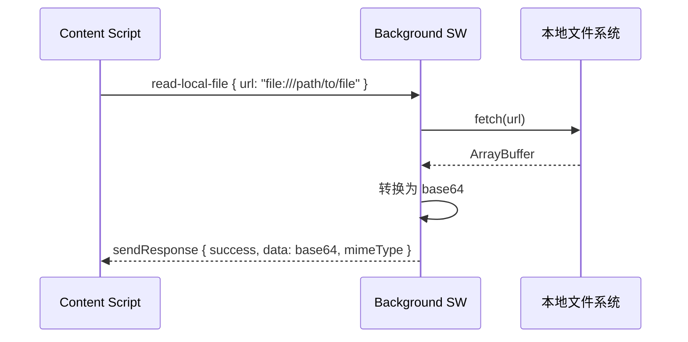
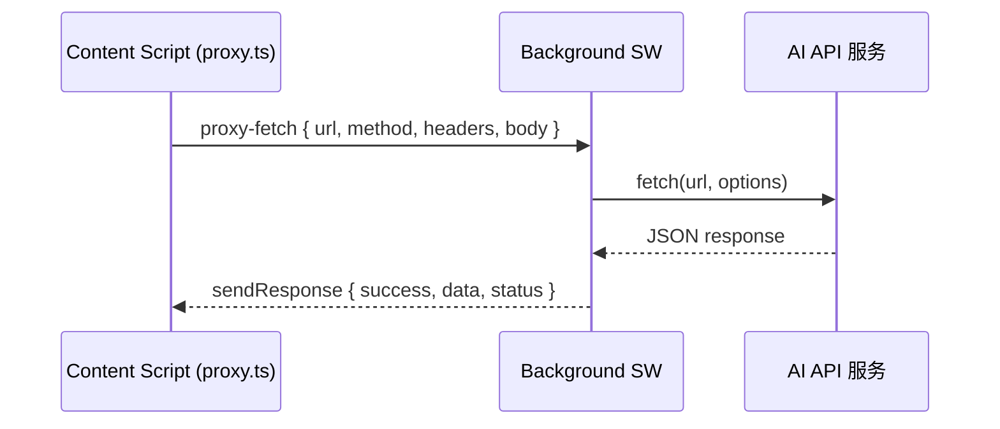
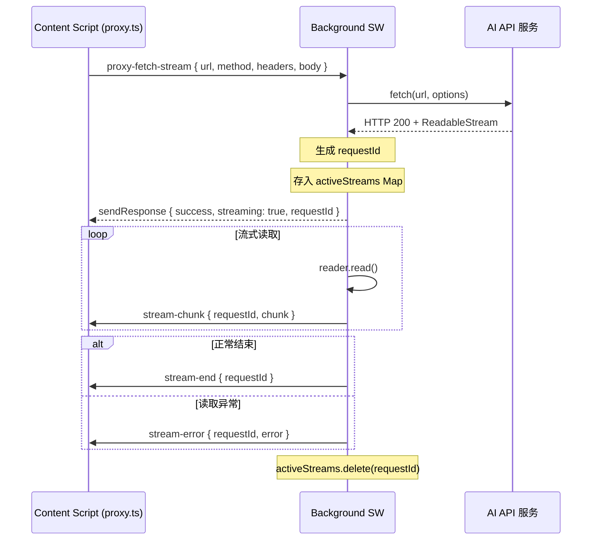
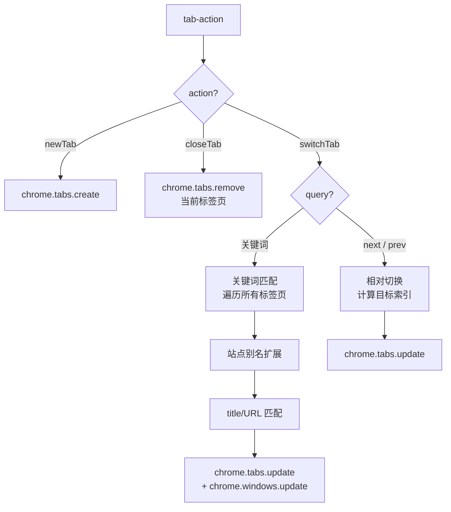
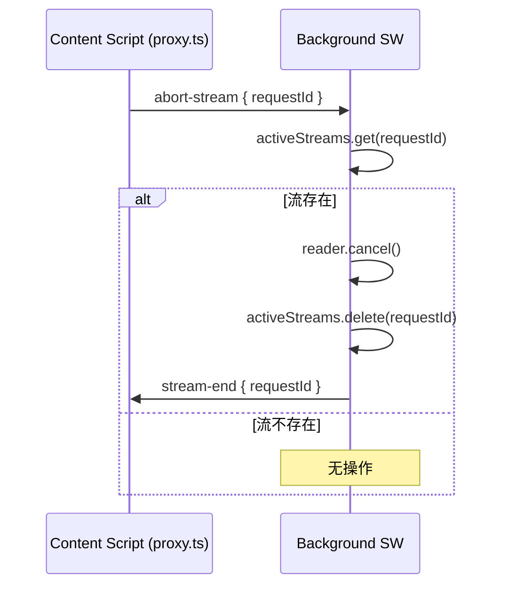
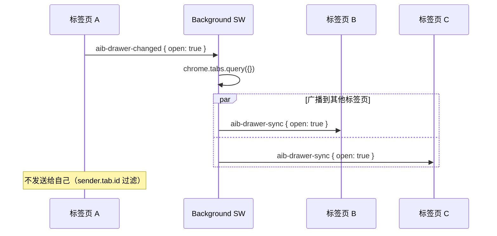
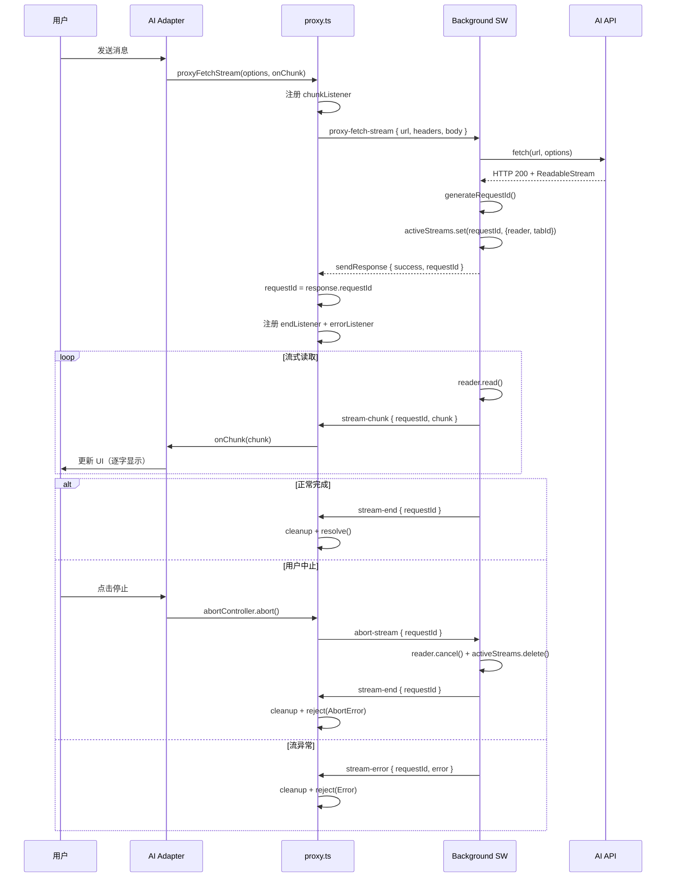
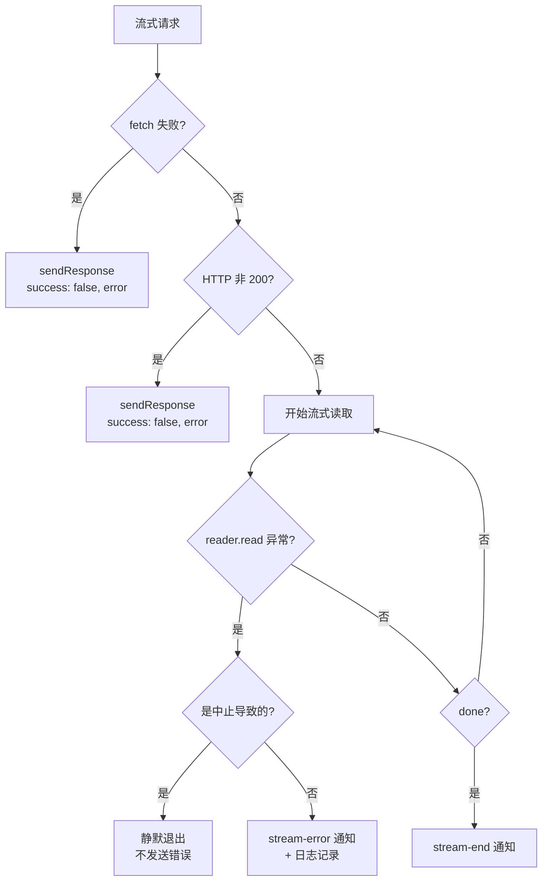
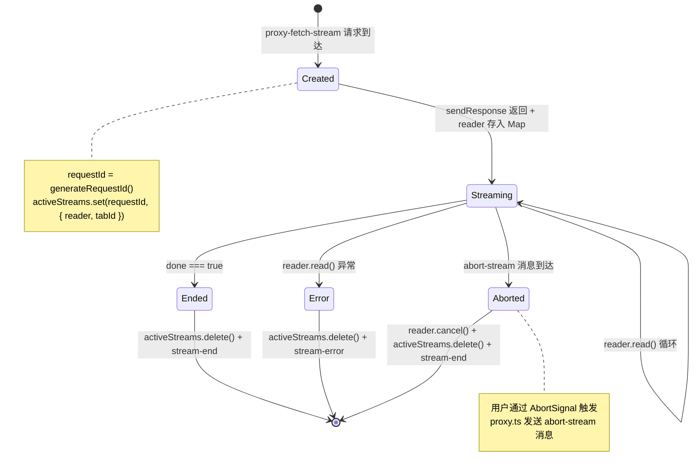

# Background Service Worker 架构

## 目标

作为扩展的后台中枢，处理 CORS 代理、标签页管理和跨标签页通信。

Background Service Worker 是 content script 与外部网络/浏览器 API 之间的桥梁。Content script 运行在网页的沙箱环境中，受同源策略限制且无法直接访问 `chrome.tabs` 等扩展 API，因此所有需要突破这些限制的操作都必须通过 background service worker 中转。

## 架构概览

```mermaid
graph TB
    subgraph Content Script
        CS1[proxy.ts<br/>代理请求工具]
        CS2[App.vue<br/>抽屉 UI]
        CS3[其他模块]
    end

    subgraph Background Service Worker
        MSG[chrome.runtime.onMessage<br/>消息路由器]
        LS[read-local-file<br/>本地文件读取]
        PF[proxy-fetch<br/>普通代理]
        PFS[proxy-fetch-stream<br/>流式代理]
        TA[tab-action<br/>标签页操作]
        AS[abort-stream<br/>中止流]
        DS[aib-drawer-changed<br/>抽屉状态同步]
        STREAMS[activeStreams Map<br/>活跃流追踪]
    end

    subgraph External
        API[AI API 服务]
        FS[本地文件系统]
        TABS[Chrome 标签页]
    end

    CS1 -->|chrome.runtime.sendMessage| MSG
    CS2 -->|chrome.runtime.sendMessage| MSG
    CS3 -->|chrome.runtime.sendMessage| MSG

    MSG --> LS
    MSG --> PF
    MSG --> PFS
    MSG --> TA
    MSG --> AS
    MSG --> DS

    LS -->|fetch file://| FS
    PF -->|fetch| API
    PFS -->|fetch + ReadableStream| API
    PFS -.->|stream-chunk / stream-end / stream-error| CS1
    TA -->|chrome.tabs API| TABS
    DS -->|aib-drawer-sync| CS2
    AS -->|reader.cancel()| STREAMS

    STREAMS --- PFS
```

### 消息类型一览

```mermaid
graph LR
    subgraph 请求消息 Content → Background
        M1[read-local-file]
        M2[proxy-fetch]
        M3[proxy-fetch-stream]
        M4[abort-stream]
        M5[tab-action]
        M6[aib-drawer-changed]
        M7[aib-toggle]
    end

    subgraph 推送消息 Background → Content
        R1[stream-chunk]
        R2[stream-end]
        R3[stream-error]
        R4[aib-drawer-sync]
    end

    M3 -.->|流数据| R1
    M3 -.->|流完成| R2
    M3 -.->|流异常| R3
    M6 -.->|广播| R4
```

## 核心设计决策

### 1. Manifest V3 Service Worker（非持久化 Background Page）

采用 Manifest V3 的 Service Worker 替代 MV2 的持久化 background page。Service Worker 在空闲时会被浏览器终止，因此：

- **无持久状态**：所有运行时状态（如 `activeStreams`）仅在 worker 存活期间有效
- **事件驱动**：通过 `chrome.runtime.onMessage` 等事件唤醒
- **生命周期短暂**：长时间运行的流式请求需要特别处理 worker 终止的情况

### 2. activeStreams Map — 活跃流追踪

```typescript
const activeStreams = new Map<string, {
  reader: ReadableStreamDefaultReader;
  tabId: number;
}>();
```

- **键**：`requestId`（由 `generateRequestId()` 生成的唯一标识）
- **值**：`reader`（ReadableStream 读取器）+ `tabId`（发起请求的标签页 ID）
- **用途**：支持流式请求的中途取消（abort），以及错误时的清理

### 3. 四种代理类型

| 消息类型 | 用途 | 响应方式 |
|---------|------|---------|
| `read-local-file` | 读取 `file://` URL（content script 无权访问） | `sendResponse` 返回 base64 |
| `proxy-fetch` | 非流式 API 调用（绕过 CORS） | `sendResponse` 返回 JSON |
| `proxy-fetch-stream` | SSE 流式请求（绕过 CORS） | `sendResponse` 确认 + 后续通过 `chrome.tabs.sendMessage` 推送数据 |
| `tab-action` | 标签页操作（新建/关闭/切换） | `sendResponse` 返回操作结果 |

### 4. 跨标签页抽屉状态同步

通过 `aib-drawer-changed` / `aib-drawer-sync` 消息对实现：

- 当某个标签页的抽屉打开/关闭时，广播到所有其他标签页
- 保持用户在不同标签页间的 UI 状态一致性

### 5. 站点别名映射

标签页切换支持自然语言关键词匹配，内置常见站点别名：

| 用户说法 | 匹配关键词 |
|---------|-----------|
| b站 / bilibili / 哔哩哔哩 | bilibili, 哔哩哔哩 |
| 淘宝 | taobao, 淘宝 |
| 京东 | jd.com, 京东 |
| 谷歌 | google, 谷歌 |
| 油管 / youtube | youtube |
| 推特 / twitter | twitter, x.com |
| ... | ... |

匹配逻辑：将用户输入的关键词扩展为同义词列表，然后在所有标签页的 title 和 URL 中搜索匹配。

## 消息处理器详细实现

### read-local-file — 本地文件读取

**问题**：Content script 运行在网页上下文中，受同源策略限制，无法 `fetch` `file://` 协议的 URL。

**解决方案**：Background service worker 不受此限制，可以代理读取。



**实现要点**：

- 将 `ArrayBuffer` 逐字节转为 base64 字符串
- 返回 MIME 类型（从 `content-type` header 获取），便于 content script 正确解析
- 错误时返回 `{ success: false, error }` 格式
- 返回 `true` 表示异步响应（`sendResponse` 在 Promise 回调中调用）

### proxy-fetch — 普通代理

**用途**：绕过 CORS 限制的简单非流式 API 调用。



**实现要点**：

- 默认 method 为 `POST`
- 响应体直接解析为 JSON（`res.json()`）
- 适用于非流式的 AI API 调用（如百度文心一言等不支持 SSE 的接口）

### proxy-fetch-stream — 流式代理

**用途**：代理 SSE（Server-Sent Events）流式请求，支持实时逐字输出。

这是最复杂的消息处理器，涉及双向异步通信。



**实现要点**：

1. **requestId 生成**：每次流式请求生成唯一 ID，用于后续的 chunk 追踪和中止操作
2. **先响应后推送**：`sendResponse` 立即返回 `{ success: true, streaming: true, requestId }`，后续数据通过 `chrome.tabs.sendMessage` 推送
3. **活跃流注册**：将 `reader` 和 `tabId` 存入 `activeStreams` Map
4. **循环读取**：使用 `reader.read()` 逐块读取，通过 `TextDecoder` 解码后转发
5. **中止检测**：每次循环检查 `activeStreams.has(requestId)`，如果流已被中止则跳出
6. **清理**：`finally` 块中始终删除 `activeStreams` 记录

**关键代码路径**：

```typescript
// entrypoints/background.ts - proxy-fetch-stream 核心逻辑
const requestId = generateRequestId();
// ... fetch ...
sendResponse({ success: true, streaming: true, requestId });

const reader = res.body?.getReader();
activeStreams.set(requestId, { reader, tabId: sender.tab.id });

while (true) {
  if (!activeStreams.has(requestId)) break;  // 中止检测
  const { done, value } = await reader.read();
  if (done) break;
  // ... decode & forward chunk ...
}

// finally: activeStreams.delete(requestId)
```

### tab-action — 标签页操作

支持三种子操作：`newTab`、`closeTab`、`switchTab`。



**switchTab 详细逻辑**：

1. **相对切换**（`query === 'next'` 或 `'prev'`）：
   - 查询当前窗口所有标签页
   - 找到当前活跃标签页的索引
   - 计算目标索引（取模实现循环）
   - 调用 `chrome.tabs.update` 切换

2. **关键词切换**：
   - 将用户输入的关键词通过 `SITE_ALIASES` 映射扩展为同义词列表
   - 遍历所有标签页，在 `title` 和 `url` 中查找匹配
   - 找到后调用 `chrome.tabs.update` + `chrome.windows.update`（聚焦窗口）

### abort-stream — 中止流式请求



**实现要点**：

- 通过 `reader.cancel()` 取消底层的 ReadableStream 读取
- 从 `activeStreams` Map 中移除记录
- 通知 content script 流已结束（content script 的 `stream-end` 监听器会清理本地状态）
- 注意：`sendResponse` 未被调用（返回 `false`），因为这是单向通知

### aib-drawer-changed — 跨标签页抽屉状态同步



**实现要点**：

- 使用 `chrome.tabs.query({})` 查询所有标签页
- 排除发送者自身（`tab.id !== sender.tab?.id`）
- 使用 `.catch(() => {})` 忽略发送失败（标签页可能已关闭）
- 返回 `false`（同步返回，无需 `sendResponse`）

## 数据流：流式代理完整生命周期



## 关键方法签名

### generateRequestId()

```typescript
/**
 * 生成唯一请求 ID
 * 格式: stream_{timestamp}_{random}
 * 用于追踪流式请求的生命周期，支持中止和 chunk 关联
 */
function generateRequestId(): string {
  return `stream_${Date.now()}_${Math.random().toString(36).slice(2, 9)}`;
}
```

### 消息监听器入口

```typescript
chrome.runtime.onMessage.addListener(
  (message, sender, sendResponse) => {
    // message.type 路由:
    //   - 'read-local-file'     → 返回 true（异步）
    //   - 'proxy-fetch'         → 返回 true（异步）
    //   - 'proxy-fetch-stream'  → 返回 true（异步）
    //   - 'tab-action'          → 返回 true（异步）
    //   - 'aib-drawer-changed'  → 返回 false（同步）
    //   - 'abort-stream'        → 返回 false（同步）
  }
);
```

### Content Script 端接口（proxy.ts）

```typescript
/** 非流式代理请求 */
async function proxyFetch(
  options: ProxyRequestOptions
): Promise<ProxyResponse>

/** 流式代理请求 */
async function proxyFetchStream(
  options: ProxyRequestOptions,
  onChunk: (chunk: string) => void
): Promise<void>

/** 请求选项 */
interface ProxyRequestOptions {
  url: string;
  method?: string;
  headers?: Record<string, string>;
  body?: string;
  signal?: AbortSignal;  // 用于中止流式请求
}
```

## 错误处理策略

### 流式请求错误



**关键设计**：

1. **中止 vs 异常区分**：通过检查 `activeStreams.has(requestId)` 判断 — 如果流已被 `abort-stream` 移除，则认为是中止导致的错误，不发送 `stream-error`
2. **双重通知**：`proxy-fetch-stream` 的 `.catch` 中既通过 `sendResponse` 返回错误（如果尚未调用过），又通过 `chrome.tabs.sendMessage` 发送 `stream-error`
3. **`.catch(() => {})` 防御**：所有 `sendMessage` 调用都用 `.catch(() => {})` 忽略错误，防止标签页已关闭时抛出未捕获异常

### 标签页操作错误

- **newTab / closeTab**：通过 `sendResponse` 返回 `{ success: false, error }`
- **switchTab**：未找到匹配标签页时返回 `{ success: false, error: '未找到包含 "xxx" 的标签页' }`
- **closeTab 无 tabId**：返回 `{ success: false, error: '无法获取当前标签页 ID' }`

## activeStreams 生命周期



**生命周期要点**：

- **创建时机**：`proxy-fetch-stream` 的 fetch 成功后，reader 获取到之后
- **存在期间**：流式读取循环中，每次 `reader.read()` 前检查 Map 是否仍存在
- **清理路径**（三条）：
  1. **正常结束**：`reader.read()` 返回 `done: true`，`finally` 块删除
  2. **读取异常**：catch 块中发送 `stream-error`，`finally` 块删除
  3. **用户中止**：`abort-stream` handler 中 `reader.cancel()` + 主动删除，随后 `stream-end` 通知

## 工具栏交互

除了消息路由，Background SW 还处理两个入口的 UI 切换：

1. **工具栏图标点击** (`chrome.action.onClicked`)：发送 `aib-toggle` 到当前活跃标签页
2. **快捷键** (`chrome.commands.onCommand`，命令 `toggle-chat`)：同上

两者都通过 `chrome.tabs.sendMessage` 向当前标签页发送 `aib-toggle` 消息，由 content script 切换抽屉的显示/隐藏。

## 源文件

- `entrypoints/background.ts` — Background Service Worker 完整实现
- `src/adapters/proxy.ts` — Content Script 端的代理请求工具（调用方）
