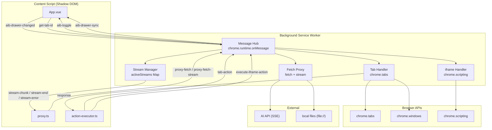
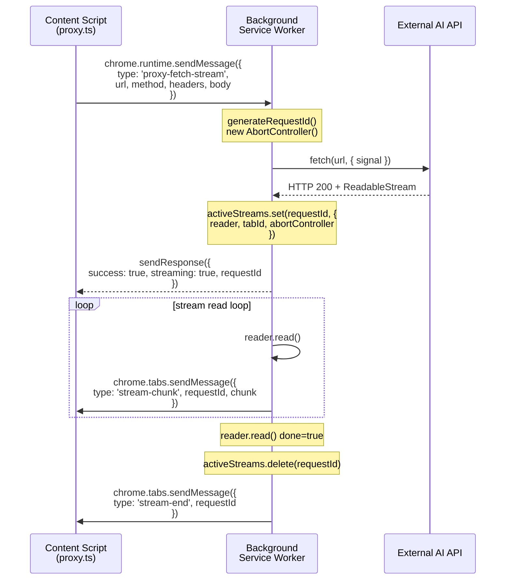
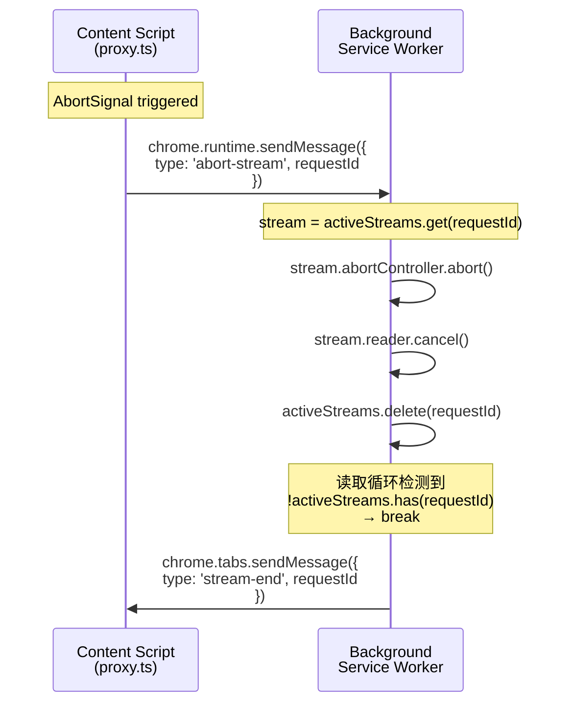
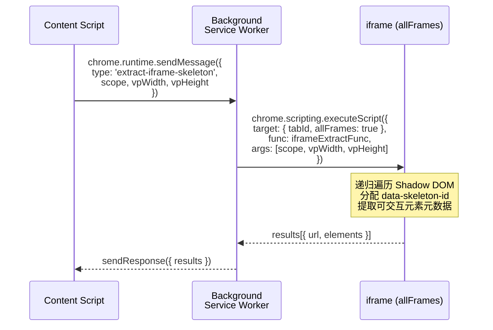
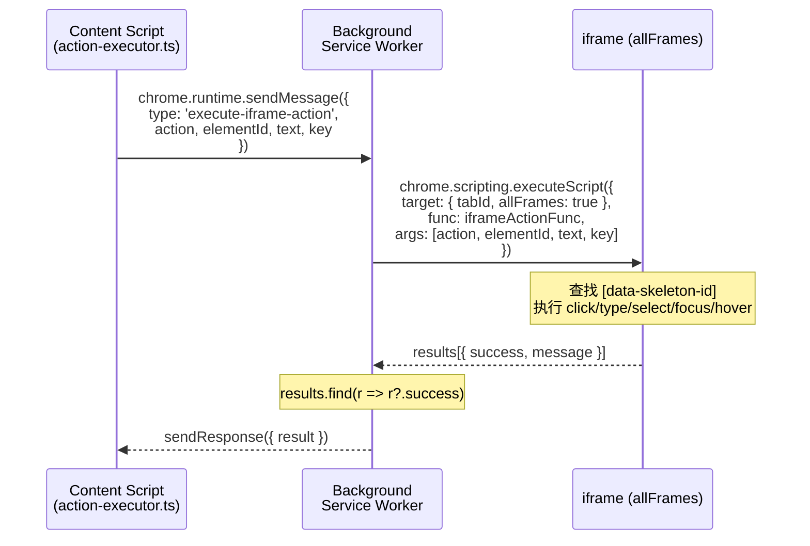
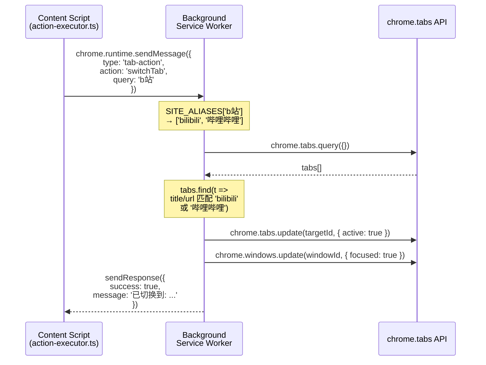
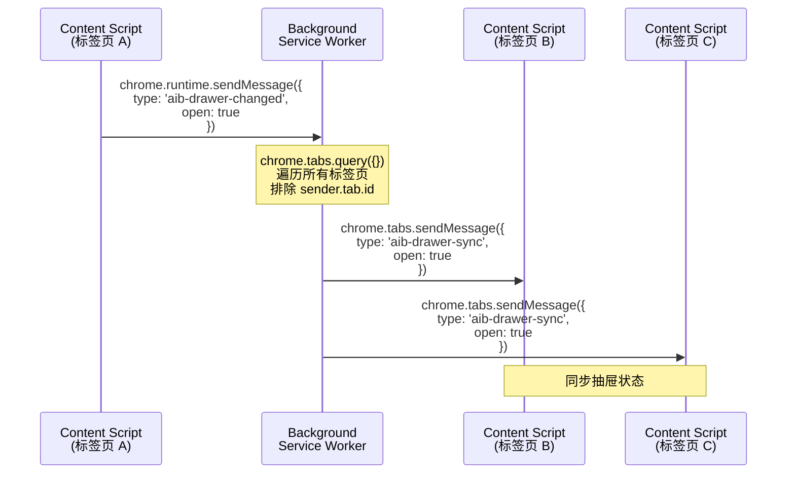

# Background Service Worker

## 模块概述

Background Service Worker 是扩展的后台中枢，运行在 Manifest V3 的 Service Worker 上下文中。它不直接操作 DOM，而是作为 content script、外部网络、浏览器 API 三者之间的消息代理，承担以下核心职责：

| 职责 | 说明 |
|------|------|
| **流式请求代理** | 代理 SSE 流式请求，规避 content script 的 CORS 限制 |
| **普通请求代理** | 代理非流式 HTTP 请求（`proxy-fetch`） |
| **本地文件读取** | Content Script 无法 `fetch('file://...')`，通过 background 中转 |
| **标签页管理** | 新建 / 关闭 / 切换标签页（content script 无 `chrome.tabs` 权限） |
| **iframe 注入** | 通过 `chrome.scripting.executeScript` 在 iframe 中执行骨架提取和 DOM 操作 |
| **跨标签页同步** | 广播抽屉状态变更，实现多标签页 UI 一致性 |
| **工具栏 / 快捷键** | 响应工具栏图标点击和快捷键命令，触发 content script 的抽屉开关 |

**源文件**: `entrypoints/background.ts`

**依赖关系**:

- **上游**: Content Script（通过 `chrome.runtime.sendMessage` 发送消息）
- **下游**: 外部 AI API（通过 `fetch` 发起网络请求）、`chrome.tabs` / `chrome.windows` / `chrome.scripting` API
- **工具**: `Logger`（`src/utils/logger.ts`）用于日志记录

---

## 架构设计

### 整体架构



### 消息类型一览

| 消息类型 | 方向 | 来源模块 | 用途 |
|---------|------|---------|------|
| `get-tab-id` | Content -> BG | App.vue | 获取当前标签页 ID（跨标签页续接） |
| `read-local-file` | Content -> BG | file-parsers.ts | 读取 `file://` 本地文件 |
| `extract-iframe-skeleton` | Content -> BG | skeleton-extractor | 在所有 iframe 中执行骨架提取 |
| `execute-iframe-action` | Content -> BG | action-executor.ts | 在所有 iframe 中执行 DOM 操作 |
| `proxy-fetch` | Content -> BG | proxy.ts | 代理普通 HTTP 请求 |
| `proxy-fetch-stream` | Content -> BG | proxy.ts | 代理 SSE 流式请求 |
| `stream-chunk` | BG -> Content | (内部) | 转发流式数据块 |
| `stream-end` | BG -> Content | (内部) | 流结束通知 |
| `stream-error` | BG -> Content | (内部) | 流错误通知 |
| `abort-stream` | Content -> BG | proxy.ts | 中止进行中的流式请求 |
| `aib-toggle` | BG -> Content | chrome.action / commands | 工具栏图标/快捷键触发抽屉开关 |
| `aib-drawer-changed` | Content -> BG | App.vue | 抽屉状态变更（广播同步） |
| `aib-drawer-sync` | BG -> Content | (内部) | 接收其他标签页的抽屉状态 |
| `tab-action` | Content -> BG | action-executor.ts | 标签页操作（newTab/closeTab/switchTab） |

---

## 核心类型定义

### ActiveStream（活跃流跟踪）

```typescript
// 实际结构（Map 中的 value）
interface ActiveStream {
  reader: ReadableStreamDefaultReader;  // 流读取器
  tabId: number;                         // 来源标签页 ID（用于回传消息）
  abortController: AbortController;      // 用于中止 fetch 请求
}

// activeStreams: Map<string, ActiveStream>
// key = requestId，格式: stream_{Date.now()}_{random7}
```

### Request ID 生成

```typescript
function generateRequestId(): string {
  return `stream_${Date.now()}_${Math.random().toString(36).slice(2, 9)}`;
}
```

格式 `stream_{timestamp}_{random7}`，时间戳 + 7 位随机 base36 字符串，碰撞概率极低。

### 站点别名映射

```typescript
const SITE_ALIASES: Record<string, string[]> = {
  'b站': ['bilibili', '哔哩哔哩'],
  'bilibili': ['bilibili', '哔哩哔哩'],
  '淘宝': ['taobao', '淘宝'],
  '京东': ['jd.com', '京东'],
  '百度': ['baidu', '百度'],
  '谷歌': ['google', '谷歌'],
  'github': ['github'],
  '掘金': ['juejin', '掘金'],
  '知乎': ['zhihu', '知乎'],
  '微博': ['weibo', '微博'],
  '抖音': ['douyin', '抖音', 'tiktok'],
  'youtube': ['youtube', 'youtube'],
  '油管': ['youtube', 'youtube'],
  'twitter': ['twitter', 'x.com'],
  '推特': ['twitter', 'x.com'],
  '网易': ['163.com', '网易'],
  '腾讯': ['qq.com', '腾讯'],
  '必应': ['bing', '必应'],
};
```

key 为用户输入（小写），value 为匹配关键词列表。`switchTab` 时先查别名表扩展匹配词，再遍历所有标签页的 title / url。

### iframe 注入函数签名

```typescript
// 骨架提取（注入到 iframe 的 allFrames: true 上下文）
function iframeExtractFunc(
  scope: string,       // 'viewport' | 'all'
  vpWidth: number,     // 视口宽度
  vpHeight: number,    // 视口高度
): { url: string; elements: unknown[] }

// 操作执行（注入到 iframe 的 allFrames: true 上下文）
function iframeActionFunc(
  action: string,      // 'click' | 'type' | 'select' | 'focus' | 'hover' | 'clear'
  elementId: string,   // data-skeleton-id
  text: string,        // type/select 的文本内容
  key: string,         // 预留（当前未使用）
): { success: boolean; message: string } | null
```

---

## 实现细节

### 1. 工具栏图标与快捷键

两个独立的事件监听器，功能相同：向当前活动标签页的 content script 发送 `aib-toggle` 消息。

```typescript
// 工具栏图标点击
chrome.action.onClicked.addListener(async (tab) => {
  if (tab.id) {
    chrome.tabs.sendMessage(tab.id, { type: 'aib-toggle' }).catch(() => {});
  }
});

// 快捷键（toggle-chat 命令）
chrome.commands.onCommand.addListener(async (command) => {
  if (command !== 'toggle-chat') return;
  const [tab] = await chrome.tabs.query({ active: true, currentWindow: true });
  if (tab?.id) {
    chrome.tabs.sendMessage(tab.id, { type: 'aib-toggle' }).catch(() => {});
  }
});
```

**注意**: 两处均使用 `.catch(() => {})` 静默忽略错误（content script 可能尚未注入）。

### 2. get-tab-id

最简单的消息处理器。Content script 通过此消息获取自身 tab ID，用于跨标签页续接场景。

```typescript
if (message.type === 'get-tab-id') {
  sendResponse({ tabId: sender.tab?.id });
  return false;  // 同步响应
}
```

- **返回值**: `{ tabId: number | undefined }`
- **同步**: `return false`

### 3. extract-iframe-skeleton（iframe 骨架提取）

Content script 无法直接调用 `chrome.scripting` API，通过 background 中转注入到目标标签页的所有 iframe 中。

```typescript
if (message.type === 'extract-iframe-skeleton') {
  const { scope, vpWidth, vpHeight } = message;
  const tabId = sender.tab?.id;
  if (!tabId) { sendResponse({ error: 'no tabId' }); return false }

  chrome.scripting.executeScript({
    target: { tabId, allFrames: true },
    func: iframeExtractFunc,
    args: [scope, vpWidth, vpHeight],
  }).then(results => {
    sendResponse({ results: results.map(r => r.result).filter(Boolean) });
  }).catch(err => {
    sendResponse({ error: String(err) });
  });
  return true;  // 异步响应
}
```

**参数**:
- `scope`: `'viewport'`（仅视口内元素）或 `'all'`（全部元素）
- `vpWidth` / `vpHeight`: 视口尺寸，用于 viewport 范围过滤

**注入逻辑**: `allFrames: true` 确保注入到所有 iframe 中。`iframeExtractFunc` 内部递归遍历 Shadow DOM（最大深度 10 层），为每个可交互元素分配 `data-skeleton-id`，提取元素元数据（tag、role、text、ariaLabel、placeholder、href、inputType、value 等）。

**返回值**: `{ results: Array<{ url: string; elements: unknown[] }> }`，每个 iframe 一条记录。

### 4. execute-iframe-action（iframe 操作执行）

在所有 iframe 中执行 DOM 操作。通过 `data-skeleton-id` 定位元素，找不到的 frame 返回 `null` 被过滤。

```typescript
if (message.type === 'execute-iframe-action') {
  const { action, elementId, text, key } = message;
  const tabId = sender.tab?.id;
  if (!tabId) { sendResponse({ error: 'no tabId' }); return false }

  chrome.scripting.executeScript({
    target: { tabId, allFrames: true },
    func: iframeActionFunc,
    args: [action, elementId, text || '', key || ''],
  }).then(results => {
    const result = results.map(r => r.result).find(r => r?.success);
    sendResponse({ result });
  }).catch(err => {
    sendResponse({ error: String(err) });
  });
  return true;
}
```

**支持的操作**:

| action | 行为 |
|--------|------|
| `click` | 完整事件序列：pointerdown -> mousedown -> focus -> pointerup -> mouseup -> click |
| `type` | focus -> value setter -> input -> change |
| `clear` | 同 type，文本为空 |
| `select` | 设置 select.value -> change |
| `focus` | focus -> focus event |
| `hover` | pointerover -> pointerenter -> mouseover -> mouseenter -> pointermove -> mousemove |

**返回值**: `{ result: { success: boolean; message: string } | undefined }`，取第一个成功的结果。

### 5. read-local-file（本地文件读取）

Content Script 受浏览器安全策略限制无法直接 `fetch('file://...')`。Background 代理读取，返回 base64 编码内容。

```typescript
if (message.type === 'read-local-file') {
  const { url } = message;
  fetch(url)
    .then(async (res) => {
      if (!res.ok) {
        sendResponse({ success: false, error: `HTTP ${res.status}` });
        return;
      }
      const buffer = await res.arrayBuffer();
      const base64 = btoa(
        new Uint8Array(buffer).reduce(
          (data, byte) => data + String.fromCharCode(byte), ''
        )
      );
      const mimeType = res.headers.get('content-type') || 'application/octet-stream';
      sendResponse({ success: true, data: base64, mimeType });
    })
    .catch((err) => {
      sendResponse({ success: false, error: String(err) });
    });
  return true;
}
```

**返回值**:
- 成功: `{ success: true, data: string (base64), mimeType: string }`
- 失败: `{ success: false, error: string }`

**注意**: MIME 类型依赖 `res.headers.get('content-type')`，无后缀推断。base64 编码使用 `btoa` + `Uint8Array.reduce` 方式。

### 6. proxy-fetch（普通请求代理）

代理非流式 HTTP 请求，规避 CORS 限制。直接返回 JSON 响应。

```typescript
if (message.type === 'proxy-fetch') {
  const { url, method, headers, body } = message;
  fetch(url, {
    method: method || 'POST',
    headers: headers || {},
    body: body,
  })
    .then(async (res) => {
      const data = await res.json();
      sendResponse({ success: true, data, status: res.status });
    })
    .catch((err) => {
      sendResponse({ success: false, error: String(err) });
    });
  return true;
}
```

**返回值**: `{ success: boolean, data?: any, status?: number, error?: string }`

**注意**: 响应体通过 `res.json()` 解析，非 JSON 响应会抛异常。

### 7. proxy-fetch-stream（流式请求代理）

Background 最核心的功能。代理 SSE 流式请求，通过 `stream-chunk` / `stream-end` / `stream-error` 三通道将流数据转发给 content script。

**完整流程**:

1. 生成唯一 `requestId`，创建 `AbortController`
2. 发起 `fetch()` 请求，获取 `ReadableStream` reader
3. 将 `{ reader, tabId, abortController }` 存入 `activeStreams` Map
4. 通过 `sendResponse` 立即返回 `{ success: true, streaming: true, requestId }`
5. 进入 `while(true)` 读取循环：
   - 每次迭代检查 `activeStreams.has(requestId)`（中止检测）
   - `reader.read()` 读取数据块
   - 通过 `chrome.tabs.sendMessage` 转发 `stream-chunk`
6. 循环结束后发送 `stream-end`
7. `finally` 块清理 `activeStreams`

```typescript
if (message.type === 'proxy-fetch-stream') {
  const { url, method, headers, body } = message;
  const requestId = generateRequestId();
  const abortController = new AbortController();

  fetch(url, {
    method: method || 'POST',
    headers: headers || {},
    body: body,
    signal: abortController.signal,
  })
    .then(async (res) => {
      if (!res.ok) {
        const text = await res.text();
        sendResponse({ success: false, error: `HTTP ${res.status}: ${text}` });
        return;
      }

      const reader = res.body?.getReader();
      if (!reader || !sender.tab?.id) {
        sendResponse({ success: false, error: '无法获取响应流' });
        return;
      }

      // 先注册活跃流，再通知 content script（避免竞态）
      activeStreams.set(requestId, { reader, tabId: sender.tab.id, abortController });
      sendResponse({ success: true, streaming: true, requestId });

      const decoder = new TextDecoder();
      let buffer = '';

      try {
        while (true) {
          if (!activeStreams.has(requestId)) break;  // 中止检测

          const { done, value } = await reader.read();
          if (done) break;

          buffer += decoder.decode(value, { stream: true });
          chrome.tabs.sendMessage(sender.tab.id, {
            type: 'stream-chunk',
            requestId,
            chunk: buffer,
          }).catch(() => {});
          buffer = '';
        }
      } catch (streamErr) {
        if (!activeStreams.has(requestId)) return;  // 中止导致的错误，静默退出
        chrome.tabs.sendMessage(sender.tab.id, {
          type: 'stream-error',
          requestId,
          error: String(streamErr),
        }).catch(() => {});
      } finally {
        activeStreams.delete(requestId);
      }

      chrome.tabs.sendMessage(sender.tab.id, {
        type: 'stream-end',
        requestId,
      }).catch(() => {});
    })
    .catch((err) => {
      if (sender.tab?.id) {
        chrome.tabs.sendMessage(sender.tab.id, {
          type: 'stream-error',
          requestId,
          error: String(err),
        }).catch(() => {});
      }
      sendResponse({ success: false, error: String(err) });
    });

  return true;
}
```

**关键设计决策**:
- `activeStreams.set` 在 `sendResponse` 之前执行，避免 `abort-stream` 到达时流尚未注册
- 每次 `reader.read()` 前检查 `activeStreams.has(requestId)`，实现协作式中止
- `catch` 块区分中止导致的错误（静默）和真实错误（发送 `stream-error`）
- `finally` 块确保流记录被清理

### 8. abort-stream（中止流式请求）

```typescript
if (message.type === 'abort-stream') {
  const { requestId } = message;
  const stream = activeStreams.get(requestId);
  if (stream) {
    stream.abortController.abort();          // 中止 fetch 请求
    stream.reader.cancel().catch(() => {});  // 取消读取
    activeStreams.delete(requestId);          // 从 Map 移除
    chrome.tabs.sendMessage(stream.tabId, {
      type: 'stream-end',
      requestId,
    }).catch(() => {});                      // 通知 content script 流已结束
  }
  return false;  // 同步响应
}
```

**中止链路**: `abortController.abort()` 终止底层 fetch -> `reader.cancel()` 释放流 -> `activeStreams.delete()` 触发读取循环 break -> 发送 `stream-end` 通知 content script。

### 9. aib-drawer-changed（跨标签页抽屉同步）

```typescript
if (message.type === 'aib-drawer-changed') {
  const { open } = message;
  chrome.tabs.query({}, (tabs) => {
    for (const tab of tabs) {
      if (tab.id && tab.id !== sender.tab?.id) {
        chrome.tabs.sendMessage(tab.id, {
          type: 'aib-drawer-sync',
          open,
        }).catch(() => {});
      }
    }
  });
  return false;  // 同步响应（不等待广播完成）
}
```

**逻辑**: 遍历所有标签页，排除发送方，广播 `aib-drawer-sync`。使用 `.catch(() => {})` 忽略尚未注入 content script 的标签页错误。

### 10. tab-action（标签页管理）

支持三种操作：`newTab`、`closeTab`、`switchTab`。

#### newTab

```typescript
if (action === 'newTab') {
  chrome.tabs.create({ url: message.url }).then((tab) => {
    if (tab.id) chrome.tabs.update(tab.id, { active: true });
    if (tab.windowId) chrome.windows.update(tab.windowId, { focused: true });
    sendResponse({ success: true, tabId: tab.id, message: `新标签页: ${tab.id}` });
  }).catch((err) => {
    sendResponse({ success: false, error: String(err) });
  });
  return true;
}
```

创建新标签页后自动聚焦（`active: true` + `focused: true`），跨标签页续接需要新页立即激活。

#### closeTab

```typescript
if (action === 'closeTab') {
  const tabId = sender.tab?.id;
  if (tabId) {
    chrome.tabs.remove(tabId).then(() => {
      sendResponse({ success: true, message: '标签页已关闭' });
    }).catch((err) => {
      sendResponse({ success: false, error: String(err) });
    });
  } else {
    sendResponse({ success: false, error: '无法获取当前标签页 ID' });
  }
  return true;
}
```

关闭发送方标签页（`sender.tab.id`），不支持关闭指定标签页。

#### switchTab

支持两种模式：

**相对切换** (`query === 'next' | 'prev'`):

```typescript
if (query === 'next' || query === 'prev') {
  chrome.tabs.query({ currentWindow: true }).then((tabs) => {
    const activeIndex = tabs.findIndex((t) => t.active);
    if (activeIndex < 0) {
      sendResponse({ success: false, error: '未找到当前标签页' });
      return;
    }
    let targetIndex: number;
    if (query === 'next') {
      targetIndex = (activeIndex + 1) % tabs.length;
    } else {
      targetIndex = (activeIndex - 1 + tabs.length) % tabs.length;
    }
    const target = tabs[targetIndex];
    if (target?.id) {
      chrome.tabs.update(target.id, { active: true }).then(() => {
        sendResponse({ success: true, message: `已切换到: ${target.title}` });
      }).catch(/* ... */);
    }
  }).catch(/* ... */);
  return true;
}
```

基于当前窗口标签页列表的索引循环，取模实现环绕。

**关键词匹配** (`query` 为任意字符串):

```typescript
const queryLower = query.toLowerCase();
const matchTerms = [queryLower, ...(SITE_ALIASES[queryLower] || [])];

chrome.tabs.query({}).then((tabs) => {
  const target = tabs.find((tab) => {
    const title = (tab.title || '').toLowerCase();
    const url = (tab.url || '').toLowerCase();
    return matchTerms.some(term => title.includes(term) || url.includes(term));
  });
  if (target?.id) {
    chrome.tabs.update(target.id, { active: true }).then(() => {
      if (target.windowId) {
        chrome.windows.update(target.windowId, { focused: true });
      }
      sendResponse({ success: true, message: `已切换到: ${target.title}` });
    }).catch(/* ... */);
  } else {
    sendResponse({ success: false, error: `未找到包含 "${query}" 的标签页` });
  }
}).catch(/* ... */);
return true;
```

先通过 `SITE_ALIASES` 扩展匹配词，再遍历所有标签页（跨窗口）的 title / url 进行子串匹配。找到后同时聚焦标签页和窗口。

---

## 数据流

### 流式请求代理（SSE）



### 流式请求中止



### iframe 骨架提取



### iframe 操作执行



### 标签页操作



### 跨标签页抽屉同步



---

## 配置与扩展

### 添加新消息处理器

在 `chrome.runtime.onMessage.addListener` 回调中添加新的 `if` 分支：

```typescript
chrome.runtime.onMessage.addListener((message, sender, sendResponse) => {
  // ... 已有处理器 ...

  if (message.type === 'your-new-type') {
    const { param1, param2 } = message;
    const tabId = sender.tab?.id;

    // 异步操作 → return true
    someAsyncOperation(param1, param2)
      .then(result => sendResponse({ success: true, data: result }))
      .catch(err => sendResponse({ success: false, error: String(err) }));
    return true;

    // 同步操作 → return false
    // sendResponse({ result: syncValue });
    // return false;
  }
});
```

**要点**:
- 同步操作 `return false`，异步操作 `return true`
- 异步操作必须在回调中调用 `sendResponse`
- 错误用 `{ success: false, error: String(err) }` 格式返回
- Content script 端需要在 `proxy.ts` 或 `action-executor.ts` 中添加对应的 `chrome.runtime.sendMessage` 调用

### 扩展站点别名

直接在 `SITE_ALIASES` 对象中添加新的中英文别名映射：

```typescript
const SITE_ALIASES: Record<string, string[]> = {
  // ... 已有映射 ...
  '新站点': ['newsite', '新站点'],
};
```

### 扩展 iframe 操作

在 `iframeActionFunc` 的 `switch` 语句中添加新的 action case：

```typescript
switch (action) {
  // ... 已有操作 ...
  case 'yourAction':
    // 操作 el 元素
    return { success: true, message: '操作成功' };
}
```

---

## 已知限制

### 1. Service Worker 生命周期

Manifest V3 的 Service Worker 有严格的生命周期限制：
- **idle 回收**: 浏览器可能在 idle 30 秒后终止 Service Worker
- **活跃流中断**: 如果 Service Worker 在流式请求进行中被回收，`reader` 和 `abortController` 将丢失，流会无声中断
- **无 keep-alive 机制**: 当前未实现 `chrome.alarms` 或 port keep-alive 等保活策略

**影响**: 长时间的 SSE 流式请求（如大模型长回复）可能被中断。Content script 端会收到 `stream-error` 或超时。

### 2. sendResponse 时序问题

流式代理中 `sendResponse` 在 fetch 成功后立即调用，但流数据通过独立的 `chrome.tabs.sendMessage` 通道传输。两条通道无严格顺序保证：
- `sendResponse` 返回 `{ success: true, streaming: true, requestId }` 到 content script
- `stream-chunk` 消息通过 `chrome.runtime.onMessage` 监听器接收
- Content script 必须先收到 `sendResponse` 获取 `requestId`，再注册 `chunkListener`，存在竞态窗口

**当前缓解**: `proxy.ts` 中先注册监听器再发消息（但 requestId 尚未赋值），通过 `requestId === null` 短路过滤。Background 端 `activeStreams.set` 在 `sendResponse` 之前执行。

### 3. 单流无并发控制

`activeStreams` Map 无上限，极端情况下可能同时存在大量流式请求：
- 每个流持有 `ReadableStreamDefaultReader` 和 `AbortController`
- 无超时机制，僵尸流可能长期占用内存
- 无优先级或队列管理

### 4. 标签页切换匹配精度

- `switchTab` 按关键词匹配可能切换到非预期标签页（如多标签页标题相似）
- `SITE_ALIASES` 为硬编码，不支持用户自定义
- `tabs.find` 返回第一个匹配，不支持模糊排序

### 5. 无重试机制

流式请求失败后直接通知 content script 错误，Background 层不做重试。重试逻辑由上层（adapter / UI）负责。

### 6. iframe 注入限制

- `chrome.scripting.executeScript` 的 `allFrames: true` 会注入到所有 frame，包括广告 iframe，可能产生误操作
- `iframeExtractFunc` 和 `iframeActionFunc` 是独立函数，无法访问 Background 的闭包变量
- Shadow DOM 遍历最大深度 10 层，极端嵌套场景可能遗漏元素

### 7. 日志记录

Background 使用 `Logger('Background')` 记录日志，但仅覆盖部分关键路径：
- `read-local-file`: 记录 URL 和结果
- `proxy-fetch-stream`: 记录流读取异常
- 其他处理器无日志输出
