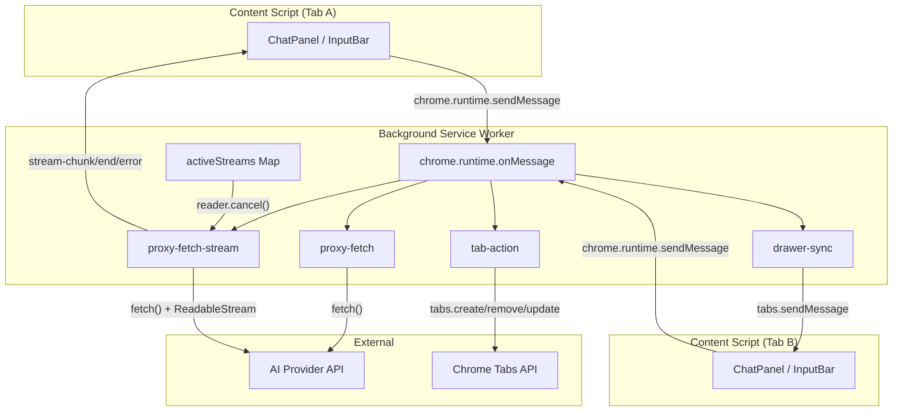
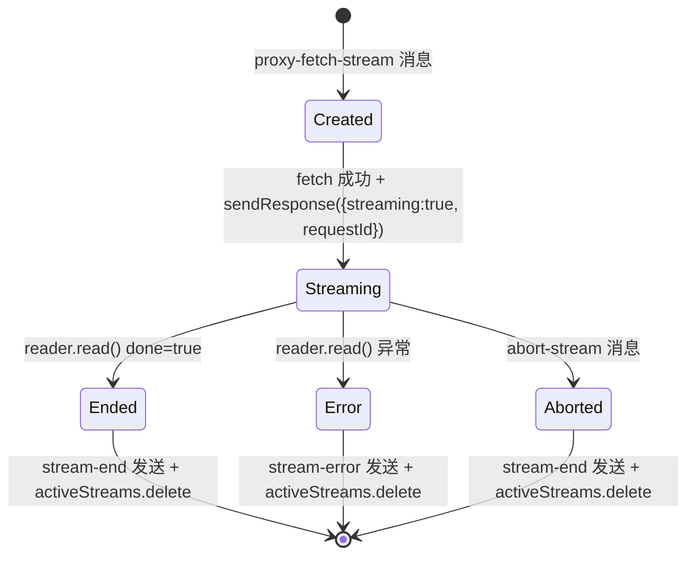
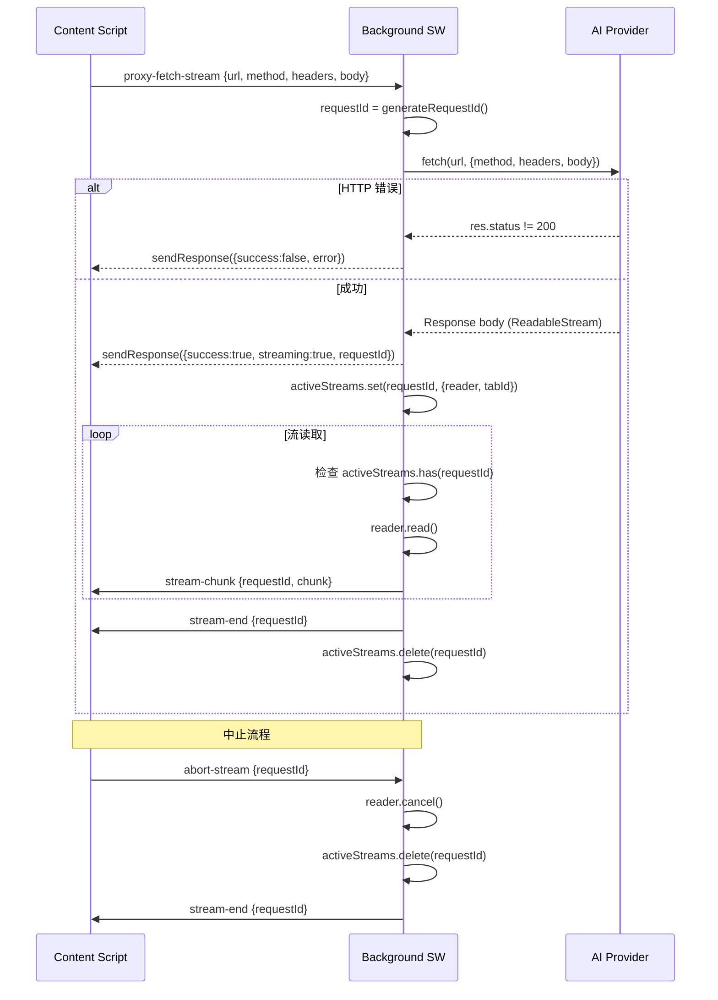
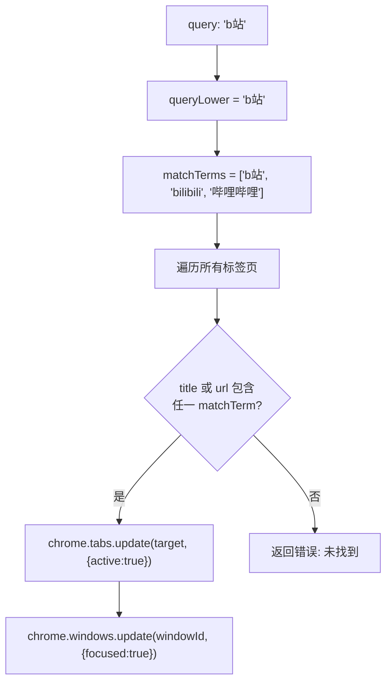
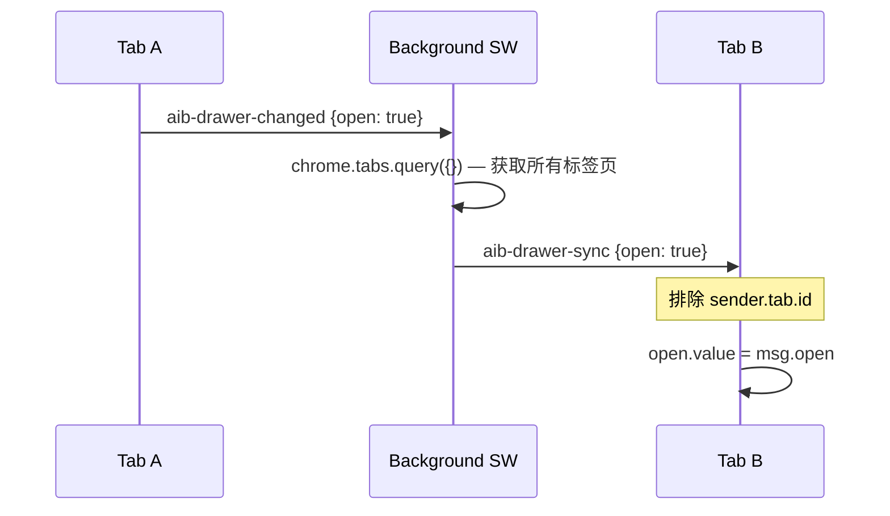

# Background Service Worker 架构

> Manifest V3 非持久化 Service Worker，负责 API 代理、流式请求转发、标签页管理和跨标签页状态同步。

## 总体架构



## 消息协议

### 请求/响应模式

| 消息类型 | 方向 | 异步 | 说明 |
|----------|------|------|------|
| `get-tab-id` | CS → BG | 否 | 获取当前标签页 ID |
| `read-local-file` | CS → BG | 是 | 读取本地文件为 base64 |
| `proxy-fetch` | CS → BG | 是 | 非流式 API 代理 |
| `proxy-fetch-stream` | CS → BG | 是 | 流式 API 代理（SSE） |
| `abort-stream` | CS → BG | 否 | 中止进行中的流 |
| `tab-action` | CS → BG | 是 | 标签页操作 |
| `aib-drawer-changed` | CS → BG | 否 | 抽屉状态变化广播 |

### 推送模式（BG → CS）

| 消息类型 | 说明 |
|----------|------|
| `aib-toggle` | 切换抽屉展开/关闭 |
| `stream-chunk` | 流式数据块 |
| `stream-end` | 流结束 |
| `stream-error` | 流错误 |
| `aib-drawer-sync` | 跨标签页抽屉状态同步 |

---

## 流式请求代理 (proxy-fetch-stream)

### 核心数据结构

```typescript
// 活跃流注册表
const activeStreams = new Map<string, {
  reader: ReadableStreamDefaultReader;
  tabId: number;
}>();

// 请求 ID 生成
function generateRequestId(): string {
  return `stream_${Date.now()}_${Math.random().toString(36).slice(2, 9)}`;
}
```

### 流生命周期



### 流程详解



### 中止检测

流读取循环中，每次迭代检查 `activeStreams.has(requestId)`。如果已被 `abort-stream` 删除，立即 break 退出。

```typescript
while (true) {
  if (!activeStreams.has(requestId)) break;  // 中止检测
  const { done, value } = await reader.read();
  if (done) break;
  // ... 转发 chunk
}
```

错误处理也检查中止状态，避免向已中止的流发送错误消息：

```typescript
catch (streamErr) {
  if (!activeStreams.has(requestId)) return;  // 中止导致的错误，静默退出
  // ... 发送 stream-error
}
```

---

## 标签页操作 (tab-action)

### 操作类型

#### newTab — 新建标签页

```typescript
chrome.tabs.create({ url: message.url }).then((tab) => {
  chrome.tabs.update(tab.id, { active: true });          // 聚焦新标签页
  chrome.windows.update(tab.windowId, { focused: true }); // 聚焦窗口
});
```

#### closeTab — 关闭当前标签页

```typescript
chrome.tabs.remove(sender.tab.id);
```

#### switchTab — 切换标签页

支持两种模式：

**相对切换** (`query: 'next' | 'prev'`)

```typescript
const activeIndex = tabs.findIndex(t => t.active);
const targetIndex = query === 'next'
  ? (activeIndex + 1) % tabs.length
  : (activeIndex - 1 + tabs.length) % tabs.length;
chrome.tabs.update(tabs[targetIndex].id, { active: true });
```

**关键词匹配** (`query: 'bilibili'`)



### SITE_ALIASES — 站点别名映射

用户说"b站"时，同时匹配 `bilibili` 和 `哔哩哔哩`：

```typescript
const SITE_ALIASES: Record<string, string[]> = {
  'b站': ['bilibili', '哔哩哔哩'],
  'bilibili': ['bilibili', '哔哩哔哩'],
  '哔哩哔哩': ['bilibili', '哔哩哔哩'],
  '淘宝': ['taobao', '淘宝'],
  '京东': ['jd.com', '京东'],
  '百度': ['baidu', '百度'],
  '谷歌': ['google', '谷歌'],
  'github': ['github'],
  '掘金': ['juejin', '掘金'],
  '知乎': ['zhihu', '知乎'],
  '微博': ['weibo', '微博'],
  '抖音': ['douyin', '抖音', 'tiktok'],
  'youtube': ['youtube', 'youtube'],
  '油管': ['youtube', 'youtube'],
  'twitter': ['twitter', 'x.com'],
  '推特': ['twitter', 'x.com'],
  '网易': ['163.com', '网易'],
  '腾讯': ['qq.com', '腾讯'],
  '必应': ['bing', '必应'],
};
```

匹配逻辑：`matchTerms = [queryLower, ...(SITE_ALIASES[queryLower] || [])]`，遍历所有标签页的 title 和 url，任一 matchTerm 命中即选中。

---

## 非流式代理 (proxy-fetch)

```typescript
if (message.type === 'proxy-fetch') {
  fetch(url, { method, headers, body })
    .then(async (res) => {
      const data = await res.json();
      sendResponse({ success: true, data, status: res.status });
    })
    .catch((err) => {
      sendResponse({ success: false, error: String(err) });
    });
  return true;  // 异步响应
}
```

用于不需要流式的场景（如非流式 API 调用）。

---

## 本地文件读取 (read-local-file)

Content Script 受 `file://` 协议限制无法直接 fetch，通过 Background 代理：

```typescript
if (message.type === 'read-local-file') {
  fetch(url)
    .then(async (res) => {
      const buffer = await res.arrayBuffer();
      const base64 = btoa(
        new Uint8Array(buffer).reduce((data, byte) => data + String.fromCharCode(byte), '')
      );
      const mimeType = res.headers.get('content-type') || 'application/octet-stream';
      sendResponse({ success: true, data: base64, mimeType });
    })
    .catch((err) => {
      sendResponse({ success: false, error: String(err) });
    });
  return true;
}
```

---

## 跨标签页抽屉同步



App.vue 中的接收逻辑：

```typescript
if (msg?.type === 'aib-drawer-sync') {
  if (msg.open !== open.value) {
    syncingFromRemote = true;
    open.value = msg.open;
    nextTick(() => (syncingFromRemote = false));
  }
}
```

`syncingFromRemote` 标志防止收到远端同步后再次触发 `aib-drawer-changed` 广播。

---

## 工具栏交互

### 图标点击

```typescript
chrome.action.onClicked.addListener(async (tab) => {
  if (tab.id) {
    chrome.tabs.sendMessage(tab.id, { type: 'aib-toggle' }).catch(() => {});
  }
});
```

### 快捷键

```typescript
chrome.commands.onCommand.addListener(async (command) => {
  if (command !== 'toggle-chat') return;
  const [tab] = await chrome.tabs.query({ active: true, currentWindow: true });
  if (tab?.id) {
    chrome.tabs.sendMessage(tab.id, { type: 'aib-toggle' }).catch(() => {});
  }
});
```

两种方式都向 Content Script 发送 `aib-toggle` 消息，由 App.vue 的 `onMessage` 处理。

---

## 异步响应模式

Chrome 扩展消息机制中，`return true` 表示异步响应：

| 消息类型 | return | 原因 |
|----------|--------|------|
| `get-tab-id` | `false` | 同步返回 |
| `read-local-file` | `true` | fetch 异步 |
| `proxy-fetch` | `true` | fetch 异步 |
| `proxy-fetch-stream` | `true` | fetch 异步 + 后续 stream 推送 |
| `abort-stream` | `false` | 同步操作 |
| `tab-action` | `true` | tabs API 异步 |
| `aib-drawer-changed` | `false` | fire-and-forget 广播 |
