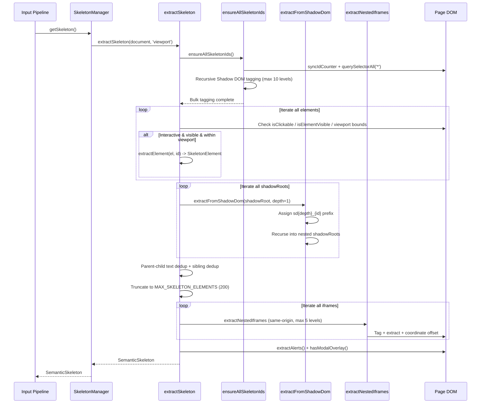
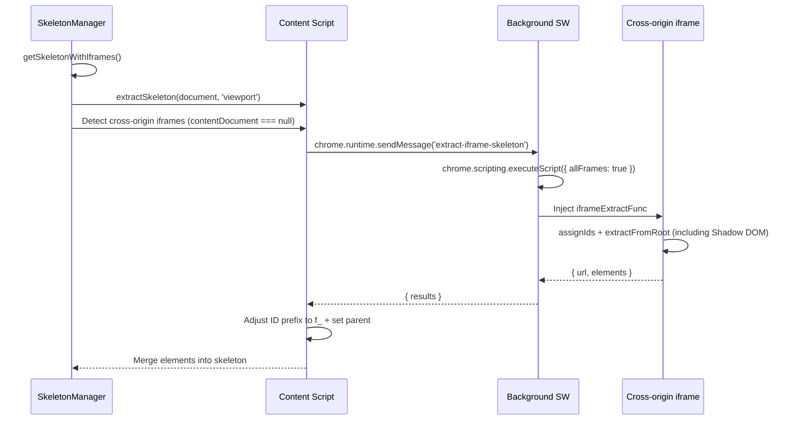
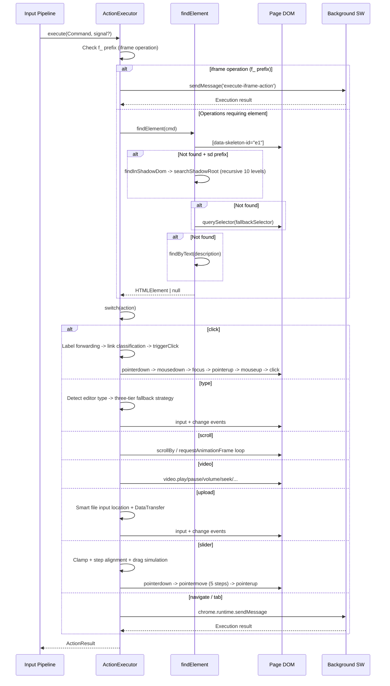
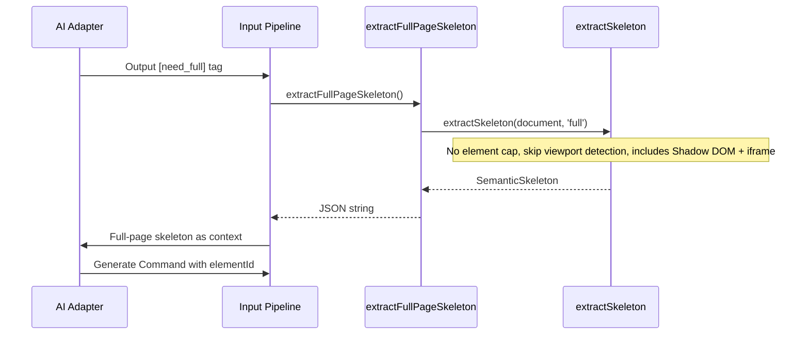
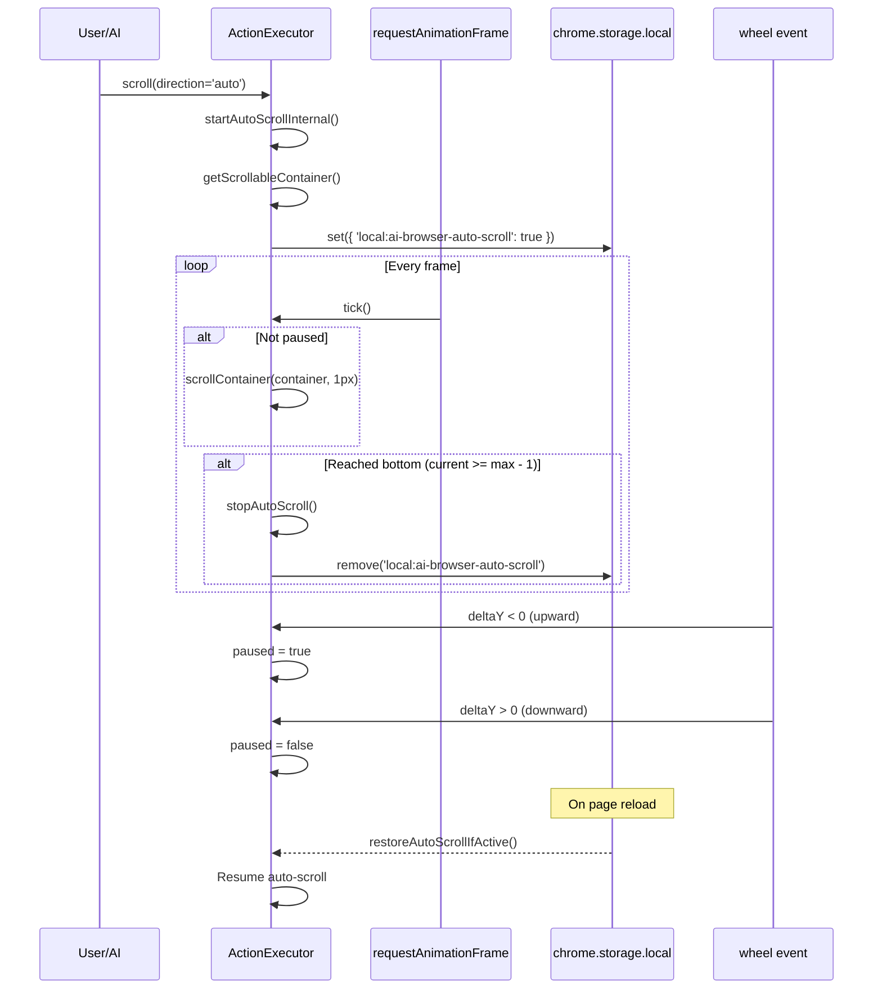
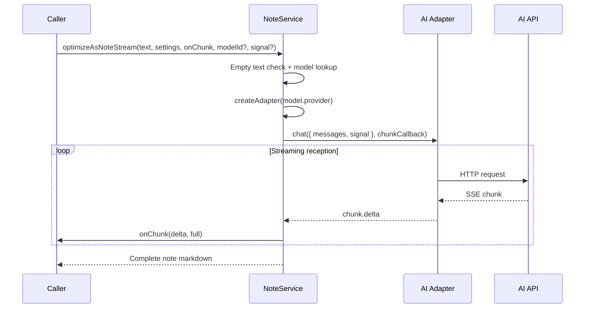

# Browser Command Engine - Architecture Document

> **🌐 中文版本：[browser-command.md](./browser-command.md)**
>
> Module path: `src/browser/`
> Responsible for converting AI-generated natural language intents into browser DOM operations. It is the execution terminal of the "voice command → page interaction" pipeline.

---

## Module Overview

### Functional Positioning

The Browser Command Engine is the **page operation execution layer** of AI Browser, with three core responsibilities:

1. **Semantic Skeleton Extraction** -- Extracts concise descriptions of interactive elements from the current page DOM (semantic skeleton) as context input for AI decision-making. Supports Shadow DOM recursive traversal (max 10 levels) and nested iframe recursion (max 5 levels), as well as cross-origin iframe extraction via `chrome.scripting.executeScript` injection.
2. **Command Execution** -- Receives structured commands (`Command`) generated by the AI and triggers real DOM event sequences on the page to perform 17 types of operations including click, input, scroll, video control, file upload, slider drag, modal dismissal, and more.
3. **Note AI Service** -- Calls AI adapters to perform deep analysis and optimization on text, outputting high-quality markdown notes.

### Position in Architecture

```
User Voice → Voice Recognition → Input Pipeline → AI Adapter
                                                      ↓
                                              Command JSON
                                                      ↓
                                          ┌──────────────────────┐
                                          │  Browser Command     │
                                          │  Engine (this module) │
                                          │                      │
                                          │  SkeletonManager     │
                                          │  ActionExecutor      │
                                          │  NoteService         │
                                          └──────────────────────┘
                                                      ↓
                                                  DOM Operations
```

- **Upstream**: The Input Pipeline (`src/input/`) calls the AI adapter to generate `Command` objects, which are passed to this module for execution.
- **Downstream**: Directly operates on the browser DOM. Some operations (tab management, navigation, iframe operations) are delegated to the background Service Worker via `chrome.runtime.sendMessage`.
- **Parallel**: Skeleton extraction results serve as context input for the AI, which generates commands based on element IDs in the skeleton.

### Dependencies

| Dependency | Purpose |
|------------|---------|
| `src/utils/logger.ts` | Unified logging (writes to chrome.storage.local) |
| `src/browser/skeleton-id.ts` | data-skeleton-id bulk tagging utility |
| `src/adapters/` | AI adapter factory for the note service |
| `src/types.ts` | Shared types: AppSettings, StreamChunk, etc. |
| `chrome.runtime` | Tab operations, navigation, iframe operations delegated to background |
| `chrome.storage.local` | Auto-scroll state persistence |
| `chrome.scripting` | Cross-origin iframe skeleton injection (relayed via background) |

### File Structure

```
src/browser/
├── index.ts              # Public exports (barrel file)
├── types.ts              # Core type definitions (SkeletonElement, Command, ActionResult)
├── skeleton-id.ts        # data-skeleton-id tagging utility (module-level counter)
├── skeleton.ts           # Semantic skeleton extractor + SkeletonManager
├── action-executor.ts    # Command execution engine (ActionExecutor)
├── local-html.ts         # Full-page skeleton extraction ([need_full] fallback)
└── note-service.ts       # Note AI service (optimizeAsNote / optimizeAsNoteStream)
```

---

## Architecture Design

### Layered Architecture

```mermaid
graph TB
    subgraph "Public Interface Layer"
        SM[SkeletonManager]
        AE[ActionExecutor]
        LH[extractFullPageSkeleton / Async]
        NS[optimizeAsNote / optimizeAsNoteStream]
    end

    subgraph "Skeleton Extraction Layer"
        ES[extractSkeleton]
        EI[extractElement]
        IC[isClickable]
        IV[isElementVisible]
        HM[hasModalOverlay]
        EA[extractAlerts]
        FL[findLandmarkParent]
        FA[findAssociatedLabelText]
        SD[extractFromShadowDom]
        NI[extractNestedIframes]
    end

    subgraph "Cross-Origin iframe Layer"
        EIS[extractIframeSkeletons]
        IEF[iframeExtractFunc]
    end

    subgraph "ID Management Layer"
        SID[ensureAllSkeletonIds]
        SIE[ensureSkeletonId]
        SAID[ensureAllSkeletonIdsForDoc]
        SYNC[syncIdCounter]
    end

    subgraph "Command Execution Layer"
        FE[findElement]
        FS[findInShadowDom / searchShadowRoot]
        FT[findByText]
        TC[triggerClick]
        EX[executeClick/Type/Scroll/Video/Upload/Slider/CloseModal/...]
    end

    subgraph "Auto-Scroll Subsystem"
        AS[autoScroll state]
        GS[getScrollableContainer]
        SC[scrollContainer]
        RAF[requestAnimationFrame loop]
    end

    SM --> ES
    LH --> ES
    ES --> SID
    ES --> EI
    ES --> IC
    ES --> IV
    ES --> HM
    ES --> EA
    ES --> FL
    ES --> SD
    ES --> NI
    EI --> FA
    SID --> SIE
    SID --> SYNC
    SAID --> SIE
    SM -->|Cross-origin iframe| EIS
    EIS -->|sendMessage| BG[Background SW]
    EIS --> IEF

    AE --> FE
    FE --> FS
    FE --> FT
    AE --> EX
    EX --> TC
    EX --> AS
    AS --> GS
    AS --> SC
    AS --> RAF
    AE -->|iframe operations| BG
```



### Core Design Patterns

#### Cache-Free Skeleton Extraction

`SkeletonManager` uses a **cache-free, MutationObserver-free** design. Every call to `getSkeleton()` re-scans the DOM:

- **Advantages**: Never expires, no cache invalidation issues after DOM changes, simple and reliable implementation.
- **Cost**: DOM scanning overhead on each extraction (controlled by `MAX_SKELETON_ELEMENTS = 200` cap).
- **Motivation**: SPAs have frequently changing DOMs; the complexity of cache management far outweighs the cost of re-scanning.

#### SkeletonManager API

```typescript
class SkeletonManager {
  // Viewport skeleton (visible area only, 200 element cap)
  getSkeleton(): SemanticSkeleton

  // Full-page skeleton (no element cap)
  getFullSkeleton(): SemanticSkeleton

  // Viewport skeleton + cross-origin iframe elements (injected via chrome.scripting)
  async getSkeletonWithIframes(): Promise<SemanticSkeleton>

  // Full-page skeleton + cross-origin iframe elements
  async getFullSkeletonWithIframes(): Promise<SemanticSkeleton>

  invalidate(): void   // No-op (cache-free design)
  dispose(): void      // No-op (interface compatibility)
  cachedUrl: string    // Always returns '' (interface compatibility)
}
```

Standalone extraction functions (independent of SkeletonManager instances):

```typescript
function extractSkeleton(doc: Document, scope?: SkeletonScope): SemanticSkeleton
function extractFullSkeleton(doc: Document): SemanticSkeleton  // Convenience wrapper for scope='full'
```

#### Triple Element Location

`ActionExecutor.findElement()` attempts three location strategies in priority order:

1. **elementId** -- Skeleton-assigned `data-skeleton-id`, exact match. Shadow DOM elements (with `sd` prefix) are looked up recursively within shadowRoot.
2. **fallbackSelector** -- AI-generated CSS selector, general fallback.
3. **findByText()** -- Fuzzy text content matching, last resort.

This progressive degradation ensures that even if the skeleton ID becomes stale due to DOM changes, the target element can still be found via selector or text.

#### Full Event Sequence Triggering

Click operations do not use a simple `el.click()`, but instead dispatch the complete browser event sequence:

```
pointerdown → mousedown → focus → pointerup → mouseup → click
```

**Motivation**: Modern SPA framework components (Vue 3, React 17+) often listen for `pointerdown`/`pointerup` rather than `mousedown`/`mouseup`. Dispatching only MouseEvents fails to trigger interactions.

#### window.open Monkey-Patching

Click operations temporarily replace `window.open` to detect whether the event handler opened a new tab, accurately setting the `openedNewTab` flag. A `try/finally` block ensures the original function is restored.

### Rationale Behind Design Decisions

| Design Decision | Rationale |
|-----------------|-----------|
| Two-tier viewport + full-page skeleton | Viewport skeleton reduces token consumption (200 cap); full-page skeleton serves as `[need_full]` fallback |
| Element fields grouped by AI decision dimensions | Seven groups: identity/content/navigation/form/state/slider/context, corresponding to different dimensions needed for AI page understanding |
| Parent-child text deduplication | Prevents `<div><button>Submit</button></div>` from producing two "Submit" elements |
| Label click auto-forwarding | When the user says "click activity area", the AI may select the label, but the actual target is the associated select/input |
| Shadow DOM recursive traversal | Elements inside Web Components require penetrating the shadow boundary for skeleton extraction and manipulation |
| Cross-origin iframe injection extraction | Relays chrome.scripting.executeScript via background to bypass content script cross-origin restrictions |
| nativeInputValueSetter | Bypasses React/Vue controlled component value setter interception |
| Code editor three-tier fallback | execCommand → ClipboardEvent paste → script injection, covering content script isolated world limitations |

---

## Core Type Definitions

### INTERACTIVE_TAGS

Native interactive tag constants shared by skeleton extraction and fuzzy matching:

```typescript
const INTERACTIVE_TAGS = [
  'a', 'button', 'input', 'select', 'textarea', 'label', 'summary', 'details'
]
```

### SkeletonElement

A single interactive element in the skeleton, with fields grouped into seven categories by AI decision dimensions:

```typescript
interface SkeletonElement {
  // ═══ 1. Identity ═══
  id: string                // Unique identifier e1, e2, ... (fi1_e1 for iframe, sd1_e1 for Shadow DOM)
  tag: string               // Tag name
  role?: string             // ARIA role: button, link, tab, menuitem, checkbox, switch ...

  // ═══ 2. Content ═══
  text?: string             // User-visible text (truncated to 100 characters)
  label?: string            // Label text associated with form element (e.g., "Activity Name" for input)
  ariaLabel?: string        // aria-label / title / img[alt] -- supplementary description (not merged with text)
  placeholder?: string      // Input placeholder hint (truncated to 50 characters)

  // ═══ 3. Navigation ═══
  href?: string             // <a> tag target URL (truncated to 200 characters)

  // ═══ 4. Form Attributes ═══
  inputType?: string        // input type: text/password/email/tel/search/number/date/file/range ...
  value?: string            // Current input value (not truncated, password fields excluded)
  checked?: boolean         // Whether checkbox/radio is selected (output only when true)
  required?: boolean        // Whether required (output only when true)
  accept?: string           // File input's accept attribute (file type filter)

  // ═══ 5. Interaction State ═══
  disabled?: boolean        // Whether disabled (output only when true)
  expanded?: boolean        // Expanded/collapsed state (output only when true)
  selected?: boolean        // Selected state (output only when true)
  contentEditable?: boolean // Whether it is a contenteditable element (output only when true)

  // ═══ 6. Slider Attributes (range input / role="slider") ═══
  min?: number              // Slider minimum value
  max?: number              // Slider maximum value
  step?: number             // Slider step size

  // ═══ 7. Context Position ═══
  parent?: string           // Parent landmark tag/iframe identifier (nav/header/main/aside/footer/iframe.xxx)
}
```

**Design Notes**:
- Optional fields are only output when the value is true or non-empty, reducing token consumption.
- `href` is truncated to 200 characters (`MAX_HREF_LENGTH`), `placeholder` to 50 characters.
- `value` is not truncated (except for password fields), so the AI knows whether input was successful.
- `ariaLabel` is output independently from `text`, not merged.
- When `contentEditable` is marked true, `role` is automatically set to `textbox`.
- Code editor containers (CodeMirror/Monaco/Ace/ByteMD) are automatically marked as `textbox`.

### ViewportInfo / ScrollInfo

```typescript
interface ViewportInfo {
  width: number             // window.innerWidth
  height: number            // window.innerHeight
}

interface ScrollInfo {
  y: number                 // window.scrollY -- current scroll position
  height: number            // document.documentElement.scrollHeight -- total document height
}
```

### SemanticSkeleton

Page-level semantic skeleton containing page state and element list:

```typescript
interface SemanticSkeleton {
  // ═══ Page Identity ═══
  url: string
  title: string

  // ═══ Viewport & Scroll ═══
  viewport: ViewportInfo
  scroll: ScrollInfo

  // ═══ Page State ═══
  hasModal: boolean         // Whether a modal/overlay is blocking interaction
  loading: boolean          // document.readyState !== 'complete'
  focusedElement?: string   // Skeleton ID of the currently focused element

  // ═══ Skeleton Statistics ═══
  totalInteractive: number  // Total interactive elements on page (before deduplication)
  truncated: boolean        // Whether the element list was truncated (>200 cap)

  // ═══ Alerts & Elements ═══
  alerts?: string[]         // Page error/status messages (role=alert, aria-live, error/alert class names, etc.)
  elements: SkeletonElement[]
}
```

### Command

AI-generated structured browser command:

```typescript
interface Command {
  action: string           // Action type (AI freely generates, within capability domain)
  elementId?: string       // Element ID from skeleton (primary location)
  fallbackSelector?: string // CSS selector (alternative location)
  text?: string            // Input text for type action
  url?: string             // Target URL for navigate action
  key?: string             // Key for keyboard action
  direction?: string       // Direction for scroll action
  amount?: number          // Scroll pixels for scroll action
  ms?: number              // Wait duration in milliseconds
  description?: string     // Action description (for logging / text matching fallback)
  tabAction?: 'newTab' | 'closeTab' | 'switchTab' | 'nextTab' | 'prevTab'
  tabQuery?: string        // Target tab keyword for switchTab (e.g., "YouTube", "Amazon")
  done?: number            // 1=last step, 0=more steps remain (used for stop detection)
  subAction?: string       // Sub-type for video action (play/pause/volume/mute/seek/jump/speed/fullscreen)
  value?: number           // Value for video action (volume 0-1, seek seconds, playback speed, etc.) / slider target value
  fileData?: { base64: string; name: string; mimeType: string } | string  // File data for upload action
  filename?: string        // Filename for upload action (fallback when AI uses wrong format)
}
```

### ActionResult

Command execution result:

```typescript
interface ActionResult {
  success: boolean
  message: string
  openedNewTab?: boolean   // Whether the click action opened a new tab (_blank / window.open)
}
```

### SkeletonScope

Skeleton extraction scope type:

```typescript
type SkeletonScope = 'viewport' | 'full'
```

---

## Implementation Details

### Skeleton ID Management (skeleton-id.ts)

Module-level ID counter, not reset across calls:

```typescript
let idCounter = 0
```

#### ensureSkeletonId

```typescript
function ensureSkeletonId(el: HTMLElement): string
```

Ensures a single element has a `data-skeleton-id`. Returns the existing ID if present; otherwise assigns `e{++idCounter}` and returns it.

#### ensureAllSkeletonIds

```typescript
function ensureAllSkeletonIds(): void
```

Bulk tagging: first calls `syncIdCounter(document)` to synchronize the counter to the maximum existing ID value, then assigns `data-skeleton-id` to all elements under `document.body` (excluding `script,style,noscript,meta,link,br,hr`). Includes Shadow DOM recursive tagging (max 10 levels).

#### ensureAllSkeletonIdsForDoc

```typescript
function ensureAllSkeletonIdsForDoc(doc: Document): void
```

Assigns `data-skeleton-id` to all elements in the specified document (e.g., an iframe's contentDocument). Called before same-origin iframe skeleton extraction.

#### syncIdCounter

```typescript
function syncIdCounter(root: Document | ShadowRoot): void
```

Scans the document for existing `data-skeleton-id` values, extracts the trailing numeric portion (supports formats like `e1`, `fi1`, `sd0_e1`), and synchronizes `idCounter` to the maximum value. Recursively enters shadowRoot.

#### ID Formats

| Scenario | Format | Example |
|----------|--------|---------|
| Main document elements | `e{n}` | `e1`, `e2` |
| Shadow DOM elements | `sd{depth}_{id}` | `sd1_e1`, `sd2_e3` |
| Elements inside iframes | Assigned `fi{n}` prefix by iframeExtractFunc | `fi1`, `fi2` |
| Cross-origin iframe elements | Prefixed with `f_` by extractIframeSkeletons | `f_fi1` |

### Skeleton Extraction Flow (skeleton.ts)

#### extractSkeleton

```typescript
function extractSkeleton(doc: Document, scope: SkeletonScope = 'viewport'): SemanticSkeleton
```

**Parameters**:
- `doc`: Document object
- `scope`: `'viewport'` (default, viewport only, 200 cap) or `'full'` (full page, no cap)

**Returns**: `SemanticSkeleton` page semantic skeleton

**Execution Steps**:

1. **Bulk Tagging** -- Calls `ensureAllSkeletonIds()` to synchronize the counter and assign `data-skeleton-id` to all elements.
2. **Main Document Extraction** -- `querySelectorAll('*')` gets all elements, checking each:
   - `isClickable()` -- Whether interactive
   - `isElementVisible()` -- Whether visible (display/visibility/offsetParent)
   - Viewport boundary check (viewport mode only): all four edges of `getBoundingClientRect()` must be within the viewport, and width/height >= 1px
3. **Shadow DOM Recursive Traversal** -- Iterates all elements' `shadowRoot`, calling `extractFromShadowDom()` to recursively extract internal interactive elements.
4. **Parent-Child Text Deduplication** -- Iterates all elements; if a parent's text contains a child's text, the parent is removed (interactive elements `<a>/<button>` etc. are excluded from deduplication).
5. **Sibling Text Deduplication** -- Groups by `parent` (landmark tag); within the same parent, only one element per unique text is kept.
6. **Empty Text Filtering** -- Retains elements with text, native interactive elements, contenteditable elements, and elements with role='textbox'.
7. **Truncation** -- Viewport mode limits to `MAX_SKELETON_ELEMENTS = 200`; full mode has no cap.
8. **Same-Origin iframe Scanning** -- Recursively scans elements inside iframes with coordinate offset `iframeRect.left/top`. Includes nested iframe recursion (max 5 levels) and Shadow DOM recursion within iframes.
9. **Alert Extraction** -- `extractAlerts()` collects page error/status messages (max 5).
10. **Result Assembly** -- Returns `SemanticSkeleton`.

#### extractFromShadowDom

```typescript
function extractFromShadowDom(
  shadowRoot: ShadowRoot,
  scope: SkeletonScope,
  depth: number,
  elements: SkeletonElement[],
  existingIds: Map<string, boolean>,
  domParentIdMap: Map<string, string>,
  stats: { scannedCount: number; totalInteractive: number },
): void
```

Recursively extracts interactive elements from within Shadow DOM. Assigns skeleton IDs in `sd{depth}_{id}` format to internal elements to avoid conflicts with main document element IDs. Recursive depth limit: `SHADOW_DOM_MAX_DEPTH = 10`. Closed-mode shadowRoots are inaccessible and skipped.

#### extractNestedIframes

```typescript
function extractNestedIframes(
  parentDoc: Document,
  vpOffsetX: number,
  vpOffsetY: number,
  parentPrefix: string,
  depth: number,
  scope: SkeletonScope,
  elements: SkeletonElement[],
  existingIds: Map<string, boolean>,
  domParentIdMap: Map<string, string>,
  stats: { scannedCount: number; totalInteractive: number },
): void
```

Recursively extracts interactive elements inside nested iframes. Element ID prefixes are hierarchical: top level `e1`, first-level iframe `fi1_e1`, second-level `fi1_fi1_e1`. Recursive depth limit: `IFRAME_MAX_DEPTH = 5`. Coordinate offsets accumulate: `offsetX = vpOffsetX + rect.left`.

#### extractIframeSkeletons

```typescript
async function extractIframeSkeletons(
  inaccessibleIframes: HTMLIFrameElement[],
  scope: SkeletonScope,
): Promise<SkeletonElement[]>
```

Extracts skeleton elements from cross-origin iframes. Delegates to the background via `chrome.runtime.sendMessage({ type: 'extract-iframe-skeleton' })`, which uses `chrome.scripting.executeScript` to inject `iframeExtractFunc` into each frame. Returned element IDs are prefixed with `f_` to avoid conflicts.

#### iframeExtractFunc

```typescript
function iframeExtractFunc(scope: string, vpWidth: number, vpHeight: number): { url: string; elements: unknown[] }
```

Self-contained extraction function injected into cross-origin iframes, with no dependency on any external imports. Executes in the iframe's isolated context, supporting Shadow DOM recursive traversal (max 10 levels). ID prefix is `fi`.

### Clickability Detection (isClickable)

```typescript
function isClickable(el: HTMLElement): boolean
```

Detection order (short-circuit return):

| Priority | Detection Condition | Description |
|----------|---------------------|-------------|
| 1 | `INTERACTIVE_TAGS` | a, button, input, select, textarea, label, summary, details |
| 2 | `contenteditable` | `contenteditable="true"` or `contenteditable=""` |
| 3 | `onclick` attribute | Inline click event |
| 4 | ARIA role | button, link, menuitem, tab, option, switch, checkbox, radio, slider |
| 5 | `tabindex` attribute | Focusable element |
| 6 | `cursor: pointer` | CSS style indicates clickable (may have addEventListener) |
| 7 | Code editor containers | CodeMirror / Monaco / Ace / ByteMD class names |

### Element Field Extraction (extractElement)

```typescript
function extractElement(el: HTMLElement, id: string): SkeletonElement | null
```

**Returns**: `SkeletonElement | null`, returns null when no valid information is available.

**Skip Conditions**: No text + no role + no icon child elements + no form content + no associated label + no ariaLabel + not an editor container + not contenteditable -> returns null.

**Text Extraction Priority**:
1. Direct text nodes (`getDirectText`, iterates childNodes TEXT_NODE, falls back to child element's innerText)
2. Form element `value` (input/textarea with entered content, not truncated)
3. Associated label text (`findAssociatedLabelText`, stored in `label` field, does not occupy `text`)
4. Icon element's `ariaLabel` or `(icon)` placeholder

**ARIA Role Extraction** (`extractRole`):
- Explicit `role` attribute takes priority
- Semantic tag auto-mapping: `<input type="submit/reset">` -> button, `<input type="text/...">` -> textbox, `<select>` -> combobox, `<summary>` -> button, `<details>` -> group
- Not output when identical to the default role (saves tokens)

**Associated Label Lookup** (`findAssociatedLabelText`) tries four methods in priority order:
1. `<label for="elementId">` -- Associated via for attribute
2. Parent `<label>` -- Input nested inside label
3. `aria-labelledby` -- Points to any element's id
4. Sibling `<label>` -- Looks up to 5 parent levels (pattern used by component libraries like Element UI)

**Special Element Handling**:
- **Password fields**: `value` is not extracted (security consideration)
- **contenteditable**: `contentEditable = true`, `role` set to `textbox`, `value` taken from `innerText`
- **Code editor containers**: `role` set to `textbox`, attempts to extract CodeMirror's `getValue()`
- **range input**: Extracts `min/max/step`
- **Custom sliders** (`role="slider"` non-input): Extracts from `aria-valuemin/max/now`
- **file input**: Extracts `accept` attribute
- **href**: `<a>` tags, skips `#` and `javascript:`, truncated to 200 characters

### Modal Detection (hasModalOverlay)

```typescript
function hasModalOverlay(doc: Document): boolean
```

Four-layer detection strategy:

| Layer | Detection Method | Examples |
|-------|------------------|----------|
| 1 | Native dialog | `dialog[open]` |
| 2 | ARIA semantics | `role="dialog"`, `role="alertdialog"`, `aria-modal="true"` |
| 3 | Framework modals | Bootstrap `.modal.show`, Element UI `.el-dialog__wrapper`, Ant Design `.ant-modal-wrap`, Material UI `.MuiDialog-root`, Vuetify `.v-dialog--active` |
| 4 | Generic overlays | class/id containing overlay/mask/modal-backdrop/dialog-mask, area > 50% of viewport |

### Page Alert Extraction (extractAlerts)

```typescript
function extractAlerts(doc: Document): string[]
```

Detection methods:
1. Elements with semantic markers: `role="alert"` / `aria-live="assertive"` / `aria-live="polite"`
2. Visible elements with class/id containing keywords: `error/alert/toast/notice/warning/tip/message`

Limits: Text length 2-200 characters, maximum 5 entries.

### Command Execution Engine (action-executor.ts)

#### ActionExecutor.execute

```typescript
class ActionExecutor {
  async execute(cmd: Command, signal?: AbortSignal): Promise<ActionResult>
}
```

**Parameters**:
- `cmd`: AI-generated structured command
- `signal`: Optional AbortSignal for interrupting wait operations

**Returns**: `ActionResult` execution result

**Execution Flow**:
1. **iframe Check** -- When `elementId` starts with `f_` prefix, delegates to `executeIframeAction()` for injection-based execution via background.
2. **Element Requirement Check** -- Operations that don't need an element: navigate, wait, scroll, keyboard, press, newTab, closeTab, switchTab, nextTab, prevTab, closeModal.
3. **Element Location** -- Calls `findElement(cmd)` when an element is needed; returns failure if not found.
4. **Action Dispatch** -- switch(action) dispatches to the corresponding execution method.
5. **Exception Handling** -- `AbortError` is thrown directly; other exceptions return a failure result.

**Supported 17 Action Types**:

| action | Execution Method | Needs Element | Description |
|--------|-----------------|---------------|-------------|
| `click` | `executeClick` | Yes | Click element |
| `type` | `executeType` | Yes | Input text |
| `clear` | `executeClear` | Yes | Clear input field (specialization of executeType with empty string) |
| `select` | `executeSelect` | Yes | Dropdown selection |
| `focus` | `executeFocus` | Yes | Focus element |
| `hover` | `executeHover` | Yes | Hover over element |
| `video` | `executeVideo` | Yes | Video control (8 sub-actions) |
| `upload` | `executeUpload` | Yes | File upload |
| `slider` | `executeSlider` | Yes | Slider drag |
| `scroll` | `executeScroll` | No | Scroll (8 direction modes) |
| `navigate` | `executeNavigate` | No | Navigate (new tab) |
| `keyboard` / `press` | `executeKeyboard` | No | Keyboard action |
| `wait` | `executeWait` | No | Wait for specified duration |
| `newTab` | `executeTabAction` | No | New tab |
| `closeTab` | `executeTabAction` | No | Close tab |
| `switchTab` / `nextTab` / `prevTab` | `executeTabAction` | No | Switch tab |
| `closeModal` | `executeCloseModal` | No | Close modal |

#### Triple Element Location (findElement)

```typescript
private findElement(cmd: Command): HTMLElement | null
```

**Location Chain**:

```
elementId (data-skeleton-id)
    ↓ Not found
    ↓ sd prefix → findInShadowDom recursively searches shadowRoot
    ↓ Not found
fallbackSelector (CSS selector)
    ↓ Not found
findByText (fuzzy text matching)
    ↓ Not found
return null → execution failed
```

**Shadow DOM Lookup** (`findInShadowDom` / `searchShadowRoot`):

```typescript
private findInShadowDom(skeletonId: string): HTMLElement | null
private searchShadowRoot(shadowRoot: ShadowRoot, skeletonId: string, depth: number): HTMLElement | null
```

CSS selectors cannot penetrate shadow boundaries, so all shadowRoots must be manually traversed to find matching `data-skeleton-id`. Recursive depth limit: 10 levels. Uses `CSS.escape` to escape special characters and prevent injection.

**findByText Strategy**:

```typescript
private findByText(text: string): HTMLElement | null
```

1. Prioritizes searching interactive elements (`INTERACTIVE_TAGS` + `[role="button"]` + `[onclick]` + `[tabindex]`)
2. Falls back to searching all elements (excluding script/style/svg)
3. Matches four attributes: `textContent`, `aria-label`, `title`, `placeholder`
4. Filters out invisible elements (display:none / visibility:hidden)

#### Click Execution (executeClick)

```typescript
private async executeClick(el: HTMLElement): Promise<ActionResult>
```

**Label Forwarding**: Clicking a `<label>` automatically forwards to the associated form element (input/select/textarea). `findLabelTarget` tries three methods: for attribute, nested element, and sibling container.

**Link Classification Handling**:

| Link Type | Condition | Handling |
|-----------|-----------|----------|
| JS interactive | href is empty/`#`/`javascript:` | `triggerClick` + window.open monkey-patching |
| Real link (current tab) | target is `_self`/`_top`/`_parent` | `window.location.href = el.href` |
| Real link (new tab) | target is `_blank` or named frame | `window.open(el.href, target)`, falls back to current tab if popup blocked |

**triggerClick Event Sequence**:

```typescript
private triggerClick(el: HTMLElement): void
```

```
pointerdown → mousedown → focus → pointerup → mouseup → click
```

All events carry `bubbles: true`, `cancelable: true`, and precise `clientX/clientY` (element center coordinates). PointerEvent additionally carries `pointerId: 1`, `pointerType: 'mouse'`, `isPrimary: true`.

#### Type Execution (executeType)

```typescript
private async executeType(el: HTMLElement, text: string): Promise<ActionResult>
```

**Three Major Input Strategy Categories** (by priority):

##### 1. Code Editors (CodeMirror 5/6, Monaco, Ace, ByteMD)

Content scripts run in an isolated world and cannot directly access page JS properties. A three-tier fallback strategy is used:

| Priority | Strategy | Principle |
|----------|----------|-----------|
| 1 | `document.execCommand('insertText')` | Simplest, supported by some editors |
| 2 | `ClipboardEvent('paste')` + `DataTransfer` | Universal fallback, simulates user paste |
| 3 | `<script>` injection (CM5 only) | Injects `CodeMirror.setValue()` into page context |

Editor detection: `el.closest('.CodeMirror, .cm-editor, .monaco-editor, .ace_editor')`

##### 2. contenteditable Rich Text Editors

Quill, TinyMCE, CKEditor, ProseMirror/TipTap, Draft.js, WangEditor, generic contenteditable:

```
el.focus() → document.execCommand('selectAll') → document.execCommand('insertText', false, text)
```

Detection: `el.isContentEditable` or `el.closest('[contenteditable="true"]')`

##### 3. Standard input / textarea

Obtains the native setter via `Object.getOwnPropertyDescriptor(proto, 'value')?.set` to bypass React/Vue controlled component interception. After setting the value, dispatches `input` + `change` events.

**Fallback**: Unrecognized editor types return failure, prompting the user to try other interaction methods.

#### Scroll Execution (executeScroll)

```typescript
private async executeScroll(direction: string, amount?: number): Promise<ActionResult>
```

**Direction Modes**:

| direction | Behavior |
|-----------|----------|
| `up` | Scroll up by `amount` pixels (default `innerHeight * 0.8`) |
| `down` | Scroll down by `amount` pixels |
| `top` | Scroll to top |
| `bottom` | Scroll to bottom |
| `auto` | Start auto-scroll (requestAnimationFrame loop, 1px per frame) |
| `stop` | Stop auto-scroll |
| `pause` | Pause auto-scroll |
| `resume` | Resume auto-scroll |

**Scrollable Container Lookup** (`getScrollableContainer`):
1. From the target element, look upward for a container with `overflow-y: auto/scroll` and `scrollHeight > clientHeight`
2. Check if `document.documentElement` is scrollable
3. Fallback: scan all `<div>` elements for the largest scrollable container (`scrollHeight - clientHeight > 50`)

**Auto-Scroll Features**:
- Uses `requestAnimationFrame` for smooth scrolling (1px per frame)
- Mouse wheel up automatically pauses (`deltaY < 0`), down automatically resumes (`deltaY > 0`)
- State persisted to `chrome.storage.local` (key: `local:ai-browser-auto-scroll`), shared across pages/tabs
- Auto-stops when reaching the bottom (`current >= max - 1`)
- Auto-restores on page load (`restoreAutoScrollIfActive`, listens for `DOMContentLoaded`)

**Scroll Wait**: After a one-time scroll, waits two frames + 500ms to ensure the browser completes repainting.

```typescript
await new Promise(resolve =>
  requestAnimationFrame(() =>
    requestAnimationFrame(() => setTimeout(resolve, 500))
  )
)
```

#### Keyboard Execution (executeKeyboard)

```typescript
private async executeKeyboard(key: string): Promise<ActionResult>
```

Dispatches the full `keydown` -> `keypress` -> `keyup` event sequence. Target is `document.activeElement || document.body`.

`getKeyCode()` maps key names to correct `KeyboardEvent.code` values:

| key | code |
|-----|------|
| `Enter` | `Enter` |
| `Escape` / `Esc` | `Escape` |
| `Tab` | `Tab` |
| `Backspace` | `Backspace` |
| `Delete` | `Delete` |
| `ArrowUp/Down/Left/Right` | `ArrowUp/Down/Left/Right` |
| `Home/End/PageUp/PageDown` | Corresponding code |
| `Space` / ` ` | `Space` |
| Single letter (a-z) | `KeyA` - `KeyZ` |
| Digit (0-9) | `Digit0` - `Digit9` |

**Enter Key Special Handling**: Synthetic events do not trigger browser default behavior, so form submission is handled manually:
1. Looks upward from `activeElement` for a `<form>` and calls `form.requestSubmit()`
2. Fallback: globally searches for search input fields (`input[type="search"]`, `input[name="q"]`, `input[name="keyword"]`, `input[name="wd"]`, `input[placeholder*="search"]`) and submits

#### Video Control (executeVideo)

```typescript
private async executeVideo(el: HTMLElement, subAction: string, value?: number): Promise<ActionResult>
```

Supports 8 sub-actions:

| subAction | Behavior | value meaning |
|-----------|----------|---------------|
| `play` | Play (`video.play()`) | - |
| `pause` | Pause (`video.pause()`) | - |
| `volume` | Set volume (0-1), auto-unmutes | Volume value, clamped to [0, 1] |
| `mute` | Mute | - |
| `unmute` | Unmute | - |
| `seek` | Fast-forward/rewind (relative to current time) | Seconds (positive=forward, negative=rewind) |
| `jump` | Jump to specified time (absolute) | Seconds |
| `speed` | Set playback speed | Multiplier (e.g., 1.5) |
| `fullscreen` | Fullscreen | Returns failure (requires user gesture, use click on fullscreen button instead) |

Video element lookup: first checks if `el` itself is an `HTMLVideoElement`, then `querySelector('video')` or `closest('video')`.

Time formatting: `formatTime(seconds)` converts seconds to `mm:ss` format.

#### File Upload (executeUpload)

```typescript
private async executeUpload(
  el: HTMLElement,
  fileData?: { base64: string; name: string; mimeType: string } | string,
  cmd?: Command,
): Promise<ActionResult>
```

**Smart Location**: When the target is not a file input, `findHiddenFileInput()` automatically locates hidden `<input type="file">`. Search strategy:
1. Target itself is a file input
2. File input inside the target element
3. Look upward in parent components (up to 5 levels) for a file input
4. Global search for hidden file input (fallback, only selects `!isElementVisible`)

**Smart Correction**: When `fileData` is a string, it is automatically converted to `{ base64, name, mimeType }` structure:
- Filename extracted from `cmd.filename` or `cmd.description` via regex, falling back to `'upload.txt'`
- MIME type guessed from extension (`guessMimeType` function, covering 40+ common formats)
- Supports data URL format (`data:application/octet-stream;base64,...`)
- Non-data URL text is encoded via `btoa(unescape(encodeURIComponent(fileData)))`

**Upload Flow**:
1. `el.focus()` to focus
2. Base64 padding correction (add missing `=` characters)
3. `atob` decode to `Uint8Array`
4. `new File([bytes], name, { type })` creates File object
5. `DataTransfer` API sets `inputEl.files`
6. Dispatches `input` + `change` events

#### Slider Operation (executeSlider)

```typescript
private async executeSlider(el: HTMLElement, targetValue?: number): Promise<ActionResult>
```

Supports two slider types:

**Standard `<input type="range">`**:
- Reads properties from `el.min/max/step`
- Clamps to valid range: `Math.max(min, Math.min(max, targetValue))`
- Aligns to step with floating-point precision fix: `parseFloat((Math.round((clampedValue - min) / step) * step + min).toFixed(10))`
- Uses `nativeInputValueSetter` to set value
- Dispatches `input` + `change` events

**Custom Sliders** (`role="slider"` non-input):
- Reads range from `aria-valuemin/max`
- Division-by-zero protection: when `max === min`, directly sets to min
- Calculates target pixel position: `targetX = rect.left + rect.width * ((clampedValue - min) / range)`
- Start position based on `aria-valuenow` to calculate current position
- Simulates complete drag event sequence: `pointerdown/mousedown -> pointermove/mousemove (5 interpolation steps) -> pointerup/mouseup/click`
- Updates `aria-valuenow` + dispatches `change/input` events

#### Modal Dismissal (executeCloseModal)

```typescript
private async executeCloseModal(): Promise<ActionResult>
```

Closes modals in a loop, up to 10 rounds, scanning by priority each round:

1. **Escape Key** (round 0 only) -- Records all visible modal elements before dispatching, dispatches Escape key event, waits 300ms, checks if effective closure occurred.
2. **Native `dialog[open]`** -- Calls `dialog.close()`.
3. **ARIA dialog** -- `[role="dialog"]` / `[role="alertdialog"]` / `[aria-modal="true"]`, searches for close button.
4. **Framework Modals** -- Bootstrap / Element UI / Ant Design / Material UI / Vuetify, searches for close button.
5. **Generic Overlays** -- class containing overlay/mask/modal-backdrop/dialog-mask, area > 50% of viewport, searches for close button.

Waits 200ms after each round to allow close animations to complete.

**Close Button Lookup** (`findCloseButton`):
1. `aria-label` containing close/dismiss
2. Class containing close/btn-close/close-btn/close-icon/modal-close
3. Text matching `x/X/close/cancel/done/ok`
4. Automatically skips disabled buttons

#### Tab Operations (executeTabAction)

```typescript
private async executeTabAction(
  tabAction: 'newTab' | 'closeTab' | 'switchTab',
  tabQuery?: string,
): Promise<ActionResult>
```

Delegates to background via `chrome.runtime.sendMessage({ type: 'tab-action', action, query })`.

#### iframe Operations (executeIframeAction)

```typescript
private async executeIframeAction(cmd: Command): Promise<ActionResult>
```

Triggered when `elementId` starts with `f_` prefix. Strips the `f_` prefix to get the real skeletonId inside the iframe, then delegates to background via `chrome.runtime.sendMessage({ type: 'execute-iframe-action' })`, which uses `chrome.scripting.executeScript` to inject the operation function into the target iframe. Supports six operation types: click, type, clear, select, focus, hover.

#### Navigation (executeNavigate)

```typescript
private async executeNavigate(url: string): Promise<ActionResult>
```

Delegates to background via `chrome.runtime.sendMessage({ type: 'tab-action', action: 'newTab', url })` to open in a new tab (avoids popup blocker).

#### Wait (executeWait)

```typescript
private async executeWait(ms: number, signal?: AbortSignal): Promise<ActionResult>
```

`setTimeout` delay for the specified milliseconds. Supports `AbortSignal` interruption: throws `AbortError` when `signal.aborted`, uses `{ once: true }` listener to avoid memory leaks.

#### Hover (executeHover)

```typescript
private async executeHover(el: HTMLElement): Promise<ActionResult>
```

Dispatches the full mouse event chain: `pointerover -> pointerenter -> mouseover -> mouseenter -> pointermove -> mousemove`. All events carry precise `clientX/clientY` and `screenX/screenY`.

#### Focus (executeFocus)

```typescript
private async executeFocus(el: HTMLElement): Promise<ActionResult>
```

Calls `el.focus()` + dispatches `FocusEvent('focus', { bubbles: true })`.

#### Dropdown Selection (executeSelect)

```typescript
private async executeSelect(el: HTMLElement, value: string): Promise<ActionResult>
```

Sets `el.value = value` + dispatches `Event('change', { bubbles: true })`.

### Full-Page Skeleton (local-html.ts)

#### extractFullPageSkeleton

```typescript
function extractFullPageSkeleton(): string | null
```

Called when `[need_full]` is triggered. Internally calls `extractFullSkeleton(document)` (i.e., `extractSkeleton(document, 'full')`), skipping viewport boundary checks with no element count limit. Returns a JSON string, or null if no elements are found.

#### extractFullPageSkeletonAsync

```typescript
async function extractFullPageSkeletonAsync(): Promise<string | null>
```

Async version that includes elements inside cross-origin iframes. Creates a `SkeletonManager` instance and calls `getFullSkeletonWithIframes()`. Returns a JSON string, or null if no elements are found.

### Note Service (note-service.ts)

#### System Prompt

```typescript
const NOTE_SYSTEM_PROMPT = `Please optimize and organize the following content to generate a high-quality note.

Optimization directions:
- Remove redundancy, retain core information
- Improve logical flow and expression
- Expand each section with detailed explanations
- Preserve key content, code, and data

Output markdown directly.`
```

#### optimizeAsNote

```typescript
async function optimizeAsNote(text: string, settings: AppSettings, modelId?: string): Promise<string>
```

**Parameters**:
- `text`: Raw text
- `settings`: Global settings (containing models, baseUrl, apiKey, etc.)
- `modelId`: Optional model ID; if not specified, uses `settings.defaultModelId` or the first model

**Returns**: AI-analyzed markdown note string

**Flow**:
1. Empty text check
2. Model lookup: `modelId` first -> `defaultModelId` -> `models[0]`
3. Create adapter: `createAdapter(model.provider)`
4. Prompt prepended to user message (compatible with models/proxies that don't support system role)
5. Calls `adapter.chat()` to receive stream, concatenating all deltas
6. Returns complete result

#### optimizeAsNoteStream

```typescript
async function optimizeAsNoteStream(
  text: string,
  settings: AppSettings,
  onChunk: (delta: string, full: string) => void,
  modelId?: string,
  signal?: AbortSignal,
): Promise<string>
```

Streaming version; each chunk calls the `onChunk(delta, full)` callback. Supports `AbortSignal` for request cancellation. Logs and re-throws exceptions.

---

## Data Flow

### Skeleton Extraction Data Flow



### Cross-Origin iframe Skeleton Extraction Data Flow



### Command Execution Data Flow



### Full-Page Skeleton Fallback Data Flow



### Auto-Scroll State Flow



### Note Service Data Flow



---

## Configuration and Extensibility

### Configurable Parameters

| Parameter | Value | Location | Description |
|-----------|-------|----------|-------------|
| `MAX_SKELETON_ELEMENTS` | 200 | skeleton.ts | Maximum elements in viewport skeleton |
| `MAX_HREF_LENGTH` | 200 | skeleton.ts | href truncation length |
| `MAX_PLACEHOLDER_LENGTH` | 50 | skeleton.ts | placeholder truncation length |
| `SHADOW_DOM_MAX_DEPTH` | 10 | skeleton.ts / skeleton-id.ts | Shadow DOM recursive depth limit |
| `IFRAME_MAX_DEPTH` | 5 | skeleton.ts | iframe recursive depth limit |
| Max alerts | 5 | skeleton.ts `extractAlerts` | Maximum number of page alerts |
| Auto-scroll speed | 1 px/frame | action-executor.ts | Pixels scrolled per requestAnimationFrame frame |
| Default scroll distance | `innerHeight * 0.8` | action-executor.ts | Default pixels for one-time scroll |
| LANDMARK_TAGS | nav/header/main/aside/footer | skeleton.ts | Landmark tag list |
| LANDMARK_ROLES | navigation/banner/main/complementary/contentinfo | skeleton.ts | Landmark role list |
| SKIP_TAGS | script/style/noscript/meta/link/br/hr | skeleton-id.ts | Non-interactive element tags excluded from tagging |
| Auto-scroll key | `local:ai-browser-auto-scroll` | action-executor.ts | chrome.storage.local key name |
| Max modal close rounds | 10 | action-executor.ts `executeCloseModal` | Loop limit for modal dismissal |
| Modal close wait time | 300ms (Escape) / 200ms (per round) | action-executor.ts | Wait time for modal close animation |

### Extension Points

#### Adding New Action Types

Add a new case in the switch branch of `ActionExecutor.execute()` and implement the corresponding `executeXxx()` method. When the action does not require element location, add the action name to the `needsElement` exclusion list:

```typescript
const needsElement = !['navigate', 'wait', 'scroll', 'keyboard', 'press',
  'newTab', 'closeTab', 'switchTab', 'nextTab', 'prevTab', 'closeModal'].includes(cmd.action)
```

#### Adding New Editor Type Support

Insert new editor detection branches in `executeType()` by priority (current order: CodeMirror -> Monaco -> Ace -> ByteMD -> contenteditable -> standard input). Detection pattern: find the editor container via `closest()` and access its internal API.

#### Adding New Modal Framework Detection

Add new CSS selectors to the `frameworkSelectors` array in `hasModalOverlay()` and `executeCloseModal()`:

```typescript
const frameworkSelectors = [
  '.modal.show',           // Bootstrap
  '.el-dialog__wrapper',   // Element UI
  '.ant-modal-wrap',       // Ant Design
  '.MuiDialog-root',       // Material UI
  '.v-dialog--active',     // Vuetify
  // Add new frameworks here
]
```

#### Adding New Clickability Rules

Add new detection conditions in `isClickable()`.

#### Adding New Landmark Types

Extend the `LANDMARK_TAGS` and `LANDMARK_ROLES` arrays.

#### Adding New Code Editor Containers

Add new classes in the editor detection within `isClickable()` and `extractElement()`:

```typescript
const isEditor = el.classList.contains('CodeMirror') ||
  el.classList.contains('monaco-editor') ||
  el.classList.contains('ace_editor') ||
  el.classList.contains('bytemd-editor')
```

---

## Known Limitations

### Skeleton Extraction

- **canvas/svg internals not extractable** -- Content drawn on Canvas and SVG internal graphic elements are not in the DOM tree and cannot be identified.
- **Dynamic content timing** -- The cache-free design means each extraction is a snapshot of the current DOM; if the page changes during AI response (e.g., lazy loading), the next extraction will reflect it.
- **cursor:pointer false positives** -- Some non-interactive elements may have `cursor: pointer` style, causing incorrect extraction.
- **Closed-mode Shadow DOM** -- When `shadowRoot` is in closed mode, it cannot be accessed and internal elements cannot be extracted.
- **Cross-origin iframe injection limitations** -- `chrome.scripting.executeScript` requires background relay, and the injected `iframeExtractFunc` is a self-contained function that cannot reuse the main document's extraction logic.
- **Unloaded iframes** -- iframes with `contentDocument` as null (not yet loaded) are collected into the cross-origin list for injection attempts, which may extract empty results.

### Command Execution

- **Synthetic event limitations** -- Dispatched events are synthetic; some browser default behaviors will not trigger (e.g., `<a>` default navigation requires manual handling, Enter form submission requires manual `requestSubmit()` call, Escape modal dismissal depends on page JS listeners).
- **Fullscreen requires user gesture** -- `video.requestFullscreen()` is restricted by browser security policies; programmatic calls will be rejected, returning failure with a prompt to click the fullscreen button.
- **React controlled components** -- Although `nativeInputValueSetter` is used to bypass interception, some extremely wrapped components may still intercept.
- **Cross-tab state sync** -- Auto-scroll state is persisted via `chrome.storage.local`, but storage events have latency; in extreme cases, synchronization may lag.
- **Text matching precision** -- `findByText` uses `includes()` for matching; when the page has many similar text elements, it may locate the wrong element.
- **Keyboard events have no default behavior** -- Synthetic KeyboardEvents do not trigger browser default behavior (e.g., Tab focus switching); page JS listeners must handle them.
- **Slider floating-point precision** -- Although `toFixed(10)` correction is used, extreme step values may still produce minor deviations.
- **File upload limitations** -- The `DataTransfer` API setting `input.files` may not trigger file validation logic in some browser/framework combinations.

### Note Service

- **Model dependency** -- Requires at least one available model configuration; otherwise throws a "no available model" error.
- **System role compatibility** -- The prompt is prepended to the user message for compatibility with models/proxies that don't support the system role, but this may affect some models' instruction-following capability.
- **No token limit** -- No truncation is applied to input text length; excessively long text may exceed the model's context window.

### Performance

- **Full DOM scan** -- Both `ensureAllSkeletonIds()` and `extractSkeleton()` traverse all DOM elements; large pages (>10000 nodes) may experience noticeable latency.
- **getComputedStyle calls** -- `isClickable` and `isElementVisible` call `getComputedStyle` for each element, which may cause layout thrashing on element-dense pages.
- **Auto-scroll memory** -- The `requestAnimationFrame` loop runs continuously during the page lifecycle (if not stopped); wheel event listeners must be properly cleaned up.
- **Shadow DOM recursion overhead** -- Deeply nested Shadow DOMs (approaching 10 levels) will cause a large number of recursive calls.
