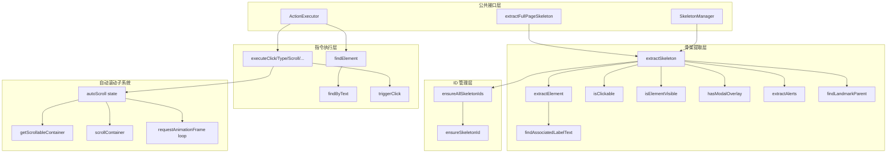
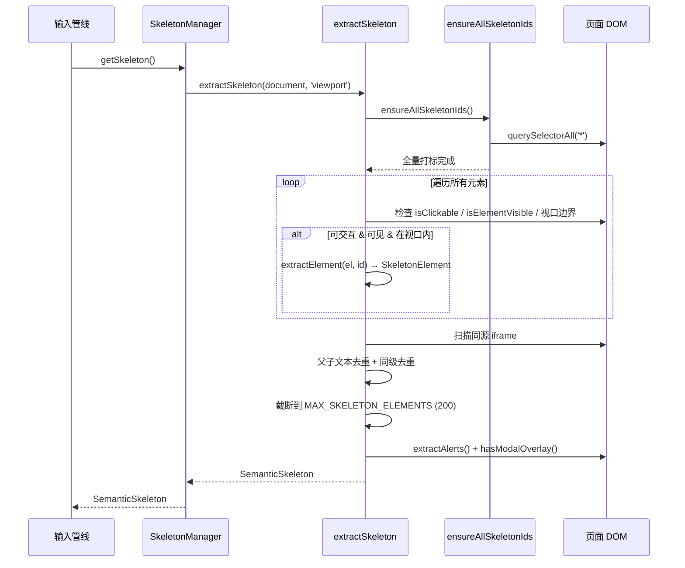
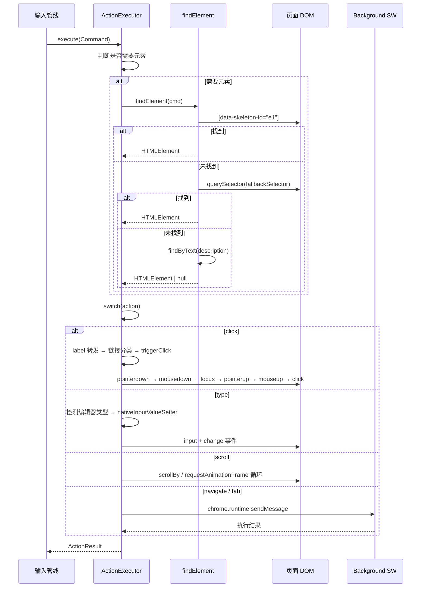
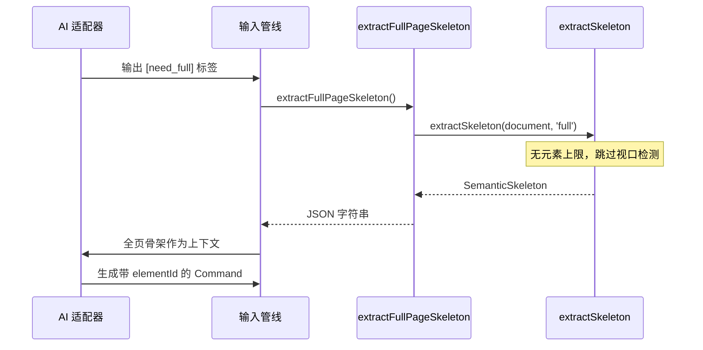
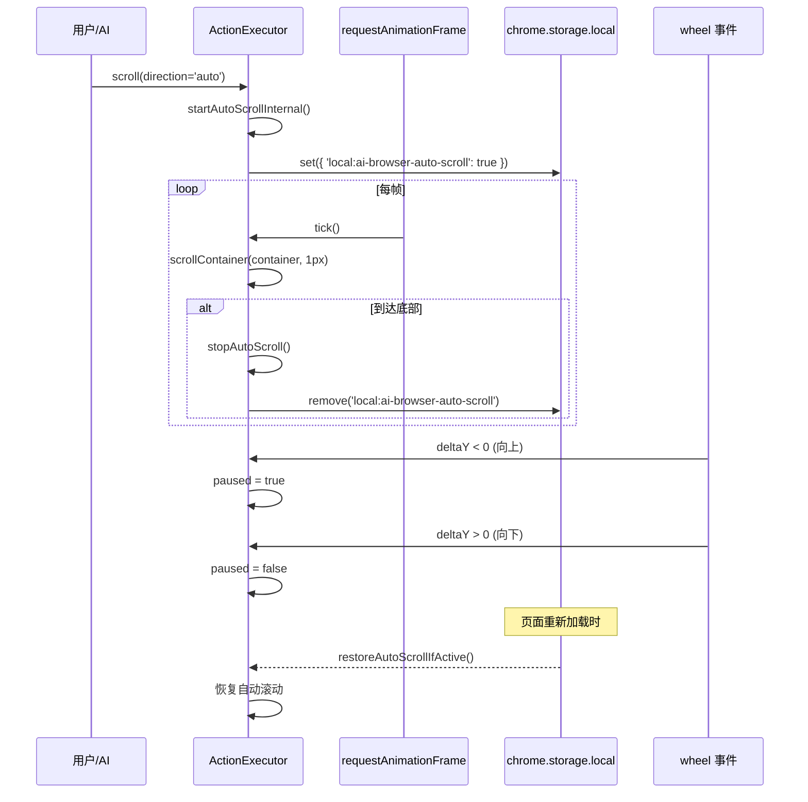

# Browser Command Engine - 架构文档

> 模块路径：`src/browser/`
> 负责将 AI 生成的自然语言意图转化为浏览器 DOM 操作，是"语音指令 → 页面交互"链路的执行终端。

---

## 1. 模块概述

### 1.1 功能定位

Browser Command Engine 是 AI Browser 的**页面操作执行层**，承担两项核心职责：

1. **语义骨架提取** — 从当前页面 DOM 中提取可交互元素的精简描述（语义骨架），作为 AI 决策的上下文输入。
2. **指令执行** — 接收 AI 生成的结构化指令（`Command`），在页面上触发真实的 DOM 事件序列，完成点击、输入、滚动、视频控制等操作。

### 1.2 在架构中的位置

```
用户语音 → 语音识别 → 输入管线(Pipeline) → AI 适配器(Adapter)
                                                       ↓
                                              Command JSON
                                                       ↓
                                          ┌──────────────────────┐
                                          │  Browser Command     │
                                          │  Engine (本模块)      │
                                          │                      │
                                          │  SkeletonManager     │
                                          │  ActionExecutor      │
                                          └──────────────────────┘
                                                       ↓
                                                  DOM 操作
```

- **上游**：输入管线（`src/input/`）调用 AI 适配器生成 `Command`，传递给本模块执行。
- **下游**：直接操作浏览器 DOM，部分操作（标签页管理、导航）通过 `chrome.runtime.sendMessage` 委托 background Service Worker 执行。
- **并行**：骨架提取结果作为 AI 的上下文输入，AI 根据骨架中的元素 ID 生成指令。

### 1.3 依赖关系

| 依赖 | 用途 |
|------|------|
| `src/utils/logger.ts` | 统一日志（写入 chrome.storage.local） |
| `src/browser/skeleton-id.ts` | data-skeleton-id 全量打标工具 |
| `chrome.runtime` | 标签页操作、导航委托 background |
| `chrome.storage.local` | 自动滚动状态持久化 |

### 1.4 文件结构

```
src/browser/
├── index.ts            # 公共导出（barrel 文件）
├── types.ts            # 核心类型定义（SkeletonElement, Command, ActionResult）
├── skeleton-id.ts      # data-skeleton-id 打标工具（模块级计数器）
├── skeleton.ts         # 语义骨架提取器 + SkeletonManager
├── action-executor.ts  # 指令执行引擎（ActionExecutor）
├── local-html.ts       # 全页骨架提取（[need_full] 兜底）
├── code-filter.ts      # 代码内容过滤器（翻译防误翻，三层过滤）
├── translate-service.ts    # 翻译服务（选中翻译 + 自动翻译）
├── translate-popup.ts      # 选中翻译浮动弹窗 UI
├── translate-click.ts      # 点击翻译（语义块检测 + WeakMap 缓存）
├── translate-parser.ts     # 翻译结果解析器（三层容错）
└── skeleton.test.ts        # 骨架提取单元测试（Vitest）
```

---

## 2. 架构设计

### 2.1 分层架构



### 2.2 核心设计模式

#### 无缓存骨架提取

`SkeletonManager` 采用**无缓存、无 MutationObserver** 的设计。每次调用 `getSkeleton()` 都重新扫描 DOM：

- **优点**：永不过期，不存在 DOM 变化后缓存失效的问题，实现简单可靠。
- **代价**：每次提取的 DOM 扫描开销（通过 `MAX_SKELETON_ELEMENTS = 200` 上限控制）。
- **动机**：SPA 应用 DOM 频繁变化，缓存管理的复杂度远大于重新扫描的成本。

#### SkeletonManager API

```typescript
class SkeletonManager {
  // 视口骨架（仅可见区域，上限 200 元素）
  getSkeleton(): SemanticSkeleton

  // 全页骨架（无元素上限）
  getFullSkeleton(): SemanticSkeleton

  // 视口骨架 + 跨域 iframe 元素（通过 chrome.scripting 注入）
  async getSkeletonWithIframes(): Promise<SemanticSkeleton>

  // 全页骨架 + 跨域 iframe 元素
  async getFullSkeletonWithIframes(): Promise<SemanticSkeleton>

  invalidate(): void   // 无操作（无缓存设计）
  dispose(): void      // 无操作（接口兼容）
  cachedUrl: string    // 始终返回 ''（接口兼容）
}
```

独立提取函数（不依赖 SkeletonManager 实例）：

```typescript
function extractSkeleton(doc: Document, scope?: SkeletonScope): SemanticSkeleton
function extractFullSkeleton(doc: Document): SemanticSkeleton  // scope='full' 的便捷封装
```

#### 三重元素定位

`ActionExecutor.findElement()` 按优先级尝试三种定位策略：

1. **elementId** — 骨架分配的 `data-skeleton-id`，精确匹配。
2. **fallbackSelector** — AI 生成的 CSS 选择器，通用兜底。
3. **findByText()** — 文本内容模糊匹配，最后手段。

这种渐进式降级确保即使骨架 ID 因 DOM 变化失效，仍能通过选择器或文本找到目标元素。

#### 完整事件序列触发

点击操作不使用简单的 `el.click()`，而是派发完整的浏览器事件序列：

```
pointerdown → mousedown → focus → pointerup → mouseup → click
```

**动机**：现代 SPA 框架（Vue 3、React 17+）的组件常监听 `pointerdown`/`pointerup` 而非 `mousedown`/`mouseup`，仅派发 MouseEvent 无法触发交互。

### 2.3 为什么这样设计

| 设计决策 | 理由 |
|----------|------|
| 视口骨架 + 全页骨架两层 | 视口骨架减少 token 消耗（200 上限），全页骨架作为 `[need_full]` 兜底 |
| 元素字段按 AI 决策维度分组 | 身份/内容/导航/表单/状态/上下文六组，对应 AI 理解页面所需的不同维度 |
| 父子文本去重 | 避免 `<div><button>提交</button></div>` 产生两个"提交"元素 |
| Label 点击自动转发 | 用户说"点击活动区域"时 AI 可能选中 label，实际需要操作关联的 select/input |
| window.open monkey-patching | 检测按钮事件处理器是否调用了 window.open，准确报告 openedNewTab |
| nativeInputValueSetter | 绕过 React/Vue 受控组件的 value setter 拦截 |

---

## 3. 核心类型定义

### 3.1 SkeletonElement

骨架中的单个可交互元素，字段按 AI 决策维度分六组：

```typescript
interface SkeletonElement {
  // ═══ 1. 身份标识 ═══
  id: string                // 唯一标识 e1, e2, ...
  tag: string               // 标签名
  role?: string             // ARIA role: button, link, tab, menuitem, checkbox, switch ...

  // ═══ 2. 内容信息 ═══
  text?: string             // 用户可见文字（截断 100 字符）
  label?: string            // 表单元素关联的 label 文本
  ariaLabel?: string        // aria-label / title / img[alt]
  placeholder?: string      // 输入框占位提示（截断 50 字符）

  // ═══ 3. 导航信息 ═══
  href?: string             // <a> 标签目标 URL（截断 80 字符）

  // ═══ 4. 表单属性 ═══
  inputType?: string        // input type: text/password/email/tel/search/number/date/file ...
  value?: string            // 当前输入值（截断 20 字符，密码框不提取）
  checked?: boolean         // checkbox/radio 是否选中（仅 true 时输出）
  required?: boolean        // 是否必填（仅 true 时输出）

  // ═══ 5. 交互状态 ═══
  disabled?: boolean        // 是否禁用（仅 true 时输出）
  expanded?: boolean        // 展开/折叠状态（仅 true 时输出）
  selected?: boolean        // 选中状态（仅 true 时输出）

  // ═══ 6. 上下文位置 ═══
  parent?: string           // 父级地标标签（nav/header/main/aside/footer）
}
```

**设计要点**：
- 可选字段仅在值为 true 或非空时输出，减少 token 消耗。
- `text` 截断 100 字符，`href` 截断 80 字符，`placeholder` 截断 50 字符，`value` 截断 20 字符。
- 密码框的 `value` 不提取（安全考虑）。
- `ariaLabel` 独立于 `text` 输出，不合并。

### 3.2 SemanticSkeleton

页面级语义骨架，包含页面状态和元素列表：

```typescript
interface SemanticSkeleton {
  // 页面标识
  url: string
  title: string

  // 视口 & 滚动
  viewport: { width: number; height: number }
  scroll: { y: number; height: number }

  // 页面状态
  hasModal: boolean         // 是否有弹窗/遮罩层阻挡交互
  loading: boolean          // document.readyState !== 'complete'
  focusedElement?: string   // 当前焦点元素的 skeletonId

  // 骨架统计
  totalInteractive: number  // 页面总可交互元素数（去重前）
  truncated: boolean        // 元素列表是否被截断（>200 上限）

  // 提示 & 元素
  alerts?: string[]         // 页面错误/状态提示
  elements: SkeletonElement[]
}
```

### 3.3 Command

AI 生成的结构化浏览器指令：

```typescript
interface Command {
  action: string           // 操作类型（click/type/scroll/navigate/keyboard/video/...）
  elementId?: string       // 骨架中的元素 ID（主定位）
  fallbackSelector?: string // CSS 选择器（备选定位）
  text?: string            // type 操作的输入文字
  url?: string             // navigate 操作的目标 URL
  key?: string             // keyboard 操作的按键
  direction?: string       // scroll 操作的方向（up/down/top/bottom/auto/stop/pause/resume）
  amount?: number          // scroll 操作的滚动像素
  ms?: number              // wait 操作的等待时间
  description?: string     // 操作描述（日志用 / 文本匹配兜底）
  tabAction?: 'newTab' | 'closeTab' | 'switchTab' | 'nextTab' | 'prevTab'
  tabQuery?: string        // switchTab 的目标标签关键词
  done?: number            // 1=最后一步，0=还有步骤
  subAction?: string       // video 操作的子类型
  value?: number           // video 操作的值
}
```

### 3.4 ActionResult

指令执行结果：

```typescript
interface ActionResult {
  success: boolean
  message: string
  openedNewTab?: boolean   // click 操作是否新开标签页
}
```

### 3.5 INTERACTIVE_TAGS

骨架提取和模糊匹配共用的原生可交互标签常量：

```typescript
const INTERACTIVE_TAGS = [
  'a', 'button', 'input', 'select', 'textarea', 'label', 'summary', 'details'
]
```

---

## 4. 实现细节

### 4.1 骨架提取流程（extractSkeleton）

```typescript
function extractSkeleton(doc: Document, scope: 'viewport' | 'full'): SemanticSkeleton
```

**执行步骤**：

1. **全量打标** — 调用 `ensureAllSkeletonIds()` 同步计数器 + 给所有元素打 `data-skeleton-id`。
2. **遍历 DOM** — `querySelectorAll('*')` 获取所有元素，逐个判断：
   - `isClickable()` — 是否可交互
   - `isElementVisible()` — 是否可见（display/visibility/offsetParent）
   - 视口边界检测（仅 viewport 模式）
3. **提取字段** — `extractElement()` 构建 `SkeletonElement`，包含 6 组字段。
4. **同源 iframe 扫描** — 递归扫描 iframe 内部元素，坐标偏移 `iframeRect.left/top`。
5. **去重** — 父子文本去重（保留子级）+ 同级文本去重（按 landmark parent 分组）。
6. **截断** — viewport 模式限制 `MAX_SKELETON_ELEMENTS = 200`。
7. **提取 alerts** — `extractAlerts()` 收集页面错误/状态提示。
8. **组装结果** — 返回 `SemanticSkeleton`。

### 4.2 可点击性检测（isClickable）

```typescript
function isClickable(el: HTMLElement): boolean
```

检测顺序（短路返回）：

| 优先级 | 检测条件 | 说明 |
|--------|----------|------|
| 1 | `INTERACTIVE_TAGS` | a, button, input, select, textarea, label, summary, details |
| 2 | `contenteditable="true"` | 可编辑元素 |
| 3 | `onclick` 属性 | 内联点击事件 |
| 4 | ARIA role | button, link, menuitem, tab, option, switch, checkbox, radio |
| 5 | `tabindex` 属性 | 可聚焦元素 |
| 6 | `cursor: pointer` | CSS 样式标记为可点击（可能有 addEventListener） |

### 4.3 元素字段提取（extractElement）

```typescript
function extractElement(el: HTMLElement, id: string): SkeletonElement | null
```

**跳过条件**：无文字 + 无 role + 无图标子元素 + 无表单内容 + 无关联 label + 无 ariaLabel → 返回 null。

**文本提取优先级**：
1. 直接文本节点（`getDirectText`，截断 100 字符）
2. 表单元素的 `value`（input/textarea 有已输入内容时）
3. 关联 label 文本（`findAssociatedLabelText`，存入 `label` 字段）
4. 图标元素的 `ariaLabel` 或 `(icon)` 占位

**关联 label 查找**（`findAssociatedLabelText`）按优先级尝试四种方式：
1. `<label for="elementId">` — 通过 for 属性关联
2. 父级 `<label>` — input 嵌套在 label 内
3. `aria-labelledby` — 指向任意元素的 id
4. 同级 `<label>` — 向上最多 5 层查找（Element UI 等组件库模式）

### 4.4 弹窗检测（hasModalOverlay）

```typescript
function hasModalOverlay(doc: Document): boolean
```

四层检测策略：

| 层级 | 检测方式 | 示例 |
|------|----------|------|
| 1 | 原生 dialog | `dialog[open]` |
| 2 | ARIA 语义 | `role="dialog"`, `role="alertdialog"`, `aria-modal="true"` |
| 3 | 框架弹窗 | Bootstrap `.modal.show`、Element UI `.el-dialog__wrapper`、Ant Design `.ant-modal-wrap`、Material UI `.MuiDialog-root`、Vuetify `.v-dialog--active` |
| 4 | 通用遮罩 | class/id 含 overlay/mask/modal-backdrop/dialog-mask，面积 > 50% 视口 |

### 4.5 元素需求分类

`execute()` 入口根据 `action` 判断是否需要定位 DOM 元素：

| 不需要元素的操作 | 说明 |
|-----------------|------|
| `navigate` | 通过 background 新标签页打开 |
| `wait` | 纯定时器 |
| `scroll` | 操作整个页面/容器 |
| `keyboard` / `press` | 作用于 `document.activeElement` |
| `newTab` / `closeTab` / `switchTab` / `nextTab` / `prevTab` | 委托 background |

其余操作（`click`、`type`、`clear`、`select`、`focus`、`hover`、`video`）必须先通过 `findElement()` 定位元素，未找到则直接返回失败。

### 4.6 三重元素定位（findElement）

```typescript
private findElement(cmd: Command): HTMLElement | null
```

**定位链**：

```
elementId (data-skeleton-id)
    ↓ 未找到
fallbackSelector (CSS 选择器)
    ↓ 未找到
findByText (文本模糊匹配)
    ↓ 未找到
return null → 执行失败
```

**findByText 策略**：
1. 优先搜索交互元素（INTERACTIVE_TAGS + `[role="button"]` + `[onclick]` + `[tabindex]`）
2. 兜底搜索所有元素（排除 script/style/svg）
3. 匹配 `textContent`、`aria-label`、`title`、`placeholder` 四个属性
4. 过滤不可见元素（display:none / visibility:hidden）

### 4.7 点击执行（executeClick）

```typescript
private async executeClick(el: HTMLElement): Promise<ActionResult>
```

**Label 转发**：点击 `<label>` 时自动转发到关联的表单元素（input/select/textarea）。`findLabelTarget` 按 for 属性、内嵌元素、同级容器三种方式查找。

**链接分类处理**：

| 链接类型 | 判断条件 | 处理方式 |
|----------|----------|----------|
| JS 交互型 | href 为空/`#`/`javascript:` | `triggerClick` + window.open monkey-patching |
| 真实链接（当前页） | target 为 `_self`/`_top`/`_parent` | `window.location.href = el.href` |
| 真实链接（新标签） | target 为 `_blank` 或命名 frame | `window.open(el.href, target)`，popup blocker 拦截时回退到当前页 |

**triggerClick 事件序列**：

```
pointerdown → mousedown → focus → pointerup → mouseup → click
```

所有事件携带 `bubbles: true`、`cancelable: true`、精确的 `clientX/clientY`（元素中心坐标）。

**window.open monkey-patching**：临时替换 `window.open`，检测事件处理器是否打开了新标签页，准确设置 `openedNewTab` 标志。

### 4.8 输入执行（executeType）

```typescript
private async executeType(el: HTMLElement, text: string): Promise<ActionResult>
```

**三大类输入策略**（按优先级）：

#### 1. 代码编辑器（CodeMirror 5/6、Monaco、Ace）

content script 运行在隔离世界（isolated world），无法直接访问页面 JS 属性（如 `CodeMirror.setValue`）。采用三层降级策略：

| 优先级 | 策略 | 原理 |
|--------|------|------|
| 1 | `document.execCommand('insertText')` | 最简单，部分编辑器支持 |
| 2 | `ClipboardEvent('paste')` + `DataTransfer` | 通用兜底，模拟用户粘贴 |
| 3 | `<script>` 注入（仅 CM5） | 注入 `document.querySelector('.CodeMirror').CodeMirror.setValue()` 到页面上下文 |

编辑器检测：`el.closest('.CodeMirror, .cm-editor, .monaco-editor, .ace_editor')`

#### 2. contenteditable 富文本编辑器

Quill、TinyMCE、CKEditor、ProseMirror/TipTap、Draft.js、WangEditor、通用 contenteditable：

```
el.focus() → document.execCommand('selectAll') → document.execCommand('insertText', false, text)
```

检测：`el.isContentEditable` 或 `el.closest('[contenteditable="true"]')`

#### 3. 标准 input / textarea

通过 `Object.getOwnPropertyDescriptor(proto, 'value').set` 获取原生 setter，绕过 React/Vue 受控组件拦截。设置值后派发 `input` + `change` 事件。

**兜底**：无法识别的编辑器类型返回失败，提示用户尝试其他操作方式。

### 4.9 滚动执行（executeScroll）

```typescript
private async executeScroll(direction: string, amount?: number): Promise<ActionResult>
```

**方向模式**：

| direction | 行为 |
|-----------|------|
| `up` | 向上滚动 amount 像素（默认 80% 视口高度） |
| `down` | 向下滚动 amount 像素 |
| `top` | 滚动到顶部 |
| `bottom` | 滚动到底部 |
| `auto` | 启动自动滚动（requestAnimationFrame 循环） |
| `stop` | 停止自动滚动 |
| `pause` | 暂停自动滚动 |
| `resume` | 恢复自动滚动 |

**可滚动容器查找**（`getScrollableContainer`）：
1. 从目标元素向上查找 `overflow-y: auto/scroll` 且 `scrollHeight > clientHeight` 的容器
2. 检查 `document.documentElement` 是否可滚动
3. 兜底：扫描所有 `<div>` 找最大可滚动容器

**自动滚动特性**：
- 使用 `requestAnimationFrame` 实现平滑滚动（每帧 1px）
- 滚轮向上自动暂停，向下自动恢复
- 状态持久化到 `chrome.storage.local`（key: `local:ai-browser-auto-scroll`），跨页面/标签页共享
- 到达底部自动停止
- 页面加载时自动恢复（`restoreAutoScrollIfActive`）

**滚动等待**：一次性滚动后等待两帧 + 500ms，确保浏览器完成重绘。

```typescript
await new Promise(resolve =>
  requestAnimationFrame(() =>
    requestAnimationFrame(() => setTimeout(resolve, 500))
  )
)
```

### 4.10 键盘执行（executeKeyboard）

```typescript
private async executeKeyboard(key: string): Promise<ActionResult>
```

派发 `keydown` → `keypress` → `keyup` 完整事件序列。`getKeyCode()` 将 key 名映射为正确的 `KeyboardEvent.code`：

| key | code |
|-----|------|
| `Enter` | `Enter` |
| `Escape` / `Esc` | `Escape` |
| `Tab` | `Tab` |
| `Backspace` | `Backspace` |
| `ArrowUp/Down/Left/Right` | `ArrowUp/Down/Left/Right` |
| `Space` / ` ` | `Space` |
| 单字母 (a-z) | `KeyA` - `KeyZ` |
| 数字 (0-9) | `Digit0` - `Digit9` |

**Enter 键特殊处理**：合成事件不触发浏览器默认行为，因此 Enter 键手动查找并提交表单：
1. 从 `activeElement` 向上找 `<form>`，调用 `form.requestSubmit()`
2. 兜底：全局找搜索输入框（`input[type="search"]`、`input[name="q"]`、`input[name="keyword"]`、`input[name="wd"]`、`input[placeholder*="搜索"]`、`input[placeholder*="search"]`）并提交

### 4.11 视频控制（executeVideo）

```typescript
private async executeVideo(el: HTMLElement, subAction: string, value?: number): Promise<ActionResult>
```

支持 8 种子操作：

| subAction | 行为 | value 含义 |
|-----------|------|-----------|
| `play` | 播放 | - |
| `pause` | 暂停 | - |
| `volume` | 设置音量（0-1） | 音量值，自动取消静音 |
| `mute` | 静音 | - |
| `unmute` | 取消静音 | - |
| `seek` | 快进/快退（相对） | 秒数（正=快进，负=快退） |
| `jump` | 跳转到指定时间（绝对） | 秒数 |
| `speed` | 设置播放速度 | 倍速（如 1.5） |
| `fullscreen` | 全屏 | 返回失败（需用户手势） |

video 元素查找：先检查 el 本身是否为 `HTMLVideoElement`，再 `querySelector('video')` 或 `closest('video')`。

时间格式化：`formatTime()` 将秒数转为 `mm:ss` 格式。

### 4.12 其他操作

**executeSelect** — 下拉框选择：设置 `el.value` + 触发 `change` 事件。

**executeFocus** — 聚焦：调用 `el.focus()` + 触发 `focus` 事件。

**executeHover** — 悬停：派发完整鼠标事件链 `pointerover → pointerenter → mouseover → mouseenter → pointermove → mousemove`。

**executeWait** — 等待：`setTimeout` 延迟指定毫秒，支持 `AbortSignal` 中断（`signal.aborted` 时抛出 `AbortError`）。

**executeNavigate** — 导航：通过 `chrome.runtime.sendMessage` 委托 background 新标签页打开（避免 popup 拦截）。

**executeTabAction** — 标签页操作：通过 `chrome.runtime.sendMessage` 委托 background 执行 `newTab`/`closeTab`/`switchTab`。

**executeIframeAction** — iframe 操作：当 `elementId` 以 `f_` 前缀开头时，表示目标元素在 iframe 内。通过 `chrome.runtime.sendMessage({ type: 'execute-iframe-action' })` 委托 background 使用 `chrome.scripting.executeScript` 注入 `iframeActionFunc` 到目标 iframe 执行。支持 click、type、clear、select、focus、hover 六种操作。`iframeActionFunc` 是自包含函数，不依赖外部导入。

### 4.13 Skeleton ID 管理（skeleton-id.ts）

```typescript
// 模块级计数器，跨调用不重置
let idCounter = 0

function ensureSkeletonId(el: HTMLElement): string         // 单元素打标
function ensureAllSkeletonIds(): void                       // 全量打标（document）
function ensureAllSkeletonIdsForDoc(doc: Document): void    // 指定 Document 打标（用于同源 iframe）
function initAllSkeletonIds(): void                         // 首次加载打标（带日志）
```

- ID 格式：`e1`, `e2`, `e3`, ...（`data-skeleton-id` 属性）
- `syncIdCounter()` 扫描已有 ID 同步计数器到最大值，避免 ID 冲突
- 跳过标签：`script, style, noscript, meta, link, br, hr`

### 4.14 全页骨架（local-html.ts）

```typescript
function extractFullPageSkeleton(): string | null
```

`[need_full]` 触发时调用。内部调用 `extractSkeleton(document, 'full')`，跳过视口边界检测，不限制元素数量。返回 JSON 字符串，无元素时返回 null。

---

## 5. 数据流

### 5.1 骨架提取数据流



### 5.2 指令执行数据流



### 5.3 全页骨架兜底数据流



### 5.4 自动滚动状态流



---

## 6. 配置与扩展

### 6.1 可配置参数

| 参数 | 值 | 位置 | 说明 |
|------|-----|------|------|
| `MAX_SKELETON_ELEMENTS` | 200 | skeleton.ts | 视口骨架最大元素数 |
| `MAX_HREF_LENGTH` | 200 | skeleton.ts | href 截断长度 |
| `MAX_PLACEHOLDER_LENGTH` | 50 | skeleton.ts | placeholder 截断长度 |
| `MAX_VALUE_LENGTH` | 20 | skeleton.ts | value 截断长度 |
| text 截断长度 | 100 | skeleton.ts `getDirectText` | 用户可见文字截断 |
| alerts 最大条数 | 5 | skeleton.ts `extractAlerts` | 页面提示最大数量 |
| 自动滚动速度 | 1 px/frame | action-executor.ts | requestAnimationFrame 每帧滚动像素 |
| 滚动默认距离 | `innerHeight * 0.8` | action-executor.ts | 一次性滚动默认像素 |
| LANDMARK_TAGS | nav/header/main/aside/footer | skeleton.ts | 地标标签列表 |
| LANDMARK_ROLES | navigation/banner/main/complementary/contentinfo | skeleton.ts | 地标 role 列表 |

### 6.2 扩展点

#### 新增操作类型

在 `ActionExecutor.execute()` 的 switch 分支中添加新 case，实现对应的 `executeXxx()` 方法。操作不需要元素定位时，将 action 名加入 `needsElement` 排除列表：

```typescript
const needsElement = !['navigate', 'wait', 'scroll', 'keyboard', 'press',
  'newTab', 'closeTab', 'switchTab', 'nextTab', 'prevTab'].includes(cmd.action)
```

#### 新增编辑器类型支持

在 `executeType()` 中按优先级插入新的编辑器检测分支（当前顺序：CodeMirror → Monaco → Ace → contenteditable → 标准 input）。检测模式：通过 `closest()` 查找编辑器容器，访问其内部 API。

#### 新增弹窗框架检测

在 `hasModalOverlay()` 的 `frameworkSelectors` 数组中添加新的 CSS 选择器：

```typescript
const frameworkSelectors = [
  '.modal.show',           // Bootstrap
  '.el-dialog__wrapper',   // Element UI
  '.ant-modal-wrap',       // Ant Design
  '.MuiDialog-root',       // Material UI
  '.v-dialog--active',     // Vuetify
  // 在此添加新框架
]
```

#### 新增可点击性规则

在 `isClickable()` 中添加新的检测条件。

#### 新增地标类型

扩展 `LANDMARK_TAGS` 和 `LANDMARK_ROLES` 数组。

---

## 7. 已知限制

### 7.1 骨架提取

- **Shadow DOM 不支持** — `querySelectorAll('*')` 无法穿透 Shadow DOM 边界，Web Components 内部元素不可见。
- **canvas/svg 内部不可提取** — Canvas 绘制的内容和 SVG 内部图形元素不在 DOM 树中，无法识别。
- **动态内容时序** — 无缓存设计意味着每次提取的是当前 DOM 快照，如果 AI 响应期间页面发生变化（如懒加载），下次提取才能反映。
- **iframe 仅限同源** — 跨域 iframe 的 `contentDocument` 访问会被浏览器阻止，静默跳过。
- **cursor:pointer 误判** — 部分不可交互元素可能设置了 `cursor: pointer` 样式，导致被错误提取。

### 7.2 指令执行

- **合成事件局限** — 派发的事件是合成事件（synthetic），部分浏览器原行为不会触发（如 `<a>` 的默认导航需手动处理，Enter 提交表单需手动调用 `requestSubmit()`）。
- **全屏需用户手势** — `video.requestFullscreen()` 受浏览器安全策略限制，程序化调用会被拒绝。
- **React 受控组件** — 虽然使用 `nativeInputValueSetter` 绕过，但部分极端封装的组件可能仍有拦截。
- **跨标签页状态同步** — 自动滚动状态通过 `chrome.storage.local` 持久化，但 storage 事件有延迟，极端情况下可能不同步。
- **文本匹配精度** — `findByText` 使用 `includes()` 匹配，当页面存在大量相似文本时可能定位到错误元素。
- **键盘事件无默认行为** — 合成 KeyboardEvent 不触发浏览器默认行为（如 Tab 切换焦点、Escape 关闭弹窗），需依赖页面 JS 监听器处理。

### 7.3 性能

- **全量 DOM 扫描** — `ensureAllSkeletonIds()` 和 `extractSkeleton()` 都会遍历全部 DOM 元素，大型页面（>10000 节点）可能有明显耗时。
- **getComputedStyle 调用** — `isClickable` 和 `isElementVisible` 对每个元素调用 `getComputedStyle`，在元素密集的页面上可能造成布局抖动（layout thrashing）。
- **自动滚动内存** — `requestAnimationFrame` 循环在页面生命周期内持续运行（如果未停止），wheel 事件监听器需正确清理。
