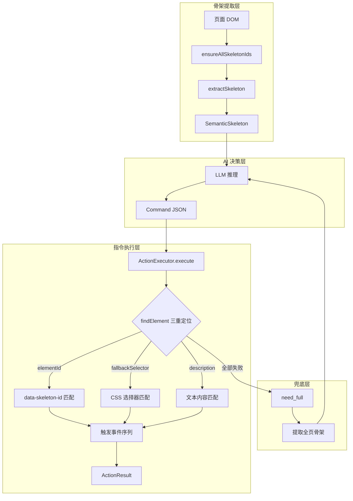
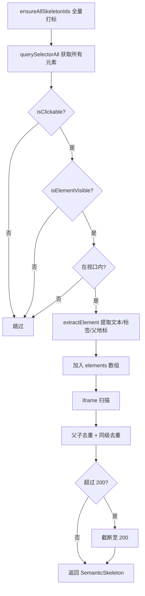
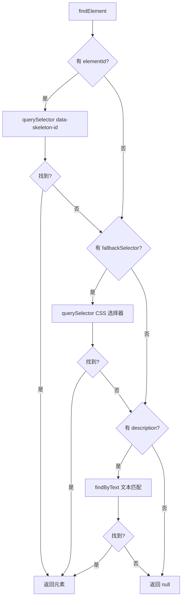
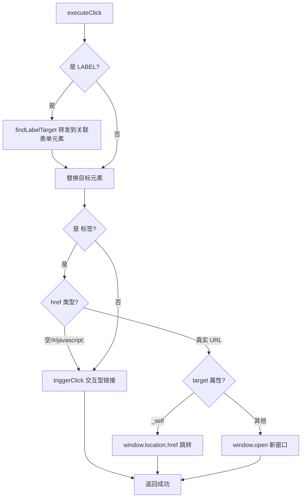
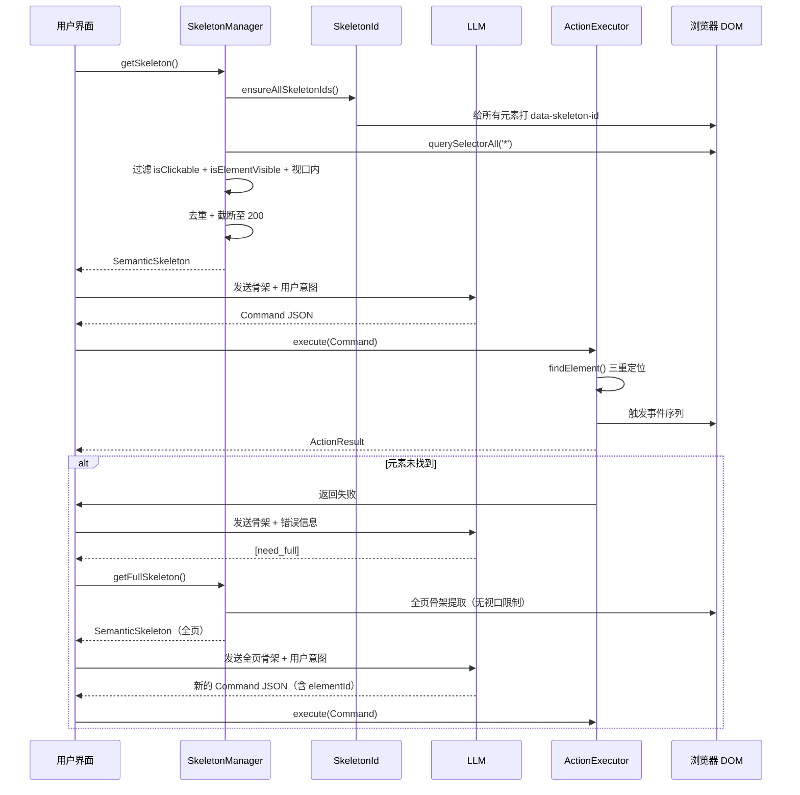

# 浏览器命令执行架构

## 目标

将 AI 生成的自然语言指令转化为浏览器 DOM 操作。核心流程：从页面可视窗口提取语义骨架（SemanticSkeleton）发送给 AI，AI 根据用户意图生成结构化指令（Command），执行引擎通过三重元素定位机制找到目标元素并触发完整的浏览器事件序列。

## 架构总览



## 核心设计决策

### 1. 无缓存：每次重新提取骨架

`getSkeleton()` 每次调用都从当前可视窗口重新扫描 DOM，不使用缓存、不监听 MutationObserver、不追踪 URL 变化。

**理由：**
- 简单可靠 —— 不存在缓存过期、DOM 变化漏检等问题
- 每次提取的骨架与当前页面状态完全一致
- 避免 MutationObserver 的性能开销和复杂性
- 骨架提取耗时在毫秒级，对用户体验无感知影响

### 2. 三重元素定位（Triple Element Location）

AI 生成的指令中可能包含多种定位信息，执行引擎按优先级依次尝试：

| 优先级 | 定位方式 | 数据来源 | 可靠性 |
|--------|----------|----------|--------|
| 1 | `elementId` → `data-skeleton-id` | 骨架提取时标记的稳定 ID | 最高 |
| 2 | `fallbackSelector` → CSS 选择器 | AI 根据页面结构生成 | 中等 |
| 3 | `description` → 文本内容匹配 | AI 从用户意图提取的关键词 | 最低（兜底） |

三重定位的设计目标是最大化指令执行成功率：即使骨架重新提取导致 ID 变化，CSS 选择器和文本匹配仍可作为兜底。

### 3. 完整事件序列（非简单 `.click()`）

点击操作不使用 `el.click()`，而是触发完整的鼠标事件序列：

```
mousedown → focus → mouseup → click
```

**理由：** Element UI、Ant Design 等组件库的 Select、DatePicker 等组件监听 `mousedown` 或 `focus` 事件，仅调用 `el.click()` 无法触发这些组件的交互逻辑。

### 4. iframe 支持

同源 iframe 内的元素会被扫描并纳入骨架。iframe 内元素的坐标会加上 iframe 的偏移量，确保视口内判断准确。`parent` 字段标记为 `iframe.{id/class/name}` 以区分来源。

跨域 iframe 因浏览器安全限制无法访问 `contentDocument`，自动跳过。

### 5. 骨架元素上限 200

`MAX_SKELETON_ELEMENTS = 200`，超出时截断。这是为了控制发送给 AI 的 token 消耗。200 个元素通常足以覆盖页面上所有关键交互元素。

## 数据类型

### SkeletonElement

骨架中的单个可交互元素，精简为 AI 定位和识别所需的核心字段：

```typescript
interface SkeletonElement {
  id: string       // 唯一标识 e1, e2, ...（对应 data-skeleton-id）
  tag: string      // HTML 标签名
  text?: string    // 可见文字（截断 100 字符，含 ariaLabel/title/placeholder fallback）
  label?: string   // 表单元素关联的 label 文本
  parent?: string  // 父级地标标签（nav/header/main 等）
}
```

### SemanticSkeleton

页面语义骨架，包含 URL、标题和可交互元素列表：

```typescript
interface SemanticSkeleton {
  url: string              // 当前页面 URL
  title: string            // 页面标题
  elements: SkeletonElement[]  // 可交互元素列表（最多 200 个）
}
```

### Command

AI 生成的浏览器指令，支持多种操作类型和灵活的定位方式：

```typescript
interface Command {
  action: string              // 操作类型（click/type/clear/scroll/navigate/select/keyboard/press/focus/hover/wait/video/tab 等）
  elementId?: string          // 骨架中的元素 ID（主定位）
  fallbackSelector?: string   // CSS 选择器（备选定位）
  text?: string               // type 操作的输入文字
  url?: string                // navigate 操作的目标 URL
  key?: string                // keyboard 操作的按键
  direction?: string          // scroll 操作的方向（up/down/top/bottom）
  amount?: number             // scroll 操作的滚动像素
  ms?: number                 // wait 操作的等待毫秒数
  description?: string        // 操作描述（日志 + 文本匹配兜底）
  tabAction?: string          // 标签页操作类型
  tabQuery?: string           // switchTab 的目标标签关键词
  done?: number               // 1=最后一步，0=还有步骤
  subAction?: string          // video 子操作类型
  value?: number              // video 操作的数值参数
}
```

### ActionResult

执行结果，包含成功状态和消息：

```typescript
interface ActionResult {
  success: boolean
  message: string
}
```

## 模块详解

### SkeletonManager（骨架管理器）

`src/browser/skeleton.ts`

骨架管理器是骨架提取的入口，封装了 `extractSkeleton()` 函数。类本身是轻量封装，核心逻辑在独立函数中，便于测试和复用。

**关键方法：**

| 方法 | 说明 |
|------|------|
| `getSkeleton(): SemanticSkeleton` | 获取当前可视窗口内的语义骨架（每次重新提取） |
| `invalidate(): void` | 骨架失效标记（viewport 模式下无缓存，保留接口兼容） |
| `dispose(): void` | 资源释放（viewport 模式下无操作） |

**`extractSkeleton()` 提取流程：**



**可点击性检测（`isClickable()`）：**

满足以下任一条件即判定为可交互元素：

- 原生交互标签：`a`, `button`, `input`, `select`, `textarea`, `label`, `summary`, `details`
- 媒体元素：`video`, `audio`
- `contenteditable="true"` 或 `contenteditable=""`
- `onclick` 属性存在
- `role` 为 `button`/`link`/`menuitem`/`tab`/`option`/`switch`/`checkbox`/`radio`
- `tabindex` 属性存在
- CSS `cursor: pointer`（可能有 `addEventListener` 绑定的点击事件）

**可见性检测（`isElementVisible()`）：**

- 排除 `display: none` 和 `visibility: hidden`
- `offsetParent` 非 null 或 `position: fixed` 判定为可见

**地标父级标注（`findLandmarkParent()`）：**

向上遍历 DOM 树，查找语义地标标签（`nav`/`header`/`main`/`aside`/`footer`）或对应 ARIA role（`navigation`/`banner`/`main`/`complementary`/`contentinfo`），写入 `parent` 字段。AI 可据此区分同名按钮在不同区域（如导航栏 vs 主内容区）。

**去重策略：**

1. 父子去重：若父元素的文本包含子元素的文本，移除父级（保留子级更精确的可操作元素）。原生交互标签（`a`/`button` 等）不参与父子去重。
2. 同级去重：同一 `parent` 下相同文本的元素只保留第一个。

### SkeletonId（骨架 ID 管理）

`src/browser/skeleton-id.ts`

统一管理 `data-skeleton-id` 属性的分配，供骨架提取和关键词搜索共用。

**关键函数：**

| 函数 | 说明 |
|------|------|
| `ensureAllSkeletonIds(): void` | 全量打标：同步计数器 + 给 body 下所有元素打 `data-skeleton-id` |
| `ensureSkeletonId(el): string` | 确保单个元素有 ID，有则返回现有，无则新增 |
| `initAllSkeletonIds(): void` | 首次加载全量打标（带日志） |

ID 格式为 `e{N}`（如 `e1`, `e2`, ...），使用模块级计数器 `idCounter` 保证全局唯一且跨调用不重置。`syncIdCounter()` 在每次全量打标前扫描已有 ID，将计数器同步到最大值，避免 ID 冲突。

跳过标签：`script`, `style`, `noscript`, `meta`, `link`, `br`, `hr`。

### ActionExecutor（指令执行引擎）

`src/browser/action-executor.ts`

指令执行引擎，支持多种操作类型，通过三重元素定位找到目标元素并触发完整事件序列。

**支持的操作类型：**

| 操作 | 说明 | 需要元素 |
|------|------|----------|
| `click` | 点击元素（完整鼠标事件序列） | 是 |
| `type` | 输入文字（兼容 React/Vue 受控组件） | 是 |
| `clear` | 清空输入框 | 是 |
| `scroll` | 滚动页面（up/down/top/bottom） | 否 |
| `navigate` | 新标签页打开 URL（通过 background 代理） | 否 |
| `select` | 下拉框选择 | 是 |
| `keyboard`/`press` | 键盘按键（keydown→keypress→keyup） | 否 |
| `focus` | 聚焦元素 | 是 |
| `hover` | 悬停元素（mouseenter + mouseover） | 是 |
| `wait` | 等待指定毫秒数 | 否 |
| `video` | 视频控制（play/pause/volume/mute/seek/jump/speed/fullscreen） | 是 |
| `newTab` | 新建标签页 | 否 |
| `closeTab` | 关闭当前标签页 | 否 |
| `switchTab`/`nextTab`/`prevTab` | 切换标签页 | 否 |

**三重元素定位（`findElement()`）：**



**文本匹配（`findByText()`）：**

分两轮搜索：
1. 优先搜索交互元素（`a`/`button`/`input`/`select`/`textarea`/`label`/`[role="button"]`/`[onclick]`/`[tabindex]`）
2. 兜底搜索所有元素（覆盖 `div`/`span` + SVG 图标按钮），过滤不可见元素

匹配范围：`textContent`、`aria-label`、`title`、`placeholder`，使用 `includes()` 模糊匹配。

**点击执行（`executeClick()`）：**



**triggerClick 完整事件序列：**

```
mousedown → focus → mouseup → click
```

每个事件都携带正确的 `clientX`/`clientY`（元素中心点坐标）、`bubbles: true`、`cancelable: true`，模拟真实用户点击行为。

**输入执行（`executeType()`）：**

1. `el.focus()` + `FocusEvent('focus')`
2. 使用 `nativeInputValueSetter` 绕过 React/Vue 受控组件的 `value` 拦截
3. 触发 `Event('input')` + `Event('change')`

**键盘执行（`executeKeyboard()`）：**

1. 触发完整键盘事件序列：`keydown` → `keypress` → `keyup`
2. Enter 键特殊处理：尝试提交表单（先找 `activeElement.closest('form')`，兜底找全局搜索输入框的表单）
3. `getKeyCode()` 将 key 名映射为正确的 `KeyboardEvent.code`

**Label 转发（`findLabelTarget()`）：**

当点击目标是 `<label>` 时，自动查找关联的表单元素（`input`/`select`/`textarea`）并转发点击事件：

1. `label[for="id"]` → `document.getElementById()`
2. label 内嵌的表单元素
3. 同级容器内的表单元素（Element UI 等组件库模式）

**Video 操作（`executeVideo()`）：**

支持的子操作：`play`、`pause`、`volume`（0-1）、`mute`、`unmute`、`seek`（相对快进/快退）、`jump`（绝对跳转）、`speed`（播放速度）。`fullscreen` 因浏览器安全限制（需要用户手势）无法程序化调用。

**标签页操作：**

通过 `chrome.runtime.sendMessage` 调用 background 的 `tabs` API 代理执行，避免 popup 页面的权限限制。

### extractFullPageSkeleton（全页骨架提取）

`src/browser/local-html.ts`

当视口骨架无法定位目标元素时的兜底机制。AI 输出 `[need_full]` 标签，系统提取全页面所有可交互元素的骨架（与视口骨架格式一致），AI 直接使用 `elementId` 生成指令。

**流程：**

1. 调用 `extractFullSkeleton(document)` 提取全页骨架
2. 与视口骨架逻辑完全一致（可交互性检测 → 可见性检测 → 提取元素 → 地标标注 → iframe → 去重）
3. 唯一区别：跳过视口边界检测，不限制元素数量
4. 返回 JSON 字符串，AI 直接解析 elementId

## 数据流



## 错误处理

### 元素未找到的回退链

```
elementId 未命中
  → fallbackSelector 未命中
    → description 文本匹配未命中
      → 返回 ActionResult { success: false }
        → AI 输出 [need_full]
          → 提取全页骨架（同格式，无上限）
            → AI 用 elementId 生成新的 Command
```

### 异常捕获

`execute()` 方法整体包裹在 `try/catch` 中，任何执行异常都会被捕获并返回 `ActionResult { success: false, message: "执行异常: ..." }`。

### 各操作的错误处理

| 操作 | 错误场景 | 处理方式 |
|------|----------|----------|
| `findElement` | CSS 选择器语法错误 | catch 后继续下一优先级 |
| `navigate` | `chrome.runtime.sendMessage` 失败 | 返回失败消息 |
| `video` | 未找到 video 元素 | 返回失败消息 |
| `video/fullscreen` | 浏览器安全限制 | 返回提示用 click 点击全屏按钮 |
| `select` | 目标不是 `<select>` 元素 | 返回失败消息 |
| `scroll` | 未知方向 | 返回失败消息 |
| 标签页操作 | background 通信失败 | 返回失败消息 |

### 中止支持

骨架管理器的 `invalidate()` 和 `dispose()` 方法保留接口兼容，viewport 模式下无需实际操作。

## 目录结构

```
src/browser/
├── index.ts              # 模块入口，统一导出
├── types.ts              # 类型定义：SkeletonElement, SemanticSkeleton, Command, ActionResult
├── skeleton-id.ts        # data-skeleton-id 打标工具：ensureAllSkeletonIds(), ensureSkeletonId()
├── skeleton.ts           # 骨架管理器：SkeletonManager 类 + extractSkeleton() + extractFullSkeleton()
├── action-executor.ts    # 指令执行引擎：ActionExecutor 类，三重定位 + 完整事件序列
├── local-html.ts         # 全页骨架提取：extractFullPageSkeleton() 兜底机制
├── code-filter.ts        # 代码过滤（辅助）
├── translate-parser.ts   # 翻译解析器
├── translate-click.ts    # 翻译点击处理
├── translate-popup.ts    # 翻译弹窗
└── translate-service.ts  # 翻译服务
```

命令执行核心模块为前 5 个文件（`types.ts` → `skeleton-id.ts` → `skeleton.ts` → `action-executor.ts` → `local-html.ts`），其余为翻译功能模块。
