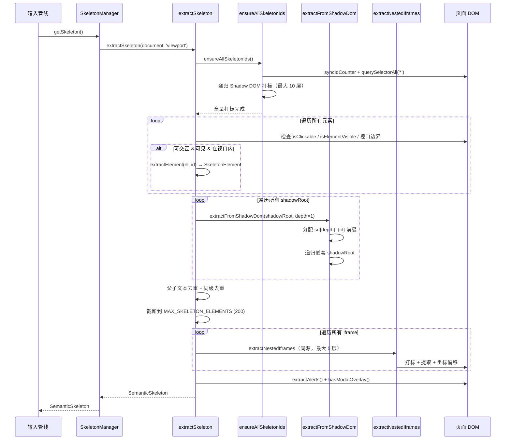
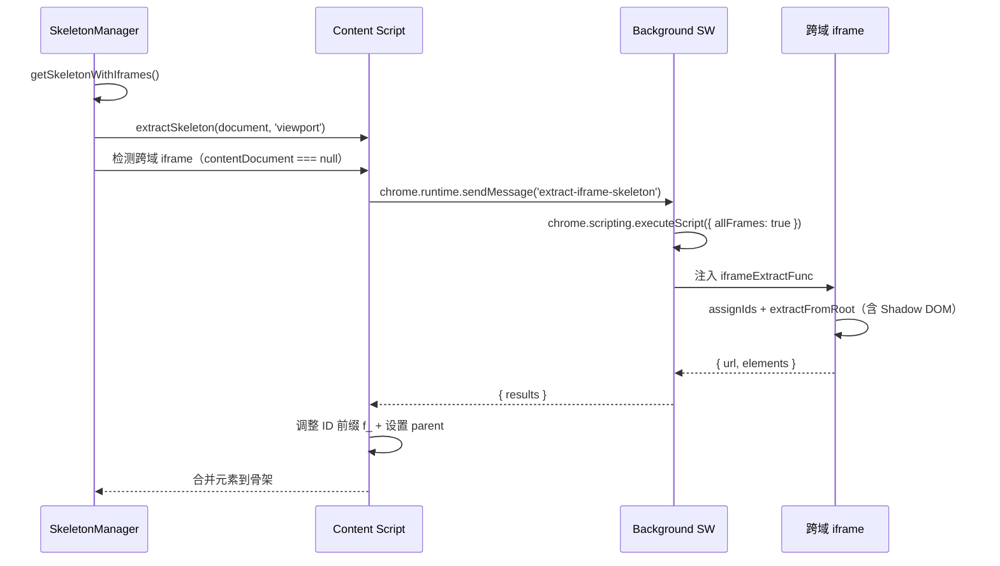
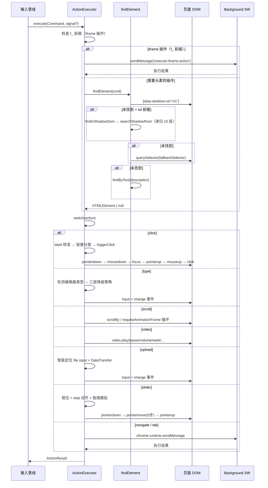
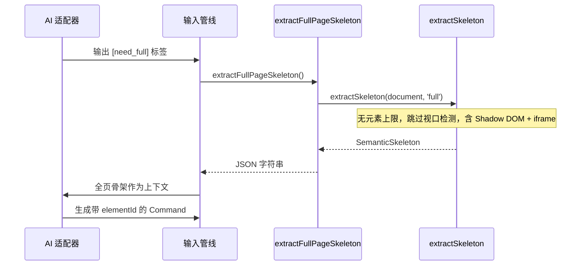
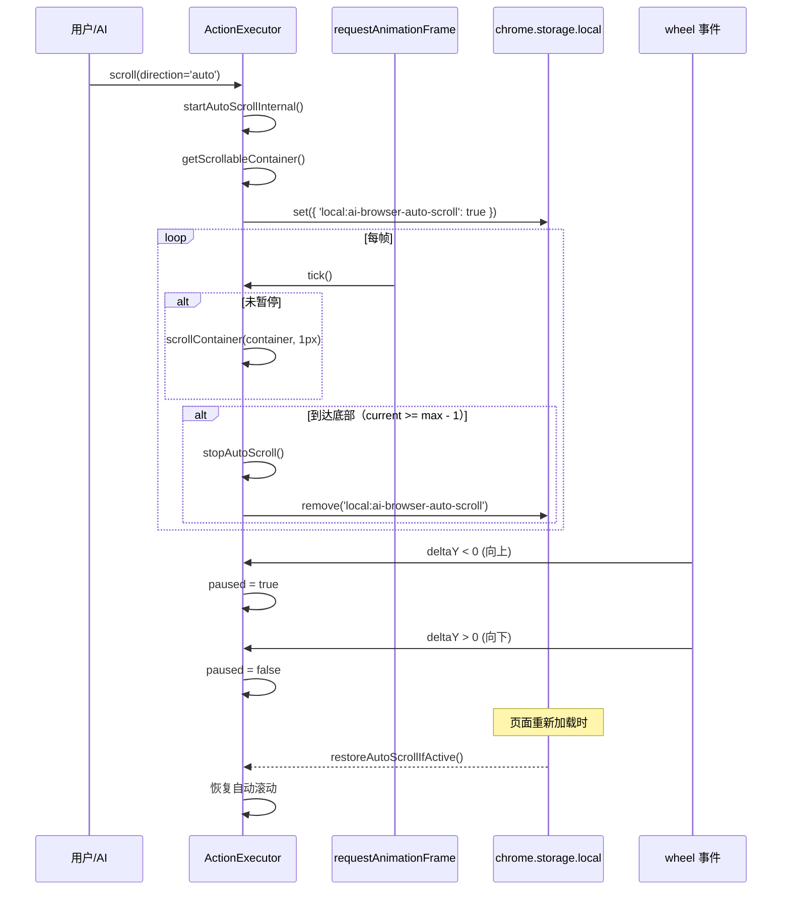
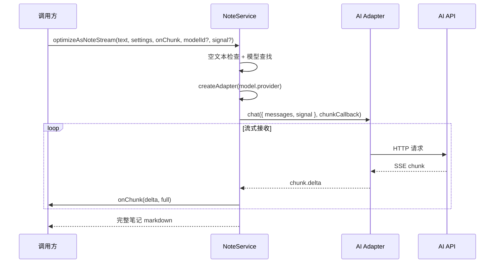

# Browser Command Engine - 架构文档

> 模块路径：`src/browser/`
> 负责将 AI 生成的自然语言意图转化为浏览器 DOM 操作，是"语音指令 → 页面交互"链路的执行终端。

---

## 模块概述

### 功能定位

Browser Command Engine 是 AI Browser 的**页面操作执行层**，承担三项核心职责：

1. **语义骨架提取** -- 从当前页面 DOM 中提取可交互元素的精简描述（语义骨架），作为 AI 决策的上下文输入。支持 Shadow DOM 递归遍历（最大 10 层）和嵌套 iframe 递归（最大 5 层），以及跨域 iframe 通过 `chrome.scripting.executeScript` 注入提取。
2. **指令执行** -- 接收 AI 生成的结构化指令（`Command`），在页面上触发真实的 DOM 事件序列，完成点击、输入、滚动、视频控制、文件上传、滑块拖动、弹窗关闭等 17 种操作。
3. **笔记 AI 服务** -- 调用 AI 适配器对文本进行深度分析和优化，输出高质量 markdown 笔记。

### 在架构中的位置

```
用户语音 → 语音识别 → 输入管线(Pipeline) → AI 适配器(Adapter)
                                                       ↓
                                              Command JSON
                                                       ↓
                                          ┌──────────────────────┐
                                          │  Browser Command     │
                                          │  Engine (本模块)      │
                                          │                      │
                                          │  SkeletonManager     │
                                          │  ActionExecutor      │
                                          │  NoteService         │
                                          └──────────────────────┘
                                                       ↓
                                                  DOM 操作
```

- **上游**：输入管线（`src/input/`）调用 AI 适配器生成 `Command`，传递给本模块执行。
- **下游**：直接操作浏览器 DOM，部分操作（标签页管理、导航、iframe 操作）通过 `chrome.runtime.sendMessage` 委托 background Service Worker 执行。
- **并行**：骨架提取结果作为 AI 的上下文输入，AI 根据骨架中的元素 ID 生成指令。

### 依赖关系

| 依赖 | 用途 |
|------|------|
| `src/utils/logger.ts` | 统一日志（写入 chrome.storage.local） |
| `src/browser/skeleton-id.ts` | data-skeleton-id 全量打标工具 |
| `src/adapters/` | 笔记服务的 AI 适配器工厂 |
| `src/types.ts` | AppSettings、StreamChunk 等共享类型 |
| `chrome.runtime` | 标签页操作、导航、iframe 操作委托 background |
| `chrome.storage.local` | 自动滚动状态持久化 |
| `chrome.scripting` | 跨域 iframe 骨架注入（通过 background 中转） |

### 文件结构

```
src/browser/
├── index.ts              # 公共导出（barrel 文件）
├── types.ts              # 核心类型定义（SkeletonElement, Command, ActionResult）
├── skeleton-id.ts        # data-skeleton-id 打标工具（模块级计数器）
├── skeleton.ts           # 语义骨架提取器 + SkeletonManager
├── action-executor.ts    # 指令执行引擎（ActionExecutor）
├── local-html.ts         # 全页骨架提取（[need_full] 兜底）
└── note-service.ts       # 笔记 AI 服务（optimizeAsNote / optimizeAsNoteStream）
```

---

## 架构设计

### 分层架构

```mermaid
graph TB
    subgraph "公共接口层"
        SM[SkeletonManager]
        AE[ActionExecutor]
        LH[extractFullPageSkeleton / Async]
        NS[optimizeAsNote / optimizeAsNoteStream]
    end

    subgraph "骨架提取层"
        ES[extractSkeleton]
        EI[extractElement]
        IC[isClickable]
        IV[isElementVisible]
        HM[hasModalOverlay]
        EA[extractAlerts]
        FL[findLandmarkParent]
        FA[findAssociatedLabelText]
        SD[extractFromShadowDom]
        NI[extractNestedIframes]
    end

    subgraph "跨域 iframe 层"
        EIS[extractIframeSkeletons]
        IEF[iframeExtractFunc]
    end

    subgraph "ID 管理层"
        SID[ensureAllSkeletonIds]
        SIE[ensureSkeletonId]
        SAID[ensureAllSkeletonIdsForDoc]
        SYNC[syncIdCounter]
    end

    subgraph "指令执行层"
        FE[findElement]
        FS[findInShadowDom / searchShadowRoot]
        FT[findByText]
        TC[triggerClick]
        EX[executeClick/Type/Scroll/Video/Upload/Slider/CloseModal/...]
    end

    subgraph "自动滚动子系统"
        AS[autoScroll state]
        GS[getScrollableContainer]
        SC[scrollContainer]
        RAF[requestAnimationFrame loop]
    end

    SM --> ES
    LH --> ES
    ES --> SID
    ES --> EI
    ES --> IC
    ES --> IV
    ES --> HM
    ES --> EA
    ES --> FL
    ES --> SD
    ES --> NI
    EI --> FA
    SID --> SIE
    SID --> SYNC
    SAID --> SIE
    SM -->|跨域 iframe| EIS
    EIS -->|sendMessage| BG[Background SW]
    EIS --> IEF

    AE --> FE
    FE --> FS
    FE --> FT
    AE --> EX
    EX --> TC
    EX --> AS
    AS --> GS
    AS --> SC
    AS --> RAF
    AE -->|iframe 操作| BG
```



### 核心设计模式

#### 无缓存骨架提取

`SkeletonManager` 采用**无缓存、无 MutationObserver** 的设计。每次调用 `getSkeleton()` 都重新扫描 DOM：

- **优点**：永不过期，不存在 DOM 变化后缓存失效的问题，实现简单可靠。
- **代价**：每次提取的 DOM 扫描开销（通过 `MAX_SKELETON_ELEMENTS = 200` 上限控制）。
- **动机**：SPA 应用 DOM 频繁变化，缓存管理的复杂度远大于重新扫描的成本。

#### SkeletonManager API

```typescript
class SkeletonManager {
  // 视口骨架（仅可见区域，上限 200 元素）
  getSkeleton(): SemanticSkeleton

  // 全页骨架（无元素上限）
  getFullSkeleton(): SemanticSkeleton

  // 视口骨架 + 跨域 iframe 元素（通过 chrome.scripting 注入）
  async getSkeletonWithIframes(): Promise<SemanticSkeleton>

  // 全页骨架 + 跨域 iframe 元素
  async getFullSkeletonWithIframes(): Promise<SemanticSkeleton>

  invalidate(): void   // 无操作（无缓存设计）
  dispose(): void      // 无操作（接口兼容）
  cachedUrl: string    // 始终返回 ''（接口兼容）
}
```

独立提取函数（不依赖 SkeletonManager 实例）：

```typescript
function extractSkeleton(doc: Document, scope?: SkeletonScope): SemanticSkeleton
function extractFullSkeleton(doc: Document): SemanticSkeleton  // scope='full' 的便捷封装
```

#### 三重元素定位

`ActionExecutor.findElement()` 按优先级尝试三种定位策略：

1. **elementId** -- 骨架分配的 `data-skeleton-id`，精确匹配。Shadow DOM 元素（`sd` 前缀）在 shadowRoot 中递归查找。
2. **fallbackSelector** -- AI 生成的 CSS 选择器，通用兜底。
3. **findByText()** -- 文本内容模糊匹配，最后手段。

这种渐进式降级确保即使骨架 ID 因 DOM 变化失效，仍能通过选择器或文本找到目标元素。

#### 完整事件序列触发

点击操作不使用简单的 `el.click()`，而是派发完整的浏览器事件序列：

```
pointerdown → mousedown → focus → pointerup → mouseup → click
```

**动机**：现代 SPA 框架（Vue 3、React 17+）的组件常监听 `pointerdown`/`pointerup` 而非 `mousedown`/`mouseup`，仅派发 MouseEvent 无法触发交互。

#### window.open monkey-patching

点击操作临时替换 `window.open`，检测事件处理器是否打开了新标签页，准确设置 `openedNewTab` 标志。使用 `try/finally` 确保原始函数恢复。

### 为什么这样设计

| 设计决策 | 理由 |
|----------|------|
| 视口骨架 + 全页骨架两层 | 视口骨架减少 token 消耗（200 上限），全页骨架作为 `[need_full]` 兜底 |
| 元素字段按 AI 决策维度分组 | 身份/内容/导航/表单/状态/滑块/上下文七组，对应 AI 理解页面所需的不同维度 |
| 父子文本去重 | 避免 `<div><button>提交</button></div>` 产生两个"提交"元素 |
| Label 点击自动转发 | 用户说"点击活动区域"时 AI 可能选中 label，实际需要操作关联的 select/input |
| Shadow DOM 递归遍历 | Web Components 内部元素需要穿透 shadow boundary 才能被骨架提取和操作 |
| 跨域 iframe 注入提取 | 通过 background 中转 chrome.scripting.executeScript，突破 content script 的跨域限制 |
| nativeInputValueSetter | 绕过 React/Vue 受控组件的 value setter 拦截 |
| 代码编辑器三层降级 | execCommand → ClipboardEvent paste → script 注入，覆盖 content script 隔离世界的限制 |

---

## 核心类型定义

### INTERACTIVE_TAGS

骨架提取和模糊匹配共用的原生可交互标签常量：

```typescript
const INTERACTIVE_TAGS = [
  'a', 'button', 'input', 'select', 'textarea', 'label', 'summary', 'details'
]
```

### SkeletonElement

骨架中的单个可交互元素，字段按 AI 决策维度分七组：

```typescript
interface SkeletonElement {
  // ═══ 1. 身份标识 ═══
  id: string                // 唯一标识 e1, e2, ...（iframe 内 fi1_e1，Shadow DOM 内 sd1_e1）
  tag: string               // 标签名
  role?: string             // ARIA role: button, link, tab, menuitem, checkbox, switch ...

  // ═══ 2. 内容信息 ═══
  text?: string             // 用户可见文字（截断 100 字符）
  label?: string            // 表单元素关联的 label 文本（如 input 关联 "活动名称"）
  ariaLabel?: string        // aria-label / title / img[alt] — 辅助说明（不与 text 合并）
  placeholder?: string      // 输入框占位提示（截断 50 字符）

  // ═══ 3. 导航信息 ═══
  href?: string             // <a> 标签目标 URL（截断 200 字符）

  // ═══ 4. 表单属性 ═══
  inputType?: string        // input type: text/password/email/tel/search/number/date/file/range ...
  value?: string            // 当前输入值（完整不截断，密码框不提取）
  checked?: boolean         // checkbox/radio 是否选中（仅 true 时输出）
  required?: boolean        // 是否必填（仅 true 时输出）
  accept?: string           // file input 的 accept 属性（文件类型过滤）

  // ═══ 5. 交互状态 ═══
  disabled?: boolean        // 是否禁用（仅 true 时输出）
  expanded?: boolean        // 展开/折叠状态（仅 true 时输出）
  selected?: boolean        // 选中状态（仅 true 时输出）
  contentEditable?: boolean // 是否为 contenteditable 元素（仅 true 时输出）

  // ═══ 6. 滑块属性（range input / role="slider"）═══
  min?: number              // 滑块最小值
  max?: number              // 滑块最大值
  step?: number             // 滑块步长

  // ═══ 7. 上下文位置 ═══
  parent?: string           // 父级地标标签/iframe 标识（nav/header/main/aside/footer/iframe.xxx）
}
```

**设计要点**：
- 可选字段仅在值为 true 或非空时输出，减少 token 消耗。
- `href` 截断 200 字符（`MAX_HREF_LENGTH`），`placeholder` 截断 50 字符。
- `value` 完整不截断（密码框除外），让 AI 知道输入是否成功。
- `ariaLabel` 独立于 `text` 输出，不合并。
- `contentEditable` 标记为 true 时，`role` 自动设为 `textbox`。
- 代码编辑器容器（CodeMirror/Monaco/Ace/ByteMD）自动标记为 `textbox`。

### ViewportInfo / ScrollInfo

```typescript
interface ViewportInfo {
  width: number             // window.innerWidth
  height: number            // window.innerHeight
}

interface ScrollInfo {
  y: number                 // window.scrollY — 当前滚动位置
  height: number            // document.documentElement.scrollHeight — 文档总高度
}
```

### SemanticSkeleton

页面级语义骨架，包含页面状态和元素列表：

```typescript
interface SemanticSkeleton {
  // ═══ 页面标识 ═══
  url: string
  title: string

  // ═══ 视口 & 滚动 ═══
  viewport: ViewportInfo
  scroll: ScrollInfo

  // ═══ 页面状态 ═══
  hasModal: boolean         // 是否有弹窗/遮罩层阻挡交互
  loading: boolean          // document.readyState !== 'complete'
  focusedElement?: string   // 当前焦点元素的 skeletonId

  // ═══ 骨架统计 ═══
  totalInteractive: number  // 页面总可交互元素数（去重前）
  truncated: boolean        // 元素列表是否被截断（>200 上限）

  // ═══ 提示 & 元素 ═══
  alerts?: string[]         // 页面错误/状态提示（role=alert、aria-live、error/alert 类名等）
  elements: SkeletonElement[]
}
```

### Command

AI 生成的结构化浏览器指令：

```typescript
interface Command {
  action: string           // 操作类型（AI 自由生成，在能力域内）
  elementId?: string       // 骨架中的元素 ID（主定位）
  fallbackSelector?: string // CSS 选择器（备选定位）
  text?: string            // type 操作的输入文字
  url?: string             // navigate 操作的目标 URL
  key?: string             // keyboard 操作的按键
  direction?: string       // scroll 操作的方向
  amount?: number          // scroll 操作的滚动像素
  ms?: number              // wait 操作的等待时间
  description?: string     // 操作描述（日志用 / 文本匹配兜底）
  tabAction?: 'newTab' | 'closeTab' | 'switchTab' | 'nextTab' | 'prevTab'
  tabQuery?: string        // switchTab 的目标标签关键词（如 "B站"、"淘宝"）
  done?: number            // 1=最后一步，0=还有步骤（用于停止判断）
  subAction?: string       // video 操作的子类型（play/pause/volume/mute/seek/jump/speed/fullscreen）
  value?: number           // video 操作的值（音量 0-1、快进秒数、播放速度等）/ slider 目标值
  fileData?: { base64: string; name: string; mimeType: string } | string  // upload 操作的文件数据
  filename?: string        // upload 操作的文件名（AI 错误格式时的回退来源）
}
```

### ActionResult

指令执行结果：

```typescript
interface ActionResult {
  success: boolean
  message: string
  openedNewTab?: boolean   // click 操作是否新开标签页（_blank / window.open）
}
```

### SkeletonScope

骨架提取范围类型：

```typescript
type SkeletonScope = 'viewport' | 'full'
```

---

## 实现细节

### 骨架 ID 管理（skeleton-id.ts）

模块级 id 计数器，跨调用不重置：

```typescript
let idCounter = 0
```

#### ensureSkeletonId

```typescript
function ensureSkeletonId(el: HTMLElement): string
```

确保单个元素有 `data-skeleton-id`。有则返回现有 id，无则新增 `e{++idCounter}` 并返回。

#### ensureAllSkeletonIds

```typescript
function ensureAllSkeletonIds(): void
```

全量打标：先调用 `syncIdCounter(document)` 同步计数器到已有 ID 最大值，再给 `document.body` 下所有元素（排除 `script,style,noscript,meta,link,br,hr`）打 `data-skeleton-id`。包含 Shadow DOM 递归打标（最大 10 层）。

#### ensureAllSkeletonIdsForDoc

```typescript
function ensureAllSkeletonIdsForDoc(doc: Document): void
```

给指定文档（如 iframe 的 contentDocument）的所有元素打 `data-skeleton-id`。同源 iframe 骨架提取前调用。

#### syncIdCounter

```typescript
function syncIdCounter(root: Document | ShadowRoot): void
```

扫描文档中已有 `data-skeleton-id`，提取末尾数字部分（支持 `e1`, `fi1`, `sd0_e1` 等格式），同步 `idCounter` 到最大值。递归进入 shadowRoot。

#### ID 格式

| 场景 | 格式 | 示例 |
|------|------|------|
| 主文档元素 | `e{n}` | `e1`, `e2` |
| Shadow DOM 元素 | `sd{depth}_{id}` | `sd1_e1`, `sd2_e3` |
| iframe 内元素 | 由 iframeExtractFunc 分配 `fi{n}` 前缀 | `fi1`, `fi2` |
| 跨域 iframe 元素 | 由 extractIframeSkeletons 加 `f_` 前缀 | `f_fi1` |

### 骨架提取流程（skeleton.ts）

#### extractSkeleton

```typescript
function extractSkeleton(doc: Document, scope: SkeletonScope = 'viewport'): SemanticSkeleton
```

**参数**：
- `doc`: 文档对象
- `scope`: `'viewport'`（默认，仅视口内，200 上限）或 `'full'`（全页面，无上限）

**返回值**：`SemanticSkeleton` 页面语义骨架

**执行步骤**：

1. **全量打标** -- 调用 `ensureAllSkeletonIds()` 同步计数器 + 给所有元素打 `data-skeleton-id`。
2. **主文档提取** -- `querySelectorAll('*')` 获取所有元素，逐个判断：
   - `isClickable()` -- 是否可交互
   - `isElementVisible()` -- 是否可见（display/visibility/offsetParent）
   - 视口边界检测（仅 viewport 模式）：`getBoundingClientRect()` 的四边需在视口内，且宽高 >= 1px
3. **Shadow DOM 递归遍历** -- 遍历所有元素的 `shadowRoot`，调用 `extractFromShadowDom()` 递归提取内部可交互元素。
4. **父子文本去重** -- 遍历所有元素，如果父元素的 text 包含子元素的 text，移除父级（交互元素 `<a>/<button>` 等不参与去重）。
5. **同级文本去重** -- 按 `parent`（地标标签）分组，相同 parent 下相同 text 只保留一个。
6. **空文本过滤** -- 保留有文字的元素、原生交互元素、contenteditable 元素、role='textbox' 的元素。
7. **截断** -- viewport 模式限制 `MAX_SKELETON_ELEMENTS = 200`，full 模式无上限。
8. **同源 iframe 扫描** -- 递归扫描 iframe 内部元素，坐标偏移 `iframeRect.left/top`。含嵌套 iframe 递归（最大 5 层）和 iframe 内 Shadow DOM 递归。
9. **提取 alerts** -- `extractAlerts()` 收集页面错误/状态提示（最多 5 条）。
10. **组装结果** -- 返回 `SemanticSkeleton`。

#### extractFromShadowDom

```typescript
function extractFromShadowDom(
  shadowRoot: ShadowRoot,
  scope: SkeletonScope,
  depth: number,
  elements: SkeletonElement[],
  existingIds: Map<string, boolean>,
  domParentIdMap: Map<string, string>,
  stats: { scannedCount: number; totalInteractive: number },
): void
```

从 Shadow DOM 内部递归提取可交互元素。给内部元素分配 `sd{depth}_{id}` 格式的骨架 ID，避免与主文档元素 ID 冲突。递归深度限制 `SHADOW_DOM_MAX_DEPTH = 10`。closed mode shadowRoot 无法访问，跳过。

#### extractNestedIframes

```typescript
function extractNestedIframes(
  parentDoc: Document,
  vpOffsetX: number,
  vpOffsetY: number,
  parentPrefix: string,
  depth: number,
  scope: SkeletonScope,
  elements: SkeletonElement[],
  existingIds: Map<string, boolean>,
  domParentIdMap: Map<string, string>,
  stats: { scannedCount: number; totalInteractive: number },
): void
```

递归提取嵌套 iframe 内的可交互元素。元素 ID 前缀层级化：顶层 `e1`，第一层 iframe `fi1_e1`，第二层 `fi1_fi1_e1`。递归深度限制 `IFRAME_MAX_DEPTH = 5`。坐标偏移累加：`offsetX = vpOffsetX + rect.left`。

#### extractIframeSkeletons

```typescript
async function extractIframeSkeletons(
  inaccessibleIframes: HTMLIFrameElement[],
  scope: SkeletonScope,
): Promise<SkeletonElement[]>
```

从跨域 iframe 中提取骨架元素。通过 `chrome.runtime.sendMessage({ type: 'extract-iframe-skeleton' })` 委托 background 使用 `chrome.scripting.executeScript` 注入 `iframeExtractFunc` 到每个 frame。返回的元素 ID 加 `f_` 前缀避免冲突。

#### iframeExtractFunc

```typescript
function iframeExtractFunc(scope: string, vpWidth: number, vpHeight: number): { url: string; elements: unknown[] }
```

注入到跨域 iframe 的自包含提取函数，不依赖任何外部导入。在 iframe 的隔离上下文中执行，支持 Shadow DOM 递归遍历（最大 10 层）。ID 前缀为 `fi`。

### 可点击性检测（isClickable）

```typescript
function isClickable(el: HTMLElement): boolean
```

检测顺序（短路返回）：

| 优先级 | 检测条件 | 说明 |
|--------|----------|------|
| 1 | `INTERACTIVE_TAGS` | a, button, input, select, textarea, label, summary, details |
| 2 | `contenteditable` | `contenteditable="true"` 或 `contenteditable=""` |
| 3 | `onclick` 属性 | 内联点击事件 |
| 4 | ARIA role | button, link, menuitem, tab, option, switch, checkbox, radio, slider |
| 5 | `tabindex` 属性 | 可聚焦元素 |
| 6 | `cursor: pointer` | CSS 样式标记为可点击（可能有 addEventListener） |
| 7 | 代码编辑器容器 | CodeMirror / Monaco / Ace / ByteMD 的 class |

### 元素字段提取（extractElement）

```typescript
function extractElement(el: HTMLElement, id: string): SkeletonElement | null
```

**返回值**：`SkeletonElement | null`，无有效信息时返回 null。

**跳过条件**：无文字 + 无 role + 无图标子元素 + 无表单内容 + 无关联 label + 无 ariaLabel + 非编辑器容器 + 非 contenteditable → 返回 null。

**文本提取优先级**：
1. 直接文本节点（`getDirectText`，遍历 childNodes 的 TEXT_NODE，fallback 到子元素的 innerText）
2. 表单元素的 `value`（input/textarea 有已输入内容时，完整不截断）
3. 关联 label 文本（`findAssociatedLabelText`，存入 `label` 字段，不占 `text`）
4. 图标元素的 `ariaLabel` 或 `(icon)` 占位

**ARIA role 提取**（`extractRole`）：
- 显式 `role` 属性优先
- 语义标签自动映射：`<input type="submit/reset">` → button，`<input type="text/...">` → textbox，`<select>` → combobox，`<summary>` → button，`<details>` → group
- 与默认角色相同时不输出（节省 token）

**关联 label 查找**（`findAssociatedLabelText`）按优先级尝试四种方式：
1. `<label for="elementId">` -- 通过 for 属性关联
2. 父级 `<label>` -- input 嵌套在 label 内
3. `aria-labelledby` -- 指向任意元素的 id
4. 同级 `<label>` -- 向上最多 5 层查找（Element UI 等组件库模式）

**特殊元素处理**：
- **密码框**：`value` 不提取（安全考虑）
- **contenteditable**：`contentEditable = true`，`role` 设为 `textbox`，`value` 取 `innerText`
- **代码编辑器容器**：`role` 设为 `textbox`，尝试提取 CodeMirror 的 `getValue()`
- **range input**：提取 `min/max/step`
- **自定义滑块**（`role="slider"` 非 input）：从 `aria-valuemin/max/now` 提取
- **file input**：提取 `accept` 属性
- **href**：`<a>` 标签，跳过 `#` 和 `javascript:`，截断 200 字符

### 弹窗检测（hasModalOverlay）

```typescript
function hasModalOverlay(doc: Document): boolean
```

四层检测策略：

| 层级 | 检测方式 | 示例 |
|------|----------|------|
| 1 | 原生 dialog | `dialog[open]` |
| 2 | ARIA 语义 | `role="dialog"`, `role="alertdialog"`, `aria-modal="true"` |
| 3 | 框架弹窗 | Bootstrap `.modal.show`、Element UI `.el-dialog__wrapper`、Ant Design `.ant-modal-wrap`、Material UI `.MuiDialog-root`、Vuetify `.v-dialog--active` |
| 4 | 通用遮罩 | class/id 含 overlay/mask/modal-backdrop/dialog-mask，面积 > 50% 视口 |

### 页面提示提取（extractAlerts）

```typescript
function extractAlerts(doc: Document): string[]
```

识别方式：
1. `role="alert"` / `aria-live="assertive"` / `aria-live="polite"` 的语义标记元素
2. class/id 含 `error/alert/toast/notice/warning/tip/message` 关键词的可见元素

限制：文本长度 2-200 字符，最多 5 条。

### 指令执行引擎（action-executor.ts）

#### ActionExecutor.execute

```typescript
class ActionExecutor {
  async execute(cmd: Command, signal?: AbortSignal): Promise<ActionResult>
}
```

**参数**：
- `cmd`: AI 生成的结构化指令
- `signal`: 可选 AbortSignal，用于中断 wait 操作

**返回值**：`ActionResult` 执行结果

**执行流程**：
1. **iframe 判断** -- `elementId` 以 `f_` 前缀开头时，委托 `executeIframeAction()` 通过 background 注入执行
2. **元素需求判断** -- 不需要元素的操作：navigate, wait, scroll, keyboard, press, newTab, closeTab, switchTab, nextTab, prevTab, closeModal
3. **元素定位** -- 需要元素时调用 `findElement(cmd)`，未找到返回失败
4. **操作分发** -- switch(action) 分发到对应执行方法
5. **异常处理** -- `AbortError` 直接抛出，其他异常返回失败结果

**支持的 17 种操作**：

| action | 执行方法 | 需要元素 | 说明 |
|--------|----------|----------|------|
| `click` | `executeClick` | 是 | 点击元素 |
| `type` | `executeType` | 是 | 输入文字 |
| `clear` | `executeClear` | 是 | 清空输入框（executeType 的空字符串特化） |
| `select` | `executeSelect` | 是 | 下拉框选择 |
| `focus` | `executeFocus` | 是 | 聚焦元素 |
| `hover` | `executeHover` | 是 | 悬停元素 |
| `video` | `executeVideo` | 是 | 视频控制（8 种子操作） |
| `upload` | `executeUpload` | 是 | 文件上传 |
| `slider` | `executeSlider` | 是 | 滑块拖动 |
| `scroll` | `executeScroll` | 否 | 滚动（8 种方向模式） |
| `navigate` | `executeNavigate` | 否 | 导航（新标签页） |
| `keyboard` / `press` | `executeKeyboard` | 否 | 键盘操作 |
| `wait` | `executeWait` | 否 | 等待指定时间 |
| `newTab` | `executeTabAction` | 否 | 新标签页 |
| `closeTab` | `executeTabAction` | 否 | 关闭标签页 |
| `switchTab` / `nextTab` / `prevTab` | `executeTabAction` | 否 | 切换标签页 |
| `closeModal` | `executeCloseModal` | 否 | 关闭弹窗 |

#### 三重元素定位（findElement）

```typescript
private findElement(cmd: Command): HTMLElement | null
```

**定位链**：

```
elementId (data-skeleton-id)
    ↓ 未找到
    ↓ sd 前缀 → findInShadowDom 递归查找 shadowRoot
    ↓ 未找到
fallbackSelector (CSS 选择器)
    ↓ 未找到
findByText (文本模糊匹配)
    ↓ 未找到
return null → 执行失败
```

**Shadow DOM 查找**（`findInShadowDom` / `searchShadowRoot`）：

```typescript
private findInShadowDom(skeletonId: string): HTMLElement | null
private searchShadowRoot(shadowRoot: ShadowRoot, skeletonId: string, depth: number): HTMLElement | null
```

CSS 选择器无法穿透 shadow boundary，需手动遍历所有 shadowRoot 查找匹配的 `data-skeleton-id`。递归深度限制 10 层。使用 `CSS.escape` 转义特殊字符防注入。

**findByText 策略**：

```typescript
private findByText(text: string): HTMLElement | null
```

1. 优先搜索交互元素（`INTERACTIVE_TAGS` + `[role="button"]` + `[onclick]` + `[tabindex]`）
2. 兜底搜索所有元素（排除 script/style/svg）
3. 匹配 `textContent`、`aria-label`、`title`、`placeholder` 四个属性
4. 过滤不可见元素（display:none / visibility:hidden）

#### 点击执行（executeClick）

```typescript
private async executeClick(el: HTMLElement): Promise<ActionResult>
```

**Label 转发**：点击 `<label>` 时自动转发到关联的表单元素（input/select/textarea）。`findLabelTarget` 按 for 属性、内嵌元素、同级容器三种方式查找。

**链接分类处理**：

| 链接类型 | 判断条件 | 处理方式 |
|----------|----------|----------|
| JS 交互型 | href 为空/`#`/`javascript:` | `triggerClick` + window.open monkey-patching |
| 真实链接（当前页） | target 为 `_self`/`_top`/`_parent` | `window.location.href = el.href` |
| 真实链接（新标签） | target 为 `_blank` 或命名 frame | `window.open(el.href, target)`，popup blocker 拦截时回退到当前页 |

**triggerClick 事件序列**：

```typescript
private triggerClick(el: HTMLElement): void
```

```
pointerdown → mousedown → focus → pointerup → mouseup → click
```

所有事件携带 `bubbles: true`、`cancelable: true`、精确的 `clientX/clientY`（元素中心坐标）。PointerEvent 额外携带 `pointerId: 1`、`pointerType: 'mouse'`、`isPrimary: true`。

#### 输入执行（executeType）

```typescript
private async executeType(el: HTMLElement, text: string): Promise<ActionResult>
```

**三大类输入策略**（按优先级）：

##### 1. 代码编辑器（CodeMirror 5/6、Monaco、Ace、ByteMD）

content script 运行在隔离世界（isolated world），无法直接访问页面 JS 属性。采用三层降级策略：

| 优先级 | 策略 | 原理 |
|--------|------|------|
| 1 | `document.execCommand('insertText')` | 最简单，部分编辑器支持 |
| 2 | `ClipboardEvent('paste')` + `DataTransfer` | 通用兜底，模拟用户粘贴 |
| 3 | `<script>` 注入（仅 CM5） | 注入 `CodeMirror.setValue()` 到页面上下文 |

编辑器检测：`el.closest('.CodeMirror, .cm-editor, .monaco-editor, .ace_editor')`

##### 2. contenteditable 富文本编辑器

Quill、TinyMCE、CKEditor、ProseMirror/TipTap、Draft.js、WangEditor、通用 contenteditable：

```
el.focus() → document.execCommand('selectAll') → document.execCommand('insertText', false, text)
```

检测：`el.isContentEditable` 或 `el.closest('[contenteditable="true"]')`

##### 3. 标准 input / textarea

通过 `Object.getOwnPropertyDescriptor(proto, 'value')?.set` 获取原生 setter，绕过 React/Vue 受控组件拦截。设置值后派发 `input` + `change` 事件。

**兜底**：无法识别的编辑器类型返回失败，提示用户尝试其他操作方式。

#### 滚动执行（executeScroll）

```typescript
private async executeScroll(direction: string, amount?: number): Promise<ActionResult>
```

**方向模式**：

| direction | 行为 |
|-----------|------|
| `up` | 向上滚动 amount 像素（默认 `innerHeight * 0.8`） |
| `down` | 向下滚动 amount 像素 |
| `top` | 滚动到顶部 |
| `bottom` | 滚动到底部 |
| `auto` | 启动自动滚动（requestAnimationFrame 循环，每帧 1px） |
| `stop` | 停止自动滚动 |
| `pause` | 暂停自动滚动 |
| `resume` | 恢复自动滚动 |

**可滚动容器查找**（`getScrollableContainer`）：
1. 从目标元素向上查找 `overflow-y: auto/scroll` 且 `scrollHeight > clientHeight` 的容器
2. 检查 `document.documentElement` 是否可滚动
3. 兜底：扫描所有 `<div>` 找最大可滚动容器（`scrollHeight - clientHeight > 50`）

**自动滚动特性**：
- 使用 `requestAnimationFrame` 实现平滑滚动（每帧 1px）
- 滚轮向上自动暂停（`deltaY < 0`），向下自动恢复（`deltaY > 0`）
- 状态持久化到 `chrome.storage.local`（key: `local:ai-browser-auto-scroll`），跨页面/标签页共享
- 到达底部自动停止（`current >= max - 1`）
- 页面加载时自动恢复（`restoreAutoScrollIfActive`，监听 `DOMContentLoaded`）

**滚动等待**：一次性滚动后等待两帧 + 500ms，确保浏览器完成重绘。

```typescript
await new Promise(resolve =>
  requestAnimationFrame(() =>
    requestAnimationFrame(() => setTimeout(resolve, 500))
  )
)
```

#### 键盘执行（executeKeyboard）

```typescript
private async executeKeyboard(key: string): Promise<ActionResult>
```

派发 `keydown` → `keypress` → `keyup` 完整事件序列。目标为 `document.activeElement || document.body`。

`getKeyCode()` 将 key 名映射为正确的 `KeyboardEvent.code`：

| key | code |
|-----|------|
| `Enter` | `Enter` |
| `Escape` / `Esc` | `Escape` |
| `Tab` | `Tab` |
| `Backspace` | `Backspace` |
| `Delete` | `Delete` |
| `ArrowUp/Down/Left/Right` | `ArrowUp/Down/Left/Right` |
| `Home/End/PageUp/PageDown` | 对应 code |
| `Space` / ` ` | `Space` |
| 单字母 (a-z) | `KeyA` - `KeyZ` |
| 数字 (0-9) | `Digit0` - `Digit9` |

**Enter 键特殊处理**：合成事件不触发浏览器默认行为，因此手动查找并提交表单：
1. 从 `activeElement` 向上找 `<form>`，调用 `form.requestSubmit()`
2. 兜底：全局找搜索输入框（`input[type="search"]`、`input[name="q"]`、`input[name="keyword"]`、`input[name="wd"]`、`input[placeholder*="搜索"]`、`input[placeholder*="search"]`）并提交

#### 视频控制（executeVideo）

```typescript
private async executeVideo(el: HTMLElement, subAction: string, value?: number): Promise<ActionResult>
```

支持 8 种子操作：

| subAction | 行为 | value 含义 |
|-----------|------|-----------|
| `play` | 播放（`video.play()`） | - |
| `pause` | 暂停（`video.pause()`） | - |
| `volume` | 设置音量（0-1），自动取消静音 | 音量值，钳位到 [0, 1] |
| `mute` | 静音 | - |
| `unmute` | 取消静音 | - |
| `seek` | 快进/快退（相对当前时间） | 秒数（正=快进，负=快退） |
| `jump` | 跳转到指定时间（绝对） | 秒数 |
| `speed` | 设置播放速度 | 倍速（如 1.5） |
| `fullscreen` | 全屏 | 返回失败（需用户手势，请用 click 点击全屏按钮） |

video 元素查找：先检查 el 本身是否为 `HTMLVideoElement`，再 `querySelector('video')` 或 `closest('video')`。

时间格式化：`formatTime(seconds)` 将秒数转为 `mm:ss` 格式。

#### 文件上传（executeUpload）

```typescript
private async executeUpload(
  el: HTMLElement,
  fileData?: { base64: string; name: string; mimeType: string } | string,
  cmd?: Command,
): Promise<ActionResult>
```

**智能定位**：目标不是 file input 时，调用 `findHiddenFileInput()` 自动查找隐藏的 `<input type="file">`。查找策略：
1. 自身就是 file input
2. 目标元素内部有 file input
3. 向上查找父组件（最多 5 层），找 file input
4. 全局查找隐藏的 file input（兜底，只选 `!isElementVisible` 的）

**智能修正**：`fileData` 是字符串时自动转换为 `{ base64, name, mimeType }` 结构：
- 文件名从 `cmd.filename` 或 `cmd.description` 中正则提取，兜底 `'upload.txt'`
- MIME 类型根据扩展名猜测（`guessMimeType` 函数，覆盖 40+ 种常见格式）
- 支持 data URL 格式（`data:application/octet-stream;base64,...`）
- 非 data URL 文本通过 `btoa(unescape(encodeURIComponent(fileData)))` 编码

**上传流程**：
1. `el.focus()` 聚焦
2. base64 padding 修正（补齐 `=` 号）
3. `atob` 解码为 `Uint8Array`
4. `new File([bytes], name, { type })` 创建 File 对象
5. `DataTransfer` API 填入 `inputEl.files`
6. 派发 `input` + `change` 事件

#### 滑块操作（executeSlider）

```typescript
private async executeSlider(el: HTMLElement, targetValue?: number): Promise<ActionResult>
```

支持两种滑块类型：

**标准 `<input type="range">`**：
- 从 `el.min/max/step` 读取属性
- 钳位到有效范围：`Math.max(min, Math.min(max, targetValue))`
- 对齐到 step + 浮点精度修正：`parseFloat((Math.round((clampedValue - min) / step) * step + min).toFixed(10))`
- 使用 `nativeInputValueSetter` 设置值
- 派发 `input` + `change` 事件

**自定义滑块**（`role="slider"` 非 input）：
- 从 `aria-valuemin/max` 读取范围
- 除零保护：`max === min` 时直接设为 min
- 计算目标像素位置：`targetX = rect.left + rect.width * ((clampedValue - min) / range)`
- 起点基于 `aria-valuenow` 计算当前位置
- 模拟完整拖拽事件序列：`pointerdown/mousedown → pointermove/mousemove（5 步分插值）→ pointerup/mouseup/click`
- 更新 `aria-valuenow` + 派发 `change/input` 事件

#### 弹窗关闭（executeCloseModal）

```typescript
private async executeCloseModal(): Promise<ActionResult>
```

循环关闭弹窗，最多 10 轮，每轮按优先级扫描：

1. **Escape 键**（仅第 0 轮）-- 记录弹窗前所有可见弹窗元素，派发 Escape 键事件，等待 300ms，检查是否有效关闭
2. **原生 `dialog[open]`** -- 调用 `dialog.close()`
3. **ARIA dialog** -- `[role="dialog"]` / `[role="alertdialog"]` / `[aria-modal="true"]`，查找关闭按钮
4. **框架弹窗** -- Bootstrap / Element UI / Ant Design / Material UI / Vuetify，查找关闭按钮
5. **通用遮罩层** -- class 含 overlay/mask/modal-backdrop/dialog-mask，面积 > 50% 视口，查找关闭按钮

每轮结束后等待 200ms 让关闭动画完成。

**关闭按钮查找**（`findCloseButton`）：
1. `aria-label` 含 close/dismiss/关闭/取消
2. class 含 close/btn-close/close-btn/close-icon/modal-close
3. 文字为 `×/✕/关闭/取消/知道了/确定/完成/好/Done/Close/OK/ok`
4. 自动跳过 disabled 按钮

#### 标签页操作（executeTabAction）

```typescript
private async executeTabAction(
  tabAction: 'newTab' | 'closeTab' | 'switchTab',
  tabQuery?: string,
): Promise<ActionResult>
```

通过 `chrome.runtime.sendMessage({ type: 'tab-action', action, query })` 委托 background 执行。

#### iframe 操作（executeIframeAction）

```typescript
private async executeIframeAction(cmd: Command): Promise<ActionResult>
```

当 `elementId` 以 `f_` 前缀开头时触发。去掉 `f_` 前缀得到 iframe 内的真实 skeletonId，通过 `chrome.runtime.sendMessage({ type: 'execute-iframe-action' })` 委托 background 使用 `chrome.scripting.executeScript` 注入操作函数到目标 iframe。支持 click、type、clear、select、focus、hover 六种操作。

#### 导航（executeNavigate）

```typescript
private async executeNavigate(url: string): Promise<ActionResult>
```

通过 `chrome.runtime.sendMessage({ type: 'tab-action', action: 'newTab', url })` 委托 background 新标签页打开（避免 popup 拦截）。

#### 等待（executeWait）

```typescript
private async executeWait(ms: number, signal?: AbortSignal): Promise<ActionResult>
```

`setTimeout` 延迟指定毫秒。支持 `AbortSignal` 中断：`signal.aborted` 时抛出 `AbortError`，使用 `{ once: true }` 监听器避免内存泄漏。

#### 悬停（executeHover）

```typescript
private async executeHover(el: HTMLElement): Promise<ActionResult>
```

派发完整鼠标事件链：`pointerover → pointerenter → mouseover → mouseenter → pointermove → mousemove`。所有事件携带精确的 `clientX/clientY` 和 `screenX/screenY`。

#### 聚焦（executeFocus）

```typescript
private async executeFocus(el: HTMLElement): Promise<ActionResult>
```

调用 `el.focus()` + 派发 `FocusEvent('focus', { bubbles: true })`。

#### 下拉框选择（executeSelect）

```typescript
private async executeSelect(el: HTMLElement, value: string): Promise<ActionResult>
```

设置 `el.value = value` + 派发 `Event('change', { bubbles: true })`。

### 全页骨架（local-html.ts）

#### extractFullPageSkeleton

```typescript
function extractFullPageSkeleton(): string | null
```

`[need_full]` 触发时调用。内部调用 `extractFullSkeleton(document)`（即 `extractSkeleton(document, 'full')`），跳过视口边界检测，不限制元素数量。返回 JSON 字符串，无元素时返回 null。

#### extractFullPageSkeletonAsync

```typescript
async function extractFullPageSkeletonAsync(): Promise<string | null>
```

异步版本，含跨域 iframe 内元素。创建 `SkeletonManager` 实例，调用 `getFullSkeletonWithIframes()`。返回 JSON 字符串，无元素时返回 null。

### 笔记服务（note-service.ts）

#### 系统提示词

```typescript
const NOTE_SYSTEM_PROMPT = `请对以下内容进行优化整理，生成一份高质量的笔记。

优化方向：
- 精简冗余，保留核心信息
- 理顺逻辑，优化表达
- 每段内容详细展开说明和解释
- 保留关键内容、代码、数据

直接输出 markdown。`
```

#### optimizeAsNote

```typescript
async function optimizeAsNote(text: string, settings: AppSettings, modelId?: string): Promise<string>
```

**参数**：
- `text`: 原始文本
- `settings`: 全局设置（含 models、baseUrl、apiKey 等）
- `modelId`: 可选模型 id，不指定时使用 `settings.defaultModelId` 或第一个模型

**返回值**：AI 分析后的 markdown 笔记字符串

**流程**：
1. 空文本检查
2. 模型查找：`modelId` 优先 → `defaultModelId` → `models[0]`
3. 创建适配器：`createAdapter(model.provider)`
4. 提示词拼接到用户消息前面（兼容不支持 system 角色的模型/代理）
5. 调用 `adapter.chat()` 流式接收，拼接所有 delta
6. 返回完整结果

#### optimizeAsNoteStream

```typescript
async function optimizeAsNoteStream(
  text: string,
  settings: AppSettings,
  onChunk: (delta: string, full: string) => void,
  modelId?: string,
  signal?: AbortSignal,
): Promise<string>
```

流式版本，每个 chunk 调用 `onChunk(delta, full)` 回调。支持 `AbortSignal` 取消请求。异常时记录日志并重新抛出。

---

## 数据流

### 骨架提取数据流



### 跨域 iframe 骨架提取数据流



### 指令执行数据流



### 全页骨架兜底数据流



### 自动滚动状态流



### 笔记服务数据流



---

## 配置与扩展

### 可配置参数

| 参数 | 值 | 位置 | 说明 |
|------|-----|------|------|
| `MAX_SKELETON_ELEMENTS` | 200 | skeleton.ts | 视口骨架最大元素数 |
| `MAX_HREF_LENGTH` | 200 | skeleton.ts | href 截断长度 |
| `MAX_PLACEHOLDER_LENGTH` | 50 | skeleton.ts | placeholder 截断长度 |
| `SHADOW_DOM_MAX_DEPTH` | 10 | skeleton.ts / skeleton-id.ts | Shadow DOM 递归深度上限 |
| `IFRAME_MAX_DEPTH` | 5 | skeleton.ts | iframe 递归深度上限 |
| alerts 最大条数 | 5 | skeleton.ts `extractAlerts` | 页面提示最大数量 |
| 自动滚动速度 | 1 px/frame | action-executor.ts | requestAnimationFrame 每帧滚动像素 |
| 滚动默认距离 | `innerHeight * 0.8` | action-executor.ts | 一次性滚动默认像素 |
| LANDMARK_TAGS | nav/header/main/aside/footer | skeleton.ts | 地标标签列表 |
| LANDMARK_ROLES | navigation/banner/main/complementary/contentinfo | skeleton.ts | 地标 role 列表 |
| SKIP_TAGS | script/style/noscript/meta/link/br/hr | skeleton-id.ts | 不打标的非交互元素标签 |
| 自动滚动 key | `local:ai-browser-auto-scroll` | action-executor.ts | chrome.storage.local 键名 |
| 关闭弹窗最大轮次 | 10 | action-executor.ts `executeCloseModal` | 循环关闭弹窗上限 |
| 关闭弹窗等待时间 | 300ms (Escape) / 200ms (每轮) | action-executor.ts | 弹窗关闭动画等待 |

### 扩展点

#### 新增操作类型

在 `ActionExecutor.execute()` 的 switch 分支中添加新 case，实现对应的 `executeXxx()` 方法。操作不需要元素定位时，将 action 名加入 `needsElement` 排除列表：

```typescript
const needsElement = !['navigate', 'wait', 'scroll', 'keyboard', 'press',
  'newTab', 'closeTab', 'switchTab', 'nextTab', 'prevTab', 'closeModal'].includes(cmd.action)
```

#### 新增编辑器类型支持

在 `executeType()` 中按优先级插入新的编辑器检测分支（当前顺序：CodeMirror → Monaco → Ace → ByteMD → contenteditable → 标准 input）。检测模式：通过 `closest()` 查找编辑器容器，访问其内部 API。

#### 新增弹窗框架检测

在 `hasModalOverlay()` 和 `executeCloseModal()` 的 `frameworkSelectors` 数组中添加新的 CSS 选择器：

```typescript
const frameworkSelectors = [
  '.modal.show',           // Bootstrap
  '.el-dialog__wrapper',   // Element UI
  '.ant-modal-wrap',       // Ant Design
  '.MuiDialog-root',       // Material UI
  '.v-dialog--active',     // Vuetify
  // 在此添加新框架
]
```

#### 新增可点击性规则

在 `isClickable()` 中添加新的检测条件。

#### 新增地标类型

扩展 `LANDMARK_TAGS` 和 `LANDMARK_ROLES` 数组。

#### 新增代码编辑器容器

在 `isClickable()` 和 `extractElement()` 的编辑器检测中添加新的 class：

```typescript
const isEditor = el.classList.contains('CodeMirror') ||
  el.classList.contains('monaco-editor') ||
  el.classList.contains('ace_editor') ||
  el.classList.contains('bytemd-editor')
```

---

## 已知限制

### 骨架提取

- **canvas/svg 内部不可提取** -- Canvas 绘制的内容和 SVG 内部图形元素不在 DOM 树中，无法识别。
- **动态内容时序** -- 无缓存设计意味着每次提取的是当前 DOM 快照，如果 AI 响应期间页面发生变化（如懒加载），下次提取才能反映。
- **cursor:pointer 误判** -- 部分不可交互元素可能设置了 `cursor: pointer` 样式，导致被错误提取。
- **closed mode Shadow DOM** -- `shadowRoot` 为 closed mode 时无法访问，内部元素不可提取。
- **跨域 iframe 注入限制** -- `chrome.scripting.executeScript` 需要 background 中转，且注入的 `iframeExtractFunc` 是自包含函数，无法复用主文档的提取逻辑。
- **iframe 未加载** -- `contentDocument` 为 null（未加载完）的 iframe 会被收集到跨域列表尝试注入，可能提取到空结果。

### 指令执行

- **合成事件局限** -- 派发的事件是合成事件（synthetic），部分浏览器原行为不会触发（如 `<a>` 的默认导航需手动处理，Enter 提交表单需手动调用 `requestSubmit()`，Escape 关闭弹窗依赖页面 JS 监听器）。
- **全屏需用户手势** -- `video.requestFullscreen()` 受浏览器安全策略限制，程序化调用会被拒绝，返回失败提示用 click 点击全屏按钮。
- **React 受控组件** -- 虽然使用 `nativeInputValueSetter` 绕过，但部分极端封装的组件可能仍有拦截。
- **跨标签页状态同步** -- 自动滚动状态通过 `chrome.storage.local` 持久化，但 storage 事件有延迟，极端情况下可能不同步。
- **文本匹配精度** -- `findByText` 使用 `includes()` 匹配，当页面存在大量相似文本时可能定位到错误元素。
- **键盘事件无默认行为** -- 合成 KeyboardEvent 不触发浏览器默认行为（如 Tab 切换焦点），需依赖页面 JS 监听器处理。
- **滑块浮点精度** -- 虽然使用 `toFixed(10)` 修正，但极端 step 值下仍可能有微小偏差。
- **文件上传限制** -- `DataTransfer` API 设置 `input.files` 在部分浏览器/框架组合下可能不触发文件校验逻辑。

### 笔记服务

- **模型依赖** -- 需要至少一个可用模型配置，否则抛出 "没有可用的模型" 错误。
- **system 角色兼容** -- 提示词拼接到用户消息前面，兼容不支持 system 角色的模型/代理，但可能影响部分模型的指令遵循能力。
- **无 token 限制** -- 没有对输入文本长度做截断，超长文本可能超出模型上下文窗口。

### 性能

- **全量 DOM 扫描** -- `ensureAllSkeletonIds()` 和 `extractSkeleton()` 都会遍历全部 DOM 元素，大型页面（>10000 节点）可能有明显耗时。
- **getComputedStyle 调用** -- `isClickable` 和 `isElementVisible` 对每个元素调用 `getComputedStyle`，在元素密集的页面上可能造成布局抖动（layout thrashing）。
- **自动滚动内存** -- `requestAnimationFrame` 循环在页面生命周期内持续运行（如果未停止），wheel 事件监听器需正确清理。
- **Shadow DOM 递归开销** -- 深层嵌套的 Shadow DOM（接近 10 层）会导致大量递归调用。
