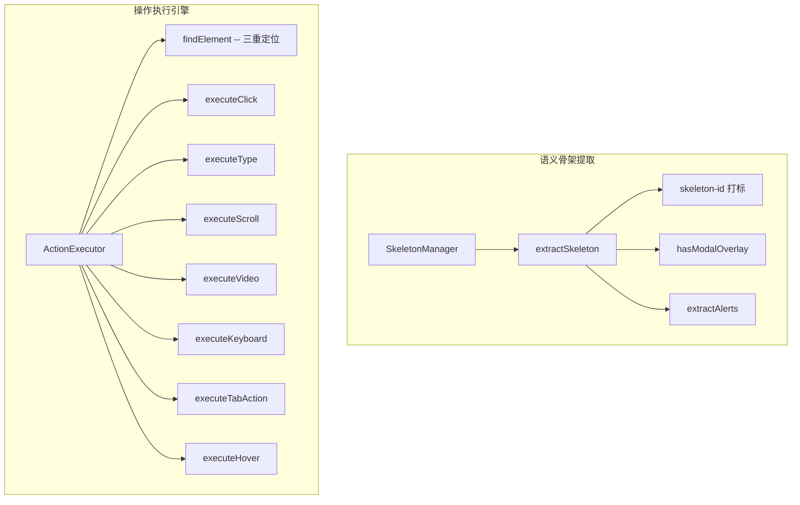

# 浏览器指令 (Browser Command)

> 语义骨架提取 + 浏览器操作执行引擎。三重元素定位、完整事件触发序列。

## 模块概览



## SemanticSkeleton -- 语义骨架

**源码**: `src/browser/types.ts`

```typescript
export interface SemanticSkeleton {
  // 页面标识
  url: string
  title: string

  // 视口 & 滚动
  viewport: { width: number; height: number }
  scroll: { y: number; height: number }

  // 页面状态
  hasModal: boolean           // 是否有弹窗/遮罩层
  loading: boolean            // document.readyState !== 'complete'
  focusedElement?: string     // 当前焦点元素的 skeletonId

  // 骨架统计
  totalInteractive: number    // 页面总可交互元素数（去重前）
  truncated: boolean          // 是否被截断（>200 上限）

  // 提示 & 元素
  alerts?: string[]           // 页面错误/状态提示
  elements: SkeletonElement[]
}
```

## SkeletonElement -- 骨架元素

**源码**: `src/browser/types.ts`

字段按 AI 决策维度分组：

```typescript
export interface SkeletonElement {
  // 1. 身份标识
  id: string                  // 唯一标识 e1, e2, ...
  tag: string                 // 标签名
  role?: string               // ARIA role

  // 2. 内容信息
  text?: string               // 用户可见文字（截断 100 字符）
  label?: string              // 表单元素关联的 label 文本
  ariaLabel?: string          // aria-label / title / img[alt]
  placeholder?: string        // 输入框占位提示（截断 50 字符）

  // 3. 导航信息
  href?: string               // <a> 标签目标 URL（截断 80 字符）

  // 4. 表单属性
  inputType?: string          // input type
  value?: string              // 当前输入值（截断 20 字符，密码框不提取）
  checked?: boolean           // checkbox/radio 是否选中
  required?: boolean          // 是否必填

  // 5. 交互状态
  disabled?: boolean          // 是否禁用
  expanded?: boolean          // 展开/折叠状态
  selected?: boolean          // 选中状态

  // 6. 上下文位置
  parent?: string             // 父级地标标签（nav/header/main/aside/footer）
}
```

## extractSkeleton -- 骨架提取

**源码**: `src/browser/skeleton.ts`

```typescript
export function extractSkeleton(doc: Document, scope: 'viewport' | 'full' = 'viewport'): SemanticSkeleton
```

提取流程：

1. **全量打标**：`ensureAllSkeletonIds()` 给所有元素打 `data-skeleton-id`
2. **遍历所有元素**：`doc.body.querySelectorAll('*')`
3. **可点击性检测**：`isClickable(el)`
4. **可见性检测**：`isElementVisible(el)`
5. **视口检测**（仅 viewport 模式）：`getBoundingClientRect()` 判断是否在视口内
6. **提取元素字段**：`extractElement(el, id)`
7. **iframe 支持**：同源 iframe 内元素也提取，parent 标记为 `iframe.xxx`
8. **父子去重**：父元素文本包含子元素文本时去掉父级（原生交互标签不参与）
9. **同级去重**：同一 parent 下文本相同去重
10. **截断**：viewport 模式最多 200 个元素，full 模式无上限

```typescript
const MAX_SKELETON_ELEMENTS = 200
const truncated = scope === 'viewport' && filtered.length > MAX_SKELETON_ELEMENTS
```

### isClickable -- 可点击性检测

```typescript
function isClickable(el: HTMLElement): boolean
```

判断条件（任一满足）：
- `INTERACTIVE_TAGS`：`a`, `button`, `input`, `select`, `textarea`, `label`, `summary`, `details`
- `contenteditable="true"`
- `onclick` 属性
- ARIA role：`button`, `link`, `menuitem`, `tab`, `option`, `switch`, `checkbox`, `radio`
- `tabindex` 属性
- CSS `cursor: pointer`（可能是 addEventListener 绑定的点击事件）

### isElementVisible -- 可见性检测

```typescript
function isElementVisible(el: HTMLElement): boolean
```

判断条件：
- `display: none` -> 不可见
- `visibility: hidden` -> 不可见
- `offsetParent !== null` 或 `position: fixed` -> 可见

### hasModalOverlay -- 弹窗检测

**源码**: `src/browser/skeleton.ts`

```typescript
function hasModalOverlay(doc: Document): boolean
```

检测策略（按优先级）：
1. 原生 `dialog[open]`
2. ARIA：`[role="dialog"]`, `[role="alertdialog"]`, `[aria-modal="true"]`
3. 框架弹窗：`.modal.show`（Bootstrap）、`.el-dialog__wrapper`（Element UI）、`.ant-modal-wrap`（Ant Design）、`.MuiDialog-root`（Material UI）、`.v-dialog--active`（Vuetify）
4. 通用遮罩：fixed/absolute 元素面积 > 50% 视口

### extractAlerts -- 状态提示提取

```typescript
function extractAlerts(doc: Document): string[]
```

识别方式：
- `role="alert"`, `aria-live="assertive"`, `aria-live="polite"`
- class/id 含 `error`, `alert`, `toast`, `notice`, `warning`, `tip`, `message`
- 限制：可见、有文本、长度 < 200 字符、最多 5 条

### findAssociatedLabelText -- Label 关联

```typescript
function findAssociatedLabelText(el: HTMLElement): string | null
```

按优先级尝试 4 种关联方式：
1. `<label for="elementId">` -- 通过 for 属性关联
2. 父级 `<label>` -- input 嵌套在 label 内
3. `aria-labelledby` -- 指向任意元素的 id
4. 同级 `<label>` -- Element UI 等组件库模式（向上 5 层查找）

### extractElement -- 元素字段提取

```typescript
function extractElement(el: HTMLElement, id: string): SkeletonElement | null
```

提取逻辑：
- 无文字 + 无 role + 无图标 + 无表单内容 + 无 label + 无 ariaLabel -> 跳过
- 文本来源优先级：直接文本 -> value（input/textarea）-> label -> ariaLabel -> `(icon)`
- href：`<a>` 标签，截断 80 字符，过滤 `#` 和 `javascript:`
- inputType：input 元素，checkbox/radio 不输出 inputType
- value：截断 20 字符，密码框不提取
- ARIA role：显式 role 属性优先，语义标签自动映射（select->combobox, summary->button）

## SkeletonManager -- 骨架管理器

**源码**: `src/browser/skeleton.ts`

```typescript
export class SkeletonManager {
  getSkeleton(): SemanticSkeleton       // 视口骨架（每次重新提取）
  getFullSkeleton(): SemanticSkeleton   // 全页骨架
  invalidate(): void                    // 无操作（viewport 模式无缓存）
  dispose(): void
}
```

设计原则：无缓存、无 MutationObserver、无 URL 追踪——简单可靠，永不过期。

## ActionExecutor -- 操作执行引擎

**源码**: `src/browser/action-executor.ts`

```typescript
export class ActionExecutor {
  async execute(cmd: Command): Promise<ActionResult>
}
```

### 三重元素定位

```typescript
private findElement(cmd: Command): HTMLElement | null
```

| 优先级 | 定位方式 | 说明 |
|---|---|---|
| 1 | `elementId` | `document.querySelector('[data-skeleton-id="e3"]')` |
| 2 | `fallbackSelector` | CSS 选择器 |
| 3 | `description` | 文本内容模糊匹配 |

文本匹配策略：先搜索交互元素（INTERACTIVE_TAGS + role + onclick + tabindex），兜底搜索所有元素（覆盖 div/span + SVG 图标按钮）。匹配范围：textContent、aria-label、title、placeholder。

### Click -- 点击

**源码**: `src/browser/action-executor.ts`

完整事件触发序列（非简单 `.click()`）：

```
pointerdown -> mousedown -> focus -> pointerup -> mouseup -> click
```

```typescript
private triggerClick(el: HTMLElement): void {
  el.dispatchEvent(new PointerEvent('pointerdown', pointerEventInit))
  el.dispatchEvent(new MouseEvent('mousedown', eventInit))
  el.dispatchEvent(new FocusEvent('focus', { bubbles: true }))
  el.dispatchEvent(new PointerEvent('pointerup', pointerEventInit))
  el.dispatchEvent(new MouseEvent('mouseup', eventInit))
  el.dispatchEvent(new MouseEvent('click', eventInit))
}
```

特殊处理：
- **Label 转发**：`<label>` 点击自动转发到关联的表单元素（input/select/textarea）
  - 方式 1：`label[for="id"]` -> `document.getElementById()`
  - 方式 2：label 内嵌的表单元素
  - 方式 3：同级容器内的表单元素（Element UI 等组件库模式）
- **`<a>` 标签**：区分真实链接 vs JS 交互型链接
  - `javascript:` / `#` / 空 href -> `triggerClick`，monkey-patch `window.open` 检测 `_blank`
  - 真实 URL + `_self` -> `window.location.href`
  - 真实 URL + `_blank` -> `window.open`，返回 `openedNewTab: true`
  - popup blocker 拦截 -> 回退到当前页跳转
- **window.open monkey-patch**：临时替换 `window.open`，检测事件处理器是否调用了 `window.open`，返回 `openedNewTab: true`

### Type -- 输入

```typescript
private async executeType(el: HTMLElement, text: string): Promise<ActionResult>
```

兼容 5 种编辑器：

| 优先级 | 编辑器 | 方式 |
|---|---|---|
| 1 | CodeMirror | `cmElement.CodeMirror.setValue(text)` |
| 2 | Monaco | `monacoElement.__editor.setValue(text)` |
| 3 | Ace | `aceElement.env.editor.session.setValue(text)` |
| 4 | contenteditable | `document.execCommand('selectAll')` + `document.execCommand('insertText')` |
| 5 | 原生 input/textarea | `nativeInputValueSetter` 绕过 React/Vue 受控组件 |

```typescript
// nativeInputValueSetter：绕过框架受控组件
const proto = el instanceof HTMLInputElement
  ? HTMLInputElement.prototype
  : HTMLTextAreaElement.prototype
const nativeSetter = Object.getOwnPropertyDescriptor(proto, 'value')?.set
nativeSetter.call(el, text)
el.dispatchEvent(new Event('input', { bubbles: true }))
el.dispatchEvent(new Event('change', { bubbles: true }))
```

### Scroll -- 滚动

```typescript
private async executeScroll(direction: string, amount?: number): Promise<ActionResult>
```

| direction | 行为 |
|---|---|
| `up` / `down` | 一次性滚动（默认 `window.innerHeight * 0.8`） |
| `top` / `bottom` | 滚动到顶部/底部 |
| `auto` | 开始自动向下滚动（requestAnimationFrame 循环） |
| `stop` | 停止自动滚动 |
| `pause` | 暂停自动滚动 |
| `resume` | 恢复自动滚动 |

自动滚动特性：
- 状态持久化到 `chrome.storage.local`（`local:ai-browser-auto-scroll`），跨页面/标签页共享
- 滚轮向上自动暂停，向下自动恢复
- 到达底部自动停止
- `getScrollableContainer()` 从目标元素向上查找可滚动容器（overflow: auto/scroll + scrollHeight > clientHeight），兜底找页面内最大可滚动 div

### Video -- 视频控制

```typescript
private async executeVideo(el: HTMLElement, subAction: string, value?: number): Promise<ActionResult>
```

| subAction | 参数 | 说明 |
|---|---|---|
| `play` | - | 播放 |
| `pause` | - | 暂停 |
| `volume` | 0-1 | 设置音量（自动取消静音） |
| `mute` | - | 静音 |
| `unmute` | - | 取消静音 |
| `seek` | 秒数 | 快进/快退（相对当前时间） |
| `jump` | 秒数 | 跳转到指定时间（绝对时间） |
| `speed` | 倍率 | 设置播放速度 |
| `fullscreen` | - | 返回错误（需要用户手势，请用 click 点击全屏按钮） |

video 元素查找：先检查 el 本身，再 `el.querySelector('video')` 或 `el.closest('video')`。

### Keyboard -- 键盘操作

```typescript
private async executeKeyboard(key: string): PromiseActionResult>
```

事件序列：`keydown` -> `keypress` -> `keyup`

`getKeyCode()` 将 key 名映射为 `KeyboardEvent.code`：
- `Enter` -> `Enter`, `Escape` -> `Escape`, `Tab` -> `Tab`
- `ArrowUp/Down/Left/Right` -> `ArrowUp/Down/Left/Right`
- 单字母 -> `KeyX`，数字 -> `DigitX`

Enter 键特殊处理：
1. `activeElement.closest('form')` -> `form.requestSubmit()`
2. 兜底全局搜索输入框（`input[type="search"]`, `input[name="q"]` 等）-> 提交表单

### Hover -- 悬停

```typescript
private async executeHover(el: HTMLElement): Promise<ActionResult>
```

完整鼠标事件链：
```
pointerover -> pointerenter -> mouseover -> mouseenter -> pointermove -> mousemove
```

### Tab Actions -- 标签页操作

```typescript
private async executeTabAction(
  tabAction: 'newTab' | 'closeTab' | 'switchTab',
  tabQuery?: string,
): Promise<ActionResult>
```

通过 `chrome.runtime.sendMessage` 调用 Background 的 tabs API。

| action | query | 说明 |
|---|---|---|
| `newTab` | - | 打开新标签页 |
| `closeTab` | - | 关闭当前标签页 |
| `switchTab` | `"next"` / `"prev"` / 关键词 | 切换标签页 |

### Navigate -- 导航

```typescript
private async executeNavigate(url: string): Promise<ActionResult>
```

通过 background 新标签页打开（避免 popup 拦截）：`chrome.runtime.sendMessage({ type: 'tab-action', action: 'newTab', url })`

## Command 接口

**源码**: `src/browser/types.ts`

```typescript
export interface Command {
  action: string              // 操作类型
  elementId?: string          // 骨架中的元素 ID
  fallbackSelector?: string   // CSS 选择器
  text?: string               // type 操作的输入文字
  url?: string                // navigate 操作的目标 URL
  key?: string                // keyboard 操作的按键
  direction?: string          // scroll 操作的方向
  amount?: number             // scroll 操作的滚动像素
  ms?: number                 // wait 操作的等待时间
  description?: string        // 操作描述
  tabAction?: 'newTab' | 'closeTab' | 'switchTab' | 'nextTab' | 'prevTab'
  tabQuery?: string           // switchTab 的目标标签关键词
  done?: number               // 1=最后一步，0=还有步骤
  subAction?: string          // video 操作的子类型
  value?: number              // video 操作的值
}
```

## ActionResult 接口

```typescript
export interface ActionResult {
  success: boolean
  message: string
  openedNewTab?: boolean      // click 操作是否新开标签页
}
```

## INTERACTIVE_TAGS 常量

**源码**: `src/browser/types.ts`

```typescript
export const INTERACTIVE_TAGS = ['a', 'button', 'input', 'select', 'textarea', 'label', 'summary', 'details']
```

在骨架提取（`isClickable`）和模糊匹配（`findByText`）中共用。

## SkeletonId -- 骨架 ID 管理

**源码**: `src/browser/skeleton-id.ts`

```typescript
export function ensureAllSkeletonIds(): void    // 全量打标
export function ensureSkeletonId(el: HTMLElement): string  // 单元素打标
export function initAllSkeletonIds(): void      // 首次加载打标（带日志）
```

ID 格式：`e{N}`（如 `e1`, `e2`, ...），模块级计数器 `idCounter` 保证全局唯一且跨调用不重置。`syncIdCounter()` 在每次全量打标前扫描已有 ID 同步计数器。跳过标签：`script`, `style`, `noscript`, `meta`, `link`, `br`, `hr`。

## extractFullPageSkeleton -- 全页骨架

**源码**: `src/browser/local-html.ts`

```typescript
export function extractFullPageSkeleton(): string | null
```

`[need_full]` 触发时调用。与视口骨架格式一致，跳过视口边界检测，不限制元素数量。返回 JSON 字符串。
