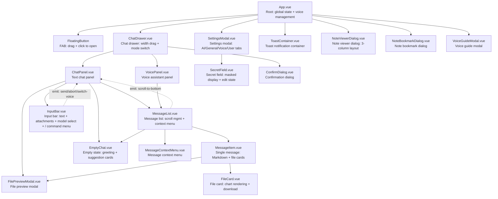
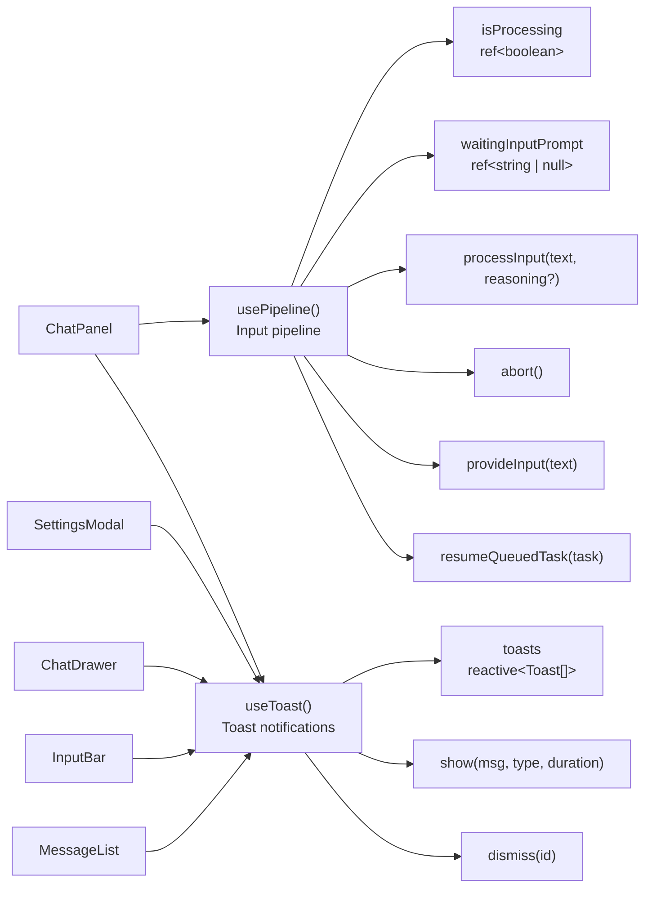
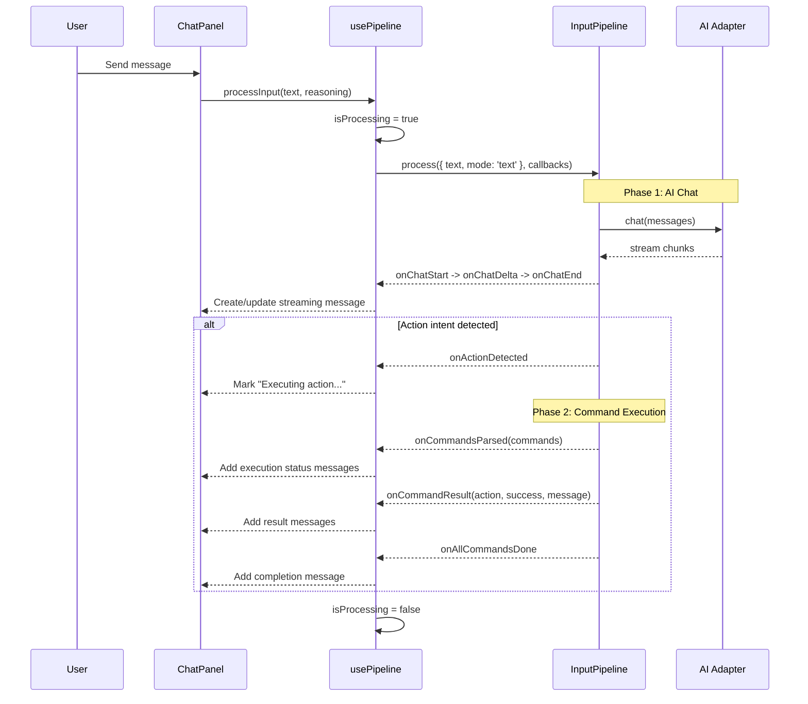
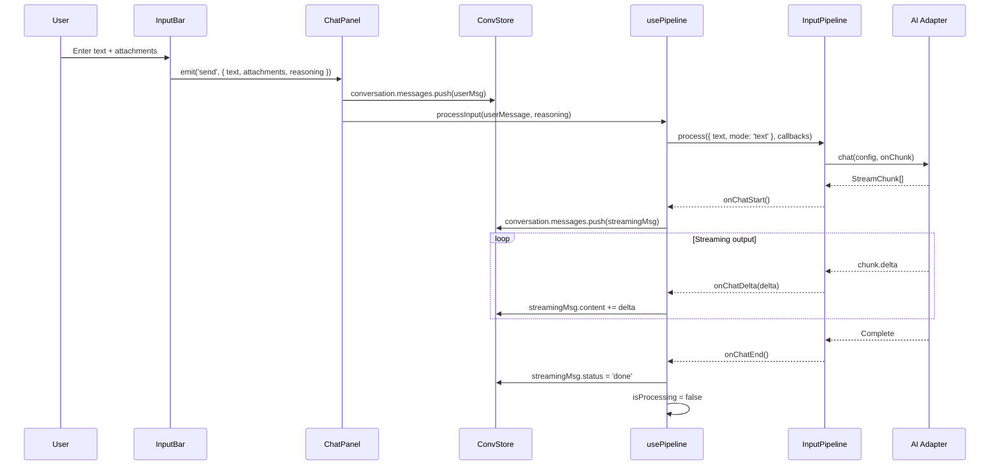
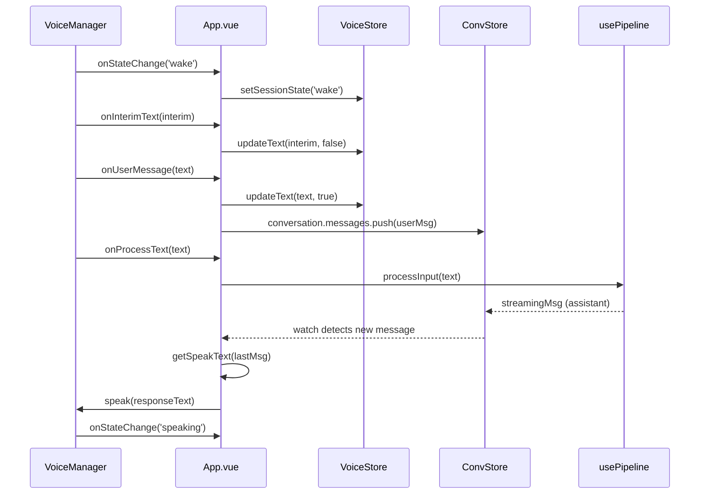
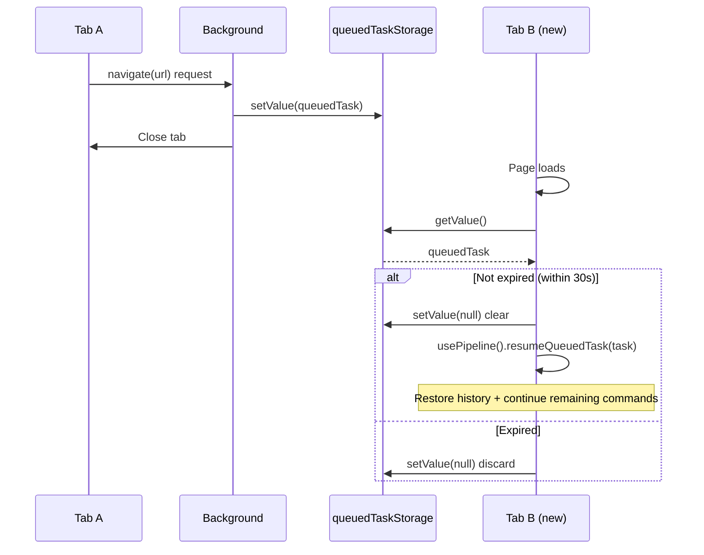
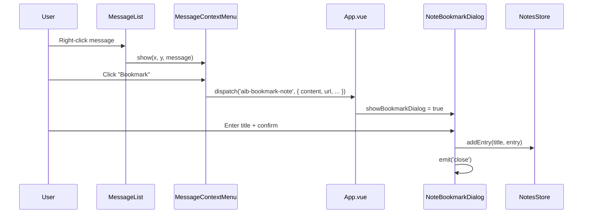
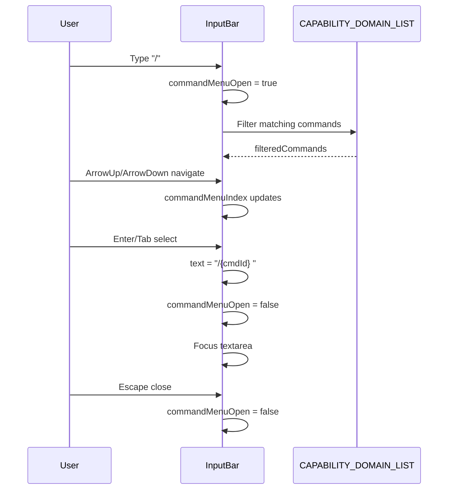
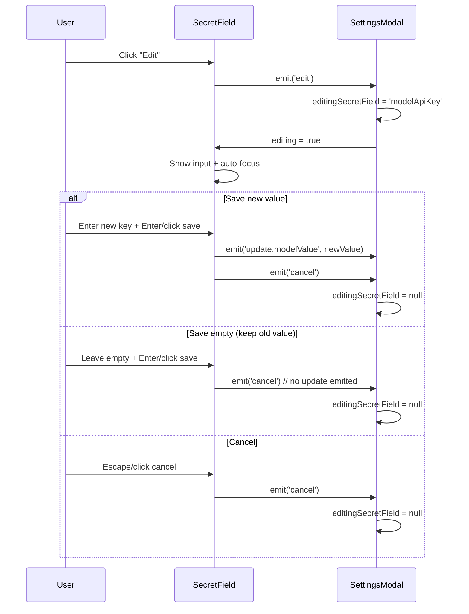

# Content Script Architecture Documentation

> Chinese version: [content-script.md](./content-script.md)

## 1. Module Overview

The Content Script is the frontend entry point injected into every web page by the extension. It is responsible for mounting a Vue 3 application in Shadow DOM, listening to page events (URL changes, DOM mutations, text selection), initializing translation/note features, managing the voice engine lifecycle, and handling cross-tab task resumption. It serves as the first layer of user interaction with the extension.

**Source Files**:
- Entry: `entrypoints/content/index.ts`
- Root Component: `entrypoints/content/App.vue`
- Composables: `src/composables/usePipeline.ts`, `src/composables/useToast.ts`
- Components Directory: `entrypoints/content/components/`

### Shadow DOM Isolation

The Shadow DOM container is created via WXT's `createShadowRootUi` API:

- **Style Isolation**: `global.css` is imported as a string via `?inline` and injected into the shadow root as a `<style>` tag in `onMount`. All CSS class names use the `aib-` prefix to avoid conflicts with the host page
- **Host Positioning**: The shadow host is set to `position: fixed; z-index: 2147483647; top: 0; left: 0; width: 0; height: 0`, occupying no page layout space and serving as an absolute positioning container
- **Vue Mounting**: In the `onMount` callback: `createApp(App).use(createPinia()).mount(container)`
- **Cleanup on Removal**: In `onRemove`, the Vue instance is unmounted, translation state is reset, and the translate popup is hidden

### Component Hierarchy

The root component `App.vue` holds global state (drawer toggle, settings dialog, notes dialog, voice management) and passes it down via props/events. The component tree starts from `FloatingButton` and `ChatDrawer`, with `ChatDrawer` internally switching between `ChatPanel` and `VoicePanel` based on `activeMode`.

## 2. Architecture Design

### Component Tree



### Composables Architecture



## 3. Core Type Definitions

### Component Props / Emits Interfaces

```typescript
// FloatingButton
// emits: { (e: 'click'): void }

// ChatDrawer
interface ChatDrawerProps {
  open: boolean;
}
// emits: { (e: 'close'): void; (e: 'open-settings'): void }

// ChatPanel
// emits: { (e: 'switch-voice'): void }

// VoicePanel
// emits: { (e: 'switch-chat'): void }

// InputBar
interface InputBarProps {
  conversation: Conversation | null | undefined;
  models: ModelConfig[];
  isProcessing?: boolean;
  waitingInputPrompt?: string | null;
  automationEnabled?: boolean;
}
// emits: {
//   (e: 'send', payload: { text: string; attachments: Attachment[]; reasoning: boolean }): void;
//   (e: 'abort'): void;
//   (e: 'switch-voice'): void;
//   (e: 'preview', attachment: Attachment): void;
// }

// MessageList
interface MessageListProps {
  conversation: Conversation;
}
// emits: { (e: 'scroll-to-bottom'): void }
// expose: { jumpToBottom, stickToBottom, showScrollBottom }

// MessageItem
interface MessageItemProps {
  message: ChatMessage;
}
// emits: { (e: 'context-menu', payload: { message: ChatMessage; x: number; y: number }): void }

// ConfirmDialog
interface ConfirmDialogProps {
  visible: boolean;
  title: string;
  desc?: string;           // default ''
  confirmText?: string;    // default 'Confirm'
  cancelText?: string;     // default 'Cancel'
  variant?: 'danger' | 'primary';  // default 'primary'
}
// emits: { (e: 'confirm'): void; (e: 'cancel'): void }

// FileCard
interface FileCardProps {
  attachment?: Attachment;    // User-uploaded file
  parsedFile?: ParsedFile;    // AI-generated file
}
// emits: {
//   (e: 'preview'): void;
//   (e: 'download'): void;
//   (e: 'download-png'): void;
//   (e: 'download-config'): void;
// }

// FilePreviewModal
interface FilePreviewModalProps {
  attachment: Attachment;
}
// emits: { (e: 'close'): void }

// MessageContextMenu
interface MessageContextMenuProps {
  x: number;
  y: number;
}
// emits: { (e: 'copy'): void; (e: 'bookmark'): void; (e: 'delete'): void }

// NoteViewerDialog
// emits: { (e: 'close'): void }

// NoteBookmarkDialog
interface NoteBookmarkDialogProps {
  data: {
    content: string;
    url: string;
    scrollY: number;
    selectedText?: string;
    source: NoteEntry['source'];
  };
}
// emits: { (e: 'close'): void }

// VoiceGuideModal
// emits: { (e: 'close'): void }

// SettingsModal
// emits: { (e: 'close'): void }

// EmptyChat
// emits: { (e: 'pick', text: string): void }

// SecretField
interface SecretFieldProps {
  modelValue: string;     // Current value (actual secret)
  editing?: boolean;      // Whether currently editing (controlled by parent)
  placeholder?: string;   // Input placeholder
}
// emits: {
//   (e: 'update:modelValue', value: string): void;
//   (e: 'edit'): void;
//   (e: 'cancel'): void;
// }

// ToastContainer — no props/emits, uses useToast() composable directly
```

### usePipeline Return Value

```typescript
interface UsePipelineReturn {
  isProcessing: Ref<boolean>;           // Whether currently processing
  waitingInputPrompt: Ref<string | null>; // Prompt text when AI awaits user input
  processInput: (text: string, reasoning?: boolean) => Promise<void>;
  resumeQueuedTask: (task: QueuedTask) => Promise<void>;
  executeCommand: (cmd: Command) => Promise<ActionResult>;
  addSystemMessage: (content: string) => void;
  provideInput: (text: string) => void;  // Provide input requested by AI
  abort: () => Promise<void>;            // Abort pipeline and wait for completion
}
```

### useToast Return Value

```typescript
interface UseToastReturn {
  toasts: Reactive<Toast[]>;
  info: (message: string, duration?: number) => string;
  success: (message: string, duration?: number) => string;
  warning: (message: string, duration?: number) => string;
  error: (message: string, duration?: number) => string;
  dismiss: (id: string) => void;
}
```

## 4. Implementation Details

### App.vue — Root Component

App.vue is the root component of the entire Content Script UI, handling the following responsibilities:

**1. Voice Engine Lifecycle Management**

App.vue holds a `VoiceManager` instance (`bgManager`) that uniformly manages microphone start/stop:

```typescript
let bgManager: VoiceManager | null = null

function startBgVoice() {
  if (bgManager) return
  bgManager = new VoiceManager({
    engineType: s.engineType,
    // ... engine config
    onStateChange: (state) => voiceStore.setSessionState(state),
    onInterimText: (text) => voiceStore.updateText(text, false),
    onUserMessage: (text) => { /* push to conversation messages */ },
    onError: (error) => { /* push error message to conversation */ },
  })
  bgManager.onProcessText = async (text) => {
    await pipeline.processInput(text)
  }
  bgManager.start()
}
```

Voice start/stop trigger conditions:
- `settingsStore.settings.voiceAlwaysOn` changes (always-on mode toggle)
- `open` changes (drawer toggle; in non-always-on mode, voice follows drawer open/close)
- `voiceStore.settingsVersion` changes (rebuild engine on settings change)
- Page visibility changes (`visibilitychange`, `focus`/`blur`)
- Another tab claims the microphone lock (`chrome.storage.onChanged` listening to `aib-mic-lock`)

**2. Cross-Tab Microphone Lock**

Only one tab holds the microphone at a time, implemented via the `aib-mic-lock` key in `chrome.storage.local`:

```typescript
const MIC_LOCK_KEY = 'aib-mic-lock' as const

function claimMic() {
  chrome.storage.local.set({ [MIC_LOCK_KEY]: myTabId }).catch(() => {})
}

function unclaimMic() {
  chrome.storage.local.get(MIC_LOCK_KEY).then(stored => {
    if (stored[MIC_LOCK_KEY] === myTabId) {
      chrome.storage.local.remove(MIC_LOCK_KEY).catch(() => {})
    }
  }).catch(() => {})
}
```

**3. TTS Broadcast**

Watches the last assistant message for changes. When `status === 'done'` and `bgManager.isActive`, it extracts the broadcast text (filtering out command execution status messages) and calls `bgManager.speak()`. Uses a `spokenMsgIds` Set to prevent duplicate broadcasts (capped at 100 entries, evicting the oldest 50 when exceeded).

The broadcast condition is determined by the `getBroadcastCondition` callback in `VoiceManager`: broadcast when the microphone is active (`bgManager?.isActive`).

**4. Auto-Note Event Bridge**

The Content Script entry (index.ts) dispatches custom events via `window.dispatchEvent`, and App.vue listens and updates conversation messages:

| Event | Purpose |
|-------|---------|
| `aib-auto-note-start` | Insert placeholder message (`status: 'streaming'`) |
| `aib-auto-note-delta` | Stream-update message content |
| `aib-auto-note-result` | Final update (`status: 'done'`) |
| `aib-auto-note-aborted` | Mark as `status: 'aborted'` |
| `aib-auto-send-command` | Open drawer and send command (e.g., `/note`) |
| `aib-bookmark-note` | Open note bookmark dialog |
| `aib-toggle-note-viewer` | Toggle note viewer dialog |
| `aib-close-drawer` | Close chat drawer |
| `aib-mode-changed` | Mode switch (manage mic start/stop) |
| `aib-show-voice-guide` | Show voice guide modal |

**5. Theme and Internationalization**

```typescript
function applyTheme() {
  const theme = getThemeById(settingsStore.settings.theme)
  for (const [key, value] of Object.entries(theme.vars)) {
    host.style.setProperty(key, value)
  }
}
```

Watches `settings.theme` and `settings.locale` changes and applies them to the shadow host in real time.

**6. Global Event Listeners**

App.vue registers numerous event listeners in `onMounted` and cleans them up in `onUnmounted`:

| Event | Source | Handler |
|-------|--------|---------|
| `chrome.runtime.onMessage` | Background | `aib-toggle` toggles drawer, `aib-drawer-sync` syncs state, `automation` executes actions |
| `keydown` (capture) | Page | Shortcut matching -> toggle drawer |
| `mouseup` (capture) | Page | Selected text -> fill input box or auto-send |
| `visibilitychange` | Page | Pause engine when hidden, resume when visible |
| `focus`/`blur` | window | Start/stop engine on focus changes |
| `beforeunload` | window | Release microphone lock |

**7. Cross-Tab Drawer State Sync**

Drawer open state is persisted to `chrome.storage.local` via `drawerOpenStorage`, and simultaneously broadcast to other tabs via `chrome.runtime.sendMessage`. The `aib-drawer-sync` message receives state changes from other tabs, using a `syncingFromRemote` flag to prevent circular sync.

### ChatDrawer.vue — Chat Drawer

**Core Features**:
- **Dual Mode Switching**: `activeMode` is managed via `settingsStore.settings.voiceMode`, auto-persisted + cross-tab synced. Mode changes dispatch `aib-mode-changed` custom events to notify App.vue for mic management
- **Width Dragging**: Left drag handle supports adjusting drawer width, range `[60px, window.innerWidth * 0.95]`, saved to `settingsStore.settings.drawerWidth`
- **Cross-Tab Width Sync**: Watches `settingsStore.settings.drawerWidth` changes, auto-updates when not dragging
- **Clear Conversation**: After confirmation via `ConfirmDialog`, calls `abortPipeline()` to abort in-flight requests, then `store.clearCurrent()` to clear the session
- **Notes Entry**: When note mode is enabled, shows a notes button that dispatches `aib-toggle-note-viewer` on click

### ChatPanel.vue — Text Chat Panel

**Core Features**:
- **Message Sending**: `onSend` handles three scenarios:
  1. AI awaiting user input -> `pipeline.provideInput(text)`
  2. Normal send -> build user message (merge attachment content) -> `pipeline.processInput(userMessage, reasoning)`
- **Attachment Handling**: Attachment content is concatenated into `userMessage` for AI, but `conversation.messages` only stores raw user text + `attachments` metadata
- **Deep Reasoning**: When `reasoning` is true, prepends `[Please answer with deep reasoning...]`
- **Stop Operation**: `onAbort` sequentially calls `convStore.abort()`, `pipeline.abort()`, and dispatches `aib-stop-auto-note` event
- **File Preview**: InputBar's `preview` event is elevated to ChatPanel level for `FilePreviewModal` rendering, avoiding fixed positioning issues inside scroll containers
- **Empty State**: When no messages, displays `EmptyChat` component; suggestion card clicks are sent directly to AI

### InputBar.vue — Input Bar

**Core Features**:
- **Auto Height**: Textarea height adjusts automatically based on content, max 200px
- **File Attachments**: Supports file selection, pasting images/links. Pasted links are auto-fetched; images are added directly as attachments; non-images upload content and paste link text simultaneously
- **Local Files**: Pasting `file:///` or Windows paths (`E:\xxx`) reads via Background proxy (Content Script cannot directly fetch `file://`). `toFetchableUrl()` handles various URL formats uniformly
- **OCR**: Image attachments trigger async OCR, progress tracked via `ocrProgressMap` and displayed as an overlay progress bar
- **Model Selection**: Dropdown menu to switch the current conversation model
- **/ Command Menu**: Typing `/` opens a command menu based on `CAPABILITY_DOMAIN_LIST` filtering. Supports keyboard navigation (ArrowUp/ArrowDown/Tab/Enter/Escape); selection auto-fills `/{cmdId} ` and focuses the textarea. Only enabled when `automationEnabled` is true
- **Input History**: Up/Down keys navigate history loaded from `settingsStore.settings.inputHistory`. Saves current draft on first history entry; restores it when reaching the end
- **Send/Stop Button**: Shows stop button (square icon) during streaming, otherwise shows send button (arrow icon)
- **Keyboard Event Isolation**: Regular character input calls `stopPropagation()` to prevent triggering page shortcuts (e.g., GitHub's `s`, `/`)

### MessageList.vue — Message List

**Core Features**:
- **Auto Scroll**: `stickToBottom` flag controls bottom-sticking; stops auto-scrolling when user scrolls up beyond 30px threshold
- **Scroll Position Restore**: Restores from `conversation.scrollTop` on session switch
- **Context Menu**: `MessageContextMenu` provides copy, bookmark, and delete operations; coordinate conversion accounts for `.aib-drawer` transform offset
- **expose**: Exposes `jumpToBottom`, `stickToBottom`, `showScrollBottom` to parent

### MessageItem.vue — Single Message

**Core Features**:
- **Markdown Rendering**: Uses `renderMarkdown()` for message content, supporting code blocks, tables, KaTeX, etc.
- **Deep Reasoning**: Shows thinking block when `reasoningEnabled` is true
- **File Tag Parsing**: `[FILE:xxx]...[/FILE]` tags in AI replies are parsed as `ParsedFile` and rendered as `FileCard`
- **Chart Rendering**: Files with `category === 'chart'` render ECharts charts
- **Attachment Display**: User-uploaded images and file attachments are displayed separately
- **Streaming State**: `status === 'streaming'` shows typing animation, `'error'` shows error banner, `'aborted'` shows stop banner
- **Code Block Operations**: Event delegation handles code block copy buttons and table download buttons

### VoicePanel.vue — Voice Assistant Panel

**Core Features**:
- **Status Indicator**: Displays different states based on `voiceStore.sessionState` (idle/wake/command/processing/speaking); top status bar shows status dot (with pulse animation) + status text + interim recognition text
- **Ripple Animation**: Three concentric ripple animations during wake and command states
- **Message List Reuse**: Reuses `MessageList` component for conversation history
- **Empty State**: Shows microphone icon + wake word prompt when no messages
- **New Message Auto-Scroll**: Watches message count changes, scrolls to bottom after 200ms delay
- **Bottom Microphone Indicator**: Circular microphone icon, highlighted with glow shadow when active

### SettingsModal.vue — Settings Modal

**Four Tabs**:

1. **AI Config**: Model list management (add/edit/delete/import/export), provider preset quick-fill, API Key configuration (uses `SecretField` component for masked display)
2. **General Config**: Theme selection (5 preset grid), shortcut recording, web automation toggle (requires confirmation dialog), selection behavior, translate mode/target language, note mode
3. **Voice Config**: Engine type selection (Web Speech/iFlytek/Baidu/Tencent), AppId/ApiKey/ApiSecret configuration (all using `SecretField` component), wake word, always-on voice, TTS broadcast parameters (rate/volume sliders), behavior parameters (buffer timeout/idle timeout sliders)
4. **User Config**: max context messages, cache management (with progress bar), log download (visible only in debug builds), language switch, version + links

**Special Features**:
- Embedded documentation viewer (Markdown rendering + sidebar TOC navigation + scroll highlighting)
- Automation toggle requires confirmation dialog (both on and off need confirmation)
- Provider presets support 10 providers (OpenAI, Anthropic, DeepSeek, MiMo, Qwen, Kimi, Zhipu, Wenxin, MiniMax, SiliconFlow)
- Import validates provider whitelist, skipping invalid entries

### SecretField.vue — Secret Field Component

**Overview**: Provides a dual-state "display + edit" toggle for password/secret fields, preventing plaintext exposure of sensitive information.

**Display State**:
- Shows `••••••••` mask text when a value exists
- Shows an "Edit" button that switches to edit state on click

**Edit State**:
- Shows an empty input field (does not pre-fill old value), auto-focused
- "Save" button: non-empty value writes new value; empty value preserves old value
- "Cancel" button: clears input and returns to display state
- Supports Enter to save, Escape to cancel

**Parent Coordination**: The `editing` prop is controlled by the parent component (e.g., `editingSecretField === 'modelApiKey'`), ensuring only one secret field is in edit state at a time. Edit state resets when switching fields or switching models/engines.

**Styles**: CSS class names `aib-secret-field`, `aib-secret-mask`, `aib-secret-input` are defined in `src/styles/global.css`, using `aib-btn-outline` and `aib-btn-ghost` button variants.

### EmptyChat.vue — Empty State

Displays a time-based greeting (determined by hour: late night/morning/noon/afternoon/evening) and four suggestion cards (automation, voice, translation, report). Clicking a suggestion card triggers the `pick` event to send to AI.

### ConfirmDialog.vue — Confirmation Dialog

A general-purpose confirmation dialog component supporting `danger` and `primary` variants, with customizable icon via the `#icon` slot.

### ToastContainer.vue — Toast Notifications

Directly uses the `toasts` reactive array from the `useToast()` composable. Uses `transition-group` for enter/exit animations. Click to manually dismiss. Each type (info/success/warning/error) has a corresponding SVG icon.

### FileCard.vue — File Card

**Two Modes**:
- **User-uploaded File**: Displays file icon, name, size, with preview and download buttons
- **AI-generated File**: Same display, plus support for chart type (`category === 'chart'`) with ECharts rendering, PNG export, JSON config download

Charts render via `renderChartToElement()`, using `ResizeObserver` to auto-call `chart.resize()` on container width changes.

### FilePreviewModal.vue — File Preview Modal

**Supported Preview Types**:
- Images: Direct `` display
- Text/Code: highlight.js syntax highlighting
- Other text types: Markdown rendered as code blocks

**Download Strategy** (priority high to low):
1. Original File object (in current session memory)
2. Image dataUrl (base64 to Blob)
3. Text whitelist extensions (json/csv/md/py/js etc.) direct download
4. xlsx: Generated from content using `xlsx` library
5. docx: Generated from content using `docx` library
6. pdf: Generated via `generatePdfFromMarkdown()`
7. Fallback: Renamed to `.txt` download

### MessageContextMenu.vue — Message Context Menu

Provides three operations: copy message content, bookmark as note, delete message. Positioned via `x/y` props, with coordinate conversion using `.aib-drawer`'s `getBoundingClientRect()`.

### NoteViewerDialog.vue — Note Viewer Dialog

**Three-Column Layout**:
- **Left**: Note title list, supports exporting individual titles as `.md`, deletion
- **Center**: Entry list for selected title, double-click to enter edit mode (textarea), supports Ctrl+Enter save, Escape cancel
- **Right**: Timeline view showing each entry's time and source URL; clicking URL navigates to the original page and scrolls to the saved position

**Import/Export**:
- Export individual title as `.md` file (with metadata comments)
- Export all as `.zip` (using JSZip)
- Import `.zip` or `.md` files

**Note Jump**: Uses URL hash to pass `aib-scroll` (scroll position) and `aib-highlight` (highlight text); the Content Script entry's `handleNoteJump()` parses and executes scrolling + highlighting.

### NoteBookmarkDialog.vue — Note Bookmark Dialog

Enter a note title (supports auto-complete from existing title list), confirm to call `notesStore.addEntry()` to save. Saved data includes note content, source URL, scroll position, selected text, source type (selection/chat).

### VoiceGuideModal.vue — Voice Guide

Five-tab usage guide: Quick Start, Engine Configuration, Permission Notes, Precautions, FAQ. Pure static content, no state management.

### usePipeline — Input Pipeline Composable

**Module-Level State**:
- `isProcessing: ref(false)` — Whether currently processing
- `waitingInputPrompt: ref<string | null>` — Prompt text when AI awaits user input
- `_abortFn` — Module-level abort reference, called externally (clear conversation/cache)

**Core Flow** `processInput(text, reasoning?)`:



**Callback Handling**:
- `onChatStart`: Creates `reactive<ChatMessage>` placeholder (`status: 'streaming'`)
- `onChatDelta`: Streams content and reasoning appends
- `onChatEnd`: Sets `status: 'done'`
- `onActionDetected`: Marks current message as "Executing action..." and clears reference
- `onCommandsParsed`: Removes Phase 1 placeholder, adds command execution status messages
- `onCommandResult`: Adds individual command execution result
- `onAllCommandsDone`: Adds summary message
- `onRetryMessage`: Cleans up placeholder, adds retry prompt
- `onError`: Adds error message
- `onNeedInput`: Adds prompt message, returns Promise awaiting user input
- `onFileOutput`: Adds file download message (triggers MessageItem `[FILE]` rendering)
- `onBroadcast`: Triggers voice broadcast via `window.dispatchEvent`

**Abort Mechanism**:
1. If awaiting user input, rejects Promise to exit pipeline from await
2. Calls `currentAborter.abort()` to abort HTTP requests
3. Clears cross-tab queued tasks
4. Waits for pipeline to truly end (3-second timeout fallback)

### useToast — Toast Notification Composable

Module-level `reactive<Toast[]>` array shared across all components. `show()` adds a toast and sets an auto-dismiss timer; `dismiss()` removes a specific toast.

```typescript
const toasts = reactive<Toast[]>([]);

function show(message: string, type: ToastType = 'info', duration = 3000): string {
  const id = `t${++seed}`;
  toasts.push({ id, message, type });
  if (duration > 0) setTimeout(() => dismiss(id), duration);
  return id;
}
```

### Content Script Entry (index.ts) — Translation and Notes

**Translation Feature Initialization**:

Three translation modes are initialized uniformly in the entry:

1. **Selection Translate (selection)**: `document.addEventListener('mouseup')` listener, checks `translateMode === 'selection'`, gets selected text then calls translate and note AI in parallel
2. **Click Translate (click)**: Initialized via `initClickTranslate(translateService, getTranslateSettings, getCurrentModelId)`
3. **Auto Translate (auto)**: First trigger on page load + `settingsStorage.watch()` for mode switching + retrigger on URL change + `MutationObserver` for DOM changes

**Note Feature**:

Auto-notes are triggered via the `/note` command, processed uniformly in the pipeline. On first page load, the `/note` command is automatically sent. On URL change, the running auto-note is cancelled and the marker is reset.

**Note Jump**:

```typescript
function handleNoteJump() {
  const hash = location.hash
  // Parse aib-scroll and aib-highlight parameters
  // Find scroll container (page itself / child container)
  // Delayed scroll + retry (300ms / 1000ms / 2000ms)
  // Highlight flash 2 times then remove
}
```

**Cross-Tab Task Resumption**:

On page load, checks `queuedTaskStorage`. If a task exists and hasn't expired (within 30s), dynamically imports `usePipeline` and calls `resumeQueuedTask()`.

## 5. Data Flow

### User Send Message Flow



### Voice Interaction Flow



### Cross-Tab Task Resumption Flow



### Note Bookmark Flow



### / Command Menu Flow



### SecretField State Transition Flow



## 6. Configuration and Extension

### Adding New Components

1. Create `NewComponent.vue` in `entrypoints/content/components/`
2. Follow `<script setup lang="ts">` + generic defineProps/defineEmits syntax
3. CSS class names must use `aib-` prefix
4. Use `new Logger('NewComponent')` for logging
5. Import and use in the needed parent component

### Adding New Composables

1. Create `useXxx.ts` in `src/composables/`
2. For cross-component shared state, use module-level `ref`/`reactive` (see `useToast`)
3. For component-local state, declare inside the returned function (see `usePipeline`'s local state)

### Adding New Global Events

1. In `index.ts`: `window.dispatchEvent(new CustomEvent('aib-xxx', { detail }))` to send
2. In `App.vue`'s `onMounted`: `window.addEventListener('aib-xxx', handler)` to listen
3. Clean up listeners in `onUnmounted`

### CSS Injection Mode

`cssInjectionMode: 'ui'` is controlled by the WXT framework. `global.css` is imported via `?inline` and manually injected into the shadow root.

### Match Rules

`matches: ['<all_urls>']` applies to all pages. Modify this configuration to restrict to specific pages.

### SecretField Reuse

The `SecretField` component can be directly reused in any scenario requiring masked display of secrets:

```vue
<SecretField
  :model-value="form.apiKey"
  :editing="editingSecretField === 'myKey'"
  placeholder="sk-..."
  @update:model-value="form.apiKey = $event"
  @edit="editingSecretField = 'myKey'"
  @cancel="editingSecretField = null"
/>
```

The parent component needs to maintain an `editingSecretField` ref to coordinate mutual exclusion of edit states across multiple SecretField instances.

## 7. Known Limitations

1. **Shadow DOM Event Leakthrough**: `mouseup` events require `isInExtensionUI()` checks to avoid interference from internal extension operations. In Chrome, events crossing Shadow boundaries have `e.target` redirected to the shadow host, requiring checks on both `getRootNode()` and `shadowRoot`.

2. **Incomplete SPA Detection**: Only monkey-patches `pushState/replaceState` + listens to `popstate/hashchange`. Cannot cover all framework routing mechanisms (e.g., some frameworks use `location.assign`).

3. **Note Jump Reliability**: Scroll container detection uses a heuristic algorithm (finding elements with `overflow-y: auto/scroll` and `scrollHeight > clientHeight`). May be inaccurate in complex nested layouts. Retry mechanism (300ms/1000ms/2000ms) mitigates but cannot fully resolve.

4. **Cross-Tab Microphone Lock**: Implemented via `chrome.storage.local`, relying on async storage event notifications. In extreme cases (two tabs claiming simultaneously), brief dual-microphone may occur.

5. **TTS Broadcast Filtering**: `getSpeakText()` uses prefix matching to filter command execution status messages. If an AI reply happens to start with these prefixes, it may be incorrectly filtered.

6. **File Preview Limitation**: FilePreviewModal's text preview depends on `attachment.content`. After page refresh, the original File object is lost, and only saved text content can be previewed.

7. **usePipeline Module-Level State**: `isProcessing`, `waitingInputPrompt`, and other states are module-level refs shared across all `usePipeline()` calls. This is by design, but conflicts may arise if multiple pipeline instances exist simultaneously.

8. **Input History Storage**: `inputHistoryStorage` loads from `chrome.storage.local` with async delay on first load; quickly pressing Up may trigger empty history.

9. **Chart Rendering**: FileCard's ECharts rendering relies on dynamic imports, causing first-render load delay. ResizeObserver is properly cleaned up on component unmount, but size changes within Shadow DOM may have edge cases.

10. **Settings Modal Size**: SettingsModal exceeds 2400 lines in a single file (including styles), containing all logic for four tabs. Styles use scoped CSS but are not extracted into separate files.

11. **SecretField Edit State Mutual Exclusion**: Only one SecretField can be in edit state at a time (controlled by parent's `editingSecretField` ref). If the parent does not manage this correctly, multiple fields may end up in edit state simultaneously.
