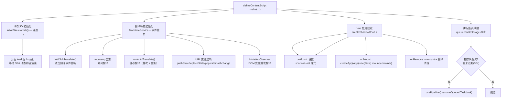
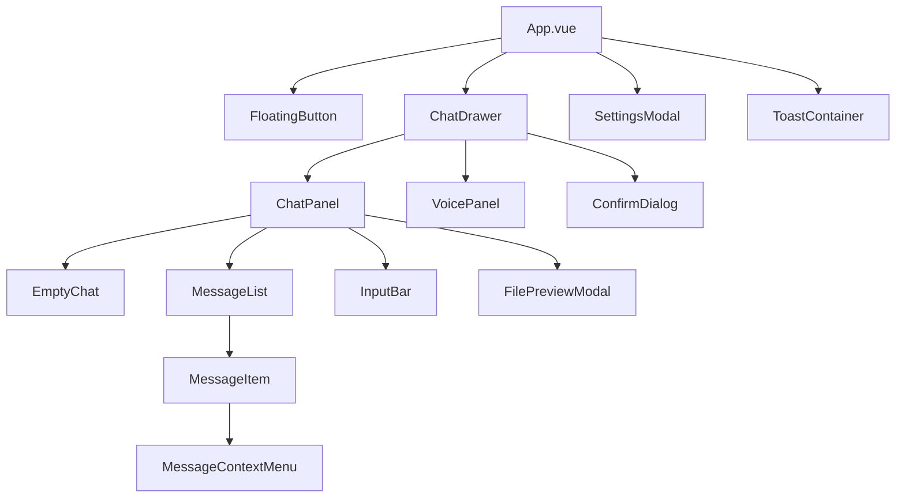
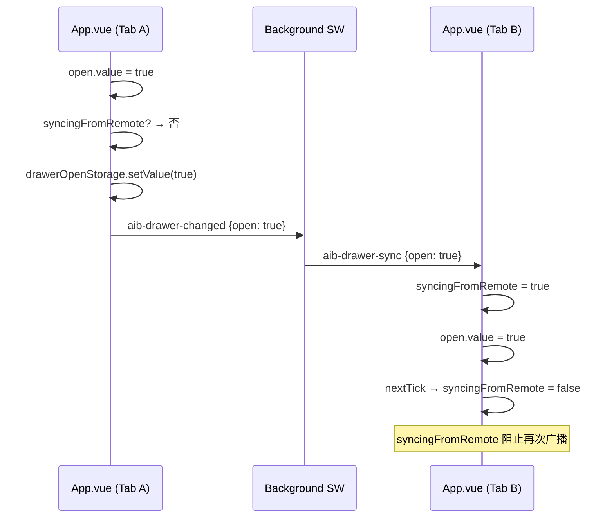
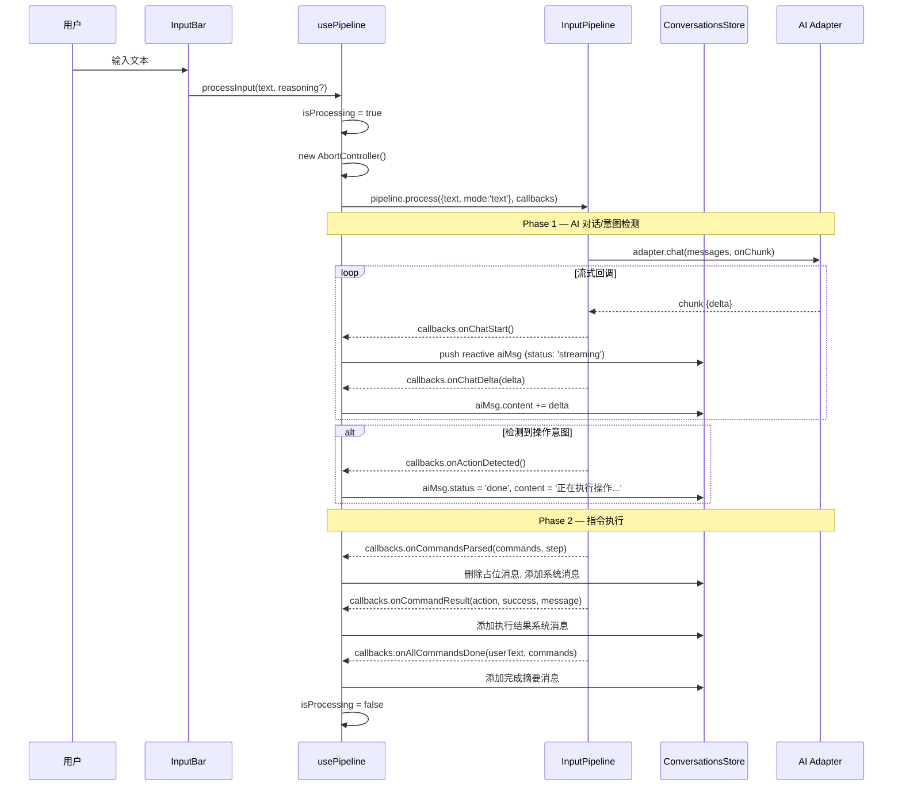
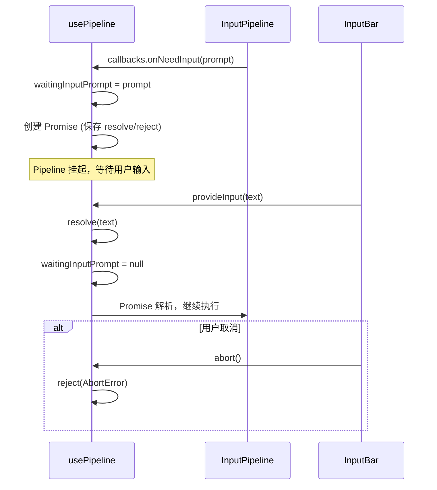
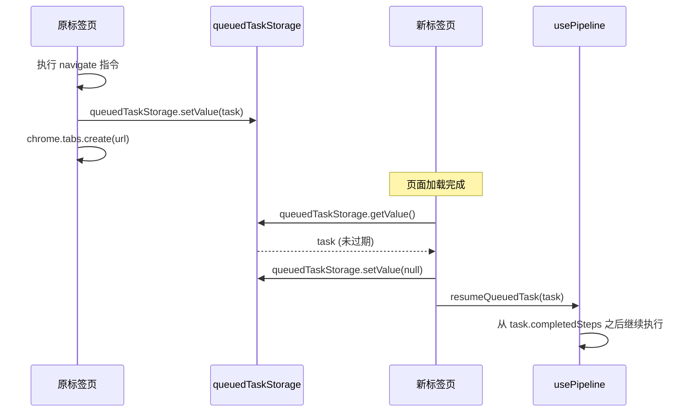
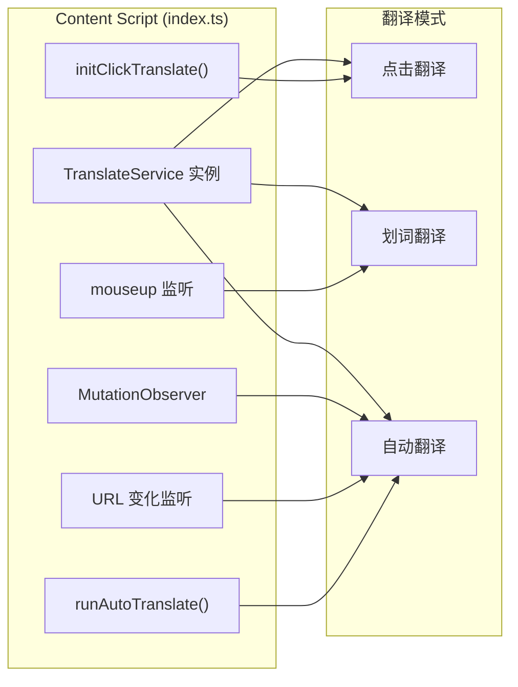

# Content Script + Vue 组件架构

> Content Script 在每个页面注入 Vue 3 应用（Shadow DOM），提供聊天抽屉、翻译功能、语音面板和跨标签页任务续接。

## 初始化流程



## Shadow DOM 挂载

### Shadow Host 配置

```typescript
const ui = await createShadowRootUi(ctx, {
  name: 'browser-ai-chat',
  position: 'inline',
  anchor: 'body',
  onMount(container, _shadow, shadowHost) {
    // 注入全局 CSS
    const style = document.createElement('style');
    style.textContent = globalCss;
    _shadow.appendChild(style);

    // Shadow Host 样式：固定定位 + 最高 z-index + 零尺寸
    shadowHost.style.position = 'fixed';
    shadowHost.style.zIndex = '2147483647';
    shadowHost.style.top = '0';
    shadowHost.style.left = '0';
    shadowHost.style.width = '0';
    shadowHost.style.height = '0';

    const app = createApp(App);
    app.use(createPinia());
    app.mount(container);
    return app;
  },
  onRemove(app) {
    app?.unmount();
    translateService.reset();
    hideTranslatePopup();
  },
});
```

### Shadow Host 样式说明

| 属性 | 值 | 原因 |
|------|-----|------|
| `position` | `fixed` | 脱离文档流，不干扰页面布局 |
| `z-index` | `2147483647` | 32 位最大整数，确保在最顶层 |
| `width/height` | `0` | Host 自身不可见，内容通过子组件定位 |

---

## App.vue — 根组件

源码：`entrypoints/content/App.vue`

### 组件树



### 响应式状态

```typescript
const open = ref(false);              // 抽屉展开状态
const showSettings = ref(false);      // 设置弹窗
const rootEl = ref<HTMLElement | null>(null);  // 根元素引用
```

### 键盘快捷键

```typescript
function onKeydown(e: KeyboardEvent) {
  const sc = settingsStore.settings.shortcut;  // 如 "Ctrl+Shift+B"
  if (matchShortcut(e, sc)) {
    e.preventDefault();
    e.stopPropagation();
    toggle();
  }
}

// 注册在 capture 阶段，优先于页面快捷键
document.addEventListener('keydown', onKeydown, true);
```

### 鼠标选中检测

```mermaid
flowchart TD
    A["mouseup 事件 (capture)"] --> B{"抽屉已打开?"}
    B -->|否| Z["忽略"]
    B -->|是| C{"autoSendSelection 模式"}
    C -->|"off / false"| Z
    C -->|D["检查事件来源"] --> E{"来自扩展 Shadow DOM?"}
    E -->|是| Z
    E -->|否| F["document.getSelection()"]
    F --> G{"有选中文本?"}
    G -->|否| Z
    G -->|是| H{"mode?"}
    H -->|"manual"| I["convStore.conversation.draftText = text"]
    H -->|"auto"| J["convStore.send(text)"]
```

事件过滤通过 `composedPath()` 和 `hostEl.contains()` 双重检查，确保扩展内部操作不会触发选中检测。

### 主题应用

```typescript
function applyTheme() {
  const host = root instanceof ShadowRoot ? root.host as HTMLElement : el;
  const theme = getThemeById(settingsStore.settings.theme);
  for (const [key, value] of Object.entries(theme.vars)) {
    host.style.setProperty(key, value);
  }
  host.style.setProperty('--aib-primary', ...);
  host.style.setProperty('--aib-drawer-width', '480px');
}
```

CSS 变量设置在 shadow host 上，Shadow DOM 内的所有组件通过 `var(--aib-xxx)` 引用。

### 抽屉跨标签页同步



---

## usePipeline — 输入管线 Composable

源码：`src/composables/usePipeline.ts`

### 核心职责

将 `InputPipeline` 集成到 Vue 组件中，管理流式消息生命周期和用户交互。

### 模块级状态

```typescript
const isProcessing = ref(false);
const waitingInputPrompt = ref<string | null>(null);
let waitingInputResolve: ((value: string) => void) | null = null;
let waitingInputReject: ((reason?: unknown) => void) | null = null;
let _abortFn: (() => Promise<void>) | null = null;
```

`isProcessing` 和 `waitingInputPrompt` 是模块级 ref（非组件级），确保跨组件访问一致。

### processInput() 流程



### PipelineCallbacks 映射

| 回调 | 触发时机 | Store 操作 |
|------|----------|-----------|
| `onChatStart` | AI 流式回复开始 | 创建 reactive 占位消息 (streaming) |
| `onChatDelta` | 流式增量 | `aiMsg.content += delta` |
| `onChatEnd` | 流式回复结束 | `aiMsg.status = 'done'` |
| `onActionDetected` | 检测到操作意图 | 标记占位消息完成，清空引用 |
| `onChatMessage` | 纯文本回复（非流式） | 直接 push 完成消息 |
| `onCommandsParsed` | 解析到指令列表 | 删除占位消息，添加执行状态 |
| `onCommandResult` | 单条指令执行完成 | 添加结果系统消息 |
| `onAllCommandsDone` | 全部指令执行成功 | 添加完成摘要 |
| `onRetryMessage` | 指令重试 | 清理占位消息，添加重试提示 |
| `onError` | 最终错误 | 添加错误系统消息 |
| `onNeedInput` | AI 请求用户输入 | 显示提示，返回 Promise |
| `onFileOutput` | 数据提取完成 | 添加 assistant 消息（触发 [FILE] 渲染） |

### onNeedInput — 用户输入等待



### abort() — 中止机制

```typescript
function abort(): Promise<void> {
  // 1. 如果在等待用户输入，reject Promise
  if (waitingInputReject) {
    waitingInputReject(new DOMException('The operation was aborted.', 'AbortError'));
    waitingInputResolve = null;
    waitingInputReject = null;
    waitingInputPrompt.value = null;
  }
  // 2. 中止 AI 请求
  currentAborter?.abort();
  // 3. 清除跨标签页排队任务
  queuedTaskStorage.setValue(null).catch(() => {});
  // 4. 等待 pipeline 真正结束（超时 3s 兜底）
  if (isProcessing.value) {
    return new Promise<void>(resolve => {
      stoppedResolve = resolve;
      setTimeout(() => {
        if (isProcessing.value) {
          isProcessing.value = false;
          resolve();
        }
      }, 3000);
    });
  }
  return Promise.resolve();
}
```

模块级 `abortPipeline()` 导出函数，供清除会话时调用：

```typescript
export async function abortPipeline(): Promise<void> {
  await _abortFn?.();
}
```

### resumeQueuedTask() — 跨标签页续接

当用户在 `navigate` 指令后打开新标签页，原标签页的 pipeline 通过 `queuedTaskStorage` 保存进度，新标签页在初始化时恢复：



过期保护：30 秒前的旧任务直接丢弃。

---

## 翻译功能初始化

Content Script 同时初始化三种翻译模式：

### 事件监听架构



### 设置变化响应

```typescript
settingsStorage.watch((newValue, oldValue) => {
  if (oldMode === newMode) return;

  // 切换到 auto → 立即触发翻译
  if (newMode === 'auto') runAutoTranslate();

  // 从 auto 切走 → 还原所有翻译
  if (oldMode === 'auto' && newMode !== 'auto') translateService.restoreAll();
});
```

### URL 变化检测

```typescript
// Monkey-patch pushState/replaceState
history.pushState = function (...args) {
  origPushState.apply(this, args);
  onUrlChange('pushState');
};

// + popstate + hashchange 事件监听
// 800ms 防抖 → translateService.reset() + runAutoTranslate()
```

---

## 跨标签页任务续接

### QueuedTask 结构

```typescript
interface QueuedTask {
  originalRequest: string;
  completedSteps: string[];
  timestamp: number;
  // ... 其他 pipeline 状态
}
```

### 续接流程

1. 原标签页执行 `navigate` 指令 → 写入 `queuedTaskStorage`
2. 新标签页打开 → Content Script 初始化后检查 `queuedTaskStorage`
3. 过期检查：`Date.now() - task.timestamp > 30_000` → 丢弃
4. 调用 `usePipeline().resumeQueuedTask(task)` 恢复执行
5. 立即清除存储：`queuedTaskStorage.setValue(null)`

### 错误处理

```typescript
try {
  const { usePipeline } = await import('@/src/composables/usePipeline');
  const { resumeQueuedTask } = usePipeline();
  await resumeQueuedTask(queuedTask);
} catch (err) {
  log.error('[跨标签页续接] 恢复失败', err);
}
```

动态 `import()` 确保 Vue 应用已 mount 后再加载 pipeline 模块。
