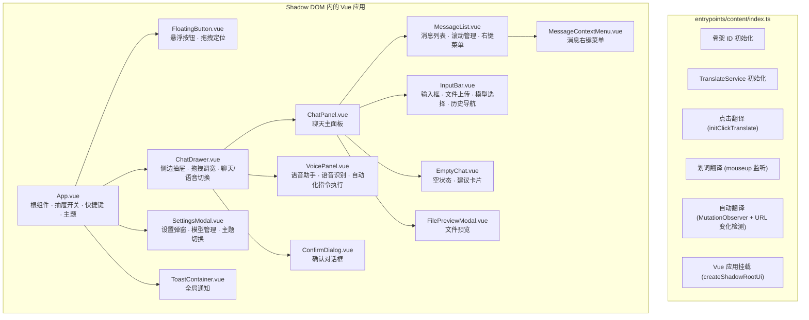
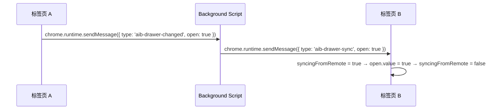
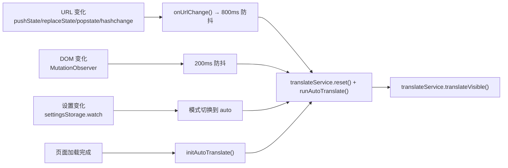
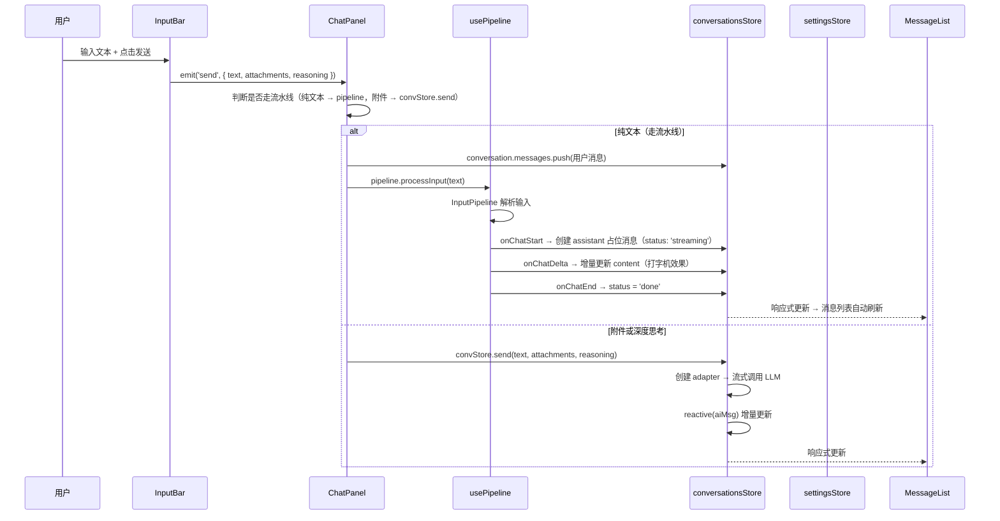
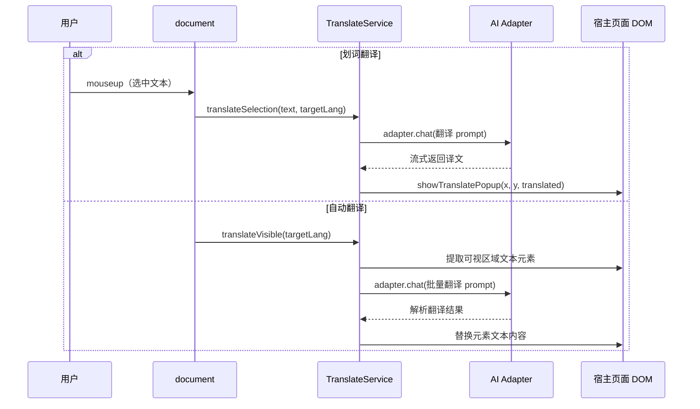

# Content Script + Vue 组件架构

> 最后更新：2026-06-18

## 目标

在宿主页面中注入隔离的 Vue 应用，提供聊天界面和翻译功能。扩展 UI 通过 Shadow DOM 完全隔离，不影响宿主页面样式，也不被宿主页面样式污染。

---

## 架构总览



---

## 核心设计决策

### 1. Shadow DOM 隔离

使用 WXT 的 `createShadowRootUi` 创建 Shadow DOM 容器，实现样式完全隔离：

- **宿主页面的 CSS 不会影响扩展 UI**：Shadow DOM 的封装性确保外部样式规则无法穿透
- **扩展 UI 的 CSS 不会污染宿主页面**：所有组件样式（scoped + global）都在 shadow root 内部
- **全局 CSS 通过 `<style>` 注入 shadow root**：`global.css` 以 `?inline` 方式导入，在 `onMount` 阶段作为内联 `<style>` 元素插入 shadow root

```typescript
// entrypoints/content/index.ts — onMount 回调
const style = document.createElement('style');
style.textContent = globalCss;
_shadow.appendChild(style);
```

### 2. Shadow Host 定位策略

Shadow host 元素（WXT 创建的容器 `<div>`）采用固定定位 + 最高层级：

```typescript
shadowHost.style.position = 'fixed';
shadowHost.style.zIndex = '2147483647'; // 32 位有符号整数最大值
shadowHost.style.top = '0';
shadowHost.style.left = '0';
shadowHost.style.width = '0';
shadowHost.style.height = '0';
```

- `z-index: 2147483647` 确保扩展 UI 始终在最顶层
- `width/height: 0` 使 host 本身不占据页面空间，子元素通过 `position: fixed` 脱离文档流
- 所有实际 UI 元素（悬浮按钮、抽屉等）在 shadow root 内部自行定位

### 3. Vue 3 Composition API + Pinia

- 所有组件使用 `<script setup>` 语法
- 状态管理使用 Pinia store（`useSettingsStore`、`useConversationsStore`、`useVoiceStore`）
- 响应式数据通过 `ref`、`reactive`、`computed` 管理
- 跨 store 通信通过直接引用其他 store 实现（如 `conversationsStore` 内部读取 `settingsStore`）

### 4. 翻译功能独立于 Vue

翻译系统在 content script 入口层面初始化，**不在 Vue 组件内部**：

- `TranslateService` 实例在 `main()` 函数顶层创建
- 翻译模式（点击/划词/自动）的事件监听器直接绑定到 `document`
- 翻译结果通过独立的 DOM 操作（`translate-popup.ts`）展示，不经过 Vue 渲染管线
- 这样设计的原因：翻译需要直接操作宿主页面 DOM，且不依赖 Vue 应用是否已挂载

### 5. 抽屉状态跨标签页同步



- 用户在一个标签页打开/关闭抽屉时，通过 `chrome.runtime.sendMessage` 广播状态
- 其他标签页的 `onMessage` 监听器接收 `aib-drawer-sync` 消息并同步
- 使用 `syncingFromRemote` 标志避免循环广播
- 抽屉状态还持久化到 `drawerOpenStorage`，页面刷新后恢复

---

## 详细实现

### entrypoints/content/index.ts — 内容脚本入口

content script 的 `main()` 函数按顺序执行以下初始化：

#### 阶段 1：骨架 ID 标记

```typescript
const markAll = () => setTimeout(() => initAllSkeletonIds(), 1000);
```

- 页面加载完成后延迟 1 秒执行，等待 SPA 动态内容渲染
- 为 DOM 元素注入 `data-skeleton-id`，供翻译系统精确定位元素

#### 阶段 2：翻译功能初始化

```typescript
const translateService = new TranslateService();
```

翻译系统包含三种模式：

| 模式 | 触发方式 | 实现 |
|------|----------|------|
| 点击翻译 | `initClickTranslate()` — 监听特定元素点击 | `translate-click.ts` |
| 划词翻译 | `document.mouseup` — 检测选中文本 | 直接在 content script 中实现 |
| 自动翻译 | 页面加载 + URL 变化 + DOM 变化 | `TranslateService.translateVisible()` |

**自动翻译的触发链路：**



**URL 变化检测：** 猴子补丁 `history.pushState` 和 `history.replaceState`，加上 `popstate` 和 `hashchange` 事件监听，覆盖所有 SPA 路由跳转场景。

**MutationObserver 配置：**
- 监听 `childList`（新增子节点）和 `characterData`（文本修改）
- 忽略纯属性修改
- 200ms 防抖避免高频触发

#### 阶段 3：Vue 应用挂载

```typescript
const ui = await createShadowRootUi(ctx, {
  name: 'browser-ai-chat',
  position: 'inline',
  anchor: 'body',
  onMount(container, _shadow, shadowHost) {
    // 注入全局 CSS → shadow root
    // 设置 host 定位
    // createApp(App).use(createPinia()).mount(container)
  },
  onRemove(app) {
    app?.unmount();
    translateService.reset();
    hideTranslatePopup();
  },
});
ui.mount();
```

`onRemove` 回调确保扩展卸载时清理翻译状态和 Vue 应用实例。

---

### App.vue — 根组件

App.vue 是整个 Vue 应用的入口，负责：

#### 抽屉开关逻辑

```typescript
const open = ref(false);

function toggle() {
  open.value = !open.value;
}
```

通过 `chrome.runtime.onMessage` 监听 `aib-toggle` 消息，支持从 popup 或其他地方触发抽屉开关。

#### 键盘快捷键

```typescript
function onKeydown(e: KeyboardEvent) {
  const sc = settingsStore.settings.shortcut;
  if (matchShortcut(e, sc)) {
    e.preventDefault();
    e.stopPropagation();
    toggle();
  }
}
```

在 `capture` 阶段监听 `keydown`，确保在宿主页面处理之前拦截快捷键。

#### 鼠标选中文字检测

```typescript
function onMouseup(e: MouseEvent) {
  // 1. 抽屉未打开时忽略
  // 2. autoSendSelection 设置为 off 时忽略
  // 3. 事件来自 Shadow DOM 内部时忽略（避免干扰聊天面板操作）
  // 4. manual 模式 → 填入输入框
  // 5. auto 模式 → 直接发送给 AI
}
```

使用 `e.composedPath().includes(hostEl)` 检测事件是否源自扩展 UI 内部。

#### 主题 CSS 变量应用

```typescript
function applyTheme() {
  const theme = getThemeById(settingsStore.settings.theme);
  for (const [key, value] of Object.entries(theme.vars)) {
    host.style.setProperty(key, value);
  }
}
```

主题变量（如 `--aib-primary`、`--aib-bg` 等）设置在 shadow host 上，子组件通过 CSS 自定义属性继承。

#### Store 初始化

```typescript
onMounted(async () => {
  try {
    await Promise.all([settingsStore.init(), convStore.init()]);
  } catch (error) {
    log.error('Store 初始化失败:', error);
  }
  applyTheme();
  // 恢复抽屉状态
  // 注册事件监听器
});
```

#### 清理

```typescript
onUnmounted(() => {
  chrome.runtime?.onMessage?.removeListener?.(onMessage);
  document.removeEventListener('keydown', onKeydown, true);
  document.removeEventListener('mouseup', onMouseup, true);
});
```

---

## 组件树与数据流

### 组件层级关系

```
App.vue
├── FloatingButton.vue          — 悬浮按钮（拖拽 + 点击触发 toggle）
├── ChatDrawer.vue              — 侧边抽屉容器
│   ├── ChatPanel.vue           — 聊天主面板
│   │   ├── EmptyChat.vue       — 空状态建议卡片
│   │   ├── MessageList.vue     — 消息列表
│   │   │   └── MessageItem.vue — 单条消息
│   │   │   └── MessageContextMenu.vue — 消息右键菜单
│   │   ├── InputBar.vue        — 输入框
│   │   └── FilePreviewModal.vue — 文件预览弹窗
│   ├── VoicePanel.vue          — 语音助手面板
│   └── ConfirmDialog.vue       — 确认对话框
├── SettingsModal.vue           — 设置弹窗
└── ToastContainer.vue          — 全局通知容器
```

### 数据流



### 翻译数据流（独立于 Vue）



---

## 关键集成点

### usePipeline Composable

`usePipeline` 是聊天面板与输入处理管线之间的桥梁：

- **职责**：将用户输入路由到 `InputPipeline`，处理指令/普通聊天的分发
- **回调驱动**：通过 `PipelineCallbacks` 接口将管线事件（`onChatStart`、`onChatDelta`、`onChatEnd`、`onCommandsParsed` 等）转化为 Pinia store 更新
- **流式消息**：使用 `reactive()` 包装的 `ChatMessage` 实现打字机效果
- **中止支持**：通过 `AbortController` 支持用户中途停止

```typescript
// ChatPanel.vue 中的使用
const pipeline = usePipeline();

async function onSend(payload) {
  if (!payload.attachments.length && !payload.reasoning) {
    // 纯文本 → 走流水线
    await pipeline.processInput(payload.text);
  } else {
    // 附件/深度思考 → 直接调 LLM
    await convStore.send(text, attachments, reasoning);
  }
}
```

### settingsStore

- 管理所有应用设置（API Key、模型列表、主题、快捷键、翻译模式等）
- 通过 `defineStorageSync` 实现跨标签页同步
- `init()` 从 `chrome.storage.local` 加载，首次使用时写入默认设置
- `update()` 立即持久化到 storage

### conversationsStore

- 管理单一会话（历史兼容旧的多会话格式，自动迁移）
- `send()` 实现流式 LLM 调用，使用 `reactive()` 包装 AI 消息实现增量更新
- `clearCurrent()` 中断进行中的请求并清空消息
- 通过 `defineStorageSync` 实现跨标签页同步
- `enforceMaxContext()` 截断消息数到 `maxContext` 设置值

---

## 错误处理

### Store 初始化失败

```typescript
// App.vue — onMounted
try {
  await Promise.all([settingsStore.init(), convStore.init()]);
} catch (error) {
  log.error('Store 初始化失败:', error);
  // 应用继续运行，使用默认设置
}
```

Store 初始化失败不会阻断应用挂载。`settingsStore.init()` 和 `conversationsStore.init()` 内部都有兜底逻辑：
- settingsStore 失败时使用 `DEFAULT_SETTINGS`
- conversationsStore 失败时创建默认空会话

### 消息监听器清理

```typescript
// App.vue — onUnmounted
onUnmounted(() => {
  chrome.runtime?.onMessage?.removeListener?.(onMessage);
  document.removeEventListener('keydown', onKeydown, true);
  document.removeEventListener('mouseup', onMouseup, true);
});
```

所有在 `onMounted` 中注册的全局监听器都在 `onUnmounted` 中清理，防止内存泄漏。

### 流式请求异常

```typescript
// usePipeline.ts
try {
  await getPipeline().process({ text, mode: 'text' }, callbacks);
} catch (error) {
  if (ac.signal.aborted) {
    addSystemMessage('已停止');
  } else {
    addSystemMessage(`处理失败: ${error.message}`);
  }
} finally {
  if (currentStreamingMsg?.status === 'streaming') {
    currentStreamingMsg.status = 'done';
  }
  isProcessing.value = false;
}
```

### 翻译错误

翻译失败时通过 `updateTranslateError(msg, doTranslate)` 展示错误信息并提供重试按钮。自动翻译失败仅记录日志，不中断页面。

---

## 组件目录与职责

| 文件 | 职责 |
|------|------|
| `entrypoints/content/index.ts` | Content script 入口：骨架标记、翻译初始化、Vue 挂载 |
| `entrypoints/content/App.vue` | 根组件：抽屉开关、快捷键、选中文字检测、主题应用、Store 初始化 |
| `components/FloatingButton.vue` | 悬浮按钮：拖拽重定位（保存到 `fabPosStorage`）、点击触发 toggle |
| `components/ChatDrawer.vue` | 侧边抽屉：拖拽调宽（保存到 settingsStore）、聊天/语音模式切换、清除确认 |
| `components/ChatPanel.vue` | 聊天主面板：消息发送路由（pipeline vs 直接 LLM）、滚动管理 |
| `components/MessageList.vue` | 消息列表：自动滚动到底部、粘性滚动、右键菜单、滚动位置持久化 |
| `components/MessageItem.vue` | 单条消息：Markdown 渲染、代码高亮、流式状态指示 |
| `components/InputBar.vue` | 输入框：文件上传（OCR）、模型选择下拉、深度思考开关、输入历史导航（上下箭头）、草稿恢复 |
| `components/EmptyChat.vue` | 空状态：时段问候语、建议卡片（点击直接发送） |
| `components/SettingsModal.vue` | 设置弹窗：三个 Tab（AI/通用/用户）、模型 CRUD、API Key 管理、主题选择、快捷键录制 |
| `components/VoicePanel.vue` | 语音助手：Web Speech API 语音识别、VoiceSession 管理、自动化指令执行（ActionExecutor）、页面上下文获取 |
| `components/ToastContainer.vue` | 全局通知：通过 `useToast` composable 控制，支持 success/error/warning/info 类型 |
| `components/ConfirmDialog.vue` | 确认对话框：支持 danger/primary 变体，用于清除对话等危险操作 |
| `components/FilePreviewModal.vue` | 文件预览：渲染在 ChatPanel 级别（非滚动容器内），避免 `position: fixed` 失效 |
| `components/MessageContextMenu.vue` | 消息右键菜单：复制、删除等操作，坐标相对于抽屉本地坐标系 |

---

## 关键文件路径

- `entrypoints/content/index.ts` — 内容脚本入口
- `entrypoints/content/App.vue` — Vue 根组件
- `entrypoints/content/components/` — 所有 Vue 组件
- `src/stores/settings.ts` — 设置 Store
- `src/stores/conversations.ts` — 会话 Store
- `src/composables/usePipeline.ts` — 输入流水线 Composable
- `src/browser/translate-service.ts` — 翻译服务
- `src/browser/translate-popup.ts` — 翻译弹窗 DOM 操作
- `src/browser/translate-click.ts` — 点击翻译逻辑
- `src/storage/` — 持久化存储定义（settingsStorage、conversationStorage、drawerOpenStorage、fabPosStorage 等）
- `src/themes/` — 主题定义与 CSS 变量
