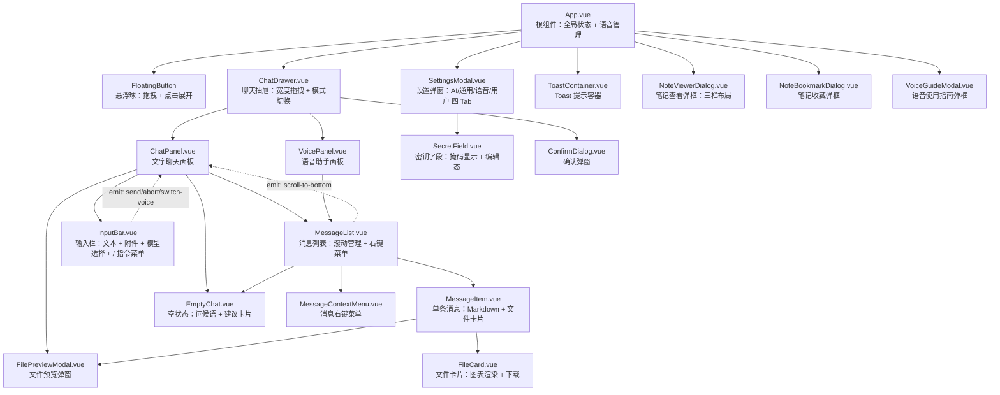
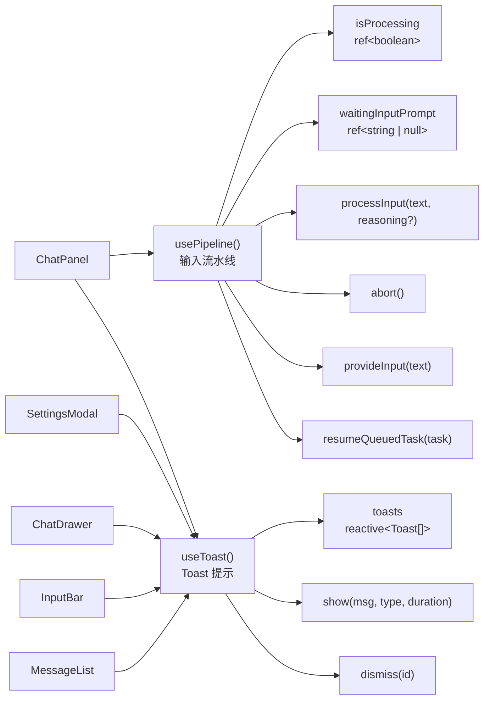
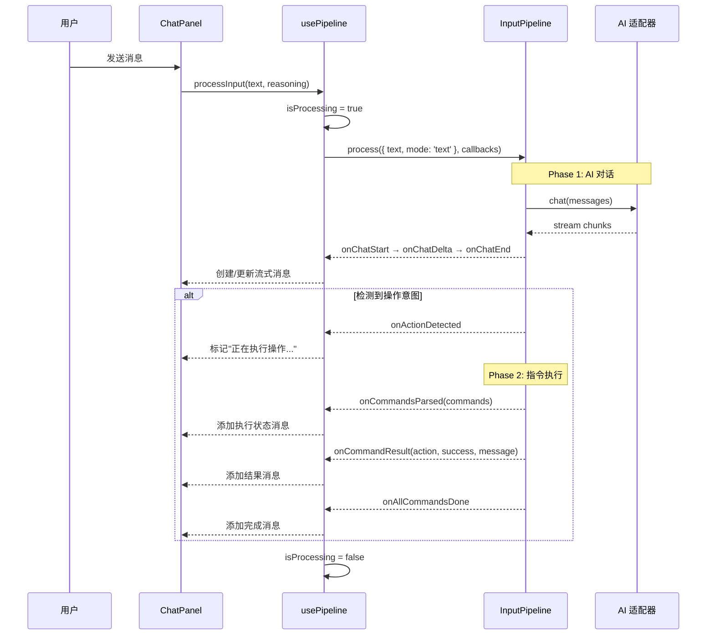
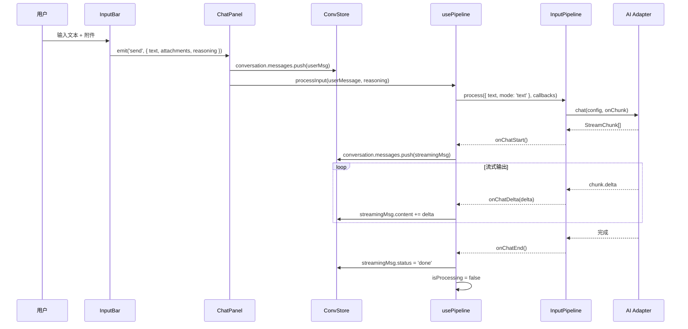
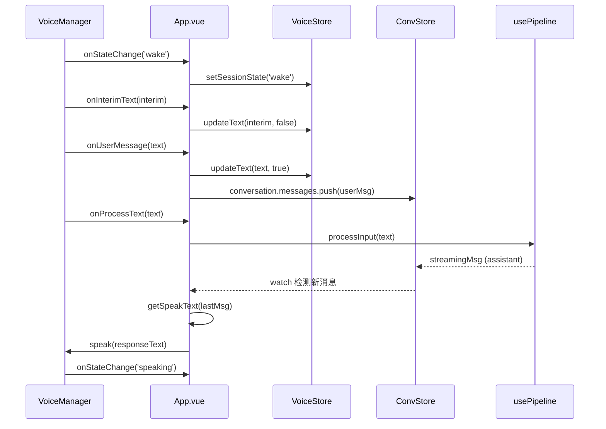
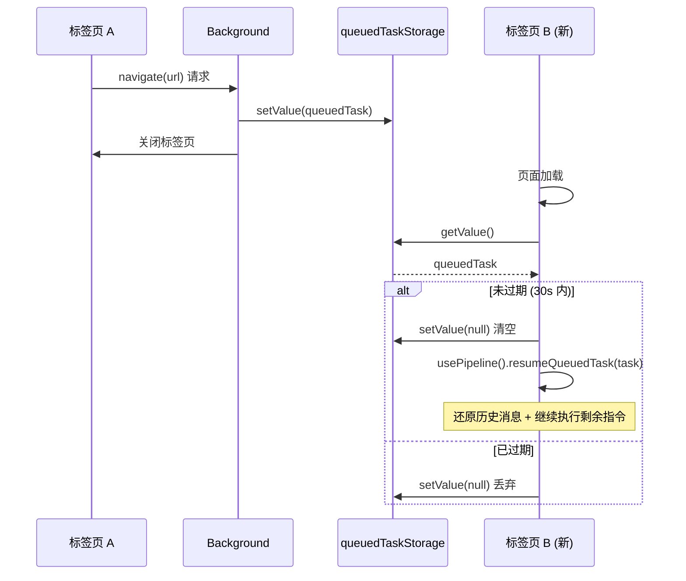
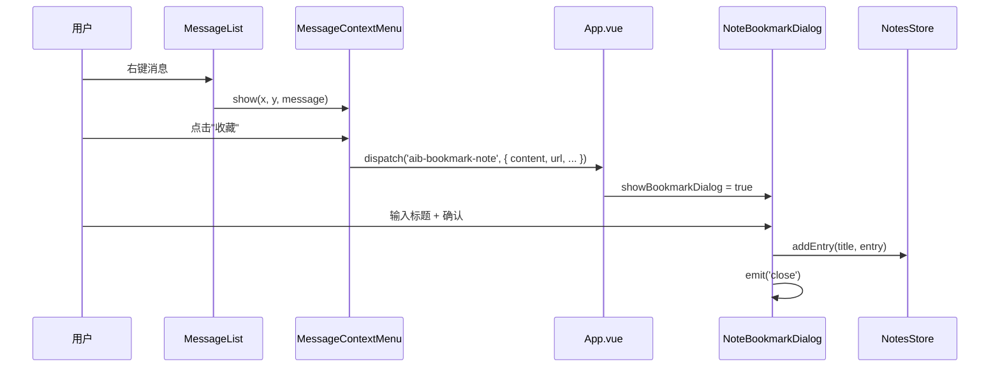
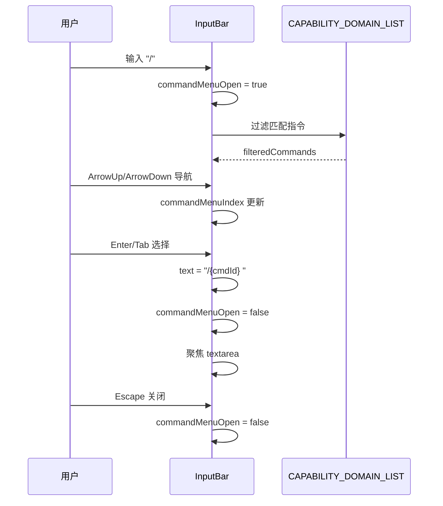
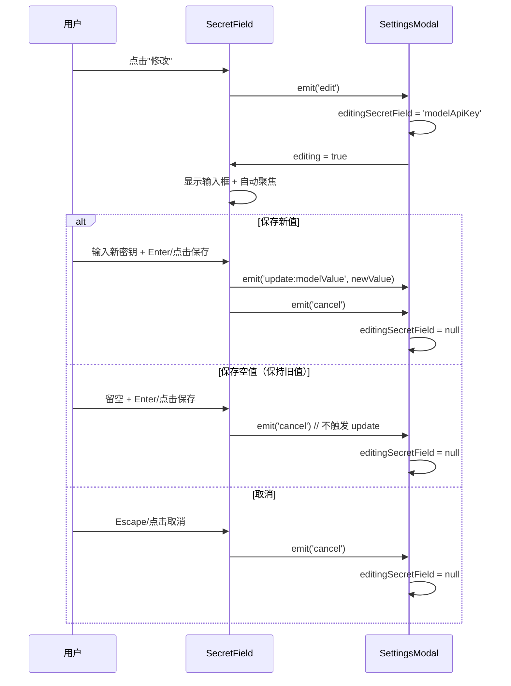

# Content Script 架构文档

> English version: [content-script-en.md](./content-script-en.md)

## 1. 模块概述

Content Script 是扩展注入到每个网页的前端入口，负责在 Shadow DOM 中挂载 Vue 3 应用、监听页面事件（URL 变化、DOM 变化、文本选择）、初始化翻译/笔记功能、管理语音引擎生命周期、以及跨标签页任务续接。它是用户与扩展交互的第一层界面。

**源文件**:
- 入口: `entrypoints/content/index.ts`
- 根组件: `entrypoints/content/App.vue`
- Composables: `src/composables/usePipeline.ts`, `src/composables/useToast.ts`
- 组件目录: `entrypoints/content/components/`

### Shadow DOM 隔离

通过 WXT 的 `createShadowRootUi` API 创建 Shadow DOM 容器：

- **样式隔离**: `global.css` 通过 `?inline` 导入为字符串，在 `onMount` 中以 `<style>` 标签注入 shadow root。所有 CSS 类名使用 `aib-` 前缀，避免与宿主页面冲突
- **宿主定位**: shadowHost 设置 `position: fixed; z-index: 2147483647; top: 0; left: 0; width: 0; height: 0`，不占据页面布局，作为绝对定位容器
- **Vue 挂载**: 在 `onMount` 回调中 `createApp(App).use(createPinia()).mount(container)`
- **卸载清理**: `onRemove` 中 unmount Vue 实例、重置翻译状态、隐藏翻译弹窗

### 组件层级

根组件 `App.vue` 持有全局状态（抽屉开关、设置弹框、笔记弹框、语音管理），通过 props/events 向下传递。组件树从 `FloatingButton` 和 `ChatDrawer` 开始，`ChatDrawer` 内部根据 `activeMode` 切换 `ChatPanel` 和 `VoicePanel`。

## 2. 架构设计

### 组件树



### Composables 架构



## 3. 核心类型定义

### 组件 Props / Emits 接口

```typescript
// FloatingButton
// emits: { (e: 'click'): void }

// ChatDrawer
interface ChatDrawerProps {
  open: boolean;
}
// emits: { (e: 'close'): void; (e: 'open-settings'): void }

// ChatPanel
// emits: { (e: 'switch-voice'): void }

// VoicePanel
// emits: { (e: 'switch-chat'): void }

// InputBar
interface InputBarProps {
  conversation: Conversation | null | undefined;
  models: ModelConfig[];
  isProcessing?: boolean;
  waitingInputPrompt?: string | null;
  automationEnabled?: boolean;
}
// emits: {
//   (e: 'send', payload: { text: string; attachments: Attachment[]; reasoning: boolean }): void;
//   (e: 'abort'): void;
//   (e: 'switch-voice'): void;
//   (e: 'preview', attachment: Attachment): void;
// }

// MessageList
interface MessageListProps {
  conversation: Conversation;
}
// emits: { (e: 'scroll-to-bottom'): void }
// expose: { jumpToBottom, stickToBottom, showScrollBottom }

// MessageItem
interface MessageItemProps {
  message: ChatMessage;
}
// emits: { (e: 'context-menu', payload: { message: ChatMessage; x: number; y: number }): void }

// ConfirmDialog
interface ConfirmDialogProps {
  visible: boolean;
  title: string;
  desc?: string;           // 默认 ''
  confirmText?: string;    // 默认 '确认'
  cancelText?: string;     // 默认 '取消'
  variant?: 'danger' | 'primary';  // 默认 'primary'
}
// emits: { (e: 'confirm'): void; (e: 'cancel'): void }

// FileCard
interface FileCardProps {
  attachment?: Attachment;    // 用户上传的文件
  parsedFile?: ParsedFile;    // AI 生成的文件
}
// emits: {
//   (e: 'preview'): void;
//   (e: 'download'): void;
//   (e: 'download-png'): void;
//   (e: 'download-config'): void;
// }

// FilePreviewModal
interface FilePreviewModalProps {
  attachment: Attachment;
}
// emits: { (e: 'close'): void }

// MessageContextMenu
interface MessageContextMenuProps {
  x: number;
  y: number;
}
// emits: { (e: 'copy'): void; (e: 'bookmark'): void; (e: 'delete'): void }

// NoteViewerDialog
// emits: { (e: 'close'): void }

// NoteBookmarkDialog
interface NoteBookmarkDialogProps {
  data: {
    content: string;
    url: string;
    scrollY: number;
    selectedText?: string;
    source: NoteEntry['source'];
  };
}
// emits: { (e: 'close'): void }

// VoiceGuideModal
// emits: { (e: 'close'): void }

// SettingsModal
// emits: { (e: 'close'): void }

// EmptyChat
// emits: { (e: 'pick', text: string): void }

// SecretField
interface SecretFieldProps {
  modelValue: string;     // 当前值（真实密钥）
  editing?: boolean;      // 是否正在编辑（由父组件控制）
  placeholder?: string;   // 输入框占位符
}
// emits: {
//   (e: 'update:modelValue', value: string): void;
//   (e: 'edit'): void;
//   (e: 'cancel'): void;
// }

// ToastContainer — 无 props/emits，直接使用 useToast() composable
```

### usePipeline 返回值

```typescript
interface UsePipelineReturn {
  isProcessing: Ref<boolean>;           // 是否正在处理
  waitingInputPrompt: Ref<string | null>; // AI 等待用户输入时的提示文本
  processInput: (text: string, reasoning?: boolean) => Promise<void>;
  resumeQueuedTask: (task: QueuedTask) => Promise<void>;
  executeCommand: (cmd: Command) => Promise<ActionResult>;
  addSystemMessage: (content: string) => void;
  provideInput: (text: string) => void;  // 用户提供 AI 请求的输入
  abort: () => Promise<void>;            // 中止 pipeline 并等待结束
}
```

### useToast 返回值

```typescript
interface UseToastReturn {
  toasts: Reactive<Toast[]>;
  info: (message: string, duration?: number) => string;
  success: (message: string, duration?: number) => string;
  warning: (message: string, duration?: number) => string;
  error: (message: string, duration?: number) => string;
  dismiss: (id: string) => void;
}
```

## 4. 实现细节

### App.vue — 根组件

App.vue 是整个 Content Script UI 的根组件，承担以下职责：

**1. 语音引擎生命周期管理**

App.vue 持有 `VoiceManager` 实例（`bgManager`），统一管理麦克风的启停：

```typescript
let bgManager: VoiceManager | null = null

function startBgVoice() {
  if (bgManager) return
  bgManager = new VoiceManager({
    engineType: s.engineType,
    // ... 引擎配置
    onStateChange: (state) => voiceStore.setSessionState(state),
    onInterimText: (text) => voiceStore.updateText(text, false),
    onUserMessage: (text) => { /* 推入会话消息 */ },
    onError: (error) => { /* 错误消息推入会话 */ },
  })
  bgManager.onProcessText = async (text) => {
    await pipeline.processInput(text)
  }
  bgManager.start()
}
```

语音启停的触发条件：
- `settingsStore.settings.voiceAlwaysOn` 变化（常驻模式开关）
- `open` 变化（抽屉开关，非常驻模式下随抽屉启停）
- `voiceStore.settingsVersion` 变化（设置变更重建引擎）
- 页面可见性变化（`visibilitychange`、`focus`/`blur`）
- 其他标签页抢走麦克风锁（`chrome.storage.onChanged` 监听 `aib-mic-lock`）

**2. 跨标签页麦克风锁**

同一时刻只有一个标签页持有麦克风，通过 `chrome.storage.local` 的 `aib-mic-lock` 键实现：

```typescript
const MIC_LOCK_KEY = 'aib-mic-lock' as const

function claimMic() {
  chrome.storage.local.set({ [MIC_LOCK_KEY]: myTabId }).catch(() => {})
}

function unclaimMic() {
  chrome.storage.local.get(MIC_LOCK_KEY).then(stored => {
    if (stored[MIC_LOCK_KEY] === myTabId) {
      chrome.storage.local.remove(MIC_LOCK_KEY).catch(() => {})
    }
  }).catch(() => {})
}
```

**3. TTS 播报**

Watch 最后一条 assistant 消息的变化，当消息 `status === 'done'` 且 `bgManager.isActive` 时，提取播报文本（过滤掉命令执行状态消息），调用 `bgManager.speak()`。使用 `spokenMsgIds` Set 防止重复播报（上限 100 条，超过时淘汰前 50 条）。

播报条件通过 `VoiceManager` 的 `getBroadcastCondition` 回调判断：麦克风打开（`bgManager?.isActive`）就播报。

**4. 自动笔记事件桥接**

Content Script 入口（index.ts）通过 `window.dispatchEvent` 发送自定义事件，App.vue 监听并更新会话消息：

| 事件 | 作用 |
|------|------|
| `aib-auto-note-start` | 插入占位消息（`status: 'streaming'`） |
| `aib-auto-note-delta` | 流式更新消息内容 |
| `aib-auto-note-result` | 最终更新（`status: 'done'`） |
| `aib-auto-note-aborted` | 标记为 `status: 'aborted'` |
| `aib-auto-send-command` | 打开抽屉并发送命令（如 `/note`） |
| `aib-bookmark-note` | 打开笔记收藏弹框 |
| `aib-toggle-note-viewer` | 切换笔记查看弹框 |
| `aib-close-drawer` | 关闭聊天抽屉 |
| `aib-mode-changed` | 模式切换（管理麦克风启停） |
| `aib-show-voice-guide` | 显示语音使用指南弹框 |

**5. 主题与国际化**

```typescript
function applyTheme() {
  const theme = getThemeById(settingsStore.settings.theme)
  for (const [key, value] of Object.entries(theme.vars)) {
    host.style.setProperty(key, value)
  }
}
```

监听 `settings.theme` 和 `settings.locale` 变化，实时应用到 shadow host。

**6. 全局事件监听**

App.vue 在 `onMounted` 中注册大量事件监听器，在 `onUnmounted` 中清理：

| 事件 | 来源 | 处理 |
|------|------|------|
| `chrome.runtime.onMessage` | Background | `aib-toggle` 切换抽屉、`aib-drawer-sync` 同步状态、`automation` 执行指令 |
| `keydown` (capture) | 页面 | 快捷键匹配 -> toggle 抽屉 |
| `mouseup` (capture) | 页面 | 选中文本 -> 填入输入框或自动发送 |
| `visibilitychange` | 页面 | 隐藏时暂停引擎，可见时恢复 |
| `focus`/`blur` | window | 焦点变化时启停引擎 |
| `beforeunload` | window | 释放麦克风锁 |

**7. 跨标签页抽屉状态同步**

抽屉展开状态通过 `drawerOpenStorage` 持久化到 `chrome.storage.local`，同时通过 `chrome.runtime.sendMessage` 通知 Background 广播给其他标签页。`aib-drawer-sync` 消息用于接收其他标签页的状态变化，使用 `syncingFromRemote` 标志避免循环同步。

### ChatDrawer.vue — 聊天抽屉

**核心功能**:
- **双模式切换**: `activeMode` 通过 `settingsStore.settings.voiceMode` 管理，自动持久化 + 跨标签页同步。切换时通过 `window.dispatchEvent(new CustomEvent('aib-mode-changed'))` 通知 App.vue 管理麦克风启停
- **宽度拖拽**: 左侧拖拽条支持调整抽屉宽度，范围 `[60px, window.innerWidth * 0.95]`，保存到 `settingsStore.settings.drawerWidth`
- **跨标签页宽度同步**: Watch `settingsStore.settings.drawerWidth` 变化，非拖拽状态下自动更新
- **清除对话**: 通过 `ConfirmDialog` 确认后，先 `abortPipeline()` 中止进行中的请求，再 `store.clearCurrent()` 清除会话
- **笔记入口**: 笔记模式开启时显示笔记按钮，点击 dispatch `aib-toggle-note-viewer` 事件

### ChatPanel.vue — 文字聊天面板

**核心功能**:
- **消息发送**: `onSend` 处理三种场景：
  1. AI 等待用户输入 -> `pipeline.provideInput(text)`
  2. 正常发送 -> 构建用户消息（合并附件内容） -> `pipeline.processInput(userMessage, reasoning)`
- **附件处理**: 附件内容拼接到 `userMessage` 传给 AI，但 `conversation.messages` 中只存用户原文 + `attachments` 元数据
- **深度思考**: `reasoning` 为 true 时添加前缀 `[请按深度思考的方式作答...]`
- **停止操作**: `onAbort` 依次调用 `convStore.abort()`、`pipeline.abort()`、dispatch `aib-stop-auto-note` 事件
- **文件预览**: InputBar 的 `preview` 事件提升到 ChatPanel 级别渲染 `FilePreviewModal`，避免 fixed 定位在滚动容器内失效
- **空状态**: 无消息时展示 `EmptyChat` 组件，建议卡片点击直接发送到 AI

### InputBar.vue — 输入栏

**核心功能**:
- **自动高度**: textarea 高度根据内容自动调整，最大 200px
- **文件附件**: 支持文件选择、粘贴图片/链接。粘贴链接时自动 fetch 内容，图片直接添加为附件，非图片同时上传内容和粘贴链接文本
- **本地文件**: 粘贴 `file:///` 或 Windows 路径（`E:\xxx`）时，通过 Background 代理读取（Content Script 无法直接 fetch `file://`）。`toFetchableUrl()` 统一处理各种 URL 格式
- **OCR**: 图片附件异步触发 OCR，进度通过 `ocrProgressMap` 追踪，显示为覆盖层进度条
- **模型选择**: 下拉菜单切换当前会话的模型
- **/ 指令选择器**: 输入 `/` 时弹出指令菜单，基于 `CAPABILITY_DOMAIN_LIST` 过滤。支持键盘导航（ArrowUp/ArrowDown/Tab/Enter/Escape），选中后自动填入 `/{cmdId} ` 并聚焦输入框。仅在 `automationEnabled` 时启用
- **输入历史**: Up/Down 键导航历史记录，从 `settingsStore.settings.inputHistory` 加载。首次进入历史模式时保存当前草稿，到达末尾时恢复
- **发送/停止按钮**: 流式输出时显示停止按钮（方块图标），否则显示发送按钮（箭头图标）
- **键盘事件隔离**: 普通输入字符 `stopPropagation()`，防止触发页面快捷键（如 GitHub 的 `s`、`/`）

### MessageList.vue — 消息列表

**核心功能**:
- **自动滚动**: `stickToBottom` 标志控制是否贴底，用户上滚超过 30px 阈值时停止自动滚动
- **滚动位置恢复**: 切换会话时从 `conversation.scrollTop` 恢复
- **右键菜单**: 通过 `MessageContextMenu` 提供复制、收藏、删除操作，坐标换算考虑 `.aib-drawer` 的 transform 偏移
- **expose**: 向父组件暴露 `jumpToBottom`、`stickToBottom`、`showScrollBottom`

### MessageItem.vue — 单条消息

**核心功能**:
- **Markdown 渲染**: 使用 `renderMarkdown()` 渲染消息内容，支持代码块、表格、KaTeX 等
- **深度思考**: `reasoningEnabled` 为 true 时显示思考块
- **文件标签解析**: AI 回复中的 `[FILE:xxx]...[/FILE]` 标签解析为 `ParsedFile`，渲染为 `FileCard`
- **图表渲染**: `category === 'chart'` 的文件渲染 ECharts 图表
- **附件展示**: 用户上传的图片和文件附件分别展示
- **流式状态**: `status === 'streaming'` 显示打字动画，`'error'` 显示错误横幅，`'aborted'` 显示停止横幅
- **代码块操作**: 事件委托处理代码块复制按钮和表格下载按钮

### VoicePanel.vue — 语音助手面板

**核心功能**:
- **状态指示**: 根据 `voiceStore.sessionState` 显示不同状态（idle/wake/command/processing/speaking），顶部状态栏显示状态点（带动画脉冲）+ 状态文字 + 临时识别文本
- **波纹动画**: wake 和 command 状态下显示三圈波纹扩散动画
- **消息列表复用**: 复用 `MessageList` 组件展示对话历史
- **空状态**: 无消息时显示麦克风图标 + 唤醒词提示
- **新消息自动滚动**: Watch 消息数量变化，延迟 200ms 滚动到底部
- **底部麦克风指示器**: 圆形麦克风图标，激活时高亮 + 发光阴影

### SettingsModal.vue — 设置弹窗

**四个 Tab**:

1. **AI 配置**: 模型列表管理（新增/编辑/删除/导入/导出）、供应商预设快速填充、API Key 配置（使用 `SecretField` 组件掩码显示）
2. **通用配置**: 主题选择（5 预设网格）、快捷键录制、网页自动化开关（切换需确认弹窗）、划词行为、翻译模式/目标语言、笔记模式
3. **语音配置**: 引擎类型选择（Web Speech/讯飞/百度/腾讯）、AppId/ApiKey/ApiSecret 配置（均使用 `SecretField` 组件）、唤醒词、常驻语音、TTS 播报参数（速率/音量滑块）、行为参数（缓冲超时/空闲超时滑块）
4. **用户配置**: License 激活、上下文消息数、缓存管理（带进度条）、日志下载（仅测试包可见）、语言切换、版本号+链接

**特殊功能**:
- 内嵌使用文档查看器（Markdown 渲染 + 侧边栏 TOC 导航 + 滚动高亮）
- 自动化开关切换需确认弹窗（开启/关闭都需要确认）
- 供应商预设支持 10 家（OpenAI、Anthropic、DeepSeek、MiMo、通义千问、Kimi、智谱清言、文心一言、MiniMax、硅基流动）
- 导入模型时校验 provider 白名单，跳过无效项

### SecretField.vue — 密钥字段组件

**功能概述**: 为密码/密钥字段提供「显示态 + 编辑态」双态切换，避免敏感信息明文暴露。

**显示态**:
- 有值时显示 `••••••••` 掩码文字
- 显示「修改」按钮，点击切换到编辑态

**编辑态**:
- 显示空白输入框（不回填旧值），自动聚焦
- 「保存」按钮：非空值写入新值，空值则保持旧值不变
- 「取消」按钮：清空输入并退回显示态
- 支持 Enter 保存、Escape 取消

**父组件协调**: `editing` prop 由父组件控制（如 `editingSecretField === 'modelApiKey'`），确保同一时刻只有一个密钥字段处于编辑态。切换编辑字段或切换模型/引擎时自动重置。

**样式**: CSS 类名 `aib-secret-field`、`aib-secret-mask`、`aib-secret-input` 定义在 `src/styles/global.css` 中，使用 `aib-btn-outline` 和 `aib-btn-ghost` 按钮变体。

### EmptyChat.vue — 空状态

显示时段问候语（根据小时判断：凌晨/上午/中午/下午/晚上）和四个建议卡片（自动化、语音、翻译、报告），点击建议卡片触发 `pick` 事件发送到 AI。

### ConfirmDialog.vue — 确认弹窗

通用确认弹窗组件，支持 `danger` 和 `primary` 两种变体，通过 `#icon` 插槽自定义图标。

### ToastContainer.vue — Toast 提示

直接使用 `useToast()` composable 的 `toasts` 响应式数组，`transition-group` 实现进出动画。点击可手动关闭。每种类型（info/success/warning/error）有对应的 SVG 图标。

### FileCard.vue — 文件卡片

**两种模式**:
- **用户上传文件**: 显示文件图标、名称、大小，提供预览和下载按钮
- **AI 生成文件**: 同样展示信息，额外支持图表类型（`category === 'chart'`）的 ECharts 渲染、PNG 导出、JSON 配置下载

图表通过 `renderChartToElement()` 渲染，使用 `ResizeObserver` 监听容器宽度变化自动调用 `chart.resize()`。

### FilePreviewModal.vue — 文件预览弹窗

**支持的预览类型**:
- 图片: 直接 `` 展示
- 文本/代码: highlight.js 语法高亮
- 其他文本类型: Markdown 渲染为代码块

**下载策略**（优先级从高到低）:
1. 原始 File 对象（当前会话内存中）
2. 图片 dataUrl（base64 转 Blob）
3. 文本白名单扩展名（json/csv/md/py/js 等）直接下载
4. xlsx: 使用 `xlsx` 库从 content 生成
5. docx: 使用 `docx` 库从 content 生成
6. pdf: 使用 `generatePdfFromMarkdown()` 生成
7. 兜底: 重命名为 `.txt` 下载

### MessageContextMenu.vue — 消息右键菜单

提供三个操作：复制消息内容、收藏为笔记、删除消息。通过 `x/y` props 定位，使用 `.aib-drawer` 的 `getBoundingClientRect()` 换算坐标。

### NoteViewerDialog.vue — 笔记查看弹框

**三栏布局**:
- **左侧**: 笔记标题列表，支持导出单个标题为 `.md`、删除
- **中间**: 选中标题的条目列表，双击进入编辑态（textarea），支持 Ctrl+Enter 保存、Escape 取消
- **右侧**: 时间线视图，显示每个条目的时间和来源 URL，点击 URL 可跳转到原始页面并滚动到保存位置

**导入导出**:
- 导出单个标题为 `.md` 文件（含元数据注释）
- 导出全部为 `.zip`（使用 JSZip）
- 导入 `.zip` 或 `.md` 文件

**笔记跳转**: 通过 URL hash 传递 `aib-scroll`（滚动位置）和 `aib-highlight`（高亮文本），Content Script 入口的 `handleNoteJump()` 负责解析并执行滚动+高亮。

### NoteBookmarkDialog.vue — 笔记收藏弹框

输入笔记标题（支持从已有标题列表自动补全），确认后调用 `notesStore.addEntry()` 保存。保存的数据包括笔记内容、来源 URL、滚动位置、选中文本、来源类型（selection/chat）。

### VoiceGuideModal.vue — 语音使用指南

五个 Tab 的使用指南：快速开始、引擎配置、权限说明、注意事项、常见问题。纯静态内容，无状态管理。

### usePipeline — 输入流水线 Composable

**模块级状态**:
- `isProcessing: ref(false)` — 是否正在处理
- `waitingInputPrompt: ref<string | null>` — AI 等待用户输入时的提示文本
- `_abortFn` — 模块级 abort 引用，供外部（清除会话/缓存）调用

**核心流程** `processInput(text, reasoning?)`:



**回调处理**:
- `onChatStart`: 创建 `reactive<ChatMessage>` 占位消息（`status: 'streaming'`）
- `onChatDelta`: 流式追加 content 和 reasoning
- `onChatEnd`: 设置 `status: 'done'`
- `onActionDetected`: 标记当前消息为"正在执行操作..."并清空引用
- `onCommandsParsed`: 删除 Phase 1 占位消息，添加指令执行状态消息
- `onCommandResult`: 添加单条指令的执行结果
- `onAllCommandsDone`: 添加汇总消息
- `onRetryMessage`: 清理占位消息，添加重试提示
- `onError`: 添加错误消息
- `onNeedInput`: 添加提示消息，返回 Promise 等待用户输入
- `onFileOutput`: 添加文件下载消息（触发 MessageItem 的 `[FILE]` 渲染）
- `onBroadcast`: 通过 `window.dispatchEvent` 触发语音播报

**abort 机制**:
1. 如果正在等待用户输入，reject Promise 让 pipeline 从 await 中退出
2. 调用 `currentAborter.abort()` 中止 HTTP 请求
3. 清除跨标签页排队任务
4. 等待 pipeline 真正结束（超时 3 秒兜底）

### useToast — Toast 提示 Composable

模块级 `reactive<Toast[]>` 数组，所有组件共享同一个 toast 列表。`show()` 方法添加 toast 并设置自动消失定时器，`dismiss()` 方法移除指定 toast。

```typescript
const toasts = reactive<Toast[]>([]);

function show(message: string, type: ToastType = 'info', duration = 3000): string {
  const id = `t${++seed}`;
  toasts.push({ id, message, type });
  if (duration > 0) setTimeout(() => dismiss(id), duration);
  return id;
}
```

### Content Script 入口 (index.ts) — 翻译与笔记

**翻译功能初始化**:

三种翻译模式在入口统一初始化：

1. **划词翻译 (selection)**: `document.addEventListener('mouseup')` 监听，检查 `translateMode === 'selection'`，获取选中文本后并行调用翻译和笔记 AI
2. **点击翻译 (click)**: `initClickTranslate(translateService, getTranslateSettings, getCurrentModelId)` 初始化
3. **自动翻译 (auto)**: 页面加载后首次触发 + `settingsStorage.watch()` 监听模式切换 + URL 变化时重新触发 + `MutationObserver` 监听 DOM 变化

**笔记功能**:

自动笔记通过 `/note` 命令触发，在 pipeline 中统一处理。页面首次加载时自动发送 `/note` 命令。URL 变化时取消正在执行的自动笔记并重置标记。

**笔记跳转**:

```typescript
function handleNoteJump() {
  const hash = location.hash
  // 解析 aib-scroll 和 aib-highlight 参数
  // 查找滚动容器（页面本身 / 子容器）
  // 延迟滚动 + 重试（300ms / 1000ms / 2000ms）
  // 高亮闪烁 2 次后移除
}
```

**跨标签页续接**:

页面加载后检查 `queuedTaskStorage`，任务存在且未过期（30s 内）时，动态导入 `usePipeline` 并调用 `resumeQueuedTask()`。

## 5. 数据流

### 用户发送消息流程



### 语音交互流程



### 跨标签页任务续接流程



### 笔记收藏流程



### / 指令菜单流程



### SecretField 状态切换流程



## 6. 配置与扩展

### 添加新组件

1. 在 `entrypoints/content/components/` 下创建 `NewComponent.vue`
2. 遵循 `<script setup lang="ts">` + 泛型 defineProps/defineEmits 语法
3. CSS 类名必须 `aib-` 前缀
4. 使用 `new Logger('NewComponent')` 记录日志
5. 在需要的父组件中 import 并使用

### 添加新 Composable

1. 在 `src/composables/` 下创建 `useXxx.ts`
2. 如果需要跨组件共享状态，使用模块级 `ref`/`reactive`（参考 `useToast`）
3. 如果状态仅组件内使用，返回函数内声明（参考 `usePipeline` 的局部状态）

### 添加新全局事件

1. 在 `index.ts` 中 `window.dispatchEvent(new CustomEvent('aib-xxx', { detail }))` 发送
2. 在 `App.vue` 的 `onMounted` 中 `window.addEventListener('aib-xxx', handler)` 监听
3. 在 `onUnmounted` 中清理监听器

### CSS 注入模式

`cssInjectionMode: 'ui'` 由 WXT 框架控制，`global.css` 通过 `?inline` 导入后手动注入 shadow root。

### 匹配规则

`matches: ['<all_urls>']` 在所有页面生效。如需限制特定页面，修改此配置。

### SecretField 复用

`SecretField` 组件可直接在任何需要掩码显示密钥的场景复用：

```vue
<SecretField
  :model-value="form.apiKey"
  :editing="editingSecretField === 'myKey'"
  placeholder="sk-..."
  @update:model-value="form.apiKey = $event"
  @edit="editingSecretField = 'myKey'"
  @cancel="editingSecretField = null"
/>
```

父组件需维护一个 `editingSecretField` ref 来协调多个 SecretField 实例的编辑态互斥。

## 7. 已知限制

1. **Shadow DOM 事件穿透**: `mouseup` 事件需要检查 `isInExtensionUI()` 避免扩展内部操作干扰。Chrome 中跨 Shadow 边界的事件 `e.target` 被重定向为 shadow host，需同时检查 `getRootNode()` 和 `shadowRoot`。

2. **SPA 检测不完整**: 仅 monkey-patch `pushState/replaceState` + 监听 `popstate/hashchange`，无法覆盖所有框架的路由机制（如某些框架使用 `location.assign`）。

3. **笔记跳转可靠性**: 滚动容器检测采用启发式算法（查找 `overflow-y: auto/scroll` 且 `scrollHeight > clientHeight` 的元素），在复杂嵌套布局中可能定位不准。重试机制（300ms/1000ms/2000ms）可缓解但无法完全解决。

4. **跨标签页麦克风锁**: 通过 `chrome.storage.local` 实现，依赖 storage 事件的异步通知。极端情况下（两个标签页同时 claim）可能短暂出现双麦克风。

5. **TTS 播报过滤**: `getSpeakText()` 使用前缀匹配过滤命令执行状态消息，如果 AI 回复恰好以这些前缀开头会被误过滤。

6. **文件预览限制**: FilePreviewModal 的文本预览依赖 `attachment.content`，刷新页面后原始 File 对象丢失，只能预览已保存的文本内容。

7. **usePipeline 模块级状态**: `isProcessing`、`waitingInputPrompt` 等状态是模块级 ref，多个组件调用 `usePipeline()` 共享同一状态。这是设计意图，但如果同时存在多个 pipeline 实例会产生冲突。

8. **输入历史存储**: `inputHistoryStorage` 从 `chrome.storage.local` 加载，首次加载时有异步延迟，快速按 Up 键可能触发空历史。

9. **图表渲染**: FileCard 的 ECharts 渲染依赖动态 import，首次渲染有加载延迟。ResizeObserver 在组件卸载时正确清理，但 Shadow DOM 内的尺寸变化可能有边界情况。

10. **设置弹窗体量**: SettingsModal 单文件超过 2400 行（含样式），包含四个 Tab 的全部逻辑。样式使用 scoped CSS，但未提取为独立文件。

11. **SecretField 编辑态互斥**: 同一时刻只有一个 SecretField 可处于编辑态（由父组件 `editingSecretField` ref 控制）。如果父组件未正确管理，可能出现多个字段同时编辑的情况。
