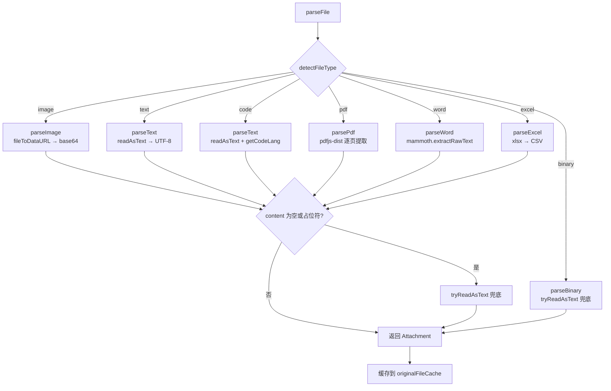
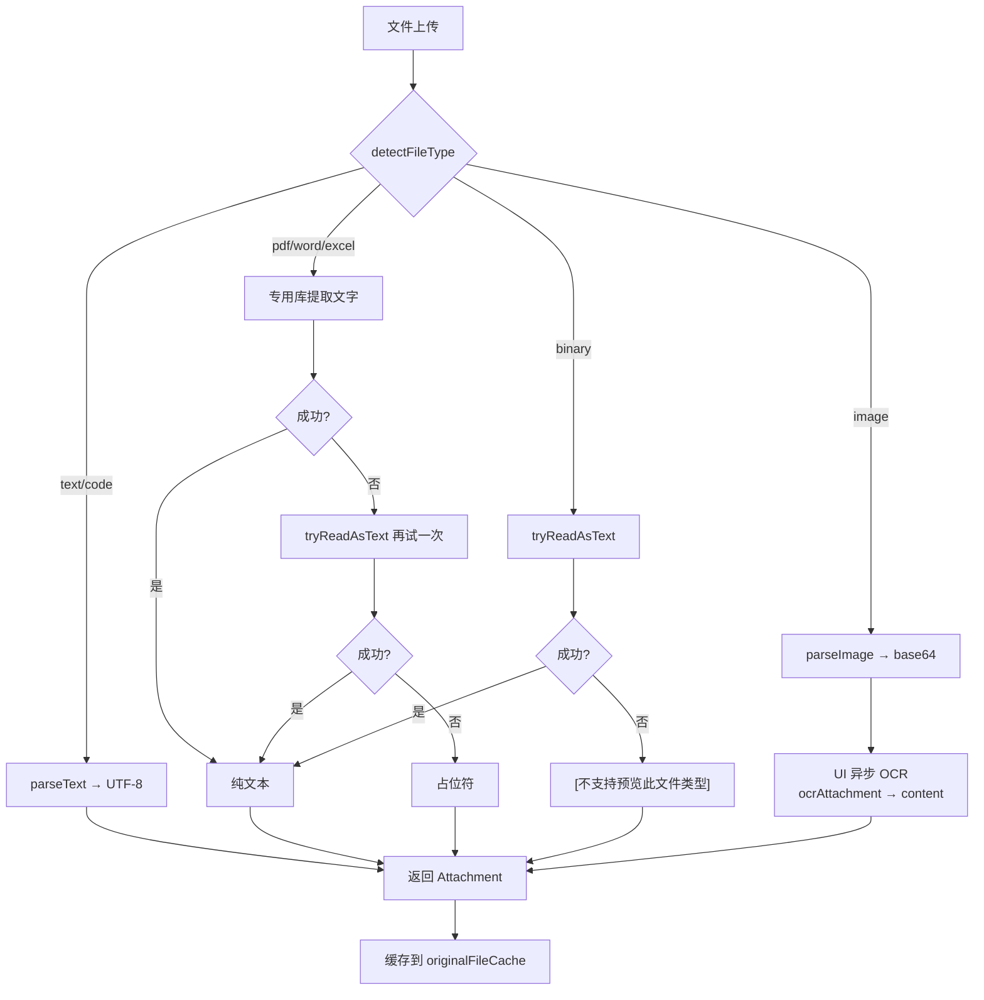

# 文件解析架构

## 概述

文件上传后经过三个阶段：**类型识别 → 按类型解析 → 通用兜底**。所有路径最终都产出纯文本或占位符字符串，不存在真正的"二进制读取"路径。

## 关键文件

| 文件 | 职责 |
|------|------|
| `src/utils/file-type.ts` | 文件类型检测与分类 |
| `src/utils/file-parsers.ts` | 统一解析入口 + 各类型解析器 |
| `src/utils/ocr.ts` | 图片 OCR（Tesseract.js） |
| `src/utils/file.ts` | `fileToDataURL` 工具函数 |
| `src/utils/file-generators.ts` | 文件生成（Excel/PDF/Word/CSV） |
| `src/utils/file-tag-parser.ts` | AI `[FILE]` 标签解析与文件卡片渲染 |
| `src/utils/echart-renderer.ts` | ECharts 图表渲染与导出 |
| `src/types.ts` | `Attachment` / `AttachmentType` 类型定义 |
| `entrypoints/content/components/InputBar.vue` | UI 层：文件选择、粘贴、OCR 触发 |

## 第一步：类型识别

`detectFileType(file)` 按优先级返回 7 种 `AttachmentType`：

```
图片(image) → PDF → Word → Excel → 代码(code) → 文本(text) → 兜底(binary)
```

| 优先级 | 类型 | 判断依据 |
|--------|------|----------|
| 1 | `image` | MIME 以 `image/` 开头 |
| 2 | `pdf` | 扩展名 `pdf` 或 MIME `application/pdf` |
| 3 | `word` | 扩展名 `doc`/`docx` 或对应 MIME |
| 4 | `excel` | 扩展名 `xls`/`xlsx` 或对应 MIME（CSV/TSV 不算 excel） |
| 5 | `code` | 扩展名命中 57 种代码文件映射表（`CODE_EXTENSIONS`） |
| 6 | `text` | 扩展名在 `TEXT_EXTENSIONS` / 文件名匹配 `TEXT_FILENAMES` / MIME `text/*` / 无扩展名无 MIME 的兜底 |
| 7 | `binary` | 以上都不匹配 |

### text 类型的多重兜底

`text` 本身有四层判断，最后一层是真正的兜底：

1. 扩展名匹配（`txt`, `log`, `csv`, `tsv` 等）
2. 无扩展名文件名匹配（`LICENSE`, `README`, `Makefile` 等）
3. MIME 匹配（`text/*`）
4. **无扩展名 + 无 MIME / `application/octet-stream`** → 归为 `text`

`binary` 只捕获"有扩展名但不识别"的文件。

### 代码文件扩展名映射

`CODE_EXTENSIONS` 包含 57+ 种扩展名到语言标识的映射，覆盖：

| 语言族 | 扩展名 |
|--------|--------|
| JavaScript/TypeScript | `js`, `jsx`, `mjs`, `cjs`, `ts`, `tsx`, `mts`, `cts` |
| Web | `html`, `htm`, `css`, `scss`, `sass`, `less`, `vue`, `svelte` |
| Python | `py`, `pyw`, `pyi` |
| Java/Kotlin/Scala | `java`, `kt`, `kts`, `scala` |
| C/C++/C# | `c`, `h`, `cpp`, `cxx`, `cc`, `hpp`, `hxx`, `cs` |
| 系统语言 | `go`, `rs`, `swift`, `dart`, `zig`, `nim` |
| 脚本语言 | `rb`, `php`, `lua`, `r`, `pl`, `pm` |
| Shell | `sh`, `bash`, `zsh`, `fish` |
| 数据/配置 | `json`, `jsonc`, `json5`, `yaml`, `yml`, `toml`, `xml`, `svg`, `ini`, `cfg`, `conf`, `env` |
| 标记语言 | `md`, `mdx`, `tex`, `rst` |
| 其他 | `groovy`, `gradle`, `cmake`, `makefile`, `dockerfile`, `graphql`, `gql`, `prisma`, `hs`, `ex`, `exs`, `erl`, `clj` |

## 第二步：按类型解析

`parseFile(file)` 根据类型分发到专用解析器：



### 各类型解析细节

| 类型 | 解析器 | 库 | 大小限制 | 输出 |
|------|--------|-----|---------|------|
| image | `parseImage` | FileReader | 20 MB | base64 dataUrl，content 为空 |
| text | `parseText` | FileReader | 2 MB（截断到 500KB） | UTF-8 文本 |
| code | `parseText` | FileReader | 2 MB（截断到 500KB） | UTF-8 文本 + lang 标识 |
| pdf | `parsePdf` | pdfjs-dist | 10 MB | 提取的文字，失败返回占位符 |
| word | `parseWord` | mammoth | 10 MB | 提取的文字，失败返回占位符 |
| excel | `parseExcel` | xlsx | 10 MB | CSV 文字，失败返回占位符 |
| binary | `parseBinary` | — | — | tryReadAsText 成功返回 text，失败返回占位符 |

### 大小限制常量

```typescript
const MAX_TEXT_CONTENT_SIZE = 500 * 1024;   // 500KB — 文本内容截断阈值
const MAX_TEXT_FILE_SIZE = 2 * 1024 * 1024;  // 2MB — 文本文件读取上限
const MAX_BINARY_FILE_SIZE = 10 * 1024 * 1024; // 10MB — PDF/Office 文件上限
const MAX_IMAGE_FILE_SIZE = 20 * 1024 * 1024;  // 20MB — 图片文件上限
```

### 图片 OCR

图片解析 (`parseImage`) 只负责转 base64 dataUrl，**不触发 OCR**。

OCR 在 UI 层 (`InputBar.vue`) 通过 `ocrAttachment()` 异步触发，不阻塞附件添加：

- 使用 Tesseract.js，语言包 `chi_sim+eng`（简体中文 + 英文）
- 30 秒超时，失败静默返回空字符串
- 语言包从扩展本地加载：`chrome.runtime.getURL('/tesseract')`
- OCR 结果写入 `attachment.content`，UI 显示进度条

```typescript
async function ocrAttachment(
  attachment: Attachment,
  onProgress?: OcrProgressCallback  // (progress: number) => void, 0~1
): Promise<void>
```

### PDF 解析细节

`parsePdf()` 使用 pdfjs-dist，通过 fake worker 模式在 content script 中运行：

1. 动态导入 `pdfjs-dist`
2. 预导入 `pdfjs-dist/build/pdf.worker.min.mjs` 到 `globalThis.pdfjsWorker`
3. 逐页调用 `page.getTextContent()` 提取文字
4. 页间用 `\n\n` 连接
5. 无可提取文本时返回 `[PDF 无可提取文本（可能是扫描件/图片型 PDF）]`

### Excel 解析细节

`parseExcel()` 处理逻辑：

- CSV/TSV 扩展名 → 直接 `readTextFile()` 读取文本
- 其他 Excel 格式 → `xlsx` 库读取 → `sheet_to_csv()` 转 CSV
- 多工作表时用 `--- SheetName ---` 分隔

## 第三步：通用兜底

### tryReadAsText 函数

所有兜底逻辑的核心：

```
读 UTF-8 → 去掉 null 字节 → 去掉控制字符 → 可打印字符 ≥ 10？
  ├─ 是 → 返回 text/code 附件
  └─ 否 → 返回 null
```

### 触发时机

**时机一**：`parseBinary()` 内部直接调用
```typescript
async function parseBinary(file: File): Promise<Attachment> {
  const textResult = await tryReadAsText(file);
  if (textResult) return textResult;
  return { content: '[不支持预览此文件类型: ...]' };
}
```

**时机二**：`parseFile()` 后处理，仅限非 binary 非 image 类型
```typescript
// 专用解析器失败或内容为空时，尝试按文本读取作为兜底
if (type !== 'binary' && type !== 'image' && (!attachment.content || attachment.content.startsWith('['))) {
  const textFallback = await tryReadAsText(file);
  if (textFallback) attachment = textFallback;
}
```

这意味着：PDF/Word/Excel 解析失败后，还会再尝试当纯文本读一次。

## 原始文件缓存

`originalFileCache` 是一个 `Map<string, File>` 内存缓存，按 `attachment.id` 存储原始 File 引用：

```typescript
const originalFileCache = new Map<string, File>();

function getOriginalFile(attachment: Attachment): File | null;
function removeFromFileCache(attachmentId: string): void;
```

- `parseFile()` 解析完成后自动缓存
- 供预览 modal 下载使用
- 不持久化，页面刷新自动释放

## AI 文件标签系统

### FILE_TAG_REGEX

AI 回复中可嵌入 `[FILE:filename]...[/FILE]` 标签，由 `file-tag-parser.ts` 解析：

```typescript
const FILE_TAG_REGEX = /\[FILE:\s*([^\]]+)\]\r?\n?([\s\S]*?)(?:\[\/FILE\]|$)/gi;
```

兼容各种格式：标准格式、Windows 换行、冒号后有空格、小写标签、无闭合标签。

### parseFileTags()

从 AI 回复文本中提取所有 `[FILE]` 标签，返回 `ParsedFile[]`：

```typescript
interface ParsedFile {
  filename: string;
  content: string;
  extension: string;
  category: FileCategory;    // 'text' | 'data' | 'excel' | 'json' | 'pdf' | 'chart'
  chartConfig?: ChartConfig; // 仅 .chart 文件
  size: number;
  index: number;
}
```

### 文件分类映射

`EXTENSION_CATEGORY` 将扩展名映射到 6 种分类：

| 分类 | 扩展名 |
|------|--------|
| `text` | txt, md, html, css, js, ts, py, java, go, rs, rb, php, c, cpp, cs, sh, sql, yaml, ini, env, log, docx, doc 等 |
| `data` | csv, tsv |
| `excel` | xlsx, xls |
| `json` | json |
| `pdf` | pdf |
| `chart` | chart |

### generateFileCardHtml()

为每种分类生成文件卡片 HTML，图表类型有特殊渲染（预览区 + PNG/JSON 双下载按钮）。

## 文件生成

### file-generators.ts

提供各种格式文件的生成和下载功能：

```typescript
// Excel 生成
function generateXlsx(rows: string[][], sheetName?: string): Blob
function generateXlsxFromCsv(csvContent: string): Blob
function generateXlsxFromContent(content: string): Blob  // 智能解析 TSV/管道符/纯文本
function parseContentToRows(content: string): string[][]

// Word 生成
async function generateDocx(content: string): Promise<Blob>  // docx 库

// PDF 生成
async function generatePdf(content: string): Promise<Blob>           // 纯文本 → HTML → canvas 截图
async function generatePdfFromMarkdown(markdown: string): Promise<Blob>  // Markdown → HTML → canvas 截图

// 下载工具
function triggerDownload(blob: Blob, filename: string): void
function triggerDownloadFromDataUrl(dataUrl: string, filename: string): void
function triggerDownloadFromUrl(url: string, filename: string): void

// 格式化
function formatBytes(bytes: number): string
function formatJson(json: string, indent?: number): string
function isTextExtension(ext: string): boolean
function getMimeType(ext: string): string
```

### PDF 生成流程

`htmlToPdf()` 使用 html2canvas + jsPDF 实现 A4 分页 PDF：

1. 注入 scoped 样式（`.aib-pdf-root` 前缀，不污染主页面）
2. 创建离屏容器（`position: absolute; left: -9999px`）
3. 自动选 scale 确保 canvas 高度不超过 16384px
4. 一次性截完整 canvas
5. 按 A4 高度（1123px @ 96dpi）逐页切分写入 jsPDF

### ECharts 图表渲染

`echart-renderer.ts` 提供动态加载 ECharts 和多格式导出：

```typescript
// 动态加载
async function loadECharts(): Promise<typeof import('echarts')>
function isEChartsLoaded(): boolean
function preloadECharts(): void

// 配置解析
function parseChartConfig(content: string): ChartConfig | null  // 完整格式或简化格式
function validateChartConfig(config: ChartConfig): { valid: boolean; errors: string[] }

// 渲染
async function renderChartToElement(container: HTMLElement, config: ChartConfig): Promise<ChartRenderResult>
async function renderChartToCanvas(config: ChartConfig): Promise<HTMLCanvasElement>  // 离屏 2x 分辨率
async function renderChartToBlob(config: ChartConfig, pixelRatio?: number, backgroundColor?: string): Promise<Blob>
async function renderChartToSvg(config: ChartConfig): Promise<string>

// 配置模板
function createBarChartConfig(title, categories, data, options?): ChartConfig
function createLineChartConfig(title, categories, datasets, options?): ChartConfig
function createPieChartConfig(title, data, options?): ChartConfig  // 支持 doughnut 模式
function createRadarChartConfig(title, indicators, datasets, options?): ChartConfig
```

**ChartConfig 接口**：

```typescript
interface ChartConfig {
  option: EChartsOption;  // ECharts 配置项
  width?: number;         // 默认 800
  height?: number;        // 默认 500
  theme?: string;         // 'light' | 'dark' | 自定义主题名
}
```

**parseChartConfig** 支持两种格式：
1. 完整格式：`{ "option": {...}, "width": 800, "height": 500, "theme": "light" }`
2. 简化格式：直接是 ECharts option 对象（向后兼容，检测 `series`/`xAxis`/`yAxis`/`radar`/`tooltip` 字段）

## 完整流程图



## 发送给 LLM

所有附件最终以文本形式拼接到消息中，不存在二进制传输：

```typescript
// 图片附件
`[图片文字识别: ${name}]\n${ocrText}`

// 其他附件（含占位符）
`[文件: ${name}]\n\`\`\`${lang}\n${content}\n\`\`\``
```

占位符（如 `[不支持预览此文件类型]`）也会发给 AI，因为 `content` 不为空。AI 会收到文件名和类型信息，知道该附件无法解析。
