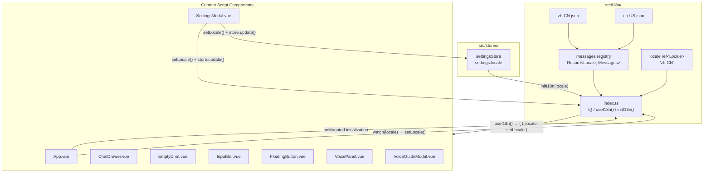
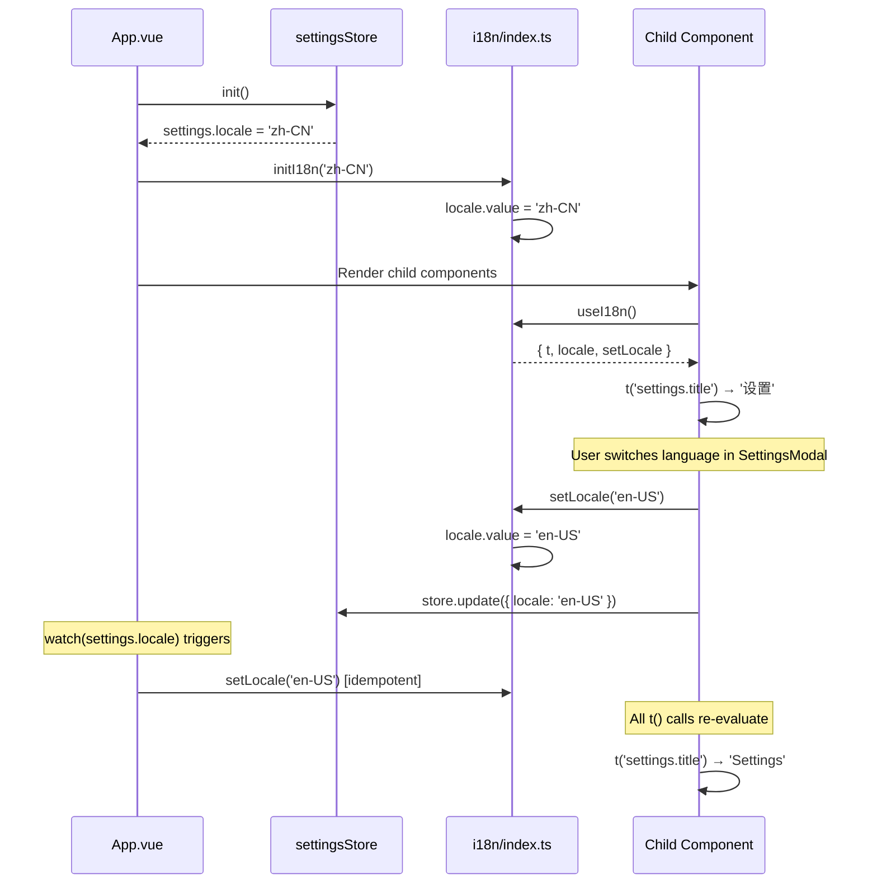
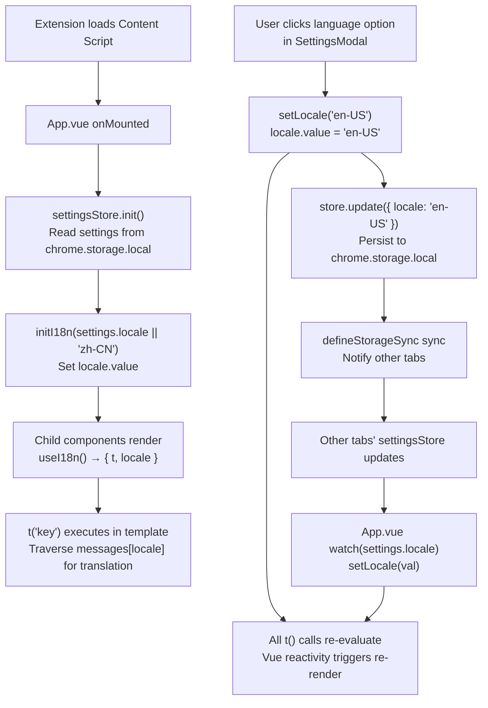

# i18n Internationalization Module

> **🌐 中文版本：[i18n.md](./i18n.md)**

## Module Overview

The internationalization module provides Chinese-English bilingual support for the AI Browser extension, implementing lightweight runtime language switching based on Vue 3's reactivity system. The module uses a **module-level singleton** design — the `locale` state is a top-level `ref`, and all components that call `useI18n()` share the same reactive reference. When the language changes, the entire UI re-renders automatically.

**Core Capabilities**:
- Chinese (`zh-CN`) / English (`en-US`) dual language packs covering approximately 150+ translation keys
- Dot-separated nested key path traversal (e.g., `settings.voice.engineType`)
- `{varName}` variable interpolation (e.g., `{count}`, `{imported}`, `{skipped}`)
- Graceful degradation to the key string itself when a key does not exist, without throwing exceptions
- Integration with `settingsStore`; language preference is persisted via `chrome.storage.local` and synced across tabs

**Position in the Architecture**: The i18n module lives in `src/i18n/` and is consumed by all Vue components in the Content Script layer. It does not depend on any other business module — only on Vue's `ref` and `computed`. Language preference persistence is managed by `settingsStore`; the i18n module itself does not directly interact with storage.

**Dependency Table**:

| Direction | Module | Description |
|-----------|--------|-------------|
| Upstream dependency | `vue` | `ref`, `computed` reactivity primitives |
| Upstream dependency | `src/stores/settings.ts` | Provides initial language value and persistence writes |
| Downstream dependents | All Vue components | Consume `t()`, `locale`, `setLocale` via `useI18n()` |

**Source Locations**:

```
src/i18n/
├── index.ts        # Core logic: t(), useI18n(), initI18n()
├── zh-CN.json      # Chinese language pack (~237 lines)
└── en-US.json      # English language pack (~237 lines)
```

## Architecture Design





## Core Type Definitions

```typescript
/** Supported locale enum */
export type Locale = 'zh-CN' | 'en-US';

/** Messages structure — derived from zh-CN.json, serves as the type baseline for all language packs */
type Messages = typeof zhCN;

/** Message registry: each locale maps to a complete Messages object */
const messages: Record<Locale, Messages> = { 'zh-CN': zhCN, 'en-US': enUS };

/** Return type of useI18n() */
interface UseI18nReturn {
  /** Translation function supporting dot-path traversal and variable interpolation */
  t: (key: string, vars?: Record<string, string | number>) => string;
  /** Current locale (reactive) */
  locale: Ref<Locale>;
  /** Switch locale */
  setLocale: (l: Locale) => void;
}
```

**Type Design Notes**:
- `Messages` is derived directly from `zh-CN.json` via `typeof`, ensuring TypeScript validates the JSON structure at compile time
- `Record<Locale, Messages>` requires each language pack's top-level structure to be consistent with `zhCN` (compile-time check)
- The `key` parameter of `t()` is typed as `string`, with path traversal performed at runtime; if a key does not exist, the key itself is returned as a fallback
- The `vars` parameter is an optional `Record<string, string | number>`, supporting interpolation variables with arbitrary names

## Implementation Details

### Translation Function t()

```typescript
function t(key: string, vars?: Record<string, string | number>): string {
  const keys = key.split('.');
  let value: unknown = messages[locale.value];
  for (const k of keys) {
    if (value && typeof value === 'object' && k in value) {
      value = (value as Record<string, unknown>)[k];
    } else {
      return key; // Return key itself when not found
    }
  }
  if (typeof value !== 'string') return key;
  if (!vars) return value;
  return value.replace(/\{(\w+)\}/g, (_, name) => String(vars[name] ?? ''));
}
```

**Execution Flow**:

1. **Path Splitting**: `'settings.voice.engineType'` → `['settings', 'voice', 'engineType']`
2. **Nested Traversal**: Starting from `messages[locale.value]`, access child objects level by level
3. **Missing Key Fallback**: If at any level `k in value` is `false`, immediately return the original key string
4. **Type Check**: If the final value is not a `string` (e.g., an intermediate object was reached), return the key
5. **Variable Interpolation**: Uses the regex `/\{(\w+)\}/g` to match `{varName}` placeholders, replacing them with `vars[name]`; missing variables are replaced with an empty string

**Usage Examples**:

```typescript
// Basic translation
t('settings.title')              // → '设置' (zh-CN) / 'Settings' (en-US)

// Nested key path
t('settings.voice.engineType')   // → '识别引擎' / 'Engine'

// Variable interpolation
t('settings.ai.exportSuccess', { count: 3 })
// → '已导出 3 个模型配置' / 'Exported 3 model(s)'

// Multi-variable interpolation
t('settings.ai.importPartial', { imported: 5, skipped: 2 })
// → '已导入 5 个，跳过 2 个无效项' / 'Imported 5, skipped 2 invalid'

// Graceful degradation when key is missing
t('nonexistent.key')             // → 'nonexistent.key'
```

### Reactive Locale State

```typescript
/** Module-level singleton — all components share the same ref */
const locale = ref<Locale>('zh-CN');

/** Called by App.vue onMounted to read the persisted value from settingsStore */
export function initI18n(initialLocale: Locale) {
  locale.value = initialLocale;
}
```

`locale` is a module-scoped top-level variable, not created inside any function. Vue's `ref` mechanism ensures that when `locale.value` changes, all components that read `locale` in their templates or `computed` properties automatically trigger a re-render.

**Initialization Sequence**:

1. In `App.vue`'s `onMounted`, first `await settingsStore.init()` to read persisted settings from `chrome.storage.local`
2. Then call `initI18n(settingsStore.settings.locale || 'zh-CN')` to set the initial language
3. If the user has never set a language, the `locale` field is `undefined`, falling back to `'zh-CN'`

### useI18n() Composable

```typescript
export function useI18n() {
  return {
    t,
    locale,
    setLocale: (l: Locale) => { locale.value = l; },
  };
}
```

The returned `t`, `locale`, and `setLocale` are all module-level singleton references. Every component that calls `useI18n()` shares the same `locale` ref and the same `t` function instance. `setLocale` directly modifies `locale.value`, triggering Vue's reactive updates.

### Integration with settingsStore

Language switching involves two paths, both triggered in `SettingsModal.vue`:

```typescript
// Language switching in SettingsModal.vue
@click="setLocale('zh-CN'); store.update({ locale: 'zh-CN' })"
@click="setLocale('en-US'); store.update({ locale: 'en-US' })"
```

1. **Immediate Effect**: `setLocale('en-US')` directly modifies `locale.value`, causing all components to re-render immediately
2. **Persistence**: `store.update({ locale: 'en-US' })` writes to `settingsStore`, which is synced to `chrome.storage.local` by `defineStorageSync`

`App.vue` also includes a `watch` as a safety net:

```typescript
watch(
  () => settingsStore.settings.locale,
  (val) => { if (val) setLocale(val as 'zh-CN' | 'en-US'); }
);
```

This watch primarily handles cross-tab scenarios — when another tab modifies `settings.locale` via `storage-sync`, the current tab's `settingsStore` updates, and the watch triggers `setLocale()` to stay in sync.

### Language Pack Structure

Both language packs have identical structures (enforced at compile time by the `Messages` type), containing approximately 150+ keys organized by functional module:

| Top-Level Key | Coverage | Example Keys |
|---------------|----------|--------------|
| `app` | App name, subtitle | `app.name`, `app.subtitle` |
| `fab` | Floating button tooltip | `fab.tooltip` |
| `emptyChat` | Empty chat page greetings, suggestion tags | `emptyChat.greeting.morning`, `emptyChat.suggestions.automation.title` |
| `drawer` | Chat drawer actions | `drawer.clear`, `drawer.clearConfirm.title` |
| `settings` | Settings panel (4 sub-tabs) | `settings.tabs.ai`, `settings.voice.engineType`, `settings.general.theme` |
| `inputBar` | Input bar | `inputBar.placeholder`, `inputBar.send` |
| `voice` | Voice panel status | `voice.listening`, `voice.processing` |
| `pipeline` | Pipeline execution status | `pipeline.processing`, `pipeline.maxRetries` |
| `common` | Common action words | `common.confirm`, `common.cancel`, `common.save` |

`settings` is the largest branch, containing `voice`, `ai`, `general`, and `user` sub-modules, each with 20-40 keys.

## Data Flow



**Single-Tab Flow**:
1. A component calls `t('settings.title')`
2. `t()` reads the current `locale.value` (reactive dependency collection)
3. Traverses `messages[locale.value]` using the dot-separated path to retrieve the value
4. Returns the translated string; Vue renders it to the DOM

**Language Switching Flow**:
1. User clicks a language option in SettingsModal
2. `setLocale()` modifies `locale.value` → triggers reactive updates for all `t()` calls
3. `store.update()` writes to persistent storage
4. `defineStorageSync` writes to `chrome.storage.local` after a 200ms debounce
5. Other tabs detect the change via `chrome.storage.onChanged`
6. Each tab's `settingsStore` updates → `App.vue`'s watch triggers `setLocale()`

## Configuration and Extension

### Adding a New Language

Using Japanese (`ja-JP`) as an example:

**Step 1**: Create a language pack file `src/i18n/ja-JP.json` with a structure identical to `zh-CN.json`:

```json
{
  "app": {
    "name": "リンボット",
    "fullName": "LingBot",
    "subtitle": "AI ボイスブラウザアシスタント"
  }
  // ... all keys
}
```

**Step 2**: Register in `src/i18n/index.ts`:

```typescript
import jaJP from './ja-JP.json';

// Extend the Locale type
export type Locale = 'zh-CN' | 'en-US' | 'ja-JP';

// Register in the message table
const messages: Record<Locale, Messages> = {
  'zh-CN': zhCN,
  'en-US': enUS,
  'ja-JP': jaJP,
};
```

**Step 3**: Add a Japanese option card to the language selection area in `SettingsModal.vue`.

**Step 4**: Add the Japanese display name (e.g., `settings.user.langJa`) in both `zh-CN.json` and `en-US.json`.

### Adding Translation Keys

Add keys with the same path in **both** `zh-CN.json` and `en-US.json` simultaneously:

```jsonc
// zh-CN.json
{
  "settings": {
    "ai": {
      "newFeature": "新功能提示"    // newly added
    }
  }
}

// en-US.json
{
  "settings": {
    "ai": {
      "newFeature": "New feature hint"    // newly added
    }
  }
}
```

Then use `t('settings.ai.newFeature')` in components.

**Important Notes**:
- Both language packs must keep their key structures in sync; otherwise missing keys will degrade to the key string at runtime
- The `Messages` type is derived from `zh-CN.json`; adding new keys to `zh-CN.json` will cause TypeScript to automatically extend the type
- If a key is added only in `en-US.json` but not in `zh-CN.json`, it will always return the key string in Chinese mode

### Variable Interpolation Format

Interpolation variables use the `{varName}` syntax, where `varName` only allows letters, digits, and underscores (regex `\w+`):

```json
{
  "ai": {
    "exportSuccess": "Exported {count} model configuration(s)",
    "importPartial": "Imported {imported}, skipped {skipped} invalid"
  }
}
```

```typescript
t('settings.ai.exportSuccess', { count: 3 })      // → 'Exported 3 model configuration(s)'
t('settings.ai.importPartial', { imported: 5, skipped: 2 })  // → 'Imported 5, skipped 2 invalid'
```

Missing variables are replaced with an empty string and do not cause errors.

## Known Limitations

1. **No Fallback Language**: When a key does not exist in the current language pack, the key string itself is returned directly — there is no fallback to `zh-CN`. For example, if the English pack is missing a key, English mode will display `"settings.xxx.missingKey"` instead of the Chinese translation.

2. **One-Way Type Safety**: The `Messages` type is derived from `zh-CN.json`. TypeScript can validate the structural consistency of `zh-CN.json`, but it will not check whether `en-US.json` is missing a key. Language pack synchronization relies on manual verification.

3. **No Key Path Autocomplete**: The parameter to `t()` is typed as `string`, so IDEs cannot provide autocomplete or spell-checking for key paths. If type-safe key paths are needed, consider using generic constraints or generating type declaration files.

4. **No Pluralization Rules**: Pluralization is not supported (e.g., English `1 item` vs `2 items`). Interpolation variables only perform simple string replacement.

5. **No Date/Number Formatting**: No `Intl.NumberFormat` / `Intl.DateTimeFormat` wrappers are provided. For example, in `Exported {count} model(s)`, the `count` is converted directly to a string without thousand-separator formatting.

6. **No Lazy Loading**: Both language packs are fully loaded into memory at module import time (each approximately 237 lines of JSON). At the current scale, the impact on extension memory is negligible, but if the language packs grow significantly or many new languages are added, dynamic `import()` on-demand loading could be considered.

7. **No Module-Level State Isolation**: `locale` is a module-level `ref`, globally shared within the same Content Script instance. This is not a problem in Chrome extension Content Scripts (each tab has an independent JS context), but in SSR scenarios it would cause state sharing across requests.

8. **Emoji Not Internationalized**: Some translation values contain emoji (e.g., `drawer.voiceTitle: "🎤 Voice Assistant"`). Emoji strings are hardcoded in JSON alongside their language and are not part of the dynamically interpolatable content.
