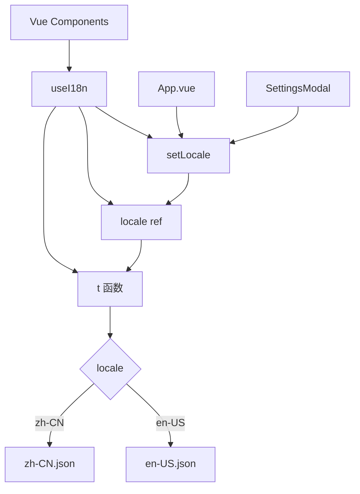
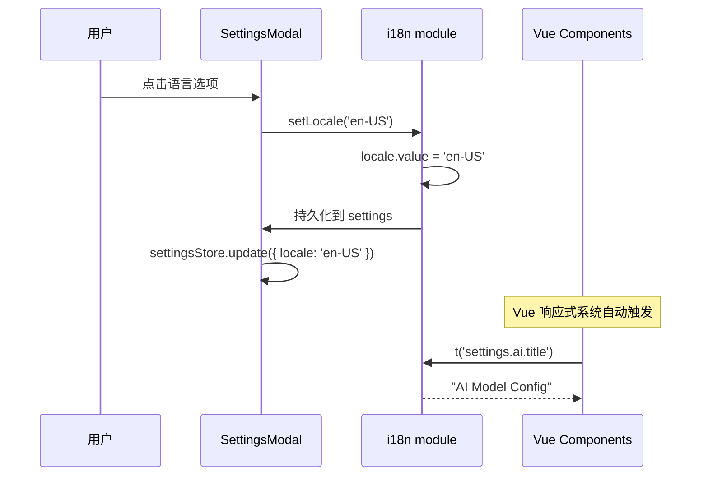

# 国际化模块

## 1. 模块概述

国际化模块提供轻量级的多语言支持，基于 Vue 响应式系统实现。当前支持 `zh-CN`（简体中文）和 `en-US`（英文）两种语言。

**职责：**
- 提供翻译函数 `t(key, vars)` 支持点号路径查找和变量插值
- 响应式语言切换（无需刷新页面）
- 提供 `useI18n()` 组合式函数供 Vue 组件使用

**源文件：**
- `src/i18n/index.ts` — 核心逻辑
- `src/i18n/zh-CN.json` — 中文语言包
- `src/i18n/en-US.json` — 英文语言包

**依赖：**
- `vue`（ref, computed）

---

## 2. 架构设计



**设计模式：**
- **组合式函数** — `useI18n()` 返回响应式状态和方法
- **点号路径查找** — 支持 `settings.ai.title` 形式的深层访问
- **优雅降级** — 缺失的 key 返回 key 本身，不抛出错误

**为什么这样设计：**
- 轻量级：不引入 vue-i18n 等第三方库，减少打包体积
- 响应式：利用 Vue 的 `ref` 和 `computed` 实现语言切换自动更新
- 简单：JSON 文件即语言包，易于维护

---

## 3. 核心类型定义

```typescript
type Locale = 'zh-CN' | 'en-US'

// Messages 类型从 zh-CN.json 推导
type Messages = typeof zhCN

// useI18n 返回值
interface I18nContext {
  t: (key: string, vars?: Record<string, string | number>) => string
  locale: Ref<Locale>
  setLocale: (locale: Locale) => void
}
```

---

## 4. 实现细节

### 4.1 initI18n(initialLocale)

```typescript
function initI18n(initialLocale: Locale): void
```

初始化语言设置，创建响应式 `locale` ref。

### 4.2 t(key, vars)

```typescript
function t(key: string, vars?: Record<string, string | number>): string
```

**算法：**
1. 按 `.` 分割 key（如 `settings.ai.title` → `['settings', 'ai', 'title']`）
2. 从当前语言包的根对象开始，逐层访问
3. 如果路径无效，返回原始 key 字符串（优雅降级）
4. 如果有 `vars`，使用正则 `/\{(\w+)\}/g` 替换 `{name}` 为对应值
5. 缺失的变量替换为空字符串

**示例：**
```typescript
t('settings.ai.title')                    // → "模型配置"
t('settings.ai.title')                    // → "AI Model Config" (en-US)
t('common.greeting', { name: '张三' })    // → "你好，张三"
t('not.exist.key')                        // → "not.exist.key" (降级)
```

### 4.3 useI18n()

```typescript
function useI18n(): I18nContext
```

组合式函数，返回：
- `t` — 翻译函数
- `locale` — 响应式语言引用
- `setLocale` — 语言切换函数

### 4.4 语言切换流程



---

## 5. 语言包结构

语言包为嵌套 JSON 对象，约 100+ 个 key：

```json
{
  "app": {
    "name": "LingBot Browser",
    "fullName": "小灵 LingBot Browser",
    "subtitle": "AI 语音浏览器助手"
  },
  "fab": {
    "tooltip": "AI 语音助手"
  },
  "emptyChat": {
    "greeting": {
      "night": "夜深了",
      "morning": "早上好",
      "noon": "中午好",
      "afternoon": "下午好",
      "evening": "晚上好"
    },
    "prompt": "，今天聊点什么？",
    "tags": "语音对话 · 网页自动化 · 智能翻译",
    "suggestions": {
      "automation": { "title": "网页操作", "desc": "滚动到页面底部" },
      "voice": { "title": "语音助手", "desc": "帮我打开百度" },
      "translate": { "title": "智能翻译", "desc": "翻译这个页面" },
      "report": { "title": "报告生成", "desc": "生成一份报告" }
    }
  },
  "drawer": {
    "clear": "清除对话",
    "settings": "设置",
    "close": "关闭",
    "backToChat": "返回文字模式",
    "voiceTitle": "🎤 语音助手",
    "cleared": "对话已清除"
  },
  "settings": {
    "title": "设置",
    "tabs": { "ai": "模型配置", "general": "通用配置", "user": "用户配置" },
    "ai": { ... },
    "general": { ... },
    "user": { ... }
  },
  "inputBar": { ... },
  "voice": { ... },
  "pipeline": { ... },
  "common": { ... }
}
```

---

## 6. 配置与扩展

### 添加新语言

1. 创建 `src/i18n/{locale}.json` 文件
2. 在 `index.ts` 的 `Locale` 类型中添加新值
3. 在 `messages` 对象中添加新语言包的引用
4. 在设置页的语言选择器中添加新选项

### 添加新翻译 key

1. 在 `zh-CN.json` 中添加 key
2. 在 `en-US.json` 中添加对应的翻译
3. 在代码中使用 `t('new.key')` 引用

---

## 7. 已知限制

1. **仅两种语言** — 当前只支持中文和英文
2. **无复数形式** — 不支持 `count > 1 ? 'items' : 'item'` 的复数规则
3. **无日期/数字格式化** — 日期和数字不根据语言自动格式化
4. **JSON 文件全量加载** — 两种语言包都会被打包，不支持按需加载
5. **无服务端翻译** — 翻译内容硬编码在 JSON 文件中
6. **key 缺失无警告** — 开发时缺失的 key 只返回 key 本身，不会在控制台报错
