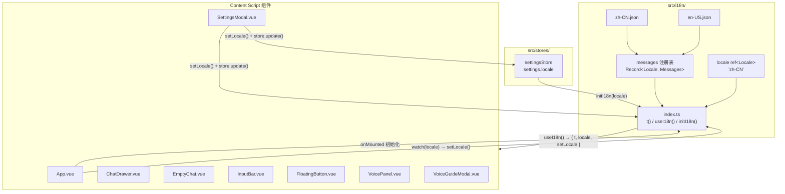
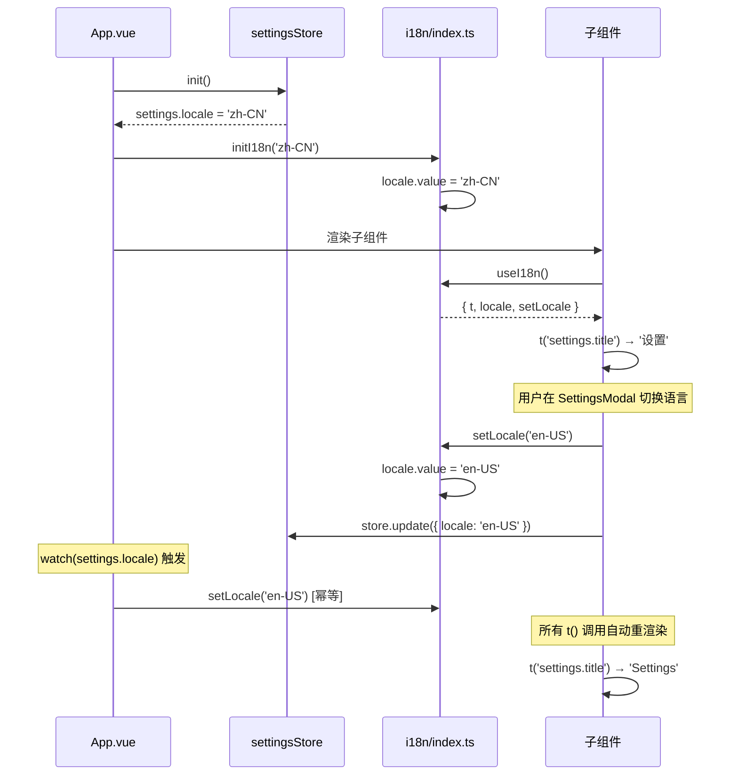
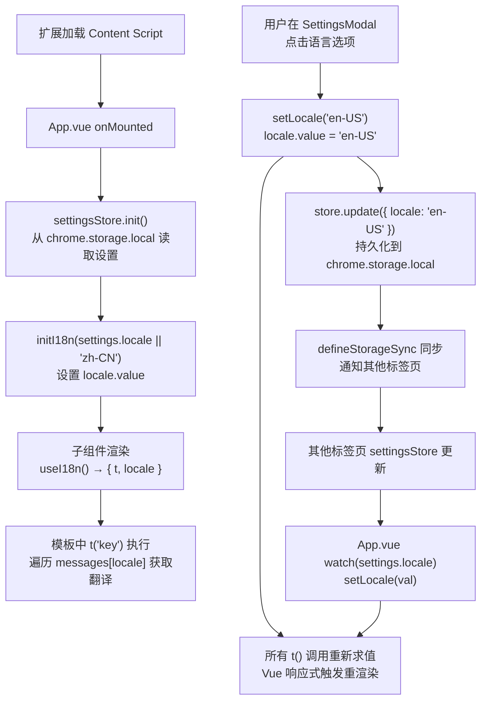

# i18n 国际化模块

## 模块概述

国际化模块为 AI Browser 扩展提供中英文双语支持，基于 Vue 3 响应式系统实现轻量级运行时语言切换。模块采用**模块级单例**设计——`locale` 状态是一个顶层 `ref`，所有通过 `useI18n()` 获取的组件共享同一响应式引用，切换语言时全量 UI 自动重渲染。

**核心能力**：
- 中文（`zh-CN`）/ 英文（`en-US`）双语言包，覆盖约 150+ 个翻译键
- 点号分隔的嵌套键路径遍历（如 `settings.voice.engineType`）
- `{varName}` 变量插值（如 `{count}`、`{imported}`、`{skipped}`）
- 键不存在时优雅降级为返回 key 字符串本身，不抛出异常
- 与 `settingsStore` 联动，语言偏好通过 `chrome.storage.local` 持久化并跨标签页同步

**在架构中的位置**：i18n 模块位于 `src/i18n/`，被 Content Script 层的所有 Vue 组件消费。它不依赖任何其他业务模块，仅依赖 Vue 的 `ref` 和 `computed`。语言偏好由 `settingsStore` 管理持久化，i18n 模块本身不直接操作存储。

**依赖关系**：

| 方向 | 模块 | 说明 |
|------|------|------|
| 上游依赖 | `vue` | `ref`、`computed` 响应式原语 |
| 上游依赖 | `src/stores/settings.ts` | 提供初始语言值和持久化写入 |
| 下游被依赖 | 所有 Vue 组件 | 通过 `useI18n()` 消费 `t()`、`locale`、`setLocale` |

**源码位置**：

```
src/i18n/
├── index.ts        # 核心逻辑：t()、useI18n()、initI18n()
├── zh-CN.json      # 中文语言包（约 237 行）
└── en-US.json      # 英文语言包（约 237 行）
```

## 架构设计





## 核心类型定义

```typescript
/** 支持的语言枚举 */
export type Locale = 'zh-CN' | 'en-US';

/** 消息结构——从 zh-CN.json 推导，作为所有语言包的类型基准 */
type Messages = typeof zhCN;

/** 消息注册表：每种语言对应一份完整的 Messages */
const messages: Record<Locale, Messages> = { 'zh-CN': zhCN, 'en-US': enUS };

/** useI18n() 返回值类型 */
interface UseI18nReturn {
  /** 翻译函数，支持点号路径和变量插值 */
  t: (key: string, vars?: Record<string, string | number>) => string;
  /** 当前语言（响应式） */
  locale: Ref<Locale>;
  /** 切换语言 */
  setLocale: (l: Locale) => void;
}
```

**类型设计要点**：
- `Messages` 直接从 `zh-CN.json` 的 `typeof` 推导，确保 TypeScript 编译期对 JSON 结构进行校验
- `Record<Locale, Messages>` 要求每种语言包的顶层结构与 `zhCN` 一致（编译期检查）
- `t()` 的 `key` 参数为 `string` 类型，运行时做路径遍历；键不存在时返回 key 本身作为降级
- `vars` 参数为可选的 `Record<string, string | number>`，支持任意名称的插值变量

## 实现细节

### 翻译函数 t()

```typescript
function t(key: string, vars?: Record<string, string | number>): string {
  const keys = key.split('.');
  let value: unknown = messages[locale.value];
  for (const k of keys) {
    if (value && typeof value === 'object' && k in value) {
      value = (value as Record<string, unknown>)[k];
    } else {
      return key; // 键不存在时返回 key 本身
    }
  }
  if (typeof value !== 'string') return key;
  if (!vars) return value;
  return value.replace(/\{(\w+)\}/g, (_, name) => String(vars[name] ?? ''));
}
```

**执行流程**：

1. **路径拆分**：`'settings.voice.engineType'` → `['settings', 'voice', 'engineType']`
2. **嵌套遍历**：从 `messages[locale.value]` 开始，逐级访问子对象
3. **不存在降级**：任何一级 `k in value` 为 `false` 时，立即返回原始 key 字符串
4. **类型校验**：最终值不是 `string` 时（如访问到中间对象），返回 key
5. **变量插值**：使用正则 `/\{(\w+)\}/g` 匹配 `{varName}` 占位符，替换为 `vars[name]`，缺失变量替换为空字符串

**使用示例**：

```typescript
// 基础翻译
t('settings.title')              // → '设置' (zh-CN) / 'Settings' (en-US)

// 嵌套键路径
t('settings.voice.engineType')   // → '识别引擎' / 'Engine'

// 变量插值
t('settings.ai.exportSuccess', { count: 3 })
// → '已导出 3 个模型配置' / 'Exported 3 model(s)'

// 多变量插值
t('settings.ai.importPartial', { imported: 5, skipped: 2 })
// → '已导入 5 个，跳过 2 个无效项' / 'Imported 5, skipped 2 invalid'

// 键不存在时降级
t('nonexistent.key')             // → 'nonexistent.key'
```

### 响应式语言状态

```typescript
/** 模块级单例——所有组件共享同一个 ref */
const locale = ref<Locale>('zh-CN');

/** 由 App.vue onMounted 调用，从 settingsStore 读取持久化值 */
export function initI18n(initialLocale: Locale) {
  locale.value = initialLocale;
}
```

`locale` 是模块作用域的顶层变量，不在任何函数内部创建。Vue 的 `ref` 机制保证当 `locale.value` 变化时，所有在模板或 `computed` 中读取 `locale` 的组件自动触发重渲染。

**初始化时序**：

1. `App.vue` 的 `onMounted` 中先 `await settingsStore.init()` 从 `chrome.storage.local` 读取持久化设置
2. 然后调用 `initI18n(settingsStore.settings.locale || 'zh-CN')` 设置初始语言
3. 如果用户从未设置过语言，`locale` 字段为 `undefined`，回退到 `'zh-CN'`

### useI18n() Composable

```typescript
export function useI18n() {
  return {
    t,
    locale,
    setLocale: (l: Locale) => { locale.value = l; },
  };
}
```

返回的 `t`、`locale`、`setLocale` 均为模块级单例引用。所有调用 `useI18n()` 的组件共享同一个 `locale` ref 和同一个 `t` 函数实例。`setLocale` 直接修改 `locale.value`，触发 Vue 响应式更新。

### 与 settingsStore 的联动

语言切换涉及两条路径，均在 `SettingsModal.vue` 中触发：

```typescript
// SettingsModal.vue 中的语言切换
@click="setLocale('zh-CN'); store.update({ locale: 'zh-CN' })"
@click="setLocale('en-US'); store.update({ locale: 'en-US' })"
```

1. **即时生效**：`setLocale('en-US')` 直接修改 `locale.value`，所有组件立即重渲染
2. **持久化**：`store.update({ locale: 'en-US' })` 写入 `settingsStore`，由 `defineStorageSync` 同步到 `chrome.storage.local`

`App.vue` 中还有一个 `watch` 作为兜底：

```typescript
watch(
  () => settingsStore.settings.locale,
  (val) => { if (val) setLocale(val as 'zh-CN' | 'en-US'); }
);
```

这个 watch 主要处理跨标签页场景——当另一个标签页通过 `storage-sync` 修改了 `settings.locale`，本标签页的 `settingsStore` 会更新，watch 触发 `setLocale()` 保持同步。

### 语言包结构

两个语言包结构完全一致（编译期由 `Messages` 类型约束），共约 150+ 个键，按功能模块组织：

| 顶层键 | 覆盖内容 | 示例键 |
|--------|---------|--------|
| `app` | 应用名称、副标题 | `app.name`、`app.subtitle` |
| `fab` | 悬浮按钮提示 | `fab.tooltip` |
| `emptyChat` | 空白对话页问候语、建议标签 | `emptyChat.greeting.morning`、`emptyChat.suggestions.automation.title` |
| `drawer` | 对话抽屉操作 | `drawer.clear`、`drawer.clearConfirm.title` |
| `settings` | 设置面板（4 个子页签） | `settings.tabs.ai`、`settings.voice.engineType`、`settings.general.theme` |
| `inputBar` | 输入栏 | `inputBar.placeholder`、`inputBar.send` |
| `voice` | 语音面板状态 | `voice.listening`、`voice.processing` |
| `pipeline` | 管线执行状态 | `pipeline.processing`、`pipeline.maxRetries` |
| `common` | 通用操作词 | `common.confirm`、`common.cancel`、`common.save` |

`settings` 是最大的分支，包含 `voice`、`ai`、`general`、`user` 四个子模块，每个子模块有 20-40 个键。

## 数据流



**单标签页内流程**：
1. 组件调用 `t('settings.title')`
2. `t()` 读取当前 `locale.value`（响应式依赖收集）
3. 从 `messages[locale.value]` 中按点号路径遍历取值
4. 返回翻译字符串，Vue 将其渲染到 DOM

**语言切换流程**：
1. 用户在 SettingsModal 点击语言选项
2. `setLocale()` 修改 `locale.value` → 触发所有 `t()` 调用的响应式更新
3. `store.update()` 写入持久化存储
4. `defineStorageSync` 的 200ms 防抖后写入 `chrome.storage.local`
5. 其他标签页通过 `chrome.storage.onChanged` 监听到变化
6. 各标签页的 `settingsStore` 更新 → `App.vue` 的 watch 触发 `setLocale()`

## 配置与扩展

### 新增语言

以添加日语（`ja-JP`）为例：

**步骤 1**：创建语言包文件 `src/i18n/ja-JP.json`，结构与 `zh-CN.json` 完全一致：

```json
{
  "app": {
    "name": "リンボット",
    "fullName": "LingBot",
    "subtitle": "AI ボイスブラウザアシスタント"
  }
  // ... 所有键
}
```

**步骤 2**：在 `src/i18n/index.ts` 中注册：

```typescript
import jaJP from './ja-JP.json';

// 扩展 Locale 类型
export type Locale = 'zh-CN' | 'en-US' | 'ja-JP';

// 注册到消息表
const messages: Record<Locale, Messages> = {
  'zh-CN': zhCN,
  'en-US': enUS,
  'ja-JP': jaJP,
};
```

**步骤 3**：在 `SettingsModal.vue` 的语言选择区域添加日语选项卡片。

**步骤 4**：在 `zh-CN.json` 和 `en-US.json` 中添加日语的显示名称（如 `settings.user.langJa`）。

### 新增翻译键

在 `zh-CN.json` 和 `en-US.json` 中**同时**添加相同路径的键：

```jsonc
// zh-CN.json
{
  "settings": {
    "ai": {
      "newFeature": "新功能提示"    // 新增
    }
  }
}

// en-US.json
{
  "settings": {
    "ai": {
      "newFeature": "New feature hint"    // 新增
    }
  }
}
```

然后在组件中使用 `t('settings.ai.newFeature')`。

**注意事项**：
- 两个语言包必须保持键结构同步，否则缺失的键会在运行时降级为 key 字符串
- `Messages` 类型从 `zh-CN.json` 推导，添加新键到 `zh-CN.json` 后 TypeScript 会自动扩展类型
- 如果只在 `en-US.json` 添加而不在 `zh-CN.json` 添加，该键在中文模式下永远返回 key 字符串

### 变量插值格式

插值变量使用 `{varName}` 语法，`varName` 只允许字母、数字、下划线（正则 `\w+`）：

```json
{
  "ai": {
    "exportSuccess": "已导出 {count} 个模型配置",
    "importPartial": "已导入 {imported} 个，跳过 {skipped} 个无效项"
  }
}
```

```typescript
t('settings.ai.exportSuccess', { count: 3 })      // → '已导出 3 个模型配置'
t('settings.ai.importPartial', { imported: 5, skipped: 2 })  // → '已导入 5 个，跳过 2 个无效项'
```

变量缺失时替换为空字符串，不会报错。

## 已知限制

1. **无 fallback 语言**：某个键在当前语言包中不存在时，直接返回 key 字符串，不会回退到 `zh-CN` 兜底。例如英文包漏了某个键，英文模式下会显示 `"settings.xxx.missingKey"` 而非中文翻译。

2. **类型安全单向**：`Messages` 类型从 `zh-CN.json` 推导，TypeScript 可以校验 `zh-CN.json` 的结构一致性，但不会检查 `en-US.json` 是否缺少某个键。语言包同步依赖人工保证。

3. **键路径无自动补全**：`t()` 的参数是 `string` 类型，IDE 无法提供键路径的自动补全和拼写检查。如需类型安全的键路径，可考虑使用泛型约束或生成类型声明文件。

4. **无复数规则**：不支持 pluralization（如英文的 `1 item` vs `2 items`），插值变量只做简单字符串替换。

5. **无日期/数字格式化**：不提供 `Intl.NumberFormat` / `Intl.DateTimeFormat` 封装。如 `已导出 {count} 个` 中的 `count` 直接转为字符串，不做千分位等格式化。

6. **无懒加载**：两个语言包在模块导入时全部加载到内存（各约 237 行 JSON）。当前规模下对扩展内存影响可忽略，但如果未来语言包膨胀或新增多种语言，可考虑动态 `import()` 按需加载。

7. **模块级状态无隔离**：`locale` 是模块级 `ref`，在同一 Content Script 实例内全局共享。这在 Chrome 扩展的 Content Script 中没有问题（每个标签页独立的 JS 上下文），但在 SSR 场景下会导致请求间状态共享。

8. **emoji 未国际化**：部分翻译值包含 emoji（如 `drawer.voiceTitle: "🎤 语音助手"`、`drawer.voiceTitle: "🎤 Voice Assistant"`），emoji 字符串随语言硬编码在 JSON 中，不属于可插值的动态部分。
