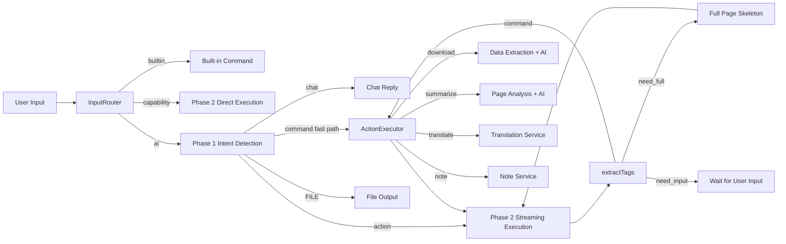
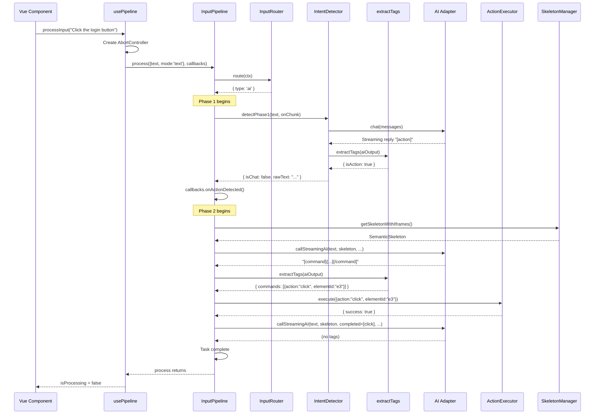
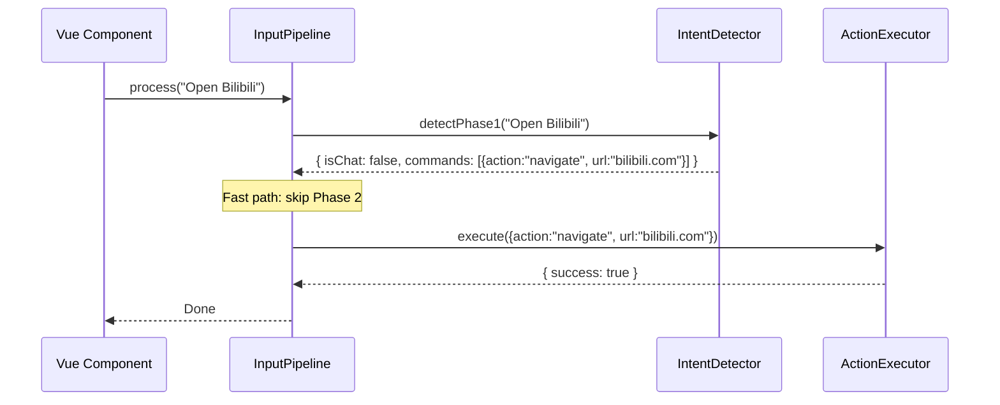
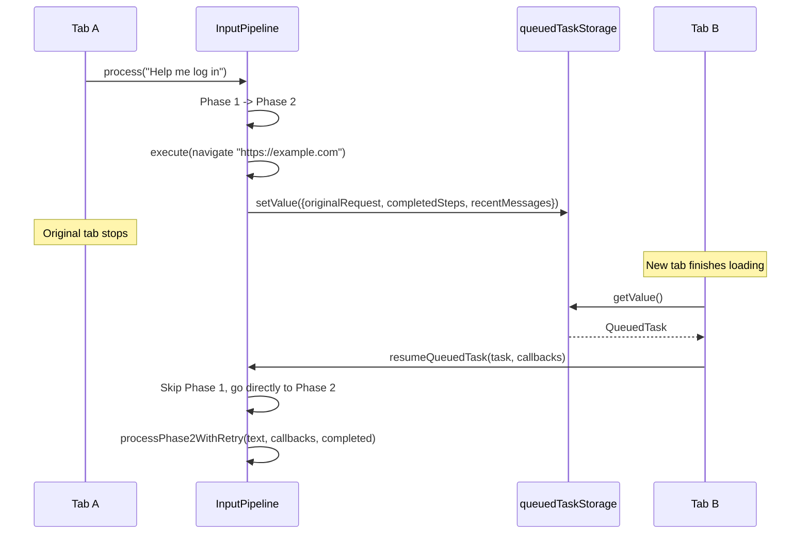
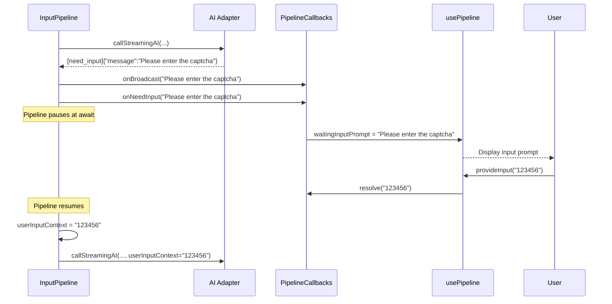
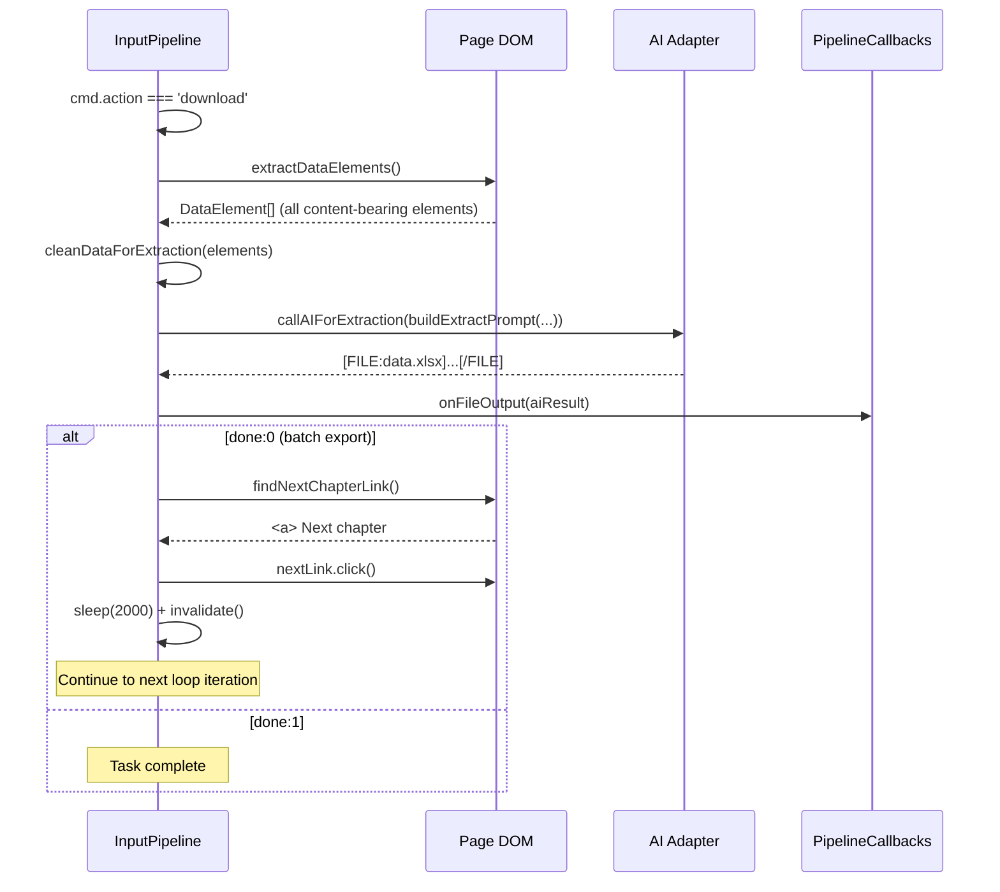

# Input Pipeline

> **🌐 中文版本：[input-pipeline.md](./input-pipeline.md)**

> Module paths: `src/input/`, `src/input/prompts/`, `src/composables/usePipeline.ts`
> Unified input processing pipeline: routing -> Phase 1 intent detection -> Phase 2 streaming execution -> tag extraction -> command execution -> retry.

---

## 1. Module Overview

### 1.1 Purpose

The Input Pipeline is the **intent understanding and task scheduling layer** of AI Browser, responsible for three core duties:

1. **Input Routing** — Distinguishes between built-in commands, capability-domain directives, and AI intent detection, dispatching user input to the correct processing path.
2. **Two-Phase Intent Detection** — Phase 1 (lightweight model) performs chat/action binary classification; Phase 2 (primary model) generates concrete browser commands from the page skeleton.
3. **Streaming Execution with Retry** — Executes AI-generated commands one by one, supporting batch execution, error retry, cross-tab resumption, and interactive user input.

### 1.2 Position in the Architecture

```
User voice/text -> Input Pipeline (this module) -> AI Adapter
                                                        |
                                                  Command JSON
                                                        |
                                            Browser Command Engine
                                            (ActionExecutor / SkeletonManager)
```

- **Upstream**: Vue components invoke `processInput()` through the `usePipeline` composable, passing in user text.
- **Downstream**: Calls the AI adapter (`createAdapter`) to obtain AI responses, calls `ActionExecutor` to execute browser actions, and calls `SkeletonManager` to extract the page skeleton.
- **Parallel**: Translation (`TranslateService`), note-taking (`note-service`), and data extraction (`extractDataElements`) are handled independently as special actions.

### 1.3 Dependencies

| Dependency | Purpose |
|------------|---------|
| `src/adapters` | AI adapter factory; `createAdapter(provider)` creates chat instances |
| `src/browser/action-executor.ts` | Browser command execution engine |
| `src/browser/skeleton.ts` | Page semantic skeleton extraction (`SkeletonManager`) |
| `src/browser/local-html.ts` | Full-page skeleton extraction (`extractFullPageSkeletonAsync`) |
| `src/browser/types.ts` | `Command`, `SemanticSkeleton` type definitions |
| `src/browser/translate-service.ts` | Translation service (dynamically imported) |
| `src/browser/note-service.ts` | Note service (dynamically imported) |
| `src/storage` | `queuedTaskStorage` for cross-tab task persistence |
| `src/utils/logger.ts` | Unified logging (writes to chrome.storage.local) |
| `src/stores/conversations.ts` | Conversation state management (used by usePipeline) |
| `src/stores/settings.ts` | Settings state management (used by usePipeline) |

### 1.4 File Structure

```
src/input/
├── index.ts                # Public exports (barrel file)
├── types.ts                # Core type definitions (InputContext, InputResult, PipelineCallbacks)
├── router.ts               # Input router (InputRouter)
├── intent-detector.ts      # Intent detector (IntentDetector, Phase 1 + Phase 2)
├── tag-parser.ts           # AI tag extractor (extractTags)
├── pipeline.ts             # Unified input processing pipeline (InputPipeline)
└── prompts/
    ├── index.ts            # Barrel export
    ├── common.ts           # Shared constants (capability domain list, file format rules)
    ├── phase1.ts           # Phase 1 intent detection prompts
    ├── phase2.ts           # Phase 2 action decision prompts
    ├── extract.ts          # Data extraction prompts (download-specific)
    ├── summarize.ts        # Page analysis prompts (summarize-specific)
    └── translate.ts        # Translation prompts

src/composables/
└── usePipeline.ts          # Vue composable, integrates InputPipeline into components
```

---

## 2. Architecture Design

### 2.1 Overall Architecture



### 2.2 Core Design Patterns

#### Two-Phase Intent Detection

Phase 1 and Phase 2 use different strategies to balance response speed with action precision:

| Phase | Model | Input | Output | Purpose |
|-------|-------|-------|--------|---------|
| Phase 1 | Lightweight model | User text | `[action]` / `[command]` / chat / `[FILE]` | Fast classification; simple actions emitted directly |
| Phase 2 | Primary model | User text + page skeleton JSON | `[command]` / `[need_full]` / `[need_input]` | Precise element targeting; generate action commands |

**Phase 1 Fast Path**: Simple actions that do not require a page skeleton (navigate, scroll, keyboard, etc.) are generated directly by Phase 1 as `[command]`, skipping Phase 2 and saving one AI call.

#### Streaming Execution Loop

Phase 2 does not generate all commands at once. Instead, it **generates one command per iteration**, then decides the next step based on the result:

```typescript
while (totalExecutions < MAX_TOTAL_STEPS) {
  // 1. Extract skeleton
  const skeleton = await skeletonManager.getSkeletonWithIframes()
  // 2. AI generates 1 command
  const result = await callStreamingAI(...)
  // 3. Execute command
  await executor.execute(cmd)
  // 4. Decide based on result: continue / retry / finish
}
```

This design ensures the AI always sees the latest page state, avoiding "blind operations."

#### Inline Tag Parsing

The AI does not need to output only tags. Tags can be embedded within natural language replies:

```
Sure, I'll click the login button for you.

[command]{"action":"click","elementId":"e3"}[/command]
```

`extractTags()` uses regex to extract `[tag]...[/tag]` from arbitrary text and parses the inner JSON.

#### Callback-Driven UI Updates

The `PipelineCallbacks` interface defines 12 callback functions. The pipeline notifies the UI layer of message state changes through callbacks, without directly manipulating the DOM or Vue state.

### 2.3 Rationale Behind Design Decisions

| Design Decision | Rationale |
|-----------------|-----------|
| Two-phase detection | Phase 1 is lightweight and fast (instant chat replies); Phase 2 is precise but requires a skeleton (accurate actions) |
| Streaming execution over batch generation | SPA pages have frequently changing DOM; re-extracting the skeleton after each execution ensures commands remain valid |
| Tags embedded in natural language | The AI can simultaneously explain to the user and perform actions, improving the experience |
| AbortSignal propagated end-to-end | Users can stop at any time; the abort signal travels from the UI layer through AI requests to sleep waits |
| Command deduplication (completedKeys) | The AI may re-generate already-executed commands; deduplication avoids redundant operations |
| Cross-tab resumption (QueuedTask) | After navigate opens a new tab, the new page automatically resumes execution seamlessly for the user |
| Dynamic imports (translate/note) | Reduces main bundle size; loaded on demand |

---

## 3. Core Type Definitions

### 3.1 InputContext

User input context, constructed and passed in by the caller:

```typescript
export interface InputContext {
  text: string           // User input text
  mode: 'text' | 'voice' // Input mode
}
```

### 3.2 InputResult

Router return value; a discriminated union distinguishing three paths:

```typescript
export type InputResult =
  | { type: 'builtin'; command: string; args: string }
  | { type: 'capability'; command: string; args: string }
  | { type: 'ai' }
```

| Type | Meaning | Subsequent Handling |
|------|---------|---------------------|
| `builtin` | Built-in commands (/stop, /help, etc.) | Executed directly, no AI involved |
| `capability` | Capability-domain directives (/scroll, /navigate, etc.) | Skip Phase 1, enter Phase 2 directly |
| `ai` | Natural language input | Enter Phase 1 intent detection |

### 3.3 Phase1Detection

Phase 1 intent detection result:

```typescript
export interface Phase1Detection {
  isChat: boolean              // Whether it is a chat reply
  responseText?: string        // Chat reply text (present when isChat=true)
  rawText: string              // Raw AI output
  commands?: Command[]         // Commands emitted directly by Phase 1 (fast path, skips Phase 2)
}
```

### 3.4 Phase2Result

Phase 2 action decision result:

```typescript
export interface Phase2Result {
  commands?: Command[]         // AI-generated action commands
  needFull?: boolean           // Request for full-page skeleton
  rawAiOutput: string          // Raw AI output
}
```

Extended type (returned by `callStreamingAI`):

```typescript
Phase2Result & { needInput?: { message: string } }
```

### 3.5 ExtractedTags

Tag extraction result:

```typescript
export interface ExtractedTags {
  chatText?: string            // Text inside [chat] (present for Phase 1 pure-chat replies)
  commands?: Command[]         // Extracted [command] list
  isAction: boolean            // Whether an [action] tag is present
  needFull?: boolean           // Extracted [need_full]
  needInput?: { message: string; type?: string } // [need_input]
  hasFileTags: boolean         // Whether [FILE:xxx]...[/FILE] file tags are present
  fileTagDetails?: {           // File tag details (for logging)
    filename: string
    hasClosingTag: boolean
    contentLength: number
  }
  hasAnyTag: boolean           // Whether any tag was extracted
  rawText: string              // Original text
}
```

### 3.6 PipelineCallbacks

Pipeline callback interface; the pipeline notifies the UI layer through these callbacks:

```typescript
export interface PipelineCallbacks {
  onChatStart: () => void
  onChatDelta: (delta: string, reasoningDelta?: string, clearContent?: boolean) => void
  onChatEnd: () => void
  onActionDetected: () => void
  onChatMessage: (text: string) => void
  onCommandsParsed: (commands: Command[], currentStep?: number) => void
  onCommandResult: (action: string, success: boolean, message: string) => void
  onAllCommandsDone?: (userText: string, commands: Command[]) => void
  onRetryMessage: (message: string, currentStep?: number, failedCommand?: {
    action: string; elementId?: string; description?: string; text?: string; url?: string
  } | null) => void
  onError: (message: string) => void
  onNeedInput: (prompt: string) => Promise<string>
  onFileOutput?: (content: string) => void
  onBroadcast?: (text: string) => void
}
```

| Callback | Trigger | Purpose |
|----------|---------|---------|
| `onChatStart` | Phase 1 chat reply begins | Create placeholder message for typewriter effect |
| `onChatDelta` | Streaming output increment | Update message content; when `clearContent=true`, clear already-output content |
| `onChatEnd` | Chat reply ends | Mark message status as done |
| `onActionDetected` | Phase 1 detects action intent | Clear tag content from streamed message |
| `onChatMessage` | Plain text chat reply (non-streaming) | Add message directly |
| `onCommandsParsed` | Command parsing complete | Display commands about to be executed |
| `onCommandResult` | Single command execution complete | Display execution result (success/failure) |
| `onAllCommandsDone` | All commands executed successfully | Record task completion in conversation history |
| `onRetryMessage` | During retry | Display retry progress |
| `onError` | Retry limit exceeded | Display error message |
| `onNeedInput` | AI needs user input | Pause pipeline, resolve after user provides input |
| `onFileOutput` | Download data extraction complete | Output AI-generated file content |
| `onBroadcast` | Action complete | Voice broadcast of result |

### 3.7 PipelineOptions

Pipeline constructor options:

```typescript
export interface PipelineOptions {
  getSettings: () => AppSettings
  getModelId?: () => string
  getRecentMessages?: () => Array<{ role: 'user' | 'assistant' | 'system'; content: string }>
  getSignal?: () => AbortSignal | undefined
  onBuiltinCommand?: (command: string, args: string) => void
}
```

### 3.8 IntentDetectorOptions

Intent detector constructor options:

```typescript
export interface IntentDetectorOptions {
  getSettings: () => AppSettings
  getModelId?: () => string
  getRecentMessages?: () => Array<{ role: 'user' | 'assistant' | 'system'; content: string }>
  getSignal?: () => AbortSignal | undefined
}
```

### 3.9 CapabilityItem

Capability domain definition (shared constants):

```typescript
export interface CapabilityItem {
  id: string           // Command identifier (e.g., navigate, scroll, click)
  title: string        // Display title
  desc: string         // Description
  needSkeleton: boolean // Whether a page skeleton is required
}
```

### 3.10 DataElement

Page element for download data extraction (internal type in pipeline.ts):

```typescript
interface DataElement {
  tag: string
  text: string
  parent?: string           // table/ul/ol/main/article, etc.
  href?: string
  src?: string
  alt?: string
  row?: number              // Table row index
  col?: number              // Table column index
  type?: 'text' | 'image' | 'code'
}
```

---

## 4. Implementation Details

### 4.1 InputRouter -- Input Router

**Source**: `src/input/router.ts`

```typescript
export class InputRouter {
  route(ctx: InputContext): InputResult
}
```

**Algorithm**:

1. `text.trim()` to remove leading/trailing whitespace
2. Starts with `/` -> Parse slash command:
   - Match regex `/^\/(\S+)\s*(.*)/` to extract command name and arguments
   - Command name in `BUILTIN_COMMANDS` (`['stop', 'pause', 'resume', 'list', 'help']`) -> return `{ type: 'builtin' }`
   - Command name in `CAPABILITY_IDS` (id set of `CAPABILITY_DOMAIN_LIST`) -> return `{ type: 'capability' }`
   - Neither matches -> return `{ type: 'builtin', command: 'unknown', args: commandName }`
3. Does not start with `/` -> return `{ type: 'ai' }`

**Edge Cases**:
- Blank input: after `trim()` becomes empty string, does not start with `/`, goes to AI path
- `/` with no command name: regex does not match, returns `{ isCommand: false }`, goes to AI path
- Command arguments are optional: `/help` has no arguments, `/scroll auto` has arguments

### 4.2 IntentDetector -- Intent Detector

**Source**: `src/input/intent-detector.ts`

#### Phase 1: detectPhase1

```typescript
async detectPhase1(
  text: string,
  onChunk?: (delta: string, reasoningDelta?: string) => void,
): Promise<Phase1Detection>
```

**Parameters**:
- `text` -- User input text
- `onChunk` -- Streaming output callback (optional)

**Return value**: `Phase1Detection`

**Algorithm**:

1. Build Phase 1 prompt: `buildPhase1Prompt(automationEnabled)`
2. Call AI: `callAI('Phase1', systemPrompt, text, onChunk)`
3. Extract tags: `extractTags(aiOutput)`
4. Branch decision:
   - `[command]` without `[action]` -> Fast path, return `{ isChat: false, commands }`
   - `[action]` -> Return `{ isChat: false }`, enter Phase 2
   - `[FILE:xxx]` -> Return as chat reply (frontend renders as file card)
   - `isChatOnlyReply(tags)` -> Pure chat, return `{ isChat: true, responseText }`
   - Otherwise -> Plain text chat, return `{ isChat: true, responseText: aiOutput.trim() }`

**Edge Cases**:
- AI returns no reply (empty string) -> Default to `[action]`, return `{ isChat: false }`
- `onChunk` callback supports `reasoningDelta` (AI thinking process), passed through to the UI

#### Phase 2: detectPhase2

```typescript
async detectPhase2(text: string, skeleton: SemanticSkeleton): Promise<Phase2Result>
```

**Parameters**:
- `text` -- User input text
- `skeleton` -- Page semantic skeleton

**Return value**: `Phase2Result`

**Algorithm**:

1. Build Phase 2 prompt: `buildPhase2Prompt(automationEnabled)`
2. Build user message: `buildPhase2UserMessage(text, skeleton)`
3. Call AI: `callAI('Phase2', systemPrompt, userContent)`
4. Extract tags: `extractTags(aiOutput)`
5. Return `{ commands, needFull, rawAiOutput }`

**Edge Cases**:
- AI returns no reply -> Return `{ rawAiOutput: '' }`
- No valid tags extracted -> Return `{ rawAiOutput }` (no commands/needFull)

#### callAI -- AI Invocation

```typescript
private async callAI(
  scene: string,
  systemPrompt: string,
  userContent: string,
  onChunk?: (delta: string, reasoningDelta?: string) => void,
): Promise<string>
```

**Message construction**:
1. Get recent N history messages (`getRecentMessages`), skip the last user message (avoid duplication)
2. Call `stripHeavyData()` on history messages to clean heavy data
3. Prepend the system prompt to the user message (for APIs that do not support the system role): `${systemPrompt}\n\nUser input: ${userContent}`
4. Add the current user message

**Error handling**:
- AbortError -> Re-throw upward for the caller to handle abort logic
- Other errors -> Log and return empty string

**stripHeavyData function** (cleans heavy data from history messages):

```typescript
function stripHeavyData(content: string): string
```

Keeps: `[Original Request]`, `[Completed]`, `[Last Error]`, `[User Supplementary Info]`
Filters: system prompts, `[Page Skeleton]` JSON, `[Full Page Skeleton]` JSON, `[Failed Command]` JSON

### 4.3 extractTags -- Tag Extractor

**Source**: `src/input/tag-parser.ts`

```typescript
export function extractTags(rawText: string): ExtractedTags
```

**Parameters**: `rawText` -- Raw AI output text

**Return value**: `ExtractedTags`

**Algorithm** (extracts 6 tag types in order):

1. **`[FILE:xxx]...[/FILE]`** -- Regex `/\[FILE:\s*([^\]]+)\]\r?\n?([\s\S]*?)(?:\[\/FILE\]|$)/i`, case-insensitive, optional whitespace, handles missing closing tag
2. **`[chat]...[/chat]`** -- First matches closed tags; if not found, takes everything after `[chat]`. Content is parsed with JSON.parse; on failure, takes the raw text
3. **`[command]...[/command]`** -- First matches closed tags; if not found, takes everything after `[command]` as JSON. Supports:
   - Single format: `[command]{"action":"click"}[/command]`
   - Array format: `[command][{"action":"click"},{"action":"type"}][/command]`
   - On JSON.parse failure, calls `parseCommandFallback()` for regex-based fallback extraction
4. **`[action]`** -- Content-less tag; `rawText.includes('[action]')` suffices
5. **`[need_full]`** -- Content-less tag; `rawText.includes('[need_full]')` suffices
6. **`[need_input]...[/need_input]`** -- JSON content tag; extracts `message` and `type` fields

**parseCommandFallback fallback parsing**:

```typescript
function parseCommandFallback(raw: string): Command | null
```

When the AI-generated JSON contains unescaped quotes, `JSON.parse` fails. The fallback strategy uses regex to extract fields individually: `action`, `elementId`, `url`, `description`, `done`, and positional matching for the `text` field (from `"text":"` to the last `","done":`).

#### isChatOnlyReply

```typescript
export function isChatOnlyReply(tags: ExtractedTags): boolean
```

Decision logic:
- Has action-class tags (`isAction` / `commands` / `needFull` / `needInput`) or file tags -> `false`
- Has `[chat]` tag -> `true`
- No tags at all + has text content -> `true` (AI replied in plain natural language)
- Otherwise -> `false`

#### getChatText

```typescript
export function getChatText(tags: ExtractedTags): string
```

Prioritizes `[chat]` tag content; falls back to raw text (`rawText.trim()`).

### 4.4 InputPipeline -- Unified Input Processing Pipeline

**Source**: `src/input/pipeline.ts`

```typescript
export class InputPipeline {
  constructor(options: PipelineOptions)
  async process(ctx: InputContext, callbacks: PipelineCallbacks): Promise<void>
  async resumeQueuedTask(task: QueuedTask, callbacks: PipelineCallbacks): Promise<void>
}
```

#### process -- Main Entry Point

```typescript
async process(ctx: InputContext, callbacks: PipelineCallbacks): Promise<void>
```

**Complete flow**:

1. **Route** -- `router.route(ctx)` determines the processing path
2. **Built-in command** -> `onBuiltinCommand(command, args)`, return immediately
3. **Capability-domain directive** -> Skip Phase 1, enter `processPhase2WithRetry` directly
4. **Phase 1** -- Streaming output; when action tags are detected, clear content:
   - Check abort signal during streaming
   - When `[action` or `[command` keywords are detected, call `onChatDelta('', undefined, true)` to clear already-output content
   - Chat reply -> Replace streamed content with cleaned final text
   - Fast path (`p1.commands`) -> `executePhase1Commands` executes directly
   - `[action]` -> Enter Phase 2

**Phase 1 streaming output optimization**:

```typescript
// Action tag detected -> clear streamed content, keep only "thinking..."
if (/\[(?:action|command)|(?:action|command)\]/.test(phase1StreamedContent)) {
  phase1ActionTagDetected = true
  callbacks.onChatDelta('', undefined, true)  // clearContent=true
}
```

Keywords must include `[` or `]` to prevent accidental triggers when words like "action" appear in chat.

#### executePhase1Commands -- Phase 1 Fast Path

```typescript
private async executePhase1Commands(
  commands: Command[],
  userText: string,
  callbacks: PipelineCallbacks,
): Promise<void>
```

Executes Phase 1 direct-emission commands one by one (no page skeleton required):

- `translate` -> Dynamically import `TranslateService`, call `translateVisible`
- `note` -> Dynamically import `optimizeAsNoteStream`, stream note output
- Other -> `ActionExecutor.execute(cmd, signal)`

After a successful navigate, call `skeletonManager.invalidate()`.

#### processPhase2WithRetry -- Phase 2 Streaming Execution Loop

```typescript
private async processPhase2WithRetry(
  text: string,
  callbacks: PipelineCallbacks,
  initialCompleted?: Array<{ action: string; elementId?: string; description?: string }>,
): Promise<void>
```

**Core loop** (`MAX_TOTAL_STEPS = 50`):

```
while (totalExecutions < MAX_TOTAL_STEPS) {
  1. Check abort signal
  2. Extract skeleton (skeletonManager.getSkeletonWithIframes())
  3. Select mode: MODE_FIRST / MODE_STREAMING / MODE_RETRY
  4. Call callStreamingAI to generate 1 command
  5. Handle result:
     - No tags -> Task complete, break
     - need_input -> Pause for user input, continue
     - command -> Execute command (supports batch arrays)
     - need_full -> Extract full-page skeleton, continue
  6. Command execution result:
     - Success -> Record to completed, check done/navigate/_blank
     - Failure -> Record error; single command goes to retry, batch skips and continues
}
```

**Command deduplication**:

```typescript
const cmdKey = `${cmd.action}:${cmd.url || cmd.elementId || cmd.description || ''}:${cmd.text || ''}`
if (completedKeys.has(cmdKey)) continue
```

**Special action handling**:

| Action | Handling | Completion Condition |
|--------|----------|----------------------|
| `download` | `extractDataElements()` -> `cleanDataForExtraction()` -> AI extraction -> `onFileOutput` | `done:1` or no next-chapter link |
| `summarize` | `extractPageText()` -> AI analysis (streaming) -> `onChatDelta` | Always `done:1` |
| `translate` | Dynamically import `TranslateService` -> `translateVisible` | `done:1` |
| `note` | Dynamically import `optimizeAsNoteStream` -> streaming output | `done:1` |
| `click` (done:0) | Pre-save `queuedTask`, check `openedNewTab` after execution | Interrupt on `_blank` new tab |
| `navigate` | Save `queuedTask` after successful execution, interrupt loop | Interrupt on success |
| `upload` | Supplement filename (extracted from user input `[File: xxx]` tag) | Normal execution |

**Batch execution**:

```typescript
const isBatch = cmds.length > 1
// Batch mode uses shorter sleep: 200ms (single: 500ms)
await sleep(isBatch ? 200 : 500, signal)
```

The `batchStopped` flag is set to true on navigate / `_blank` new tab / `done:1`, interrupting both the batch and the outer loop.

**need_input handling**:

```typescript
if (phase2Result.needInput) {
  callbacks.onBroadcast?.(phase2Result.needInput.message)
  userInputContext = await callbacks.onNeedInput(phase2Result.needInput.message)
  lastError = ''
  lastFailedCommand = null
  continue
}
```

The pipeline pauses at `await callbacks.onNeedInput()`. After the user provides input, the Promise resolves, and execution continues with `userInputContext`.

**need_full handling**:

```typescript
if (phase2Result.needFull) {
  const fullSkeleton = await extractFullPageSkeletonAsync()
  lastError = 'Viewport skeleton did not find target element; full-page skeleton extracted'
  lastFullSkeleton = fullSkeleton
  continue
}
```

#### callStreamingAI -- Streaming AI Invocation

```typescript
private async callStreamingAI(
  text: string,
  skeleton: SemanticSkeleton,
  completed: Array<{ action: string; elementId?: string; description?: string }>,
  lastError: string,
  lastFailedCommand?: { ... } | null,
  lastFullSkeleton?: string | null,
  coreRule?: string,
  userInputContext?: string,
): Promise<Phase2Result & { needInput?: { message: string } }>
```

**Message construction**:

```typescript
// System prompt: {coreRule} placeholder replacement
const systemPrompt = buildPhase2Prompt(automation).replace('{coreRule}', coreRule)

// User message: original request + completed steps + error info + skeleton JSON
const userContent = buildStreamingUserMessage(text, skeleton, completed, lastError, lastFailedCommand, lastFullSkeleton, userInputContext)

// History messages: recent N messages, stripHeavyData cleanup, skip last user message
const messages = [...filteredRecentMsgs, { role: 'user', content: `${systemPrompt}\n\n${userContent}` }]
```

**buildStreamingUserMessage message structure**:

```
[Original Request] User: "..."
[Completed] 1. click e3 (Login)  2. type e5 (Enter text)
[Last Error] [click] Target element not found
[Failed Command] {"action":"click","elementId":"e7"}
[Page Skeleton]
{"url":"...","title":"...","elements":[...]}
[User Supplementary Info] Additional information from the user
```

#### resumeQueuedTask -- Cross-Tab Resumption

```typescript
async resumeQueuedTask(task: QueuedTask, callbacks: PipelineCallbacks): Promise<void>
```

Skips Phase 1 and enters Phase 2 streaming execution directly. Completed steps are read from `task.completedSteps` and passed to `processPhase2WithRetry` via the `initialCompleted` parameter.

#### Helper Functions

**extractDataElements** -- Download data extraction:

```typescript
function extractDataElements(): DataElement[]
```

Extracts all elements with text content from `document.body.querySelectorAll('*')`. Unlike skeleton extraction (which only extracts interactive elements like buttons/links/inputs), this extracts all content-bearing elements (table cells `td`, list items `li`, paragraphs `p`, etc.). Skips script/style/noscript/svg/path/br/hr and hidden elements. Images are extracted separately (no text content required). Limited to 500 items.

**cleanDataForExtraction** -- Clean data elements:

```typescript
function cleanDataForExtraction(elements: DataElement[]): string
```

Filters out whitespace-only and punctuation-only elements, limits to 500 items, returns a JSON string (containing url, title, count, data).

**extractPageText** -- Extract full page text:

```typescript
function extractPageText(): string
```

Uses `document.body.innerText` to get visible page text (automatically filters script/style/hidden elements), limited to 15,000 characters.

**findNextChapterLink** -- Find next chapter link:

```typescript
function findNextChapterLink(): HTMLElement | null
```

Priority: text matching (next chapter/next page/Next/>) -> `rel="next"` attribute -> common class names (.next-chapter/.next-page/.pagination .next). Checks visibility and valid href.

**sleep** -- Abort-aware wait:

```typescript
function sleep(ms: number, signal?: AbortSignal): Promise<void>
```

Can be interrupted by an AbortSignal during the wait period. Rejects immediately if the signal is already aborted; otherwise registers an abort listener to clean up the timer.

### 4.5 Prompt Modules

**Source**: `src/input/prompts/`

#### common.ts -- Shared Constants

`CAPABILITY_DOMAIN_LIST` defines 22 capability domains (compared to the legacy version, it adds `upload`, `slider`, `closeModal`, `translate`, `note`):

```typescript
export const CAPABILITY_DOMAIN_LIST: CapabilityItem[] = [
  { id: 'navigate',   title: 'Open URL',        desc: 'Open a URL (requires url)',                                   needSkeleton: false },
  { id: 'scroll',     title: 'Scroll Page',      desc: 'Scroll the page (direction:up/down/top/bottom/auto/stop/pause/resume)', needSkeleton: false },
  { id: 'newTab',     title: 'New Tab',          desc: 'Open a new tab',                                              needSkeleton: false },
  { id: 'closeTab',   title: 'Close Tab',        desc: 'Close the current tab',                                       needSkeleton: false },
  { id: 'nextTab',    title: 'Next Tab',         desc: 'Switch to the next tab',                                      needSkeleton: false },
  { id: 'prevTab',    title: 'Previous Tab',     desc: 'Switch to the previous tab',                                  needSkeleton: false },
  { id: 'switchTab',  title: 'Switch Tab',       desc: 'Switch to a specific tab (requires tabQuery)',                 needSkeleton: false },
  { id: 'keyboard',   title: 'Simulate Key',     desc: 'Simulate a keypress (requires key:Enter/Escape/Tab)',          needSkeleton: false },
  { id: 'wait',       title: 'Wait',             desc: 'Wait (requires ms)',                                          needSkeleton: false },
  { id: 'search',     title: 'Web Search',       desc: 'Search the web (requires text)',                              needSkeleton: true },
  { id: 'click',      title: 'Click Element',    desc: 'Click an element (requires elementId or description)',         needSkeleton: true },
  { id: 'type',       title: 'Type Text',        desc: 'Type text (requires elementId+text)',                         needSkeleton: true },
  { id: 'clear',      title: 'Clear Input',      desc: 'Clear an input field (requires elementId)',                    needSkeleton: true },
  { id: 'select',     title: 'Select Dropdown',  desc: 'Select a dropdown option (requires elementId+text)',           needSkeleton: true },
  { id: 'focus',      title: 'Focus Element',    desc: 'Focus an element (requires elementId)',                        needSkeleton: true },
  { id: 'hover',      title: 'Hover Element',    desc: 'Hover over an element (requires elementId)',                   needSkeleton: true },
  { id: 'upload',     title: 'Upload File',      desc: 'Upload a file to a file input (requires elementId+fileData)', needSkeleton: true },
  { id: 'slider',     title: 'Drag Slider',      desc: 'Drag a slider to a specific value (requires elementId+value)',needSkeleton: true },
  { id: 'closeModal', title: 'Close Modal',      desc: 'Close a page modal/dialog',                                   needSkeleton: false },
  { id: 'download',   title: 'Extract Data',     desc: 'Extract page data and export as file',                        needSkeleton: true },
  { id: 'summarize',  title: 'Summarize',        desc: 'Extract full page text and summarize with AI',                 needSkeleton: true },
  { id: 'translate',  title: 'Translate Page',   desc: 'Translate the current page content',                          needSkeleton: true },
  { id: 'note',       title: 'Generate Notes',   desc: 'Generate notes from the current page content',                needSkeleton: true },
]
```

Derived constants:
- `CAPABILITY_LIST` -- Full list (used by Phase 2)
- `PHASE1_CAPABILITY_LIST` -- Only items where `needSkeleton=false` (used by Phase 1)

Shared rule fragments:
- `FILE_FORMAT_RULES` -- File output format rules (single file/multiple files/chart .chart)
- `SITE_URL_RULE` -- Site name to URL conversion rules
- `FILE_EXT_RULE` -- File extension rules
- `COMMAND_CLOSE_RULE` -- Tag closing rules

#### phase1.ts -- Phase 1 Prompts

```typescript
export function buildPhase1Prompt(automation: boolean): string
```

- `automation=true` -> Full version (`PHASE1_SYSTEM_PROMPT`): supports `[command]` / `[action]` / `[FILE]` / direct reply formats
- `automation=false` -> Simplified version (`PHASE1_NO_AUTO_PROMPT`): only supports `[FILE]` / direct reply formats

#### phase2.ts -- Phase 2 Prompts

```typescript
export function buildPhase2Prompt(_automation?: boolean): string
```

Always returns the full `PHASE2_SYSTEM_PROMPT` (Phase 2 is only triggered when automation is enabled).

The system prompt contains a `{coreRule}` placeholder, replaced at runtime with the mode description:

```typescript
export const MODE_FIRST = 'First execution. Based on the user request and page skeleton, generate the 1st command...'
export const MODE_STREAMING = 'Continue execution. Based on the user original request, completed steps, current page skeleton...'
export const MODE_RETRY = 'Previous command failed. Adjust strategy: element obscured -> scroll to make element visible first...'
```

Message construction functions:

```typescript
export function buildPhase2UserMessage(text: string, skeleton: SemanticSkeleton): string
// Returns: [Current Request] User: "..." + [Page Skeleton] {JSON}

export function buildStreamingUserMessage(
  text: string, skeleton: SemanticSkeleton,
  completed: Array<{...}>, lastError?: string,
  lastFailedCommand?: {...} | null, fullSkeleton?: string,
  userInputContext?: string,
): string
// Returns: [Original Request] + [Completed] + [Last Error] + [Failed Command] + [Page Skeleton/Full Page Skeleton] + [User Supplementary Info]
```

#### extract.ts -- Data Extraction Prompts

```typescript
export const EXTRACT_SYSTEM_PROMPT: string
export function buildExtractPrompt(userRequest: string, cleanedSkeleton: string, automation?: boolean): string
```

- `automation=false` -> Returns "Web automation is disabled" message
- `automation=true` -> Concatenates system prompt + user request + page skeleton data

#### summarize.ts -- Page Analysis Prompts

```typescript
export const SUMMARIZE_SYSTEM_PROMPT: string
export function buildSummarizePrompt(userRequest: string, pageText: string): string
```

The analysis framework defines the output format: Core Summary -> Content Analysis -> Technical Deep Dive -> Key Insights -> Action Recommendations -> Tags.

#### translate.ts -- Translation Prompts

```typescript
export const TRANSLATE_SYSTEM_PROMPT: string
export function buildSelectionTranslateMessage(text: string, targetLang: string): string
export function buildAutoTranslateMessage(texts: Array<{ id: string; text: string }>, targetLang: string): string
```

Selection translation returns plain text; batch translation returns a JSON array `[{"id":"e1","translated":"Translated text"}]`.

### 4.6 usePipeline -- Vue Composable

**Source**: `src/composables/usePipeline.ts`

```typescript
export function usePipeline() {
  return {
    isProcessing: Ref<boolean>,
    waitingInputPrompt: Ref<string | null>,
    processInput: (text: string, reasoning?: boolean) => Promise<void>,
    resumeQueuedTask: (task: QueuedTask) => Promise<void>,
    executeCommand: (cmd: Command) => Promise<ActionResult>,
    addSystemMessage: (content: string) => void,
    provideInput: (text: string) => void,
    abort: () => Promise<void>,
  }
}
```

**Module-level state**:
- `isProcessing` -- Whether processing is in progress (ref, shared across components)
- `waitingInputPrompt` -- Prompt text when AI is waiting for user input
- `_abortFn` -- Module-level abort reference, called by `abortPipeline()`

**processInput flow**:

1. Create `AbortController`
2. Build `PipelineCallbacks` (12 callbacks that manipulate Vue state)
3. Call `pipeline.process({ text, mode: 'text' }, callbacks)`
4. finally block: clean up streaming messages, reset state, call `stoppedResolve`

**Key callback implementations**:

- `onChatStart` -- Create reactive `ChatMessage`, push into `conversation.messages`
- `onChatDelta` -- Update `currentStreamingMsg.content`; when `clearContent=true`, clear content
- `onActionDetected` -- Mark message as "Executing action...", clear `currentStreamingMsg` reference
- `onCommandsParsed` -- Remove Phase 1 placeholder message, add execution status message
- `onNeedInput` -- Set `waitingInputPrompt`, return Promise (`waitingInputResolve`/`waitingInputReject`)
- `onFileOutput` -- Add assistant message (triggers `[FILE]` rendering in MessageItem)
- `onBroadcast` -- Dispatch `aib-broadcast` CustomEvent, listened to by VoiceManager for voice broadcast

**abort flow**:

```typescript
function abort(): Promise<void> {
  // 1. Reject pending Promise (need_input scenario)
  waitingInputReject?.(new DOMException('...', 'AbortError'))
  // 2. Abort current request
  currentAborter?.abort()
  // 3. Clear cross-tab queued task
  queuedTaskStorage.setValue(null)
  // 4. Wait for pipeline to truly end (3-second timeout fallback)
  if (isProcessing.value) {
    return new Promise(resolve => {
      stoppedResolve = resolve
      setTimeout(() => { /* Force reset */ }, 3000)
    })
  }
}
```

**provideInput flow**:

```typescript
function provideInput(text: string) {
  addSystemMessage(`Your input: ${text}`)
  waitingInputResolve(text)  // Resolve Promise, pipeline continues
}
```

**resumeQueuedTask flow**:

1. Create AbortController
2. Build PipelineCallbacks (similar to processInput, some callbacks adapted for resumption)
3. Restore cross-tab history messages (deduplication: `role::content` set)
4. Call `pipeline.resumeQueuedTask(task, callbacks)`

**Module-level abortPipeline**:

```typescript
export async function abortPipeline(): Promise<void> {
  await _abortFn?.()
}
```

Called when clearing conversations/cache to ensure the pipeline stops.

---

## 5. Data Flow

### 5.1 Complete Processing Flow



### 5.2 Fast Path Flow



### 5.3 Cross-Tab Resumption Flow



### 5.4 need_input User Interaction Flow



### 5.5 Download Data Extraction Flow



---

## 6. Configuration and Extension

### 6.1 Configurable Parameters

| Parameter | Value | Location | Description |
|-----------|-------|----------|-------------|
| `MAX_TOTAL_STEPS` | 50 | pipeline.ts | Maximum iterations for the Phase 2 streaming execution loop |
| `BUILTIN_COMMANDS` | `['stop', 'pause', 'resume', 'list', 'help']` | router.ts | Built-in command list |
| History message count | `settings.maxContext` (default 100) | usePipeline.ts | Number of recent messages passed to the AI |
| Sleep duration | Batch 200ms / Single 500ms | pipeline.ts | Wait time after command execution for page update |
| need_full wait | 2000ms | pipeline.ts | Wait after auto-clicking next chapter in download mode |
| Abort timeout | 3000ms | usePipeline.ts | Timeout for waiting on pipeline to finish after abort |
| Message auto-cleanup | 500 messages | usePipeline.ts | Trim conversation messages when exceeding the limit |
| Page text truncation | 15,000 characters | pipeline.ts `extractPageText` | Truncation limit for full page text in summarize scenarios |
| Data element limit | 500 items | pipeline.ts `cleanDataForExtraction` | Element count limit for download scenarios |
| stripHeavyData | Regex cleanup | intent-detector.ts, pipeline.ts | Cleans skeleton JSON and other heavy data from history messages |

### 6.2 Extension Points

#### Adding a New Capability Domain

Add a new entry to `CAPABILITY_DOMAIN_LIST`:

```typescript
{ id: 'newAction', title: 'New Action', desc: 'Action description', needSkeleton: true/false }
```

- `needSkeleton=false` -> Phase 1 can emit `[command]` directly
- `needSkeleton=true` -> Requires Phase 2 skeleton

#### Adding a New Special Action Handler

Add a new action branch in the batch execution loop of `processPhase2WithRetry`:

```typescript
if (cmd.action === 'newAction') {
  // Custom handling logic
  callbacks.onCommandResult('newAction', success, message)
  continue
}
```

Also add the corresponding fast-path handling in `executePhase1Commands`.

#### Adding a New Phase 1 Output Format

1. Add the new format description to `PHASE1_SYSTEM_PROMPT` in `phase1.ts`
2. Add new regex extraction in `extractTags` in `tag-parser.ts`
3. Add new branch decision in `detectPhase1` in `intent-detector.ts`
4. Add new handling path in `process` in `pipeline.ts`

#### Custom Prompts

All prompts are constructed via functions in the `prompts/` directory and can be modified independently:

- `buildPhase1Prompt(automation)` -- Phase 1 system prompt
- `buildPhase2Prompt()` -- Phase 2 system prompt
- `buildExtractPrompt(userRequest, cleanedSkeleton, automation)` -- Data extraction prompt
- `buildSummarizePrompt(userRequest, pageText)` -- Page analysis prompt

---

## 7. Known Limitations

### 7.1 Intent Detection

- **Phase 1 misclassification** -- The AI may misjudge an action request as chat (e.g., "help me look at this page" could be summarize or chat), or misjudge chat as an action (e.g., "click-through rate is high" where "click" might trigger `[action]`).
- **Phase 2 command drift** -- The AI may deviate from the user's original intent during multi-step operations, especially in long conversation contexts.
- **Fragile tag format** -- AI-generated JSON may contain unescaped quotes, causing `JSON.parse` to fail. `parseCommandFallback` regex fallback mitigates this but is not fully reliable.
- **Inaccurate done determination** -- The AI may incorrectly set `done:0`/`done:1`, causing tasks to end prematurely or loop infinitely.

### 7.2 Streaming Execution

- **MAX_TOTAL_STEPS limit** -- The 50-execution cap prevents infinite loops, but complex multi-step tasks may be truncated.
- **Skeleton staleness** -- The skeleton is re-extracted each loop iteration, but the page may change during the AI response period (e.g., lazy-loaded content).
- **Batch execution atomicity** -- Batch commands are executed sequentially; a single failure does not affect subsequent commands, but there is no rollback mechanism.
- **State loss after navigate** -- After a successful navigate, the original tab stops; the new tab resumes via QueuedTask, but the original tab's streaming message state cannot be migrated.

### 7.3 Cross-Tab Resumption

- **QueuedTask race condition** -- Multiple tabs reading QueuedTask simultaneously may cause duplicate execution.
- **History message deduplication** -- The `role::content` set deduplication may incorrectly remove messages that have the same content but different semantic meanings.
- **Storage event latency** -- After writing to `chrome.storage.local`, other tabs experience listener delays; in extreme cases, resumption may be missed.

### 7.4 Data Extraction

- **Download element coverage** -- `extractDataElements` uses `document.body.querySelectorAll('*')`, which cannot penetrate Shadow DOM or cross-origin iframes.
- **Next chapter link detection** -- `findNextChapterLink` relies on text matching and common class names; non-standard pagination may fail detection.
- **Summarize text truncation** -- `extractPageText` is limited to 15,000 characters; long articles may lose trailing content.

### 7.5 User Interaction

- **need_input timeout** -- The pipeline pauses at `await callbacks.onNeedInput()` with no timeout mechanism; if the user does not respond, the pipeline hangs indefinitely (only abort can interrupt).
- **Abort race condition** -- During abort, rejecting the waitingInputPromise and aborting the request may trigger simultaneously; care must be taken to avoid duplicate cleanup.

### 7.6 Prompts

- **System prompt compatibility** -- The system prompt is prepended to the user message (for APIs that do not support the system role), but some models may be sensitive to message structure.
- **Token consumption** -- Phase 2 sends the full skeleton JSON + history messages every iteration; `stripHeavyData` reduces this but token consumption remains significant.
- **stripHeavyData duplication** -- Both `intent-detector.ts` and `pipeline.ts` contain identical copies of the `stripHeavyData` function; changes must be synchronized during maintenance.
