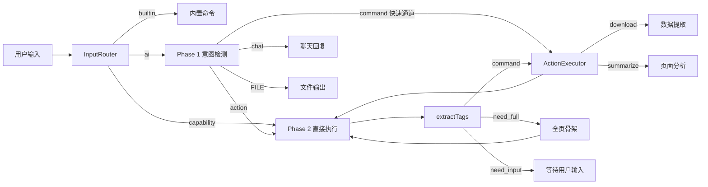

# 输入管线 (Input Pipeline)

> 统一输入处理流水线：路由 -> Phase 1 意图检测 -> Phase 2 流式执行 -> 标签提取 -> 指令执行 -> 重试。

## 模块概览



## InputRouter -- 3 路由类型

**源码**: `src/input/router.ts`

```typescript
export class InputRouter {
  route(ctx: InputContext): InputResult
}
```

路由决策：

| 输入 | 路由类型 | 处理方式 |
|---|---|---|
| `/stop`, `/help` 等 | `builtin` | 直接执行内置命令 |
| `/scroll`, `/navigate` 等 | `capability` | 跳过 Phase 1，直接进 Phase 2 |
| 其他文本 | `ai` | Phase 1 意图检测 |

内置命令列表：`stop`, `pause`, `resume`, `list`, `help`

**能力域指令** 映射到 `CAPABILITY_DOMAIN_LIST` 的 id（18 项）：

| id | 需要骨架 | 说明 |
|---|---|---|
| `navigate` | 否 | 打开 URL |
| `scroll` | 否 | 滚动（up/down/top/bottom/auto/stop/pause/resume） |
| `newTab` | 否 | 新标签页 |
| `closeTab` | 否 | 关闭标签页 |
| `nextTab` / `prevTab` | 否 | 切换标签页 |
| `switchTab` | 否 | 切换到指定标签页 |
| `keyboard` | 否 | 模拟按键 |
| `wait` | 否 | 等待 |
| `search` | 是 | 全网搜索 |
| `click` | 是 | 点击元素 |
| `type` | 是 | 输入文字 |
| `clear` | 是 | 清空输入框 |
| `select` | 是 | 选择下拉框 |
| `focus` | 是 | 聚焦元素 |
| `hover` | 是 | 悬停元素 |
| `download` | 是 | 提取数据并导出文件 |
| `summarize` | 是 | 分析总结页面 |

```typescript
export interface CapabilityItem {
  id: string
  title: string
  desc: string
  needSkeleton: boolean
}

export const CAPABILITY_DOMAIN_LIST: CapabilityItem[] = [
  { id: 'navigate',  title: '打开网址',   desc: '打开URL（需url）',                     needSkeleton: false },
  { id: 'scroll',    title: '滚动页面',   desc: '滚动页面（direction:up/down/top/bottom/auto/stop/pause/resume）', needSkeleton: false },
  // ... 共 18 项
]
```

## Phase 1 -- 意图检测

**源码**: `src/input/intent-detector.ts`, `src/input/prompts/phase1.ts`

Phase 1 系统提示词定义 4 种输出格式：

| 输出格式 | 含义 | 后续处理 |
|---|---|---|
| `[command]{...}[/command]` | 不需要骨架的简单操作 | 快速通道，直接执行 |
| `[action]` | 需要页面骨架的复杂操作 | 进入 Phase 2 |
| `[FILE:xxx]...[/FILE]` | 文件输出 | 作为聊天消息返回 |
| 直接回复 | 聊天/问答 | 作为聊天消息返回 |

**Phase 1 流式输出优化**：Phase 1 流式输出时实时检测 `[action` 或 `[command` 关键词。一旦检测到操作标签，调用 `callbacks.onChatDelta('', undefined, true)` 清空已流式输出的内容（`clearContent=true`），用户只看到"思考中"而非半截标签文本。

```typescript
export interface Phase1Detection {
  isChat: boolean
  responseText?: string
  rawText: string
  commands?: Command[]        // 快速通道指令（跳过 Phase 2）

// Phase 1 快速通道：不需要页面骨架的指令
// 路径：Phase 1 -> [command] -> ActionExecutor -> 完成
// 跳过 Phase 2，减少一次 AI 调用
```

**自动化开关**：`automationEnabled=false` 时，Phase 1 只输出聊天或 [FILE]，不输出 [command]/[action]。

## Phase 2 -- 流式操作决策

**源码**: `src/input/pipeline.ts`, `src/input/prompts/phase2.ts`

Phase 2 系统提示词使用 `{coreRule}` 占位符，运行时替换为模式描述：

```typescript
export const MODE_FIRST = '首次执行。根据用户请求和页面骨架，生成第1条指令...'
export const MODE_STREAMING = '继续执行。根据用户原始请求、已完成步骤、当前页面骨架...'
export const MODE_RETRY = '上次指令执行失败。调整策略...'
```

Phase 2 输出 3 种格式：

| 输出格式 | 含义 |
|---|---|
| `[command]{...}[/command]` | 执行浏览器操作（支持数组批量） |
| `[need_full]` | 骨架中找不到目标，请求全页骨架 |
| `[need_input]{"message":"...","type":"..."}` | 需要用户输入私有信息 |

### 流式执行循环

```typescript
const MAX_TOTAL_STEPS = 50  // 总执行次数上限（成功+失败+重试）

while (totalExecutions < MAX_TOTAL_STEPS) {
  // ★ 多重 abort 检查点：循环开始 / 骨架提取后 / AI 请求后 / 指令执行后
  if (signal?.aborted) throw new AbortError()

  // 1. 提取骨架（含跨域 iframe 内元素）
  const skeleton = await this.skeletonManager.getSkeletonWithIframes()

  // 2. 选择模式：首次 / 继续 / 重试
  const coreRule = isFirstEntry ? MODE_FIRST : (lastError ? MODE_RETRY : MODE_STREAMING)

  // 3. AI 生成指令（带历史上下文，stripHeavyData 清理骨架 JSON）
  const result = await this.callStreamingAI(text, skeleton, completed, lastError,
    lastFailedCommand, lastFullSkeleton, coreRule, userInputContext)

  // 4. 处理结果
  // ── 无标签 → 任务完成 ──
  if (!result.commands?.length && !result.needFull && !result.needInput) break

  // ── need_input → 暂停，等待用户输入后继续 ──
  if (result.needInput) {
    userInputContext = await callbacks.onNeedInput(message)
    continue
  }

  // ── command → 执行指令（支持单条 + 批量数组） ──
  if (result.commands?.length) {
    for (const cmd of result.commands) {
      // 指令去重：key = action:url/elementId/description:text
      const cmdKey = `${cmd.action}:${cmd.url || cmd.elementId || cmd.description || ''}:${cmd.text || ''}`
      if (completedKeys.has(cmdKey)) continue

      // ★ download/summarize → 独立处理流程，不走 ActionExecutor
      if (cmd.action === 'download') { /* extractDataElements → AI → onFileOutput */ }
      if (cmd.action === 'summarize') { /* extractPageText → AI → onChatDelta */ }

      // ★ click + done:0 → 前置保存 queued task（跨标签页续接）
      if (cmd.action === 'click' && cmd.done !== 1) {
        await queuedTaskStorage.setValue(pendingTask)
      }

      const result = await this.executor.execute(cmd, signal)

      // navigate → 保存任务到 storage，中断循环等待新页续接
      if (cmd.action === 'navigate' && result.success) {
        await queuedTaskStorage.setValue(task)
        break  // 原标签页停止
      }

      // _blank 新开页 → 保留 queued task，中断循环
      if (result.openedNewTab) break

      // done:1 → 最后一步执行成功，直接结束
      if (cmd.done === 1) break

      // 等待页面更新（批量 200ms / 单条 500ms）
      await sleep(isBatch ? 200 : 500, signal)
    }
  }

  // ── need_full → 提取全页骨架后重试 ──
  if (result.needFull) {
    lastFullSkeleton = await extractFullPageSkeletonAsync()
    totalExecutions++  // need_full 也计数
    continue
  }
}
```

### 批量命令执行

Phase 2 支持数组格式的批量指令：

```
[command][
  {"action":"click","elementId":"e10","description":"点赞第1条","done":0},
  {"action":"click","elementId":"e15","description":"点赞第2条","done":1}
][/command]
```

批量执行逻辑：
- `cmds` 数组逐条执行，`isBatch = cmds.length > 1`
- `batchStopped` 标记：navigate / _blank 新开页 / done:1 时中断批量
- 批量模式下 sleep 缩短为 200ms（单条 500ms）
- 指令去重 key：`action:url/elementId/description:text`，`completedKeys` Set 防止重复执行
- 单条失败走重试流程，批量失败跳过继续下一条
- download/summarize 为特殊 action，不走 ActionExecutor，有独立的 DOM 提取 + AI 调用流程

## Tag Parser -- 标签提取

**源码**: `src/input/tag-parser.ts`

从 AI 自然语言回复中提取标签，不要求 AI 只输出标签。

```typescript
export function extractTags(rawText: string): ExtractedTags

export interface ExtractedTags {
  chatText?: string           // [chat] 内的文本
  commands?: Command[]        // [command] 列表
  isAction: boolean           // 是否包含 [action]
  needFull?: boolean          // 是否包含 [need_full]
  needInput?: { message: string; type?: string }  // [need_input]
  hasFileTags: boolean        // 是否包含 [FILE:xxx]...[/FILE]
  fileTagDetails?: { filename: string; hasClosingTag: boolean; contentLength: number }
  hasAnyTag: boolean          // 是否提取到了任何标签
  rawText: string
}
```

支持的标签：

| 标签 | 格式 | 用途 |
|---|---|---|
| `[command]` | `[command]{JSON}[/command]` 或 `[command][{JSON},{JSON}][/command]` | 浏览器操作指令 |
| `[action]` | `[action]`（无内容） | 进入 Phase 2 的标记 |
| `[need_full]` | `[need_full]`（无内容） | 请求全页骨架 |
| `[need_input]` | `[need_input]{"message":"..."}[/need_input]` | 请求用户输入 |
| `[chat]` | `[chat]文本[/chat]` 或 `[chat]文本` | 聊天回复 |
| `[FILE:xxx]` | `[FILE:文件名.扩展名]内容[/FILE]` | 文件输出 |

辅助函数：

```typescript
function isChatOnlyReply(tags: ExtractedTags): boolean
// 无操作标签 + 无文件标签 + 有文本内容 -> 纯聊天

function getChatText(tags: ExtractedTags): string
// 优先取 [chat] 标签内容，回退取原始文本
```

## Download -- 数据提取

**源码**: `src/input/pipeline.ts`

download 是独立的页面数据提取流程，不使用骨架系统（骨架只提取可交互元素）。

```typescript
// 1. 提取所有有文本内容的元素
const dataElements = extractDataElements()  // DataElement[]

// 2. 清洗数据（过滤无意义内容，限制 500 条）
const cleaned = cleanDataForExtraction(dataElements)

// 3. 构建提取提示词
const extractPrompt = buildExtractPrompt(userRequest, cleaned, automationEnabled)

// 4. 调用 AI 生成文件
const aiResult = await this.callAIForExtraction(extractPrompt)

// 5. 输出文件
callbacks.onFileOutput(aiResult)
```

`DataElement` 接口：

```typescript
interface DataElement {
  tag: string
  text: string
  parent?: string           // table/ul/ol/main/article 等
  href?: string
  src?: string
  alt?: string
  row?: number              // 表格行号
  col?: number              // 表格列号
  type?: 'text' | 'image' | 'code'
}
```

## Summarize -- 页面分析

**源码**: `src/input/pipeline.ts`, `src/input/prompts/summarize.ts`

summarize 提取页面全文纯文本，发送给 AI 进行结构化分析总结。输出为半结构化 Markdown，可直接收藏为笔记。

### 执行流程

```typescript
// 1. 提取页面全文（innerText，保留段落结构）
const pageText = extractPageText()  // 限制 15000 字符

// 2. 构建分析提示词（系统提示词 + 用户请求 + 页面全文）
const summarizePrompt = buildSummarizePrompt(userRequest, pageText)

// 3. 调用 AI 分析
const aiResult = await this.callAIForSummarize(summarizePrompt)

// 4. 输出为聊天消息（流式）
callbacks.onChatStart()
callbacks.onChatDelta(aiResult)
callbacks.onChatEnd()
```

### 分析框架（三层递进）

`SUMMARIZE_SYSTEM_PROMPT` 定义了三层分析框架：

| 层级 | 目标 | 内容 |
|------|------|------|
| 第一层 · 提取 | 快速识别 | 页面主题、内容类型、目标读者 |
| 第二层 · 分析 | 深入拆解 | 关键论点、数据/证据、逻辑脉络、优缺点 |
| 第三层 · 洞察 | 超越内容 | 隐含假设、盲区、可操作的启发、与读者的关联 |

### 输出格式

```
# 📄 [标题]
> **来源**: [域名] | **类型**: [文章/产品/文档/...] | **日期**: [...]

## 📌 核心摘要        ← 2-3 句话概括
## 🔍 深度分析        ← 关键要点 + 数据与证据 + 逻辑脉络
## 💡 洞察与启发      ← 深层见解 + 局限性/盲区
## ⚡ 行动建议        ← 1-3 条可执行建议（可省略）
## 🏷️ 标签            ← 3-6 个精准关键词
```

### 自适应规则

分析重点根据页面类型自动调整：

- **文章/博客** → 重点分析论点和逻辑脉络
- **产品页** → 重点分析功能、优缺点、适用场景
- **数据/表格** → 重点提取数据、趋势、异常值
- **文档/Wiki** → 重点梳理知识结构和核心概念
- **讨论/论坛** → 重点归纳各方观点和共识/分歧

### 与 download 的区别

| 维度 | summarize | download |
|------|-----------|----------|
| 输出方式 | 聊天消息（流式） | 文件下载 |
| 数据源 | 页面全文纯文本 | 结构化 DataElement |
| 骨架依赖 | 不依赖骨架 | 不依赖骨架 |
| AI 角色 | 内容分析师 | 数据提取器 |

## PipelineCallbacks 接口

**源码**: `src/input/types.ts`

```typescript
export interface PipelineCallbacks {
  onChatStart: () => void
  onChatDelta: (delta: string, reasoningDelta?: string, clearContent?: boolean) => void
  onChatEnd: () => void
  onActionDetected: () => void
  onChatMessage: (text: string) => void
  onCommandsParsed: (commands: Command[], currentStep?: number) => void
  onCommandResult: (action: string, success: boolean, message: string) => void
  onAllCommandsDone?: (userText: string, commands: Command[]) => void
  onRetryMessage: (message: string, currentStep?: number, failedCommand?: {...} | null) => void
  onError: (message: string) => void
  onNeedInput: (prompt: string) => Promise<string>
  onFileOutput?: (content: string) => void
}
```

## usePipeline Composable

**源码**: `src/composables/usePipeline.ts`

将 `InputPipeline` 集成到 Vue 组件中。

```typescript
export function usePipeline() {
  return {
    isProcessing: Ref<boolean>,          // 是否正在处理
    waitingInputPrompt: Ref<string|null>, // AI 等待用户输入时的提示文本
    processInput: (text: string, reasoning?: boolean) => Promise<void>,
    resumeQueuedTask: (task: QueuedTask) => Promise<void>,
    executeCommand: (cmd: Command) => Promise<ActionResult>,
    addSystemMessage: (content: string) => void,
    provideInput: (text: string) => void,  // 用户提供 AI 请求的输入
    abort: () => Promise<void>,
  }
}
```

关键逻辑：
- `processInput()` 创建 AbortController，构建 PipelineCallbacks，调用 `pipeline.process()`
- `resumeQueuedTask()` 跳过 Phase 1，直接进入 Phase 2 恢复执行
- `abort()` reject 等待中的 Promise、abort 请求、清除 queuedTaskStorage
- `provideInput()` resolve 等待中的 Promise，继续 pipeline 执行
- 模块级 `abortPipeline()` 供清除会话/缓存时调用

## 跨标签页任务续接

**源码**: `src/input/pipeline.ts`, `src/storage/index.ts`

```typescript
export interface QueuedTask {
  originalRequest: string
  completedSteps: Array<{ action: string; elementId?: string; description?: string }>
  timestamp: number
}

export const queuedTaskStorage = storage.defineItem<QueuedTask | null>(
  'local:aib-queued-task',
  { fallback: null }
)
```

续接流程：
1. click(_blank) 或 navigate 成功后，保存 QueuedTask 到 storage
2. 新标签页加载完成后，`usePipeline` 检测到 queuedTask
3. 调用 `pipeline.resumeQueuedTask(task, callbacks)`
4. 跳过 Phase 1，直接进入 Phase 2 流式执行，已完成步骤从 task 读取

## Prompts 目录

**源码**: `src/input/prompts/`

| 文件 | 导出 | 用途 |
|---|---|---|
| `index.ts` | 桶导出 | 统一 import 路径 |
| `common.ts` | `CAPABILITY_DOMAIN_LIST`, `CAPABILITY_LIST`, `PHASE1_CAPABILITY_LIST`, `FILE_FORMAT_RULES`, `SITE_URL_RULE`, `FILE_EXT_RULE`, `COMMAND_CLOSE_RULE` | 共享常量 |
| `phase1.ts` | `PHASE1_SYSTEM_PROMPT`, `buildPhase1Prompt(automation)` | Phase 1 意图检测 |
| `phase2.ts` | `PHASE2_SYSTEM_PROMPT`, `MODE_FIRST`, `MODE_STREAMING`, `MODE_RETRY`, `buildPhase2Prompt()`, `buildPhase2UserMessage()`, `buildStreamingUserMessage()` | Phase 2 操作决策 |
| `extract.ts` | `EXTRACT_SYSTEM_PROMPT`, `buildExtractPrompt()` | download 数据提取 |
| `summarize.ts` | `SUMMARIZE_SYSTEM_PROMPT`, `buildSummarizePrompt(userRequest, pageText)` | summarize 页面分析（三层递进框架） |
| `translate.ts` | `TRANSLATE_SYSTEM_PROMPT`, `buildSelectionTranslateMessage()`, `buildAutoTranslateMessage()` | 翻译 |

## 流式 AI 调用

Phase 2 的流式调用 `callStreamingAI()` 构建消息结构：

```typescript
// 系统提示词：PHASE2_SYSTEM_PROMPT + {coreRule} 替换
const systemPrompt = buildPhase2Prompt(automation).replace('{coreRule}', coreRule)

// 用户消息：原始请求 + 已完成步骤 + 错误信息 + 骨架 JSON
const userContent = buildStreamingUserMessage(text, skeleton, completed, lastError, lastFailedCommand, lastFullSkeleton, userInputContext)

// 历史消息：最近 N 条（stripHeavyData 去掉骨架 JSON 减少 token）
// 注意：跳过最后一条 user 消息（已在 [原始请求] 中嵌入，避免重复）
const messages = [...filteredRecentMsgs, { role: 'user', content: `${systemPrompt}\n\n${userContent}` }]
```

> `stripHeavyData` 在 `intent-detector.ts` 和 `pipeline.ts` 中各有一份（相同逻辑），清理历史消息中的系统提示词、`[页面骨架]` JSON、`[全页骨架]` JSON、`[失败指令]` JSON，保留 `[原始请求]`、`[已完成]`、`[上次错误]`、`[用户补充信息]`。
```

`buildStreamingUserMessage` 消息结构：

```
[原始请求] 用户: "..."
[已完成] 1. click e3 (登录)  2. type e5 (输入文字)
[上次错误] [click] 未找到目标元素
[失败指令] {"action":"click","elementId":"e7"}
[页面骨架]
{"url":"...","title":"...","elements":[...]}
[用户补充信息] 用户提供的额外信息
```
