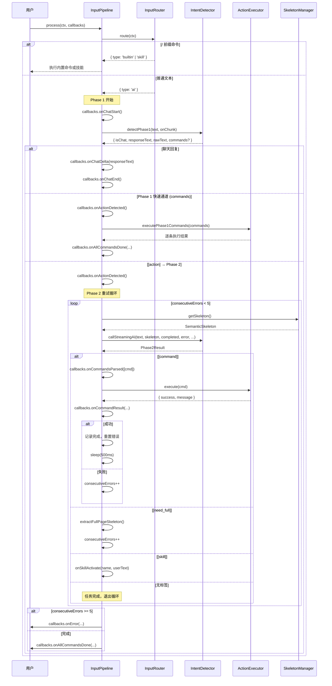

# 输入处理流水线架构

## 目标

统一处理用户输入（文字/语音），路由到聊天回复或浏览器操作。用户输入经过确定性路由、两阶段 AI 意图检测、流式指令执行、自动重试，最终完成浏览器操作或返回聊天回复。

## 架构总览

```
用户输入
   │
   ▼
┌─────────────┐
│ InputRouter  │  / 前缀 → 确定性路由
└──────┬──────┘
       │
       ├─ builtin → 内置命令（stop/pause/resume/list/help）
       ├─ skill   → 技能触发（零 AI）
       └─ ai      ──┐
                     ▼
          ┌──────────────────┐
          │  IntentDetector   │
          │  Phase 1 (轻量)   │  三分类：[command] / [action] / 聊天
          └────────┬─────────┘
                   │
       ┌───────────┼───────────┐
       │           │           │
    聊天回复   [command]    [action]
       │       快速通道       │
       ▼           │           ▼
    结束           ▼    ┌──────────────────┐
               直接执行  │  InputPipeline    │
               (无需骨架) │  Phase 2 (主力)   │  流式单指令执行 + 重试循环
                         └────────┬─────────┘
                                  │
                                  ▼
                         ┌──────────────────┐
                         │  ActionExecutor   │  执行浏览器操作
                         └──────────────────┘
```

### Mermaid 流程图

```mermaid
flowchart TD
    A[用户输入] --> B[InputRouter.route]
    B -->|/ 前缀| C{命令类型}
    B -->|普通文本| D[IntentDetector.detectPhase1]

    C -->|builtin| E[内置命令处理]
    C -->|skill| F[技能激活]

    D -->|isChat=true| G[返回聊天回复]
    D -->|Phase1 直出 [command]| FP[快速通道: executePhase1Commands]
    D -->|isChat=false / [action]| H[IntentDetector.detectPhase2]

    FP --> K2[ActionExecutor.execute]

    H --> I[InputPipeline.processPhase2WithRetry]
    I --> J{标签提取}
    J -->|[command]| K[ActionExecutor.execute]
    J -->|[need_full]| L[提取全页骨架]
    J -->|[skill]| M[技能激活]
    J -->|无标签| N[任务完成]

    K -->|成功| O{done=1?}
    K -->|失败| P{重试次数 < 5?}
    K2 -->|成功| N
    K2 -->|失败| N
    O -->|是| N
    O -->|否| I
    P -->|是| I
    P -->|否| Q[报错: 超过重试上限]

    L --> I
    M --> I
```

## 核心设计决策

### 1. 两阶段处理 (Two-Phase Processing)

处理流程分为两个阶段，各司其职：

| 阶段 | 模型 | 职责 | 输出 |
|------|------|------|------|
| Phase 1 | 轻量模型 | 聊天 vs 操作 二分类 + 简单指令直出 | `[action]` / `[command]` / 自然语言回复 |
| Phase 2 | 主力模型 | 从 AI 自然回复中提取结构化指令 | `[command]` / `[skill]` / `[need_full]` 标签 |

**Phase 1 设计考量：**
- 使用轻量模型做意图分类，降低延迟和成本
- 系统提示词 (`PHASE1_SYSTEM_PROMPT`) 要求严格三选一输出：`[command]` / `[action]` / 自然语言
- **快速通道（Fast Path）：** Phase 1 直出 `[command]` 时跳过 Phase 2，直接执行。适用于不需要页面骨架的简单操作（navigate/scroll/keyboard 等）
- 流式输出期间实时检测 `[action]` 标签，一旦检测到立即清除流式内容，用户只看到"思考中"
- 若 Phase 1 异常输出了 `[skill]` 标签，强制进入 Phase 2

**Phase 2 设计考量：**
- 使用主力模型生成操作指令
- AI 以自然语言回复，代码通过正则从回复中提取结构化标签
- 不要求 AI 只输出标签，允许 AI 在标签前后输出自然语言

### 2. 流式单指令执行 (Streaming Single-Command Execution)

Phase 2 采用流式执行模式，每次迭代只执行一条指令：

1. AI 生成回复（可能包含多条标签）
2. 代码提取标签，只取第一条 `[command]`
3. 执行该指令
4. 刷新页面骨架 (SemanticSkeleton)
5. 携带执行结果请求下一条指令

**设计优势：**
- 每步都能看到最新页面状态，指令准确性高
- 执行失败时可立即调整策略
- 用户能实时看到执行进度

### 3. 重试机制 (Retry Mechanism)

所有错误类型统一处理：

- **最大重试次数：** 5 次 (`MAX_RETRY`)
- **重试时携带的信息：**
  - 最新页面骨架（每轮重新提取）
  - 上次失败的错误信息
  - 上次失败的指令详情
  - 已完成指令列表
  - `need_full` 触发时的全页骨架（如有）
- **连续错误计数：** 指令成功执行后 `consecutiveErrors` 重置为 0

### 4. 指令去重 (Command Deduplication)

通过 `completedKeys` Set 防止重复执行：

```typescript
// key 格式: "action:url/elementId/description"
const cmdKey = `${cmd.action}:${cmd.url || cmd.elementId || cmd.description || ''}`
if (completedKeys.has(cmdKey)) {
  // 跳过执行
}
```

**适用场景：** AI 在重试时可能生成与已完成指令相同的操作，去重机制避免重复点击等副作用。

### 5. Abort 支持

整个流水线支持用户中途取消：

- `sleep()` 函数使用 `AbortSignal` 监听，等待期间可被中断
- 每轮循环开始时检查 `signal.aborted`
- AI 请求传递 `signal`，网络层可中止
- Abort 时抛出 `DOMException`，调用方统一处理

## 组件详细设计

### InputRouter

**文件：** `src/input/router.ts`

**职责：** 唯一预处理层，解析 `/` 前缀命令，其余交给 AI。

**路由逻辑：**

```
输入文本
  │
  ├─ 以 / 开头 ──→ 正则匹配 /^\/(\S+)\s*(.*)/
  │     │
  │     ├─ 命令名在 BUILTIN_COMMANDS 中 → { type: 'builtin' }
  │     └─ 否则 → { type: 'skill' }
  │
  └─ 其余 → { type: 'ai' }
```

**内置命令列表：** `stop`, `pause`, `resume`, `list`, `help`

**核心方法：**

```typescript
class InputRouter {
  route(ctx: InputContext): InputResult
}
```

- `InputContext`: `{ text: string; mode: 'text' | 'voice' }`
- `InputResult`: `{ type: 'skill' }` | `{ type: 'builtin' }` | `{ type: 'ai' }`

### IntentDetector

**文件：** `src/input/intent-detector.ts`

**职责：** 两阶段 AI 意图检测。

**Phase 1 — `detectPhase1()`**

```typescript
interface Phase1Detection {
  isChat: boolean
  responseText?: string
  rawText: string
  /** Phase 1 直接生成的指令（快速通道，跳过 Phase 2） */
  commands?: Command[]
}

async detectPhase1(
  text: string,
  onChunk?: (delta: string, reasoningDelta?: string) => void,
): Promise<Phase1Detection>
```

- 使用 `PHASE1_SYSTEM_PROMPT` 系统提示词
- 流式输出，`onChunk` 回调支持实时展示
- 判断逻辑：
  1. 提取标签 → 有 `[command]` 且无 `[action]` → **快速通道**：`{ isChat: false, commands: [...] }`
  2. 有 `[action]` → `isChat: false`，进入 Phase 2
  3. 有 `[skill]`（异常情况）→ `isChat: false`，强制进 Phase 2
  4. 有 `[chat]` 标签或纯文本 → `isChat: true`

**Phase 2 — `detectPhase2()`**

```typescript
async detectPhase2(text: string, skeleton: SemanticSkeleton): Promise<Phase2Result>
```

- 使用 `PHASE2_SYSTEM_PROMPT` 系统提示词，运行时替换 `{coreRule}` 和 `{skillList}` 占位符
- 用户消息通过 `buildPhase2UserMessage()` 构建，包含当前请求和页面骨架
- 返回 `{ commands?: Command[]; skill?: {...}; needFull?: boolean; rawAiOutput: string }`

**AI 调用细节：**
- 消息构建：最近 6 条历史消息（过滤重数据）+ 系统提示词拼接到用户消息前（兼容不支持 system role 的 API）
- `stripHeavyData()` 清理历史消息中的骨架 JSON 和全页骨架 JSON，减少 token 消耗
- AbortError 向上抛出，由调用方处理

### InputPipeline

**文件：** `src/input/pipeline.ts`

**职责：** 编排完整处理流程，包含 Phase 2 流式执行和重试循环。

**核心方法：**

```typescript
class InputPipeline {
  async process(ctx: InputContext, callbacks: PipelineCallbacks): Promise<void>
}
```

**`process()` 流程：**

1. `router.route(ctx)` 路由
   - `builtin` → `onBuiltinCommand()` 回调
   - `skill` → `onSkillActivate()` 回调
   - `ai` → 继续
2. Phase 1 流式检测
   - `onChatStart()` 创建占位消息
   - 流式回调 `onChatDelta()`，实时检测 `[action]` 标签
   - 检测到操作标签 → `onChatDelta('', undefined, true)` 清除内容
   - 聊天回复 → 替换流式内容为最终文本 → `onChatEnd()`
   - **快速通道：** `p1.commands?.length` → `executePhase1Commands()` 直接执行，跳过 Phase 2
3. Phase 2 流式执行
   - `onActionDetected()` 移除"思考中"消息
   - `processPhase2WithRetry()` 执行

**`executePhase1Commands()` 方法（快速通道）：**

```typescript
private async executePhase1Commands(
  commands: Command[],
  userText: string,
  callbacks: PipelineCallbacks,
): Promise<void>
```

- 逐条执行 Phase 1 直出的指令（不需要页面骨架）
- 共用 Phase 2 的执行逻辑和 UI 回调（`onCommandsParsed` / `onCommandResult` / `onAllCommandsDone`）
- `navigate` 操作后自动失效骨架缓存（`skeletonManager.invalidate()`）

**`processPhase2WithRetry()` 流程：**

```
while (consecutiveErrors < MAX_RETRY):
  1. 检查 abort signal
  2. 提取最新骨架
  3. 选择模式: MODE_FIRST / MODE_STREAMING / MODE_RETRY
  4. callStreamingAI() — 每次只取第一条指令
  5. 无标签 → 任务完成，break
  6. [command]:
     - 去重检查 (completedKeys)
     - 执行指令
     - 成功 → 记录、重置错误、sleep 500ms、continue
     - 失败 → 记录错误、consecutiveErrors++、continue
  7. [need_full]:
     - extractFullPageSkeleton() 提取全页骨架
     - 记录错误和全页骨架、consecutiveErrors++、continue
  8. [skill]:
     - onSkillActivate() 回调
     - 成功/失败处理、continue
```

**`callStreamingAI()` 方法：**

```typescript
private async callStreamingAI(
  text: string,
  skeleton: SemanticSkeleton,
  completed: Array<{...}>,
  lastError: string,
  lastFailedCommand?: {...} | null,
  lastFullSkeleton?: string | null,
  coreRule?: string,
): Promise<Phase2Result>
```

- 构建系统提示词：`PHASE2_SYSTEM_PROMPT` 替换 `{coreRule}` 和 `{skillList}`
- 构建用户消息：`buildStreamingUserMessage()` 包含原始请求、已完成列表、错误信息、全页骨架、当前骨架
- 只取 `tags.commands` 的第一条：`tags.commands?.slice(0, 1)`

### TagParser

**文件：** `src/input/tag-parser.ts`

**职责：** 从 AI 自然语言回复中提取结构化标签。

**核心方法：**

```typescript
function extractTags(rawText: string): ExtractedTags
```

**支持的标签：**

| 标签 | 格式 | 用途 |
|------|------|------|
| `[action]` | `[action]`（无内容） | Phase 1 操作意图标记 |
| `[chat]` | `[chat]{"text":"..."}[/chat]` 或 `[chat]文本[/chat]` | Phase 1 聊天回复 |
| `[command]` | `[command]{"action":"click","elementId":"e3"}[/command]` | 浏览器操作指令 |
| `[skill]` | `[skill]{"name":"翻译","userText":"..."}[/skill]` | 技能调用 |
| `[need_full]` | `[need_full]`（无内容） | 请求全页骨架 |

**提取策略：**
- 优先匹配闭合标签 `[tag]...[/tag]`
- 回退匹配：`[tag]` 后的整个 JSON 对象
- `[need_full]` 无需 JSON 解析，检测到标签即触发

**辅助函数：**

```typescript
function isChatOnlyReply(tags: ExtractedTags): boolean
// 无操作标签 + 有文本内容 → 纯聊天

function getChatText(tags: ExtractedTags): string
// 优先取 [chat] 标签内容，回退取原始文本
```

### Prompts

**文件：** `src/input/prompts.ts`

**职责：** 集中管理所有 AI 提示词。

**系统提示词：**

- `PHASE1_SYSTEM_PROMPT`: Phase 1 意图分类，要求严格三选一输出：`[command]` / `[action]` / 自然语言
- `PHASE2_SYSTEM_PROMPT`: Phase 2 操作决策模板，运行时替换 `{coreRule}`（模式说明）和 `{skillList}`（可用技能列表）
- `CAPABILITY_DOMAIN`: 所有能力域定义（navigate/search/click/type/scroll/keyboard 等）

**模式说明（注入 `{coreRule}` 占位符）：**

- `MODE_FIRST`: 首次进入，"每次只生成1条指令，系统执行后反馈结果再生成下一条"
- `MODE_STREAMING`: 流式执行，"按照以下信息和格式，生成下一条指令"
- `MODE_RETRY`: 错误重试，"上次指令执行失败。根据失败指令、错误信息、最新页面骨架，调整策略"

**消息构建函数：**

```typescript
buildPhase2UserMessage(text, skeleton)
// Phase 2 标准消息：当前请求 + 页面骨架

buildStreamingUserMessage(text, skeleton, completed, lastError?, lastFailedCommand?, fullSkeleton?)
// 流式执行消息：原始请求 + 已完成列表 + 错误信息 + 全页骨架 + 当前骨架
```

## 数据流时序图



## 类型定义

### InputContext

```typescript
interface InputContext {
  text: string           // 用户输入文本
  mode: 'text' | 'voice' // 输入模式
}
```

### InputResult

```typescript
type InputResult =
  | { type: 'skill'; skillName: string; skillUserText: string }
  | { type: 'builtin'; command: string; args: string }
  | { type: 'ai' }
```

### PipelineCallbacks

```typescript
interface PipelineCallbacks {
  onChatStart: () => void
  onChatDelta: (delta: string, reasoningDelta?: string, clearContent?: boolean) => void
  onChatEnd: () => void
  onActionDetected: () => void
  onChatMessage: (text: string) => void
  onCommandsParsed: (commands: Command[], currentStep?: number) => void
  onSkillParsed: (name: string, userText: string) => void
  onCommandResult: (action: string, success: boolean, message: string) => void
  onAllCommandsDone?: (userText: string, commands: Command[]) => void
  onRetryMessage: (message: string, currentStep?: number, failedCommand?: {...} | null) => void
  onError: (message: string) => void
}
```

### ExtractedTags

```typescript
interface ExtractedTags {
  chatText?: string
  commands?: Command[]
  skill?: { name: string; userText: string }
  isAction: boolean
  needFull?: boolean
  hasAnyTag: boolean
  rawText: string
}
```

## 错误处理

### Abort-Aware Sleep

```typescript
function sleep(ms: number, signal?: AbortSignal): Promise<void>
```

等待期间通过 `AbortSignal` 监听中止事件，清除定时器并抛出 `DOMException`。

### 连续错误追踪

- `consecutiveErrors`: 连续失败计数器
- 指令成功执行后重置为 0
- 达到 `MAX_RETRY` (5) 时终止循环，调用 `onError` 回调

### 重试信息传递

每轮重试携带完整上下文：

| 信息 | 用途 |
|------|------|
| 最新骨架 | AI 了解当前页面状态 |
| `lastError` | 上次失败的错误描述 |
| `lastFailedCommand` | 上次失败的指令详情 |
| `lastFullSkeleton` | `need_full` 触发时的全页骨架 |
| `completed` 已完成列表 | 避免重复操作 |

### AI 调用容错

- `IntentDetector.callAI()` 中 AI 请求失败返回空字符串，不中断流程
- AbortError 检测：捕获后向上抛出，由调用方处理
- `callStreamingAI()` 请求失败后检查 abort 状态，避免继续循环浪费请求

## 目录结构

```
src/input/
├── index.ts              # 统一导出
├── types.ts              # 类型定义 (InputContext, InputResult, PipelineCallbacks)
├── router.ts             # InputRouter — / 前缀路由
├── intent-detector.ts    # IntentDetector — Phase 1 & Phase 2 AI 调用
├── pipeline.ts           # InputPipeline — 流程编排 + 流式执行 + 重试
├── tag-parser.ts         # extractTags() — 标签提取
└── prompts.ts            # 提示词常量 + 消息构建函数
```

### 依赖关系

```
pipeline.ts
  ├── router.ts           (InputRouter)
  ├── intent-detector.ts  (IntentDetector)
  ├── tag-parser.ts       (extractTags)
  ├── prompts.ts          (PHASE2_SYSTEM_PROMPT, buildStreamingUserMessage, MODE_*)
  └── browser/
      ├── action-executor.ts  (ActionExecutor)
      ├── skeleton.ts         (SkeletonManager)
      └── local-html.ts       (extractFullPageSkeleton)

intent-detector.ts
  ├── tag-parser.ts       (extractTags, isChatOnlyReply, getChatText)
  ├── prompts.ts          (PHASE1_SYSTEM_PROMPT, PHASE2_SYSTEM_PROMPT, buildPhase2UserMessage)
  └── adapters/           (createAdapter)
```
