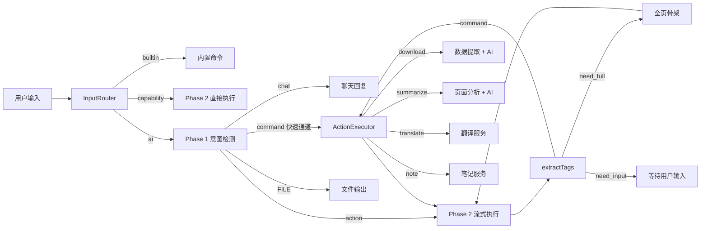
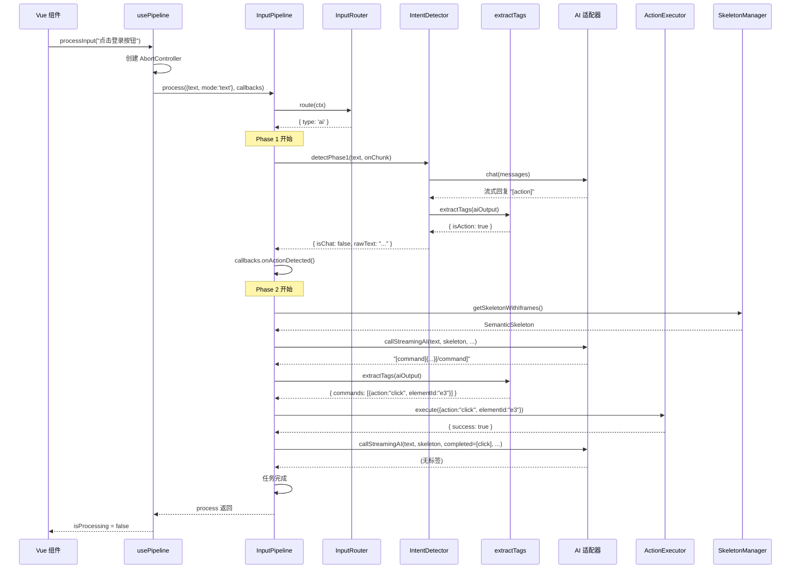
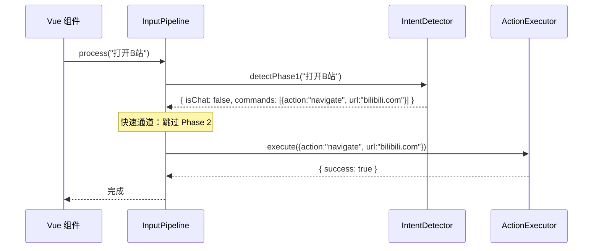
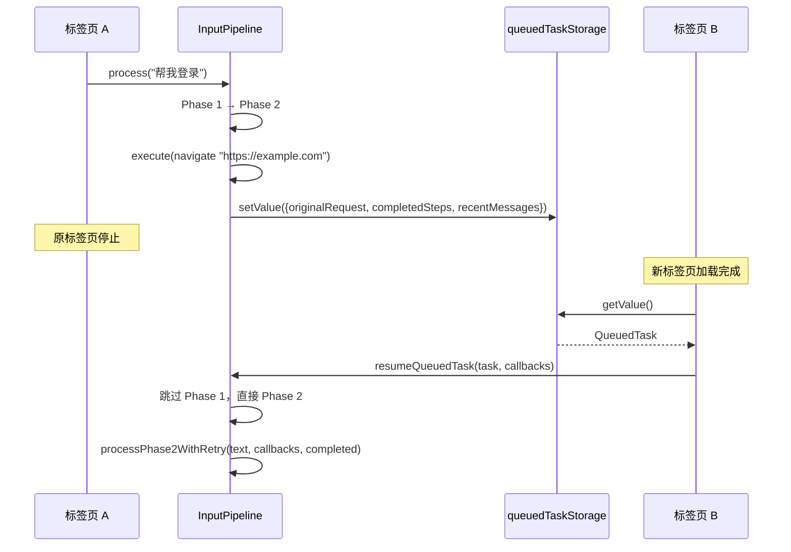
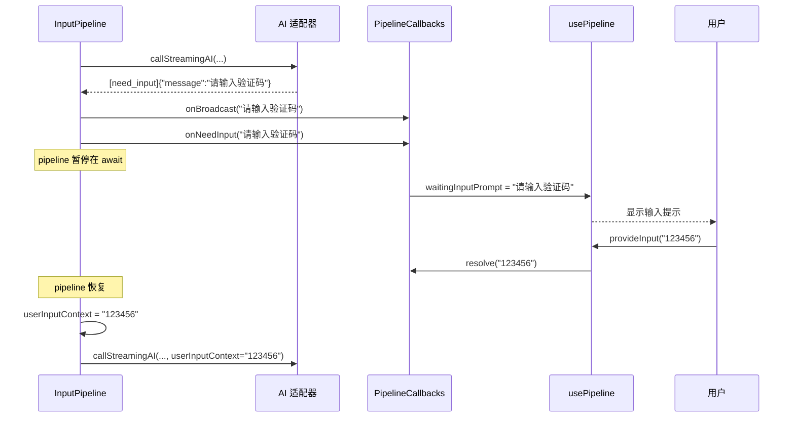
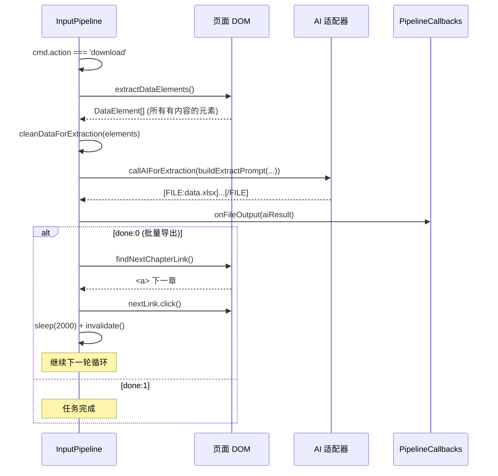

# 输入管线 (Input Pipeline)

> 模块路径：`src/input/`, `src/input/prompts/`, `src/composables/usePipeline.ts`
> 统一输入处理流水线：路由 -> Phase 1 意图检测 -> Phase 2 流式执行 -> 标签提取 -> 指令执行 -> 重试。

---

## 1. 模块概述

### 1.1 功能定位

Input Pipeline 是 AI Browser 的**意图理解与任务调度层**，承担三项核心职责：

1. **输入路由** — 区分内置命令、能力域指令和 AI 意图检测，将用户输入分发到正确的处理路径。
2. **两阶段意图检测** — Phase 1（轻量模型）做聊天/操作二分类，Phase 2（主力模型）从页面骨架生成具体浏览器指令。
3. **流式执行与重试** — 逐条执行 AI 生成的指令，支持批量执行、错误重试、跨标签页续接和用户交互式输入。

### 1.2 在架构中的位置

```
用户语音/文字 → Input Pipeline（本模块）→ AI 适配器（Adapter）
                                                  ↓
                                            Command JSON
                                                  ↓
                                      Browser Command Engine
                                      （ActionExecutor / SkeletonManager）
```

- **上游**：Vue 组件通过 `usePipeline` composable 调用 `processInput()`，传入用户文本。
- **下游**：调用 AI 适配器（`createAdapter`）获取 AI 回复，调用 `ActionExecutor` 执行浏览器操作，调用 `SkeletonManager` 提取页面骨架。
- **并行**：翻译（`TranslateService`）、笔记（`note-service`）、数据提取（`extractDataElements`）作为特殊 action 独立处理。

### 1.3 依赖关系

| 依赖 | 用途 |
|------|------|
| `src/adapters` | AI 适配器工厂，`createAdapter(provider)` 创建聊天实例 |
| `src/browser/action-executor.ts` | 浏览器指令执行引擎 |
| `src/browser/skeleton.ts` | 页面语义骨架提取（`SkeletonManager`） |
| `src/browser/local-html.ts` | 全页骨架提取（`extractFullPageSkeletonAsync`） |
| `src/browser/types.ts` | `Command`, `SemanticSkeleton` 类型定义 |
| `src/browser/translate-service.ts` | 翻译服务（动态导入） |
| `src/browser/note-service.ts` | 笔记服务（动态导入） |
| `src/storage` | `queuedTaskStorage` 跨标签页任务持久化 |
| `src/utils/logger.ts` | 统一日志（写入 chrome.storage.local） |
| `src/stores/conversations.ts` | 对话状态管理（usePipeline 使用） |
| `src/stores/settings.ts` | 设置状态管理（usePipeline 使用） |

### 1.4 文件结构

```
src/input/
├── index.ts                # 公共导出（barrel 文件）
├── types.ts                # 核心类型定义（InputContext, InputResult, PipelineCallbacks）
├── router.ts               # 输入路由器（InputRouter）
├── intent-detector.ts      # 意图检测器（IntentDetector，Phase 1 + Phase 2）
├── tag-parser.ts           # AI 标签提取器（extractTags）
├── pipeline.ts             # 统一输入处理流水线（InputPipeline）
└── prompts/
    ├── index.ts            # 桶导出
    ├── common.ts           # 共享常量（能力域列表、文件格式规则）
    ├── phase1.ts           # Phase 1 意图检测提示词
    ├── phase2.ts           # Phase 2 操作决策提示词
    ├── extract.ts          # 数据提取提示词（download 专用）
    ├── summarize.ts        # 页面分析提示词（summarize 专用）
    └── translate.ts        # 翻译提示词

src/composables/
└── usePipeline.ts          # Vue composable，集成 InputPipeline 到组件
```

---

## 2. 架构设计

### 2.1 整体架构



### 2.2 核心设计模式

#### 两阶段意图检测

Phase 1 和 Phase 2 使用不同策略，平衡响应速度与操作精度：

| 阶段 | 模型 | 输入 | 输出 | 目的 |
|------|------|------|------|------|
| Phase 1 | 轻量模型 | 用户文本 | `[action]` / `[command]` / 聊天 / `[FILE]` | 快速分类，简单操作直出 |
| Phase 2 | 主力模型 | 用户文本 + 页面骨架 JSON | `[command]` / `[need_full]` / `[need_input]` | 精确定位页面元素，生成操作指令 |

**Phase 1 快速通道**：不需要页面骨架的简单操作（navigate、scroll、keyboard 等）由 Phase 1 直接生成 `[command]`，跳过 Phase 2，减少一次 AI 调用。

#### 流式执行循环

Phase 2 不是一次性生成所有指令，而是**每次生成 1 条指令**，执行后根据结果决定下一步：

```typescript
while (totalExecutions < MAX_TOTAL_STEPS) {
  // 1. 提取骨架
  const skeleton = await skeletonManager.getSkeletonWithIframes()
  // 2. AI 生成 1 条指令
  const result = await callStreamingAI(...)
  // 3. 执行指令
  await executor.execute(cmd)
  // 4. 根据结果决定：继续 / 重试 / 结束
}
```

这种设计确保 AI 每次都能看到最新的页面状态，避免"盲操作"。

#### 标签嵌入式解析

AI 不需要只输出标签，标签可以嵌入自然语言回复中：

```
好的，我来帮你点击登录按钮。

[command]{"action":"click","elementId":"e3"}[/command]
```

`extractTags()` 用正则从任意文本中提取 `[tag]...[/tag]`，解析内部 JSON。

#### 回调驱动的 UI 更新

`PipelineCallbacks` 接口定义了 12 个回调函数，pipeline 通过回调通知 UI 层更新消息状态，不直接操作 DOM 或 Vue 状态。

### 2.3 为什么这样设计

| 设计决策 | 理由 |
|----------|------|
| 两阶段检测 | Phase 1 轻量快速（聊天秒回），Phase 2 精确但需要骨架（操作准确） |
| 流式执行而非批量生成 | SPA 页面 DOM 频繁变化，每次执行后重新提取骨架确保指令有效 |
| 标签嵌入自然语言 | AI 可以同时给用户解释和执行操作，提升体验 |
| AbortSignal 全链路传递 | 用户可随时停止，从 UI 层到 AI 请求到 sleep 等待全链路中断 |
| 指令去重（completedKeys） | AI 可能重复生成已执行的指令，去重避免无意义操作 |
| 跨标签页续接（QueuedTask） | navigate 打开新标签页后，新页自动恢复执行，用户无感 |
| 动态导入（translate/note） | 减少主 bundle 体积，按需加载 |

---

## 3. 核心类型定义

### 3.1 InputContext

用户输入上下文，由调用方构造传入：

```typescript
export interface InputContext {
  text: string           // 用户输入文本
  mode: 'text' | 'voice' // 输入模式
}
```

### 3.2 InputResult

路由器返回的路由结果，联合类型区分三种路径：

```typescript
export type InputResult =
  | { type: 'builtin'; command: string; args: string }
  | { type: 'capability'; command: string; args: string }
  | { type: 'ai' }
```

| 类型 | 含义 | 后续处理 |
|------|------|----------|
| `builtin` | 内置命令（/stop, /help 等） | 直接执行，不走 AI |
| `capability` | 能力域指令（/scroll, /navigate 等） | 跳过 Phase 1，直接进 Phase 2 |
| `ai` | 自然语言输入 | 进入 Phase 1 意图检测 |

### 3.3 Phase1Detection

Phase 1 意图检测结果：

```typescript
export interface Phase1Detection {
  isChat: boolean              // 是否为聊天回复
  responseText?: string        // 聊天回复文本（isChat=true 时有值）
  rawText: string              // AI 原始输出
  commands?: Command[]         // Phase 1 直出的指令（快速通道，跳过 Phase 2）
}
```

### 3.4 Phase2Result

Phase 2 操作决策结果：

```typescript
export interface Phase2Result {
  commands?: Command[]         // AI 生成的操作指令
  needFull?: boolean           // 请求全页骨架
  rawAiOutput: string          // AI 原始输出
}
```

扩展类型（`callStreamingAI` 返回）：

```typescript
Phase2Result & { needInput?: { message: string } }
```

### 3.5 ExtractedTags

标签提取结果：

```typescript
export interface ExtractedTags {
  chatText?: string            // [chat] 内的文本（Phase 1 纯聊天回复时有值）
  commands?: Command[]         // 提取到的 [command] 列表
  isAction: boolean            // 是否包含 [action] 标记
  needFull?: boolean           // 提取到的 [need_full]
  needInput?: { message: string; type?: string } // [need_input]
  hasFileTags: boolean         // 是否包含 [FILE:xxx]...[/FILE] 文件标签
  fileTagDetails?: {           // 文件标签详情（用于日志）
    filename: string
    hasClosingTag: boolean
    contentLength: number
  }
  hasAnyTag: boolean           // 是否提取到了任何标签
  rawText: string              // 原始文本
}
```

### 3.6 PipelineCallbacks

流水线回调接口，pipeline 通过回调通知 UI 层：

```typescript
export interface PipelineCallbacks {
  onChatStart: () => void
  onChatDelta: (delta: string, reasoningDelta?: string, clearContent?: boolean) => void
  onChatEnd: () => void
  onActionDetected: () => void
  onChatMessage: (text: string) => void
  onCommandsParsed: (commands: Command[], currentStep?: number) => void
  onCommandResult: (action: string, success: boolean, message: string) => void
  onAllCommandsDone?: (userText: string, commands: Command[]) => void
  onRetryMessage: (message: string, currentStep?: number, failedCommand?: {
    action: string; elementId?: string; description?: string; text?: string; url?: string
  } | null) => void
  onError: (message: string) => void
  onNeedInput: (prompt: string) => Promise<string>
  onFileOutput?: (content: string) => void
  onBroadcast?: (text: string) => void
}
```

| 回调 | 触发时机 | 用途 |
|------|----------|------|
| `onChatStart` | Phase 1 聊天回复开始 | 创建占位消息，实现打字机效果 |
| `onChatDelta` | 流式输出增量 | 更新消息内容；`clearContent=true` 时清空已输出内容 |
| `onChatEnd` | 聊天回复结束 | 标记消息状态为 done |
| `onActionDetected` | Phase 1 检测到操作意图 | 清除流式消息中的标签内容 |
| `onChatMessage` | 纯文本聊天回复（非流式） | 直接添加消息 |
| `onCommandsParsed` | 指令解析完成 | 展示即将执行的指令 |
| `onCommandResult` | 单条指令执行完成 | 展示执行结果（成功/失败） |
| `onAllCommandsDone` | 全部指令执行成功 | 记录任务完成状态到对话历史 |
| `onRetryMessage` | 重试时 | 展示重试过程 |
| `onError` | 超过重试上限 | 展示错误信息 |
| `onNeedInput` | AI 需要用户输入 | 暂停 pipeline，等待用户输入后 resolve |
| `onFileOutput` | download 数据提取完成 | 输出 AI 生成的文件内容 |
| `onBroadcast` | 操作完成 | 语音播报结果 |

### 3.7 PipelineOptions

流水线构造选项：

```typescript
export interface PipelineOptions {
  getSettings: () => AppSettings
  getModelId?: () => string
  getRecentMessages?: () => Array<{ role: 'user' | 'assistant' | 'system'; content: string }>
  getSignal?: () => AbortSignal | undefined
  onBuiltinCommand?: (command: string, args: string) => void
}
```

### 3.8 IntentDetectorOptions

意图检测器构造选项：

```typescript
export interface IntentDetectorOptions {
  getSettings: () => AppSettings
  getModelId?: () => string
  getRecentMessages?: () => Array<{ role: 'user' | 'assistant' | 'system'; content: string }>
  getSignal?: () => AbortSignal | undefined
}
```

### 3.9 CapabilityItem

能力域定义（共享常量）：

```typescript
export interface CapabilityItem {
  id: string           // 指令标识（如 navigate, scroll, click）
  title: string        // 中文标题
  desc: string         // 描述
  needSkeleton: boolean // 是否需要页面骨架
}
```

### 3.10 DataElement

download 数据提取的页面元素（pipeline.ts 内部类型）：

```typescript
interface DataElement {
  tag: string
  text: string
  parent?: string           // table/ul/ol/main/article 等
  href?: string
  src?: string
  alt?: string
  row?: number              // 表格行号
  col?: number              // 表格列号
  type?: 'text' | 'image' | 'code'
}
```

---

## 4. 实现细节

### 4.1 InputRouter — 输入路由器

**源码**: `src/input/router.ts`

```typescript
export class InputRouter {
  route(ctx: InputContext): InputResult
}
```

**算法**：

1. `text.trim()` 去除首尾空白
2. 以 `/` 开头 → 解析斜杠命令：
   - 匹配正则 `/^\/(\S+)\s*(.*)/`，提取命令名和参数
   - 命令名在 `BUILTIN_COMMANDS`（`['stop', 'pause', 'resume', 'list', 'help']`）中 → 返回 `{ type: 'builtin' }`
   - 命令名在 `CAPABILITY_IDS`（`CAPABILITY_DOMAIN_LIST` 的 id 集合）中 → 返回 `{ type: 'capability' }`
   - 都不匹配 → 返回 `{ type: 'builtin', command: 'unknown', args: 命令名 }`
3. 非 `/` 开头 → 返回 `{ type: 'ai' }`

**边界处理**：
- 空白输入：`trim()` 后为空字符串，不以 `/` 开头，走 AI 路径
- `/` 后无命令名：正则不匹配，返回 `{ isCommand: false }`，走 AI 路径
- 命令参数可选：`/help` 无参数，`/scroll auto` 有参数

### 4.2 IntentDetector — 意图检测器

**源码**: `src/input/intent-detector.ts`

#### Phase 1: detectPhase1

```typescript
async detectPhase1(
  text: string,
  onChunk?: (delta: string, reasoningDelta?: string) => void,
): Promise<Phase1Detection>
```

**参数**：
- `text` — 用户输入文本
- `onChunk` — 流式输出回调（可选）

**返回值**：`Phase1Detection`

**算法**：

1. 构建 Phase 1 提示词：`buildPhase1Prompt(automationEnabled)`
2. 调用 AI：`callAI('Phase1', systemPrompt, text, onChunk)`
3. 提取标签：`extractTags(aiOutput)`
4. 分支决策：
   - `[command]` 且无 `[action]` → 快速通道，返回 `{ isChat: false, commands }`
   - `[action]` → 返回 `{ isChat: false }`，进入 Phase 2
   - `[FILE:xxx]` → 作为聊天回复返回（前端渲染为文件卡片）
   - `isChatOnlyReply(tags)` → 纯聊天，返回 `{ isChat: true, responseText }`
   - 其他 → 纯文本聊天，返回 `{ isChat: true, responseText: aiOutput.trim() }`

**边界处理**：
- AI 未返回回复（空字符串）→ 默认当作 `[action]`，返回 `{ isChat: false }`
- `onChunk` 回调中支持 `reasoningDelta`（AI 思考过程），透传给 UI

#### Phase 2: detectPhase2

```typescript
async detectPhase2(text: string, skeleton: SemanticSkeleton): Promise<Phase2Result>
```

**参数**：
- `text` — 用户输入文本
- `skeleton` — 页面语义骨架

**返回值**：`Phase2Result`

**算法**：

1. 构建 Phase 2 提示词：`buildPhase2Prompt(automationEnabled)`
2. 构建用户消息：`buildPhase2UserMessage(text, skeleton)`
3. 调用 AI：`callAI('Phase2', systemPrompt, userContent)`
4. 提取标签：`extractTags(aiOutput)`
5. 返回 `{ commands, needFull, rawAiOutput }`

**边界处理**：
- AI 未返回回复 → 返回 `{ rawAiOutput: '' }`
- 未提取到有效标签 → 返回 `{ rawAiOutput }`（无 commands/needFull）

#### callAI — AI 调用

```typescript
private async callAI(
  scene: string,
  systemPrompt: string,
  userContent: string,
  onChunk?: (delta: string, reasoningDelta?: string) => void,
): Promise<string>
```

**消息构建**：
1. 获取最近 N 条历史消息（`getRecentMessages`），跳过最后一条 user 消息（避免重复）
2. 对历史消息调用 `stripHeavyData()` 清理重数据
3. 将 system 提示词拼接到用户消息前面（兼容不支持 system role 的 API）：`${systemPrompt}\n\n用户输入: ${userContent}`
4. 添加当前用户消息

**错误处理**：
- AbortError → 向上抛出，让调用方处理中止逻辑
- 其他错误 → 记录日志，返回空字符串

**stripHeavyData 函数**（清理历史消息中的重数据）：

```typescript
function stripHeavyData(content: string): string
```

保留：`[原始请求]`、`[已完成]`、`[上次错误]`、`[用户补充信息]`
过滤：系统提示词、`[页面骨架]` JSON、`[全页骨架]` JSON、`[失败指令]` JSON

### 4.3 extractTags — 标签提取器

**源码**: `src/input/tag-parser.ts`

```typescript
export function extractTags(rawText: string): ExtractedTags
```

**参数**：`rawText` — AI 原始输出文本

**返回值**：`ExtractedTags`

**算法**（按顺序提取 6 种标签）：

1. **`[FILE:xxx]...[/FILE]`** — 正则 `/\[FILE:\s*([^\]]+)\]\r?\n?([\s\S]*?)(?:\[\/FILE\]|$)/i`，兼容大小写、可选空格、无闭合标签
2. **`[chat]...[/chat]`** — 先匹配闭合标签，匹配不到则取 `[chat]` 后的整个内容。内容尝试 JSON.parse，失败则取原始文本
3. **`[command]...[/command]`** — 先匹配闭合标签，匹配不到则取 `[command]` 后的整个 JSON。支持：
   - 单条格式：`[command]{"action":"click"}[/command]`
   - 数组格式：`[command][{"action":"click"},{"action":"type"}][/command]`
   - JSON.parse 失败时调用 `parseCommandFallback()` 正则回退提取
4. **`[action]`** — 无内容标签，`rawText.includes('[action]')` 即可
5. **`[need_full]`** — 无内容标签，`rawText.includes('[need_full]')` 即可
6. **`[need_input]...[/need_input]`** — JSON 内容标签，提取 `message` 和 `type` 字段

**parseCommandFallback 回退解析**：

```typescript
function parseCommandFallback(raw: string): Command | null
```

当 AI 生成的 JSON 包含未转义引号时，`JSON.parse` 会失败。回退策略用正则逐字段提取 `action`、`elementId`、`url`、`description`、`done`，`text` 字段用位置匹配（从 `"text":"` 到最后的 `","done":`）。

#### isChatOnlyReply

```typescript
export function isChatOnlyReply(tags: ExtractedTags): boolean
```

判断逻辑：
- 有操作类标签（`isAction` / `commands` / `needFull` / `needInput`）或文件标签 → `false`
- 有 `[chat]` 标签 → `true`
- 没有任何标签 + 有文本内容 → `true`（AI 直接回复自然语言）
- 其他 → `false`

#### getChatText

```typescript
export function getChatText(tags: ExtractedTags): string
```

优先取 `[chat]` 标签内容，没有则取原始文本（`rawText.trim()`）。

### 4.4 InputPipeline — 统一输入处理流水线

**源码**: `src/input/pipeline.ts`

```typescript
export class InputPipeline {
  constructor(options: PipelineOptions)
  async process(ctx: InputContext, callbacks: PipelineCallbacks): Promise<void>
  async resumeQueuedTask(task: QueuedTask, callbacks: PipelineCallbacks): Promise<void>
}
```

#### process — 主入口

```typescript
async process(ctx: InputContext, callbacks: PipelineCallbacks): Promise<void>
```

**完整流程**：

1. **路由** — `router.route(ctx)` 决定处理路径
2. **内置命令** → `onBuiltinCommand(command, args)`，直接返回
3. **能力域指令** → 跳过 Phase 1，直接进入 `processPhase2WithRetry`
4. **Phase 1** — 流式输出，检测到操作标签时清空内容：
   - 流式过程中检查 abort 信号
   - 检测到 `[action` 或 `[command` 关键词时，调用 `onChatDelta('', undefined, true)` 清空已输出内容
   - 聊天回复 → 用清理后的最终文本替换流式内容
   - 快速通道（`p1.commands`）→ `executePhase1Commands` 直接执行
   - `[action]` → 进入 Phase 2

**Phase 1 流式输出优化**：

```typescript
// 检测到操作标签 → 清掉流式内容，只保留"思考中"
if (/\[(?:action|command)|(?:action|command)\]/.test(phase1StreamedContent)) {
  phase1ActionTagDetected = true
  callbacks.onChatDelta('', undefined, true)  // clearContent=true
}
```

关键词必须带 `[` 或 `]`，防止聊天中提到 "action" 等词误触发。

#### executePhase1Commands — Phase 1 快速通道

```typescript
private async executePhase1Commands(
  commands: Command[],
  userText: string,
  callbacks: PipelineCallbacks,
): Promise<void>
```

逐条执行 Phase 1 直出的指令（不需要页面骨架）：

- `translate` → 动态导入 `TranslateService`，调用 `translateVisible`
- `note` → 动态导入 `optimizeAsNoteStream`，流式输出笔记
- 其他 → `ActionExecutor.execute(cmd, signal)`

navigate 成功后调用 `skeletonManager.invalidate()`。

#### processPhase2WithRetry — Phase 2 流式执行循环

```typescript
private async processPhase2WithRetry(
  text: string,
  callbacks: PipelineCallbacks,
  initialCompleted?: Array<{ action: string; elementId?: string; description?: string }>,
): Promise<void>
```

**核心循环**（`MAX_TOTAL_STEPS = 50`）：

```
while (totalExecutions < MAX_TOTAL_STEPS) {
  1. 检查 abort signal
  2. 提取骨架（skeletonManager.getSkeletonWithIframes()）
  3. 选择模式：MODE_FIRST / MODE_STREAMING / MODE_RETRY
  4. 调用 callStreamingAI 生成 1 条指令
  5. 处理结果：
     - 无标签 → 任务完成，break
     - need_input → 暂停等待用户输入，continue
     - command → 执行指令（支持批量数组）
     - need_full → 提取全页骨架，continue
  6. 指令执行结果：
     - 成功 → 记录到 completed，检查 done/navigate/_blank
     - 失败 → 记录错误，单条走重试，批量跳过继续
}
```

**指令去重**：

```typescript
const cmdKey = `${cmd.action}:${cmd.url || cmd.elementId || cmd.description || ''}:${cmd.text || ''}`
if (completedKeys.has(cmdKey)) continue
```

**特殊 action 处理**：

| action | 处理方式 | 完成条件 |
|--------|----------|----------|
| `download` | `extractDataElements()` → `cleanDataForExtraction()` → AI 提取 → `onFileOutput` | `done:1` 或无下一章链接 |
| `summarize` | `extractPageText()` → AI 分析（流式）→ `onChatDelta` | 始终 `done:1` |
| `translate` | 动态导入 `TranslateService` → `translateVisible` | `done:1` |
| `note` | 动态导入 `optimizeAsNoteStream` → 流式输出 | `done:1` |
| `click` (done:0) | 前置保存 `queuedTask`，执行后检查 `openedNewTab` | `_blank` 新开页时中断 |
| `navigate` | 执行成功后保存 `queuedTask`，中断循环 | 成功即中断 |
| `upload` | 补充文件名（从用户输入的 `[文件: xxx]` 标签提取） | 正常执行 |

**批量执行**：

```typescript
const isBatch = cmds.length > 1
// 批量模式下 sleep 缩短为 200ms（单条 500ms）
await sleep(isBatch ? 200 : 500, signal)
```

`batchStopped` 标记在 navigate / `_blank` 新开页 / `done:1` 时设为 true，中断批量和外层循环。

**need_input 处理**：

```typescript
if (phase2Result.needInput) {
  callbacks.onBroadcast?.(phase2Result.needInput.message)
  userInputContext = await callbacks.onNeedInput(phase2Result.needInput.message)
  lastError = ''
  lastFailedCommand = null
  continue
}
```

pipeline 暂停在 `await callbacks.onNeedInput()`，用户输入后 resolve，携带 `userInputContext` 继续执行。

**need_full 处理**：

```typescript
if (phase2Result.needFull) {
  const fullSkeleton = await extractFullPageSkeletonAsync()
  lastError = '当前视口骨架未找到目标元素，已提取全页骨架'
  lastFullSkeleton = fullSkeleton
  continue
}
```

#### callStreamingAI — 流式 AI 调用

```typescript
private async callStreamingAI(
  text: string,
  skeleton: SemanticSkeleton,
  completed: Array<{ action: string; elementId?: string; description?: string }>,
  lastError: string,
  lastFailedCommand?: { ... } | null,
  lastFullSkeleton?: string | null,
  coreRule?: string,
  userInputContext?: string,
): Promise<Phase2Result & { needInput?: { message: string } }>
```

**消息构建**：

```typescript
// 系统提示词：{coreRule} 占位符替换
const systemPrompt = buildPhase2Prompt(automation).replace('{coreRule}', coreRule)

// 用户消息：原始请求 + 已完成步骤 + 错误信息 + 骨架 JSON
const userContent = buildStreamingUserMessage(text, skeleton, completed, lastError, lastFailedCommand, lastFullSkeleton, userInputContext)

// 历史消息：最近 N 条，stripHeavyData 清理，跳过最后一条 user 消息
const messages = [...filteredRecentMsgs, { role: 'user', content: `${systemPrompt}\n\n${userContent}` }]
```

**buildStreamingUserMessage 消息结构**：

```
[原始请求] 用户: "..."
[已完成] 1. click e3 (登录)  2. type e5 (输入文字)
[上次错误] [click] 未找到目标元素
[失败指令] {"action":"click","elementId":"e7"}
[页面骨架]
{"url":"...","title":"...","elements":[...]}
[用户补充信息] 用户提供的额外信息
```

#### resumeQueuedTask — 跨标签页续接

```typescript
async resumeQueuedTask(task: QueuedTask, callbacks: PipelineCallbacks): Promise<void>
```

跳过 Phase 1，直接进入 Phase 2 流式执行。已完成步骤从 `task.completedSteps` 读取，传入 `processPhase2WithRetry` 的 `initialCompleted` 参数。

#### 辅助函数

**extractDataElements** — download 数据提取：

```typescript
function extractDataElements(): DataElement[]
```

从 `document.body.querySelectorAll('*')` 提取所有有文本内容的元素。与骨架提取的区别：骨架只提取可交互元素（按钮/链接/输入框），这里提取所有有内容的元素（表格 td、列表 li、段落 p 等）。跳过 script/style/noscript/svg/path/br/hr 和隐藏元素。图片单独提取（不需要文本内容）。限制 500 条。

**cleanDataForExtraction** — 清洗数据元素：

```typescript
function cleanDataForExtraction(elements: DataElement[]): string
```

过滤纯空白/纯标点元素，限制 500 条，返回 JSON 字符串（包含 url、title、count、data）。

**extractPageText** — 提取页面全文：

```typescript
function extractPageText(): string
```

使用 `document.body.innerText` 获取页面可见文本（自动过滤 script/style/hidden 元素），限制 15000 字符。

**findNextChapterLink** — 查找下一章链接：

```typescript
function findNextChapterLink(): HTMLElement | null
```

优先级：文本匹配（下一章/下一页/Next/>）→ `rel="next"` 属性 → 常见类名（.next-chapter/.next-page/.pagination .next）。检查可见性和有效 href。

**sleep** — abort-aware 等待：

```typescript
function sleep(ms: number, signal?: AbortSignal): Promise<void>
```

等待期间可被 AbortSignal 中断。signal 已 aborted 时立即 reject，否则注册 abort 监听器清理 timer。

### 4.5 提示词模块

**源码**: `src/input/prompts/`

#### common.ts — 共享常量

`CAPABILITY_DOMAIN_LIST` 定义 22 项能力域（比旧版多了 `upload`、`slider`、`closeModal`、`translate`、`note`）：

```typescript
export const CAPABILITY_DOMAIN_LIST: CapabilityItem[] = [
  { id: 'navigate',   title: '打开网址',   desc: '打开URL（需url）',                     needSkeleton: false },
  { id: 'scroll',     title: '滚动页面',   desc: '滚动页面（direction:up/down/top/bottom/auto/stop/pause/resume）', needSkeleton: false },
  { id: 'newTab',     title: '新标签页',   desc: '打开新标签页',                          needSkeleton: false },
  { id: 'closeTab',   title: '关闭标签页', desc: '关闭当前标签页',                        needSkeleton: false },
  { id: 'nextTab',    title: '下一个标签', desc: '切换下一个标签页',                      needSkeleton: false },
  { id: 'prevTab',    title: '上一个标签', desc: '切换上一个标签页',                      needSkeleton: false },
  { id: 'switchTab',  title: '切换标签页', desc: '切换到指定标签页（需tabQuery）',          needSkeleton: false },
  { id: 'keyboard',   title: '模拟按键',   desc: '模拟按键（需key:Enter/Escape/Tab）',     needSkeleton: false },
  { id: 'wait',       title: '等待',       desc: '等待（需ms）',                          needSkeleton: false },
  { id: 'search',     title: '全网搜索',   desc: '全网搜索（需text）',                    needSkeleton: true },
  { id: 'click',      title: '点击元素',   desc: '点击元素（需elementId或description）',   needSkeleton: true },
  { id: 'type',       title: '输入文字',   desc: '输入文字（需elementId+text）',           needSkeleton: true },
  { id: 'clear',      title: '清空输入框', desc: '清空输入框（需elementId）',              needSkeleton: true },
  { id: 'select',     title: '选择下拉框', desc: '选择下拉框（需elementId+text）',         needSkeleton: true },
  { id: 'focus',      title: '聚焦元素',   desc: '聚焦元素（需elementId）',                needSkeleton: true },
  { id: 'hover',      title: '悬停元素',   desc: '悬停元素（需elementId）',                needSkeleton: true },
  { id: 'upload',     title: '上传文件',   desc: '上传文件到file input（需elementId+fileData）', needSkeleton: true },
  { id: 'slider',     title: '拖动滑块',   desc: '拖动滑块到指定值（需elementId+value）',  needSkeleton: true },
  { id: 'closeModal', title: '关闭弹窗',   desc: '关闭页面弹窗/对话框',                    needSkeleton: false },
  { id: 'download',   title: '提取数据',   desc: '提取页面数据并导出文件',                  needSkeleton: true },
  { id: 'summarize',  title: '分析总结',   desc: '提取页面全文并AI分析总结',                needSkeleton: true },
  { id: 'translate',  title: '翻译页面',   desc: '翻译当前页面内容',                       needSkeleton: true },
  { id: 'note',       title: '生成笔记',   desc: '对当前页面内容生成笔记',                  needSkeleton: true },
]
```

衍生常量：
- `CAPABILITY_LIST` — 完整列表（Phase 2 用）
- `PHASE1_CAPABILITY_LIST` — 仅 `needSkeleton=false` 的列表（Phase 1 用）

共享规则片段：
- `FILE_FORMAT_RULES` — 文件输出格式规则（单文件/多文件/图表 .chart）
- `SITE_URL_RULE` — 网站名转 URL 规则
- `FILE_EXT_RULE` — 文件扩展名规则
- `COMMAND_CLOSE_RULE` — 标签闭合规则

#### phase1.ts — Phase 1 提示词

```typescript
export function buildPhase1Prompt(automation: boolean): string
```

- `automation=true` → 完整版（`PHASE1_SYSTEM_PROMPT`）：支持 `[command]` / `[action]` / `[FILE]` / 直接回复四种格式
- `automation=false` → 精简版（`PHASE1_NO_AUTO_PROMPT`）：仅支持 `[FILE]` / 直接回复两种格式

#### phase2.ts — Phase 2 提示词

```typescript
export function buildPhase2Prompt(_automation?: boolean): string
```

始终返回完整版 `PHASE2_SYSTEM_PROMPT`（Phase 2 仅在自动化开启时被触发）。

系统提示词包含 `{coreRule}` 占位符，运行时替换为模式描述：

```typescript
export const MODE_FIRST = '首次执行。根据用户请求和页面骨架，生成第1条指令...'
export const MODE_STREAMING = '继续执行。根据用户原始请求、已完成步骤、当前页面骨架...'
export const MODE_RETRY = '上次指令执行失败。调整策略：元素被遮挡→先scroll让元素可见...'
```

消息构建函数：

```typescript
export function buildPhase2UserMessage(text: string, skeleton: SemanticSkeleton): string
// 返回: [当前请求] 用户: "..." + [页面骨架] {JSON}

export function buildStreamingUserMessage(
  text: string, skeleton: SemanticSkeleton,
  completed: Array<{...}>, lastError?: string,
  lastFailedCommand?: {...} | null, fullSkeleton?: string,
  userInputContext?: string,
): string
// 返回: [原始请求] + [已完成] + [上次错误] + [失败指令] + [页面骨架/全页骨架] + [用户补充信息]
```

#### extract.ts — 数据提取提示词

```typescript
export const EXTRACT_SYSTEM_PROMPT: string
export function buildExtractPrompt(userRequest: string, cleanedSkeleton: string, automation?: boolean): string
```

- `automation=false` → 返回"网页自动化已关闭"提示
- `automation=true` → 拼接系统提示词 + 用户请求 + 页面骨架数据

#### summarize.ts — 页面分析提示词

```typescript
export const SUMMARIZE_SYSTEM_PROMPT: string
export function buildSummarizePrompt(userRequest: string, pageText: string): string
```

分析框架定义输出格式：核心总结 → 内容分析 → 技术深挖 → 关键洞察 → 行动建议 → 标签。

#### translate.ts — 翻译提示词

```typescript
export const TRANSLATE_SYSTEM_PROMPT: string
export function buildSelectionTranslateMessage(text: string, targetLang: string): string
export function buildAutoTranslateMessage(texts: Array<{ id: string; text: string }>, targetLang: string): string
```

划词翻译返回纯文本，批量翻译返回 JSON 数组 `[{"id":"e1","translated":"译文"}]`。

### 4.6 usePipeline — Vue Composable

**源码**: `src/composables/usePipeline.ts`

```typescript
export function usePipeline() {
  return {
    isProcessing: Ref<boolean>,
    waitingInputPrompt: Ref<string | null>,
    processInput: (text: string, reasoning?: boolean) => Promise<void>,
    resumeQueuedTask: (task: QueuedTask) => Promise<void>,
    executeCommand: (cmd: Command) => Promise<ActionResult>,
    addSystemMessage: (content: string) => void,
    provideInput: (text: string) => void,
    abort: () => Promise<void>,
  }
}
```

**模块级状态**：
- `isProcessing` — 是否正在处理（ref，跨组件共享）
- `waitingInputPrompt` — AI 等待用户输入时的提示文本
- `_abortFn` — 模块级 abort 引用，供 `abortPipeline()` 调用

**processInput 流程**：

1. 创建 `AbortController`
2. 构建 `PipelineCallbacks`（12 个回调，操作 Vue 状态）
3. 调用 `pipeline.process({ text, mode: 'text' }, callbacks)`
4. finally 块：清理流式消息、重置状态、调用 `stoppedResolve`

**关键回调实现**：

- `onChatStart` — 创建 reactive `ChatMessage`，推入 `conversation.messages`
- `onChatDelta` — 更新 `currentStreamingMsg.content`；`clearContent=true` 时清空
- `onActionDetected` — 标记消息为"正在执行操作..."，清空 `currentStreamingMsg` 引用
- `onCommandsParsed` — 删除 Phase 1 占位消息，添加执行状态消息
- `onNeedInput` — 设置 `waitingInputPrompt`，返回 Promise（`waitingInputResolve`/`waitingInputReject`）
- `onFileOutput` — 添加 assistant 消息（触发 MessageItem 的 `[FILE]` 渲染）
- `onBroadcast` — 派发 `aib-broadcast` CustomEvent，由 VoiceManager 监听播报

**abort 流程**：

```typescript
function abort(): Promise<void> {
  // 1. reject 等待中的 Promise（need_input 场景）
  waitingInputReject?.(new DOMException('...', 'AbortError'))
  // 2. abort 当前请求
  currentAborter?.abort()
  // 3. 清除跨标签页排队任务
  queuedTaskStorage.setValue(null)
  // 4. 等待 pipeline 真正结束（超时 3 秒兜底）
  if (isProcessing.value) {
    return new Promise(resolve => {
      stoppedResolve = resolve
      setTimeout(() => { /* 强制重置 */ }, 3000)
    })
  }
}
```

**provideInput 流程**：

```typescript
function provideInput(text: string) {
  addSystemMessage(`📝 **您的输入：** ${text}`)
  waitingInputResolve(text)  // resolve Promise，pipeline 继续执行
}
```

**resumeQueuedTask 流程**：

1. 创建 AbortController
2. 构建 PipelineCallbacks（与 processInput 类似，部分回调适配恢复场景）
3. 还原跨标签页的历史消息（去重：`role::content` 集合）
4. 调用 `pipeline.resumeQueuedTask(task, callbacks)`

**模块级 abortPipeline**：

```typescript
export async function abortPipeline(): Promise<void> {
  await _abortFn?.()
}
```

供清除会话/缓存时调用，确保 pipeline 停止。

---

## 5. 数据流

### 5.1 完整处理流程



### 5.2 快速通道流程



### 5.3 跨标签页续接流程



### 5.4 need_input 用户交互流程



### 5.5 download 数据提取流程



---

## 6. 配置与扩展

### 6.1 可配置参数

| 参数 | 值 | 位置 | 说明 |
|------|-----|------|------|
| `MAX_TOTAL_STEPS` | 50 | pipeline.ts | Phase 2 流式执行循环总次数上限 |
| `BUILTIN_COMMANDS` | `['stop', 'pause', 'resume', 'list', 'help']` | router.ts | 内置命令列表 |
| 历史消息条数 | `settings.maxContext`（默认 100） | usePipeline.ts | 传入 AI 的最近消息条数 |
| sleep 等待时间 | 批量 200ms / 单条 500ms | pipeline.ts | 指令执行后等待页面更新 |
| need_full 等待 | 2000ms | pipeline.ts | download 自动点击下一章后等待 |
| abort 超时 | 3000ms | usePipeline.ts | abort 等待 pipeline 结束的超时时间 |
| 消息自动清理 | 500 条 | usePipeline.ts | 对话消息超过上限时裁剪 |
| 页面文本截断 | 15000 字符 | pipeline.ts `extractPageText` | summarize 场景页面全文截断 |
| 数据元素限制 | 500 条 | pipeline.ts `cleanDataForExtraction` | download 场景元素数量限制 |
| stripHeavyData | 正则清理 | intent-detector.ts, pipeline.ts | 清理历史消息中的骨架 JSON 等重数据 |

### 6.2 扩展点

#### 新增能力域

在 `CAPABILITY_DOMAIN_LIST` 中添加新项：

```typescript
{ id: 'newAction', title: '新操作', desc: '操作描述', needSkeleton: true/false }
```

- `needSkeleton=false` → Phase 1 可直出 `[command]`
- `needSkeleton=true` → 需要 Phase 2 骨架

#### 新增特殊 action 处理

在 `processPhase2WithRetry` 的批量执行循环中添加新的 action 分支：

```typescript
if (cmd.action === 'newAction') {
  // 自定义处理逻辑
  callbacks.onCommandResult('newAction', success, message)
  continue
}
```

同时在 `executePhase1Commands` 中添加对应的快速通道处理。

#### 新增 Phase 1 输出格式

1. 在 `phase1.ts` 的 `PHASE1_SYSTEM_PROMPT` 中添加新格式说明
2. 在 `tag-parser.ts` 的 `extractTags` 中添加新的正则提取
3. 在 `intent-detector.ts` 的 `detectPhase1` 中添加新的分支决策
4. 在 `pipeline.ts` 的 `process` 中添加新的处理路径

#### 自定义提示词

所有提示词通过 `prompts/` 目录的函数构建，可独立修改：

- `buildPhase1Prompt(automation)` — Phase 1 系统提示词
- `buildPhase2Prompt()` — Phase 2 系统提示词
- `buildExtractPrompt(userRequest, cleanedSkeleton, automation)` — 数据提取提示词
- `buildSummarizePrompt(userRequest, pageText)` — 页面分析提示词

---

## 7. 已知限制

### 7.1 意图检测

- **Phase 1 误判** — AI 可能将操作请求误判为聊天（如"帮我看看这个页面"可能是 summarize 也可能是聊天），或聊天误判为操作（如"点击率很高"中的"点击"可能触发 `[action]`）。
- **Phase 2 指令漂移** — AI 在多步操作中可能偏离用户原始意图，尤其是长对话上下文中。
- **标签格式脆弱** — AI 输出的 JSON 可能包含未转义引号，导致 `JSON.parse` 失败。`parseCommandFallback` 正则回退可缓解但不完全可靠。
- **done 判定不准** — AI 可能错误判断 `done:0`/`done:1`，导致任务过早结束或无限循环。

### 7.2 流式执行

- **MAX_TOTAL_STEPS 上限** — 50 次执行上限防止无限循环，但复杂多步任务可能被截断。
- **骨架时效性** — 每轮循环重新提取骨架，但 AI 响应期间页面可能已变化（如懒加载内容）。
- **批量执行原子性** — 批量指令逐条执行，某条失败不影响后续，但没有回滚机制。
- **navigate 后状态丢失** — navigate 成功后原标签页停止，新标签页通过 QueuedTask 续接，但原标签页的流式消息状态无法迁移。

### 7.3 跨标签页续接

- **QueuedTask 竞态** — 多个标签页同时读取 QueuedTask 可能导致重复执行。
- **历史消息去重** — `role::content` 集合去重可能误删内容相同但语义不同的消息。
- **storage 事件延迟** — `chrome.storage.local` 写入后其他标签页的监听有延迟，极端情况下可能丢失续接。

### 7.4 数据提取

- **download 元素覆盖** — `extractDataElements` 使用 `document.body.querySelectorAll('*')`，无法穿透 Shadow DOM 和跨域 iframe。
- **下一章链接检测** — `findNextChapterLink` 依赖文本匹配和常见类名，非标准分页可能检测失败。
- **summarize 文本截断** — `extractPageText` 限制 15000 字符，长文章可能丢失尾部内容。

### 7.5 用户交互

- **need_input 超时** — pipeline 暂停在 `await callbacks.onNeedInput()`，没有超时机制，用户不响应则 pipeline 永久挂起（仅 abort 可中断）。
- **abort 竞态** — abort 时 reject waitingInputPromise 和 abort 请求可能同时触发，需确保不会重复清理。

### 7.6 提示词

- **system prompt 兼容** — system 提示词拼接到用户消息前面（兼容不支持 system role 的 API），但部分模型可能对消息结构敏感。
- **token 消耗** — Phase 2 每轮都发送完整骨架 JSON + 历史消息，`stripHeavyData` 可减少但仍有较大 token 消耗。
- **stripHeavyData 副本** — `intent-detector.ts` 和 `pipeline.ts` 各有一份相同的 `stripHeavyData` 函数，维护时需同步修改。
