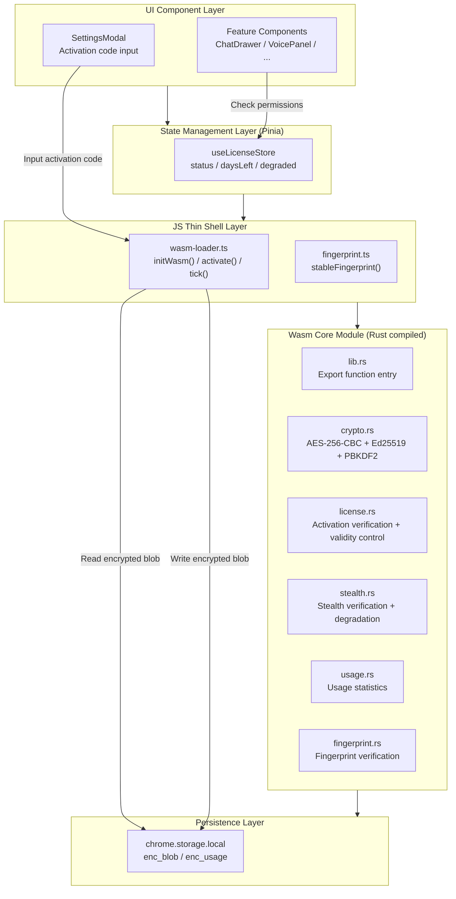

# License System Architecture

> [中文版](./license-system.md)

## Module Overview

The license system is the commercialization core of the AI Browser extension, responsible for trial period management, activation code verification, validity period control, and anti-piracy protection. The system uses a **full Wasm hardening** architecture — all license logic is compiled into a Rust → Wasm binary, with the JS layer serving only as a thin calling shell containing no decision logic.

The system handles five core responsibilities:

1. **Trial Period Management**: Auto-activates a 7-day trial on first install, based on stable device fingerprint to prevent uninstall-reinstall bypass
2. **Activation Code Verification**: Ed25519 asymmetric signature verification, private key stored offline, public key embedded in wasm (can be public)
3. **Validity Period Control**: Only controls validity period, not features. All features available within validity period, all disabled after expiration
4. **Stealth Secondary Verification**: Randomly triggers silent checks; pirated versions gradually degrade (manifests as "bugs")
5. **Local Storage Encryption**: License data in chrome.storage encrypted with AES-256-CBC + HMAC tamper detection

**Source Files**:

| File | Responsibility |
|------|----------------|
| `wasm-license/src/lib.rs` | Wasm entry point, exports all functions |
| `wasm-license/src/crypto.rs` | AES-256-CBC encryption + Ed25519 signatures + PBKDF2 key derivation |
| `wasm-license/src/license.rs` | Activation code verification + trial period initialization + validity period control |
| `wasm-license/src/stealth.rs` | Stealth check trigger + gradual degradation state machine |
| `wasm-license/src/usage.rs` | Usage hours/actions statistics (encrypted storage) |
| `wasm-license/src/fingerprint.rs` | Device fingerprint generation and verification |
| `src/license/wasm-loader.ts` | JS thin shell: loads wasm, calls functions, exposes state |
| `src/license/fingerprint.ts` | stableFingerprint device fingerprint generation |
| `src/stores/license.ts` | Pinia license store (state management) |

**Position in Architecture**: The license system sits between the Vue application layer and core feature modules, serving as the sole validity gateway for all features. The Pinia licenseStore interacts with the Wasm module through wasm-loader; Vue components only read licenseStore state and do not directly manipulate license logic.

---

## Architecture Design

### System Layers



### Core Flows

#### Flow 1: First Install (Trial Period Initialization)

```
User installs extension
    │
    ▼
App.vue onMounted()
    │
    ├─ licenseStore.init()
    │   │
    │   ├─ stableFingerprint()
    │   │   ├─ Collect hardware signals: screen, CPU, memory, timezone, language
    │   │   └─ SHA-256 hash → 64-char hex
    │   │
    │   ├─ chrome.storage.local.get('enc_blob')
    │   │   ├─ Has value → Existing license, skip to Flow 2
    │   │   └─ No value → First install, continue ↓
    │   │
    │   ├─ wasm.init_trial(fingerprint)
    │   │   ├─ Generate trial blob:
    │   │   │   status: 'trial'
    │   │   │   fingerprint: <device fingerprint>
    │   │   │   expireTs: now + 7 days
    │   │   │   features: ['chat']
    │   │   │   maxMessages: 50/day
    │   │   ├─ AES-256-CBC encrypt
    │   │   └─ HMAC-SHA256 sign
    │   │
    │   └─ chrome.storage.local.set({ enc_blob: encrypted })
    │
    └─ licenseStore.status === 'trial'
       licenseStore.daysLeft === 7
```

#### Flow 2: License Check on Startup

```
Extension startup / Tab activation
    │
    ├─ licenseStore.checkLicense()
    │   │
    │   ├─ chrome.storage.local.get('enc_blob')
    │   │
    │   ├─ wasm.check_license(blob)
    │   │   ├─ AES decrypt
    │   │   ├─ HMAC verify signature → Fail → status = 'corrupted'
    │   │   ├─ Check fingerprint → Mismatch → status = 'device_mismatch'
    │   │   ├─ Check expireTs
    │   │   │   ├─ Not expired → status remains trial/active, all features available
    │   │   │   └─ Expired → status = 'expired', all features disabled
    │   │   └─ Return { status, daysLeft, expired }
    │   │
    │   └─ Update licenseStore state
    │
    └─ Vue components reactively update UI
```

#### Flow 3: User Activation

```
User enters activation code in SettingsModal
    │
    ├─ licenseStore.activate(code)
    │   │
    │   ├─ stableFingerprint() → Get current device fingerprint
    │   │
    │   ├─ wasm.verify_code(code, fingerprint)
    │   │   ├─ Parse activation code format (AIB-XXXX-XXXX-XXXX-XXXX)
    │   │   ├─ Extract version, expire_ts, features, fingerprint_hash
    │   │   ├─ Verify fingerprint_hash matches current device
    │   │   ├─ Ed25519 public key verify signature → Fail → { valid: false }
    │   │   ├─ Check version match → Mismatch → { valid: false }
    │   │   ├─ Generate active blob:
    │   │   │   status: 'active'
    │   │   │   fingerprint: <device fingerprint>
    │   │   │   expireTs: now + 30 days
    │   │   ├─ AES-256-CBC encrypt
    │   │   └─ Ed25519 sign
    │   │
    │   ├─ chrome.storage.local.set({ enc_blob: encrypted })
    │   │
    │   └─ licenseStore.status = 'active'
    │
    └─ UI shows "Activation successful"
```

#### Flow 4: Validity Period Control + Stealth Verification

```
User performs action (send message / voice / automation)
    │
    ├─ tick(action)
    │   │
    │   ├─ wasm.track_usage(blob, action, Date.now())
    │   │   ├─ Accumulate usage hours/actions
    │   │   ├─ Update enc_usage (encrypted storage)
    │   │   └─ Return { shouldCheck: true/false }
    │   │
    │   └─ if shouldCheck:
    │       ├─ wasm.hidden_verify(blob)
    │       │   ├─ Recalculate fingerprint → Compare with blob
    │       │   ├─ Re-verify signature
    │       │   ├─ Check usage hours plausibility
    │       │   └─ Return { passed, degradeLevel }
    │       │
    │       └─ if !passed:
    │           └─ Update degradeLevel (persisted to blob)
    │
    ├─ wasm.check_license(blob) → { status, daysLeft, expired }
    │   ├─ trial / active → All features available
    │   └─ expired → All features disabled, show activation prompt
    │
    └─ UI decides whether to show activation prompt based on status
```

---

## Key Design Decisions

### 1. Full Wasm Hardening (Asymmetric Encryption)

**Decision**: All license logic compiled into Wasm binary, using Ed25519 asymmetric signatures.

**Rationale**:
- Plaintext JS can be directly modified to bypass gating
- Wasm binary reverse engineering cost is much higher than JS obfuscation
- Ed25519 asymmetric signatures: public key can be public, private key stored offline; even if wasm is reverse-engineered, activation codes cannot be generated
- Symmetric encryption (HMAC) keys are inside wasm; reverse engineering enables bulk code generation

**Trade-offs**:
- Higher development cost (requires Rust toolchain)
- Build artifacts increase by ~50-80KB
- Difficult to debug (wasm internal logic not visible)

### 2. Stable Device Fingerprint (Prevent Uninstall-Reinstall Bypass)

**Decision**: fingerprint based on hardware signals (screen/CPU/memory/timezone/language), not including installTs.

**Rationale**:
- `installTs` changes on each install → uninstall-reinstall = fresh trial period
- Hardware signals remain the same on the same device → fingerprint persists across reinstalls
- Changing devices automatically grants a new trial period (reasonable behavior)

**Trade-offs**:
- User upgrading OS/changing monitor → fingerprint changes → needs customer service reset
- Device change reset code mechanism provided

### 3. Stealth Secondary Verification + Gradual Degradation

**Decision**: Verification failure shows no prompt; instead, gradual degradation (delays, random failures) manifests as "bugs".

**Rationale**:
- Direct "verification failed" prompt → user knows about anti-piracy → seeks crack methods
- Gradual degradation → user thinks it's software quality issues → natural churn
- Degradation state persists → only reactivation with valid code can restore

**Trade-offs**:
- May cause false positives for legitimate users (fingerprint changes trigger degradation)
- Customer service channel needed for false positive handling

### 4. Chrome Web Store Compatible

**Decision**: Disable `selfDefending`, `debugProtection`, `domainLock` and other obfuscation options.

**Rationale**:
- Chrome Web Store review policy prohibits these features
- Injecting detection code / debugger statements is considered malicious behavior
- Domain locking limits extension availability

**Trade-offs**:
- Reduced obfuscation strength (but still far better than no obfuscation)
- Cannot implement "self-protection" (detecting debugger/tampering)

---

## Security Model

### Threat Model

| Threat | Attack Method | Defense | Effectiveness |
|--------|--------------|---------|---------------|
| Modify JS to bypass gating | Directly edit JS files | All logic in Wasm, JS is just a calling shell | ⭐⭐⭐⭐⭐ |
| Extract Wasm for reverse engineering | Decompile wasm binary | Wasm binary reverse engineering is costly + version rotation | ⭐⭐⭐⭐ |
| Tamper with chrome.storage | Directly modify encrypted data | AES encryption + HMAC tamper detection | ⭐⭐⭐⭐ |
| Uninstall-reinstall to reset trial | Clear storage and reinstall | stableFingerprint based on hardware signals | ⭐⭐⭐⭐ |
| Bulk generate activation codes | Reverse engineer to extract key | Ed25519 asymmetric signature, public key can be public | ⭐⭐⭐⭐⭐ |
| Long-term use of old version | Don't upgrade, continue using cracked version | Version rotation + activation code binds to version | ⭐⭐⭐ |
| Tamper with system time | Modify system clock to bypass validity period | wasm checks time plausibility + stealth verification | ⭐⭐⭐ |
| Share activation codes | One code, multiple users | Activation code binds to device fingerprint | ⭐⭐⭐⭐ |

### Security Boundaries

**Can defend against**:
- Ordinary users modifying JS to bypass paid features
- Directly reading/modifying license data from chrome.storage
- Uninstall-reinstall to get unlimited trial period
- Reverse engineering wasm to extract key for bulk activation code generation (Ed25519 asymmetric)

**Cannot defend against**:
- Professional reverse engineers modifying wasm binary verification logic
- Modifying JS thin shell to skip wasm calls (returning forged results)
- Using modified Chromium to bypass extension security mechanisms

**Conclusion**: The solution significantly raises the cracking barrier, but cannot achieve 100% protection. For Chrome extensions, this is a reasonable security-cost balance.

---

## Performance Impact

| Metric | Impact | Notes |
|--------|--------|-------|
| Extension size | +50-80KB | Wasm binary, `opt-level = "s"` + LTO + strip |
| Startup time | +50-100ms | Wasm module initialization (one-time) |
| Each operation | +1-5ms | `tick()` calls wasm statistics function |
| Memory usage | +2-5MB | Wasm runtime memory |
| Stealth check | +10-50ms | Randomly triggered, imperceptible to user |

---

## Dependencies

### Rust Dependencies (wasm-license/Cargo.toml)

| Crate | Purpose | Version |
|-------|---------|---------|
| `wasm-bindgen` | Wasm-JS interop | 0.2 |
| `aes` | AES-256-CBC encryption | 0.8 |
| `cbc` | CBC mode | 0.1 |
| `sha2` | SHA-256 hash | 0.10 |
| `hmac` | HMAC-SHA256 signature | 0.12 |
| `ed25519-dalek` | Ed25519 signature | 2.0 |
| `pbkdf2` | Key derivation | 0.12 |
| `serde` / `serde_json` | JSON serialization | 1.0 |
| `getrandom` | Random numbers (wasm compatible) | 0.2 |

### Node.js Dependencies (Development Tools)

| Package | Purpose | Version |
|---------|---------|---------|
| `javascript-obfuscator` | JS obfuscation | ^4.0 |
| `@noble/ed25519` | Ed25519 signature (activation code generation) | ^2.0 |

---

## Related Documents

- [Build & Publish Guide](../发布/打包上架.md) — Complete build flow, activation code generation, Chrome Web Store submission
- [Storage Module Architecture](./storage.md) — chrome.storage abstraction layer
- [State Management Architecture](./state-management.md) — Pinia store pattern
