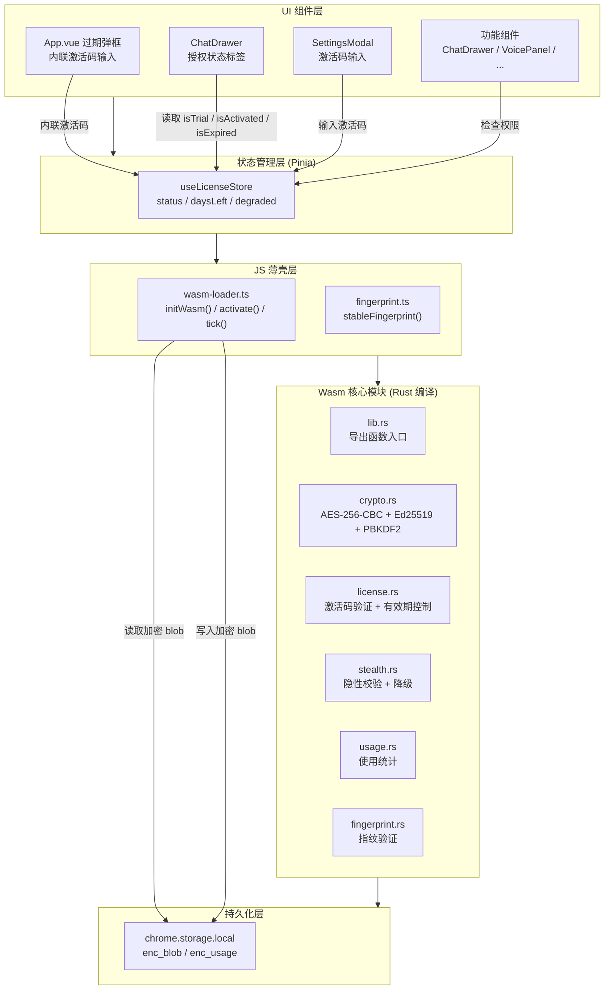

# 授权系统架构

> [English Version](./license-system-en.md)

## 模块概述

授权系统是 AI Browser 扩展的商业化核心，负责试用期管理、激活码验证、有效期控制和防破解保护。系统采用 **Wasm 全量加固**架构——所有授权逻辑编译为 Rust → Wasm 二进制，JS 层仅做调用壳，不包含任何判断逻辑。

系统承担五项核心职责：

1. **试用期管理**：首次安装自动激活 7 天试用期，基于稳定设备指纹防止卸载重装绕过
2. **激活码验证**：Ed25519 非对称签名验证，私钥离线保管，公钥嵌入 wasm 可公开
3. **有效期控制**：只控制有效期，不控制功能。有效期内全部功能可用，过期后全部不可用
4. **隐性二次验证**：随机触发静默校验，破解版长期使用会渐进式降级（表现为"bug"）
5. **本地存储加密**：chrome.storage 中的授权数据 AES-256-CBC 加密 + HMAC 防篡改

**源文件**：

| 文件 | 职责 |
|------|------|
| `wasm-license/src/lib.rs` | Wasm 主入口，导出所有函数 |
| `wasm-license/src/crypto.rs` | AES-256-CBC 加密 + Ed25519 签名 + PBKDF2 密钥派生 |
| `wasm-license/src/license.rs` | 激活码验证 + 试用期初始化 + 有效期控制 |
| `wasm-license/src/stealth.rs` | 隐性校验触发器 + 渐进降级状态机 |
| `wasm-license/src/usage.rs` | 使用时长/次数统计（加密存储） |
| `wasm-license/src/fingerprint.rs` | 设备指纹生成与验证 |
| `src/license/wasm-loader.ts` | JS 薄壳层：加载 wasm、调用函数、暴露状态 |
| `src/license/fingerprint.ts` | stableFingerprint 设备指纹生成 |
| `src/stores/license.ts` | Pinia license store（状态管理） |

**在架构中的位置**：授权系统位于 Vue 应用层与核心功能模块之间，是所有功能的唯一有效期门控。Pinia licenseStore 通过 wasm-loader 与 Wasm 模块交互，Vue 组件只读取 licenseStore 的状态，不直接操作授权逻辑。

---

## 架构设计

### 系统分层



### 核心流程

#### 流程 1：首次安装（试用期初始化）

```
用户安装扩展
    │
    ▼
App.vue onMounted()
    │
    ├─ 等待 500ms（避免与其他 store 的响应式冲突）
    │
    ├─ licenseStore.init()
    │   │
    │   ├─ stableFingerprint()
    │   │   ├─ 收集硬件信号: screen, CPU, memory, timezone, language
    │   │   └─ SHA-256 哈希 → 64 字符 hex
    │   │
    │   ├─ chrome.storage.local.get('enc_blob')
    │   │   ├─ 有值 → 已有授权，跳到流程 2
    │   │   └─ 无值 → 首次安装，继续 ↓
    │   │
    │   ├─ wasm.init_trial(fingerprint)
    │   │   ├─ 生成 trial blob:
    │   │   │   status: 'trial'
    │   │   │   fingerprint: <设备指纹>
    │   │   │   expireTs: now + 7天
    │   │   │   features: ['chat']
    │   │   │   maxMessages: 50/天
    │   │   ├─ AES-256-CBC 加密
    │   │   └─ HMAC-SHA256 签名
    │   │
    │   └─ chrome.storage.local.set({ enc_blob: encrypted })
    │
    └─ licenseStore.status === 'trial'
       licenseStore.daysLeft === 7
```

#### 流程 2：启动时授权检查

```
扩展启动 / 标签页激活
    │
    ├─ licenseStore.checkLicense()
    │   │
    │   ├─ chrome.storage.local.get('enc_blob')
    │   │
    │   ├─ wasm.check_license(blob)
    │   │   ├─ AES 解密
    │   │   ├─ HMAC 验签 → 失败 → status = 'corrupted'
    │   │   ├─ 检查 fingerprint → 不匹配 → status = 'device_mismatch'
    │   │   ├─ 检查 expireTs
    │   │   │   ├─ 未过期 → status 保持 trial/active，全部功能可用
    │   │   │   └─ 已过期 → status = 'expired'，全部功能不可用
    │   │   └─ 返回 { status, daysLeft, expired }
    │   │
    │   └─ 更新 licenseStore 状态
    │
    └─ Vue 组件响应式更新 UI
```

#### 流程 3：用户激活

```
用户在 SettingsModal 输入激活码
    │
    ├─ licenseStore.activate(code)
    │   │
    │   ├─ stableFingerprint() → 获取当前设备指纹
    │   │
    │   ├─ wasm.verify_code(code, fingerprint)
    │   │   ├─ 解析激活码格式 (AIB-XXXX-XXXX-XXXX-XXXX)
    │   │   ├─ 提取 version, expire_ts, features, fingerprint_hash
    │   │   ├─ 验证 fingerprint_hash 与当前设备匹配
    │   │   ├─ Ed25519 公钥验签 → 失败 → { valid: false, error: '签名无效' }
    │   │   ├─ 检查版本号匹配 → 不匹配 → { valid: false, error: '版本不匹配' }
    │   │   ├─ 生成 active blob:
    │   │   │   status: 'active'
    │   │   │   fingerprint: <设备指纹>
    │   │   │   expireTs: now + 30天
    │   │   ├─ AES-256-CBC 加密
    │   │   └─ Ed25519 签名
    │   │
    │   ├─ chrome.storage.local.set({ enc_blob: encrypted })
    │   │
    │   └─ licenseStore.status = 'active'
    │
    └─ UI 提示"激活成功"
```

#### 流程 4：有效期控制 + 隐性校验

```
用户执行操作（发送消息 / 语音 / 自动化）
    │
    ├─ tick(action)
    │   │
    │   ├─ wasm.track_usage(blob, action, Date.now())
    │   │   ├─ 累计使用时长/次数
    │   │   ├─ 更新 enc_usage（加密存储）
    │   │   └─ 返回 { shouldCheck: true/false }
    │   │
    │   └─ if shouldCheck:
    │       ├─ wasm.hidden_verify(blob)
    │       │   ├─ 重新计算 fingerprint → 对比 blob 中的
    │       │   ├─ 重新验证签名
    │       │   ├─ 检查使用时长合理性
    │       │   └─ 返回 { passed, degradeLevel }
    │       │
    │       └─ if !passed:
    │           └─ 更新 degradeLevel（持久化到 blob）
    │
    ├─ wasm.check_license(blob) → { status, daysLeft, expired }
    │   ├─ trial / active → 全部功能可用
    │   └─ expired → 全部功能不可用，提示激活
    │
    └─ UI 根据 status 决定是否显示激活提示
```

---

## UI 集成

### App.vue — 过期弹框与延迟初始化

**延迟初始化**：授权系统在 `onMounted` 中通过 `setTimeout(500ms)` 延迟初始化，避免与其他 store（settings、conversations、notes）的响应式循环。

```typescript
setTimeout(async () => {
  await licenseStore.init();
  if (licenseStore.status === 'expired') {
    showExpired.value = true;
  }
}, 500);
```

**过期弹框**：当 `licenseStore.status === 'expired'` 且用户点击悬浮球时，显示内联激活弹框（非独立弹窗），包含：
- 激活码输入框（`placeholder: "输入激活码 AIB-XXXX-XXXX-XXXX"`）
- 激活按钮 → `licenseStore.activate(code)`
- 错误提示文本

**悬浮球拦截**：`toggle()` 函数检查授权状态，过期时拦截抽屉展开，改为显示激活弹框：

```typescript
function toggle() {
  if (licenseStore.status === 'expired') {
    showExpired.value = true;
    return;
  }
  open.value = !open.value;
}
```

### ChatDrawer.vue — 授权状态标签

聊天抽屉头部品牌行显示授权状态标签，紧跟品牌名右侧：

| 状态 | 标签样式 | 文案 |
|------|---------|------|
| `isTrial` | 紫色渐变背景 + 紫色边框 | `试用 {daysLeft}天` |
| `isActivated` | 绿色渐变背景 + 绿色边框 | `{daysLeft}天` |
| `isExpired` | 红色渐变背景 + 红色边框 | `已过期` |

```vue
<span v-if="licenseStore.isTrial" class="aib-license-tag aib-license-tag--trial">
  试用 {{ licenseStore.daysLeft }}天
</span>
<span v-else-if="licenseStore.isActivated" class="aib-license-tag aib-license-tag--active">
  {{ licenseStore.daysLeft }}天
</span>
<span v-else-if="licenseStore.status === 'expired'" class="aib-license-tag aib-license-tag--expired">
  已过期
</span>
```

### SettingsModal.vue — 用户 Tab 激活

用户配置 Tab 中包含激活码输入区域：
- 输入框 + 激活按钮（`aib-btn-activate` 样式）
- 调用 `licenseStore.activate(code)` 验证
- 成功/失败通过 Toast 提示

---

## 关键设计决策

### 1. Wasm 全量加固（非对称加密）

**决策**：所有授权逻辑编译为 Wasm 二进制，使用 Ed25519 非对称签名。

**原因**：
- JS 明文可被直接修改绕过门控
- Wasm 二进制逆向成本远高于 JS 混淆
- Ed25519 非对称签名：公钥可公开，私钥离线保管，即使 wasm 被逆向也无法生成激活码
- 对称加密（HMAC）的密钥在 wasm 内，逆向后可批量生成激活码

**权衡**：
- 开发成本高（需要 Rust 工具链）
- 编译产物增加 ~50-80KB
- 调试困难（wasm 内部逻辑不可见）

### 2. 稳定设备指纹（防卸载重装）

**决策**：fingerprint 基于硬件信号（screen/CPU/memory/timezone/language），不包含 installTs。

**原因**：
- `installTs` 每次安装都不同 → 卸载重装 = 全新试用期
- 硬件信号同设备不变 → 卸载重装后 fingerprint 一致
- 换设备自动获得新试用期（合理行为）

**权衡**：
- 用户升级系统/换显示器 → fingerprint 变化 → 需要客服重置
- 提供设备变更重置码机制

### 3. 隐性二次验证 + 渐进降级

**决策**：验证失败不弹提示，而是渐进式降级（延迟、随机失败），表现像"bug"。

**原因**：
- 直接提示"验证失败" → 用户知道有防破解 → 寻找破解方法
- 渐进降级 → 用户以为是软件质量问题 → 自然流失
- 降级状态持久化 → 只有重新激活有效码才能恢复

**权衡**：
- 可能导致正常用户误判（设备指纹变化触发降级）
- 需要提供客服渠道处理误判

### 4. Chrome Web Store 兼容

**决策**：禁用 `selfDefending`、`debugProtection`、`domainLock` 等混淆选项。

**原因**：
- Chrome Web Store 审核政策禁止这些特性
- 注入检测代码 / debugger 语句被视为恶意行为
- 域名锁定限制了扩展的可用性

**权衡**：
- 混淆强度降低（但仍远高于未混淆）
- 无法实现"自我保护"（检测调试器/篡改）

---

## 安全模型

### 威胁模型

| 威胁 | 攻击方式 | 防御措施 | 有效性 |
|------|---------|---------|--------|
| 修改 JS 绕过门控 | 直接编辑 JS 文件 | 全量逻辑在 Wasm，JS 只是调用壳 | ⭐⭐⭐⭐⭐ |
| 提取 Wasm 逆向 | 反编译 wasm 二进制 | Wasm 二进制本身逆向成本高 + 版本轮转 | ⭐⭐⭐⭐ |
| 篡改 chrome.storage | 直接修改加密数据 | AES 加密 + HMAC 防篡改 | ⭐⭐⭐⭐ |
| 卸载重装重置试用期 | 清除 storage 重新安装 | stableFingerprint 基于硬件信号 | ⭐⭐⭐⭐ |
| 批量生成激活码 | 逆向提取密钥 | Ed25519 非对称签名，公钥可公开 | ⭐⭐⭐⭐⭐ |
| 旧版本长期使用 | 不升级继续用破解版 | 版本轮转 + 激活码绑定版本 | ⭐⭐⭐ |
| 篡改系统时间 | 修改系统时钟绕过有效期 | wasm 检查时间合理性 + 隐性验证 | ⭐⭐⭐ |
| 分享激活码 | 一个码多人用 | 激活码绑定设备指纹 | ⭐⭐⭐⭐ |

### 安全边界

**能防住**：
- 普通用户修改 JS 绕过付费限制
- 从 chrome.storage 直接读取/修改授权数据
- 卸载重装获取无限试用期
- 逆向 wasm 提取密钥后批量生成激活码（Ed25519 非对称）

**防不住**：
- 专业逆向工程师修改 wasm 二进制中的验证逻辑
- 修改 JS 薄壳层跳过 wasm 调用（返回伪造结果）
- 使用修改版 Chromium 绕过扩展安全机制

**结论**：方案大幅提高破解门槛，但无法做到 100% 防护。对于 Chrome 扩展而言，这是合理的安全-成本平衡。

---

## 性能影响

| 指标 | 影响 | 说明 |
|------|------|------|
| 扩展体积 | +50-80KB | Wasm 二进制，`opt-level = "s"` + LTO + strip |
| 启动时间 | +50-100ms | Wasm 模块初始化（一次性） |
| 每次操作 | +1-5ms | `tick()` 调用 wasm 统计函数 |
| 内存占用 | +2-5MB | Wasm 运行时内存 |
| 隐性校验 | +10-50ms | 随机触发，用户无感知 |

---

## 依赖关系

### Rust 依赖（wasm-license/Cargo.toml）

| Crate | 用途 | 版本 |
|-------|------|------|
| `wasm-bindgen` | Wasm-JS 互操作 | 0.2 |
| `aes` | AES-256-CBC 加密 | 0.8 |
| `cbc` | CBC 模式 | 0.1 |
| `sha2` | SHA-256 哈希 | 0.10 |
| `hmac` | HMAC-SHA256 签名 | 0.12 |
| `ed25519-dalek` | Ed25519 签名 | 2.0 |
| `pbkdf2` | 密钥派生 | 0.12 |
| `serde` / `serde_json` | JSON 序列化 | 1.0 |
| `getrandom` | 随机数（wasm 兼容） | 0.2 |

### Node.js 依赖（开发工具）

| 包 | 用途 | 版本 |
|----|------|------|
| `javascript-obfuscator` | JS 混淆 | ^4.0 |
| `@noble/ed25519` | Ed25519 签名（激活码生成） | ^2.0 |

---

## 相关文档

- [打包上架指南](../发布/打包上架.md) — 完整打包流程、激活码生成、Chrome Web Store 上架
- [存储模块架构](./storage.md) — chrome.storage 抽象层
- [状态管理架构](./state-management.md) — Pinia store 模式
