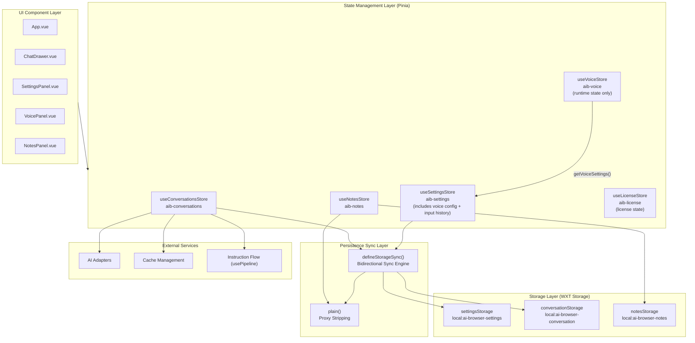
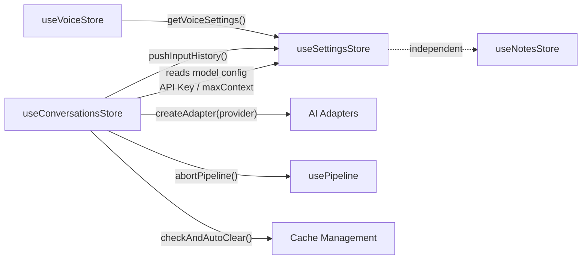
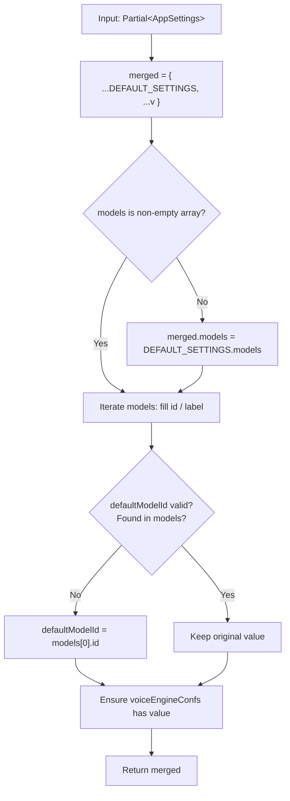
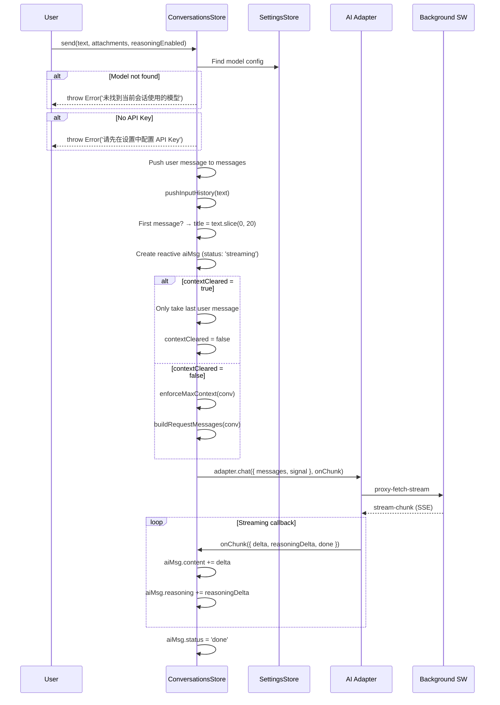
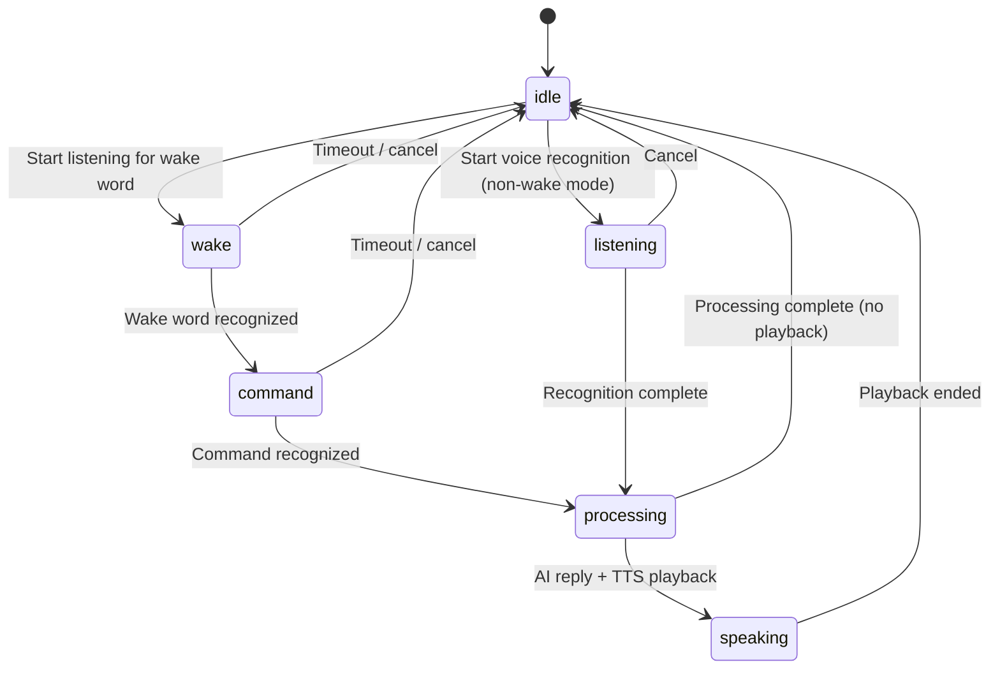
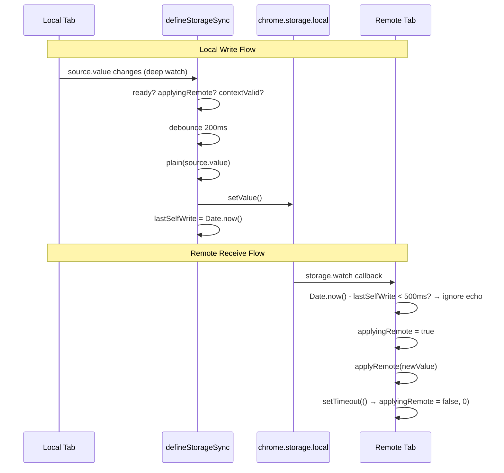
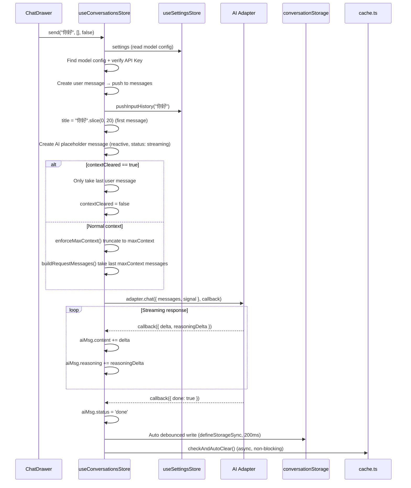
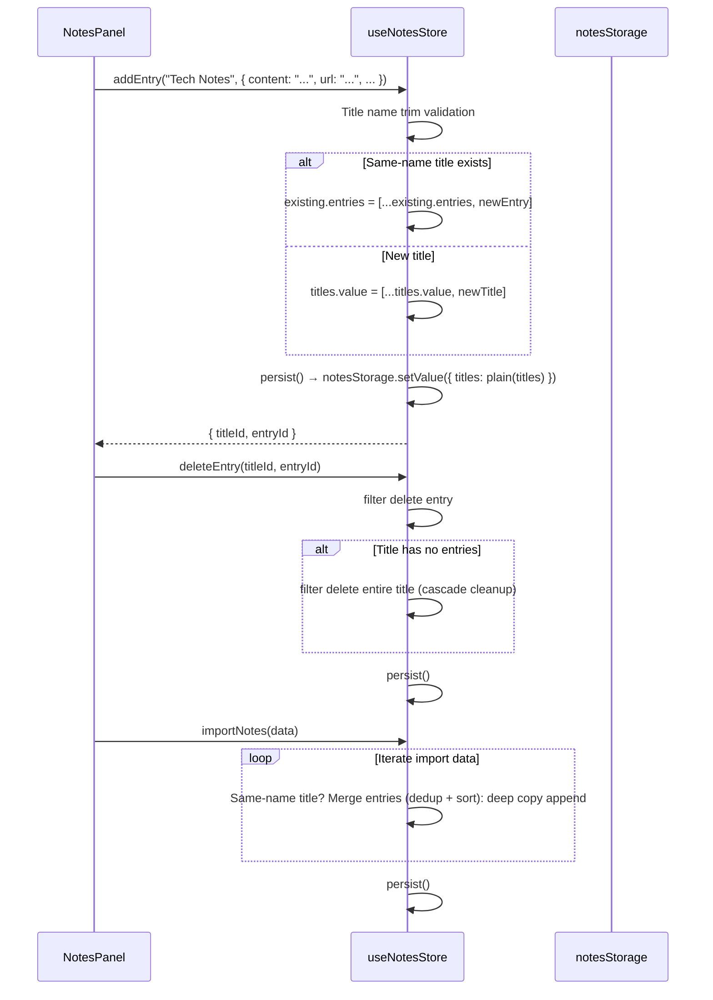
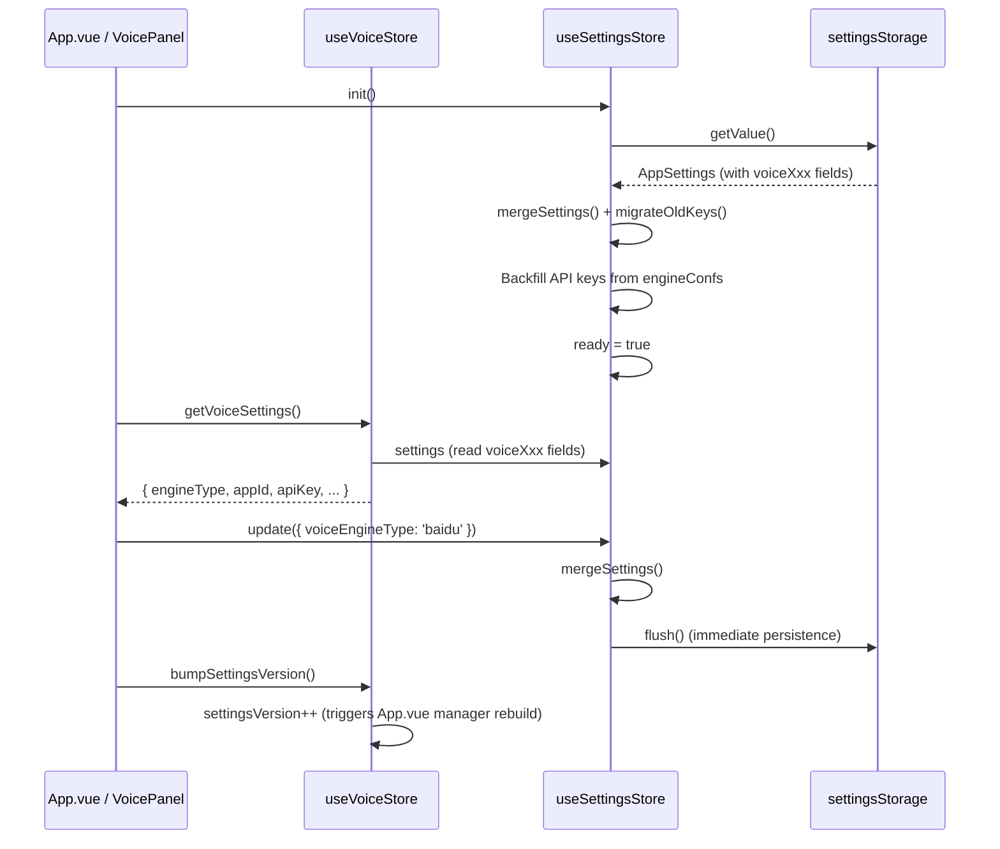

# State Management Architecture

> English | [中文](./state-management.md)

## Module Overview

The state management module is the data layer core of the AI Browser extension, built on **Pinia** using the **Composition API (setup store)** pattern. It manages all runtime state including global settings (with voice configuration and input history), conversation history, and notes data, providing bidirectional persistent synchronization with `chrome.storage.local` via the `defineStorageSync` utility.

**Key Change**: Voice configuration has been merged into `AppSettings`, eliminating the separate `voiceSettingsStorage`. `useVoiceStore` now only manages runtime state (recognition status, session state, interim text) and reads voice config from `useSettingsStore` via `getVoiceSettings()`. Input history is also now part of `AppSettings.inputHistory`.

**Position in Architecture**: State management sits in the Content Script layer, acting as a bridge between UI components (Vue) and underlying services (adapters, storage, voice engine). All components access data through Pinia stores, which internally coordinate adapter calls, storage reads/writes, and cross-tab synchronization.

**Dependencies**:

| Direction | Module | Description |
|-----------|--------|-------------|
| Upstream | `src/storage/` | WXT storage wrappers providing `settingsStorage`, `conversationStorage`, `notesStorage`, etc. |
| Upstream | `src/adapters/` | AI adapter factory: `createAdapter(provider)` |
| Upstream | `src/utils/storage-sync.ts` | `defineStorageSync` bidirectional sync engine |
| Upstream | `src/utils/cache.ts` | `checkAndAutoClear()` cache overflow auto-clear |
| Upstream | `src/composables/usePipeline` | `abortPipeline()` instruction flow abort |
| Downstream | All Vue components | Consume state via `useXxxStore()` |

**Source Locations**:

```
src/stores/
├── settings.ts         # useSettingsStore (global settings + voice config + input history)
├── conversations.ts    # useConversationsStore (single conversation management)
├── notes.ts            # useNotesStore (notes management)
├── voice.ts            # useVoiceStore (voice runtime state only)
└── license.ts          # useLicenseStore (license state management)

src/utils/
└── storage-sync.ts     # defineStorageSync + plain()

src/storage/
├── index.ts            # Storage item definitions + DEFAULT_SETTINGS
└── input-history.ts    # pushInputHistory() utility
```



---

## Architecture Design

### Design Patterns

| Pattern | Location | Description |
|---------|----------|-------------|
| **Setup Store** | All stores | Uses Pinia `defineStore` + functional syntax, fully following Vue 3 Composition API |
| **Bidirectional Data Binding** | `defineStorageSync` | reactive ref synced with chrome.storage via `watch` + `storage.watch` |
| **Debounced Write** | `defineStorageSync` | 200ms debounce prevents high-frequency writes; 500ms echo window prevents cross-tab loops |
| **Factory Pattern** | `createAdapter` | Creates AI adapter instances based on provider |
| **Defensive Merge** | `mergeSettings` | Uses `DEFAULT_SETTINGS` as fallback to ensure data integrity |
| **Single Conversation** | `useConversationsStore` | No multi-conversation support; single `conversation` ref holds all messages |
| **Manual Persistence** | `useNotesStore` | Does not use `defineStorageSync`; manually calls `persist()` to write to storage |
| **Config Aggregation** | `AppSettings` | Voice config, input history, etc. stored uniformly in `AppSettings`, reducing storage keys |
| **Runtime/Persistence Separation** | `useVoiceStore` | Voice runtime state (status/sessionState) separated from persistence config (voiceXxx) into different stores |

### Store Dependencies



- `useConversationsStore` calls `useSettingsStore()` in `send()` to obtain model config, API Key, `maxContext`, etc.
- `useConversationsStore` calls `createAdapter()` in `send()` to create AI adapters
- `useConversationsStore` calls `abortPipeline()` in `clearCurrent()` / `resetConversation()` to abort instruction flows
- `useConversationsStore` calls `pushInputHistory()` in `send()` to record input history (internally operates on `useSettingsStore`)
- `useConversationsStore` calls `checkAndAutoClear()` after `saveConversation()` to check cache size
- `useVoiceStore` reads all voice config from `useSettingsStore` via `getVoiceSettings()`
- `useNotesStore` is fully independent, with no dependencies on other stores

---

## Core Type Definitions

### AppSettings

Global application settings (including voice configuration and input history), storage key `local:ai-browser-settings`.

```typescript
interface AppSettings {
  // ── Basic Configuration ──
  provider: Provider;                    // Protocol type
  baseUrl: string;                       // Global request URL
  apiKey: string;                        // Global API key
  authField?: string;                    // Auth field (bearer / api-key / access-token / authorization)
  models: ModelConfig[];                 // Available model list
  defaultModelId: string;                // Default model id
  drawerWidth: number;                   // Drawer width (vw percentage, 40-100)
  primaryColor: string;                  // Theme color (hex)
  theme?: string;                        // Theme id
  shortcut: string;                      // Activation shortcut (e.g. "Ctrl+`")
  maxConversations?: number;             // Max conversation count
  maxContext?: number;                   // Max context messages per conversation (default 100)
  autoSendSelection?: 'auto' | 'manual' | 'off';  // Selection action mode
  translateTargetLang?: string;          // Translation target language
  translateMode?: 'selection' | 'auto' | 'click' | 'off';  // Translation mode
  noteMode?: NoteMode;                   // Note mode
  automationEnabled?: boolean;           // Web automation toggle (default true)
  locale?: 'zh-CN' | 'en-US';          // UI language

  // ── Voice Configuration ──
  voiceEngineType?: VoiceEngineType;     // Voice engine type (default 'web-speech')
  voiceAppId?: string;                   // Engine appId
  voiceApiKey?: string;                  // Engine apiKey
  voiceApiSecret?: string;               // Engine apiSecret
  voiceEngineConfs?: EngineConf[];       // All engine default configs (merged from voice-config.json)
  voiceRecognitionLang?: string;         // Recognition language (default 'zh-CN')
  voiceWakeWord?: string;                // Wake word (default '你好，小灵')
  voiceAlwaysOn?: boolean;               // Always-on voice mode
  voiceEnableTts?: boolean;              // TTS toggle (default true)
  voiceTtsRate?: number;                 // TTS rate (default 1.8)
  voiceTtsVolume?: number;              // TTS volume (default 0.8)
  voiceBufferTimeout?: number;           // Voice buffer timeout ms (default 1500)
  voiceIdleTimeout?: number;             // Voice idle timeout ms (default 3000)
  voiceMode?: 'chat' | 'voice';         // Voice assistant mode

  // ── User Data ──
  inputHistory?: string[];               // Input history (max 100, FIFO + consecutive dedup)

  /** @deprecated Use translateMode instead */
  selectionTranslate?: boolean;
  /** @deprecated Use translateMode instead */
  autoTranslate?: boolean;
  /** @deprecated Use translateMode instead */
  clickTranslate?: boolean;
}
```

### ModelConfig

Single AI model configuration, nested within `AppSettings.models` array.

```typescript
interface ModelConfig {
  id: string;            // Unique identifier (auto-generated or user-specified)
  label: string;         // Display name
  provider: Provider;    // Protocol type (openai / anthropic / gemini / ...)
  modelName: string;     // Actual model name (for request body)
  reasoning?: boolean;   // Whether it supports deep thinking
  vision?: boolean;      // Whether it supports images
  baseUrl?: string;      // Per-model request URL (optional, falls back to global)
  apiKey?: string;       // Per-model API key (optional, falls back to global)
  authField?: string;    // Auth field
  website?: string;      // Vendor website URL
}
```

### Provider

AI protocol type union:

```typescript
type Provider =
  | 'openai'        // OpenAI compatible
  | 'anthropic'     // Anthropic Claude
  | 'gemini'        // Google Gemini
  | 'custom'        // Custom
  | 'qwen'          // Tongyi Qianwen (Alibaba)
  | 'wenxin'        // ERNIE Bot (Baidu)
  | 'zhipu'         // Zhipu ChatGLM
  | 'deepseek'      // DeepSeek
  | 'moonshot'      // Moonshot (Kimi)
  | 'doubao'        // Doubao (ByteDance Volcano Engine)
  | 'grok'          // Grok (xAI)
```

### ChatMessage

Single chat message, stored in `Conversation.messages` array.

```typescript
interface ChatMessage {
  id: string;
  role: 'user' | 'assistant' | 'system';
  content: string;                                          // Plain text content
  reasoning?: string;                                       // Deep thinking content
  attachments?: Attachment[];                               // Unified attachments (image OCR text + files)
  timestamp: number;                                        // Creation time
  status?: 'sending' | 'streaming' | 'done' | 'error' | 'aborted';
  errorMessage?: string;                                    // Error message (when status=error)
  reasoningEnabled?: boolean;                               // Whether deep thinking was enabled when sent
}
```

**Status flow**: `sending` -> `streaming` -> `done`; on error: `error` or `aborted`.

### Conversation

Single conversation object, storage key `local:ai-browser-conversation`.

```typescript
interface Conversation {
  id: string;                      // UUID
  title: string;                   // Conversation title (default "新对话", first 20 chars of first message)
  messages: ChatMessage[];         // Message list
  modelId: string;                 // Model id used by this conversation
  scrollTop?: number;              // Scroll position (persisted)
  draftText?: string;              // Input box draft text
  draftAttachments?: Attachment[]; // Input box draft attachments
  reasoningEnabled?: boolean;      // Deep thinking toggle
  createdAt: number;               // Creation timestamp
  updatedAt: number;               // Update timestamp
}
```

### Attachment

Unified attachment interface:

```typescript
type AttachmentType = 'image' | 'text' | 'code' | 'pdf' | 'word' | 'excel' | 'binary';

interface Attachment {
  id: string;
  type: AttachmentType;
  name: string;           // Original filename
  size: number;           // File size (bytes)
  mimeType: string;       // MIME type
  dataUrl?: string;       // Image: base64 dataURL
  content?: string;       // Text/code/PDF/Office extracted text content
  lang?: string;          // Code language identifier (for syntax highlighting)
  truncated?: boolean;    // Whether content was truncated (over 500KB)
}
```

### NoteEntry / NoteTitle / NotesData

Notes system types, storage key `local:ai-browser-notes`.

```typescript
interface NoteEntry {
  id: string;                        // Unique id (generated by genId())
  content: string;                   // Note content (markdown)
  url: string;                       // Source URL
  scrollY: number;                   // Scroll position at save time
  selectedText?: string;             // Selected/highlighted text
  source: 'selection' | 'click' | 'chat' | 'auto';  // Source type
  timestamp: number;                 // Save time
}

interface NoteTitle {
  id: string;                        // Unique id (generated by genId())
  title: string;                     // Title name
  entries: NoteEntry[];              // Entry list (sorted by time)
  createdAt: number;                 // Creation time
  updatedAt: number;                 // Update time
}

interface NotesData {
  titles: NoteTitle[];
}
```

### VoiceEngineType / EngineConf

Voice engine types (defined in `src/types.ts`, config stored in `AppSettings`):

```typescript
type VoiceEngineType = 'web-speech' | 'iflytek' | 'baidu' | 'tencent';

interface EngineConf {
  engineType: string;
  appId: string;
  apiKey: string;
  apiSecret: string;
}
```

### VoiceStatus / SessionState

Voice runtime state types (not persisted, managed only in `useVoiceStore`):

```typescript
type VoiceStatus = 'idle' | 'listening' | 'processing' | 'error';

type SessionState =
  | 'idle'        // Idle
  | 'wake'        // Listening for wake word
  | 'command'     // Listening for command
  | 'processing'  // AI processing
  | 'speaking'    // TTS speaking
```

### defineStorageSync Generic Options

```typescript
interface StorageItemLike<T> {
  setValue: (v: T) => Promise<void>;
  watch: (cb: (nv: T | null) => void) => void;
}

interface SyncOptions<T> {
  source: Ref<T>;                          // Reactive data ref
  storage: StorageItemLike<T>;             // WXT storage item
  ready: Ref<boolean>;                     // Ready flag; writes suppressed when false
  applyRemote: (nv: T) => void;           // Apply remote value to source
  debounce?: number;                       // Debounce delay (ms), default 200
  echoWindow?: number;                     // Self-write echo ignore window (ms), default 500
}
```

---

## Implementation Details

### defineStorageSync — Bidirectional Sync Engine

Source: `src/utils/storage-sync.ts`

This is the core infrastructure of the entire state management module. All stores requiring cross-tab persistence depend on it.

**Function Signature**:

```typescript
function defineStorageSync<T>(opts: SyncOptions<T>): {
  isApplyingRemote: () => boolean;
  markSelfWrite: () => void;
  flush: () => Promise<void>;
}
```

**Core Algorithm**:

1. **Cross-tab sync (storage -> ref)**: Listens for `chrome.storage` change events via `storage.watch`. On receiving a change, checks if within the echo window (`Date.now() - lastSelfWrite < echoMs`); if so, ignores it (prevents self-written values from being read back in a loop). Otherwise calls `applyRemote` to apply the remote value to the local ref.

2. **Local change write (ref -> storage)**: Deep-watches the source ref via Vue `watch`. On change, checks three conditions: `ready` is true, not in `applyingRemote` state, and extension context is valid. After 200ms debounce, calls `storage.setValue(plain(source.value))`.

3. **Echo protection**: Records `lastSelfWrite = Date.now()` before writing; the remote listener ignores self-originated write events within the 500ms window.

4. **Context invalidation detection**: `isContextValid()` checks `chrome?.runtime?.id` to determine if the extension context is still valid, preventing errors after extension uninstall/update.

**Return Values**:

| Method | Return | Purpose |
|--------|--------|---------|
| `isApplyingRemote()` | `boolean` | Whether currently applying a remote value; external logic can skip operations accordingly |
| `markSelfWrite()` | `void` | Manually mark self-write timestamp, used during init's first write to prevent echo |
| `flush()` | `Promise<void>` | Bypass debounce for immediate write, used in `update()` scenarios requiring instant persistence |

### plain() — Vue Proxy Stripping

```typescript
export function plain<T>(v: T): T {
  return JSON.parse(JSON.stringify(toRaw(v)));
}
```

Strips Vue's Proxy wrapper via `toRaw`, then deep-copies via `JSON.parse(JSON.stringify(...))`, ensuring what's written to storage is a pure JSON object, avoiding Proxy serialization issues and reference sharing.

### isContextValid() — Extension Context Detection

```typescript
function isContextValid(): boolean {
  try {
    return !!chrome?.runtime?.id;
  } catch {
    return false;
  }
}
```

Chrome extension content scripts may lose their extension context after page navigation. Checks `chrome.runtime.id` existence before writing to avoid `"Extension context invalidated"` errors.

---

### useSettingsStore — Global Settings (Including Voice Config and Input History)

Source: `src/stores/settings.ts`

**Store ID**: `aib-settings`

#### State

```typescript
const settings = ref<AppSettings>({ ...DEFAULT_SETTINGS });
const ready = ref(false);
```

#### mergeSettings(v: Partial<AppSettings>): AppSettings

Safe merge function ensuring data integrity:

```typescript
function mergeSettings(v: Partial<AppSettings>): AppSettings {
  const merged = { ...DEFAULT_SETTINGS, ...v };
  // Ensure models is a non-empty array
  if (!Array.isArray(merged.models) || merged.models.length === 0) {
    merged.models = DEFAULT_SETTINGS.models;
  }
  // Fix models without ids
  merged.models = merged.models.map((m, i) => ({
    ...m,
    id: m.id || m.modelName || `model-${i}`,
    label: m.label || m.modelName || `模型 ${i + 1}`,
  }));
  // Ensure defaultModelId is valid
  if (
    !merged.defaultModelId ||
    !merged.models.find((m) => m.id === merged.defaultModelId)
  ) {
    merged.defaultModelId = merged.models[0].id;
  }
  // Ensure voiceEngineConfs has value
  if (!Array.isArray(merged.voiceEngineConfs) || merged.voiceEngineConfs.length === 0) {
    merged.voiceEngineConfs = DEFAULT_SETTINGS.voiceEngineConfs || [];
  }
  return merged;
}
```

**Edge Case Handling**:
- `models` not an array or empty: falls back to `DEFAULT_SETTINGS.models`
- Model missing `id`: fallback chain: `m.id` -> `m.modelName` -> `'model-${i}'`
- Model missing `label`: fallback chain: `m.label` -> `m.modelName` -> `'模型 ${i + 1}'`
- `defaultModelId` points to non-existent model: auto-falls back to `models[0].id`
- `voiceEngineConfs` not an array or empty: falls back to `DEFAULT_SETTINGS.voiceEngineConfs`

**Error Handling**: This function never throws; it always returns a valid `AppSettings` object.



#### init(): Promise<void>

Initialization flow:

```typescript
async function init() {
  const v = await settingsStorage.getValue();
  const hasValidData =
    v && typeof v === 'object' && !Array.isArray(v) &&
    Array.isArray((v as any).models) && (v as any).models.length > 0;

  if (hasValidData) {
    settings.value = mergeSettings(v as any);
  } else {
    settings.value = mergeSettings(DEFAULT_SETTINGS);
    sync.markSelfWrite();
    await settingsStorage.setValue(plain(settings.value));
  }

  // Migrate old storage keys (voice-settings, input-history)
  await migrateOldKeys();

  // Backfill empty API keys from engineConfs
  const conf = settings.value.voiceEngineConfs?.find(
    c => c.engineType === settings.value.voiceEngineType
  );
  if (conf) {
    if (!settings.value.voiceAppId) settings.value.voiceAppId = conf.appId;
    if (!settings.value.voiceApiKey) settings.value.voiceApiKey = conf.apiKey;
    if (!settings.value.voiceApiSecret) settings.value.voiceApiSecret = conf.apiSecret;
  }

  ready.value = true;
}
```

**Validity Check**: `v` must be a non-array object with `models` as a non-empty array.

**First Load**: When no valid data exists, writes `DEFAULT_SETTINGS` (including models from `local-config.json`) to storage. `markSelfWrite()` prevents subsequent `defineStorageSync` watch from re-writing the just-written defaults (echo prevention).

**Legacy Data Migration**: `init()` automatically calls `migrateOldKeys()` afterward, migrating old `local:voice-settings` and `local:ai-browser-input-history` into `AppSettings`, then deleting the old keys.

**Voice Key Backfill**: Finds the current engine's default config from `voiceEngineConfs` and fills in empty `voiceAppId`, `voiceApiKey`, `voiceApiSecret`.

#### migrateOldKeys(): Promise<void>

```typescript
async function migrateOldKeys() {
  const result = await chrome.storage.local.get([
    'local:voice-settings',
    'local:ai-browser-input-history',
  ]);

  let migrated = false;

  // Migrate voice settings: old VoiceSettings fields -> AppSettings.voiceXxx fields
  const oldVoice = result['local:voice-settings'];
  if (oldVoice && typeof oldVoice === 'object') {
    if (oldVoice.engineType) settings.value.voiceEngineType = oldVoice.engineType;
    if (oldVoice.appId) settings.value.voiceAppId = oldVoice.appId;
    // ... other fields mapped individually
    migrated = true;
  }

  // Migrate input history: only when AppSettings has no data
  const oldHistory = result['local:ai-browser-input-history'];
  if (Array.isArray(oldHistory) && oldHistory.length > 0
      && (!settings.value.inputHistory || settings.value.inputHistory.length === 0)) {
    settings.value.inputHistory = oldHistory;
    migrated = true;
  }

  if (migrated) {
    sync.markSelfWrite();
    await settingsStorage.setValue(plain(settings.value));
    await chrome.storage.local.remove([
      'local:voice-settings',
      'local:ai-browser-input-history',
    ]);
  }
}
```

**Migration Strategy**:
- Voice settings: field-by-field mapping (`engineType` -> `voiceEngineType`, `appId` -> `voiceAppId`, ...)
- Input history: only migrates when `AppSettings.inputHistory` is empty (avoids overwriting new data)
- Old keys deleted after migration to prevent duplicate migration

#### update(partial: Partial<AppSettings>): Promise<void>

```typescript
async function update(partial: Partial<AppSettings>) {
  settings.value = mergeSettings({ ...settings.value, ...partial });
  await sync.flush();
}
```

**Design Intent**: After user modifies settings on the settings page, immediate persistence is needed rather than waiting for the 200ms debounce. `flush()` bypasses debounce to write directly to storage. Uses spread operator to create a new object (immutable pattern).

#### Cross-Tab Sync

Establishes bidirectional sync via `defineStorageSync`:

```typescript
const sync = defineStorageSync<AppSettings>({
  source: settings,
  storage: settingsStorage,
  ready,
  applyRemote: (nv) => {
    if (nv && typeof nv === 'object' && !Array.isArray(nv)) {
      settings.value = mergeSettings(nv);
    }
  },
});
```

`applyRemote` also calls `mergeSettings` to ensure remote data undergoes safe merging.

---

### useConversationsStore — Conversation Management

Source: `src/stores/conversations.ts`

**Store ID**: `aib-conversations`

#### State

```typescript
const conversation = ref<Conversation | null>(null);
const ready = ref(false);
const contextCleared = ref(false);              // Flag: context cleared
let currentAborter: AbortController | null = null;  // Current request AbortController (non-reactive)

const active = computed(() => conversation.value ?? undefined);  // Legacy compatibility
```

**Single Conversation Model**: No multi-conversation support; `conversation` directly holds the single conversation object.

#### init(): Promise<void>

```typescript
async function init() {
  const stored = await conversationStorage.getValue();
  if (stored && typeof stored === 'object' && Array.isArray((stored as any).messages)) {
    conversation.value = stored as Conversation;
    // Clean up residual streaming messages
    let cleaned = 0;
    for (const msg of conversation.value.messages) {
      if (msg.status === 'streaming') {
        msg.status = 'done';
        cleaned++;
      }
    }
    if (cleaned) log.warn('清理残留 streaming 消息', { count: cleaned });
  } else {
    conversation.value = createDefaultConversation();
    await saveConversation();
  }
  ready.value = true;
}
```

**Residual Cleanup Reason**: During cross-tab navigation, the JS context is destroyed and `defineStorageSync`'s 200ms debounce write may not complete, leaving `status: 'streaming'` messages in storage. On next load, all are marked as `'done'`.

#### createDefaultConversation(): Conversation

```typescript
function createDefaultConversation(): Conversation {
  const settings = useSettingsStore().settings;
  return {
    id: uuid(),
    title: '新对话',
    messages: [],
    modelId: settings.defaultModelId,
    createdAt: Date.now(),
    updatedAt: Date.now(),
  };
}
```

#### send(text, attachments?, reasoningEnabled?): Promise<void>

Core flow for streaming message sending:



**Key Design Decisions**:

1. **reactive aiMsg**: Uses `reactive()` instead of `ref()` for the AI placeholder message, ensuring streaming updates (character-by-character append) trigger Vue rendering. `ref()` may not track deep property changes timely enough.

2. **contextCleared flag**: `clearCurrent()` sets `contextCleared = true`; next `send()` only sends the current user message (no history), then resets to `false`. Implements the "restart conversation after clearing context" semantic.

3. **Effective baseUrl/ApiKey priority**: `model.baseUrl || settings.baseUrl`, `model.apiKey || settings.apiKey`. Per-model config takes precedence over global config.

4. **Auto title generation**: First 20 characters of the first user message become the conversation title.

5. **Input history recording**: Non-empty text messages recorded via `pushInputHistory()` into `settingsStore.settings.inputHistory` (max 100, FIFO strategy, consecutive dedup).

**Error Handling**:

| Scenario | Handling |
|----------|----------|
| Model not found | Throws `Error('未找到当前会话使用的模型')` |
| No API Key | Throws `Error('请先在设置中配置 API Key')` |
| Request aborted (AbortError) | `aiMsg.status = 'aborted'`, no throw |
| Other request errors | `aiMsg.status = 'error'`, `aiMsg.errorMessage = e.message`, no throw |

#### enforceMaxContext(conv: Conversation): void

```typescript
function enforceMaxContext(conv: Conversation) {
  const max = useSettingsStore().settings.maxContext;
  if (conv.messages.length <= max) return;
  conv.messages.splice(0, conv.messages.length - max);
}
```

Truncates from the head, keeping the most recent `maxContext` messages (default 100). Truncation occurs before `send()` builds the request context, directly modifying `conversation.messages`.

#### buildRequestMessages(conv: Conversation): ChatMessage[]

```typescript
function buildRequestMessages(conv: Conversation): ChatMessage[] {
  const max = useSettingsStore().settings.maxContext;
  return conv.messages.slice(-max);
}
```

Takes the most recent `maxContext` messages from the end of the message list as request context. Note that `slice(-max)` returns a new array without modifying the original.

#### clearCurrent(): Promise<void>

Clears current conversation history:

```typescript
async function clearCurrent() {
  if (!conversation.value) return;
  await abortPipeline();                    // Abort in-progress instruction flow
  if (currentAborter) {
    currentAborter.abort();                 // Abort in-progress HTTP request
    currentAborter = null;
  }
  conversation.value.messages = [];
  conversation.value.title = '新对话';
  conversation.value.draftText = '';
  conversation.value.draftAttachments = [];
  conversation.value.updatedAt = Date.now();
  contextCleared.value = true;              // Next send won't carry history
}
```

#### resetConversation(): Promise<void>

Completely resets conversation (used when clearing cache):

```typescript
async function resetConversation() {
  await abortPipeline();
  if (currentAborter) {
    currentAborter.abort();
    currentAborter = null;
  }
  conversation.value = createDefaultConversation();
  contextCleared.value = false;
}
```

**clearCurrent vs resetConversation Comparison**:

| Method | Behavior | contextCleared | Purpose |
|--------|----------|----------------|---------|
| `clearCurrent()` | Clears messages, title, drafts; keeps conversation object | `true` | User manually clears conversation history |
| `resetConversation()` | Creates brand new conversation object | `false` | Used when clearing cache |

#### deleteMessage(msgId: string): void

```typescript
function deleteMessage(msgId: string) {
  if (!conversation.value) return;
  const idx = conversation.value.messages.findIndex((m) => m.id === msgId);
  if (idx === -1) return;
  conversation.value.messages.splice(idx, 1);
  conversation.value.updatedAt = Date.now();
}
```

Uses `splice` to delete a single message in-place. Used when user manually deletes a message from the conversation.

#### updateScroll(top: number): void

```typescript
function updateScroll(top: number) {
  if (conversation.value) conversation.value.scrollTop = top;
}
```

Updates scroll position, automatically persisted with the `conversation` object.

#### abort(): void

```typescript
function abort() {
  currentAborter?.abort();
  currentAborter = null;
}
```

Standalone abort method that only interrupts the request without clearing messages or conversation state.

#### saveConversation(): Promise<void>

```typescript
async function saveConversation() {
  if (conversation.value) {
    conversation.value.updatedAt = Date.now();
    await conversationStorage.setValue(conversation.value);
    checkAndAutoClear();  // Async cache size check, non-blocking
  }
}
```

Explicit storage write, used for migration scenarios. After writing, asynchronously checks cache size; auto-clears if over 30MB.

---

### useNotesStore — Notes Management

Source: `src/stores/notes.ts`

**Store ID**: `aib-notes`

**Note**: This store does not use `defineStorageSync`; it manually calls `persist()` to write to storage. Cross-tab auto-sync is not supported.

#### State

```typescript
const titles = ref<NoteTitle[]>([]);
const ready = ref(false);
```

#### genId(): string

```typescript
function genId(): string {
  return Date.now().toString(36) + Math.random().toString(36).slice(2, 8);
}
```

Generates a unique ID based on timestamp + random number (not UUID, but sufficiently unique for this use case).

#### init(): Promise<void>

```typescript
async function init() {
  const data = await notesStorage.getValue();
  if (data && Array.isArray(data.titles)) {
    titles.value = data.titles;
  } else {
    titles.value = [];
  }
  ready.value = true;
}
```

#### persist(): Promise<void>

```typescript
async function persist() {
  await notesStorage.setValue({ titles: plain(titles.value) });
}
```

Manual persistence, uses `plain()` to strip Vue proxy before writing to storage.

#### addEntry(titleName, entry): Promise<{ titleId; entryId }>

```typescript
async function addEntry(
  titleName: string,
  entry: Omit<NoteEntry, 'id' | 'timestamp'>,
): Promise<{ titleId: string; entryId: string }>
```

**Logic**:
1. Title name empty after trim -> throws `Error('笔记标题不能为空')`
2. Finds existing title with same name:
   - Exists -> appends entry to `entries` array (spread operator creates new array, maintaining immutability)
   - Doesn't exist -> creates new title + new entry
3. Calls `persist()` to write to storage
4. Returns `{ titleId, entryId }`

#### deleteTitle(titleId): Promise<void>

```typescript
async function deleteTitle(titleId: string) {
  titles.value = titles.value.filter((t) => t.id !== titleId);
  await persist();
}
```

Deletes entire title group (including all entries). Uses `filter` to create new array (immutable).

#### deleteEntry(titleId, entryId): Promise<void>

```typescript
async function deleteEntry(titleId: string, entryId: string) {
  const title = titles.value.find((t) => t.id === titleId);
  if (!title) return;
  const newEntries = title.entries.filter((e) => e.id !== entryId);
  if (newEntries.length === 0) {
    titles.value = titles.value.filter((t) => t.id !== titleId);
  } else {
    title.entries = newEntries;
    title.updatedAt = Date.now();
  }
  await persist();
}
```

Deletes a single entry. **Cascade cleanup**: When a title has no entries left, the entire title is automatically deleted.

#### updateEntryContent(titleId, entryId, content): Promise<void>

```typescript
async function updateEntryContent(
  titleId: string,
  entryId: string,
  content: string,
) {
  const title = titles.value.find((t) => t.id === titleId);
  if (!title) return;
  const entry = title.entries.find((e) => e.id === entryId);
  if (!entry) return;
  entry.content = content;
  title.updatedAt = Date.now();
  await persist();
}
```

Updates entry content (for editing). Directly modifies entry object properties (mutation), since it operates on nested objects within `titles.value`.

#### renameTitle(titleId, newTitle): Promise<void>

```typescript
async function renameTitle(titleId: string, newTitle: string) {
  const trimmed = newTitle.trim();
  if (!trimmed) return;
  const duplicate = titles.value.find((t) => t.title === trimmed && t.id !== titleId);
  if (duplicate) throw new Error('已存在同名笔记');
  const title = titles.value.find((t) => t.id === titleId);
  if (!title) return;
  title.title = trimmed;
  title.updatedAt = Date.now();
  await persist();
}
```

Renames a title with **duplicate detection**: checks if a title with the same name but different id exists; if so, throws an error.

#### getTitleNames(): string[]

```typescript
function getTitleNames(): string[] {
  return titles.value.map((t) => t.title);
}
```

Returns all title names (pure read, no persistence).

#### importNotes(data: NotesData): Promise<void>

```typescript
async function importNotes(data: NotesData) {
  if (!data || !Array.isArray(data.titles)) return;
  for (const incoming of data.titles) {
    if (!incoming.title || !Array.isArray(incoming.entries)) continue;

    const existing = titles.value.find((t) => t.title === incoming.title);
    if (existing) {
      const existingIds = new Set(existing.entries.map((e) => e.id));
      const newEntries = incoming.entries
        .filter((e) => e.id && !existingIds.has(e.id))
        .map((e) => ({ ...e }));
      existing.entries = [...existing.entries, ...newEntries]
        .sort((a, b) => a.timestamp - b.timestamp);
      existing.updatedAt = Date.now();
    } else {
      titles.value = [...titles.value, {
        ...incoming,
        entries: incoming.entries.map((e) => ({ ...e })),
      }];
    }
  }
  await persist();
}
```

Imports notes data using a **merge strategy**:
1. Iterates each title in the import data
2. Same-name title exists -> merges entries (dedup by id, deep copy to avoid reference sharing, sort by timestamp)
3. Same-name title doesn't exist -> deep copy then append
4. Invalid data (no title or no entries array) -> skip

---

### useVoiceStore — Voice Runtime State

Source: `src/stores/voice.ts`

**Store ID**: `aib-voice`

**Important Change**: `useVoiceStore` no longer manages voice persistence configuration. All voice configuration (engine type, API keys, TTS parameters, etc.) has been merged into `AppSettings` and is managed uniformly by `useSettingsStore`. `useVoiceStore` is only responsible for voice runtime state.

#### State

```typescript
// Runtime state (not persisted)
const status = ref<VoiceStatus>('idle');
const sessionState = ref<SessionState>('idle');
const interimText = ref('');
const finalText = ref('');
const settingsVersion = ref(0);  // Incremented on save; App.vue watches this to rebuild manager
```

#### getVoiceSettings(): VoiceSettingsSnapshot

Convenience getter that reads voice config from `useSettingsStore`:

```typescript
function getVoiceSettings() {
  const s = useSettingsStore().settings;
  return {
    engineType: s.voiceEngineType || 'web-speech',
    appId: s.voiceAppId || '',
    apiKey: s.voiceApiKey || '',
    apiSecret: s.voiceApiSecret || '',
    engineConfs: s.voiceEngineConfs || [],
    recognitionLang: s.voiceRecognitionLang || 'zh-CN',
    wakeWord: s.voiceWakeWord || '你好，小灵',
    alwaysOnVoice: s.voiceAlwaysOn ?? false,
    enableTts: s.voiceEnableTts ?? true,
    ttsRate: s.voiceTtsRate ?? 1.8,
    ttsVolume: s.voiceTtsVolume ?? 0.8,
    bufferTimeout: s.voiceBufferTimeout ?? 1500,
    idleTimeout: s.voiceIdleTimeout ?? 3000,
  };
}
```

**Design Notes**: Returns a flat object with field names compatible with the old `VoiceSettings` interface, facilitating seamless migration for consumers. Every field has a default value fallback.

#### State Machine



#### State Update Functions

```typescript
function setStatus(newStatus: VoiceStatus) {
  status.value = newStatus;
}

function setSessionState(state: SessionState) {
  sessionState.value = state;
}

function updateText(text: string, isFinal: boolean) {
  if (isFinal) {
    finalText.value = text;
    interimText.value = '';    // Clear interim text after final result confirmed
  } else {
    interimText.value = text;  // Continuously update interim result
  }
}

function reset() {
  status.value = 'idle';
  sessionState.value = 'idle';
  interimText.value = '';
  finalText.value = '';
}

function bumpSettingsVersion() {
  settingsVersion.value++;
}
```

**updateText Design**: `finalText` and `interimText` are separated, allowing the UI to simultaneously display "confirmed text + real-time recognition interim result". After final result confirmation, `interimText` is cleared to avoid duplicate display.

**bumpSettingsVersion**: Called externally when voice settings change, increments `settingsVersion`. App.vue watches this value to rebuild the VoiceManager instance.

---

### useLicenseStore — License State Management

Source: `src/stores/license.ts`

**Store ID**: `aib-license`

**Design Principle**: This store is a pure state exposure layer — all license logic is delegated to the Wasm module (via `wasm-loader.ts`). The store itself contains no decision logic, only providing reactive state for Vue components to consume.

**Relationship with Other Stores**: Completely independent, does not depend on `useSettingsStore` or other stores. Internally interacts with the Wasm module through `src/license/wasm-loader.ts`.

#### State

```typescript
const status = ref<string>('unknown');     // Current license status
const daysLeft = ref<number>(0);           // Days remaining
const initialized = ref<boolean>(false);   // Whether Wasm module is loaded
const loading = ref<boolean>(false);       // Loading state
const error = ref<string | null>(null);    // Error message
```

#### Computed Properties

```typescript
const isActive = computed(() => status.value === 'trial' || status.value === 'active');
const isTrial = computed(() => status.value === 'trial');
const isActivated = computed(() => status.value === 'active');
const isExpired = computed(() => status.value === 'expired');
const statusText = computed(() => { /* Returns localized display text based on status */ });
```

#### init(): Promise<void>

Initialization flow:

```typescript
async function init() {
  if (initialized.value) return;
  loading.value = true;
  try {
    await initWasm();                    // Load Wasm module
    const result = await checkLicense(); // Check existing license or init trial
    if (result.status === 'corrupted') {
      await clearLicense();              // Data corrupted, clear and re-init
      const trial = await checkLicense();
      status.value = trial.status;
      daysLeft.value = trial.daysLeft;
    } else {
      status.value = result.status;
      daysLeft.value = result.daysLeft;
    }
    initialized.value = true;
  } catch (err) {
    // Wasm load failure doesn't block the app, allow trial
    status.value = 'trial';
    daysLeft.value = 7;
    initialized.value = true;
  } finally {
    loading.value = false;
  }
}
```

**Fault Tolerance**: When Wasm fails to load (network issues, CSP restrictions), the app is not blocked — a 7-day trial is granted by default.

#### activate(code): Promise<{ success, error? }>

```typescript
async function activate(code: string): Promise<{ success: boolean; error?: string }> {
  const result = await activateCode(code);
  if (result.valid) {
    status.value = result.status || 'active';
    daysLeft.value = result.daysLeft || 0;
    return { success: true };
  }
  return { success: false, error: result.error || '激活失败' };
}
```

#### trackAction(action): Promise<void>

Called on every user action (chat, voice, automation), triggers Wasm internal usage statistics and stealth verification.

#### refresh(): Promise<void>

Re-checks license status, updates `status` and `daysLeft`.

#### reset(): Promise<void>

Clears all license data (for testing), resets state to `unknown`.

---

## Data Flow

### Cross-Tab Sync Sequence



### Echo Prevention Mechanism

The core challenge of cross-tab sync: Tab A writes to storage -> storage change event triggers both Tab A and Tab B -> Tab A receives its own write echo -> writes again -> infinite loop.

Three-layer protection:

1. **Timestamp window**: Records `lastSelfWrite = Date.now()` on write; checks `Date.now() - lastSelfWrite < echoWindow (500ms)` on receiving remote change; ignores if within window
2. **applyingRemote flag**: Sets `applyingRemote = true` when applying remote value; local watch detects this flag and skips writing
3. **setTimeout clearing**: After `applyRemote` executes, uses `setTimeout(() => applyingRemote = false, 0)` to delay-clear the flag, ensuring no local write is triggered within the current sync cycle

### Message Sending Complete Flow



### Notes CRUD Flow



### Voice Config Read Flow



---

## Configuration & Extension

### Default Settings Source

`DEFAULT_SETTINGS` is dynamically parsed from `src/local-config.json` and `src/voice-config.json`:

```mermaid
flowchart LR
    A[local-config.json] -->|import| B[rawModels]
    B -->|parseLocalModels| C[ModelConfig[]]
    C -->|DEFAULT_SETTINGS.models| D[settingsStorage fallback]

    E[voice-config.json] -->|import| F[voiceConfig]
    F -->|parseEngineConfs| G[EngineConf[]]
    G -->|DEFAULT_SETTINGS.voiceEngineConfs| D
```

`parseLocalModels()` processing logic:
- Strips `/chat/completions` from `baseUrl` tail (adapter auto-appends)
- Derives model identifier from `id` / `modelName` / `model`
- `label` defaults to `modelName`
- `provider` defaults to `'openai'`

`parseEngineConfs()` processing logic:
- Extracts `engineType`, `appId`, `apiKey`, `apiSecret` from `voice-config.json` array
- Used as default values for `DEFAULT_SETTINGS.voiceEngineConfs`

### Storage Key Mapping

| Key | Store | Type | Description |
|-----|-------|------|-------------|
| `local:ai-browser-settings` | useSettingsStore | `AppSettings` | Global settings (includes voice config, input history) |
| `local:ai-browser-conversation` | useConversationsStore | `Conversation \| null` | Current conversation |
| `local:ai-browser-notes` | useNotesStore | `NotesData` | Notes data |
| `local:ai-browser-fab-pos` | — | `FabPos` | Floating button position |
| `local:ai-browser-drawer-open` | — | `boolean` | Drawer open state |
| `local:aib-queued-task` | — | `QueuedTask \| null` | Cross-tab queued task |

**Deprecated Storage Keys** (migrated via `migrateOldKeys()`):

| Key | Migration Target | Description |
|-----|-----------------|-------------|
| `local:voice-settings` | `AppSettings.voiceXxx` | Old standalone voice settings |
| `local:ai-browser-input-history` | `AppSettings.inputHistory` | Old standalone input history |

### Configurable Parameters

| Parameter | Store | Default | Description |
|-----------|-------|---------|-------------|
| `maxContext` | Settings | `100` | Max context messages per conversation, affects `enforceMaxContext` and `buildRequestMessages` |
| `debounce` | defineStorageSync | `200` ms | Debounced write delay |
| `echoWindow` | defineStorageSync | `500` ms | Self-write echo ignore window |
| `maxConversations` | Settings | `100` | Max conversation count (unused in current single-conversation mode) |
| `drawerWidth` | Settings | `480` | Drawer width (vw percentage) |
| `primaryColor` | Settings | `#4f46e5` | Theme color |
| `shortcut` | Settings | `` Ctrl+` `` | Activation shortcut |
| `voiceTtsRate` | Settings | `1.8` | TTS rate |
| `voiceTtsVolume` | Settings | `0.8` | TTS volume |
| `voiceBufferTimeout` | Settings | `1500` ms | Voice buffer timeout |
| `voiceIdleTimeout` | Settings | `3000` ms | Voice idle timeout |
| `voiceWakeWord` | Settings | `你好，小灵` | Wake word |
| `CACHE_LIMIT` | cache.ts | `30` MB | Cache auto-clear threshold |
| `INPUT_HISTORY_MAX` | input-history.ts | `100` entries | Input history max count |

### Adding a New Store

Standard procedure for adding a new persistent store:

1. Define storage item (`src/storage/index.ts`):
   ```typescript
   export const myStorage = storage.defineItem<MyType>('local:ai-browser-my-data', {
     fallback: defaultValue,
   });
   ```

2. Create store (`src/stores/my-store.ts`):
   ```typescript
   export const useMyStore = defineStore('aib-my-store', () => {
     const data = ref<MyType>(defaultValue);
     const ready = ref(false);

     defineStorageSync<MyType>({
       source: data,
       storage: myStorage,
       ready,
       applyRemote: (nv) => { data.value = nv; },
     });

     async function init() { /* ... */ ready.value = true; }
     return { data, ready, init };
   });
   ```

3. Call `init()` at entry point

### External System Interfaces

| Interface | Direction | Description |
|-----------|-----------|-------------|
| `chrome.storage.local` | Read/Write | Underlying storage for all persistent data |
| `chrome.runtime.id` | Read | Extension context validity detection |
| `storage.onChanged` | Listen | Cross-tab sync event source (wrapped by WXT storage) |
| AI Adapters | Call | `createAdapter(provider).chat()` streaming call |
| `abortPipeline()` | Call | Abort in-progress instruction flow |
| `pushInputHistory()` | Call | Record input history (internally operates on settingsStore) |
| `checkAndAutoClear()` | Call | Cache overflow auto-clear |

---

## Known Limitations

### Single Conversation Limitation

The current architecture only supports a single conversation (`conversation` is a single ref), with no multi-conversation switching. The `maxConversations` config exists but is unused. Supporting multi-conversation would require changing `conversation` to a `Map` or array structure and redesigning the storage key strategy.

### Notes Store Lacks Cross-Tab Sync

`useNotesStore` does not use `defineStorageSync`; it manually calls `persist()`. Simultaneous note editing across multiple tabs may result in data overwrites (last-write-wins).

### Inconsistent Mutation Usage

`deleteMessage` uses `splice` to modify arrays in-place, while `deleteEntry` and `importNotes` use the spread operator to create new arrays. The old voice store used `Object.assign` (mutation), while `useSettingsStore.update` uses the spread operator (immutable). The style is inconsistent.

### plain() Performance Overhead

Every storage write goes through `JSON.parse(JSON.stringify(toRaw(v)))` full deep copy. For large conversations (hundreds of messages), this may have performance impact. Since voice config is now merged into `AppSettings`, the `settingsStorage` write size has increased.

### No Version Migration for Conversation Data

Stored `Conversation` objects have no version field. If `ChatMessage` or `Conversation` interfaces undergo breaking changes (field renames, type changes), loading old data may cause issues. The validity check in `init()` only verifies basic structure, not field completeness.

### Streaming Residual Cleanup Limitations

The streaming residual cleanup in `init()` only marks `status` as `'done'`, but the message `content` may be an incomplete streaming fragment. Users will see a "completed" AI reply with truncated content, with no way to distinguish between normal completion and abnormal interruption.

### contextCleared State Loss

`contextCleared` is an in-memory ref that is not persisted. After page refresh, this state is lost. Users may expect that after clearing context and refreshing the page, history still won't be carried.

### Concurrent Write Race Condition

The `send()` function is asynchronous but has no mutex lock. If users rapidly send multiple messages in succession, multiple `currentAborter` instances may be alternately assigned. In practice, this issue rarely triggers since user operation intervals typically exceed API response times.

### Cross-Tab Sync Eventual Consistency

`defineStorageSync` implements an eventual consistency model. When two tabs modify the same store simultaneously, the later write overwrites the earlier one (last-write-wins). There is no conflict resolution mechanism. In single-conversation scenarios where users typically operate in only one tab, this issue has minimal impact.

### Silent Error Ignoring

`defineStorageSync` silently ignores write errors via `storage.setValue(...).catch(() => {})`; `checkAndAutoClear` also silently ignores `getBytesInUse` failures. This may cause data loss to go unnoticed by users.

### Legacy Data Migration Limitations

`migrateOldKeys()` only executes once during `init()`. If a user simultaneously has `local:voice-settings` in the old version and `AppSettings.voiceXxx` in the new version, migration logic takes old data as truth (field-by-field overwrite), potentially losing manual modifications in the new version. Old keys are deleted after migration and cannot be rolled back.

### Future Improvements

1. **Multi-conversation restoration**: Restore `conversations` list support, giving meaning to the `maxConversations` config
2. **Notes store integration with defineStorageSync**: Enable cross-tab auto-sync
3. **Operation log/timeline**: Record operation logs for key state changes (settings updates, conversation clearing) for debugging
4. **Selective persistence**: Use chunked storage or incremental sync for large conversation messages, reducing `plain()` full-copy overhead
5. **Unified mutation strategy**: Make a clear choice between immutable and mutable operations, unifying code style
6. **Data version migration**: Add version fields to stored data, supporting automatic migration on breaking changes
7. **AppSettings slimming**: Consider extracting voice config into a separate sub-object (e.g., `voice: VoiceConfig`) to reduce top-level field count
