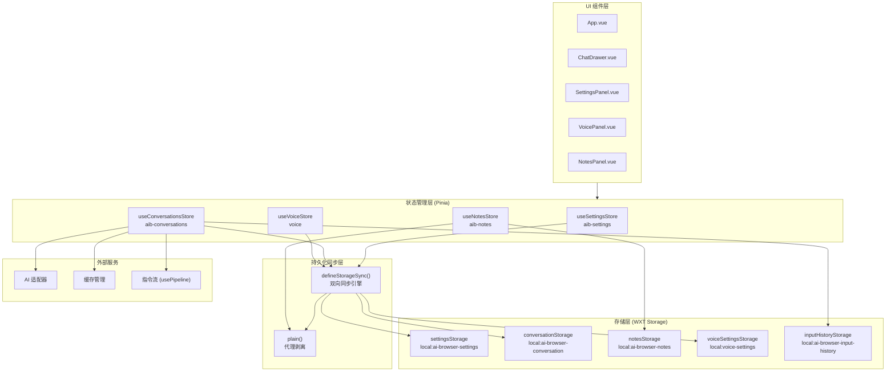
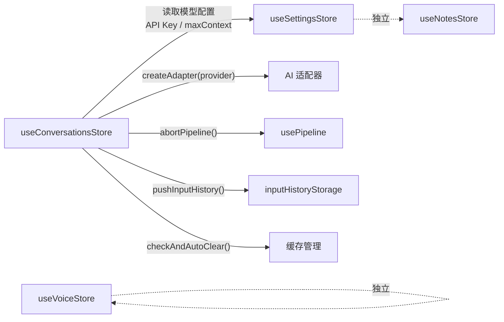
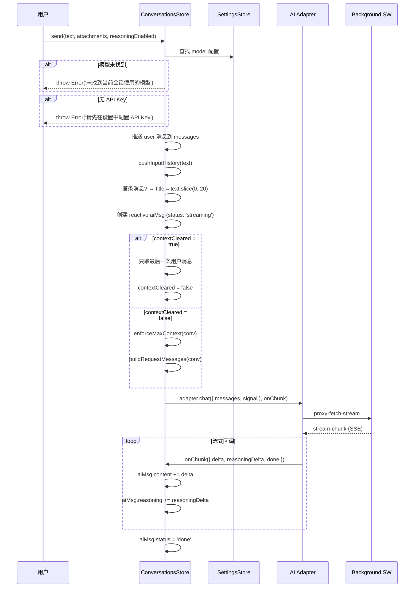
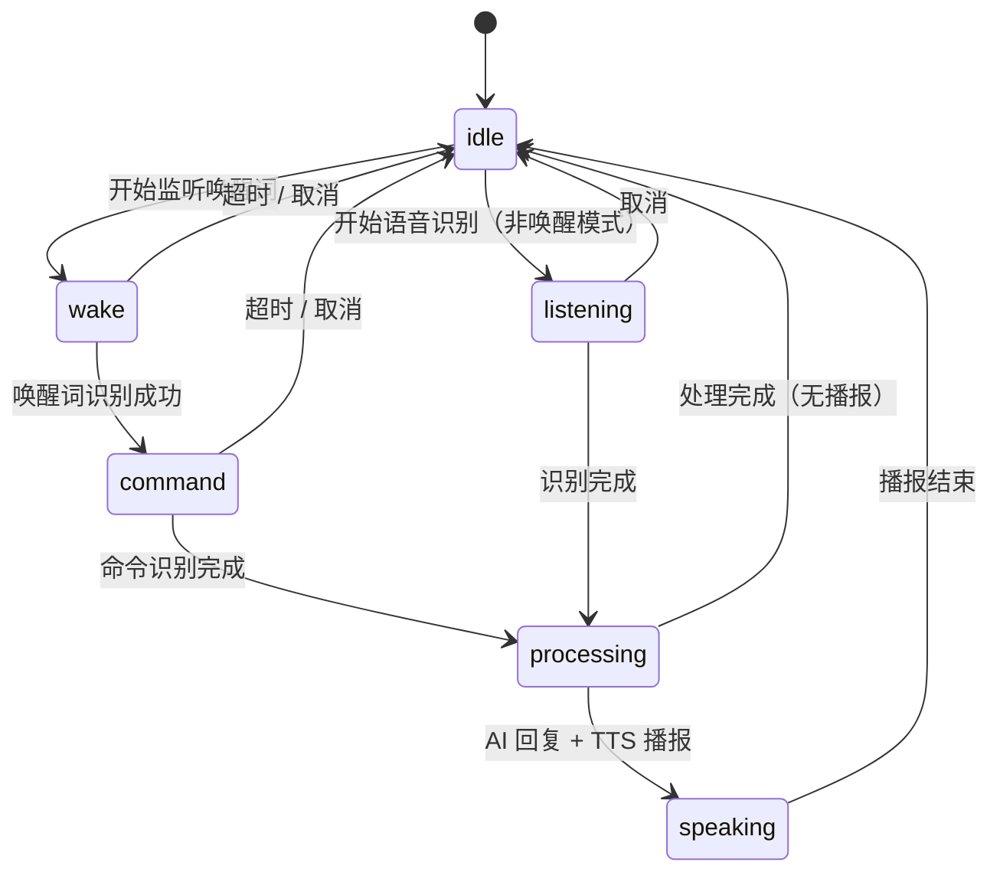
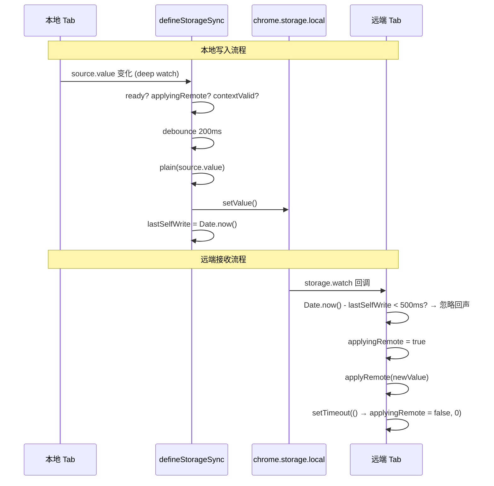
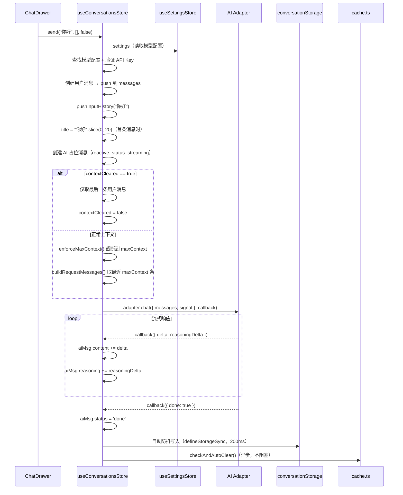
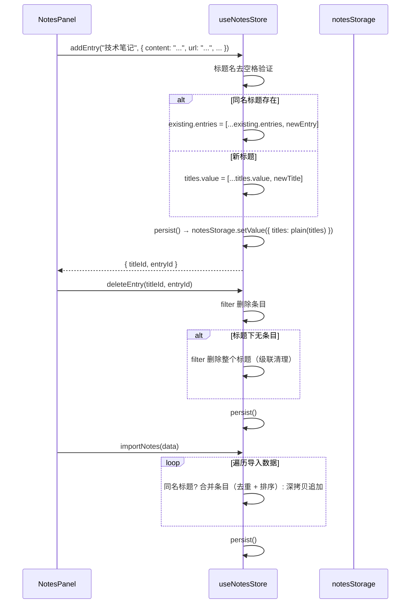
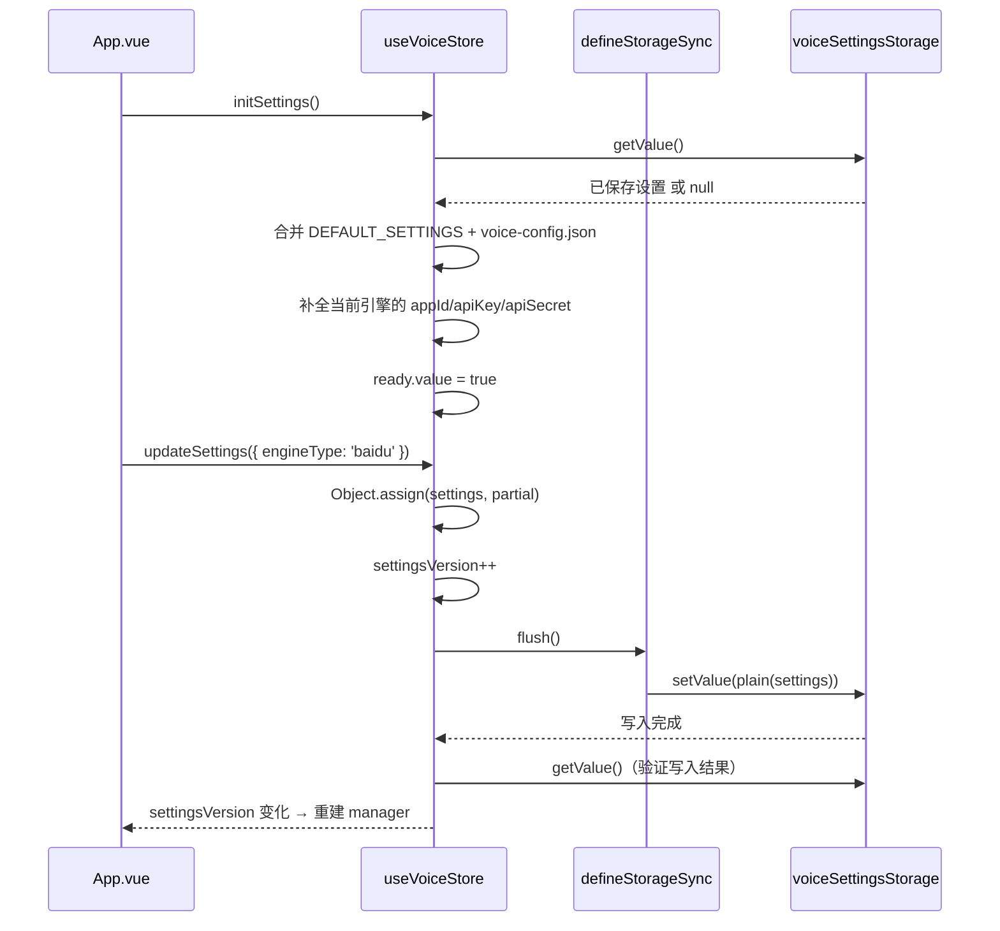

# 状态管理架构

## 模块概述

状态管理模块是 AI Browser 扩展的数据层核心，基于 **Pinia** 实现，采用 **Composition API（setup store）** 模式。模块负责管理扩展运行时的所有状态，包括全局设置、对话历史、笔记数据和语音状态，并通过 `defineStorageSync` 工具函数实现与 `chrome.storage.local` 的双向持久化同步。

**在架构中的位置**：状态管理位于 Content Script 层，作为 UI 组件（Vue）与底层服务（适配器、存储、语音引擎）之间的桥梁。所有组件通过 Pinia store 访问数据，store 内部协调适配器调用、存储读写和跨标签页同步。

**依赖关系**：

| 方向 | 模块 | 说明 |
|------|------|------|
| 上游依赖 | `src/storage/` | WXT storage 封装，提供 `settingsStorage`、`conversationStorage` 等存储项 |
| 上游依赖 | `src/adapters/` | AI 适配器工厂，`createAdapter(provider)` |
| 上游依赖 | `src/utils/storage-sync.ts` | `defineStorageSync` 双向同步引擎 |
| 上游依赖 | `src/utils/cache.ts` | `checkAndAutoClear()` 缓存超限自动清除 |
| 上游依赖 | `src/composables/usePipeline` | `abortPipeline()` 中断指令流 |
| 上游依赖 | `src/storage/input-history.ts` | `pushInputHistory()` 输入历史记录 |
| 下游被依赖 | 所有 Vue 组件 | 通过 `useXxxStore()` 消费状态 |

**源码位置**：

```
src/stores/
├── settings.ts         # useSettingsStore
├── conversations.ts    # useConversationsStore
├── notes.ts            # useNotesStore
└── voice.ts            # useVoiceStore

src/utils/
└── storage-sync.ts     # defineStorageSync + plain()

src/storage/
├── index.ts            # 存储项定义 + DEFAULT_SETTINGS + DEFAULT_VOICE_SETTINGS
└── input-history.ts    # 输入历史记录工具
```



---

## 架构设计

### 设计模式

| 模式 | 应用位置 | 说明 |
|------|----------|------|
| **Setup Store** | 所有 store | 使用 Pinia 的 `defineStore` + 函数式写法，完全遵循 Vue 3 Composition API |
| **双向数据绑定** | `defineStorageSync` | reactive ref 与 chrome.storage 通过 `watch` + `storage.watch` 实现双向同步 |
| **防抖写入** | `defineStorageSync` | 200ms 防抖避免高频写入，500ms 回声窗口防止跨标签页循环 |
| **工厂模式** | `createAdapter` | 根据 provider 创建对应 AI 适配器实例 |
| **防御式合并** | `mergeSettings` | 使用 `DEFAULT_SETTINGS` 作为兜底，确保数据完整性 |
| **单例会话** | `useConversationsStore` | 不再支持多会话，单一 `conversation` ref 管理全部消息 |
| **手动持久化** | `useNotesStore` | 不使用 `defineStorageSync`，手动调用 `persist()` 写入 storage |

### Store 间依赖关系



- `useConversationsStore` 在 `send()` 中调用 `useSettingsStore()` 获取模型配置、API Key、`maxContext` 等参数
- `useConversationsStore` 在 `send()` 中调用 `createAdapter()` 创建 AI 适配器
- `useConversationsStore` 在 `clearCurrent()` / `resetConversation()` 中调用 `abortPipeline()` 中断指令流
- `useConversationsStore` 在 `send()` 中调用 `pushInputHistory()` 记录输入历史
- `useConversationsStore` 在 `saveConversation()` 后调用 `checkAndAutoClear()` 检查缓存大小
- `useVoiceStore` 完全独立，不依赖其他 store
- `useNotesStore` 完全独立，不依赖其他 store

---

## 核心类型定义

### AppSettings

全局应用设置，存储键 `local:ai-browser-settings`。

```typescript
interface AppSettings {
  provider: Provider;                    // 协议类型
  baseUrl: string;                       // 全局请求地址
  apiKey: string;                        // 全局密钥
  authField?: string;                    // 认证字段（bearer / api-key / access-token / authorization）
  models: ModelConfig[];                 // 可用模型列表
  defaultModelId: string;                // 默认模型 id
  drawerWidth: number;                   // 抽屉宽度（vw 百分比，40-100）
  primaryColor: string;                  // 主题色（hex）
  theme?: string;                        // 主题 id
  shortcut: string;                      // 唤起快捷键（如 "Ctrl+`"）
  maxConversations?: number;             // 最大会话数
  maxContext?: number;                   // 单会话最大上下文消息数（默认 100）
  autoSendSelection?: 'auto' | 'manual' | 'off';  // 划词操作模式
  translateTargetLang?: string;          // 翻译目标语言
  translateMode?: 'selection' | 'auto' | 'click' | 'off';  // 翻译模式
  noteMode?: NoteMode;                   // 笔记模式
  automationEnabled?: boolean;           // 网页自动化开关（默认 true）
  locale?: 'zh-CN' | 'en-US';          // 界面语言
}
```

### ModelConfig

单个 AI 模型配置，嵌套在 `AppSettings.models` 数组中。

```typescript
interface ModelConfig {
  id: string;            // 唯一标识（自动生成或用户指定）
  label: string;         // 显示名称
  provider: Provider;    // 协议类型（openai / anthropic / gemini / ...）
  modelName: string;     // 真实模型名（请求 body 用）
  reasoning?: boolean;   // 是否支持深度思考
  vision?: boolean;      // 是否支持图片
  baseUrl?: string;      // 每模型独立请求地址（可选，不填用全局）
  apiKey?: string;       // 每模型独立密钥（可选，不填用全局）
  authField?: string;    // 认证字段
  website?: string;      // 供应商官网地址
}
```

### Provider

AI 协议类型联合：

```typescript
type Provider =
  | 'openai'        // OpenAI 兼容
  | 'anthropic'     // Anthropic Claude
  | 'gemini'        // Google Gemini
  | 'custom'        // 自定义
  | 'qwen'          // 通义千问（阿里）
  | 'wenxin'        // 文心一言（百度）
  | 'zhipu'         // 智谱清言
  | 'deepseek'      // DeepSeek
  | 'moonshot'      // Moonshot (Kimi)
  | 'doubao'        // 豆包（字节火山引擎）
  | 'grok'          // Grok (xAI)
```

### ChatMessage

单条聊天消息，存储在 `Conversation.messages` 数组中。

```typescript
interface ChatMessage {
  id: string;
  role: 'user' | 'assistant' | 'system';
  content: string;                                          // 普通文本内容
  reasoning?: string;                                       // 深度思考内容
  attachments?: Attachment[];                               // 统一附件（图片 OCR 文字 + 文件）
  timestamp: number;                                        // 创建时间
  status?: 'sending' | 'streaming' | 'done' | 'error' | 'aborted';
  errorMessage?: string;                                    // 错误信息（status=error 时）
  reasoningEnabled?: boolean;                               // 发送时是否启用深度思考
}
```

**状态流转**：`sending` -> `streaming` -> `done`，异常时为 `error` 或 `aborted`。

### Conversation

单一会话对象，存储键 `local:ai-browser-conversation`。

```typescript
interface Conversation {
  id: string;                      // UUID
  title: string;                   // 会话标题（默认 "新对话"，首条消息前 20 字符）
  messages: ChatMessage[];         // 消息列表
  modelId: string;                 // 当前会话使用的模型 id
  scrollTop?: number;              // 滚动条位置（持久化）
  draftText?: string;              // 输入框草稿文本
  draftAttachments?: Attachment[]; // 输入框草稿附件
  reasoningEnabled?: boolean;      // 深度思考开关
  createdAt: number;               // 创建时间戳
  updatedAt: number;               // 更新时间戳
}
```

### Attachment

统一附件接口：

```typescript
type AttachmentType = 'image' | 'text' | 'code' | 'pdf' | 'word' | 'excel' | 'binary';

interface Attachment {
  id: string;
  type: AttachmentType;
  name: string;           // 原始文件名
  size: number;           // 文件大小（字节）
  mimeType: string;       // MIME 类型
  dataUrl?: string;       // 图片: base64 dataURL
  content?: string;       // 文本/代码/PDF/Office 提取的文本内容
  lang?: string;          // 代码语言标识（用于语法高亮）
  truncated?: boolean;    // 内容是否被截断（超过 500KB）
}
```

### NoteEntry / NoteTitle / NotesData

笔记系统类型，存储键 `local:ai-browser-notes`。

```typescript
interface NoteEntry {
  id: string;                        // 唯一 id（genId() 生成）
  content: string;                   // 笔记内容（markdown）
  url: string;                       // 来源 URL
  scrollY: number;                   // 保存时的滚动条位置
  selectedText?: string;             // 划词/选中的文本
  source: 'selection' | 'click' | 'chat' | 'auto';  // 来源类型
  timestamp: number;                 // 保存时间
}

interface NoteTitle {
  id: string;                        // 唯一 id（genId() 生成）
  title: string;                     // 标题名
  entries: NoteEntry[];              // 条目列表（按时间排序）
  createdAt: number;                 // 创建时间
  updatedAt: number;                 // 更新时间
}

interface NotesData {
  titles: NoteTitle[];
}
```

### VoiceSettings / EngineConf

语音设置类型，存储键 `local:voice-settings`。

```typescript
type EngineType = 'web-speech' | 'iflytek' | 'baidu' | 'tencent';

interface EngineConf {
  engineType: string;
  appId: string;
  apiKey: string;
  apiSecret: string;
}

interface VoiceSettings {
  engineType: EngineType;       // 语音引擎类型
  appId: string;                // 应用 ID
  apiKey: string;               // API 密钥
  apiSecret: string;            // API 密钥
  engineConfs: EngineConf[];    // 所有引擎的默认配置（从 voice-config.json 合并）
  recognitionLang: string;      // 识别语言（默认 'zh-CN'）
  wakeWord: string;             // 唤醒词（默认 '你好，小灵'）
  alwaysOnVoice: boolean;       // 始终监听
  enableTts: boolean;           // TTS 开关（默认 true）
  ttsRate: number;              // TTS 语速（默认 1.8）
  ttsVolume: number;            // TTS 音量（默认 0.8）
  bufferTimeout: number;        // 缓冲超时 ms（默认 1500）
  idleTimeout: number;          // 空闲超时 ms（默认 3000）
}
```

### VoiceStatus / SessionState

语音运行时状态类型（不持久化）：

```typescript
type VoiceStatus = 'idle' | 'listening' | 'processing' | 'error';

type SessionState =
  | 'idle'        // 空闲
  | 'wake'        // 监听唤醒词
  | 'command'     // 监听命令
  | 'processing'  // AI 处理中
  | 'speaking'    // TTS 播报中
```

### defineStorageSync 泛型选项

```typescript
interface StorageItemLike<T> {
  setValue: (v: T) => Promise<void>;
  watch: (cb: (nv: T | null) => void) => void;
}

interface SyncOptions<T> {
  source: Ref<T>;                          // 响应式数据 ref
  storage: StorageItemLike<T>;             // wxt storage item
  ready: Ref<boolean>;                     // ready 标志，false 时不写入
  applyRemote: (nv: T) => void;           // 来自远端的值 -> 应用到 source
  debounce?: number;                       // 防抖延时（ms），默认 200
  echoWindow?: number;                     // 自我写入回声忽略窗口（ms），默认 500
}
```

---

## 实现细节

### defineStorageSync —— 双向同步引擎

源码：`src/utils/storage-sync.ts`

这是整个状态管理模块的核心基础设施，所有需要跨标签页持久化的 store 都依赖它。

**函数签名**：

```typescript
function defineStorageSync<T>(opts: SyncOptions<T>): {
  isApplyingRemote: () => boolean;
  markSelfWrite: () => void;
  flush: () => Promise<void>;
}
```

**核心算法**：

1. **跨页面同步（storage -> ref）**：通过 `storage.watch` 监听 `chrome.storage` 变化事件。收到变化时，检查是否在回声窗口内（`Date.now() - lastSelfWrite < echoMs`），如果是则忽略（避免自己写入的值又被读回来形成循环）。否则调用 `applyRemote` 将远端值应用到本地 ref。

2. **本地变化写入（ref -> storage）**：通过 Vue `watch` 深度监听 source ref。变化时检查三个条件：`ready` 为 true、不在 `applyingRemote` 状态、扩展上下文有效。通过 200ms 防抖后，调用 `storage.setValue(plain(source.value))` 写入。

3. **回声防护**：写入前记录 `lastSelfWrite = Date.now()`，远端监听器在 500ms 窗口内忽略来自自身的写入事件。

4. **上下文失效检测**：`isContextValid()` 通过检查 `chrome?.runtime?.id` 判断扩展上下文是否仍有效，防止在扩展卸载/更新后继续操作导致报错。

```typescript
export function defineStorageSync<T>(opts: SyncOptions<T>) {
  const { source, storage, ready, applyRemote } = opts;
  const debounceMs = opts.debounce ?? 200;
  const echoMs = opts.echoWindow ?? 500;

  let lastSelfWrite = 0;
  let timer: number | null = null;
  let applyingRemote = false;

  // 跨页面同步：监听 storage 变化
  storage.watch((nv) => {
    if (nv == null) return;
    if (Date.now() - lastSelfWrite < echoMs) return;  // 回声窗口内忽略
    applyingRemote = true;
    applyRemote(nv);
    setTimeout(() => (applyingRemote = false), 0);
  });

  // 本地变化 → 防抖写入
  watch(
    source,
    () => {
      if (!ready.value || applyingRemote) return;
      if (!isContextValid()) return;
      if (timer) window.clearTimeout(timer);
      timer = window.setTimeout(() => {
        if (!isContextValid()) return;
        lastSelfWrite = Date.now();
        storage.setValue(plain(source.value)).catch(() => {});
      }, debounceMs);
    },
    { deep: true }
  );

  // 显式立即写入（绕过防抖）
  async function flush() {
    if (!isContextValid()) return;
    if (timer) window.clearTimeout(timer);
    lastSelfWrite = Date.now();
    await storage.setValue(plain(source.value)).catch(() => {});
  }

  return {
    isApplyingRemote: () => applyingRemote,
    markSelfWrite: () => (lastSelfWrite = Date.now()),
    flush,
  };
}
```

**返回值说明**：

| 方法 | 返回值 | 用途 |
|------|--------|------|
| `isApplyingRemote()` | `boolean` | 判断当前是否正在应用远端值，外部逻辑可据此跳过某些操作 |
| `markSelfWrite()` | `void` | 手动标记自我写入时间戳，用于 init 时首次写入场景，避免触发远端监听器的回声 |
| `flush()` | `Promise<void>` | 绕过防抖立即写入，用于 `update()` 等需要确保即时持久化的场景 |

### plain() —— Vue 代理剥离

```typescript
export function plain<T>(v: T): T {
  return JSON.parse(JSON.stringify(toRaw(v)));
}
```

通过 `toRaw` 剥离 Vue 的 Proxy 包装，再经 `JSON.parse(JSON.stringify(...))` 深拷贝，确保写入 storage 的是纯 JSON 对象，避免 Proxy 序列化问题和引用共享。

### isContextValid() —— 扩展上下文检测

```typescript
function isContextValid(): boolean {
  try {
    return !!chrome?.runtime?.id;
  } catch {
    return false;
  }
}
```

Chrome 扩展的 content script 在页面导航后可能失去扩展上下文。写入前检查 `chrome.runtime.id` 是否存在，避免 `"Extension context invalidated"` 错误。

---

### useSettingsStore —— 全局设置

源码：`src/stores/settings.ts`

**Store ID**: `aib-settings`

#### 状态

```typescript
const settings = ref<AppSettings>({ ...DEFAULT_SETTINGS });
const ready = ref(false);
```

#### mergeSettings(v: Partial<AppSettings>): AppSettings

安全合并函数，保证数据完整性：

```typescript
function mergeSettings(v: Partial<AppSettings>): AppSettings {
  const merged = { ...DEFAULT_SETTINGS, ...v };
  // 保证 models 是非空数组
  if (!Array.isArray(merged.models) || merged.models.length === 0) {
    merged.models = DEFAULT_SETTINGS.models;
  }
  // 修复无 id 的模型
  merged.models = merged.models.map((m, i) => ({
    ...m,
    id: m.id || m.modelName || `model-${i}`,
    label: m.label || m.modelName || `模型 ${i + 1}`,
  }));
  // 保证 defaultModelId 有效
  if (
    !merged.defaultModelId ||
    !merged.models.find((m) => m.id === merged.defaultModelId)
  ) {
    merged.defaultModelId = merged.models[0].id;
  }
  return merged;
}
```

**边界条件处理**：
- `models` 不是数组或为空时，回退到 `DEFAULT_SETTINGS.models`
- 模型缺少 `id` 时，回退链：`m.id` -> `m.modelName` -> `'model-${i}'`
- 模型缺少 `label` 时，回退链：`m.label` -> `m.modelName` -> `'模型 ${i + 1}'`
- `defaultModelId` 指向不存在的模型时，自动回退到 `models[0].id`

**错误处理**：该函数不抛出异常，始终返回有效的 `AppSettings` 对象。


#### init(): Promise<void>

初始化流程：

```typescript
async function init() {
  const v = await settingsStorage.getValue();
  const hasValidData =
    v && typeof v === 'object' && !Array.isArray(v) &&
    Array.isArray((v as any).models) && (v as any).models.length > 0;

  if (hasValidData) {
    settings.value = mergeSettings(v as any);
  } else {
    settings.value = mergeSettings(DEFAULT_SETTINGS);
    sync.markSelfWrite();
    await settingsStorage.setValue(plain(settings.value));
  }
  ready.value = true;
}
```

**有效性判断**：`v` 必须是非数组对象，且 `models` 为非空数组。

**首次加载**：无有效数据时，使用 `DEFAULT_SETTINGS`（含 `local-config.json` 中的模型配置）写入 storage。`markSelfWrite()` 阻止后续 `defineStorageSync` 的 watch 将刚写入的默认值再次写入（防回声）。

#### update(partial: Partial<AppSettings>): Promise<void>

```typescript
async function update(partial: Partial<AppSettings>) {
  settings.value = mergeSettings({ ...settings.value, ...partial });
  await sync.flush();
}
```

**设计意图**：用户在设置页面修改配置后，需要立即持久化而非等待 200ms 防抖。`flush()` 绕过防抖直接写入 storage。使用展开运算符创建新对象（immutable 模式）。

#### 跨标签页同步

通过 `defineStorageSync` 建立双向同步：

```typescript
const sync = defineStorageSync<AppSettings>({
  source: settings,
  storage: settingsStorage,
  ready,
  applyRemote: (nv) => {
    if (nv && typeof nv === 'object' && !Array.isArray(nv)) {
      settings.value = mergeSettings(nv);
    }
  },
});
```

`applyRemote` 中同样调用 `mergeSettings`，确保远端传来的数据也经过安全合并。

---

### useConversationsStore —— 对话管理

源码：`src/stores/conversations.ts`

**Store ID**: `aib-conversations`

#### 状态

```typescript
const conversation = ref<Conversation | null>(null);
const ready = ref(false);
const contextCleared = ref(false);              // 标记上下文是否已清除
let currentAborter: AbortController | null = null;  // 当前请求的 AbortController（非响应式）

const active = computed(() => conversation.value ?? undefined);  // 兼容旧接口
```

**单会话模型**：不再支持多会话，`conversation` 直接持有唯一的会话对象。

#### init(): Promise<void>

```typescript
async function init() {
  const stored = await conversationStorage.getValue();
  if (stored && typeof stored === 'object' && Array.isArray((stored as any).messages)) {
    conversation.value = stored as Conversation;
    // 清理残留的 streaming 消息
    let cleaned = 0;
    for (const msg of conversation.value.messages) {
      if (msg.status === 'streaming') {
        msg.status = 'done';
        cleaned++;
      }
    }
    if (cleaned) log.warn('清理残留 streaming 消息', { count: cleaned });
  } else {
    conversation.value = createDefaultConversation();
    await saveConversation();
  }
  ready.value = true;
}
```

**残留清理原因**：跨标签页导航时，JS 上下文被销毁，`defineStorageSync` 的 200ms 防抖写入可能未完成，导致 storage 中残留 `status: 'streaming'` 的消息。下次加载时统一标记为 `'done'`。

#### createDefaultConversation(): Conversation

```typescript
function createDefaultConversation(): Conversation {
  const settings = useSettingsStore().settings;
  return {
    id: uuid(),
    title: '新对话',
    messages: [],
    modelId: settings.defaultModelId,
    createdAt: Date.now(),
    updatedAt: Date.now(),
  };
}
```

#### send(text, attachments?, reasoningEnabled?): Promise<void>

流式消息发送的核心流程：



**关键设计**：

1. **reactive aiMsg**：用 `reactive()` 而非 `ref()` 包装 AI 占位消息，确保流式更新（逐字符追加）能触发 Vue 渲染。`ref()` 对深层属性变化的追踪可能不够及时。

2. **contextCleared 标记**：`clearCurrent()` 设置 `contextCleared = true`，下次 `send()` 时只发送当前用户消息（不携带历史），发送后重置为 `false`。这实现了"清除上下文后重新开始对话"的语义。

3. **有效的 baseUrl/ApiKey 优先级**：`model.baseUrl || settings.baseUrl`，`model.apiKey || settings.apiKey`。每模型独立配置优先于全局配置。

4. **自动标题生成**：首条用户消息的前 20 个字符作为会话标题。

5. **输入历史记录**：非空文本消息通过 `pushInputHistory()` 记录到 `inputHistoryStorage`（上限 100 条，FIFO 策略，连续去重）。

**错误处理**：

| 场景 | 处理方式 |
|------|----------|
| 模型未找到 | 抛出 `Error('未找到当前会话使用的模型')` |
| 无 API Key | 抛出 `Error('请先在设置中配置 API Key')` |
| 请求中止（AbortError） | `aiMsg.status = 'aborted'`，不抛出 |
| 其他请求错误 | `aiMsg.status = 'error'`，`aiMsg.errorMessage = e.message`，不抛出 |

#### enforceMaxContext(conv: Conversation): void

```typescript
function enforceMaxContext(conv: Conversation) {
  const max = useSettingsStore().settings.maxContext;
  if (conv.messages.length <= max) return;
  conv.messages.splice(0, conv.messages.length - max);
}
```

从头部截断，保留最近 `maxContext` 条消息（默认 100）。截断发生在 `send()` 构建请求上下文之前，直接修改 `conversation.messages`。

#### buildRequestMessages(conv: Conversation): ChatMessage[]

```typescript
function buildRequestMessages(conv: Conversation): ChatMessage[] {
  const max = useSettingsStore().settings.maxContext;
  return conv.messages.slice(-max);
}
```

从消息列表末尾取最近 `maxContext` 条作为请求上下文。注意 `slice(-max)` 返回新数组，不修改原数组。

#### clearCurrent(): Promise<void>

清除当前会话历史：

```typescript
async function clearCurrent() {
  if (!conversation.value) return;
  await abortPipeline();                    // 中断进行中的指令流
  if (currentAborter) {
    currentAborter.abort();                 // 中断进行中的 HTTP 请求
    currentAborter = null;
  }
  conversation.value.messages = [];
  conversation.value.title = '新对话';
  conversation.value.draftText = '';
  conversation.value.draftAttachments = [];
  conversation.value.updatedAt = Date.now();
  contextCleared.value = true;              // 下次发送不携带历史
}
```

#### resetConversation(): Promise<void>

彻底重置会话（清除缓存时使用）：

```typescript
async function resetConversation() {
  await abortPipeline();
  if (currentAborter) {
    currentAborter.abort();
    currentAborter = null;
  }
  conversation.value = createDefaultConversation();
  contextCleared.value = false;
}
```

**clearCurrent vs resetConversation 对比**：

| 方法 | 行为 | contextCleared | 用途 |
|------|------|----------------|------|
| `clearCurrent()` | 清空消息、标题、草稿，保留会话对象 | `true` | 用户主动清除对话历史 |
| `resetConversation()` | 创建全新会话对象 | `false` | 清除缓存时使用 |

#### deleteMessage(msgId: string): void

```typescript
function deleteMessage(msgId: string) {
  if (!conversation.value) return;
  const idx = conversation.value.messages.findIndex((m) => m.id === msgId);
  if (idx === -1) return;
  conversation.value.messages.splice(idx, 1);
  conversation.value.updatedAt = Date.now();
}
```

使用 `splice` 原地删除单条消息。用于用户手动删除对话中的某条消息。

#### updateScroll(top: number): void

```typescript
function updateScroll(top: number) {
  if (conversation.value) conversation.value.scrollTop = top;
}
```

更新滚动条位置，随 `conversation` 对象自动持久化。

#### abort(): void

```typescript
function abort() {
  currentAborter?.abort();
  currentAborter = null;
}
```

独立的中止方法，仅中断请求，不清空消息或会话状态。

#### saveConversation(): Promise<void>

```typescript
async function saveConversation() {
  if (conversation.value) {
    conversation.value.updatedAt = Date.now();
    await conversationStorage.setValue(conversation.value);
    checkAndAutoClear();  // 异步检查缓存大小，不阻塞保存
  }
}
```

显式写入存储，用于迁移等场景。写入后异步检查缓存大小，超过 30MB 时自动清除。

---

### useNotesStore —— 笔记管理

源码：`src/stores/notes.ts`

**Store ID**: `aib-notes`

**注意**：此 store 不使用 `defineStorageSync`，而是手动调用 `persist()` 写入 storage。不支持跨标签页自动同步。

#### 状态

```typescript
const titles = ref<NoteTitle[]>([]);
const ready = ref(false);
```

#### genId(): string

```typescript
function genId(): string {
  return Date.now().toString(36) + Math.random().toString(36).slice(2, 8);
}
```

基于时间戳 + 随机数生成唯一 ID（非 UUID，但在此场景下足够唯一）。

#### init(): Promise<void>

```typescript
async function init() {
  const data = await notesStorage.getValue();
  if (data && Array.isArray(data.titles)) {
    titles.value = data.titles;
  } else {
    titles.value = [];
  }
  ready.value = true;
}
```

#### persist(): Promise<void>

```typescript
async function persist() {
  await notesStorage.setValue({ titles: plain(titles.value) });
}
```

手动持久化，使用 `plain()` 剥离 Vue 代理后写入 storage。

#### addEntry(titleName, entry): Promise<{ titleId; entryId }>

```typescript
async function addEntry(
  titleName: string,
  entry: Omit<NoteEntry, 'id' | 'timestamp'>,
): Promise<{ titleId: string; entryId: string }>
```

**逻辑**：
1. 标题名去空格后为空 -> 抛出 `Error('笔记标题不能为空')`
2. 查找已有同名标题：
   - 存在 -> 追加条目到 `entries` 数组（展开运算符创建新数组，保持不可变性）
   - 不存在 -> 创建新标题 + 新条目
3. 调用 `persist()` 写入 storage
4. 返回 `{ titleId, entryId }`

#### deleteTitle(titleId): Promise<void>

```typescript
async function deleteTitle(titleId: string) {
  titles.value = titles.value.filter((t) => t.id !== titleId);
  await persist();
}
```

删除整个标题组（含所有条目）。使用 `filter` 创建新数组（immutable）。

#### deleteEntry(titleId, entryId): Promise<void>

```typescript
async function deleteEntry(titleId: string, entryId: string) {
  const title = titles.value.find((t) => t.id === titleId);
  if (!title) return;
  const newEntries = title.entries.filter((e) => e.id !== entryId);
  if (newEntries.length === 0) {
    titles.value = titles.value.filter((t) => t.id !== titleId);
  } else {
    title.entries = newEntries;
    title.updatedAt = Date.now();
  }
  await persist();
}
```

删除单条条目。**级联清理**：当标题下无条目时，自动删除整个标题。

#### updateEntryContent(titleId, entryId, content): Promise<void>

```typescript
async function updateEntryContent(
  titleId: string,
  entryId: string,
  content: string,
) {
  const title = titles.value.find((t) => t.id === titleId);
  if (!title) return;
  const entry = title.entries.find((e) => e.id === entryId);
  if (!entry) return;
  entry.content = content;
  title.updatedAt = Date.now();
  await persist();
}
```

更新条目内容（编辑用）。直接修改 entry 对象属性（mutation），因为操作的是 `titles.value` 内部的嵌套对象。

#### renameTitle(titleId, newTitle): Promise<void>

```typescript
async function renameTitle(titleId: string, newTitle: string) {
  const trimmed = newTitle.trim();
  if (!trimmed) return;
  const duplicate = titles.value.find((t) => t.title === trimmed && t.id !== titleId);
  if (duplicate) throw new Error('已存在同名笔记');
  const title = titles.value.find((t) => t.id === titleId);
  if (!title) return;
  title.title = trimmed;
  title.updatedAt = Date.now();
  await persist();
}
```

重命名标题，包含**重名检测**：查找是否存在同名但不同 id 的标题，存在则抛出错误。

#### getTitleNames(): string[]

```typescript
function getTitleNames(): string[] {
  return titles.value.map((t) => t.title);
}
```

获取所有标题名列表（纯读取，不持久化）。

#### importNotes(data: NotesData): Promise<void>

```typescript
async function importNotes(data: NotesData) {
  if (!data || !Array.isArray(data.titles)) return;
  for (const incoming of data.titles) {
    if (!incoming.title || !Array.isArray(incoming.entries)) continue;

    const existing = titles.value.find((t) => t.title === incoming.title);
    if (existing) {
      const existingIds = new Set(existing.entries.map((e) => e.id));
      const newEntries = incoming.entries
        .filter((e) => e.id && !existingIds.has(e.id))
        .map((e) => ({ ...e }));
      existing.entries = [...existing.entries, ...newEntries]
        .sort((a, b) => a.timestamp - b.timestamp);
      existing.updatedAt = Date.now();
    } else {
      titles.value = [...titles.value, {
        ...incoming,
        entries: incoming.entries.map((e) => ({ ...e })),
      }];
    }
  }
  await persist();
}
```

导入笔记数据，采用**合并策略**：
1. 遍历导入数据的每个标题
2. 同名标题存在 -> 合并条目（按 id 去重，深拷贝避免引用共享，按 timestamp 排序）
3. 同名标题不存在 -> 深拷贝后追加
4. 无效数据（无 title 或无 entries 数组）-> 跳过

---

### useVoiceStore —— 语音状态管理

源码：`src/stores/voice.ts`

**Store ID**: `voice`（注意：未使用 `aib-` 前缀）

#### 状态分类

1. **运行时状态**（不持久化）：
   - `status: Ref<VoiceStatus>` — `'idle' | 'listening' | 'processing' | 'error'`
   - `sessionState: Ref<SessionState>` — `'idle' | 'wake' | 'command' | 'processing' | 'speaking'`
   - `interimText: Ref<string>` — 识别中间结果
   - `finalText: Ref<string>` — 识别最终结果

2. **持久化设置**（通过 `defineStorageSync` 同步到 `voiceSettingsStorage`）：
   - `settings: Ref<VoiceSettings>` — 语音设置
   - `settingsVersion: Ref<number>` — 版本号，App.vue 监听变化来重建 manager

```typescript
// 运行时状态
const status = ref<VoiceStatus>('idle');
const sessionState = ref<SessionState>('idle');
const interimText = ref('');
const finalText = ref('');

// 持久化设置
const settings = ref<VoiceSettings>({ ...DEFAULT_SETTINGS });
const ready = ref(false);
const settingsVersion = ref(0);
```

#### 状态机



#### initSettings(): Promise<void>

```typescript
async function initSettings() {
  try {
    const stored = await voiceSettingsStorage.getValue();
    const merged = { ...DEFAULT_SETTINGS, ...stored };

    // 首次加载：把 voice-config.json 整个数组写入 engineConfs
    if (!merged.engineConfs || merged.engineConfs.length === 0) {
      merged.engineConfs = Array.isArray(voiceConfig)
        ? voiceConfig.map((c: any) => ({
            engineType: c.engineType || '',
            appId: c.appId || '',
            apiKey: c.apiKey || '',
            apiSecret: c.apiSecret || '',
          }))
        : [];
    }

    // 从 engineConfs 中取当前引擎的默认值补全空字段
    const conf = merged.engineConfs.find(c => c.engineType === merged.engineType);
    if (conf) {
      if (!merged.appId) merged.appId = conf.appId;
      if (!merged.apiKey) merged.apiKey = conf.apiKey;
      if (!merged.apiSecret) merged.apiSecret = conf.apiSecret;
    }

    settings.value = merged;

    if (!stored) {
      sync.markSelfWrite();
      await voiceSettingsStorage.setValue(plain(settings.value) as VoiceSettings);
    }
    ready.value = true;
  } catch (error) {
    log.error('加载语音设置失败:', error);
    ready.value = true;  // 错误时仍设置 ready，不阻塞应用启动
  }
}
```

**初始化流程**：
1. 从 `voiceSettingsStorage` 读取已保存设置
2. 与 `DEFAULT_SETTINGS` 合并
3. 首次加载时，从 `voice-config.json` 整个数组写入 `engineConfs`
4. 从 `engineConfs` 中取当前引擎的默认值补全空字段（`appId`、`apiKey`、`apiSecret`）
5. 无已保存数据 -> 标记 `markSelfWrite()` 后写入默认值
6. 错误处理：catch 后仍设置 `ready = true`（不阻塞应用启动）

#### updateSetting<K>(key, value): void

```typescript
function updateSetting<K extends keyof VoiceSettings>(key: K, value: VoiceSettings[K]) {
  settings.value[key] = value;
  sync.flush();
}
```

单个设置项更新，立即持久化。

#### updateSettings(partial): Promise<void>

```typescript
async function updateSettings(partial: Partial<VoiceSettings>) {
  Object.assign(settings.value, partial);
  settingsVersion.value++;
  await sync.flush();
  // 验证写入结果
  const verify = await voiceSettingsStorage.getValue();
  log.info('语音设置已更新并验证', {
    version: settingsVersion.value,
    engineType: settings.value.engineType,
    storedEngineType: verify?.engineType,
  });
}
```

批量更新设置：
1. `Object.assign` 合并到当前 settings（注意：此处使用 mutation，与 settings store 的展开运算符风格不同）
2. 递增 `settingsVersion`（触发 App.vue 重建 manager）
3. `sync.flush()` 立即持久化
4. 写入后验证（读取 storage 确认写入成功）

#### resetSettings(): void

```typescript
function resetSettings() {
  Object.assign(settings.value, DEFAULT_SETTINGS);
}
```

重置为默认设置（仅修改内存，由 `defineStorageSync` 自动持久化）。

#### 状态更新函数

```typescript
function setStatus(newStatus: VoiceStatus) {
  status.value = newStatus;
}

function setSessionState(state: SessionState) {
  sessionState.value = state;
}

function updateText(text: string, isFinal: boolean) {
  if (isFinal) {
    finalText.value = text;
    interimText.value = '';    // 最终结果确认后清空中间文本
  } else {
    interimText.value = text;  // 中间结果持续更新
  }
}

function reset() {
  status.value = 'idle';
  sessionState.value = 'idle';
  interimText.value = '';
  finalText.value = '';
}
```

**updateText 设计要点**：`finalText` 和 `interimText` 分离，UI 可以同时展示"已确认文本 + 实时识别中间结果"。最终结果确认后清空 `interimText`，避免重复显示。

---

## 数据流

### 跨标签页同步时序



### 防回声机制

跨标签页同步的核心难题：Tab A 写入 storage -> storage 变更事件同时触发 Tab A 和 Tab B -> Tab A 收到自己的写入回声 -> 再次写入 -> 无限循环。

三层防护：

1. **时间戳窗口**：写入时记录 `lastSelfWrite = Date.now()`，收到远端变更时检查 `Date.now() - lastSelfWrite < echoWindow (500ms)`，在窗口内则忽略
2. **applyingRemote 标记**：应用远端值时设置 `applyingRemote = true`，本地 watch 检测到此标记则跳过写入
3. **setTimeout 清除**：`applyRemote` 执行后通过 `setTimeout(() => applyingRemote = false, 0)` 延迟清除标记，确保当前同步周期内不会触发本地写入

### 消息发送完整流程



### 笔记 CRUD 流程



### 语音设置更新流程



---

## 配置与扩展

### 默认设置来源

`DEFAULT_SETTINGS` 从 `src/local-config.json` 动态解析：

```mermaid
flowchart LR
    A[local-config.json] -->|import| B[rawModels]
    B -->|parseLocalModels| C[ModelConfig[]]
    C -->|DEFAULT_SETTINGS| D[settingsStorage fallback]
```

`parseLocalModels()` 处理逻辑：
- `baseUrl` 末尾去掉 `/chat/completions`（适配器会自动拼接）
- 从 `id` / `modelName` / `model` 中推导模型标识
- `label` 默认等于 `modelName`
- `provider` 默认为 `'openai'`

`DEFAULT_VOICE_SETTINGS` 从 `src/voice-config.json` 读取引擎配置，`initSettings()` 时合并到 `engineConfs` 数组。

### 存储键映射

| 键 | Store | 类型 | 说明 |
|----|-------|------|------|
| `local:ai-browser-settings` | useSettingsStore | `AppSettings` | 全局设置 |
| `local:ai-browser-conversation` | useConversationsStore | `Conversation \| null` | 当前会话 |
| `local:ai-browser-notes` | useNotesStore | `NotesData` | 笔记数据 |
| `local:voice-settings` | useVoiceStore | `VoiceSettings` | 语音设置 |
| `local:ai-browser-fab-pos` | — | `FabPos` | 悬浮按钮位置 |
| `local:ai-browser-drawer-open` | — | `boolean` | 抽屉展开状态 |
| `local:ai-browser-input-history` | — | `string[]` | 输入历史记录 |
| `local:aib-queued-task` | — | `QueuedTask \| null` | 跨标签页排队任务 |

### 可配置参数

| 参数 | 所属 Store | 默认值 | 说明 |
|------|-----------|--------|------|
| `maxContext` | Settings | `100` | 单会话最大上下文消息数，影响 `enforceMaxContext` 和 `buildRequestMessages` |
| `debounce` | defineStorageSync | `200` ms | 防抖写入延时 |
| `echoWindow` | defineStorageSync | `500` ms | 自我写入回声忽略窗口 |
| `maxConversations` | Settings | `100` | 最大会话数（当前单会话模式下未实际使用） |
| `drawerWidth` | Settings | `480` | 抽屉宽度（vw 百分比） |
| `primaryColor` | Settings | `#4f46e5` | 主题色 |
| `shortcut` | Settings | `` Ctrl+` `` | 唤起快捷键 |
| `ttsRate` | VoiceSettings | `1.8` | TTS 语速 |
| `ttsVolume` | VoiceSettings | `0.8` | TTS 音量 |
| `bufferTimeout` | VoiceSettings | `1500` ms | 语音缓冲超时 |
| `idleTimeout` | VoiceSettings | `3000` ms | 语音空闲超时 |
| `wakeWord` | VoiceSettings | `你好，小灵` | 唤醒词 |
| `CACHE_LIMIT` | cache.ts | `30` MB | 缓存自动清除阈值 |
| `INPUT_HISTORY_MAX` | input-history.ts | `100` 条 | 输入历史上限 |

### 扩展新 Store

添加新的持久化 store 的标准流程：

1. 定义存储项（`src/storage/index.ts`）：
   ```typescript
   export const myStorage = storage.defineItem<MyType>('local:ai-browser-my-data', {
     fallback: defaultValue,
   });
   ```

2. 创建 store（`src/stores/my-store.ts`）：
   ```typescript
   export const useMyStore = defineStore('aib-my-store', () => {
     const data = ref<MyType>(defaultValue);
     const ready = ref(false);

     defineStorageSync<MyType>({
       source: data,
       storage: myStorage,
       ready,
       applyRemote: (nv) => { data.value = nv; },
     });

     async function init() { /* ... */ ready.value = true; }
     return { data, ready, init };
   });
   ```

3. 在入口处调用 `init()`

### 外部系统接口

| 接口 | 方向 | 说明 |
|------|------|------|
| `chrome.storage.local` | 读写 | 所有持久化数据的底层存储 |
| `chrome.runtime.id` | 读取 | 扩展上下文有效性检测 |
| `storage.onChanged` | 监听 | 跨标签页同步的事件源（由 WXT storage 封装） |
| AI 适配器 | 调用 | `createAdapter(provider).chat()` 流式调用 |
| `abortPipeline()` | 调用 | 中断进行中的指令流 |
| `pushInputHistory()` | 调用 | 记录输入历史 |
| `checkAndAutoClear()` | 调用 | 缓存超限自动清除 |

---

## 已知限制

### 单会话限制

当前架构仅支持单会话（`conversation` 为单一 ref），不支持多会话切换。`maxConversations` 配置项存在但未使用。如需支持多会话，需要将 `conversation` 改为 `Map` 或数组结构，并重新设计存储键策略。

### 笔记 store 无跨标签页同步

`useNotesStore` 不使用 `defineStorageSync`，手动调用 `persist()`。在多个标签页同时编辑笔记时可能出现数据覆盖（last-write-wins）。

### voice store ID 不一致

`useVoiceStore` 的 store ID 为 `'voice'`，未遵循 `aib-` 前缀规范（其他三个 store 均使用 `aib-` 前缀）。

### mutation 使用不一致

`deleteMessage` 使用 `splice` 原地修改数组，而 `deleteEntry` 和 `importNotes` 使用展开运算符创建新数组。`updateSettings` 使用 `Object.assign`（mutation），而 `useSettingsStore.update` 使用展开运算符（immutable）。风格不统一。

### plain() 性能开销

每次写入 storage 都经过 `JSON.parse(JSON.stringify(toRaw(v)))` 全量深拷贝，对于大型会话（数百条消息）可能有性能影响。

### 会话数据无版本迁移

存储的 `Conversation` 对象没有版本号字段。如果 `ChatMessage` 或 `Conversation` 接口发生 breaking change（如字段重命名、类型变更），旧数据加载时可能出现异常。`init()` 中的有效性检查仅验证基础结构，不验证字段完整性。

### streaming 残留清理的局限

`init()` 中的 streaming 残留清理仅将 `status` 标记为 `'done'`，但消息的 `content` 可能是不完整的流式片段。用户会看到一条"已完成"但内容截断的 AI 回复，无法区分是正常完成还是异常中断。

### contextCleared 状态丢失

`contextCleared` 是内存中的 ref，不持久化。页面刷新后该状态丢失，用户可能期望清除上下文后刷新页面仍不携带历史。

### 并发写入竞争

`send()` 函数是异步的，但没有互斥锁。如果用户快速连续发送多条消息，可能出现多个 `currentAborter` 交替赋值。实际使用中由于用户操作间隔通常大于 API 响应时间，此问题极少触发。

### 跨标签页同步的 eventual consistency

`defineStorageSync` 实现的是最终一致性模型。两个标签页同时修改同一 store 时，后写入的值会覆盖先写入的值（last-write-wins）。没有冲突解决机制。在单会话场景下，用户通常只在一个标签页操作，此问题影响较小。

### 错误静默忽略

`defineStorageSync` 中 `storage.setValue(...).catch(() => {})` 静默忽略写入错误；`checkAndAutoClear` 中 `getBytesInUse` 失败时也静默忽略。这可能导致数据丢失时用户无感知。

### 未来改进方向

1. **多会话恢复**：恢复 `conversations` 列表支持，保留 `maxConversations` 配置的意义
2. **笔记 store 接入 defineStorageSync**：实现跨标签页自动同步
3. **操作日志/时间线**：为关键状态变更（settings 更新、会话清除）记录操作日志，便于调试
4. **选择性持久化**：对大型会话消息采用分块存储或增量同步，减少 `plain()` 的全量拷贝开销
5. **统一 mutation 策略**：在 immutable 和 mutable 操作之间做出明确选择，统一代码风格
6. **store ID 规范化**：将 `voice` store ID 改为 `aib-voice`
7. **数据版本迁移**：为存储数据添加版本号字段，支持 breaking change 时的自动迁移
