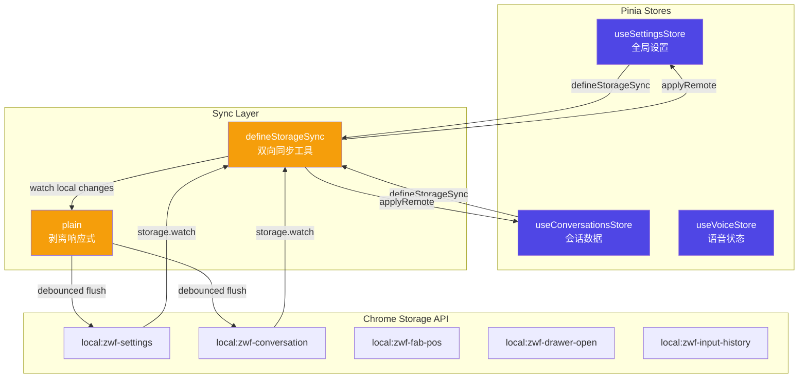
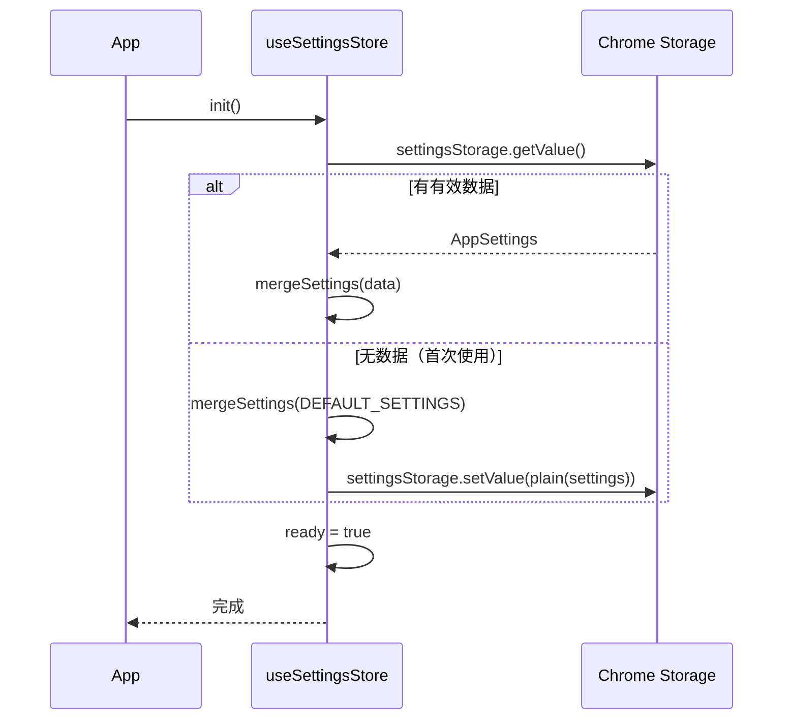
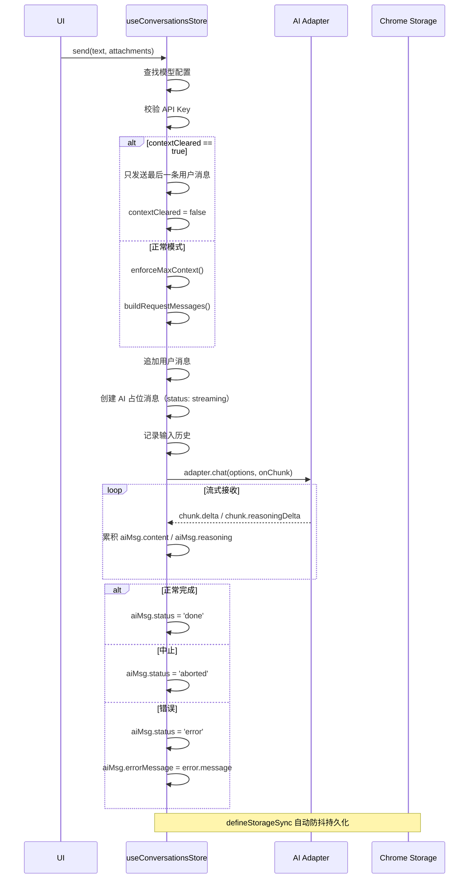
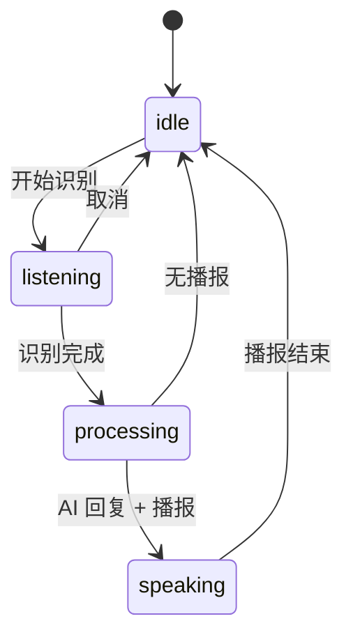
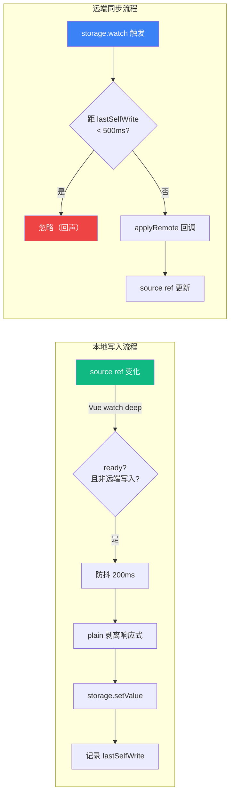
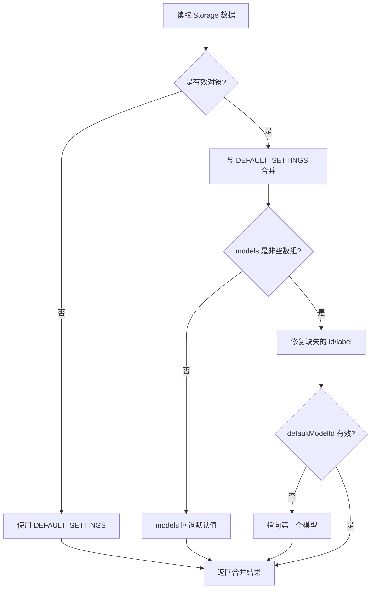

# 状态管理架构

## 目标

管理全局应用状态，支持跨标签页同步和持久化。通过 Pinia 提供响应式状态管理，结合自研 `defineStorageSync()` 工具实现 Pinia State 与 Chrome Storage 之间的自动双向同步，确保多标签页状态一致性。

## 架构总览



## 核心设计决策

### 1. Pinia 作为响应式状态管理

采用 Pinia（Vue 3 官方状态管理库）管理全局状态。所有 Store 均使用 Composition API 风格（`defineStore` + `setup` 函数），与 Vue 3 组合式 API 保持一致的开发体验。

### 2. defineStorageSync() 自动双向同步

自研 `defineStorageSync()` 工具封装了 Pinia State 与 Chrome Storage 之间的双向同步逻辑：

- **本地变化 → Storage**：通过 Vue `watch()` 深度监听响应式数据，防抖（默认 200ms）后调用 `storage.setValue()` 写入
- **Storage 变化 → 本地**：通过 `storage.watch()` 监听跨标签页的存储变更，调用 `applyRemote()` 回调应用到本地 State
- **回声抑制**：本地写入后记录时间戳（`lastSelfWrite`），在 500ms 窗口内忽略自身触发的 `watch` 回调，避免死循环

### 3. 单一会话模型

会话管理采用单一会话模式（不再支持多会话切换）。整个应用生命周期内只有一个 `Conversation` 对象，简化了状态管理复杂度。保留了旧的多会话存储键 `zwf-conversations` 用于数据迁移。

### 4. 设置安全合并机制

`mergeSettings()` 函数保证从 Storage 读取的数据始终与 `DEFAULT_SETTINGS` 合并，防止数据损坏导致应用异常：

- `models` 必须为非空数组，否则回退到默认值
- 每个模型必须有有效的 `id` 和 `label`（自动修复缺失字段）
- `defaultModelId` 必须指向一个有效的模型，否则自动指向第一个模型

### 5. 输入历史独立存储

输入历史记录单独存储在 `zwf-input-history`，不与会话数据耦合。采用上限 100 条 + 连续去重策略，避免存储膨胀。

## 详细实现

### useSettingsStore

**文件**: `src/stores/settings.ts`

管理全局应用设置，包括 AI 提供商配置、模型列表、UI 偏好等。

**状态字段**:

| 字段 | 类型 | 说明 |
|------|------|------|
| `settings` | `Ref<AppSettings>` | 响应式设置对象 |
| `ready` | `Ref<boolean>` | 初始化完成标志 |

**AppSettings 结构**:

```typescript
interface AppSettings {
  provider: Provider;           // AI 协议: openai / anthropic / gemini / deepseek 等
  baseUrl: string;              // API 请求地址
  apiKey: string;               // API 密钥
  authField?: string;           // 认证字段: bearer / api-key / access-token
  models: ModelConfig[];        // 可用模型列表
  defaultModelId: string;       // 默认模型 ID
  drawerWidth: number;          // 抽屉宽度（vw 百分比，40-100）
  primaryColor: string;         // 主题色（hex）
  theme?: string;               // 主题 ID
  shortcut: string;             // 唤起快捷键，如 "Ctrl+`"
  maxContext?: number;          // 单会话最大上下文消息数
  translateTargetLang?: string; // 翻译目标语言
  translateMode?: string;       // 翻译模式: selection / auto / click / off
}
```

**核心方法**:

```typescript
// 初始化：从 Storage 加载设置，无数据则使用默认值并写入
async function init(): Promise<void>

// 更新设置：合并部分更新并立即持久化
async function update(partial: Partial<AppSettings>): Promise<void>

// 安全合并：保证数据完整性
function mergeSettings(v: Partial<AppSettings>): AppSettings
```

**初始化流程**:



### useConversationsStore

**文件**: `src/stores/conversations.ts`

管理单一会话的完整生命周期，包括消息的发送、流式接收、中止、清除等操作。

**状态字段**:

| 字段 | 类型 | 说明 |
|------|------|------|
| `conversation` | `Ref<Conversation \| null>` | 当前会话 |
| `ready` | `Ref<boolean>` | 初始化完成标志 |
| `contextCleared` | `Ref<boolean>` | 上下文已清除标志 |
| `active` | `Computed<Conversation \| undefined>` | 兼容旧接口，指向唯一会话 |

**Conversation 结构**:

```typescript
interface Conversation {
  id: string;               // UUID
  title: string;            // 会话标题（首条消息前 20 字符）
  messages: ChatMessage[];  // 消息列表
  modelId: string;          // 当前使用的模型 ID
  scrollTop?: number;       // 滚动条位置
  draftText?: string;       // 输入框草稿
  draftAttachments?: Attachment[]; // 草稿附件
  reasoningEnabled?: boolean; // 深度思考开关
  createdAt: number;        // 创建时间
  updatedAt: number;        // 更新时间
}
```

**核心方法**:

```typescript
// 初始化：加载会话数据，兼容旧格式迁移
async function init(): Promise<void>

// 发送消息（流式）
async function send(
  text: string,
  attachments?: Attachment[],
  reasoningEnabled?: boolean
): Promise<void>

// 中止当前请求
function abort(): void

// 清除当前会话历史和上下文
async function clearCurrent(): Promise<void>

// 删除单条消息
function deleteMessage(msgId: string): void
```

**send() 流程**:



### useVoiceStore

**文件**: `src/stores/voice.ts`

管理语音识别状态和语音对话历史。纯内存状态，不做持久化。

**状态机**:



**核心字段**:

| 字段 | 类型 | 说明 |
|------|------|------|
| `status` | `VoiceStatus` | 语音识别底层状态 |
| `sessionState` | `SessionState` | 会话状态机状态 |
| `interimText` | `string` | 中间识别文本 |
| `finalText` | `string` | 最终识别文本 |
| `messages` | `VoiceMessage[]` | 语音对话历史 |
| `isProcessing` | `boolean` | AI 处理中标志 |
| `isSpeaking` | `boolean` | 语音播报中标志 |

### defineStorageSync()

**文件**: `src/utils/storage-sync.ts`

将 Vue 响应式 Ref 与 Chrome Storage 进行双向同步的核心工具函数。

**函数签名**:

```typescript
function defineStorageSync<T>(opts: SyncOptions<T>): {
  isApplyingRemote: () => boolean;
  markSelfWrite: () => void;
  flush: () => Promise<void>;
}

interface SyncOptions<T> {
  source: Ref<T>;                    // 响应式数据源
  storage: StorageItemLike<T>;       // wxt storage item
  ready: Ref<boolean>;               // 就绪标志，false 时不写入
  applyRemote: (nv: T) => void;      // 远端值应用回调
  debounce?: number;                 // 防抖延时（默认 200ms）
  echoWindow?: number;               // 回声忽略窗口（默认 500ms）
}
```

**同步数据流**:



### plain() 辅助函数

```typescript
function plain<T>(v: T): T
```

剥离 Vue 响应式代理（Proxy），返回纯净的 JavaScript 对象。实现方式为 `JSON.parse(JSON.stringify(toRaw(v)))`。在写入 Chrome Storage 前必须调用，避免 Proxy 对象序列化失败。

## 存储键定义

所有存储键使用 `zwf-` 命名空间，存储在 `local:` 域（仅本设备同步）。

| 存储键 | 类型 | 说明 | 持久化 |
|--------|------|------|--------|
| `local:zwf-settings` | `AppSettings` | 全局设置 | 是 |
| `local:zwf-conversation` | `Conversation \| null` | 当前会话 | 是 |
| `local:zwf-conversations` | `Conversation[]` | 旧版多会话（已废弃，仅迁移用） | 是 |
| `local:zwf-fab-pos` | `{ right: number, bottom: number }` | 悬浮按钮位置 | 是 |
| `local:zwf-drawer-open` | `boolean` | 抽屉展开状态 | 是 |
| `local:zwf-input-history` | `string[]` | 输入历史（上限 100 条） | 是 |
| `local:zwf-active-id` | `string` | 旧版活跃会话 ID（已废弃） | - |

## 错误处理

### 设置安全合并

`mergeSettings()` 函数对所有从 Storage 读取的设置执行防御性合并：



### 模型 ID 校验

- 模型缺少 `id` 时自动使用 `modelName` 或 `model-${index}` 作为兜底
- 模型缺少 `label` 时自动使用 `modelName` 或 `模型 ${index + 1}` 作为兜底
- `defaultModelId` 指向不存在的模型时自动重置为列表第一个模型

### 上下文清除标记

`contextCleared` 标志用于控制 `send()` 的上下文发送策略：

- `clearCurrent()` 设置 `contextCleared = true`
- 下次 `send()` 时仅发送当前用户消息，不携带历史上下文
- 发送完成后自动重置 `contextCleared = false`
- 后续消息恢复正常上下文携带

### 流式请求错误处理

| 状态 | 触发条件 | 处理 |
|------|----------|------|
| `done` | 正常完成 | 设置 status 为 done |
| `aborted` | 用户主动中止或 `AbortError` | 设置 status 为 aborted |
| `error` | 网络错误、API 错误等 | 设置 status 为 error，记录 errorMessage |

## 源文件索引

| 文件 | 职责 |
|------|------|
| `src/stores/settings.ts` | 全局设置 Store，管理 AI 配置和 UI 偏好 |
| `src/stores/conversations.ts` | 会话 Store，管理消息发送和流式接收 |
| `src/stores/voice.ts` | 语音 Store，管理语音识别状态（纯内存） |
| `src/storage/index.ts` | 存储键定义和 Storage Item 创建 |
| `src/storage/input-history.ts` | 输入历史记录管理（上限 100 条，连续去重） |
| `src/utils/storage-sync.ts` | 双向同步工具 `defineStorageSync()` 和 `plain()` |
| `src/types.ts` | 核心类型定义：AppSettings, Conversation, ChatMessage 等 |
