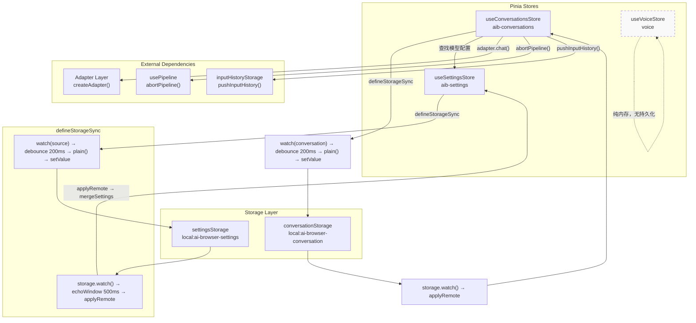
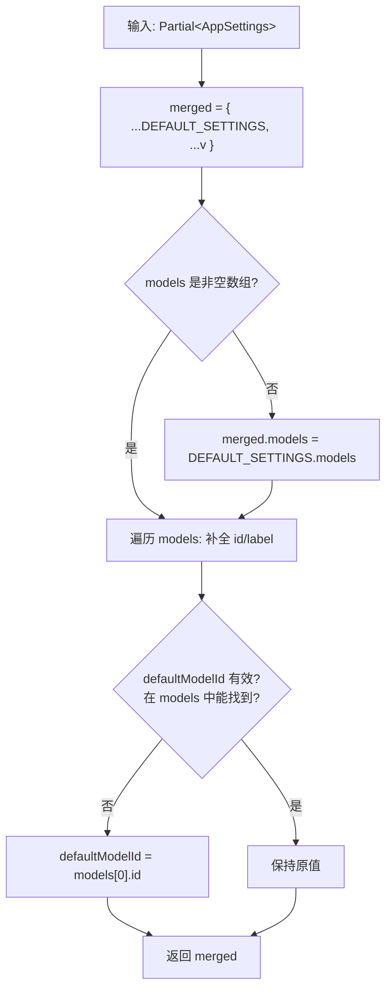
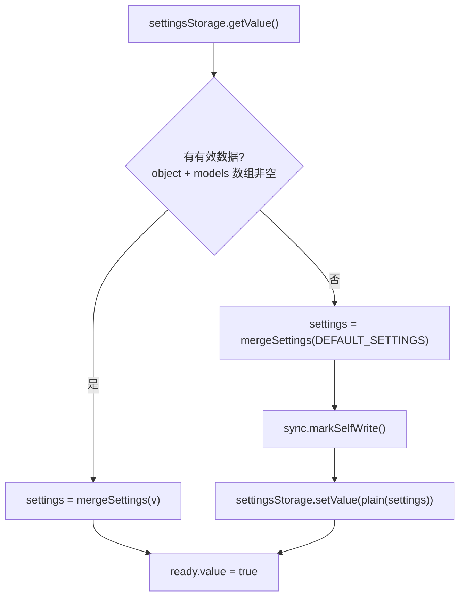
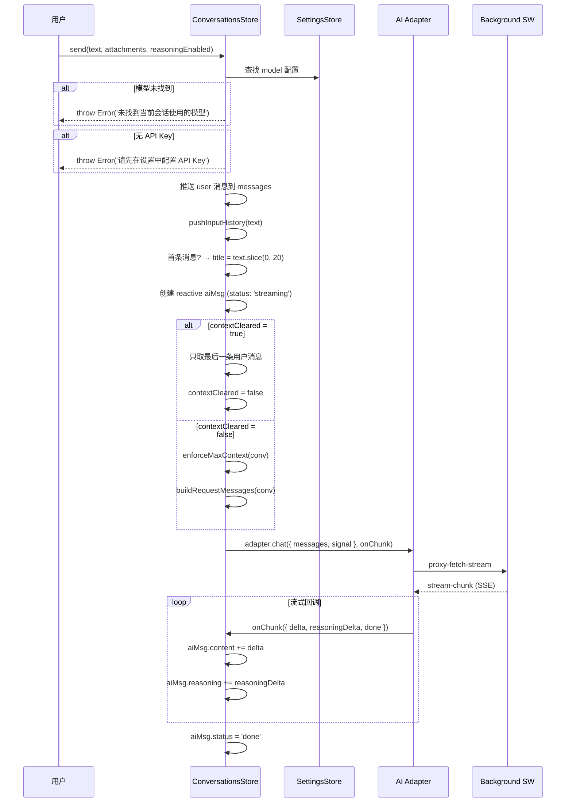
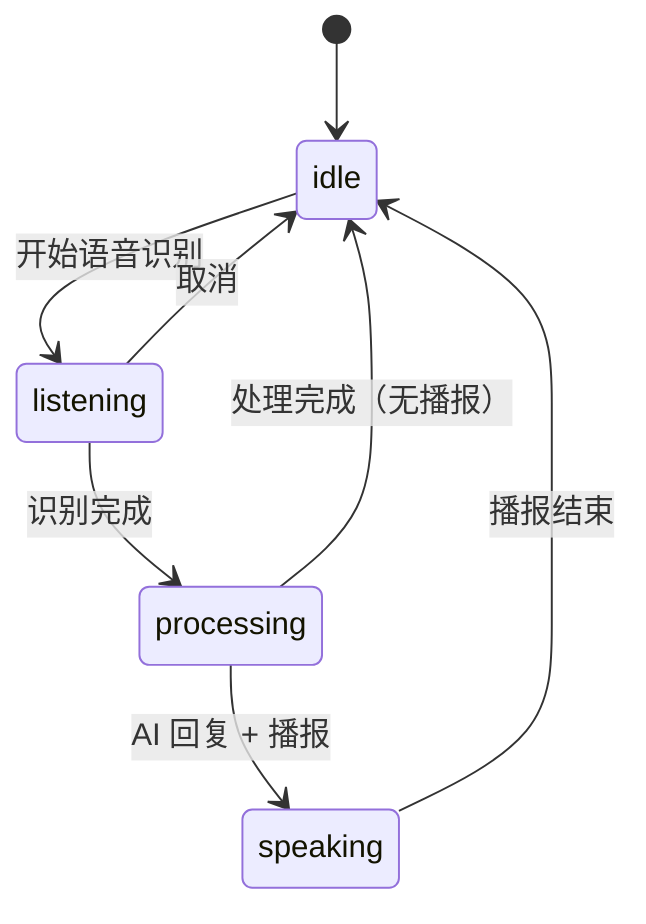
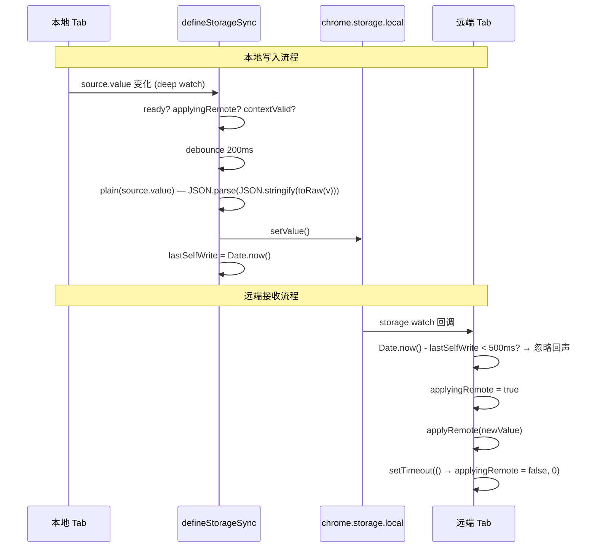

# 状态管理架构

## 1. 模块概述

AI Browser 的状态管理层基于 **Pinia setup store** 构建，包含三个独立 store：

| Store | ID | 持久化 | 职责 |
|-------|-----|--------|------|
| `useSettingsStore` | `aib-settings` | chrome.storage.local | 全局设置（模型列表、API Key、主题、快捷键等） |
| `useConversationsStore` | `aib-conversations` | chrome.storage.local | 单会话数据（消息列表、草稿、滚动位置） |
| `useVoiceStore` | `voice` | 纯内存 | 语音识别状态机、语音对话历史 |

两个持久化 store 通过自研 `defineStorageSync` 工具实现 reactive ref 与 `chrome.storage.local` 的双向同步，支持跨标签页实时同步和防抖写入。`useVoiceStore` 为纯内存 store，不持久化，会话结束后数据清空。

源码位置：

```
src/stores/
├── settings.ts         # useSettingsStore
├── conversations.ts    # useConversationsStore
└── voice.ts            # useVoiceStore

src/utils/
└── storage-sync.ts     # defineStorageSync + plain()

src/storage/
└── index.ts            # 存储项定义 + DEFAULT_SETTINGS
```

---

## 2. 架构设计

### 2.1 Store 总览



### 2.2 Store 间依赖关系

- `useConversationsStore` 在 `send()` 中调用 `useSettingsStore()` 获取模型配置、API Key、`maxContext` 等参数
- `useConversationsStore` 在 `send()` 中调用 `createAdapter()` 创建 AI 适配器
- `useConversationsStore` 在 `clearCurrent()` / `resetConversation()` 中调用 `abortPipeline()` 中断指令流
- `useConversationsStore` 在 `send()` 中调用 `pushInputHistory()` 记录输入历史
- `useVoiceStore` 完全独立，不依赖其他 store

---

## 3. 核心类型定义

### 3.1 AppSettings

全局应用设置，存储键 `local:ai-browser-settings`。

```typescript
interface AppSettings {
  provider: Provider;                    // 协议类型
  baseUrl: string;                       // API 请求地址
  apiKey: string;                        // API 密钥
  authField?: string;                    // 认证字段（bearer/api-key/access-token/authorization）
  models: ModelConfig[];                 // 可用模型列表
  defaultModelId: string;                // 默认模型 ID
  drawerWidth: number;                   // 抽屉宽度（vw 百分比，40-100）
  primaryColor: string;                  // 主题色（hex）
  theme?: string;                        // 主题 ID
  shortcut: string;                      // 唤起快捷键（如 "Ctrl+`"）
  maxConversations?: number;             // 最大会话数
  maxContext?: number;                   // 单会话最大上下文消息数
  autoSendSelection?: 'auto' | 'manual' | 'off';  // 划词操作模式
  translateTargetLang?: string;          // 翻译目标语言
  translateMode?: 'selection' | 'auto' | 'click' | 'off';  // 翻译模式
  automationEnabled?: boolean;           // 网页自动化开关
  locale?: 'zh-CN' | 'en-US';           // 界面语言
}
```

### 3.2 ModelConfig

单个 AI 模型配置，嵌套在 `AppSettings.models` 数组中。

```typescript
interface ModelConfig {
  id: string;            // 唯一标识（自动生成或用户指定）
  label: string;         // 显示名称
  provider: Provider;    // 协议类型（openai/anthropic/gemini/...）
  modelName: string;     // 真实模型名（请求 body 用）
  reasoning?: boolean;   // 是否支持深度思考
  vision?: boolean;      // 是否支持图片
  baseUrl?: string;      // 每模型独立 API 地址（可选，不填用全局）
  apiKey?: string;       // 每模型独立 API 密钥（可选，不填用全局）
  authField?: string;    // 认证字段
  website?: string;      // 供应商官网地址
}
```

### 3.3 ChatMessage

单条聊天消息，存储在 `Conversation.messages` 数组中。

```typescript
interface ChatMessage {
  id: string;
  role: 'user' | 'assistant' | 'system';
  content: string;                                          // 文本内容
  reasoning?: string;                                       // 深度思考内容
  attachments?: Attachment[];                               // 统一附件（图片 OCR 文字 + 文件）
  timestamp: number;                                        // 创建时间
  status?: 'sending' | 'streaming' | 'done' | 'error' | 'aborted';
  errorMessage?: string;                                    // 错误信息（status=error 时）
  reasoningEnabled?: boolean;                               // 发送时是否启用深度思考
}
```

**状态流转**：`sending` → `streaming` → `done`，异常时为 `error` 或 `aborted`。

### 3.4 Conversation

单一会话对象，存储键 `local:ai-browser-conversation`。

```typescript
interface Conversation {
  id: string;                      // UUID
  title: string;                   // 会话标题（默认 "新对话"，首条消息前 20 字符）
  messages: ChatMessage[];         // 消息列表
  modelId: string;                 // 当前会话使用的模型 ID
  scrollTop?: number;              // 滚动条位置（持久化）
  draftText?: string;              // 输入框草稿文本
  draftAttachments?: Attachment[]; // 输入框草稿附件
  reasoningEnabled?: boolean;      // 深度思考开关
  createdAt: number;               // 创建时间戳
  updatedAt: number;               // 更新时间戳
}
```

### 3.5 VoiceMessage

语音对话消息，存储在 `useVoiceStore.messages` 中。

```typescript
interface VoiceMessage {
  id: string;                      // Date.now().toString()
  role: 'user' | 'assistant' | 'system';
  content: string;                 // 文本内容
  actionResult?: {                 // 自动化指令执行结果
    action: string;                // 指令名称
    success: boolean;              // 是否成功
    message: string;               // 结果描述
  };
  timestamp: number;
}
```

### 3.6 SessionState

语音会话状态机，4 个状态，无 evaluating 中间态。

```typescript
type SessionState = 'idle' | 'listening' | 'processing' | 'speaking';
```

| 状态 | 含义 | 触发转换 |
|------|------|----------|
| `idle` | 空闲 / 常驻等待 | → `listening`（开始语音识别） |
| `listening` | 聆听中 | → `processing`（识别完成）/ → `idle`（取消） |
| `processing` | AI 分析 + 解析 + 执行 | → `speaking`（有播报内容）/ → `idle`（无播报） |
| `speaking` | 语音播报中 | → `idle`（播报结束） |

---

## 4. 实现细节

### 4.1 useSettingsStore

源码：`src/stores/settings.ts`

#### 状态

```typescript
const settings = ref<AppSettings>({ ...DEFAULT_SETTINGS });
const ready = ref(false);
```

#### mergeSettings() — 安全合并算法

`mergeSettings` 是 settings store 的核心防御函数，确保任何来源的设置数据都能被安全合并。



**关键逻辑**：

1. **浅合并**：`{ ...DEFAULT_SETTINGS, ...v }`，传入的字段覆盖默认值
2. **models 数组验证**：非数组或空数组回退到 `DEFAULT_SETTINGS.models`
3. **id/label 自动修复**：遍历每个 model，补全缺失的 `id` 和 `label`
   - `id` 回退链：`m.id` → `m.modelName` → `'model-${i}'`
   - `label` 回退链：`m.label` → `m.modelName` → `'模型 ${i + 1}'`
4. **defaultModelId 验证**：在 models 中找不到匹配项时，回退到 `models[0].id`

**错误处理**：该函数不抛出异常，始终返回有效的 `AppSettings` 对象。

#### init() — 初始化流程



**有效性判断**：`v` 必须是非数组对象，且 `models` 为非空数组。

**首次加载**：无有效数据时，使用 `DEFAULT_SETTINGS`（含 `local-config.json` 中的模型配置）写入 storage。`markSelfWrite()` 阻止后续 `defineStorageSync` 的 watch 将刚写入的默认值再次写入（防回声）。

#### update() — 显式更新

```typescript
async function update(partial: Partial<AppSettings>) {
  settings.value = mergeSettings({ ...settings.value, ...partial });
  await sync.flush();  // 立即持久化，不走 200ms 防抖
}
```

**设计意图**：用户在设置页面修改配置后，需要立即持久化而非等待 200ms 防抖。`flush()` 绕过防抖直接写入 storage。

#### 跨标签页同步

通过 `defineStorageSync` 建立双向同步：

```typescript
const sync = defineStorageSync<AppSettings>({
  source: settings,
  storage: settingsStorage,
  ready,
  applyRemote: (nv) => {
    if (nv && typeof nv === 'object' && !Array.isArray(nv)) {
      settings.value = mergeSettings(nv);
    }
  },
});
```

`applyRemote` 中同样调用 `mergeSettings`，确保远端传来的数据也经过安全合并。

---

### 4.2 useConversationsStore

源码：`src/stores/conversations.ts`

#### 状态

```typescript
const conversation = ref<Conversation | null>(null);
const ready = ref(false);
const contextCleared = ref(false);          // 标记上下文是否已清除
let currentAborter: AbortController | null = null;  // 当前请求的 AbortController

const active = computed(() => conversation.value ?? undefined);  // 兼容旧接口
```

**单会话模型**：不再支持多会话，`conversation` 直接持有唯一的会话对象。

#### init() — 初始化与残留清理

```typescript
async function init() {
  const stored = await conversationStorage.getValue();
  if (stored && typeof stored === 'object' && Array.isArray(stored.messages)) {
    conversation.value = stored;
    // 清理残留的 streaming 消息
    for (const msg of conversation.value.messages) {
      if (msg.status === 'streaming') {
        msg.status = 'done';
      }
    }
  } else {
    conversation.value = createDefaultConversation();
    await saveConversation();
  }
  ready.value = true;
}
```

**残留清理原因**：跨标签页导航时，JS 上下文被销毁，`defineStorageSync` 的 200ms 防抖写入可能未完成，导致 storage 中残留 `status: 'streaming'` 的消息。下次加载时统一标记为 `'done'`。

#### send() — 流式发送核心算法



**关键设计**：

1. **reactive aiMsg**：用 `reactive()` 而非 `ref()` 包装 AI 占位消息，确保流式更新（逐字符追加）能触发 Vue 渲染。`ref()` 对深层属性变化的追踪可能不够及时。

2. **contextCleared 标记**：`clearCurrent()` 设置 `contextCleared = true`，下次 `send()` 时只发送当前用户消息（不携带历史），发送后重置为 `false`。这实现了"清除上下文后重新开始对话"的语义。

3. **有效的 baseUrl/ApiKey 优先级**：`model.baseUrl || settings.baseUrl`，`model.apiKey || settings.apiKey`。每模型独立配置优先于全局配置。

4. **自动标题生成**：首条用户消息的前 20 个字符作为会话标题。

5. **输入历史记录**：非空文本消息通过 `pushInputHistory()` 记录到 `inputHistoryStorage`（上限 100 条，FIFO 策略，连续去重）。

**错误处理**：

| 场景 | 处理方式 |
|------|----------|
| 模型未找到 | 抛出 `Error('未找到当前会话使用的模型')` |
| 无 API Key | 抛出 `Error('请先在设置中配置 API Key')` |
| 请求中止（AbortError） | `aiMsg.status = 'aborted'`，不抛出 |
| 其他请求错误 | `aiMsg.status = 'error'`，`aiMsg.errorMessage = e.message`，不抛出 |

#### enforceMaxContext() — 上下文截断

```typescript
function enforceMaxContext(conv: Conversation) {
  const max = useSettingsStore().settings.maxContext;  // 默认 50
  if (conv.messages.length <= max) return;
  conv.messages.splice(0, conv.messages.length - max);
}
```

从头部截断，保留最近 `maxContext` 条消息。截断发生在 `send()` 构建请求上下文之前，直接修改 `conversation.messages`。

#### buildRequestMessages() — 请求上下文构建

```typescript
function buildRequestMessages(conv: Conversation): ChatMessage[] {
  const max = useSettingsStore().settings.maxContext;
  return conv.messages.slice(-max);
}
```

从消息列表末尾取最近 `maxContext` 条作为请求上下文。注意这里 `slice(-max)` 返回新数组，不修改原数组。

#### clearCurrent() vs resetConversation()

| 方法 | 行为 | contextCleared |
|------|------|----------------|
| `clearCurrent()` | 清空消息、标题、草稿，保留会话对象 | `true` |
| `resetConversation()` | 创建全新会话对象 | `false` |

两者都会先调用 `abortPipeline()` 中断进行中的指令流，再 `currentAborter.abort()` 中断 AI 请求。

#### 草稿与滚动位置持久化

通过 `defineStorageSync` 自动同步到 `conversationStorage`：

- `conversation.draftText`：输入框草稿文本
- `conversation.draftAttachments`：输入框草稿附件
- `conversation.scrollTop`：滚动条位置，通过 `updateScroll(top)` 更新
- `conversation.reasoningEnabled`：深度思考开关

这些字段随 `conversation` 对象一起持久化，刷新页面后自动恢复。

---

### 4.3 useVoiceStore

源码：`src/stores/voice.ts`

纯内存 store，不持久化到 `chrome.storage`。会话结束后数据清空。

#### 状态

```typescript
const status = ref<VoiceStatus>('idle');        // 语音识别状态
const sessionState = ref<SessionState>('idle');  // 会话状态机状态
const interimText = ref('');                     // 中间识别结果
const finalText = ref('');                       // 最终识别结果
const messages = ref<VoiceMessage[]>([]);        // 语音对话历史
const isProcessing = ref(false);                 // 是否正在处理 AI 请求
const isSpeaking = ref(false);                   // 是否正在语音播报
const messageCount = computed(() => messages.value.length);
```

#### 状态机



#### updateText() — 识别文本更新

```typescript
function updateText(text: string, isFinal: boolean) {
  if (isFinal) {
    finalText.value = text;
    interimText.value = '';    // 最终结果确认后清空中间文本
  } else {
    interimText.value = text;  // 中间结果持续更新
  }
}
```

**设计要点**：`finalText` 和 `interimText` 分离，UI 可以同时展示"已确认文本 + 实时识别中间结果"。最终结果确认后清空 `interimText`，避免重复显示。

#### 消息管理

| 方法 | role | 用途 |
|------|------|------|
| `addUserMessage(text)` | `user` | 用户语音输入 |
| `addAssistantMessage(content, actionResult?)` | `assistant` | AI 回复，可携带自动化指令结果 |
| `addSystemMessage(content)` | `system` | 系统提示（如"识别失败"） |
| `clearMessages()` | — | 清空所有消息 + 重置文本状态 |

消息 ID 使用 `Date.now().toString()`，非 UUID（轻量，内部使用无需全局唯一）。

`VoiceMessage.actionResult` 用于语音触发的网页自动化场景，记录指令执行结果：

```typescript
actionResult?: {
  action: string;    // 指令名称（如 "click", "navigate"）
  success: boolean;  // 是否成功
  message: string;   // 结果描述
}
```

---

## 5. 数据流

### 5.1 defineStorageSync — 双向同步原语

源码：`src/utils/storage-sync.ts`

`defineStorageSync` 是连接 Vue 响应式世界和 Chrome Storage 的桥梁。

```typescript
interface SyncOptions<T> {
  source: Ref<T>;              // 响应式数据 ref
  storage: StorageItemLike<T>; // wxt storage item
  ready: Ref<boolean>;         // ready 标志，false 时不写入
  applyRemote: (nv: T) => void; // 远端值 → 应用到 source
  debounce?: number;           // 防抖延时，默认 200ms
  echoWindow?: number;         // 自我写入回声忽略窗口，默认 500ms
}
```

**返回值**：

```typescript
{
  isApplyingRemote: () => boolean;  // 是否正在应用远端值
  markSelfWrite: () => void;        // 标记自我写入时间戳
  flush: () => Promise<void>;       // 立即写入（绕过防抖）
}
```

### 5.2 跨标签页同步时序



### 5.3 防回声机制

跨标签页同步的核心难题：Tab A 写入 storage → storage 变更事件同时触发 Tab A 和 Tab B → Tab A 收到自己的写入回声 → 再次写入 → 无限循环。

三层防护：

1. **时间戳窗口**：写入时记录 `lastSelfWrite = Date.now()`，收到远端变更时检查 `Date.now() - lastSelfWrite < echoWindow (500ms)`，在窗口内则忽略
2. **applyingRemote 标记**：应用远端值时设置 `applyingRemote = true`，本地 watch 检测到此标记则跳过写入
3. **setTimeout 清除**：`applyRemote` 执行后通过 `setTimeout(() => applyingRemote = false, 0)` 延迟清除标记，确保当前同步周期内不会触发本地写入

### 5.4 plain() — 去代理化

```typescript
function plain<T>(v: T): T {
  return JSON.parse(JSON.stringify(toRaw(v)));
}
```

Vue 3 的 `ref`/`reactive` 返回 Proxy 对象，直接序列化会报错或产生意外行为。`plain()` 通过 `toRaw` 剥离 Proxy，再经 `JSON.parse(JSON.stringify(...))` 深拷贝得到纯净的可序列化数据。

### 5.5 flush() — 绕过防抖的立即写入

```typescript
async function flush(): Promise<void> {
  if (!isContextValid()) return;
  if (timer) window.clearTimeout(timer);
  lastSelfWrite = Date.now();
  await storage.setValue(plain(source.value)).catch(() => {});
}
```

用于 `update()` 等需要确保数据立即持久化的场景。清除待执行的防抖定时器，直接写入。

### 5.6 上下文有效性检查

```typescript
function isContextValid(): boolean {
  try {
    return !!chrome?.runtime?.id;
  } catch {
    return false;
  }
}
```

Chrome 扩展的 content script 在页面导航后可能失去扩展上下文。写入前检查 `chrome.runtime.id` 是否存在，避免 `"Extension context invalidated"` 错误。

---

## 6. 配置与扩展

### 6.1 默认设置来源

`DEFAULT_SETTINGS` 从 `src/local-config.json` 动态解析：

```mermaid
flowchart LR
    A[local-config.json] -->|import| B[rawModels]
    B -->|parseLocalModels| C[ModelConfig[]]
    C -->|DEFAULT_SETTINGS| D[settingsStorage fallback]
```

`parseLocalModels()` 处理逻辑：
- `baseUrl` 末尾去掉 `/chat/completions`（适配器会自动拼接）
- 从 `id` / `modelName` / `model` 中推导模型标识
- `label` 默认等于 `modelName`
- `provider` 默认为 `'openai'`

### 6.2 存储键映射

| 键 | Store | 类型 | 说明 |
|----|-------|------|------|
| `local:ai-browser-settings` | useSettingsStore | `AppSettings` | 全局设置 |
| `local:ai-browser-conversation` | useConversationsStore | `Conversation \| null` | 当前会话 |
| `local:ai-browser-fab-pos` | — | `FabPos` | 悬浮按钮位置 |
| `local:ai-browser-drawer-open` | — | `boolean` | 抽屉展开状态 |
| `local:ai-browser-input-history` | — | `string[]` | 输入历史记录 |
| `local:aib-queued-task` | — | `QueuedTask \| null` | 跨标签页排队任务 |

### 6.3 扩展新 Store

添加新的持久化 store 的标准流程：

1. 定义存储项（`src/storage/index.ts`）：
   ```typescript
   export const myStorage = storage.defineItem<MyType>('local:ai-browser-my-data', {
     fallback: defaultValue,
   });
   ```

2. 创建 store（`src/stores/my-store.ts`）：
   ```typescript
   export const useMyStore = defineStore('aib-my-store', () => {
     const data = ref<MyType>(defaultValue);
     const ready = ref(false);

     defineStorageSync<MyType>({
       source: data,
       storage: myStorage,
       ready,
       applyRemote: (nv) => { data.value = nv; },
     });

     async function init() { /* ... */ ready.value = true; }
     return { data, ready, init };
   });
   ```

3. 在入口处调用 `init()`

### 6.4 maxContext 配置

`maxContext` 控制单会话最大上下文消息数，默认 50。影响两个行为：

- `enforceMaxContext()`：消息数超过 `maxContext` 时从头部截断（写入操作）
- `buildRequestMessages()`：取最近 `maxContext` 条作为请求上下文（读取操作）

用户可在设置页面调整此值。值越大，AI 能看到的上下文越多，但 API 调用成本也越高。

---

## 7. 已知限制

### 7.1 单会话限制

当前架构仅支持单会话（`conversation` 为单一 ref），不支持多会话切换。`maxConversations` 配置项存在但未使用。如需支持多会话，需要将 `conversation` 改为 `Map` 或数组结构，并重新设计存储键策略。

### 7.2 会话数据无版本迁移

存储的 `Conversation` 对象没有版本号字段。如果 `ChatMessage` 或 `Conversation` 接口发生 breaking change（如字段重命名、类型变更），旧数据加载时可能出现异常。`init()` 中的有效性检查（`Array.isArray(stored.messages)`）仅验证基础结构，不验证字段完整性。

### 7.3 streaming 残留清理的局限

`init()` 中的 streaming 残留清理仅将 `status` 标记为 `'done'`，但消息的 `content` 可能是不完整的流式片段。用户会看到一条"已完成"但内容截断的 AI 回复，无法区分是正常完成还是异常中断。

### 7.4 reactive aiMsg 的内存行为

`send()` 中用 `reactive()` 创建的 AI 占位消息直接 `push` 到 `conversation.messages` 数组。由于 `conversation` 是 `ref`，其内部数组元素的响应式追踪依赖 Vue 的深度代理。`reactive()` 包装确保了流式更新的响应性，但该对象不会被 `plain()` 正确序列化（`reactive` 对象的 `toRaw` 行为与普通对象不同）。实际写入 storage 时，`defineStorageSync` 的 `plain()` 会通过 `JSON.parse(JSON.stringify(...))` 强制深拷贝，因此不会产生问题。

### 7.5 并发写入风险

`send()` 函数是异步的，但没有互斥锁。如果用户快速连续发送多条消息，可能出现：
- 多个 `currentAborter` 交替赋值
- `enforceMaxContext` 和 `buildRequestMessages` 在消息追加过程中读取到中间状态

实际使用中由于用户操作间隔通常大于 API 响应时间，此问题极少触发。

### 7.6 VoiceStore 消息 ID 冲突

`VoiceMessage.id` 使用 `Date.now().toString()`，在同一毫秒内添加多条消息会导致 ID 冲突。由于 voice store 是纯内存且消息仅用于 UI 展示（无删除/编辑操作），此问题目前不影响功能。

### 7.7 跨标签页同步的 eventual consistency

`defineStorageSync` 实现的是最终一致性模型。两个标签页同时修改同一 store 时，后写入的值会覆盖先写入的值（last-write-wins）。没有冲突解决机制。在单会话场景下，用户通常只在一个标签页操作，此问题影响较小。
