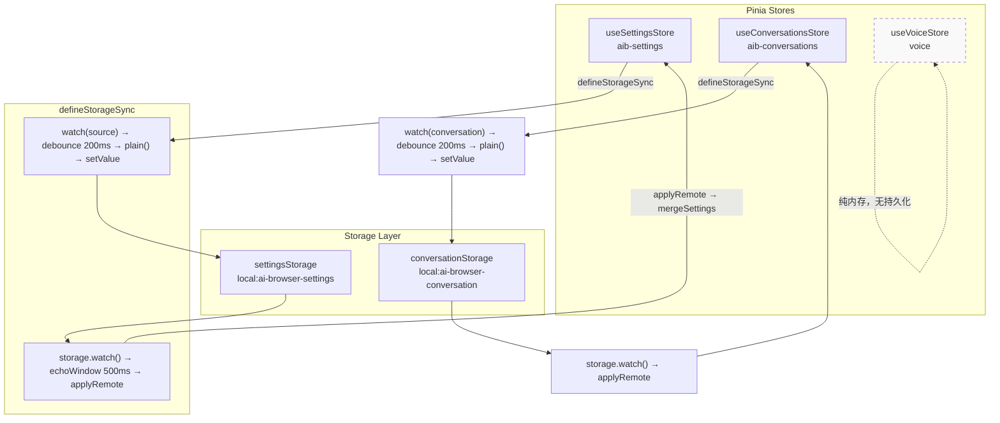
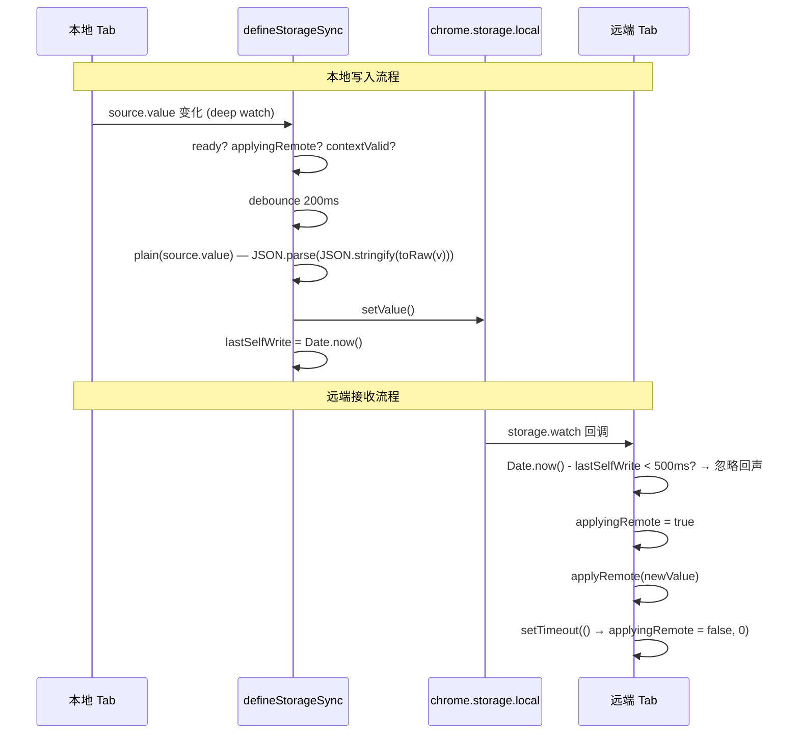
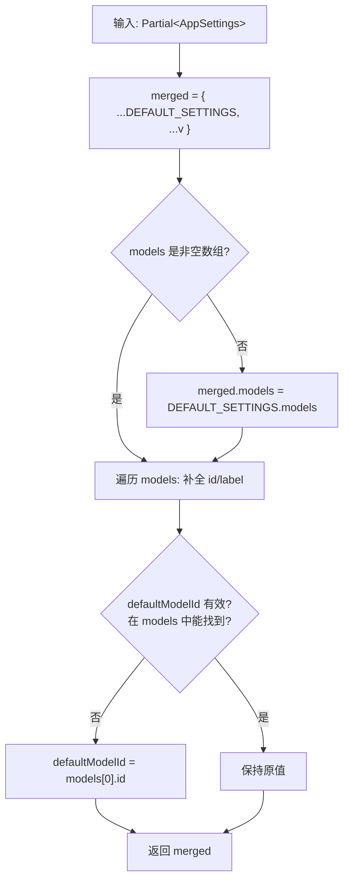
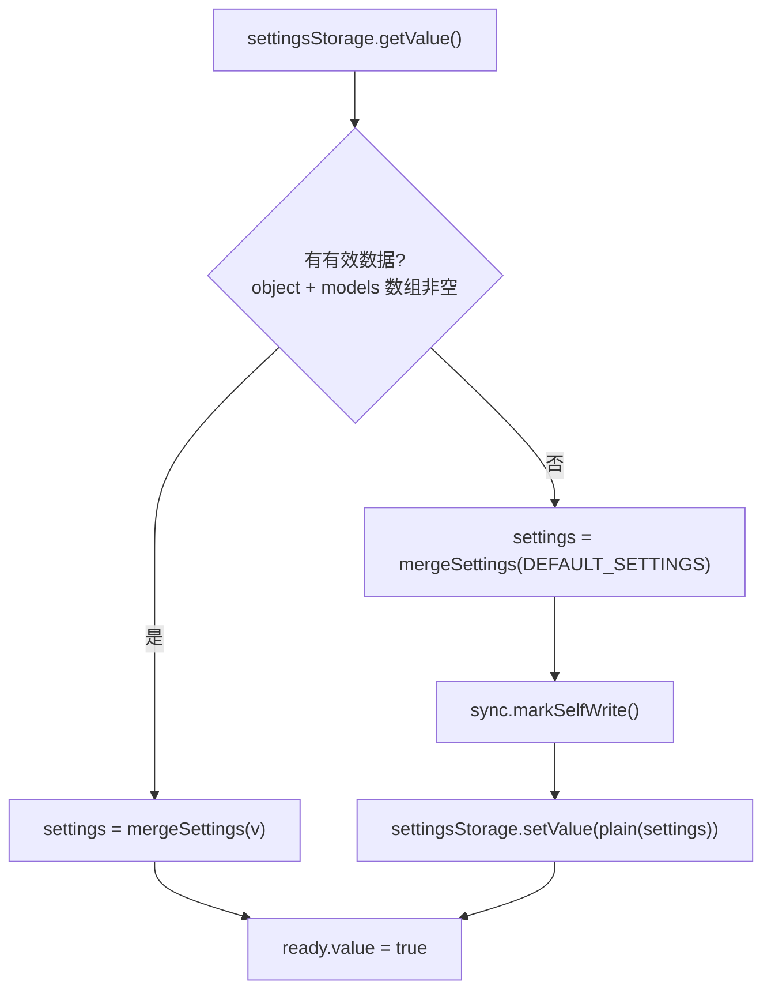
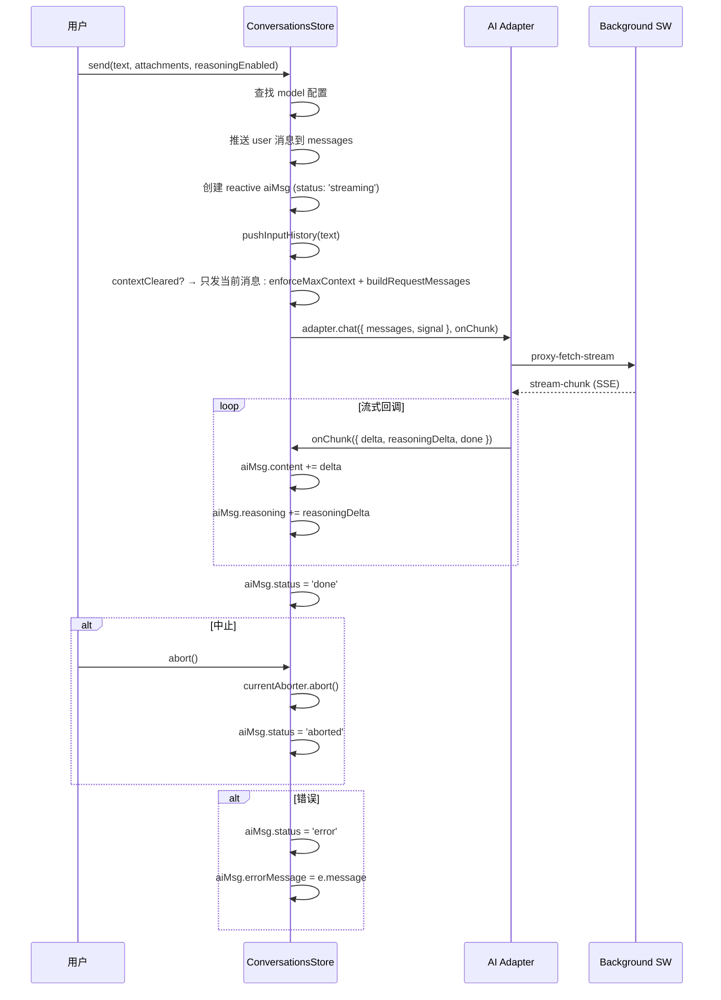
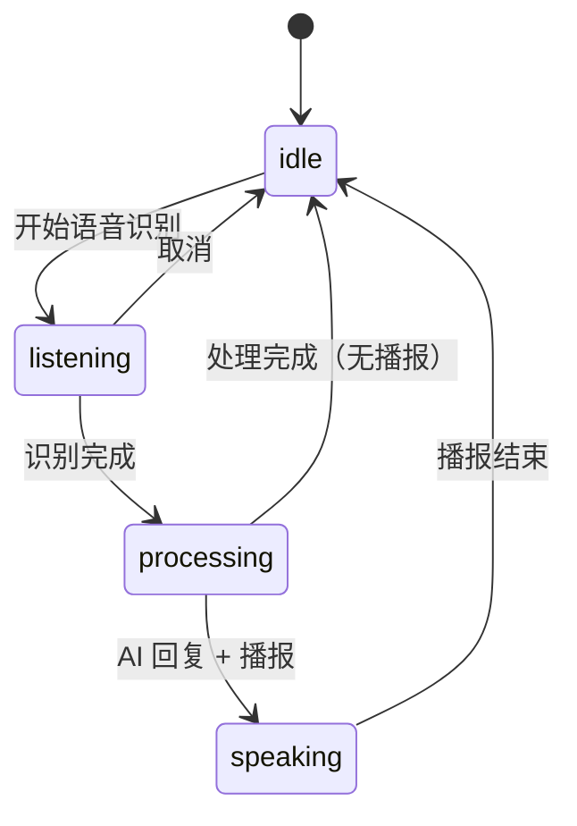
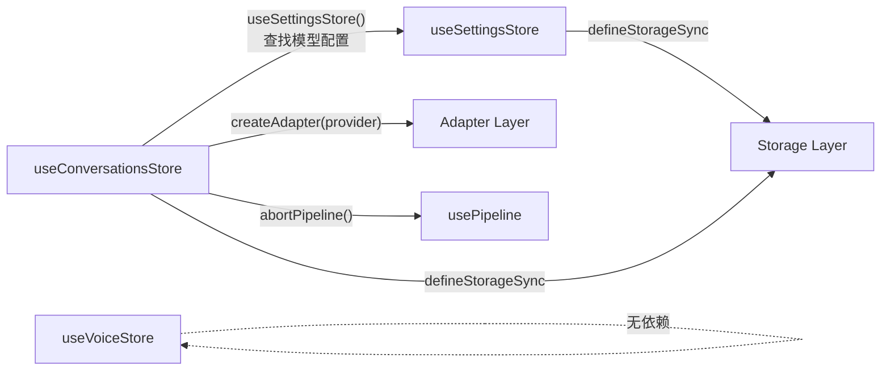

# 状态管理架构

> AI Browser 的状态管理层基于 Pinia setup store + 自研 `defineStorageSync` 双向同步机制，实现 reactive ref 与 `chrome.storage.local` 的跨标签页同步。

## 总体架构



## Storage Keys

| Key | Store | 类型 | 说明 |
|-----|-------|------|------|
| `local:ai-browser-settings` | useSettingsStore | `AppSettings` | 全局设置（模型列表、API Key、主题等） |
| `local:ai-browser-conversation` | useConversationsStore | `Conversation \| null` | 当前会话（单会话模式） |
| `local:ai-browser-fab-pos` | — | `{ x: number; y: number }` | 悬浮按钮位置 |
| `local:ai-browser-drawer-open` | — | `boolean` | 抽屉展开状态 |
| `local:ai-browser-input-history` | — | `string[]` | 输入历史记录 |
| `local:aib-queued-task` | — | `QueuedTask \| null` | 跨标签页排队任务 |

---

## defineStorageSync — 双向同步原语

源码：`src/utils/storage-sync.ts`

### 核心接口

```typescript
interface SyncOptions<T> {
  /** 响应式数据 ref */
  source: Ref<T>;
  /** wxt storage item */
  storage: StorageItemLike<T>;
  /** ready 标志，false 时不写入 */
  ready: Ref<boolean>;
  /** 来自远端的值 -> 应用到 source */
  applyRemote: (nv: T) => void;
  /** 防抖延时（ms），默认 200 */
  debounce?: number;
  /** 自我写入回声忽略窗口（ms），默认 500 */
  echoWindow?: number;
}

interface StorageItemLike<T> {
  setValue: (v: T) => Promise<void>;
  watch: (cb: (nv: T | null) => void) => void;
}

function defineStorageSync<T>(opts: SyncOptions<T>): {
  isApplyingRemote: () => boolean;
  markSelfWrite: () => void;
  flush: () => Promise<void>;
}
```

### 数据流



### plain() — 去代理化

```typescript
export function plain<T>(v: T): T {
  return JSON.parse(JSON.stringify(toRaw(v)));
}
```

Vue 3 的 `ref`/`reactive` 返回 Proxy 对象，直接序列化会报错。`plain()` 通过 `toRaw` 剥离 Proxy，再经 `JSON.parse(JSON.stringify(...))` 深拷贝得到纯净数据。

### 防回声机制

跨标签页同步的核心难题：Tab A 写入 storage → storage 变更事件同时触发 Tab A 和 Tab B → Tab A 收到自己的写入回声 → 再次写入 → 无限循环。

解决方案：

1. **写入时记录时间戳**：`lastSelfWrite = Date.now()`
2. **收到远端变更时检查**：`Date.now() - lastSelfWrite < echoWindow` → 忽略
3. **applyRemote 期间标记**：`applyingRemote = true`，跳过本地 watch 写入

### flush() — 绕过防抖的立即写入

```typescript
async function flush(): Promise<void> {
  if (!isContextValid()) return;
  if (timer) window.clearTimeout(timer);
  lastSelfWrite = Date.now();
  await storage.setValue(plain(source.value)).catch(() => {});
}
```

用于 `update()` 等需要确保数据立即持久化的场景。

---

## useSettingsStore (aib-settings)

源码：`src/stores/settings.ts`

### 类型定义

```typescript
interface AppSettings {
  provider: Provider;
  baseUrl: string;
  apiKey: string;
  authField?: string;
  models: ModelConfig[];
  defaultModelId: string;
  drawerWidth: number;
  primaryColor: string;
  theme?: string;
  shortcut: string;
  maxConversations?: number;
  maxContext?: number;
  autoSendSelection?: 'auto' | 'manual' | 'off';
  translateTargetLang?: string;
  translateMode?: 'selection' | 'auto' | 'click' | 'off';
  automationEnabled?: boolean;
}

interface ModelConfig {
  id: string;
  label: string;
  provider: Provider;
  modelName: string;
  reasoning?: boolean;
  vision?: boolean;
  baseUrl?: string;
  apiKey?: string;
  authField?: string;
  website?: string;
}
```

### Store 结构

```typescript
export const useSettingsStore = defineStore('aib-settings', () => {
  const settings = ref<AppSettings>({ ...DEFAULT_SETTINGS });
  const ready = ref(false);

  function mergeSettings(v: Partial<AppSettings>): AppSettings { /* ... */ }
  async function init() { /* ... */ }
  async function update(partial: Partial<AppSettings>) { /* ... */ }

  return { settings, ready, init, update };
});
```

### mergeSettings() — 安全合并



关键逻辑：
- **models 数组验证**：非数组或空数组回退到 `DEFAULT_SETTINGS.models`
- **id/label 自动修复**：`m.id || m.modelName || 'model-${i}'`
- **defaultModelId 验证**：不存在则回退到 `models[0].id`

### init() — 初始化流程



首次加载时，`markSelfWrite()` 阻止后续 `defineStorageSync` 的 watch 将刚写入的默认值再次写入。

### update() — 显式更新

```typescript
async function update(partial: Partial<AppSettings>) {
  settings.value = mergeSettings({ ...settings.value, ...partial });
  await sync.flush();  // 立即持久化，不走 200ms 防抖
}
```

---

## useConversationsStore (aib-conversations)

源码：`src/stores/conversations.ts`

### 类型定义

```typescript
interface Conversation {
  id: string;
  title: string;
  messages: ChatMessage[];
  modelId: string;
  scrollTop?: number;
  draftText?: string;
  draftAttachments?: Attachment[];
  reasoningEnabled?: boolean;
  createdAt: number;
  updatedAt: number;
}

interface ChatMessage {
  id: string;
  role: 'user' | 'assistant' | 'system';
  content: string;
  reasoning?: string;
  attachments?: Attachment[];
  timestamp: number;
  status?: 'sending' | 'streaming' | 'done' | 'error' | 'aborted';
  errorMessage?: string;
  reasoningEnabled?: boolean;
}
```

### Store 结构

```typescript
export const useConversationsStore = defineStore('aib-conversations', () => {
  const conversation = ref<Conversation | null>(null);
  const ready = ref(false);
  const contextCleared = ref(false);
  let currentAborter: AbortController | null = null;

  const active = computed(() => conversation.value ?? undefined);

  async function init() { /* ... */ }
  async function clearCurrent() { /* ... */ }
  async function resetConversation() { /* ... */ }
  function deleteMessage(msgId: string) { /* ... */ }
  function updateScroll(top: number) { /* ... */ }
  async function send(text, attachments?, reasoningEnabled?) { /* ... */ }
  function abort() { /* ... */ }

  return { conversation, active, ready, contextCleared, init, clearCurrent, resetConversation, deleteMessage, updateScroll, send, abort };
});
```

### send() — 流式发送



关键设计：
- **reactive aiMsg**：用 `reactive()` 包装 AI 占位消息，确保流式更新触发 Vue 渲染
- **contextCleared**：清除上下文后首次发送只携带当前用户消息，发送后重置标记
- **enforceMaxContext**：消息数超过 `maxContext` 时从头部截断

### clearCurrent() — 清除当前会话

```typescript
async function clearCurrent() {
  await abortPipeline();           // 中断 pipeline 指令流
  currentAborter?.abort();         // 中断 AI 请求
  conversation.value.messages = [];
  conversation.value.title = '新对话';
  conversation.value.draftText = '';
  conversation.value.draftAttachments = [];
  contextCleared.value = true;     // 标记上下文已清除
}
```

### resetConversation() — 彻底重置

```typescript
async function resetConversation() {
  await abortPipeline();
  currentAborter?.abort();
  conversation.value = createDefaultConversation();  // 全新会话
  contextCleared.value = false;
}
```

### init() — 初始化与残留清理

初始化时会清理跨标签页导航时残留的 `streaming` 状态消息：

```typescript
for (const msg of conversation.value.messages) {
  if (msg.status === 'streaming') {
    msg.status = 'done'  // 标记为完成
  }
}
```

---

## useVoiceStore (voice)

源码：`src/stores/voice.ts`

纯内存 store，不持久化到 `chrome.storage`。

### 状态机



### 类型定义

```typescript
type SessionState = 'idle' | 'listening' | 'processing' | 'speaking';

interface VoiceMessage {
  id: string;
  role: 'user' | 'assistant' | 'system';
  content: string;
  actionResult?: {
    action: string;
    success: boolean;
    message: string;
  };
  timestamp: number;
}
```

### Store 结构

```typescript
export const useVoiceStore = defineStore('voice', () => {
  const status = ref<VoiceStatus>('idle');
  const sessionState = ref<SessionState>('idle');
  const interimText = ref('');
  const finalText = ref('');
  const messages = ref<VoiceMessage[]>([]);
  const isProcessing = ref(false);
  const isSpeaking = ref(false);
  const messageCount = computed(() => messages.value.length);

  function setStatus(newStatus: VoiceStatus) { /* ... */ }
  function setSessionState(state: SessionState) { /* ... */ }
  function updateText(text: string, isFinal: boolean) { /* ... */ }
  function addUserMessage(text: string): VoiceMessage { /* ... */ }
  function addAssistantMessage(content: string, actionResult?): VoiceMessage { /* ... */ }
  function addSystemMessage(content: string): VoiceMessage { /* ... */ }
  function clearMessages() { /* ... */ }
  function setProcessing(value: boolean) { /* ... */ }
  function setSpeaking(value: boolean) { /* ... */ }

  return { status, sessionState, interimText, finalText, messages, isProcessing, isSpeaking, messageCount, setStatus, setSessionState, updateText, addUserMessage, addAssistantMessage, addSystemMessage, clearMessages, setProcessing, setSpeaking };
});
```

### 设计要点

- **4 状态状态机**：idle → listening → processing → speaking → idle，无 evaluating 中间态
- **VoiceMessage.actionResult**：自动化指令执行结果（action/success/message）
- **interimText / finalText**：语音识别的中间结果和最终结果分离
- **消息 ID**：使用 `Date.now().toString()`，非 uuid（轻量，内部使用）

---

## Store 间依赖关系



- `useConversationsStore` 依赖 `useSettingsStore` 获取模型配置、API Key、maxContext 等
- `useVoiceStore` 完全独立，纯内存操作
- 两个持久化 store 各自通过 `defineStorageSync` 与 `chrome.storage.local` 同步
