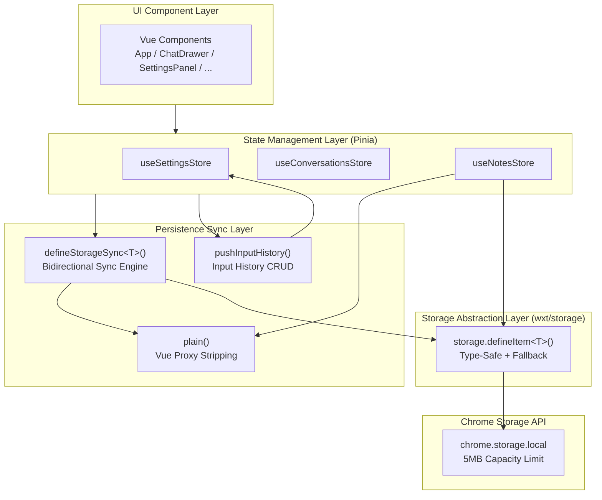
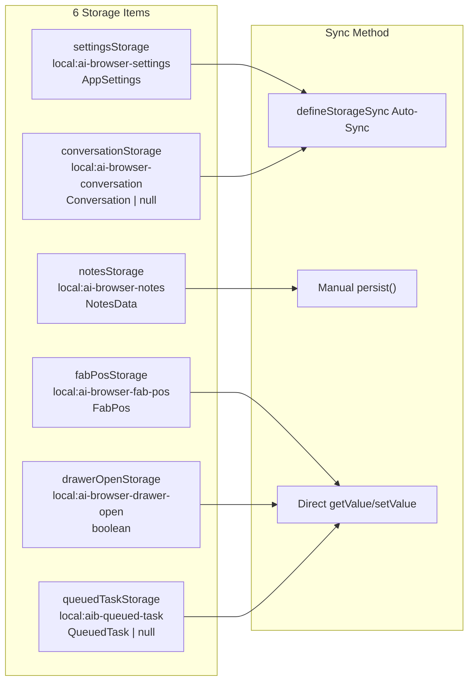
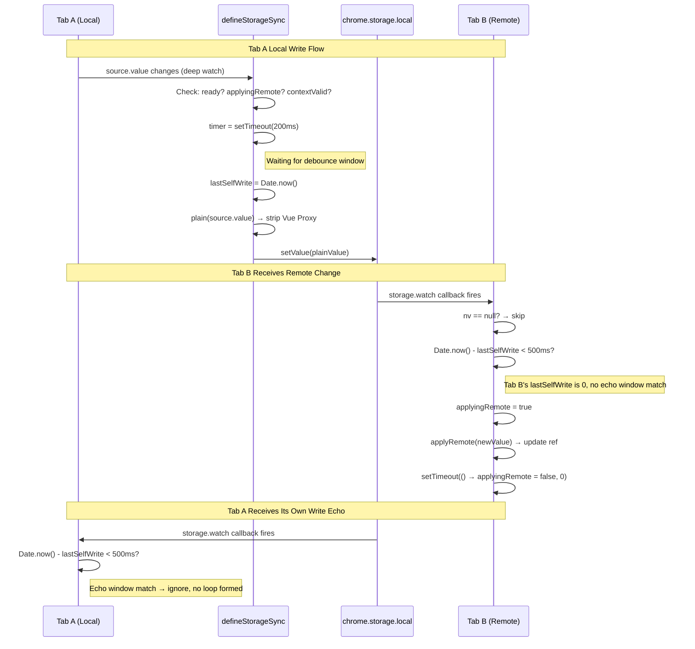
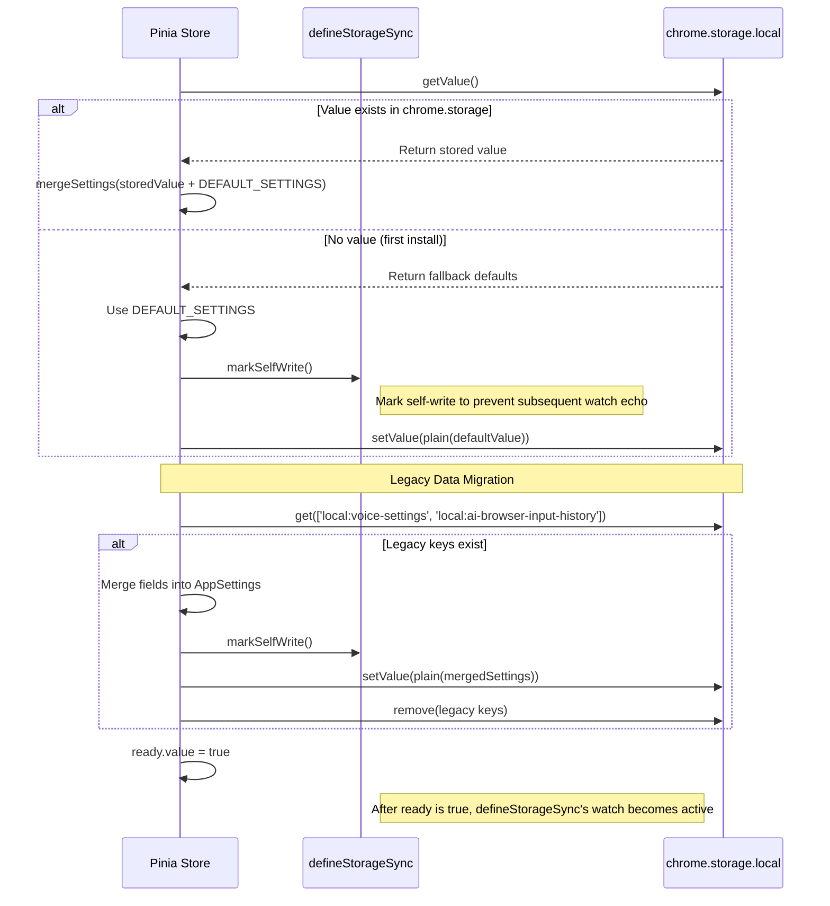
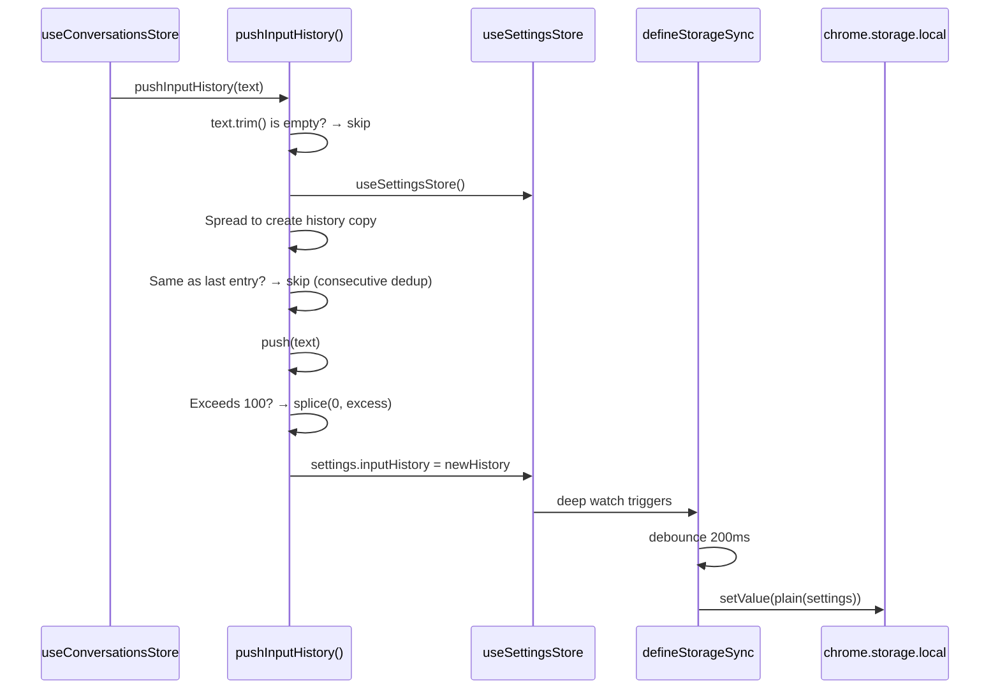

# Storage Module Architecture

> [Chinese Version / 中文版](./storage.md)

## Module Overview

The storage module is the persistence infrastructure for the AI Browser extension. It wraps `chrome.storage.local` via WXT framework's `wxt/storage` API, providing type-safe key-value storage abstractions. The module has three core responsibilities:

1. **Storage Item Definition**: Declares named storage items via `storage.defineItem<T>()` with type constraints and `fallback` defaults, covering app settings (including voice configuration and input history), conversation data, notes data, UI state, and cross-tab task queue -- 6 storage items in total.
2. **Input History Management**: `input-history.ts` provides append-only input history operations with consecutive deduplication, 100-item FIFO cap, and extension context invalidation tolerance. Input history is stored as a field within `AppSettings`.
3. **Cross-Tab Bidirectional Sync**: `storage-sync.ts` provides `defineStorageSync<T>()` utility to establish bidirectional binding between Vue reactive refs and chrome.storage, using 200ms debounce writes + 500ms echo window + 3-layer anti-echo mechanisms to ensure cross-tab data consistency.

**Source Files**:

| File | Responsibility |
|------|---------------|
| `src/storage/index.ts` | Storage item definitions, defaults, model config parsing, voice engine config parsing |
| `src/storage/input-history.ts` | Input history utility (operates via settingsStore) |
| `src/utils/storage-sync.ts` | `defineStorageSync` bidirectional sync engine + `plain()` proxy stripping |

**Position in Architecture**: The storage module sits between Pinia stores and `chrome.storage.local`, serving as the single exit point for all persisted data. Pinia stores establish bidirectional bindings with storage items via `defineStorageSync`. Vue components do not directly access the storage layer.

---

## Architecture Design

### Storage Layer Hierarchy



### Storage Items Overview



### Legacy Storage Item Migration

In earlier versions, voice settings (`local:voice-settings`) and input history (`local:ai-browser-input-history`) were stored in separate storage keys. The current version has unified them into `AppSettings`:

| Legacy Key | Legacy Type | Migration Target Field |
|-----------|-------------|----------------------|
| `local:voice-settings` | `VoiceSettings` | `AppSettings.voice*` series of fields |
| `local:ai-browser-input-history` | `string[]` | `AppSettings.inputHistory` |

Migration logic resides in `useSettingsStore.migrateOldKeys()`: during initialization, it detects legacy keys, merges data into `AppSettings`, then deletes the old keys.

---

## Core Type Definitions

### StorageKey

All storage items use the `local:` prefix, with data persisted in `chrome.storage.local`:

```typescript
// Key definitions in src/storage/index.ts
const KEY_SETTINGS    = 'local:ai-browser-settings'
const KEY_CONVERSATION = 'local:ai-browser-conversation'
const KEY_FAB_POS     = 'local:ai-browser-fab-pos'
// Remaining keys are inline in storage.defineItem() calls:
// 'local:ai-browser-notes'
// 'local:ai-browser-drawer-open'
// 'local:aib-queued-task'
```

### AppSettings (Core Configuration Type)

`AppSettings` is the largest storage type, unifying global settings, voice configuration, and user data:

```typescript
interface AppSettings {
  // ── Global Settings ──
  provider: Provider
  baseUrl: string
  apiKey: string
  authField?: string
  models: ModelConfig[]
  defaultModelId: string
  drawerWidth: number
  primaryColor: string
  theme?: string
  shortcut: string
  maxConversations?: number
  maxContext?: number
  autoSendSelection?: 'auto' | 'manual' | 'off'
  translateTargetLang?: string
  translateMode?: 'selection' | 'auto' | 'click' | 'off'
  noteMode?: NoteMode
  automationEnabled?: boolean
  locale?: 'zh-CN' | 'en-US'

  // ── Voice Configuration (merged from former VoiceSettings) ──
  voiceEngineType?: VoiceEngineType
  voiceAppId?: string
  voiceApiKey?: string
  voiceApiSecret?: string
  voiceEngineConfs?: EngineConf[]
  voiceRecognitionLang?: string
  voiceWakeWord?: string
  voiceAlwaysOn?: boolean
  voiceEnableTts?: boolean
  voiceTtsRate?: number
  voiceTtsVolume?: number
  voiceBufferTimeout?: number
  voiceIdleTimeout?: number
  voiceMode?: 'chat' | 'voice'

  // ── User Data ──
  inputHistory?: string[]
}
```

### Storage Item Type Definitions

```typescript
// Floating button position (distance from viewport bottom-right corner)
interface FabPos {
  right: number
  bottom: number
}

// Cross-tab queued task
interface QueuedTask {
  originalRequest: string
  completedSteps: Array<{
    action: string
    elementId?: string
    description?: string
  }>
  recentMessages?: Array<{ role: string; content: string }>
  timestamp: number
}

// Voice engine type
type VoiceEngineType = 'web-speech' | 'iflytek' | 'baidu' | 'tencent'

// Engine configuration item
interface EngineConf {
  engineType: string
  appId: string
  apiKey: string
  apiSecret: string
}
```

### defineStorageSync Type Definitions

```typescript
// src/utils/storage-sync.ts

// Minimal interface for wxt storage item
interface StorageItemLike<T> {
  setValue: (v: T) => Promise<void>
  watch: (cb: (nv: T | null) => void) => void
}

// Sync options
interface SyncOptions<T> {
  source: Ref<T>                    // Vue reactive data ref
  storage: StorageItemLike<T>       // wxt storage item
  ready: Ref<boolean>               // Ready flag, writes suppressed when false
  applyRemote: (nv: T) => void     // Remote value -> apply to source
  debounce?: number                 // Debounce delay (ms), default 200
  echoWindow?: number               // Self-write echo ignore window (ms), default 500
}

// Return value
interface SyncResult {
  isApplyingRemote: () => boolean   // Whether currently applying a remote value
  markSelfWrite: () => void         // Manually mark self-write timestamp
  flush: () => Promise<void>        // Bypass debounce and write immediately
}
```

---

## Implementation Details

### wxt/storage Wrapper

`src/storage/index.ts` declares storage items via `storage.defineItem<T>(key, options)`. Each storage item returns a type-safe handle providing the following methods:

| Method | Signature | Description |
|--------|-----------|-------------|
| `getValue()` | `() => Promise<T>` | Async read, returns `fallback` when no value exists |
| `setValue(v)` | `(v: T) => Promise<void>` | Async write to `chrome.storage.local` |
| `watch(cb)` | `(cb: (nv: T \| null) => void) => void` | Listen for value changes (cross-tab) |
| `fallback` | `T` | Default value returned when storage has no value |

Example -- settings storage item declaration:

```typescript
export const settingsStorage = storage.defineItem<AppSettings>(
  'local:ai-browser-settings',
  { fallback: DEFAULT_SETTINGS }
)
```

All storage items use the `local:` prefix, writing data to `chrome.storage.local` (not `chrome.storage.sync`), with no sync capacity limits, but subject to the 5MB total capacity constraint.

### Model Config Parsing (parseLocalModels)

The `models` field of `DEFAULT_SETTINGS` is dynamically parsed from `src/local-config.json`:

```typescript
function parseLocalModels(list: any[]): ModelConfig[] {
  return list.map((m) => {
    let baseUrl = m.baseUrl || ''
    baseUrl = baseUrl.replace(/\/chat\/completions\/?$/, '')  // Strip trailing path
    const id = m.id || m.modelName || m.model || `model-${Date.now()}`
    const modelName = m.modelName || m.model || id
    const label = m.label || modelName
    const provider = (m.provider || 'openai') as Provider
    return { id, label, provider, modelName, baseUrl, apiKey: m.apiKey || '', website: m.website || '' }
  })
}
```

**Fallback chains**:
- `id`: `m.id` -> `m.modelName` -> `m.model` -> `'model-{timestamp}'`
- `modelName`: `m.modelName` -> `m.model` -> `id`
- `label`: `m.label` -> `modelName`
- `provider`: `m.provider` -> `'openai'`

### Voice Engine Config Parsing (parseEngineConfs / findEngineConf)

The `voiceEngineConfs` field of `DEFAULT_SETTINGS` is dynamically parsed from `src/voice-config.json`:

```typescript
function parseEngineConfs(): EngineConf[] {
  if (!Array.isArray(voiceConfig)) return []
  return voiceConfig.map((c: any) => ({
    engineType: c.engineType || '',
    appId: c.appId || '',
    apiKey: c.apiKey || '',
    apiSecret: c.apiSecret || '',
  }))
}
```

The `findEngineConf(type)` helper function finds a single configuration item by `engineType` from the `voice-config.json` array:

```typescript
export function findEngineConf(type: string): Record<string, string> {
  if (!Array.isArray(voiceConfig)) return {}
  return voiceConfig.find((c: any) => c.engineType === type) || {}
}
```

### input-history CRUD

Source: `src/storage/input-history.ts`

`pushInputHistory(text)` implements input history append logic. Input history is stored as the `AppSettings.inputHistory` field, read/written through `useSettingsStore`:

```typescript
const INPUT_HISTORY_MAX = 100

export async function pushInputHistory(text: string) {
  if (!text.trim()) return                            // Filter empty text
  try {
    const settingsStore = useSettingsStore()
    const history = [...(settingsStore.settings.inputHistory || [])]
    if (history.length > 0 && history[history.length - 1] === text) return  // Consecutive dedup
    history.push(text)
    if (history.length > INPUT_HISTORY_MAX) {
      history.splice(0, history.length - INPUT_HISTORY_MAX)  // FIFO truncation
    }
    settingsStore.settings.inputHistory = history
  } catch {
    // Silently ignore when extension context is invalidated
  }
}
```

**Design highlights**:
- **Storage location**: `AppSettings.inputHistory`, unified with global settings, no separate storage key
- **Consecutive dedup**: Only compares with the last entry, does not scan full history (performance-first)
- **FIFO strategy**: Truncates from the head when exceeding 100 items, keeping the most recent records
- **Fault tolerance**: Wrapped in try-catch, silently ignores failures when extension context is invalidated (e.g., after page navigation)
- **Immutable update**: Spread operator creates a new array copy, avoiding direct mutation of the store reference
- **No delete API**: Input history is append-only; users cannot manually clear history

### defineStorageSync Implementation

Source: `src/utils/storage-sync.ts`

#### plain() -- Vue Proxy Stripping

```typescript
export function plain<T>(v: T): T {
  return JSON.parse(JSON.stringify(toRaw(v)))
}
```

Strips Vue's Proxy wrapper via `toRaw`, then deep-copies through `JSON.parse(JSON.stringify(...))`, ensuring the value written to storage is a plain JSON object. This solves two problems:
1. Vue Proxy objects cannot be serialized by `chrome.storage`
2. Prevents the written value from sharing a reference with the in-memory ref (subsequent mutations should not affect the already-written snapshot)

#### isContextValid() -- Extension Context Detection

```typescript
function isContextValid(): boolean {
  try {
    return !!chrome?.runtime?.id
  } catch {
    return false
  }
}
```

Chrome extension content scripts may lose their extension context after page navigation. Checks whether `chrome.runtime.id` exists before writing to avoid `"Extension context invalidated"` errors.

#### Core Sync Logic

```typescript
export function defineStorageSync<T>(opts: SyncOptions<T>) {
  const { source, storage, ready, applyRemote } = opts
  const debounceMs = opts.debounce ?? 200
  const echoMs = opts.echoWindow ?? 500

  let lastSelfWrite = 0
  let timer: number | null = null
  let applyingRemote = false

  // ① Cross-tab sync: listen for storage changes
  storage.watch((nv) => {
    if (nv == null) return
    if (Date.now() - lastSelfWrite < echoMs) return  // Ignore within echo window
    applyingRemote = true
    applyRemote(nv)
    setTimeout(() => (applyingRemote = false), 0)
  })

  // ② Local changes → debounced write
  watch(
    source,
    () => {
      if (!ready.value || applyingRemote) return
      if (!isContextValid()) return
      if (timer) window.clearTimeout(timer)
      timer = window.setTimeout(() => {
        if (!isContextValid()) return
        lastSelfWrite = Date.now()
        storage.setValue(plain(source.value)).catch(() => {})
      }, debounceMs)
    },
    { deep: true }
  )

  // ③ Explicit immediate write (bypasses debounce)
  async function flush() {
    if (!isContextValid()) return
    if (timer) window.clearTimeout(timer)
    lastSelfWrite = Date.now()
    await storage.setValue(plain(source.value)).catch(() => {})
  }

  return {
    isApplyingRemote: () => applyingRemote,
    markSelfWrite: () => (lastSelfWrite = Date.now()),
    flush,
  }
}
```

#### Three-Layer Anti-Echo Mechanism

The core challenge of cross-tab synchronization: Tab A writes to storage -> storage change event fires on both Tab A and Tab B -> Tab A receives its own write echo -> writes again -> infinite loop.

| Layer | Mechanism | Code | Purpose |
|-------|-----------|------|---------|
| Layer 1 | Timestamp window | `Date.now() - lastSelfWrite < echoMs` | Ignore echoes from own writes within 500ms |
| Layer 2 | applyingRemote flag | `if (applyingRemote) return` | Skip local watch while applying remote value |
| Layer 3 | setTimeout delayed clear | `setTimeout(() => applyingRemote = false, 0)` | Ensure local writes are not triggered within the current sync cycle |

#### 200ms Debounce Writes

Local ref changes do not immediately write to storage; instead, they wait for a 200ms debounce window. This avoids high-frequency writes from rapid consecutive modifications (e.g., dragging a slider to adjust settings). The `flush()` method bypasses debounce for direct writes, used in scenarios like `update()` that require immediate persistence.

#### Return Values

| Method | Return Type | Purpose |
|--------|------------|---------|
| `isApplyingRemote()` | `boolean` | Indicates whether a remote value is currently being applied; external logic can skip certain operations based on this |
| `markSelfWrite()` | `void` | Manually marks the self-write timestamp; used during init's first write to prevent triggering remote listener echoes |
| `flush()` | `Promise<void>` | Bypasses debounce and writes immediately; used for settings updates and other scenarios requiring guaranteed immediate persistence |

### Legacy Data Migration (migrateOldKeys)

Source: `src/stores/settings.ts`

`useSettingsStore` executes `migrateOldKeys()` during initialization, migrating voice settings and input history from legacy standalone storage into the unified `AppSettings`:

```typescript
const OLD_KEYS = {
  voice: 'local:voice-settings',
  inputHistory: 'local:ai-browser-input-history',
} as const

async function migrateOldKeys() {
  const result = await chrome.storage.local.get(Object.values(OLD_KEYS))

  // Migrate voice settings: map fields to AppSettings.voice* fields
  const oldVoice = result[OLD_KEYS.voice]
  if (oldVoice && typeof oldVoice === 'object') {
    if (oldVoice.engineType) settings.value.voiceEngineType = oldVoice.engineType
    if (oldVoice.appId) settings.value.voiceAppId = oldVoice.appId
    // ... other fields
  }

  // Migrate input history: assign directly to AppSettings.inputHistory
  const oldHistory = result[OLD_KEYS.inputHistory]
  if (Array.isArray(oldHistory) && oldHistory.length > 0
      && (!settings.value.inputHistory || settings.value.inputHistory.length === 0)) {
    settings.value.inputHistory = oldHistory
  }

  // Write migrated data, delete old keys
  if (migrated) {
    sync.markSelfWrite()
    await settingsStorage.setValue(plain(settings.value))
    await chrome.storage.local.remove(Object.values(OLD_KEYS))
  }
}
```

**Migration strategy**:
- Only migrates when legacy keys exist and new fields are empty (does not overwrite existing data)
- Deletes legacy keys immediately after migration to free storage space
- `markSelfWrite()` marks the write timestamp to prevent migration writes from triggering cross-tab echoes

---

## Data Flow

### Cross-Tab Sync Sequence



### Storage Read Initialization Flow



### Input History Write Flow



---

## Configuration & Extension

### Configurable Parameters

| Parameter | Default | Source File | Description |
|-----------|---------|-------------|-------------|
| `debounce` | 200 ms | storage-sync.ts | `defineStorageSync` debounce write delay |
| `echoWindow` | 500 ms | storage-sync.ts | Self-write echo ignore window |
| `INPUT_HISTORY_MAX` | 100 items | input-history.ts | Input history cap (FIFO strategy) |

### Storage Key Mapping

| Key | Storage Item | Type | Sync Method |
|-----|-------------|------|-------------|
| `local:ai-browser-settings` | `settingsStorage` | `AppSettings` | defineStorageSync |
| `local:ai-browser-conversation` | `conversationStorage` | `Conversation \| null` | defineStorageSync |
| `local:ai-browser-notes` | `notesStorage` | `NotesData` | Manual persist() |
| `local:ai-browser-fab-pos` | `fabPosStorage` | `FabPos` | Direct getValue/setValue |
| `local:ai-browser-drawer-open` | `drawerOpenStorage` | `boolean` | Direct getValue/setValue |
| `local:aib-queued-task` | `queuedTaskStorage` | `QueuedTask \| null` | Direct getValue/setValue |

**Deprecated legacy keys** (auto-deleted after migration):

| Legacy Key | Original Type | Migration Target |
|-----------|---------------|-----------------|
| `local:voice-settings` | `VoiceSettings` | `AppSettings.voice*` series of fields |
| `local:ai-browser-input-history` | `string[]` | `AppSettings.inputHistory` |

### Adding New Storage Items

Standard procedure for adding a new storage item:

1. **Declare the storage item** (`src/storage/index.ts`):
   ```typescript
   export const myDataStorage = storage.defineItem<MyType>(
     'local:ai-browser-my-data',
     { fallback: defaultValue }
   )
   ```

2. **Create a Pinia store** (`src/stores/my-store.ts`):
   ```typescript
   export const useMyStore = defineStore('aib-my-store', () => {
     const data = ref<MyType>(defaultValue)
     const ready = ref(false)

     const sync = defineStorageSync<MyType>({
       source: data,
       storage: myDataStorage,
       ready,
       applyRemote: (nv) => { data.value = nv },
     })

     async function init() {
       const stored = await myDataStorage.getValue()
       data.value = stored
       ready.value = true
     }

     return { data, ready, init }
   })
   ```

3. **Call `init()` at the entry point**

---

## Known Limitations

1. **Plaintext apiKey storage**: The `apiKey`, `voiceApiKey`, and `voiceApiSecret` fields in `settingsStorage` are stored in plaintext in `chrome.storage.local`. Any code with extension permissions can read them. Consider using Chrome's `chrome.storage.session` or encryption to protect sensitive fields.

2. **plain() full deep copy overhead**: Every storage write goes through `JSON.parse(JSON.stringify(toRaw(v)))` full deep copy. For large settings objects (with hundreds of model configs and input history), serialization overhead can be significant. There is no incremental sync or chunked storage mechanism.

3. **No storage migration versioning**: Migration logic only checks whether legacy keys exist, with no version number management. If the storage structure changes again in the future, independent migration code must be written for each change.

4. **Chrome Storage 5MB capacity limit**: `chrome.storage.local` has a default 5MB upper limit. Large conversation histories, notes data, and attachment content may approach this limit. There is no capacity monitoring or automatic cleanup mechanism (`checkAndAutoClear` is at the store layer, not the storage layer).

5. **Notes store lacks cross-tab sync**: `useNotesStore` does not use `defineStorageSync`; it manually calls `persist()`. When multiple tabs edit notes simultaneously, a last-write-wins strategy is used, which may cause data overwrites.

6. **Input history cannot be cleared**: `pushInputHistory()` only provides an append API; there is no delete or clear method. Users cannot manually clear their history.

7. **queuedTask lacks persistence protection**: `queuedTaskStorage` only uses `timestamp` for expiry checking (30s). Tasks are lost after Service Worker restart. There is no retry or recovery mechanism.

8. **parseLocalModels is hardcoded**: Model parsing logic is hardcoded in the storage module and does not support runtime dynamic model addition. Modifying the model list requires editing `local-config.json` and rebuilding the extension.

9. **Write errors silently ignored**: In `defineStorageSync`, `storage.setValue(...).catch(() => {})` silently ignores write errors. Users have no awareness of data loss. `pushInputHistory` similarly ignores errors in its catch block.

10. **Concurrent writes use last-write-wins**: When two tabs modify the same storage item simultaneously, the later write overwrites the earlier one. There is no conflict resolution mechanism, no optimistic locking, and no operation log.
