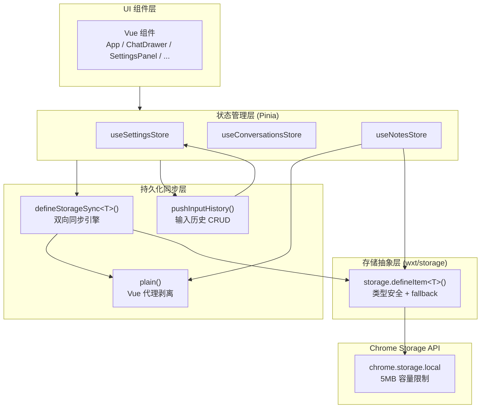
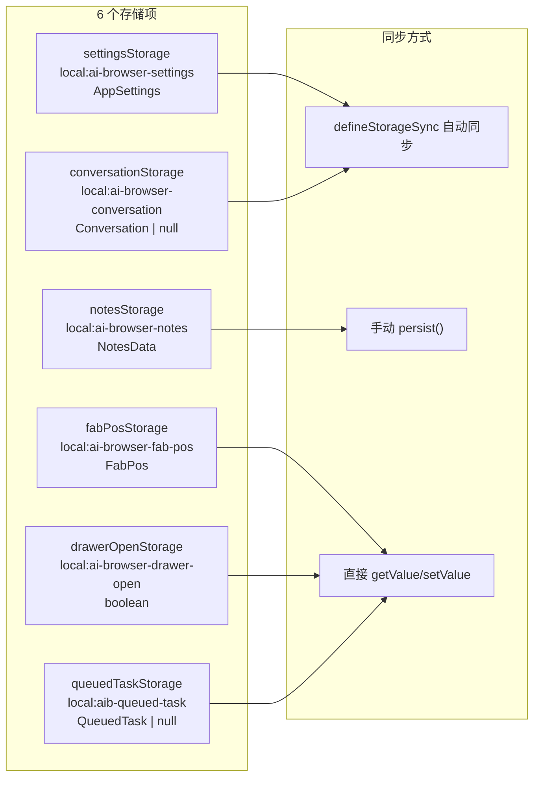
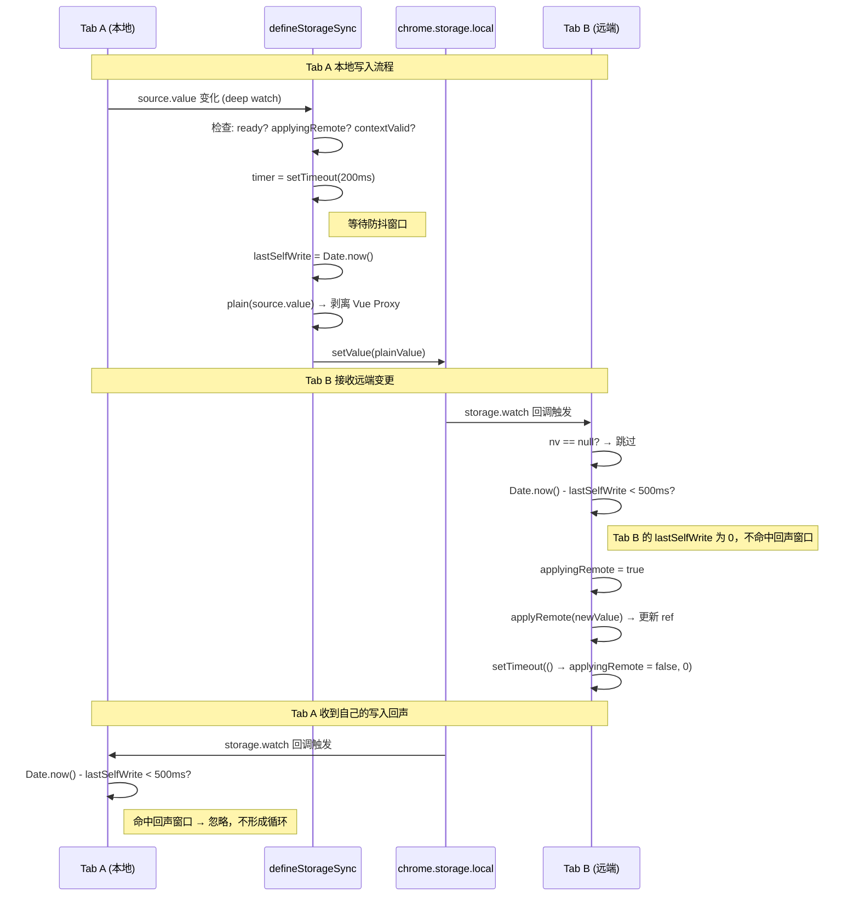
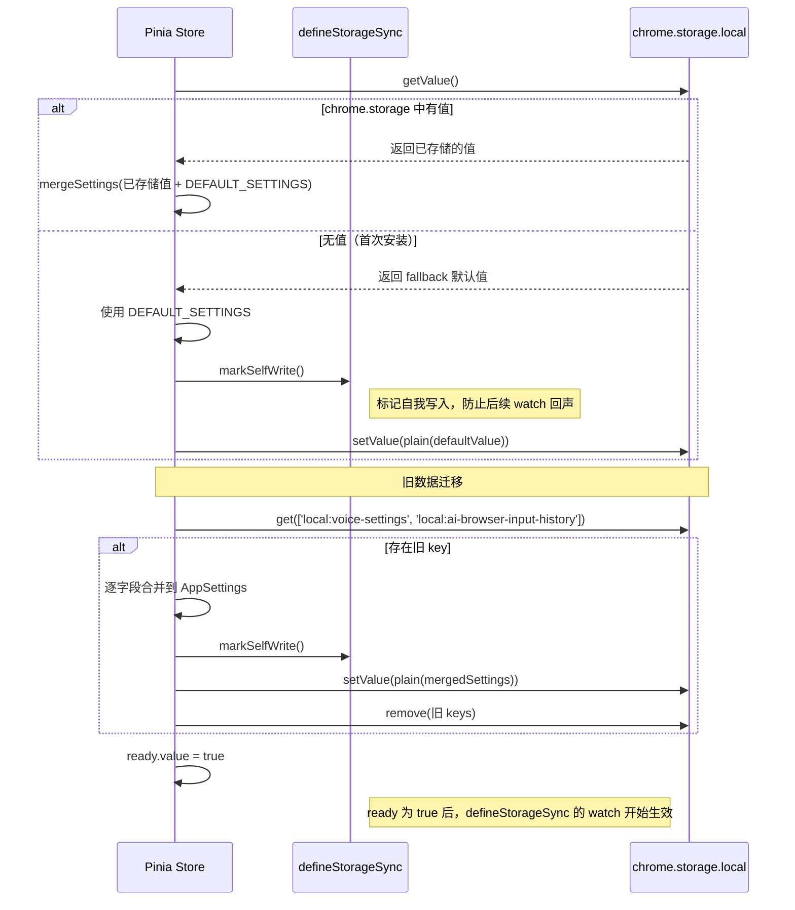
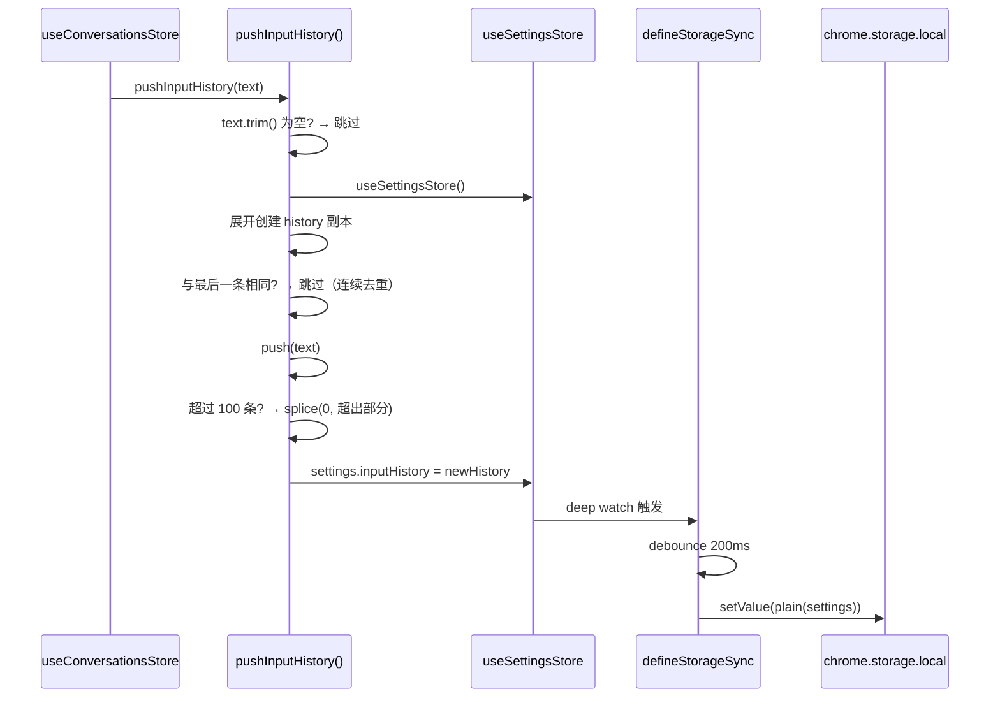

# Storage 模块架构

> [English Version](./storage-en.md)

## 模块概述

存储模块是 AI Browser 扩展的持久化基础设施，基于 WXT 框架的 `wxt/storage` API 对 `chrome.storage.local` 进行封装，提供类型安全的键值存储抽象。模块承担三项核心职责：

1. **存储项定义**：通过 `storage.defineItem<T>()` 声明具名存储项，附带类型约束和 `fallback` 默认值，涵盖应用设置（含语音配置和输入历史）、会话数据、笔记数据、UI 状态和跨标签页任务队列共 6 个存储项。
2. **输入历史管理**：`input-history.ts` 提供输入历史的追加操作，实现连续去重、上限截断（100 条 FIFO）和扩展上下文失效容错。输入历史作为 `AppSettings` 的字段统一存储。
3. **跨标签页双向同步**：`storage-sync.ts` 提供 `defineStorageSync<T>()` 工具函数，将 Vue reactive ref 与 chrome.storage 建立双向绑定，通过 200ms 防抖写入 + 500ms 回声窗口 + 3 层防回声机制保证跨标签页数据一致性。

**源文件**：

| 文件 | 职责 |
|------|------|
| `src/storage/index.ts` | 存储项定义、默认值、模型配置解析、语音引擎配置解析 |
| `src/storage/input-history.ts` | 输入历史记录工具（通过 settingsStore 操作） |
| `src/utils/storage-sync.ts` | `defineStorageSync` 双向同步引擎 + `plain()` 代理剥离 |

**在架构中的位置**：存储模块位于 Pinia store 与 `chrome.storage.local` 之间，是所有持久化数据的唯一出口。Pinia store 通过 `defineStorageSync` 与存储项建立双向绑定，Vue 组件不直接操作存储层。

---

## 架构设计

### 存储层分层



### 存储项总览



### 旧存储项迁移

早期版本中，语音设置（`local:voice-settings`）和输入历史（`local:ai-browser-input-history`）分别存储在独立的 storage key 中。当前版本已将它们统一合并到 `AppSettings` 中：

| 旧 Key | 旧类型 | 迁移目标字段 |
|--------|--------|-------------|
| `local:voice-settings` | `VoiceSettings` | `AppSettings.voice*` 系列字段 |
| `local:ai-browser-input-history` | `string[]` | `AppSettings.inputHistory` |

迁移逻辑位于 `useSettingsStore.migrateOldKeys()`：初始化时检测旧 key，将数据合并到 `AppSettings`，然后删除旧 key。

---

## 核心类型定义

### StorageKey

所有存储项使用 `local:` 前缀，数据持久化在 `chrome.storage.local` 中：

```typescript
// src/storage/index.ts 中的键定义
const KEY_SETTINGS    = 'local:ai-browser-settings'
const KEY_CONVERSATION = 'local:ai-browser-conversation'
const KEY_FAB_POS     = 'local:ai-browser-fab-pos'
// 其余键内联在 storage.defineItem() 调用中：
// 'local:ai-browser-notes'
// 'local:ai-browser-drawer-open'
// 'local:aib-queued-task'
```

### AppSettings（核心配置类型）

`AppSettings` 是最大的存储类型，统一承载全局设置、语音配置和用户数据：

```typescript
interface AppSettings {
  // ── 全局设置 ──
  provider: Provider
  baseUrl: string
  apiKey: string
  authField?: string
  models: ModelConfig[]
  defaultModelId: string
  drawerWidth: number
  primaryColor: string
  theme?: string
  shortcut: string
  maxConversations?: number
  maxContext?: number
  autoSendSelection?: 'auto' | 'manual' | 'off'
  translateTargetLang?: string
  translateMode?: 'selection' | 'auto' | 'click' | 'off'
  noteMode?: NoteMode
  automationEnabled?: boolean
  locale?: 'zh-CN' | 'en-US'

  // ── 语音配置（原独立 VoiceSettings，已合并） ──
  voiceEngineType?: VoiceEngineType
  voiceAppId?: string
  voiceApiKey?: string
  voiceApiSecret?: string
  voiceEngineConfs?: EngineConf[]
  voiceRecognitionLang?: string
  voiceWakeWord?: string
  voiceAlwaysOn?: boolean
  voiceEnableTts?: boolean
  voiceTtsRate?: number
  voiceTtsVolume?: number
  voiceBufferTimeout?: number
  voiceIdleTimeout?: number
  voiceMode?: 'chat' | 'voice'

  // ── 用户数据 ──
  inputHistory?: string[]
}
```

### 存储项类型定义

```typescript
// 悬浮按钮位置（距视口右下角）
interface FabPos {
  right: number
  bottom: number
}

// 跨标签页排队任务
interface QueuedTask {
  originalRequest: string
  completedSteps: Array<{
    action: string
    elementId?: string
    description?: string
  }>
  recentMessages?: Array<{ role: string; content: string }>
  timestamp: number
}

// 语音引擎类型
type VoiceEngineType = 'web-speech' | 'iflytek' | 'baidu' | 'tencent'

// 引擎配置项
interface EngineConf {
  engineType: string
  appId: string
  apiKey: string
  apiSecret: string
}
```

### defineStorageSync 类型定义

```typescript
// src/utils/storage-sync.ts

// wxt storage item 的最小接口
interface StorageItemLike<T> {
  setValue: (v: T) => Promise<void>
  watch: (cb: (nv: T | null) => void) => void
}

// 同步选项
interface SyncOptions<T> {
  source: Ref<T>                    // Vue 响应式数据 ref
  storage: StorageItemLike<T>       // wxt storage item
  ready: Ref<boolean>               // ready 标志，false 时不写入
  applyRemote: (nv: T) => void     // 来自远端的值 -> 应用到 source
  debounce?: number                 // 防抖延时（ms），默认 200
  echoWindow?: number               // 自我写入回声忽略窗口（ms），默认 500
}

// 返回值
interface SyncResult {
  isApplyingRemote: () => boolean   // 是否正在应用远端值
  markSelfWrite: () => void         // 手动标记自我写入时间戳
  flush: () => Promise<void>        // 绕过防抖立即写入
}
```

---

## 实现细节

### wxt/storage 封装

`src/storage/index.ts` 通过 `storage.defineItem<T>(key, options)` 声明存储项。每个存储项返回一个类型安全的存储句柄，提供以下方法：

| 方法 | 签名 | 说明 |
|------|------|------|
| `getValue()` | `() => Promise<T>` | 异步读取，无值时返回 `fallback` |
| `setValue(v)` | `(v: T) => Promise<void>` | 异步写入 `chrome.storage.local` |
| `watch(cb)` | `(cb: (nv: T \| null) => void) => void` | 监听值变化（跨标签页） |
| `fallback` | `T` | 存储中无值时返回的默认值 |

示例——settings 存储项声明：

```typescript
export const settingsStorage = storage.defineItem<AppSettings>(
  'local:ai-browser-settings',
  { fallback: DEFAULT_SETTINGS }
)
```

所有存储项均使用 `local:` 前缀，数据写入 `chrome.storage.local`（非 `chrome.storage.sync`），无容量同步限制，但受 5MB 总容量约束。

### 模型配置解析 (parseLocalModels)

`DEFAULT_SETTINGS` 的 `models` 字段从 `src/local-config.json` 动态解析：

```typescript
function parseLocalModels(list: any[]): ModelConfig[] {
  return list.map((m) => {
    let baseUrl = m.baseUrl || ''
    baseUrl = baseUrl.replace(/\/chat\/completions\/?$/, '')  // 去除末尾路径
    const id = m.id || m.modelName || m.model || `model-${Date.now()}`
    const modelName = m.modelName || m.model || id
    const label = m.label || modelName
    const provider = (m.provider || 'openai') as Provider
    return { id, label, provider, modelName, baseUrl, apiKey: m.apiKey || '', website: m.website || '' }
  })
}
```

**回退链**：
- `id`: `m.id` -> `m.modelName` -> `m.model` -> `'model-{timestamp}'`
- `modelName`: `m.modelName` -> `m.model` -> `id`
- `label`: `m.label` -> `modelName`
- `provider`: `m.provider` -> `'openai'`

### 语音引擎配置解析 (parseEngineConfs / findEngineConf)

`DEFAULT_SETTINGS` 的 `voiceEngineConfs` 字段从 `src/voice-config.json` 动态解析：

```typescript
function parseEngineConfs(): EngineConf[] {
  if (!Array.isArray(voiceConfig)) return []
  return voiceConfig.map((c: any) => ({
    engineType: c.engineType || '',
    appId: c.appId || '',
    apiKey: c.apiKey || '',
    apiSecret: c.apiSecret || '',
  }))
}
```

`findEngineConf(type)` 辅助函数从 `voice-config.json` 数组中按 `engineType` 查找单个配置项：

```typescript
export function findEngineConf(type: string): Record<string, string> {
  if (!Array.isArray(voiceConfig)) return {}
  return voiceConfig.find((c: any) => c.engineType === type) || {}
}
```

### input-history CRUD

源码：`src/storage/input-history.ts`

`pushInputHistory(text)` 实现输入历史的追加逻辑。输入历史作为 `AppSettings.inputHistory` 字段存储，通过 `useSettingsStore` 读写：

```typescript
const INPUT_HISTORY_MAX = 100

export async function pushInputHistory(text: string) {
  if (!text.trim()) return                            // 过滤空文本
  try {
    const settingsStore = useSettingsStore()
    const history = [...(settingsStore.settings.inputHistory || [])]
    if (history.length > 0 && history[history.length - 1] === text) return  // 连续去重
    history.push(text)
    if (history.length > INPUT_HISTORY_MAX) {
      history.splice(0, history.length - INPUT_HISTORY_MAX)  // FIFO 截断
    }
    settingsStore.settings.inputHistory = history
  } catch {
    // 扩展上下文失效时静默忽略
  }
}
```

**设计要点**：
- **存储位置**：`AppSettings.inputHistory`，与全局设置统一存储，无独立 storage key
- **连续去重**：仅与最后一条比较，不检查历史中是否存在（性能优先）
- **FIFO 策略**：超过 100 条时从头部截断，保留最新记录
- **容错处理**：try-catch 包裹，扩展上下文失效时（页面导航后）静默忽略
- **不可变更新**：展开运算符创建新数组副本，避免直接修改 store 中的引用
- **无删除接口**：输入历史只增不减，用户无法手动清理

### defineStorageSync 实现

源码：`src/utils/storage-sync.ts`

#### plain() —— Vue 代理剥离

```typescript
export function plain<T>(v: T): T {
  return JSON.parse(JSON.stringify(toRaw(v)))
}
```

通过 `toRaw` 剥离 Vue 的 Proxy 包装，再经 `JSON.parse(JSON.stringify(...))` 深拷贝，确保写入 storage 的是纯 JSON 对象。这解决两个问题：
1. Vue Proxy 对象无法被 `chrome.storage` 序列化
2. 避免写入的值与内存中的 ref 共享引用（后续修改不应影响已写入的快照）

#### isContextValid() —— 扩展上下文检测

```typescript
function isContextValid(): boolean {
  try {
    return !!chrome?.runtime?.id
  } catch {
    return false
  }
}
```

Chrome 扩展的 content script 在页面导航后可能失去扩展上下文。写入前检查 `chrome.runtime.id` 是否存在，避免 `"Extension context invalidated"` 错误。

#### 核心同步逻辑

```typescript
export function defineStorageSync<T>(opts: SyncOptions<T>) {
  const { source, storage, ready, applyRemote } = opts
  const debounceMs = opts.debounce ?? 200
  const echoMs = opts.echoWindow ?? 500

  let lastSelfWrite = 0
  let timer: number | null = null
  let applyingRemote = false

  // ① 跨页面同步：监听 storage 变化
  storage.watch((nv) => {
    if (nv == null) return
    if (Date.now() - lastSelfWrite < echoMs) return  // 回声窗口内忽略
    applyingRemote = true
    applyRemote(nv)
    setTimeout(() => (applyingRemote = false), 0)
  })

  // ② 本地变化 → 防抖写入
  watch(
    source,
    () => {
      if (!ready.value || applyingRemote) return
      if (!isContextValid()) return
      if (timer) window.clearTimeout(timer)
      timer = window.setTimeout(() => {
        if (!isContextValid()) return
        lastSelfWrite = Date.now()
        storage.setValue(plain(source.value)).catch(() => {})
      }, debounceMs)
    },
    { deep: true }
  )

  // ③ 显式立即写入（绕过防抖）
  async function flush() {
    if (!isContextValid()) return
    if (timer) window.clearTimeout(timer)
    lastSelfWrite = Date.now()
    await storage.setValue(plain(source.value)).catch(() => {})
  }

  return {
    isApplyingRemote: () => applyingRemote,
    markSelfWrite: () => (lastSelfWrite = Date.now()),
    flush,
  }
}
```

#### 三层防回声机制

跨标签页同步的核心难题：Tab A 写入 storage -> storage 变更事件同时触发 Tab A 和 Tab B -> Tab A 收到自己的写入回声 -> 再次写入 -> 无限循环。

| 层级 | 机制 | 代码 | 作用 |
|------|------|------|------|
| 第 1 层 | 时间戳窗口 | `Date.now() - lastSelfWrite < echoMs` | 500ms 内忽略自身写入触发的回声 |
| 第 2 层 | applyingRemote 标记 | `if (applyingRemote) return` | 应用远端值期间跳过本地 watch |
| 第 3 层 | setTimeout 延迟清除 | `setTimeout(() => applyingRemote = false, 0)` | 确保当前同步周期内不触发本地写入 |

#### 200ms 防抖写入

本地 ref 变化后不立即写入 storage，而是等待 200ms 防抖窗口。这避免了连续快速修改（如拖动滑块调整设置）导致的高频写入。`flush()` 方法绕过防抖直接写入，用于 `update()` 等需要即时持久化的场景。

#### 返回值

| 方法 | 返回值 | 用途 |
|------|--------|------|
| `isApplyingRemote()` | `boolean` | 判断当前是否正在应用远端值，外部逻辑可据此跳过某些操作 |
| `markSelfWrite()` | `void` | 手动标记自我写入时间戳，用于 init 时首次写入场景，避免触发远端监听器的回声 |
| `flush()` | `Promise<void>` | 绕过防抖立即写入，用于设置更新等需要确保即时持久化的场景 |

### 旧数据迁移 (migrateOldKeys)

源码：`src/stores/settings.ts`

`useSettingsStore` 在初始化时执行 `migrateOldKeys()`，将旧版独立存储的语音设置和输入历史迁移到统一的 `AppSettings` 中：

```typescript
const OLD_KEYS = {
  voice: 'local:voice-settings',
  inputHistory: 'local:ai-browser-input-history',
} as const

async function migrateOldKeys() {
  const result = await chrome.storage.local.get(Object.values(OLD_KEYS))

  // 迁移语音设置：逐字段映射到 AppSettings.voice* 字段
  const oldVoice = result[OLD_KEYS.voice]
  if (oldVoice && typeof oldVoice === 'object') {
    if (oldVoice.engineType) settings.value.voiceEngineType = oldVoice.engineType
    if (oldVoice.appId) settings.value.voiceAppId = oldVoice.appId
    // ... 其他字段
  }

  // 迁移输入历史：直接赋值到 AppSettings.inputHistory
  const oldHistory = result[OLD_KEYS.inputHistory]
  if (Array.isArray(oldHistory) && oldHistory.length > 0
      && (!settings.value.inputHistory || settings.value.inputHistory.length === 0)) {
    settings.value.inputHistory = oldHistory
  }

  // 写入迁移后的数据，删除旧 key
  if (migrated) {
    sync.markSelfWrite()
    await settingsStorage.setValue(plain(settings.value))
    await chrome.storage.local.remove(Object.values(OLD_KEYS))
  }
}
```

**迁移策略**：
- 仅在旧 key 存在且新字段为空时迁移（不覆盖已有数据）
- 迁移完成后立即删除旧 key，释放存储空间
- `markSelfWrite()` 标记写入时间戳，防止迁移写入触发跨标签页回声

---

## 数据流

### 跨标签页同步时序



### 存储读取初始化流程



### 输入历史写入流程



---

## 配置与扩展

### 可配置参数

| 参数 | 默认值 | 所属文件 | 说明 |
|------|--------|----------|------|
| `debounce` | 200 ms | storage-sync.ts | `defineStorageSync` 防抖写入延时 |
| `echoWindow` | 500 ms | storage-sync.ts | 自我写入回声忽略窗口 |
| `INPUT_HISTORY_MAX` | 100 条 | input-history.ts | 输入历史上限（FIFO 策略） |

### 存储键映射

| 键名 | 存储项 | 类型 | 同步方式 |
|------|--------|------|----------|
| `local:ai-browser-settings` | `settingsStorage` | `AppSettings` | defineStorageSync |
| `local:ai-browser-conversation` | `conversationStorage` | `Conversation \| null` | defineStorageSync |
| `local:ai-browser-notes` | `notesStorage` | `NotesData` | 手动 persist() |
| `local:ai-browser-fab-pos` | `fabPosStorage` | `FabPos` | 直接 getValue/setValue |
| `local:ai-browser-drawer-open` | `drawerOpenStorage` | `boolean` | 直接 getValue/setValue |
| `local:aib-queued-task` | `queuedTaskStorage` | `QueuedTask \| null` | 直接 getValue/setValue |

**已废弃的旧键**（迁移后自动删除）：

| 旧键名 | 原类型 | 迁移目标 |
|--------|--------|----------|
| `local:voice-settings` | `VoiceSettings` | `AppSettings.voice*` 系列字段 |
| `local:ai-browser-input-history` | `string[]` | `AppSettings.inputHistory` |

### 扩展新存储项

添加新存储项的标准流程：

1. **声明存储项**（`src/storage/index.ts`）：
   ```typescript
   export const myDataStorage = storage.defineItem<MyType>(
     'local:ai-browser-my-data',
     { fallback: defaultValue }
   )
   ```

2. **创建 Pinia store**（`src/stores/my-store.ts`）：
   ```typescript
   export const useMyStore = defineStore('aib-my-store', () => {
     const data = ref<MyType>(defaultValue)
     const ready = ref(false)

     const sync = defineStorageSync<MyType>({
       source: data,
       storage: myDataStorage,
       ready,
       applyRemote: (nv) => { data.value = nv },
     })

     async function init() {
       const stored = await myDataStorage.getValue()
       data.value = stored
       ready.value = true
     }

     return { data, ready, init }
   })
   ```

3. **在入口处调用 `init()`**

---

## 已知限制

1. **apiKey 明文存储**：`settingsStorage` 中的 `apiKey`、`voiceApiKey`、`voiceApiSecret` 以明文形式存储在 `chrome.storage.local`，任何有扩展权限的代码都可读取。建议使用 Chrome 的 `chrome.storage.session` 或加密方案保护敏感字段。

2. **plain() 全量深拷贝开销**：每次写入 storage 都经过 `JSON.parse(JSON.stringify(toRaw(v)))` 全量深拷贝。对于大型设置对象（含数百个模型配置和输入历史），序列化开销可能显著。无增量同步或分块存储机制。

3. **无存储迁移版本号**：迁移逻辑仅检测旧 key 是否存在，无版本号管理。如果未来存储结构再次变更，需要为每次变更编写独立的迁移代码。

4. **Chrome Storage 5MB 容量限制**：`chrome.storage.local` 默认 5MB 上限。大量对话历史、笔记数据和附件内容可能接近上限。无容量监控或自动清理机制（`checkAndAutoClear` 在 store 层而非存储层）。

5. **笔记 store 无跨标签页同步**：`useNotesStore` 不使用 `defineStorageSync`，手动调用 `persist()`。多标签页同时编辑笔记时采用 last-write-wins 策略，可能导致数据覆盖。

6. **输入历史不可清理**：`pushInputHistory()` 只提供追加接口，无删除或清空方法。用户无法手动清理历史记录。

7. **queuedTask 无持久化保护**：`queuedTaskStorage` 仅靠 `timestamp` 做过期判断（30s），Service Worker 重启后任务丢失。无重试或恢复机制。

8. **parseLocalModels 硬编码**：模型解析逻辑硬编码在存储模块中，不支持运行时动态添加模型。修改模型列表需修改 `local-config.json` 后重新构建扩展。

9. **写入错误静默忽略**：`defineStorageSync` 中 `storage.setValue(...).catch(() => {})` 静默忽略写入错误，数据丢失时用户无感知。`pushInputHistory` 同样在 catch 中静默忽略。

10. **并发写入 last-write-wins**：两个标签页同时修改同一存储项时，后写入的值覆盖先写入的值。无冲突解决机制、无乐观锁、无操作日志。
