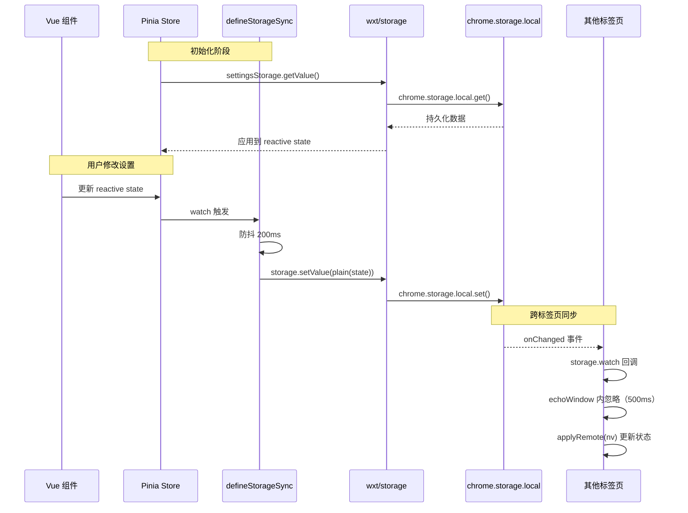
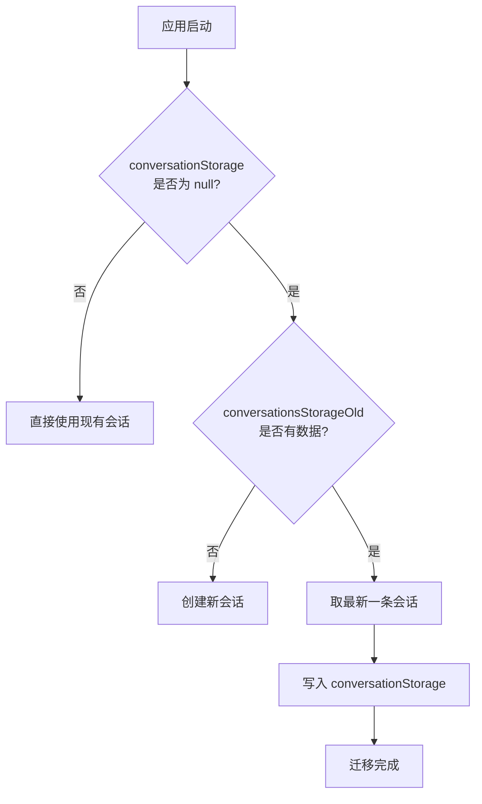

# 存储架构

## 目标

提供类型安全的数据持久化层，支持跨标签页同步。基于 WXT 框架的 `storage.defineItem()` API 统一封装 Chrome Storage，实现设置、会话、UI 状态等数据的持久化存储，并通过 `defineStorageSync()` 工具实现 Vue 响应式数据与 storage 的双向同步。

## 架构总览

```mermaid
graph TB
    subgraph Vue 响应式层
        RS[reactive state<br/>Pinia Store / Component Ref]
    end

    subgraph 同步层
        SS[defineStorageSync<br/>双向同步 + 防抖 + 回声抑制]
    end

    subgraph 存储定义层
        direction LR
        S1[settingsStorage]
        S2[conversationStorage]
        S3[fabPosStorage]
        S4[drawerOpenStorage]
        S5[inputHistoryStorage]
        S6[conversationsStorageOld<br/>@deprecated]
    end

    subgraph WXT 框架层
        WXT[wxt/storage<br/>storage.defineItem]
    end

    subgraph 浏览器层
        CS[Chrome Storage API<br/>chrome.storage.local]
    end

    RS <-->|双向绑定| SS
    SS --> WXT
    S1 & S2 & S3 & S4 & S5 & S6 --> WXT
    WXT --> CS

    subgraph 配置源
        LC[local-config.json<br/>默认模型配置]
    end

    LC -->|parseLocalModels| S1
```

## 核心设计决策

### 1. WXT storage.defineItem() 类型安全存储

所有存储项通过 `storage.defineItem<T>(key, { fallback })` 定义，提供完整的 TypeScript 类型推导和默认值回退。无需手动处理 JSON 序列化/反序列化，WXT 框架自动处理。

### 2. local: 命名空间

所有数据使用 `local:` 命名空间，即 `chrome.storage.local`。这意味着数据存储在本地磁盘，不随 Chrome 账号同步，但读写速度最快且无容量配额限制（相比 `sync:` 的 100KB 限制）。

### 3. 配置驱动的默认值

`DEFAULT_SETTINGS` 从 `local-config.json` 动态解析默认模型列表，通过 `parseLocalModels()` 映射为标准 `ModelConfig[]`。这使得开箱即用的模型配置可以通过修改 JSON 文件调整，无需改动代码。

### 4. 输入历史 FIFO 策略

`inputHistoryStorage` 存储用户输入历史，上限 100 条。采用 FIFO（先进先出）策略，超过上限时截掉头部旧记录。连续相同文本自动去重，避免重复记录。

### 5. 旧会话格式迁移

旧版支持多会话（`conversationsStorageOld` 存储 `Conversation[]`），新版简化为单会话（`conversationStorage` 存储 `Conversation | null`）。首次加载时自动将旧格式迁移为新格式。

## 存储项详情

### settingsStorage — 应用设置

- **键**：`local:zwf-settings`
- **类型**：`AppSettings`
- **默认值**：`DEFAULT_SETTINGS`（从 `local-config.json` 解析）

```typescript
interface AppSettings {
  provider: Provider              // 协议类型（openai/anthropic/gemini/...）
  baseUrl: string                 // API 请求地址
  apiKey: string                  // API 密钥
  authField?: string              // 认证字段（bearer/api-key/access-token）
  models: ModelConfig[]           // 可用模型列表
  defaultModelId: string          // 默认模型 ID
  drawerWidth: number             // 抽屉宽度（vw 百分比，40-100）
  primaryColor: string            // 主题色（hex）
  theme?: string                  // 主题 ID
  shortcut: string                // 快捷键（如 "Ctrl+`"）
  maxConversations?: number       // 最大会话数
  maxContext?: number             // 单会话最大上下文消息数
  autoSendSelection?: 'auto' | 'manual' | 'off'  // 划词操作模式
  translateTargetLang?: string    // 翻译目标语言
  translateMode?: 'selection' | 'auto' | 'click' | 'off'  // 翻译模式
}
```

**默认值构建流程**：

```mermaid
flowchart LR
    A[local-config.json] -->|import| B[rawModels]
    B -->|parseLocalModels| C[ModelConfig[]]
    C -->|DEFAULT_SETTINGS| D[settingsStorage fallback]
```

`parseLocalModels()` 处理逻辑：
- `baseUrl` 末尾去掉 `/chat/completions`（适配器会自动拼接）
- 从 `id`/`modelName`/`model` 中推导模型标识
- `label` 默认等于 `modelName`
- `provider` 默认为 `'openai'`

### conversationStorage — 单会话

- **键**：`local:zwf-conversation`
- **类型**：`Conversation | null`
- **默认值**：`null`

```typescript
interface Conversation {
  id: string
  title: string
  messages: ChatMessage[]
  modelId: string               // 当前会话使用的模型 ID
  scrollTop?: number            // 滚动条位置
  draftText?: string            // 输入框草稿
  draftAttachments?: Attachment[]  // 草稿附件
  reasoningEnabled?: boolean    // 深度思考开关
  createdAt: number
  updatedAt: number
}

interface ChatMessage {
  id: string
  role: 'user' | 'assistant' | 'system'
  content: string
  reasoning?: string            // 深度思考内容
  attachments?: Attachment[]    // 统一附件
  timestamp: number
  status?: 'sending' | 'streaming' | 'done' | 'error' | 'aborted'
  errorMessage?: string
  reasoningEnabled?: boolean
}
```

### conversationsStorageOld — 旧多会话（已废弃）

- **键**：`local:zwf-conversations`
- **类型**：`Conversation[]`
- **默认值**：`[]`
- **用途**：仅用于从旧版迁移，新代码不应使用

### fabPosStorage — 悬浮按钮位置

- **键**：`local:zwf-fab-pos`
- **类型**：`FabPos`
- **默认值**：`{ right: 24, bottom: 24 }`

```typescript
interface FabPos {
  right: number   // 距视口右边距离（px）
  bottom: number  // 距视口底边距离（px）
}
```

### drawerOpenStorage — 抽屉展开状态

- **键**：`local:zwf-drawer-open`
- **类型**：`boolean`
- **默认值**：`false`

### inputHistoryStorage — 输入历史

- **键**：`local:zwf-input-history`
- **类型**：`string[]`
- **默认值**：`[]`
- **上限**：100 条（FIFO 策略）

`pushInputHistory()` 函数逻辑：
1. 过滤空文本
2. 连续去重（与最后一条相同则跳过）
3. 推入新记录
4. 超过 100 条时 `splice(0, history.length - 100)` 截掉头部

## 数据流

### 设置同步流程



### defineStorageSync 双向同步机制

`defineStorageSync()` 是连接 Vue 响应式世界和 Chrome Storage 的桥梁：

```typescript
function defineStorageSync<T>(opts: {
  source: Ref<T>              // Vue 响应式 ref
  storage: StorageItemLike<T> // wxt storage item
  ready: Ref<boolean>         // 就绪标志，false 时不写入
  applyRemote: (nv: T) => void  // 远端值 → 应用到 source
  debounce?: number           // 防抖延时，默认 200ms
  echoWindow?: number         // 回声忽略窗口，默认 500ms
}): { flush: () => Promise<void>, ... }
```

**关键机制**：
- **防抖写入**：source 变化后延迟 200ms 写入 storage，避免频繁 IO
- **回声抑制**：自己写入后 500ms 内忽略 storage.watch 回调，防止循环更新
- **plain 化**：写入前通过 `JSON.parse(JSON.stringify(toRaw(v)))` 去除 Vue 代理
- **显式 flush**：提供 `flush()` 方法绕过防抖立即写入（用于关键操作）

## 迁移策略

### 旧多会话 → 单会话迁移



迁移在首次加载时自动执行，旧数据保留在 `local:zwf-conversations` 中不删除，确保回退兼容。

## 关键类型与接口

```typescript
// ========== 存储项类型 ==========

// wxt/storage 通用接口
interface StorageItemLike<T> {
  getValue(): Promise<T>
  setValue(v: T): Promise<void>
  watch(cb: (nv: T) => void): void
  removeValue(): Promise<void>
}

// 同步选项
interface SyncOptions<T> {
  source: Ref<T>
  storage: StorageItemLike<T>
  ready: Ref<boolean>
  applyRemote: (nv: T) => void
  debounce?: number    // 默认 200ms
  echoWindow?: number  // 默认 500ms
}

// ========== 存储键映射 ==========

// local:zwf-settings          → AppSettings
// local:zwf-conversation      → Conversation | null
// local:zwf-conversations     → Conversation[] (@deprecated)
// local:zwf-fab-pos           → FabPos { right, bottom }
// local:zwf-drawer-open       → boolean
// local:zwf-input-history     → string[]
```

## 目录结构

```
src/storage/
├── index.ts            # 所有存储项定义 + DEFAULT_SETTINGS
└── input-history.ts    # pushInputHistory() 输入历史管理

src/utils/
└── storage-sync.ts     # defineStorageSync() 双向同步工具

src/
├── local-config.json   # 默认模型配置（构建时导入）
└── types.ts            # AppSettings, Conversation, ModelConfig 等类型定义
```
