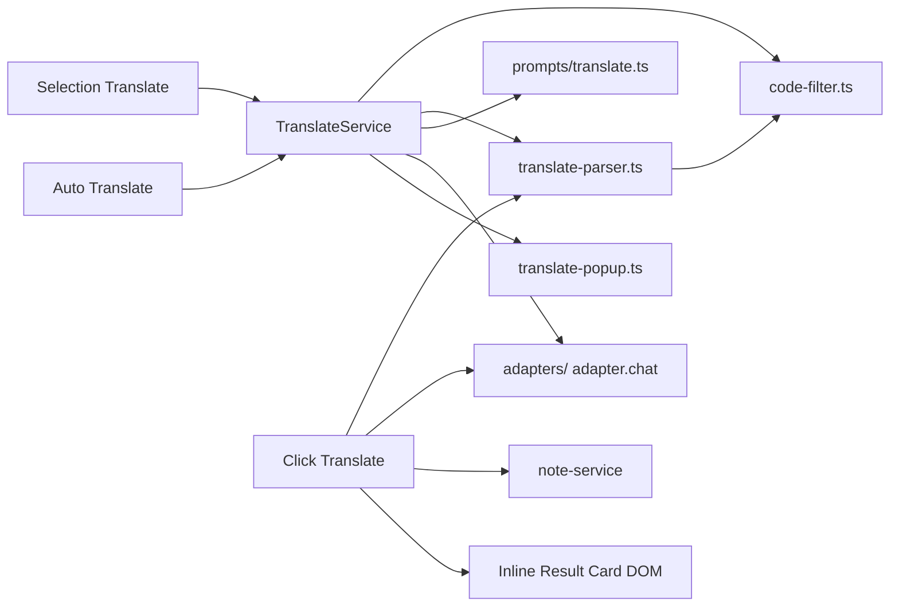
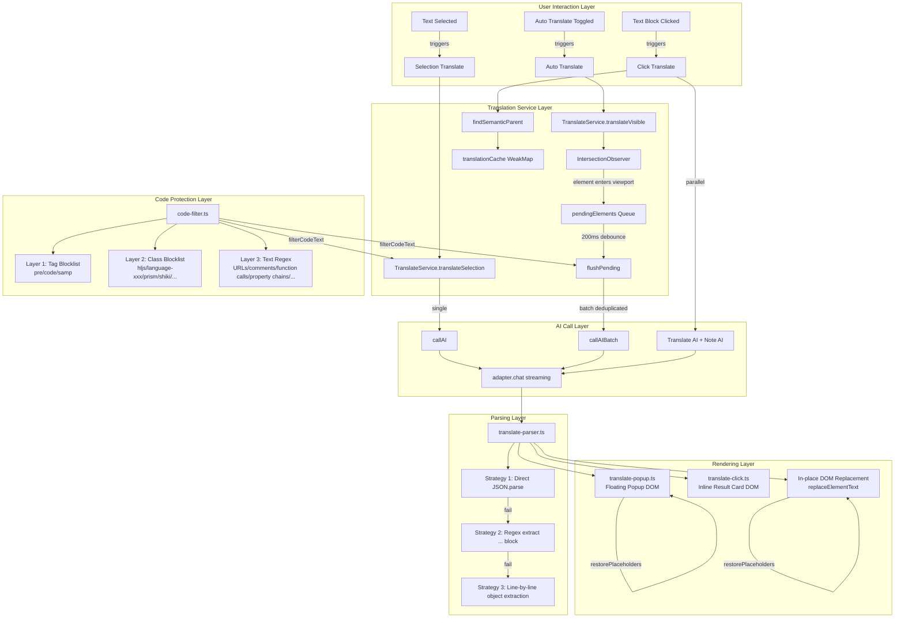

# Translation Module Architecture

> **🌐 中文版本：[translation.md](./translation.md)**

## Module Overview

The translation module provides three complementary page translation modes for AI Browser, seamlessly integrating AI translation capabilities into the user's browsing experience. All modes bypass the Phase1/Phase2 pipeline and directly invoke the AI adapter for streaming translation.

| Mode | Trigger | Typical Scenario | Interaction |
|------|---------|-----------------|-------------|
| **Selection Translate** | User selects text | Quick understanding of a local paragraph | Floating popup (translate-popup) |
| **Auto Translate** | Toggle switch | Full-page immersive reading | In-place DOM replacement |
| **Click Translate** | User clicks a text block | On-demand per-paragraph understanding | Inline result card below the element |

**Source Files**:

| File | Responsibility |
|------|---------------|
| `src/browser/translate-service.ts` | Translation service core (TranslateService class, AI calls + DOM replacement) |
| `src/browser/translate-popup.ts` | Selection translate floating popup UI (pure DOM, drag/resize/streaming updates) |
| `src/browser/translate-click.ts` | Click translate logic (semantic parent lookup + WeakMap cache + parallel translate + note) |
| `src/browser/translate-parser.ts` | AI response parser (three-layer fault tolerance: JSON.parse → regex extraction → line-by-line matching) |
| `src/browser/code-filter.ts` | Code filter (three-layer filtering: tag blocklist → class blocklist → text regex) |
| `src/input/prompts/translate.ts` | Translation prompts (system instructions + message construction) |

### Core Dependencies



## Architecture Design



## Core Type Definitions

### TranslateElement — Element Awaiting Translation

```typescript
/** A single element awaiting translation (internal interface in translate-service.ts) */
interface TranslateElement {
  id: string                    // Unique identifier from data-skeleton-id
  text: string                  // Extracted raw text (with inline code placeholders)
  el: HTMLElement               // DOM element reference
  inlineCodes: Map<string, string>  // Inline code mapping: {{ic_N}} → original code
}
```

### TranslateResult — Translation Result

```typescript
/** Batch translation result (exported from translate-service.ts + translate-parser.ts) */
interface TranslateResult {
  id: string        // Element id (format "e1", "e2", ...)
  translated: string // Translated text
}
```

### FilterResult — Code Filter Result

```typescript
/** Code filter result (exported from code-filter.ts) */
interface FilterResult {
  text: string                    // Filtered text (code replaced with {{code_N}} placeholders)
  placeholders: Map<string, string>  // Placeholder mapping: {{code_N}} → original code snippet
}
```

### TranslateService Internal State

```typescript
class TranslateService {
  private translatedList: Array<{ id: string; original: string; translated: string }>
  private abortController: AbortController | null
  private isTranslating: boolean
  private observer: IntersectionObserver | null
  private pendingElements: TranslateElement[]
  private observedIds: Set<string>
  private pendingTimer: ReturnType<typeof setTimeout> | null
  private currentTargetLang: string
  private currentSettings: AppSettings | null
  private currentModelId: string | undefined
}
```

### Click Translate Cache Structure

```typescript
// WeakMap keyed by source element; automatically cleaned up when element is GC'd
translationCache: WeakMap<HTMLElement, {
  translated: string       // Translated text
  noteContent: string      // Note markdown
  resultEl: HTMLElement    // Result card DOM element
}>
```

## Implementation Details

### 1. TranslateService Class (translate-service.ts)

The translation service is the core of the entire module, managing the full translation lifecycle: extract text → filter code → call AI → replace DOM. It automatically deduplicates — already-translated elements are not translated again.

#### 1.1 translateSelection — Selection Translate

Single-text translation flow: code filtering → AI call → placeholder restoration.

```typescript
async translateSelection(
  text: string, targetLang: string, settings: AppSettings, modelId?: string
): Promise<string> {
  // 1. Code filtering: inline code replaced with {{code_N}} placeholders
  const { text: filtered, placeholders } = filterCodeText(text)

  // 2. Call AI (stream and collect full result)
  const translated = await this.callAI(filtered, targetLang, settings, false, modelId)

  // 3. Placeholder restoration: {{code_N}} → original code
  const result = restorePlaceholders(translated, placeholders)
  return result
}
```

#### 1.2 translateVisible — Auto Translate Entry Point

Uses `IntersectionObserver` to implement a lazy strategy where elements are only translated when they enter the viewport. `translateIncremental()` is an alias (for interface compatibility).

```typescript
async translateVisible(targetLang, settings, modelId?): Promise<number> {
  // 1. Tag all elements with skeletonId (ensure every element has a unique identifier)
  ensureAllSkeletonIds()

  // 2. Extract all text elements (not limited to viewport; observer will filter)
  const elements = this.extractAllTextElements()

  // 3. Filter already-translated elements (skip those already in translatedList)
  const newElements = elements.filter(el => !translatedIds.has(el.id))

  // 4. Initialize IntersectionObserver (if not already created)
  if (!this.observer) {
    this.observer = new IntersectionObserver(
      (entries) => this.onIntersection(entries),
      { rootMargin: '0px', threshold: 0 }
    )
  }

  // 5. Register new elements with observer (skip those already in queue or registered)
  for (const el of newElements) {
    if (pendingIds.has(el.id)) continue
    if (this.observedIds.has(el.id)) continue
    this.observer.observe(el.el)
    this.observedIds.add(el.id)
  }
}
```

#### 1.3 IntersectionObserver Callback

When an element enters the viewport, it is added to the pending translation queue. After a 200ms debounce, the batch is processed:

```typescript
private onIntersection(entries: IntersectionObserverEntry[]): void {
  for (const entry of entries) {
    if (!entry.isIntersecting) continue  // Element left viewport → skip

    const el = entry.target as HTMLElement
    const id = el.dataset.skeletonId

    // Already translated or already in queue → unobserve
    if (translatedIds.has(id) || pendingElements.some(p => p.id === id)) {
      this.observer?.unobserve(el)
      continue
    }

    // Extract text (with inline code placeholders)
    const { text, inlineCodes } = this.getDirectTextWithCodes(el)
    if (!text || text.length < 2) { this.observer?.unobserve(el); continue }

    // Add to queue + unobserve
    this.pendingElements.push({ id, text, el, inlineCodes })
    this.observer?.unobserve(el)

    // Debounce 200ms then batch translate
    if (this.pendingTimer) clearTimeout(this.pendingTimer)
    this.pendingTimer = setTimeout(() => this.flushPending(), 200)
  }
}
```

#### 1.4 flushPending — Batch Translation Core

Deduplicate by text → batch AI call → backfill all elements with the same text:

```typescript
private async flushPending(): Promise<void> {
  const batch = [...this.pendingElements]
  this.pendingElements = []

  // If a translation is already in progress, re-enqueue
  if (this.isTranslating) {
    this.pendingElements.push(...batch)
    return
  }

  // Deduplicate by original text: identical text is only translated once
  const textGroupMap = new Map<string, {
    ids: string[]; elements: TranslateElement[]
    filtered: string; placeholders: Map<string, string>
  }>()

  for (const el of batch) {
    const existing = textGroupMap.get(el.text)
    if (existing) {
      existing.ids.push(el.id)
      existing.elements.push(el)
    } else {
      const { text: filtered, placeholders } = filterCodeText(el.text)
      textGroupMap.set(el.text, { ids: [el.id], elements: [el], filtered, placeholders })
    }
  }

  // Add loading spinner to all elements
  for (const el of batch) this.addLoadingMark(el.el)

  // Build deduplicated translation list (each unique text sent once, using first id as representative)
  const translateItems = [...textGroupMap.values()].map(g => ({
    id: g.ids[0], text: g.filtered
  }))

  // Call AI for batch translation
  const results = await this.callAIBatch(translateItems, targetLang, settings, signal, modelId)

  // Backfill translation results to all elements with the same text
  for (const { id, translated } of results) {
    const group = groupById.get(id)
    if (!group) continue
    const finalText = group.placeholders.size > 0
      ? restorePlaceholders(translated, group.placeholders)
      : translated
    for (const el of group.elements) {
      this.replaceElementText(el.el, finalText)
      this.removeLoadingMark(el.el)
      this.translatedList.push({ id: el.id, original: el.text, translated: finalText })
    }
  }
}
```

#### 1.5 getDirectTextWithCodes — Text Extraction with Inline Code Placeholders

Only traverses direct child nodes, without recursion: `<code>`/`<samp>` elements are replaced with `{{ic_N}}` placeholders, while other element children are skipped (so child elements get extracted and translated on their own). This way container elements (e.g., `<div>`) are not translated — only leaf elements (e.g., `<p>`) are.

```typescript
// Example: <p>The <code>AudioTrackButton</code> controls</p>
// → text: "The {{ic_01}} controls"
// → inlineCodes: { "{{ic_01}}": "AudioTrackButton" }
private getDirectTextWithCodes(el: HTMLElement): { text: string; inlineCodes: Map<string, string> } {
  let text = ''
  const inlineCodes = new Map<string, string>()
  let codeCounter = 0

  for (const node of el.childNodes) {
    if (node.nodeType === Node.TEXT_NODE) {
      text += node.textContent || ''
    } else if (node.nodeType === Node.ELEMENT_NODE) {
      const tag = (node as HTMLElement).tagName.toLowerCase()
      if (tag === 'code' || tag === 'samp') {
        codeCounter++
        const key = `{{ic_${String(codeCounter).padStart(2, '0')}}}`
        text += key
        inlineCodes.set(key, (node as HTMLElement).textContent?.trim() || '')
      }
      // Other element children → skip, do not recurse
    }
  }

  // Fallback: aria-label or title attribute
  if (!text) {
    text = el.getAttribute('aria-label') || el.getAttribute('title') || ''
  }
  return { text: text.trim().slice(0, 500), inlineCodes }
}
```

#### 1.6 replaceElementText — DOM Replacement (Preserving Inline Code Structure)

The translated text may contain `{{ic_N}}` placeholders. The translation is split by placeholders, the original `<code>` elements are preserved, and only text nodes are replaced:

```typescript
// Original DOM: <p>The <code>AudioTrackButton</code> controls</p>
// Translation: "should appear in the {{ic_01}} controls"
// Result: <p>should appear in the <code>AudioTrackButton</code> controls</p>
private replaceElementText(el: HTMLElement, translated: string): void {
  // No inline code → directly replace the first textNode
  if (!/\{\{ic_(\d{2})\}\}/.test(translated)) {
    this.replaceFirstTextNode(el, translated)
    return
  }

  // Has inline code: split translation by placeholders, rebuild child nodes
  const parts = translated.split(/\{\{ic_(\d{2})\}\}/)
  // parts: ["should appear in the ", "01", " controls"]  (odd indices are placeholder numbers)

  // Collect original <code>/<samp> elements (recursive collection, in order)
  const codeElements: HTMLElement[] = []
  const collectCodes = (node: Node) => { /* recursively collect code/samp elements */ }
  for (const node of el.childNodes) collectCodes(node)

  // Clear element, rebuild: text + placeholder-mapped <code>
  while (el.firstChild) el.removeChild(el.firstChild)
  for (let i = 0; i < parts.length; i++) {
    if (i % 2 === 0) {
      // Text part
      if (parts[i]) el.appendChild(document.createTextNode(parts[i]))
    } else {
      // Placeholder number → insert original <code> element
      const idx = parseInt(parts[i], 10) - 1
      if (idx >= 0 && idx < codeElements.length) {
        el.appendChild(codeElements[idx])
      }
    }
  }
}
```

#### 1.7 extractAllTextElements — Element Scanning with Parent-Child Deduplication

```typescript
private extractAllTextElements(): TranslateElement[] {
  // 1. Traverse all elements, filter layer by layer
  for (const el of document.body.querySelectorAll('*:not(script,style,noscript,meta,link,br,hr)')) {
    if (isCodeElement(htmlEl)) { skippedCode++; continue }       // Layer 1+2 code filtering
    if (!this.isElementVisible(htmlEl)) { skippedInvisible++; continue }  // Visibility check
    // Extract text, skip empty text, pure numbers/symbols
    if (!text || text.length < 2) { skippedText++; continue }
    if (/^[\d\s.,%+\-*/=<>]+$/.test(text)) { skippedText++; continue }
    candidates.push({ id, text, el: htmlEl, inlineCodes })
  }

  // 2. Parent-child deduplication: when parent and child text are identical, keep only the parent
  for (const c of candidates) {
    let dominated = false
    let parent = c.el.parentElement
    while (parent) {
      const pCandidate = candidates.find(x => x.id === parent.dataset.skeletonId)
      if (pCandidate && pCandidate.text === c.text) { dominated = true; break }
      parent = parent.parentElement
    }
    if (!dominated) elements.push(c)
  }
}
```

#### 1.8 Other Methods

- **`abort()`**: Cancels an in-progress translation (AbortController.abort() + clear timers)
- **`restoreAll()`**: Restores original text (iterates `translatedList`, finds elements by `data-skeleton-id` and restores the original text)
- **`reset()`**: Resets state (called on page navigation, clears all lists + disconnects observer)
- **`addLoadingMark()`**: Adds a 12px spinning loader to an element (CSS `@keyframes aib-tl-spin`), only added to elements that have direct text nodes
- **`getModel()`**: Model selection (modelId takes priority, otherwise uses defaultModelId, falls back to models[0])
- **`buildMessages()`**: Merges `TRANSLATE_SYSTEM_PROMPT` + user content into a single user message

### 2. translate-popup.ts — Selection Translate Popup

A pure-DOM floating popup with no Vue dependency — lightweight and independent of Shadow DOM.

#### 2.1 Popup Lifecycle

```typescript
// Show → loading state (creates full DOM structure)
showTranslateLoading(x, y, original)

// Update → hides loading, shows translation + toolbar
updateTranslateResult(translated)

// Streaming update → appends incremental text (translation and note update independently)
updateTranslateStreaming(delta, full)   // Translation content streaming
updateNoteStreaming(delta, full)        // Note content streaming (plain text append to avoid frequent markdown re-render)

// Final note → markdown rendering (renderMarkdown)
updateNoteResult(note, onBookmark)

// Error → shows error message + retry/close buttons
updateTranslateError(message, onRetry)

// Show translation directly (composite call: showTranslateLoading + updateTranslateResult)
showTranslatePopup(x, y, translated, original)

// Close → cleans up DOM + drag event listeners
hideTranslatePopup()
```

#### 2.2 Popup DOM Structure

```
┌─────────────────────────────────────┐
│  ≡ Drag Handle (28px)       [✕ Close] │  ← Drag to move + resize in four directions
├─────────────────────────────────────┤
│                                     │
│  Translation Content (contentEl)    │  ← Updated by updateTranslateResult
│                                     │
│  ─────────────────────────────────  │
│  Original (12px, textSoft color)    │  ← Original selected text
│                                     │
│  ─────────────────────────────────  │
│  📝 AI Note (noteContentEl)        │  ← Rendered by updateNoteResult with markdown
│  .aib-msg-text styles               │
│                                     │
│  ─────────────────────────────────  │
│  Processing... (loadingEl)          │  ← Dot animation aib-dot-blink
│                                     │
├─────────────────────────────────────┤
│  [Copy]  [⭐ Bookmark Note] (toolbar)│  ← Toolbar (shown when result is ready)
└─────────────────────────────────────┘
```

The popup defaults to 560px wide, with an 8px offset from the selection, and a z-index of `2147483646` (near maximum).

#### 2.3 Drag and Resize

Implemented via `mousedown`/`mousemove`/`mouseup` events:

```typescript
// Drag: top drag handle mousedown → record offset → mousemove updates left/top
dragHandle.addEventListener('mousedown', (e) => {
  isDragging = true
  dragOffsetX = e.clientX - rect.left
  dragOffsetY = e.clientY - rect.top
})

// Resize: four-direction resize handles (left/right/top/bottom) → mousemove updates width/height
// Right resize: width = resizeStartWidth + dx
// Left resize: width = resizeStartWidth - dx, left adjusted accordingly
// Bottom resize: height = resizeStartHeight + dy
// Top resize: height = resizeStartHeight - dy, top adjusted accordingly
// Minimum width 200px, minimum height 100px
```

Resize handles are 6px-wide/high transparent divs positioned outside the popup edges (`position: absolute`), with `cursor: col-resize/row-resize` to indicate functionality.

#### 2.4 Positioning Strategy

```typescript
function positionPopup(popup, x, y): void {
  let left = x
  let top = y + OFFSET  // Default: 8px below the selection

  // Boundary detection: stay within viewport (12px margin on all sides)
  if (left + rect.width > vpWidth - 12) left = vpWidth - rect.width - 12
  if (left < 12) left = 12
  if (top + rect.height > vpHeight - 12) top = y - rect.height - OFFSET  // Flip above selection if not enough space
  if (top < 12) top = 12
}
```

#### 2.5 Toolbar

- **Copy button**: `navigator.clipboard.writeText()`, shows "Copied" for 1.5 seconds after click
- **Bookmark Note button**: Calls `onBookmark(currentNoteContent)` callback, dispatches a `CustomEvent('aib-bookmark-note')` event
- Button styles follow theme variables (`--aib-primary`, `--aib-bg-hover`, etc.), changing color on hover

### 3. translate-click.ts — Click Translate

Click a text block → find semantic parent → show inline translation/note result card below. Click again to hide (without deleting), third click shows cached result.

#### 3.1 findSemanticParent — Semantic Parent Lookup

Traverses upward from the click target through the DOM tree to find the nearest "semantic block element":

```typescript
function findSemanticParent(target: HTMLElement): HTMLElement | null {
  let el = target
  while (el) {
    // Skip extension UI itself (.aib-click-result)
    if (el.classList.contains('aib-click-result')) return null

    // Table → return the entire <table>
    if (['TD','TH','TR','THEAD','TBODY','TFOOT'].includes(tag)) {
      return el.closest('table')
    }

    // Definition list → return <dl>
    if (['DT','DD'].includes(tag)) return el.closest('dl')

    // List item → return <ol>/<ul> for multi-item lists, <li> itself for single items
    if (tag === 'LI') {
      const list = el.closest('ol, ul')
      if (list && list.querySelectorAll(':scope > li').length > 1) return list
      return el
    }

    // Block element → determine if it's a layout container or a leaf content block
    if (BLOCK_TAGS.has(tag)) {
      if (isLayoutContainer(el)) return findNearestLeafIn(el, target)  // Container → find nearest leaf downward
      return el  // Leaf → return directly
    }

    // Inline element → continue upward
    if (INLINE_TAGS.has(tag)) { el = el.parentElement; continue }

    return el
  }
}
```

Helper functions:

- **`isLeafContentBlock(el)`**: Returns true directly for known tags (P, H1-H6, BLOCKQUOTE, etc.); otherwise checks whether the element has no block-level children
- **`isLayoutContainer(el)`**: Returns false directly for known tags; otherwise counts block-level children — 2 or more indicates a layout container
- **`findNearestLeafIn(container, target)`**: From target, walks upward to find a direct child of container, or returns the first block-level child of container

#### 3.2 Caching Mechanism

Uses a `WeakMap` keyed by the source element to cache translation results. When the element is garbage-collected, the cache is automatically cleaned up:

```typescript
const translationCache = new WeakMap<HTMLElement, {
  translated: string; noteContent: string; resultEl: HTMLElement
}>()

// Click logic:
// 1. Has cache and currently shown → hide (display: none), set data-aib-click-hidden="true"
// 2. Has cache and currently hidden → show (display: ''), set data-aib-click-hidden="false"
// 3. No cache → create result container → store empty cache to prevent duplicate requests → request AI
```

#### 3.3 Parallel Translation + Notes

Translation and notes run in parallel via `Promise.allSettled`, each independently streaming UI updates:

```typescript
const tasks: Promise<void>[] = []

if (isTranslate) {
  tasks.push((async () => {
    const adapter = createAdapter(model.provider)
    let raw = ''
    await adapter.chat({ ... }, (chunk: StreamChunk) => {
      if (chunk.delta) {
        raw += chunk.delta
        fillTranslateStreaming(resultEl, raw)  // Real-time translation area update
      }
    })
    const translated = parseSingleTranslation(raw)
    cached.translated = translated
    fillResult(resultEl, cached.translated, cached.noteContent, onBookmark)
  })())
}

if (isNote) {
  tasks.push((async () => {
    const noteContent = await optimizeAsNoteStream(text, settings, (delta, full) => {
      fillNoteStreaming(resultEl, full)  // Real-time note area update
    }, modelId)
    cached.noteContent = noteContent
    fillResult(resultEl, cached.translated, cached.noteContent, onBookmark)
  })())
}

await Promise.allSettled(tasks)
```

**Error handling strategy**:
- Both fail → show error + refresh button, clear cache
- Only translation fails → translation area shows a "Translation failed" notice, note still available
- Only note fails → handled silently, translation result still displayed

#### 3.4 Result Card DOM Structure

```
┌──────────────────────────────────────┐
│                              [✕]     │  ← Close button in top-right corner
│  Processing...                       │  ← Loading animation
│                                      │
│  Translation Content (.aib-click-result-content) │  ← Translation result
│                                      │
│  ──────────────────────────────────  │
│  📝 AI Note                         │  ← Note area (markdown rendered)
│  Note Content (.aib-click-result-note)│
│                                      │
│  ──────────────────────────────────  │
│  AI Translate · AI Note  [Copy] [⭐] │  ← Bottom bar
└──────────────────────────────────────┘
```

CSS animation `aib-click-in`: transitions from `opacity:0 translateY(-4px)` to `opacity:1 translateY(0)` over 0.2s.

### 4. translate-parser.ts — AI Response Parsing

A three-layer fault-tolerant parsing strategy to handle inconsistent AI output formats.

#### 4.1 parseTranslateResponse — Batch Parsing (Auto Translate Scenario)

```typescript
export function parseTranslateResponse(raw: string): TranslateResult[] {
  const trimmed = raw.trim()
  if (!trimmed) return []

  // Strategy 1: Direct JSON.parse (AI returns a pure JSON array)
  try {
    const arr = JSON.parse(trimmed)
    if (Array.isArray(arr)) {
      const results = validateResults(arr)
      if (results.length > 0) return results
    }
  } catch { /* continue */ }

  // Strategy 2: Regex extract [...] blocks (AI returns JSON with explanatory text before/after)
  const jsonBlocks = trimmed.match(/\[[\s\S]*?\]/g)
  if (jsonBlocks) {
    // Try from the last match (most likely to be the complete array)
    for (let i = jsonBlocks.length - 1; i >= 0; i--) {
      try {
        const arr = JSON.parse(jsonBlocks[i])
        if (Array.isArray(arr)) {
          const results = validateResults(arr)
          if (results.length > 0) return results
        }
      } catch { /* continue */ }
    }
  }

  // Strategy 3: Line-by-line extraction of {"id":"eN","translated":"..."} objects
  const results: TranslateResult[] = []
  const lineRegex = /\{\s*"id"\s*:\s*"(e\d+)"\s*,\s*"translated"\s*:\s*"((?:[^"\\]|\\.)*)"\s*\}/g
  let m: RegExpExecArray | null
  while ((m = lineRegex.exec(trimmed)) !== null) {
    results.push({ id: m[1], translated: unescapeJson(m[2]) })
  }
  return results
}
```

#### 4.2 parseSingleTranslation — Single Parsing (Selection/Click Translate Scenario)

```typescript
export function parseSingleTranslation(raw: string): string {
  const trimmed = raw.trim()

  // 1. Try JSON parsing { translated: "..." }
  try {
    const obj = JSON.parse(trimmed)
    if (typeof obj === 'object' && obj !== null && typeof obj.translated === 'string') {
      return obj.translated
    }
  } catch { /* continue */ }

  // 2. Regex extract "translated": "..." field
  const m = trimmed.match(/"translated"\s*:\s*"((?:[^"\\]|\\.)*)"/)
  if (m) return unescapeJson(m[1])

  // 3. Strip common prefix/suffix explanatory text
  let text = trimmed
  text = text.replace(/^(以下是|这是|翻译结果[：:])\s*/i, '')
  text = text.replace(/\s*(希望|以上).*$/i, '')
  return text
}
```

#### 4.3 validateResults — Result Validation

```typescript
function validateResults(arr: unknown[]): TranslateResult[] {
  return arr.filter((item): item is TranslateResult =>
    typeof item === 'object' && item !== null &&
    typeof (item as any).id === 'string' &&
    typeof (item as any).translated === 'string' &&
    /^e\d+$/.test((item as any).id)  // id format: e1, e2, e3...
  )
}
```

#### 4.4 unescapeJson — JSON Unescaping

```typescript
function unescapeJson(s: string): string {
  try {
    return JSON.parse(`"${s}"`)  // Leverage JSON.parse to handle escape sequences
  } catch {
    return s  // Return original string on parse failure
  }
}
```

### 5. code-filter.ts — Code Filter

A three-layer filtering mechanism to prevent code from being incorrectly translated by AI. After translation, original code is restored via placeholder backfill.

#### 5.1 Layer 1 — Tag Blocklist

```typescript
const CODE_TAGS = new Set(['pre', 'code', 'samp'])

// isCodeElement() logic:
// <pre> → skip directly (pure code block)
// <code> → skip when parent is <pre>; standalone <code> blocks (no text sibling nodes) are also skipped
//           Inline <code> (e.g., <p>text <code>code</code> text</p>) is NOT skipped
// <samp> → skip directly
```

#### 5.2 Layer 2 — Class Blocklist

```typescript
const CODE_CLASS_KEYWORDS = [
  'hljs',        // highlight.js
  'language-',   // Prism.js / generic language marker
  'code-block',  // Generic code block
  'highlight',   // Highlighted code
  'syntax',      // Syntax highlighting
  'prism',       // Prism.js
  'shiki',       // Shiki highlighter
  'codemirror',  // CodeMirror editor
  'ace_',        // Ace editor
]

// className.toLowerCase() contains any of these keywords → skip
```

#### 5.3 Layer 3 — Text Regex Fallback

Code characteristic regexes ordered by priority (match longer patterns first to avoid truncation by shorter patterns):

| Priority | Pattern | Label | Example |
|----------|---------|-------|---------|
| 1 | `/* ... */` | block-comment | `/* multi line comment */` |
| 2 | `` `...` `` | backtick | `` `template string` `` |
| 3 | `// ...` | line-comment | `// single line comment` |
| 4 | `https?://...` | url | `https://example.com/path` |
| 5 | `$`/`>`/`#` prefixed lines | cli | `$ npm install react` |
| 6 | `{ "key": ... }` | json | `{"name":"value"}` |
| 7 | `foo(...)` | func-call | `getElementById('x')` |
| 8 | `obj.prop.method` | prop-chain | `window.location.href` |
| 9 | `{...}` | brace-block | `{ key: value }` |
| 10 | `[...]` | bracket-block | `[1, 2, 3]` |
| 11 | Consecutive programming keywords | keywords | `const x = function() {}` |
| 12 | `x.y.z` version numbers | version | `1.2.3-beta` |
| 13 | `/path/to/file` | filepath | `/src/utils/logger.ts` |

**Chinese protection**: If a match is purely Chinese content (CJK unified ideographs `一-鿿` range + Chinese punctuation), the replacement is skipped to avoid false positives on Chinese brackets/braces.

#### 5.4 Placeholder Mechanism

Two placeholder systems work in parallel:

| Placeholder Format | Generated By | Purpose |
|-------------------|-------------|---------|
| `{{code_N}}` | code-filter.ts `filterCodeText()` | Code snippets matched by Layer 3 text regex |
| `{{ic_N}}` | translate-service.ts `getDirectTextWithCodes()` | Inline `<code>`/`<samp>` DOM elements |

```typescript
// filterCodeText: code → placeholder
const { text, placeholders } = filterCodeText("Visit https://example.com for docs")
// text: "Visit {{code_01}} for docs"
// placeholders: Map { "{{code_01}}" → "https://example.com" }

// restorePlaceholders: placeholder → original code
const result = restorePlaceholders("Visit {{code_01}} for documentation", placeholders)
// result: "Visit https://example.com for documentation"
```

Each regex uses `new RegExp(pattern.source, pattern.flags)` to reset `lastIndex`, ensuring correctness of global regexes.

## Data Flow

### Auto Translate Flow

```mermaid
sequenceDiagram
    participant U as User
    participant TS as TranslateService
    participant IO as IntersectionObserver
    participant CF as code-filter
    participant AI as AI Adapter
    participant PR as translate-parser
    participant DOM as Page DOM

    U->>TS: translateVisible(targetLang, settings)
    TS->>DOM: ensureAllSkeletonIds() tag all elements
    TS->>DOM: extractAllTextElements() scan all elements
    Note over TS: Filter: code elements / invisible / no text / pure numbers / parent-child dedup
    DOM-->>TS: TranslateElement[] new element list

    loop For each new element
        TS->>IO: observe(element)
        TS->>TS: observedIds.add(id)
    end

    Note over IO: User scrolls the page, new elements enter the viewport...

    IO->>TS: onIntersection(entries)
    loop For each isIntersecting entry
        TS->>TS: getDirectTextWithCodes(el) extract text
        TS->>TS: pendingElements.push(element)
        TS->>IO: unobserve(el)
    end
    TS->>TS: 200ms debounce timer

    Note over TS: After 200ms...

    TS->>TS: flushPending()
    TS->>DOM: addLoadingMark() add spinning loader
    TS->>TS: Deduplicate by original text (identical text translated only once)
    TS->>CF: filterCodeText(filtered) code filtering
    CF-->>TS: { text, placeholders }

    TS->>AI: callAIBatch(items, targetLang) streaming batch translation
    Note over AI: adapter.chat() → stream and collect deltas
    AI-->>PR: Complete AI response text
    PR->>PR: Strategy 1: JSON.parse → Strategy 2: Regex [...] → Strategy 3: Line-by-line
    PR-->>TS: TranslateResult[]

    loop For each translation result
        TS->>CF: restorePlaceholders(translated, placeholders)
        CF-->>TS: Final translated text
        loop For all elements with the same text
            TS->>DOM: replaceElementText(el, finalText)
            Note over DOM: Has {{ic_N}} → split and rebuild preserving &lt;code&gt;<br/>No {{ic_N}} → replace first textNode
            TS->>DOM: removeLoadingMark(el)
            TS->>TS: translatedList.push({ id, original, translated })
        end
    end
```

### Click Translate Flow

```mermaid
sequenceDiagram
    participant U as User
    participant CT as translate-click
    participant SP as findSemanticParent
    participant Cache as translationCache
    participant AI as AI Adapter (translate)
    participant NS as note-service (notes)
    participant DOM as Page DOM

    U->>CT: click(event)
    CT->>CT: isInExtensionUI(target) check
    Note over CT: Inside popup/result card/Shadow DOM → ignore

    CT->>SP: findSemanticParent(target)
    SP->>SP: Traverse upward through DOM tree
    Note over SP: Table elements → &lt;table&gt;<br/>Definition lists → &lt;dl&gt;<br/>List items → &lt;ol&gt;/&lt;ul&gt; (multi-item)<br/>Layout containers → findNearestLeafIn<br/>Leaf blocks → return directly
    SP-->>CT: blockEl (semantic parent) | null

    CT->>Cache: get(blockEl)

    alt Has cache and currently shown
        CT->>DOM: resultEl.style.display = 'none'
        CT->>DOM: blockEl.data-aib-click-hidden = 'true'
    else Has cache and currently hidden
        CT->>DOM: resultEl.style.display = ''
        CT->>DOM: blockEl.data-aib-click-hidden = 'false'
    else No cache
        CT->>DOM: createResultContainer()
        CT->>DOM: insertAfter(blockEl, resultEl)
        CT->>Cache: set(blockEl, { translated:'', noteContent:'', resultEl })

        par Run translation and notes in parallel
            CT->>AI: adapter.chat() translate
            AI-->>CT: Streaming delta
            CT->>DOM: fillTranslateStreaming(resultEl, raw) real-time update
            CT->>CT: parseSingleTranslation(raw) parse
            CT->>Cache: cached.translated = translated
            CT->>DOM: fillResult() final render
        and
            CT->>NS: optimizeAsNoteStream() notes
            NS-->>CT: Streaming delta
            CT->>DOM: fillNoteStreaming(resultEl, full) real-time update
            CT->>Cache: cached.noteContent = noteContent
            CT->>DOM: fillResult() final render
        end

        Note over CT: Promise.allSettled waits for both to complete
        CT->>CT: Error handling (both fail / one fails / both succeed)
    end
```

## Configuration and Extension

### Settings

| Config | Type | Description |
|--------|------|-------------|
| `translateMode` | `'selection' \| 'auto' \| 'click'` | Translation mode |
| `noteMode` | `'click' \| ...` | Note mode |
| `translateTargetLang` | `string` | Target language (default `'Chinese'`) |
| `defaultModelId` | `string` | Default AI model ID |
| `models` | `Model[]` | Model list (with provider/baseUrl/apiKey/modelName) |

### Runtime Constants

| Constant | Value | Description |
|----------|-------|-------------|
| `DEFAULT_WIDTH` | 560px | Default popup width |
| `OFFSET` | 8px | Gap between popup and selection |
| Debounce interval | 200ms | IntersectionObserver callback debounce |
| Text truncation | 500 chars | Max text length per element in `getDirectTextWithCodes` |
| Minimum text | 2 chars | Text shorter than this is not translated |

### Prompt Configuration

Translation prompts are defined in `src/input/prompts/translate.ts`:

```typescript
// System instruction: strictly translate only natural language, preserve {{code_N}} placeholders as-is
TRANSLATE_SYSTEM_PROMPT = "You are a professional translator. Strictly follow these rules: ..."

// Selection translate user message
buildSelectionTranslateMessage(text, targetLang)
// → "Translate the following text to {targetLang}, return only the translation:\n\n{text}"

// Batch translate user message (JSON array format)
buildAutoTranslateMessage(texts, targetLang)
// → "Translate the following texts to {targetLang}. Return a JSON array... Input:\n{JSON.stringify(texts)}"
```

### Extension Points

1. **Add a new translation mode**: Add a new method in `TranslateService`, reusing the `callAI`/`callAIBatch` + `filterCodeText`/`restorePlaceholders` pipeline.
2. **Custom code filtering rules**: Append new regex objects `{ pattern, label }` to the `CODE_PATTERNS` array in `code-filter.ts`.
3. **Custom parsing strategies**: Add a new strategy layer (after the existing three) in `translate-parser.ts`'s `parseTranslateResponse`.
4. **Popup style customization**: `translate-popup.ts` reads CSS variables via `getThemeVar()` (e.g., `--aib-primary`, `--aib-bg-card`), automatically following the theme.
5. **Note feature extension**: The note portion of click translate is implemented via `note-service.ts`'s `optimizeAsNoteStream()`, which can be independently extended for note generation logic.

## Known Limitations

1. **No chunking for batch translation**: `callAIBatch` sends all deduplicated text to the AI in one request. Large volumes of text may exceed the model's context window. A `chunk()` helper is defined in `TranslateService` but is not yet called.
2. **Conservative parent-child deduplication**: Only deduplicates when parent and child text are identical. If a parent's `innerText` is the concatenation of its children (e.g., `<div><p>A</p><p>B</p></div>` has `innerText` of `"A\nB"`), deduplication does not occur, which may cause container elements to be translated as well.
3. **IntersectionObserver does not cross iframes**: Only elements in the main document are observed. Text inside iframes will not be automatically translated.
4. **Click translate cache is not persistent**: The `WeakMap` is keyed by DOM elements. Cache is lost on page refresh or DOM reconstruction.
5. **Code filter false positive risk**: Layer 3 regexes may incorrectly identify natural-language braces, brackets, etc. as code (mitigated by the pure-Chinese skip rule, but non-Chinese contexts still carry risk).
6. **No rollback for translation results**: `replaceElementText` directly modifies the DOM. If the number of `{{ic_N}}` placeholders in the AI response does not match the original, excess placeholders will remain visible as text on the page.
7. **Singleton popup**: `translate-popup.ts` has a single global `currentPopup`. Consecutive selection translations overwrite the previous result.
8. **Serial translation per batch**: `flushPending` re-enqueues the batch when `isTranslating=true`. Parallel translation requests are not supported.
9. **Loading marker cleanup**: The `finally` block globally cleans up via `document.querySelectorAll('.aib-tl-loading')`. If other parts of the page happen to have elements with the same class name, they may be accidentally removed.
10. **Click translate note area streaming render**: The streaming phase uses `textContent` plain-text append to avoid frequent markdown re-rendering. Only after the stream completes is `renderMarkdown()` called — intermediate stages do not support formatted display.
