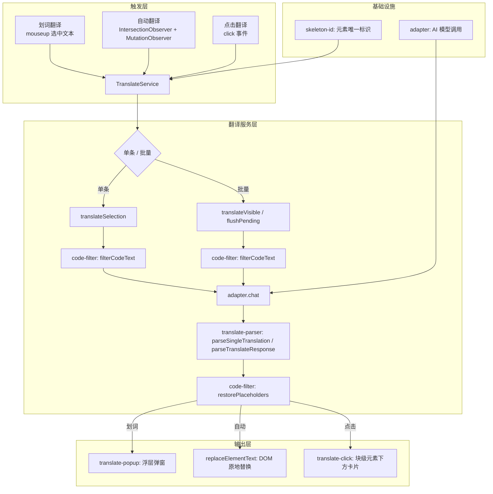
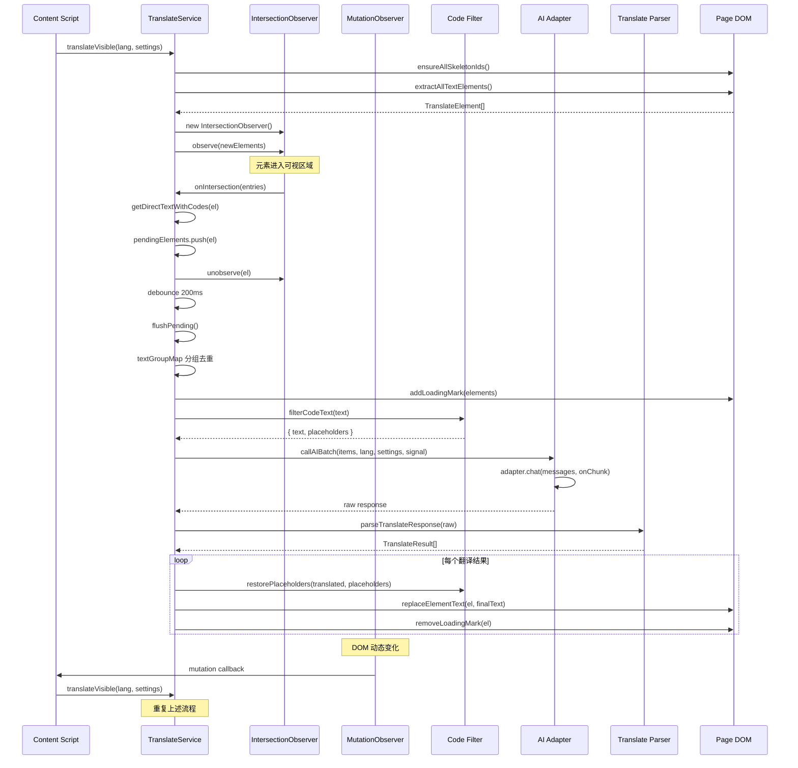
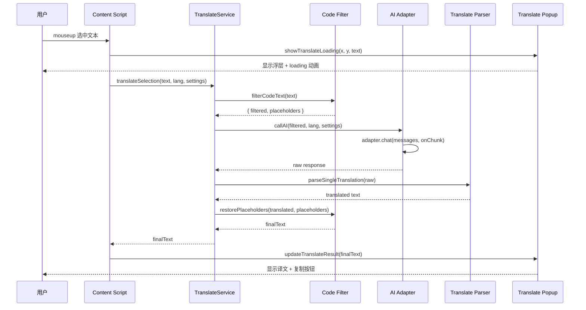
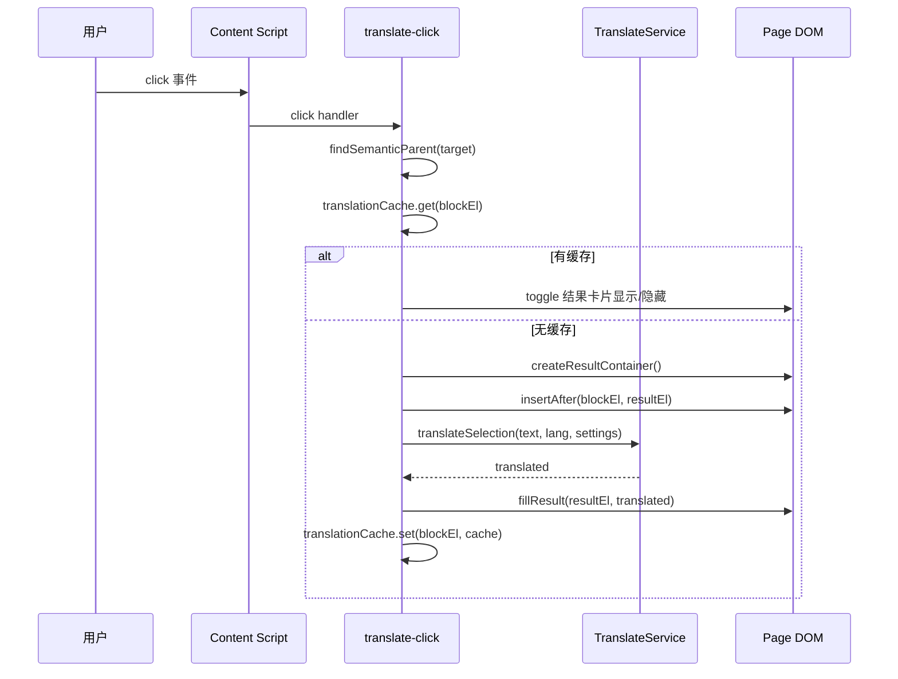
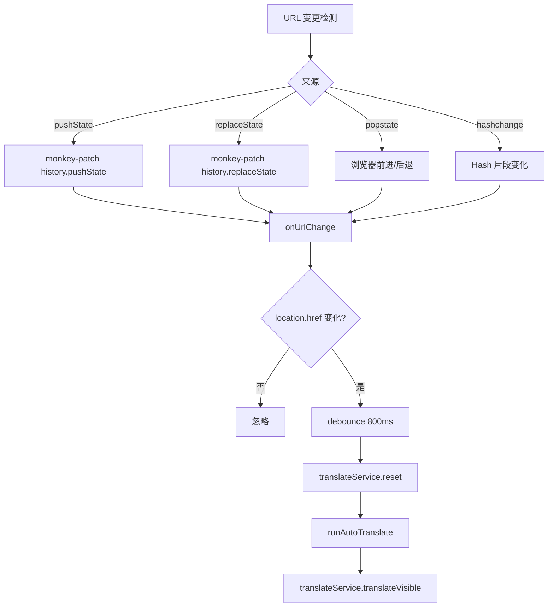

# 翻译功能架构

## 目标

提供三种翻译模式（划词/自动/点击），直接替换页面 DOM 文本。翻译服务绕过 Phase1/Phase2 AI 管道，直接调用 adapter 获取译文，实现轻量、低延迟的页面翻译体验。

## 架构总览



## 核心设计决策

### 1. 三种翻译模式

| 模式 | 触发方式 | 输出形式 | 核心场景 |
|------|----------|----------|----------|
| 划词 (selection) | mouseup 选中文本 | 选区附近浮层弹窗 | 用户主动选择片段翻译 |
| 自动 (auto) | IntersectionObserver 监听可视区域 + MutationObserver 监听 DOM 变化 | 直接替换页面 DOM 文本 | 全页沉浸式翻译 |
| 点击 (click) | click 事件，向上查找语义父级块 | 块级元素下方插入翻译卡片 | 按需逐段翻译 |

模式由 `AppSettings.translateMode` 控制，可选值：`'selection'`、`'auto'`、`'click'`、`'off'`（默认 `'off'`）。

### 2. TranslateService 绕过 Phase1/Phase2 管道

翻译服务不经过意图检测（Phase1）和操作决策（Phase2），直接调用 adapter。原因：

- 翻译是确定性操作，不需要 AI 判断意图
- 减少一次 AI 调用，降低延迟
- 翻译 prompt 独立于浏览器操作 prompt，避免上下文干扰

消息构建方式：将系统提示词（`TRANSLATE_SYSTEM_PROMPT`）和用户内容合并到单条 `user` 消息中，不使用 `system` 角色。

### 3. 自动翻译的 IntersectionObserver + MutationObserver 双监听

**IntersectionObserver** 负责可视区域元素的翻译调度：

- 配置 `{ rootMargin: '0px', threshold: 0 }`，元素进入可视区域即触发
- `extractAllTextElements()` 扫描全页所有元素（不限可视区域），由 observer 自动过滤不可见的
- 元素进入可视区域后加入 `pendingElements` 队列，立即 `unobserve`
- 防抖 200ms 后调用 `flushPending()` 批量翻译

**MutationObserver** 负责 DOM 动态变化的翻译触发：

- 监听 `document.body`，配置 `{ childList: true, subtree: true, characterData: true }`
- 过滤条件：`addedNodes.length > 0` 或 `type === 'characterData'`
- 防抖 200ms 后调用 `translateService.translateVisible()` 重新扫描
- 覆盖 SPA 路由切换、API 加载内容、Tab 切换等动态场景

### 4. 文本去重

两层去重机制，确保相同文本只翻译一次：

**层级 1 — 元素提取阶段**（`extractAllTextElements`）：

父子去重：从每个候选元素向上查找祖先，若祖先与后代文本完全相同，跳过后代。避免同时翻译 `<div>Hello</div>` 和其子元素 `<p>Hello</p>`。

**层级 2 — 批量翻译阶段**（`flushPending`）：

按原始文本分组（`textGroupMap`），相同文本只取第一个 id 发送给 AI。翻译结果回填到该文本对应的所有元素。例如页面上有 5 个 "Submit" 按钮，只发一次 AI 请求，5 个按钮全部替换。

### 5. 内联代码保留

页面中 `<code>`、`<samp>` 等内联代码元素需要在翻译后保留原始结构。

**提取阶段**（`getDirectTextWithCodes`）：

遍历元素的直接子节点：
- `textNode` → 直接拼接
- `<code>` / `<samp>` → 替换为 `{{ic_N}}` 占位符，记录原始代码到 `inlineCodes` Map
- 其他元素子节点 → 跳过（不递归，让子元素自己被提取翻译）

示例：`<p>The <code>AudioTrackButton</code> controls</p>` → `text: "The {{ic_01}} controls"`, `inlineCodes: {"{{ic_01}}": "AudioTrackButton"}`

**替换阶段**（`replaceElementText`）：

1. 检测译文是否包含 `{{ic_N}}` 占位符
2. 若有，按占位符拆分译文，收集原始 `<code>` / `<samp>` 元素
3. 清空元素内容，按顺序重建：文本部分用 `createTextNode`，占位符部分插入原始 `<code>` 元素
4. 若无占位符，直接替换第一个非空 textNode

### 6. 代码过滤

三层过滤机制，防止代码被 AI 错误翻译：

| 层级 | 机制 | 示例 |
|------|------|------|
| Layer 1: 标签黑名单 | `<pre>`、独立 `<code>`、`<samp>` 整体跳过 | 代码块不提取 |
| Layer 2: Class 黑名单 | `hljs`、`language-`、`highlight`、`prism` 等 | 语法高亮容器跳过 |
| Layer 3: 文本正则 | 注释、URL、函数调用、关键字等替换为 `{{code_NN}}` 占位符 | 内联代码片段保护 |

Layer 3 的正则模式按优先级排列（长模式优先），包括：块注释、反引号字符串、行注释、URL、CLI 命令、JSON 片段、函数调用、属性链、花括号/方括号块、连续编程关键字、版本号、文件路径。纯中文内容不做替换，避免误杀中文标点。

### 7. Loading 指示器

| 场景 | 实现 | 样式 |
|------|------|------|
| 自动翻译 | 元素末尾追加 `<span class="zwf-tl-loading">` | 12x12px 蓝色旋转圆圈，0.6s 线性旋转 |
| 划词翻译 | 浮层内 "翻译中..." 文字 + 动画省略号 | CSS `@keyframes zwf-dot-blink`，`steps(3, end)` |
| 点击翻译 | 结果卡片内 "翻译中..." + 动画省略号 | 同划词翻译的省略号动画 |

自动翻译的 loading 标记带 `translate="no"` 属性，防止被 AI 翻译。翻译完成或失败后自动移除。

## 详细实现

### TranslateService

**文件：** `src/browser/translate-service.ts`

核心类，管理翻译生命周期：提取文本 → 过滤代码 → 调用 AI → 替换 DOM。

```typescript
export class TranslateService {
  // 划词翻译：单条文本翻译，返回译文
  async translateSelection(
    text: string,
    targetLang: string,
    settings: AppSettings,
    modelId?: string,
  ): Promise<string>

  // 自动翻译：IntersectionObserver 监听所有文本元素
  // 元素进入可视区域 → 加入待翻译队列 → 防抖 200ms → 批量翻译
  async translateVisible(
    targetLang: string,
    settings: AppSettings,
    modelId?: string,
  ): Promise<number>

  // 处理待翻译队列：按文本去重后发给 AI，翻译结果回填到所有相同文本的元素
  private async flushPending(): Promise<void>

  // 替换元素文本（保留内联代码结构）
  // 译文中 {{ic_N}} 占位符 → 按占位符拆分 → 保留原始 <code> 元素
  private replaceElementText(el: HTMLElement, translated: string): void

  // 取消正在进行的翻译
  abort(): void

  // 还原所有翻译（关闭自动翻译时调用）
  restoreAll(): void

  // 重置状态（页面切换时调用）
  reset(): void
}
```

**内部类型：**

```typescript
interface TranslateElement {
  id: string                    // data-skeleton-id
  text: string                  // 提取的文本（最长 500 字符）
  el: HTMLElement
  inlineCodes: Map<string, string>  // {{ic_N}} → 原始代码
}

interface TranslateResult {
  id: string
  translated: string
}
```

### translate-popup.ts

**文件：** `src/browser/translate-popup.ts`

划词翻译浮层弹窗，纯 DOM 实现（不依赖 Vue），单例模式。

```typescript
// 显示翻译浮层（loading 状态）
function showTranslateLoading(x: number, y: number, original: string): void

// 更新翻译结果（AI 返回后调用）
function updateTranslateResult(translated: string): void

// 显示翻译错误（AI 调用失败时调用）
function updateTranslateError(message: string, onRetry?: () => void): void

// 隐藏翻译浮层
function hideTranslatePopup(): void
```

UI 结构：内容区（译文）→ 原文区（灰色小字）→ Loading 区（动画省略号）→ 工具栏（复制按钮，翻译完成后显示）。

定位策略：`positionPopup()` 测量弹窗尺寸，确保不超出视口（12px 边距），超出底部时翻转到选区上方。

自动关闭：`mousedown` 外部点击（延迟 100ms 注册避免立即关闭）+ `scroll` 事件（passive 监听）。

### translate-click.ts

**文件：** `src/browser/translate-click.ts`

点击翻译，点击页面文本区域 → 找到语义父级块元素 → 下方展示翻译卡片。

```typescript
function initClickTranslate(
  translateService: {
    translateSelection: (
      text: string,
      targetLang: string,
      settings: AppSettings,
      modelId?: string,
    ) => Promise<string>
  },
  getSettings: () => Promise<AppSettings | null>,
  getCurrentModelId?: () => Promise<string | undefined>,
): void
```

**语义父级查找算法（`findSemanticParent`）：**

从点击目标向上遍历 DOM：

1. `td/th/tr/thead/tbody/tfoot` → 找最近的 `<table>`
2. `dt/dd` → 找最近的 `<dl>`
3. `li`（多个）→ 找 `<ol>` / `<ul>`；单个 → 用 `<li>` 本身
4. 明确内容元素（p, h1-h6, blockquote...）→ 直接使用
5. 布局容器（div, section 有多个子块）→ 向下找离点击最近的叶子内容块
6. 内联元素 → 继续向上
7. 在 `.zwf-click-result` 内 → 返回 null（避免递归翻译）

**缓存：** `WeakMap<HTMLElement, { translated, resultEl }>`，元素从 DOM 移除后自动 GC。

**Toggle 行为：** 首次点击请求翻译；后续点击切换结果卡片的显示/隐藏。`data-zwf-click-hidden` 属性跟踪状态。

### translate-parser.ts

**文件：** `src/browser/translate-parser.ts`

翻译结果解析器，三层容错解析。

```typescript
// 批量翻译结果解析（自动翻译场景）
function parseTranslateResponse(raw: string): TranslateResult[]

// 单条翻译结果解析（划词翻译场景）
function parseSingleTranslation(raw: string): string
```

**`parseTranslateResponse` 三层容错：**

| 优先级 | 策略 | 说明 |
|--------|------|------|
| 1 | 直接 JSON.parse | AI 返回标准 JSON 数组 |
| 2 | 正则提取 `[...]` 块 | AI 返回 JSON 前后有说明文字，从最后一个匹配开始尝试 |
| 3 | 逐行提取 `{id, translated}` 对象 | AI 返回非标准格式，用正则逐行匹配 |

**`parseSingleTranslation` 解析策略：**

1. 尝试 JSON.parse，提取 `.translated` 字段
2. 正则匹配 `"translated": "..."`
3. 去除常见前后缀（"以下是"、"翻译结果："、"希望..."、"以上..."）

### code-filter.ts

**文件：** `src/browser/code-filter.ts`

代码过滤器，三层过滤机制防止代码被翻译。

```typescript
// 判断元素是否是纯代码容器（Layer 1 + Layer 2）
function isCodeElement(el: HTMLElement): boolean

// 过滤文本中的代码，替换为 {{code_NN}} 占位符（Layer 3）
function filterCodeText(text: string): FilterResult

// 将占位符回填为原始代码
function restorePlaceholders(text: string, placeholders: Map<string, string>): string
```

```typescript
interface FilterResult {
  text: string                      // 过滤后文本（含占位符）
  placeholders: Map<string, string> // 占位符映射：{{code_NN}} → 原始代码
}
```

## 数据流

### 自动翻译完整流程



### 划词翻译流程



### 点击翻译流程



## URL 变更处理

SPA 应用的 URL 变更不会触发页面刷新，需要主动检测并重新翻译。



**`reset()` 清理内容：**
- `translatedList` 清空
- `pendingElements` 清空
- `observedIds` 清空
- IntersectionObserver 断开
- AbortController 中止

## 错误处理

| 场景 | 处理方式 |
|------|----------|
| AI 调用失败 | 划词：`updateTranslateError` 显示错误 + 重试按钮；点击：`fillError` + 重试按钮 |
| AI 返回空结果 | 视为失败，显示 "翻译失败" + 重试 |
| AbortError | 静默忽略，清除所有 loading 标记 |
| 其他异常 | 日志记录，清除 loading 标记 |
| 翻译进行中新请求 | 自动翻译：重新入队等待；划词/点击：独立 AbortController |
| Observer 断开 | `disconnectObserver()` 清理引用；`reset()` / `restoreAll()` 自动调用 |

**AbortController 生命周期：**
- `flushPending()` 开始时创建
- `callAIBatch()` 将 `signal` 传递给 `adapter.chat()`
- `flushPending()` 结束（成功/失败/中止）后置 null
- `abort()` 主动中止：调用 `controller.abort()`，清除定时器，重置 `isTranslating`

## 设置变更响应

| 变更 | 响应 |
|------|------|
| `translateMode` → `'auto'` | 立即调用 `runAutoTranslate()` |
| `translateMode` 从 `'auto'` 切换为其他 | 调用 `translateService.restoreAll()` 还原所有译文 |
| `translateTargetLang` 变化 | 下次翻译使用新语言（已翻译内容不自动刷新） |

## 文件清单

| 文件 | 职责 |
|------|------|
| `src/browser/translate-service.ts` | 翻译服务核心：IntersectionObserver、批量调度、去重、AI 调用、DOM 替换 |
| `src/browser/translate-popup.ts` | 划词翻译浮层弹窗（纯 DOM、单例） |
| `src/browser/translate-click.ts` | 点击翻译：语义父级查找、toggle、WeakMap 缓存 |
| `src/browser/translate-parser.ts` | 三层容错 JSON 解析 |
| `src/browser/code-filter.ts` | 三层代码检测（标签/Class/正则）+ 占位符系统 |
| `src/browser/skeleton-id.ts` | `data-skeleton-id` 分配 |
| `src/input/prompts.ts` | AI 提示词模板（`TRANSLATE_SYSTEM_PROMPT`、消息构建函数） |
| `src/types.ts` | `AppSettings.translateMode`、`translateTargetLang`、`StreamChunk` |
| `src/storage/index.ts` | 默认设置、存储键、`settingsStorage.watch()` |
| `entrypoints/content/index.ts` | Content Script 入口：组装翻译功能、URL 变更处理、MutationObserver |
